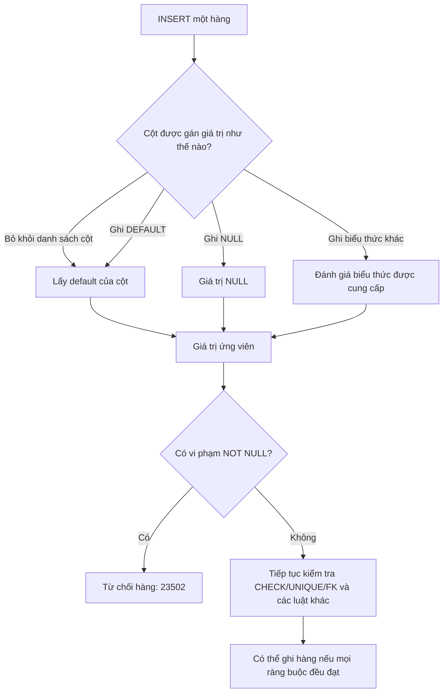

# NOT NULL, DEFAULT và phân biệt giá trị mặc định với ràng buộc

Khi thiết kế bảng trong PostgreSQL, hai cụm từ rất hay đi cùng nhau là `NOT NULL` và `DEFAULT`:

```sql
status TEXT NOT NULL DEFAULT 'NEW'
```

Chúng xuất hiện trên cùng một cột nhưng **không làm cùng một việc**. `DEFAULT` trả lời câu hỏi **“nếu câu lệnh không cung cấp giá trị thì lấy gì?”**; `NOT NULL` trả lời câu hỏi **“giá trị cuối cùng được ghi có được phép là NULL không?”**. Một cột có thể có default mà vẫn chứa NULL; hoặc không có default mà luôn bắt buộc ứng dụng cung cấp giá trị.

Nhầm lẫn hai cơ chế dẫn tới nhiều lỗi thực tế: một API gửi `NULL` và mong PostgreSQL tự dùng mặc định; một migration đặt default rồi nghĩ dữ liệu NULL cũ đã được sửa; một cột `CHECK (amount > 0)` vẫn cho phép NULL; hoặc một ORM cố ghi `NULL` vào cột vốn được thiết kế để PostgreSQL sinh giá trị.

Bài học thuộc chương **Ràng buộc**, tập trung vào:

1. Ngữ nghĩa chính xác của `NULL`, `NOT NULL` và `DEFAULT` khi `INSERT`, `UPDATE`, `COPY`.
2. Sự khác biệt giữa **giá trị thay thế khi thiếu dữ liệu** và **ràng buộc bảo vệ tính hợp lệ**.
3. Default biểu thức, thời điểm đánh giá, identity columns và generated columns.
4. Thiết kế bảng có chủ đích: khi nào dùng mặc định, khi nào buộc client phải khai báo.
5. Thay đổi default/NOT NULL trên bảng đang có dữ liệu mà không làm hỏng ứng dụng.
6. Quan sát metadata, xử lý lỗi SQLSTATE, sử dụng JDBC/ORM và các bài thực hành có thể chạy trong database thử nghiệm.

Các ví dụ dành cho PostgreSQL hiện đại. Các điểm phụ thuộc phiên bản, nhất là tối ưu `ADD COLUMN ... DEFAULT` và các loại constraint đặc biệt, sẽ được nêu riêng. Không dùng các câu DDL thực hành trực tiếp trên bảng production.

## 1. Khác biệt cốt lõi qua một bảng so sánh

| Thuộc tính | `DEFAULT` | `NOT NULL` |
|---|---|---|
| Bản chất | Biểu thức cung cấp giá trị khi câu lệnh sử dụng mặc định | Quy tắc cấm kết quả cuối cùng của cột là `NULL` |
| Mục tiêu | Tăng tính thuận tiện, cung cấp giá trị khởi tạo | Bảo vệ tính toàn vẹn dữ liệu |
| Khi `INSERT` bỏ qua cột | Dùng default nếu có; nếu không thường là `NULL` | Kiểm tra giá trị cuối không được `NULL` |
| Khi `INSERT` chỉ rõ `NULL` | **Không** tự thay bằng default | Từ chối hàng có `NULL` |
| Khi `UPDATE` không nhắc tới cột | Không tự tính lại default | Giá trị cũ vẫn phải thỏa luật dữ liệu |
| Khi `UPDATE ... SET c = DEFAULT` | Tính giá trị default của cột tại thời điểm cần | Từ chối nếu default cho ra `NULL` |
| Giá trị lịch sử đã lưu | `SET DEFAULT` không tự sửa các hàng cũ | `SET NOT NULL` chỉ thành công khi dữ liệu thỏa điều kiện |
| Có thể tồn tại độc lập? | Có | Có |
| Thông báo lỗi điển hình | Default có thể tự báo lỗi khi đánh giá | `23502 not_null_violation` khi một hàng vi phạm |

Ví dụ khai báo:

```sql
name TEXT NOT NULL,
note TEXT DEFAULT 'Chưa có ghi chú',
status TEXT NOT NULL DEFAULT 'NEW',
closed_at TIMESTAMPTZ
```

- `name`: bắt buộc cung cấp giá trị khác NULL; không có giá trị mặc định.
- `note`: nếu bỏ qua, PostgreSQL chọn chuỗi mặc định; vẫn có thể ghi `NULL` rõ ràng.
- `status`: nếu bỏ qua thì dùng `'NEW'`; không cho phép NULL dù ứng dụng truyền NULL.
- `closed_at`: không có default và được phép NULL, thích hợp để biểu diễn “chưa đóng”.

**Quy tắc ghi nhớ:** `DEFAULT` không phải bộ lọc hợp lệ dữ liệu. Nó là **một nguồn giá trị** trong tình huống câu lệnh yêu cầu mặc định.

## 2. NULL là gì và không phải là gì?

Trong PostgreSQL, `NULL` biểu diễn **giá trị không có/không biết/không áp dụng**, tùy ý nghĩa nghiệp vụ. Nó không đồng nghĩa:

- Chuỗi rỗng `''`.
- Số không `0`.
- Boolean `FALSE`.
- Một chuỗi văn bản `'NULL'`.
- Khoảng trắng `' '`.
- Một timestamp giả định như `'1970-01-01'`.
- Giá trị mặc định của cột.

Ví dụ:

```sql
SELECT
    NULL IS NULL AS is_null_value,
    '' IS NULL AS empty_text_is_null,
    0 IS NULL AS zero_is_null,
    FALSE IS NULL AS false_is_null;
```

Kết quả logic: biểu thức đầu đúng, ba biểu thức còn lại sai.

### 2.1. So sánh với NULL dùng IS NULL

```sql
-- Cách đúng:
SELECT *
FROM demo_defaults.task
WHERE note IS NULL;

-- Không dùng để tìm NULL:
SELECT *
FROM demo_defaults.task
WHERE note = NULL;
```

Biểu thức `note = NULL` thường cho ra `UNKNOWN` chứ không phải `TRUE`, nên không chọn được các hàng theo cách người mới thường mong đợi.

Nếu cần so sánh bao gồm cả trường hợp hai bên cùng NULL:

```sql
SELECT
    NULL IS NOT DISTINCT FROM NULL AS both_null_are_equivalent,
    NULL IS DISTINCT FROM 'text' AS null_differs_from_text;
```

`IS [NOT] DISTINCT FROM` hữu ích khi nghiệp vụ cần logic so sánh NULL rõ ràng.

### 2.2. Ba giá trị logic liên quan tới CHECK

SQL có `TRUE`, `FALSE` và `UNKNOWN` trong biểu thức logic. Một `CHECK` của PostgreSQL vi phạm khi biểu thức trả về **FALSE**; biểu thức ra **TRUE hoặc UNKNOWN/NULL** được chấp nhận.

Do đó:

```sql
quantity INTEGER CHECK (quantity > 0)
```

**vẫn có thể chứa `NULL`**. Muốn cột thật sự bắt buộc và dương:

```sql
quantity INTEGER NOT NULL CHECK (quantity > 0)
```

Đây là điểm liên hệ quan trọng giữa `NOT NULL` và những loại constraint khác: không nên suy ra `CHECK` tự thay thế `NOT NULL`.

## 3. Ma trận quyết định: bỏ cột, ghi NULL hay dùng DEFAULT

Giả sử mỗi cột chỉ có một trong bốn cấu hình:

| Cấu hình cột | `INSERT` bỏ cột | `INSERT` ghi `NULL` | `INSERT` ghi `DEFAULT` |
|---|---|---|---|
| `value TEXT` | Lưu `NULL` | Lưu `NULL` | Lưu `NULL` |
| `value TEXT DEFAULT 'X'` | Lưu `'X'` | **Lưu `NULL`** | Lưu `'X'` |
| `value TEXT NOT NULL` | Lỗi `23502` | Lỗi `23502` | Lỗi `23502` vì mặc định ngầm là NULL |
| `value TEXT NOT NULL DEFAULT 'X'` | Lưu `'X'` | Lỗi `23502` | Lưu `'X'` |

Ma trận này đủ để loại bỏ một hiểu lầm phổ biến:

> Khi câu `INSERT` **đề cập đến cột và cung cấp giá trị `NULL`**, PostgreSQL không coi đó là “bỏ trống nên dùng DEFAULT”.

Hành vi có thể khác nếu bảng có trigger được thiết kế để thay thế giá trị hoặc rule viết lại lệnh, nhưng đó là **logic bổ sung**, không phải ngữ nghĩa thông thường của `DEFAULT`.

### 3.1. Sơ đồ xử lý một cột khi INSERT



Sơ đồ được đơn giản hóa để nhấn mạnh ngữ nghĩa `DEFAULT` và `NOT NULL`, không mô tả đầy đủ thứ tự các trigger, generated columns, partition routing hoặc mọi loại ràng buộc trong executor.

## 4. Chuẩn bị database thử nghiệm

Dùng một database thử nghiệm và tạo schema riêng để không trộn với bảng hiện có:

```sql
CREATE SCHEMA IF NOT EXISTS demo_defaults;

CREATE TABLE demo_defaults.task (
    task_id BIGINT GENERATED ALWAYS AS IDENTITY,
    task_code TEXT NOT NULL,
    title TEXT NOT NULL,
    status TEXT NOT NULL DEFAULT 'NEW',
    priority SMALLINT NOT NULL DEFAULT 3,
    retry_count INTEGER NOT NULL DEFAULT 0,
    note TEXT DEFAULT 'Chưa có ghi chú',
    created_at TIMESTAMPTZ NOT NULL DEFAULT CURRENT_TIMESTAMP,
    completed_at TIMESTAMPTZ,

    CONSTRAINT pk_task PRIMARY KEY (task_id),
    CONSTRAINT uq_task_code UNIQUE (task_code),
    CONSTRAINT ck_task_code_not_blank
        CHECK (length(btrim(task_code)) > 0),
    CONSTRAINT ck_task_title_not_blank
        CHECK (length(btrim(title)) > 0),
    CONSTRAINT ck_task_status
        CHECK (status IN ('NEW', 'RUNNING', 'DONE', 'FAILED')),
    CONSTRAINT ck_task_priority
        CHECK (priority BETWEEN 1 AND 5),
    CONSTRAINT ck_task_retry_count
        CHECK (retry_count >= 0)
);
```

Ý nghĩa thiết kế:

| Cột | Chính sách | Lý do |
|---|---|---|
| `task_id` | Identity + primary key | PostgreSQL cấp ID và đảm bảo khóa chính duy nhất |
| `task_code` | NOT NULL + UNIQUE + CHECK | Mã nghiệp vụ phải được cung cấp, không trùng và không toàn khoảng trắng |
| `title` | NOT NULL + CHECK | Nội dung chính phải được người gửi cung cấp |
| `status` | NOT NULL + DEFAULT + CHECK | Task mới mặc định ở `NEW`, chỉ nhận trạng thái hợp lệ |
| `priority` | NOT NULL + DEFAULT + CHECK | Mức ưu tiên mặc định 3, chỉ cho 1 đến 5 |
| `retry_count` | NOT NULL + DEFAULT + CHECK | Số lần retry khởi tạo 0, không âm |
| `note` | DEFAULT nhưng cho NULL | Bỏ cột thì có ghi chú mặc định; caller vẫn được phép nói “không có” bằng NULL |
| `created_at` | NOT NULL + DEFAULT thời điểm | Tự điền thời điểm tạo nếu client không cung cấp |
| `completed_at` | Nullable, không default | Chưa hoàn tất có thể không có timestamp |

Trong thực tế, một cột `note TEXT DEFAULT 'Chưa có ghi chú'` không phải lúc nào là thiết kế tốt: có thể giữ NULL để biểu diễn “chưa có ghi chú” rõ hơn. Ở đây nó được chọn **có chủ đích để chứng minh DEFAULT không cấm NULL**.

Bài thực hành giả định bảng vừa được tạo một lần. Nếu đã có bảng tên `demo_defaults.task`, không dùng `DROP TABLE ... CASCADE` trên database có dữ liệu quan trọng chỉ để chạy lại ví dụ.

## 5. INSERT bỏ qua cột: DEFAULT được áp dụng

Chèn hai task, chỉ khai báo trường bắt buộc mà không có default:

```sql
INSERT INTO demo_defaults.task (task_code, title)
VALUES
    ('TASK-001', 'Kiểm tra bảng đơn hàng'),
    ('TASK-002', 'Chạy báo cáo ngày')
RETURNING
    task_id,
    task_code,
    title,
    status,
    priority,
    retry_count,
    note,
    created_at,
    completed_at;
```

Các giá trị kỳ vọng:

- `task_id`: PostgreSQL sinh các ID theo identity.
- `status`: `NEW`.
- `priority`: `3`.
- `retry_count`: `0`.
- `note`: `Chưa có ghi chú`.
- `created_at`: thời điểm theo default.
- `completed_at`: `NULL`, vì không có default và cột cho phép NULL.

Lệnh `RETURNING` giúp quan sát dữ liệu được tạo mà **không cần đoán ID tiếp theo** từ sequence.

Nếu cùng lệnh được chạy lại, unique constraint `uq_task_code` sẽ từ chối mã task trùng. Đó là hành vi đúng, không liên quan `DEFAULT`.

### 5.1. Không có DEFAULT ngầm nghĩa là dùng NULL

Với cột `completed_at TIMESTAMPTZ`, nếu `INSERT` bỏ cột:

```sql
INSERT INTO demo_defaults.task (task_code, title)
VALUES ('TASK-003', 'Chuẩn bị dữ liệu')
RETURNING task_code, completed_at;
```

Cột `completed_at` nhận `NULL`. PostgreSQL không tự suy đoán phải lấy thời điểm hiện tại chỉ vì tên cột kết thúc bằng `_at`.

Đây là lý do cần thiết kế ý nghĩa rõ: **chưa hoàn thành** thường phải khác **hoàn thành đúng lúc tạo task**.

## 6. INSERT với từ khóa DEFAULT tường minh

Ngoài việc bỏ cột, PostgreSQL cho phép dùng từ khóa `DEFAULT` ở vị trí giá trị trong `VALUES`:

```sql
INSERT INTO demo_defaults.task
    (task_code, title, status, priority, note)
VALUES
    ('TASK-004', 'Kiểm tra sự khác biệt của DEFAULT',
     DEFAULT, DEFAULT, DEFAULT)
RETURNING task_code, status, priority, note;
```

Các cột được gán `DEFAULT` nhận cùng biểu thức mặc định đã khai báo trong bảng. Từ khóa `DEFAULT` **khác với chuỗi văn bản `'DEFAULT'`**.

Ví dụ:

```sql
-- Câu dưới đưa chuỗi 'DEFAULT' làm giá trị status và bị CHECK từ chối:
INSERT INTO demo_defaults.task (task_code, title, status)
VALUES ('TASK-BAD-STATUS', 'Không hợp lệ', 'DEFAULT');
```

Trên connection ở chế độ autocommit và ngoài transaction tường minh, statement lỗi được rollback riêng. Nếu chạy trong `BEGIN`, phải xử lý transaction lỗi trước khi tiếp tục.

### 6.1. INSERT DEFAULT VALUES

PostgreSQL hỗ trợ cú pháp:

```sql
INSERT INTO ten_bang DEFAULT VALUES;
```

Nhưng với `demo_defaults.task`, lệnh này **không hợp lệ**, vì `task_code` và `title` là NOT NULL mà không có default.

Để thấy trường hợp hợp lệ, tạo bảng khác:

```sql
CREATE TABLE demo_defaults.system_event (
    event_id BIGINT GENERATED ALWAYS AS IDENTITY PRIMARY KEY,
    event_type TEXT NOT NULL DEFAULT 'PING',
    created_at TIMESTAMPTZ NOT NULL DEFAULT now()
);

INSERT INTO demo_defaults.system_event DEFAULT VALUES
RETURNING event_id, event_type, created_at;
```

Tất cả cột bắt buộc trong bảng `system_event` đều có cách cung cấp giá trị, nên có thể chèn một hàng không cần truyền cột nào.

**Điểm quan trọng:** `DEFAULT VALUES` không “vô hiệu hóa” `NOT NULL`. Nếu default của một cột bắt buộc không tồn tại hoặc tạo ra `NULL`, câu lệnh vẫn thất bại.

## 7. INSERT cung cấp NULL rõ ràng: không kích hoạt DEFAULT

Thử đưa `NULL` vào cột `note`:

```sql
INSERT INTO demo_defaults.task
    (task_code, title, note)
VALUES
    ('TASK-005', 'Thử giá trị NULL rõ ràng', NULL)
RETURNING task_code, note;
```

Kết quả `note` là `NULL`, **không phải** `'Chưa có ghi chú'`, dù cột có default.

Thử đưa `NULL` vào cột `status`:

```sql
-- CHỦ Ý GÂY LỖI NOT NULL:
INSERT INTO demo_defaults.task
    (task_code, title, status)
VALUES
    ('TASK-FAIL-NULL', 'Không được phép ghi NULL', NULL);
```

PostgreSQL báo lỗi tương tự:

```text
ERROR: null value in column "status" of relation "task" violates not-null constraint
SQLSTATE: 23502
```

`status` có `DEFAULT 'NEW'` nhưng điều đó không giúp câu `INSERT` vừa rồi, vì client đã nói rõ giá trị nó muốn ghi là `NULL`.

### 7.1. Một giá trị sai khác NULL vẫn có thể vi phạm CHECK

```sql
-- CHỦ Ý GÂY LỖI CHECK:
INSERT INTO demo_defaults.task
    (task_code, title, status)
VALUES
    ('TASK-FAIL-CHECK', 'Không có trong tập trạng thái', 'UNKNOWN');
```

Cột `status` không NULL, nên **đạt NOT NULL**, nhưng `'UNKNOWN'` không nằm trong tập `NEW/RUNNING/DONE/FAILED`, nên vi phạm `ck_task_status`.

Lỗi `CHECK` thường có SQLSTATE `23514`. Đây là minh chứng trực tiếp rằng **một cột NOT NULL vẫn có thể chứa dữ liệu sai nghiệp vụ** nếu không có constraint khác hoặc logic xử lý phù hợp.

## 8. DEFAULT không phải ràng buộc tính hợp lệ

Hãy xét cột:

```sql
priority SMALLINT DEFAULT 3
```

Cấu hình này chỉ nói: khi thiếu giá trị, chọn 3. Nó **không** cấm các giá trị:

```text
NULL
-10
0
100
```

Với kiểu `SMALLINT`, một số giá trị quá phạm vi số còn bị từ chối bởi kiểu dữ liệu, nhưng đó là ràng buộc của **kiểu**, không phải của `DEFAULT`.

Trong bảng demo, ta đã chọn:

```sql
priority SMALLINT NOT NULL DEFAULT 3,
CONSTRAINT ck_task_priority CHECK (priority BETWEEN 1 AND 5)
```

Ba cơ chế phối hợp:

1. **DEFAULT 3:** nếu caller không truyền, task bắt đầu ở mức 3.
2. **NOT NULL:** không có task nào lưu priority NULL.
3. **CHECK BETWEEN 1 AND 5:** mọi priority được lưu đều nằm trong miền hợp lệ.

Ngược lại, default hợp lệ không làm cho những giá trị caller cố tình đưa vào tự hợp lệ.

### 8.1. Default phải tương thích với các constraint

Ví dụ cấu hình mâu thuẫn:

```sql
-- Minh họa DDL không hợp lý:
CREATE TABLE demo_defaults.bad_policy (
    id INTEGER NOT NULL DEFAULT -1,
    CONSTRAINT ck_bad_policy_id CHECK (id > 0)
);
```

DDL có thể được tạo, nhưng `INSERT ... DEFAULT VALUES` sẽ gặp lỗi vì default `-1` không thỏa `CHECK (id > 0)`. Một schema có DDL tạo thành công **không chứng minh default sẽ chèn được dữ liệu hợp lệ**.

Do đó, khi review, không chỉ hỏi “default là gì?” mà còn hỏi “default có thỏa NOT NULL, CHECK, unique, foreign key và ngữ nghĩa nghiệp vụ không?”.

## 9. Cột NOT NULL không có DEFAULT: buộc bên ghi ra quyết định

Đây là một lựa chọn **tốt** khi không có giá trị thay thế an toàn.

```sql
CREATE TABLE demo_defaults.customer (
    customer_id BIGINT GENERATED ALWAYS AS IDENTITY PRIMARY KEY,
    email TEXT NOT NULL,
    full_name TEXT NOT NULL,
    joined_at TIMESTAMPTZ NOT NULL DEFAULT now(),
    CONSTRAINT uq_customer_email UNIQUE (email)
);
```

Khách hàng mới phải cung cấp `email` và `full_name`; PostgreSQL không nên tự đặt `email = 'unknown@example.test'` cho mọi người.

```sql
-- Hợp lệ:
INSERT INTO demo_defaults.customer (email, full_name)
VALUES ('lan@example.test', 'Lan')
RETURNING customer_id;

-- CHỦ Ý GÂY LỖI: full_name không có default:
INSERT INTO demo_defaults.customer (email)
VALUES ('minh@example.test');
```

Lệnh thứ hai làm `full_name` ngầm nhận NULL rồi vi phạm `NOT NULL`.

**Không phải cột NOT NULL nào cũng cần DEFAULT.** Một giá trị bắt buộc thể hiện ý định nghiệp vụ từ client thường nên được **cung cấp rõ ràng**, tránh các giá trị ngầm gây hiểu nhầm.

### 9.1. Khi nào default quá “tiện” lại nguy hiểm?

Ví dụ bảng thanh toán:

```sql
amount NUMERIC(14, 2) NOT NULL DEFAULT 0
```

Cấu hình này làm việc chèn payment mà quên số tiền **vẫn có thể thành công với 0**. Nếu nghiệp vụ yêu cầu caller xác định số tiền và số tiền phải dương, thiết kế tốt hơn có thể là:

```sql
amount NUMERIC(14, 2) NOT NULL,
CONSTRAINT ck_payment_amount_positive CHECK (amount > 0)
```

Một giá trị “an toàn về kỹ thuật” không nhất thiết là giá trị “đúng về nghiệp vụ”. Tương tự, `is_verified BOOLEAN NOT NULL DEFAULT TRUE` có thể là sai lầm bảo mật nếu hệ thống phải xác minh trước khi đánh dấu đã xác minh.

## 10. NOT NULL khác với “không được rỗng”

Một cột `TEXT NOT NULL` vẫn cho phép:

```text
''
' '
'   '
```

Để yêu cầu nội dung có ít nhất một ký tự không phải khoảng trắng thông thường:

```sql
title TEXT NOT NULL,
CONSTRAINT ck_title_not_blank
    CHECK (length(btrim(title)) > 0)
```

Trong bảng demo, `title` dùng hai lớp bảo vệ như vậy.

Lưu ý `btrim` mặc định xử lý một số ký tự khoảng trắng theo quy tắc của hàm; không phải một thư viện chuẩn hóa mọi Unicode whitespace hay xác nhận nội dung văn bản có ý nghĩa. Nếu bài toán cần validation tên người, email hoặc mã định danh phức tạp, phải định nghĩa luật chính xác hơn.

### 10.1. NOT NULL và boolean FALSE

```sql
CREATE TABLE demo_defaults.feature_flag (
    flag_code TEXT PRIMARY KEY,
    enabled BOOLEAN NOT NULL DEFAULT FALSE
);
```

Trong bảng này:

- `FALSE` là một giá trị hợp lệ, **không phải NULL**.
- `DEFAULT FALSE` làm tính năng mới bị tắt nếu caller bỏ qua cột.
- `NOT NULL` ngăn client lưu trạng thái không rõ.

Đừng dùng `CHECK (enabled IN (TRUE, FALSE))` mà bỏ `NOT NULL` rồi nghĩ đã cấm NULL: điều kiện kiểm tra có thể cho UNKNOWN khi `enabled IS NULL`.

## 11. DEFAULT khi UPDATE: không tự reset cột

Default không phải một hàm được PostgreSQL tự chạy lại cho mọi lần cập nhật hàng.

Giả sử `TASK-001` đang có `status = 'NEW'`:

```sql
UPDATE demo_defaults.task
SET title = 'Kiểm tra lại bảng đơn hàng'
WHERE task_code = 'TASK-001'
RETURNING task_code, title, status, priority, created_at;
```

Chỉ `title` được thay đổi. `status` không tự trở về `NEW` do có default; `priority` không tự về 3; `created_at` không tự đổi sang thời điểm hiện tại.

### 11.1. UPDATE SET column = DEFAULT

Nếu thực sự muốn reset về biểu thức mặc định:

```sql
UPDATE demo_defaults.task
SET status = DEFAULT,
    priority = DEFAULT,
    note = DEFAULT
WHERE task_code = 'TASK-001'
RETURNING task_code, status, priority, note;
```

Đây là chỉ thị **tường minh**. Nó có tác dụng tương tự yêu cầu PostgreSQL chọn lại default hiện tại cho những cột được chỉ định, đồng thời vẫn phải thỏa các constraint.

Nếu default thay đổi giữa hai thời điểm, `UPDATE ... SET c = DEFAULT` dùng **định nghĩa default hiện có tại lúc statement được thực thi**, không phải bản ghi nhớ giá trị default của thời điểm hàng được tạo.

### 11.2. UPDATE ... SET c = NULL

```sql
-- CHỦ Ý GÂY LỖI:
UPDATE demo_defaults.task
SET status = NULL
WHERE task_code = 'TASK-001';
```

Dù `status` có `DEFAULT 'NEW'`, câu lệnh vẫn vi phạm `NOT NULL`.

Một câu `UPDATE` không chứa cột đó sẽ giữ nguyên giá trị cũ, còn `SET c = DEFAULT` yêu cầu gán lại default. Ba trường hợp phải phân biệt rõ.

### 11.3. Giá trị “updated_at” không tự thay đổi nhờ DEFAULT

```sql
updated_at TIMESTAMPTZ NOT NULL DEFAULT now()
```

Tạo cột như vậy thường chỉ cấp thời điểm **khi INSERT bỏ qua cột**; một lần `UPDATE` khác sau đó **không tự cập nhật `updated_at`**.

Nếu ứng dụng cần cập nhật thời gian sửa cuối, có thể chọn:

- Gán `updated_at = now()` trong từng câu `UPDATE` nghiệp vụ.
- Dùng trigger được thiết kế, kiểm thử và quản lý migration phù hợp.
- Dùng một tầng persistence thống nhất, biết rõ nguồn thời gian và hành vi bulk update.

Chọn một quy tắc và ghi rõ vào data dictionary; đừng suy ra từ hậu tố `_at` rằng database tự cập nhật.

## 12. DEFAULT expression: không chỉ giá trị hằng

PostgreSQL cho phép nhiều **biểu thức hợp lệ** trong `DEFAULT`, chẳng hạn phép tính, function call, timestamp hoặc sinh ID.

```sql
CREATE TABLE demo_defaults.default_expression_demo (
    id BIGINT GENERATED ALWAYS AS IDENTITY PRIMARY KEY,
    source TEXT NOT NULL DEFAULT 'manual',
    created_at TIMESTAMPTZ NOT NULL DEFAULT now(),
    observed_at TIMESTAMPTZ NOT NULL DEFAULT clock_timestamp(),
    random_sample DOUBLE PRECISION NOT NULL DEFAULT random(),
    score INTEGER NOT NULL DEFAULT (10 + 5)
);
```

Một lần chèn:

```sql
INSERT INTO demo_defaults.default_expression_demo DEFAULT VALUES
RETURNING id, source, created_at, observed_at, random_sample, score;
```

Các cột được khởi tạo bằng **biểu thức tại thời điểm PostgreSQL cần lấy default**, không nhất thiết là một literal cố định được chép trong DDL.

### 12.1. CURRENT_TIMESTAMP và now() dùng thời gian transaction

Trong PostgreSQL, `now()` và `CURRENT_TIMESTAMP` trả về thời gian bắt đầu transaction hiện hành (theo cơ chế của chúng), không phải lúc CPU vừa thực thi từng dòng SQL.

```sql
BEGIN;

SELECT now() AS first_time;

SELECT pg_sleep(1);

SELECT now() AS second_time;

COMMIT;
```

Hai giá trị `now()` trong cùng transaction thường bằng nhau. Điều đó rất hữu ích khi nhiều hàng tạo trong cùng transaction cần một mốc thời gian nhất quán.

Ngược lại, `clock_timestamp()` trả thời gian đồng hồ thực và có thể thay đổi ngay trong cùng statement/transaction:

```sql
SELECT
    now() AS transaction_time,
    statement_timestamp() AS statement_start_time,
    clock_timestamp() AS actual_clock_time;
```

Chọn hàm đúng ý nghĩa:

| Nhu cầu | Hướng lựa chọn |
|---|---|
| Thời điểm logic chung của một transaction | `now()` / `CURRENT_TIMESTAMP` |
| Thời điểm bắt đầu statement hiện tại | `statement_timestamp()` |
| Thời điểm đồng hồ thực gần lúc function được gọi | `clock_timestamp()` |

Nếu ứng dụng lưu timestamp trong cùng một nghiệp vụ, cần thống nhất cách xử lý timezone. `TIMESTAMPTZ` biểu diễn một thời điểm tuyệt đối nhưng **không lưu nguyên timezone name riêng của input**; hiển thị phụ thuộc `TimeZone` của session.

### 12.2. random() và giá trị mặc định có biến động

Với:

```sql
random_sample DOUBLE PRECISION DEFAULT random()
```

mỗi lần PostgreSQL đánh giá hàm có thể tạo một số khác nhau. Không được xem `DEFAULT` là một giá trị “được tính một lần lúc `CREATE TABLE`” cho mọi expression.

Sự khác nhau giữa các hàm `STABLE` và `VOLATILE` cũng tác động đến tối ưu `ALTER TABLE ADD COLUMN DEFAULT` cho bảng hiện có, sẽ được nhắc tới trong phần migration.

### 12.3. Default không tham chiếu trực tiếp cột khác của cùng hàng

Câu dưới không phải cách hợp lệ để tính cột tổng:

```sql
-- Ví dụ KHÔNG HỢP LỆ:
CREATE TABLE demo_defaults.invalid_total (
    quantity INTEGER NOT NULL,
    unit_price NUMERIC(12, 2) NOT NULL,
    total_amount NUMERIC(12, 2)
        DEFAULT (quantity * unit_price)
);
```

Default expression của cột không được trực tiếp tham chiếu các cột khác của chính hàng theo cách đó.

Nếu muốn dữ liệu luôn được tính từ những cột khác, xem xét **generated column**:

```sql
CREATE TABLE demo_defaults.order_line (
    order_line_id BIGINT GENERATED ALWAYS AS IDENTITY PRIMARY KEY,
    quantity INTEGER NOT NULL CHECK (quantity > 0),
    unit_price NUMERIC(12, 2) NOT NULL CHECK (unit_price >= 0),
    line_total NUMERIC(14, 2)
        GENERATED ALWAYS AS (quantity * unit_price) STORED
);
```

`GENERATED ALWAYS AS (...) STORED` là cơ chế khác default: PostgreSQL tính dựa trên cột nguồn và duy trì giá trị theo quy tắc generated column. Ví dụ này dùng stored generated column được hỗ trợ trong các phiên bản PostgreSQL hiện đại; không coi mọi expression hoặc function volatile là hợp lệ cho generated columns.

## 13. DEFAULT, identity và sequence là những cơ chế khác nhau

Một cột thường gặp:

```sql
task_id BIGINT GENERATED ALWAYS AS IDENTITY
```

Đây là **identity column**, được PostgreSQL hỗ trợ bằng sequence với quy tắc đặc biệt về quyền tự gán giá trị. Nó không hoàn toàn đồng nghĩa với viết `DEFAULT 1`.

So sánh:

| Cách khai báo | Ý nghĩa |
|---|---|
| `id BIGINT NOT NULL DEFAULT 1` | Nếu bỏ cột, dùng 1; không có cơ chế tự tăng, có thể gây trùng |
| `id BIGSERIAL` | Cú pháp rút gọn lịch sử, tạo sequence và default dạng `nextval(...)` cùng đặc điểm liên quan |
| `id BIGINT GENERATED BY DEFAULT AS IDENTITY` | PostgreSQL sinh ID khi bỏ cột nhưng cho phép client cung cấp ID tường minh theo quy tắc |
| `id BIGINT GENERATED ALWAYS AS IDENTITY` | PostgreSQL ưu tiên tự sinh; chèn ID tường minh thường cần `OVERRIDING SYSTEM VALUE` |

Ví dụ identity:

```sql
INSERT INTO demo_defaults.task (task_code, title)
VALUES ('TASK-IDENTITY', 'Để database sinh task_id')
RETURNING task_id;
```

Nếu đã dùng `GENERATED ALWAYS AS IDENTITY` mà muốn cung cấp ID do hệ thống khác mang tới, đó là một trường hợp migration/import đặc biệt cần cú pháp override và kiểm tra sequence/unique:

```sql
-- Chỉ minh họa cú pháp trên bảng thử nghiệm:
INSERT INTO demo_defaults.task
    (task_id, task_code, title)
OVERRIDING SYSTEM VALUE
VALUES
    (900001, 'TASK-IMPORTED', 'Task nhập từ hệ thống cũ');
```

Không dùng override tràn lan trong luồng nghiệp vụ hàng ngày. Khi import ID tường minh, sequence có thể chưa được đồng bộ với ID lớn nhất; cần một quy trình kiểm soát nếu sau đó hệ thống tiếp tục sinh ID tự động.

### 13.1. Sequence không bảo đảm số liên tiếp

Sequence có thể tiêu thụ giá trị ngay cả khi transaction chèn hàng bị rollback hoặc `INSERT` thất bại. Vì vậy các ID có thể có khoảng trống.

Một lỗi thiết kế là dùng `task_id` hoặc `payment_id` làm “số chứng từ không được thiếu số” trong nghiệp vụ pháp lý. Nếu cần quy tắc đánh số liên tục đặc biệt, phải thiết kế một cơ chế cấp số và transaction/khả năng đồng thời riêng; identity đơn thuần không đáp ứng mục tiêu đó.

## 14. Thêm hoặc đổi DEFAULT không sửa dữ liệu hiện có

Đây là phần thường gây hiểu nhầm nhất khi bảo trì schema.

Tạo bảng cũ có hàng đã tồn tại:

```sql
CREATE TABLE demo_defaults.legacy_job (
    job_id INTEGER PRIMARY KEY,
    job_name TEXT NOT NULL,
    state TEXT,
    owner_team TEXT
);

INSERT INTO demo_defaults.legacy_job
    (job_id, job_name, state, owner_team)
VALUES
    (1, 'Import khách hàng', NULL, NULL),
    (2, 'Xuất báo cáo', 'RUNNING', 'reporting'),
    (3, 'Dọn bản ghi tạm', NULL, NULL);
```

Bây giờ thêm default:

```sql
ALTER TABLE demo_defaults.legacy_job
ALTER COLUMN state SET DEFAULT 'NEW';
```

Quan sát:

```sql
SELECT job_id, state
FROM demo_defaults.legacy_job
ORDER BY job_id;
```

Các hàng `job_id = 1` và `3` **vẫn có `state IS NULL`**. `SET DEFAULT` chỉ thay đổi giá trị được dùng cho những lần ghi mới yêu cầu default; nó không phải câu `UPDATE` hàng cũ.

Chèn hàng mới:

```sql
INSERT INTO demo_defaults.legacy_job (job_id, job_name)
VALUES (4, 'Tác vụ mới')
RETURNING job_id, state;
```

Lúc này hàng mới có `state = 'NEW'` do bỏ cột.

### 14.1. Đổi default lần nữa không thay đổi các hàng cũ

```sql
ALTER TABLE demo_defaults.legacy_job
ALTER COLUMN state SET DEFAULT 'QUEUED';
```

- Hàng `4` đã lưu `'NEW'` sẽ vẫn là `'NEW'`.
- Hàng `1`/`3` vẫn NULL.
- Các câu `INSERT` mới bỏ cột sẽ dùng `'QUEUED'`.

Default được áp dụng trong hành vi ghi, không phải một phép truy vấn động thay thế dữ liệu quá khứ mỗi khi `SELECT`.

### 14.2. DROP DEFAULT cũng không xóa giá trị đã lưu

```sql
ALTER TABLE demo_defaults.legacy_job
ALTER COLUMN state DROP DEFAULT;
```

Sau khi bỏ default, hàng đã lưu `NEW` hoặc `RUNNING` không bị xóa. Chỉ có hành vi chèn/tái gán default trong tương lai thay đổi; với cột nullable và không còn default, `INSERT` bỏ cột có thể tạo `NULL`.

Muốn đặt lại default để tiếp tục các phần thực hành:

```sql
ALTER TABLE demo_defaults.legacy_job
ALTER COLUMN state SET DEFAULT 'NEW';
```

## 15. Thêm cột có DEFAULT khác với SET DEFAULT trên cột cũ

Phân biệt hai thao tác:

**A — đặt default cho cột vốn đã tồn tại:**

```sql
ALTER TABLE demo_defaults.legacy_job
ALTER COLUMN state SET DEFAULT 'NEW';
```

Không cập nhật các hàng đang có.

**B — thêm một cột mới với default:**

```sql
ALTER TABLE demo_defaults.legacy_job
ADD COLUMN source TEXT NOT NULL DEFAULT 'internal';
```

Khi truy vấn lại, những hàng hiện có sẽ **đọc thấy `source = 'internal'`** theo ngữ nghĩa thêm cột có default. Vì sao điều này không mâu thuẫn với phần trước?

- Ở **A**, những hàng cũ đã có một giá trị cụ thể của `state` (kể cả NULL). `SET DEFAULT` không viết lại chúng.
- Ở **B**, cột `source` **chưa từng tồn tại** trong schema cũ; PostgreSQL phải xác định giá trị logic cho nó trên các hàng hiện hữu tại lúc thêm.

Trong PostgreSQL 11 trở lên, khi `ADD COLUMN` có default **không volatile**, PostgreSQL có thể tối ưu để tránh viết lại toàn bộ bảng ngay tại thời điểm thêm cột. Giá trị logic vẫn hiện ra đúng cho các hàng cũ, dù cơ chế lưu trữ vật lý dùng metadata để tránh rewrite.

**Đừng suy ra “nhìn thấy default ở hàng cũ” nghĩa là mọi heap tuple đã được cập nhật vật lý.** Cơ chế tối ưu của PostgreSQL giúp hạn chế chi phí trong nhiều trường hợp.

### 15.1. Volatile default có thể gây rewrite lớn

Nếu thêm cột với một biểu thức volatile, ví dụ sinh ngẫu nhiên hoặc thời gian thực:

```sql
-- Chỉ minh họa trên bảng thử nghiệm:
ALTER TABLE demo_defaults.legacy_job
ADD COLUMN random_marker DOUBLE PRECISION DEFAULT random();
```

PostgreSQL có thể phải đánh giá expression cho các hàng hiện có, dẫn đến rewrite/chi phí lớn hơn so với default hằng. Trên bảng hàng triệu hàng, thay đổi kiểu này có thể tiêu tốn I/O, WAL và giữ khóa đáng kể.

Vì thế, **không chọn default volatile cho một ALTER TABLE lớn rồi giả định nó luôn là thay đổi metadata-only**. Cần xem phiên bản, độ lớn bảng, loại default, phạm vi lock và kế hoạch migration.

### 15.2. DEFAULT hàm không luôn được đánh giá giống nhau

- Một default hằng như `'internal'` có một giá trị rõ.
- Một biểu thức `now()` thường gắn với timestamp transaction và có tính chất ổn định theo transaction.
- Một expression `random()` có thể cho kết quả khác giữa các hàng.

Không được mặc định thêm cột mới với `DEFAULT now()` sẽ tạo timestamp lịch sử chính xác của từng hàng cũ. Nó cung cấp giá trị theo **lúc migration được thực hiện**, không biết thời điểm nghiệp vụ thực sự xảy ra của từng hàng.

## 16. SET NOT NULL trên bảng cũ: cần xử lý NULL hiện hữu

Với bảng `demo_defaults.legacy_job`, cột `owner_team` vẫn có các hàng NULL. Nếu chạy:

```sql
-- CHỦ Ý GÂY LỖI khi còn dữ liệu NULL:
ALTER TABLE demo_defaults.legacy_job
ALTER COLUMN owner_team SET NOT NULL;
```

PostgreSQL từ chối vì những hàng hiện tại không đáp ứng yêu cầu mới. Điều đó là đúng: `NOT NULL` không được dùng để tự chọn một owner team cho các bản ghi thiếu thông tin.

### 16.1. Bước 1: đo phạm vi dữ liệu thiếu

```sql
SELECT
    COUNT(*) AS total_rows,
    COUNT(*) FILTER (WHERE owner_team IS NULL) AS missing_owner_team
FROM demo_defaults.legacy_job;
```

Trước khi cập nhật, hãy hỏi:

- Có phải các hàng cũ thật sự phải có owner team không?
- Có thể xác định owner từ log, ứng dụng hoặc dữ liệu liên quan không?
- Có những bản ghi nên giữ NULL vì “không áp dụng” không?
- Nếu gán giá trị mặc định như `'legacy'`, đó là giá trị nghiệp vụ được phê duyệt hay chỉ che một thiếu sót?

Không backfill bằng dữ liệu giả chỉ để câu `SET NOT NULL` thành công.

### 16.2. Bước 2: backfill theo quy tắc đã xác nhận

Trong môi trường lab, giả sử nhóm thống nhất các bản ghi cũ chưa biết owner chuyển cho nhóm `'legacy_ops'`:

```sql
UPDATE demo_defaults.legacy_job
SET owner_team = 'legacy_ops'
WHERE owner_team IS NULL;
```

Với bảng rất lớn, một `UPDATE` khổng lồ có thể tạo nhiều WAL/dead tuples, tăng replica lag và làm transaction dài. Production cần batch, throttling, khả năng chạy lại và giám sát.

### 16.3. Bước 3: đặt NOT NULL

```sql
ALTER TABLE demo_defaults.legacy_job
ALTER COLUMN owner_team SET NOT NULL;
```

PostgreSQL phải đảm bảo không có dữ liệu trái luật. Với nhiều trường hợp, việc xác nhận có thể cần scan bảng và lấy lock mạnh theo ngữ nghĩa `ALTER TABLE`. Một số phiên bản có thể tận dụng CHECK constraint đã validate để tránh scan toàn bảng; không mặc định cách tối ưu này luôn có trên mọi phiên bản và mọi biểu thức.

Sau khi áp dụng, cả `INSERT` thiếu `owner_team` lẫn `INSERT` gửi `NULL` đều bị từ chối vì cột không có default và là NOT NULL.

### 16.4. Chọn DEFAULT sau khi SET NOT NULL là quyết định riêng

Có thể thêm default:

```sql
ALTER TABLE demo_defaults.legacy_job
ALTER COLUMN owner_team SET DEFAULT 'legacy_ops';
```

Nhưng có **nên** làm không? Nếu mỗi job mới phải được service định tuyến chính xác, default `'legacy_ops'` có thể khiến ứng dụng quên owner vẫn ghi thành công, tạo dữ liệu sai. Trong trường hợp đó, giữ `NOT NULL` **không có default** tốt hơn.

**Kết luận:** backfill, `NOT NULL` và `DEFAULT` là ba quyết định khác nhau. Không tự động thêm default chỉ để migration tránh lỗi.

## 17. Chiến lược migration ít gián đoạn cho bảng lớn

Trên bảng lớn phục vụ nhiều request, thêm `NOT NULL` không nên chỉ là một câu SQL tự phát. Một cách tiếp cận tùy trường hợp:

1. **Expand:** thêm cột mới nullable nếu cần tương thích với app cũ.
2. **Update writers:** triển khai ứng dụng ghi giá trị hợp lệ.
3. **Backfill:** sửa dữ liệu cũ theo batch, giám sát lock và WAL.
4. **Validate:** chứng minh không còn dữ liệu thiếu.
5. **Constrain:** chuyển sang NOT NULL khi đã sẵn sàng.
6. **Clean up:** loại bỏ default tạm thời/constraint phụ trợ nếu không cần.

### 17.1. NOT VALID CHECK như một bước chuyển tiếp

Trong một số phiên bản/cấu hình PostgreSQL, có thể thêm ràng buộc `CHECK` không kiểm tra ngay toàn bộ dữ liệu cũ:

```sql
-- Trên bảng ví dụ có thêm cột external_reference nullable:
ALTER TABLE demo_defaults.legacy_job
ADD COLUMN external_reference TEXT;
```

Sau đó ứng dụng mới bắt đầu ghi `external_reference`. Để ngăn các hàng mới không có giá trị, nhưng chưa kiểm tra hàng cũ trong bước ADD:

```sql
ALTER TABLE demo_defaults.legacy_job
ADD CONSTRAINT ck_legacy_job_external_reference_present
CHECK (external_reference IS NOT NULL)
NOT VALID;
```

`NOT VALID` tránh việc kiểm tra mọi hàng cũ ngay lúc thêm CHECK, nhưng constraint mới vẫn được kiểm tra đối với các lần ghi/cập nhật thuộc phạm vi của nó. Do đó, cần phối hợp writer trước khi kích hoạt để tránh làm ứng dụng cũ thất bại.

Khi có quy tắc để backfill các hàng cũ, tiến hành bổ sung dữ liệu, rồi:

```sql
ALTER TABLE demo_defaults.legacy_job
VALIDATE CONSTRAINT ck_legacy_job_external_reference_present;
```

Cuối cùng có thể chuyển thành ràng buộc native `NOT NULL`:

```sql
ALTER TABLE demo_defaults.legacy_job
ALTER COLUMN external_reference SET NOT NULL;
```

Trong các phiên bản PostgreSQL hỗ trợ suy luận từ CHECK đã được validate, thao tác `SET NOT NULL` có thể tránh một lần scan kiểm tra NULL không cần thiết; tuy nhiên vẫn cần lock để thay đổi catalog. Chỉ sau khi chắc chắn native NOT NULL có hiệu lực và không còn dependency, mới cân nhắc xóa CHECK tạm:

```sql
ALTER TABLE demo_defaults.legacy_job
DROP CONSTRAINT ck_legacy_job_external_reference_present;
```

Cách này không có nghĩa migration hoàn toàn không khóa. Mục tiêu là **tách kiểm tra dữ liệu lớn khỏi một bước đổi metadata nhạy cảm**, và cần kiểm chứng trên phiên bản/dung lượng thật.

### 17.2. Khi nào không nên đặt DEFAULT tạm?

Giả sử cột mới `external_reference` cần ID từ đối tác; một default `'unknown'` sẽ giúp tất cả `INSERT` cũ chạy tiếp, nhưng nếu đó là tham chiếu phải duy nhất, hàng nghìn giá trị `'unknown'` vừa không đúng nghĩa vừa có thể phá UNIQUE.

Trong trường hợp đó, hãy xem xét:

- Đổi API/worker để truyền ID thật.
- Cho phép nullable có kiểm soát trong thời gian chuyển tiếp.
- Bổ sung constraint sau khi dữ liệu đầy đủ.
- Tách loại bản ghi legacy ra trạng thái riêng nếu nghiệp vụ cho phép.

**Không dùng DEFAULT để che việc chưa xác định được dữ liệu quan trọng.**

## 18. Đổi DEFAULT trong một hệ thống có nhiều phiên bản ứng dụng

Một thay đổi tưởng nhỏ:

```sql
ALTER TABLE demo_defaults.task
ALTER COLUMN status SET DEFAULT 'RUNNING';
```

có thể tác động đến mọi ứng dụng đang chèn task mà không truyền `status`. Ứng dụng cũ vốn giả định mọi task mới ở `NEW` sẽ bất ngờ nhận `RUNNING`, dù code không đổi.

Vì vậy, default là một phần của **hợp đồng dữ liệu** giữa PostgreSQL và các client, không chỉ là “chi tiết lưu trữ”.

### 18.1. Phân biệt tương thích cú pháp và tương thích nghiệp vụ

Sau khi đổi default, câu:

```sql
INSERT INTO demo_defaults.task (task_code, title)
VALUES ('TASK-AFTER-CHANGE', 'Task sau migration');
```

vẫn đúng cú pháp, nhưng trạng thái mới đã khác. Một migration có thể **thành công về DDL** mà vẫn tạo regression nghiệp vụ.

Quy trình nên gồm:

- Xác định những client cố tình bỏ cột để nhận default.
- Review logic đọc/lọc theo trạng thái.
- Mở rộng tập trạng thái hợp lệ trước nếu cần.
- Triển khai code có thể hiểu cả trạng thái cũ và mới.
- Đổi default tại mốc rollout thích hợp.
- Quan sát dữ liệu và khả năng rollback khi bất thường.

### 18.2. Xác định nguồn sự thật cho giá trị khởi tạo

Có ba nơi thường có “mặc định”:

1. Frontend điền sẵn một giá trị trong form.
2. Java service tạo object rồi gán thuộc tính khi chưa nhận input.
3. PostgreSQL định nghĩa `DEFAULT` cho cột.

Nếu cả ba đưa ra giá trị khác nhau, giá trị thực lưu phụ thuộc **câu INSERT cuối cùng**. Khi service gửi một giá trị tường minh, default DB thường không được dùng. Nên xác định nơi nào là **nguồn sự thật**, nơi nào chỉ gợi ý UI.

Ví dụ, với trạng thái task, PostgreSQL `DEFAULT 'NEW'` có thể là tuyến phòng thủ tốt, nhưng service cũng phải biết và không tự gửi một chuỗi sai chỉ vì thiếu mapping.

## 19. JDBC: bỏ cột khác setNull()

Đây là tình huống rất hay xảy ra trong ứng dụng Java.

### 19.1. Câu INSERT cho PostgreSQL dùng default

```java
String sql = """
    INSERT INTO demo_defaults.task (task_code, title)
    VALUES (?, ?)
    RETURNING task_id, status, priority
    """;

try (PreparedStatement ps = connection.prepareStatement(sql)) {
    ps.setString(1, "TASK-JAVA-001");
    ps.setString(2, "Task tạo từ JDBC");
    try (ResultSet rs = ps.executeQuery()) {
        if (rs.next()) {
            long taskId = rs.getLong("task_id");
            String status = rs.getString("status"); // NEW
            int priority = rs.getInt("priority");   // 3
        }
    }
}
```

Lệnh này **không hề đưa `status`, `priority` vào danh sách cột**, nên PostgreSQL sử dụng default tương ứng.

### 19.2. Câu INSERT setNull() không dùng default

```java
String sql = """
    INSERT INTO demo_defaults.task (task_code, title, status)
    VALUES (?, ?, ?)
    """;

try (PreparedStatement ps = connection.prepareStatement(sql)) {
    ps.setString(1, "TASK-JAVA-002");
    ps.setString(2, "Task có NULL rõ ràng");
    ps.setNull(3, java.sql.Types.VARCHAR);
    ps.executeUpdate(); // PostgreSQL từ chối: 23502
}
```

Dù Java object có field `status == null`, điều đó không tự có nghĩa “bỏ cột trong SQL”. Nếu ORM hoặc JDBC sinh `status = NULL` trong `INSERT`, DB default sẽ **không** được áp dụng.

Cần quyết định rõ:

- Nếu `null` ở tầng API nghĩa là “dùng default của DB”, service phải xây câu INSERT tương ứng với **bỏ cột** hoặc dùng từ khóa `DEFAULT` ở SQL đúng vị trí.
- Nếu `null` nghĩa là “người dùng muốn lưu thiếu giá trị”, cột phải nullable, hoặc service phải trả lỗi validation.
- Nếu field không được cung cấp khác với field được cung cấp nhưng có giá trị null, API nên thể hiện sự khác biệt đó thay vì gộp hai trường hợp.

### 19.3. ORM annotations không thay thế kiểm tra schema thật

Trong JPA/Hibernate, các annotation và cơ chế sinh DDL có thể ảnh hưởng tên cột, nullable và những giá trị được gán bởi Java. Tuy nhiên:

- Field initializer của Java **không phải** `DEFAULT` trong PostgreSQL.
- `@Column(nullable = false)` có thể ảnh hưởng DDL của ORM, nhưng không bảo đảm database thực tế đã được migrate đúng.
- Một ORM có thể gửi mọi cột kể cả NULL, khiến default DB không được dùng.
- Các tùy chọn như dynamic insert có tính đặc thù framework, cần hiểu rõ SQL cuối cùng được tạo.
- Khi cần sinh giá trị từ database, ưu tiên đọc giá trị thực qua `RETURNING` hoặc cơ chế fetch generated values phù hợp.

Để chẩn đoán, đừng chỉ xem Java entity; hãy **xem SQL được gửi và DDL thật trên PostgreSQL**.

## 20. INSERT ... SELECT, COPY và nhập dữ liệu hàng loạt

Default được áp dụng theo cấu trúc **câu lệnh ghi**, không chỉ khi dùng `INSERT ... VALUES`.

### 20.1. INSERT ... SELECT bỏ cột

```sql
INSERT INTO demo_defaults.task (task_code, title)
SELECT
    'TASK-BULK-' || n::text,
    'Task sinh từ generate_series ' || n::text
FROM generate_series(1, 3) AS n
RETURNING task_code, status, priority, retry_count;
```

Vì không liệt kê `status`, `priority` và `retry_count`, chúng được cấp default cho các hàng được chèn.

Nếu cần giá trị tường minh cho một cột, đặt nó trong danh sách `INSERT` và trả expression tương ứng từ `SELECT`. Không dùng `DEFAULT` như một expression tùy ý ở mọi vị trí `SELECT`; cú pháp `DEFAULT` có phạm vi sử dụng riêng.

### 20.2. COPY FROM với danh sách cột

Ví dụ file CSV phía client:

```csv
task_code,title
TASK-COPY-001,Task nhập từ CSV
TASK-COPY-002,Task nhập thứ hai
```

Trong `psql` có thể dùng:

```text
\copy demo_defaults.task (task_code, title) FROM 'tasks.csv' WITH (FORMAT csv, HEADER true)
```

Các cột không thuộc danh sách `COPY` nhận default tương ứng. Với những cột không có default và nullable, kết quả có thể là NULL.

**Khác biệt:** nếu CSV có cột `status` và giá trị được parse thành NULL, đó là **NULL tường minh** khi nạp dữ liệu; `NOT NULL` có thể từ chối, không tự chuyển thành `'NEW'`.

Trong định dạng CSV của PostgreSQL, chuỗi rỗng và marker NULL chịu quy tắc `COPY`/`NULL`/`FORCE_NULL`/`FORCE_NOT_NULL`; không tự giả định mọi trường rỗng là chuỗi rỗng `''` hoặc đều là default. Hãy chọn format/import options có chủ đích.

### 20.3. Dữ liệu lịch sử có thể thiếu trường được thêm sau

Trong một import từ hệ thống cũ, một cột mới có default có thể giúp hàng nhập chạy được, nhưng default không phản ánh sự thật lịch sử nếu từng hàng có giá trị riêng chưa được khôi phục.

Ví dụ `created_at DEFAULT now()` sẽ lưu thời điểm **nạp dữ liệu**, không phải thời điểm đơn hàng được tạo cách đây ba năm. Với dữ liệu lịch sử, nên import timestamp thật hoặc đặt tên `imported_at` riêng cho thời điểm nạp.

## 21. INSERT ... ON CONFLICT và DEFAULT

Một câu UPSERT gồm nhánh thử chèn và nhánh cập nhật khi đụng unique/primary key.

```sql
INSERT INTO demo_defaults.task
    (task_code, title)
VALUES
    ('TASK-001', 'Tên task đã cập nhật từ UPSERT')
ON CONFLICT (task_code)
DO UPDATE SET
    title = EXCLUDED.title
RETURNING task_code, title, status, priority;
```

Trong nhánh INSERT thử, những cột bị bỏ qua có thể được cấp default. Nhưng nếu xảy ra xung đột và chạy `DO UPDATE` như trên, **các cột `status`/`priority` của hàng hiện hữu không tự reset**.

Nếu muốn reset chúng, phải nói rõ:

```sql
INSERT INTO demo_defaults.task
    (task_code, title)
VALUES
    ('TASK-001', 'Task reset trạng thái có chủ đích')
ON CONFLICT (task_code)
DO UPDATE SET
    title = EXCLUDED.title,
    status = DEFAULT,
    priority = DEFAULT
RETURNING task_code, status, priority;
```

Chỉ dùng kiểu reset này nếu đúng nghiệp vụ. Ví dụ, một task đã `DONE` không nên bị đưa lại về `NEW` chỉ vì hệ thống đồng bộ tên.

**UPSERT không phải cách bỏ qua constraint.** NOT NULL/CHECK vẫn được kiểm tra theo đường ghi tương ứng.

## 22. COALESCE không tạo DEFAULT lưu trong bảng

Một biểu thức truy vấn:

```sql
SELECT
    task_code,
    COALESCE(note, 'Không có ghi chú') AS note_display
FROM demo_defaults.task
ORDER BY task_code;
```

giúp hiển thị một chuỗi thay cho NULL trong kết quả đọc. Nhưng `note` trong bảng **vẫn có thể là NULL**.

So sánh ba cơ chế:

| Cơ chế | Tác dụng |
|---|---|
| `DEFAULT 'X'` | Cung cấp `'X'` khi INSERT/UPDATE yêu cầu default |
| `COALESCE(note, 'X')` trong SELECT | Chọn giá trị hiển thị cho biểu thức đọc, không tự thay đổi dữ liệu lưu |
| `UPDATE task SET note = 'X' WHERE note IS NULL` | Thật sự cập nhật các hàng đang lưu NULL |

Một ứng dụng có thể hiển thị `'Không có ghi chú'` nhưng vẫn muốn giữ NULL trong database để phân biệt **không có ghi chú** với **người dùng đã gõ đúng chuỗi ấy**.

### 22.1. NULLIF là cơ chế ngược lại theo biểu thức

```sql
SELECT NULLIF('', '') AS empty_becomes_null;
```

`NULLIF` có thể chuyển một giá trị tương đương thành NULL, hữu ích khi xử lý input, nhưng nếu đưa kết quả đó vào cột NOT NULL thì vẫn bị từ chối. Nó không phải một cách né constraint.

## 23. NOT NULL, DEFAULT và UNIQUE: ba câu hỏi khác nhau

Xét bảng:

```sql
CREATE TABLE demo_defaults.external_record (
    record_id BIGINT GENERATED ALWAYS AS IDENTITY PRIMARY KEY,
    external_key TEXT DEFAULT 'UNASSIGNED',
    CONSTRAINT uq_external_record_external_key
        UNIQUE (external_key)
);
```

- `DEFAULT 'UNASSIGNED'`: khi bỏ `external_key`, PostgreSQL chọn chuỗi đó.
- `UNIQUE`: không cho hai hàng cùng giá trị `'UNASSIGNED'` nếu quy tắc unique áp dụng.
- Không có `NOT NULL`: client vẫn có thể chèn `NULL`.

Kết quả thường gặp:

1. Hàng thứ nhất bỏ `external_key` → `'UNASSIGNED'`, thành công.
2. Hàng thứ hai cũng bỏ cột → lại `'UNASSIGNED'`, **vi phạm UNIQUE**.
3. Hai hàng gửi `NULL` rõ ràng có thể cùng tồn tại với unique mặc định của PostgreSQL.

Từ PostgreSQL 15, có thể dùng `UNIQUE NULLS NOT DISTINCT` nếu nghiệp vụ muốn coi các NULL là không phân biệt nhau trong ràng buộc unique. Không áp dụng quy tắc này một cách máy móc; cần xác định rõ ý nghĩa NULL.

**Bài học thiết kế:** một giá trị default cố định đặt trên cột phải duy nhất theo từng hàng thường **không hợp lý**. Nếu cần khóa duy nhất, dùng identity/UUID hoặc cơ chế cấp mã có chủ đích.

## 24. NOT NULL và foreign key

Ví dụ:

```sql
CREATE TABLE demo_defaults.task_comment (
    comment_id BIGINT GENERATED ALWAYS AS IDENTITY PRIMARY KEY,
    task_id BIGINT NOT NULL,
    body TEXT NOT NULL,
    CONSTRAINT fk_task_comment_task
        FOREIGN KEY (task_id)
        REFERENCES demo_defaults.task(task_id),
    CONSTRAINT ck_task_comment_body_not_blank
        CHECK (length(btrim(body)) > 0)
);
```

`NOT NULL` và `FOREIGN KEY` bảo vệ hai điều kiện khác nhau:

- `task_id NOT NULL`: comment **phải có task được chỉ định**.
- Foreign key: task đó **phải tồn tại** theo quy tắc tham chiếu của PostgreSQL.

Nếu bỏ `NOT NULL`, một foreign key đơn cột thường cho phép `NULL` mà không yêu cầu hàng parent tương ứng.

Đặt `DEFAULT 0` cho `task_id` không làm tự tồn tại task 0; nếu task 0 không có, foreign key sẽ từ chối. Đừng dùng một ID giả làm default chỉ để khỏi nhận NULL.

## 25. NOT NULL và CHECK: diễn giải đúng điều kiện nghiệp vụ

Xét một cột phần trăm:

```sql
discount_percent NUMERIC(5, 2)
    CHECK (discount_percent BETWEEN 0 AND 100)
```

Lệnh trên cho phép NULL dù một số người nghĩ CHECK đã “ràng buộc 0..100”. Để luôn có phần trăm hợp lệ:

```sql
discount_percent NUMERIC(5, 2) NOT NULL
    DEFAULT 0
    CHECK (discount_percent BETWEEN 0 AND 100)
```

Nhưng lại phải hỏi: **0% có phải mặc định đúng?** Nếu khách không được cấp giảm giá thì có thể đúng. Nếu giảm giá chỉ được xác định sau phê duyệt, `NULL` có thể mang nghĩa “chưa tính”; ép default 0 sẽ làm mất thông tin.

### 25.1. DEFAULT không thay thế check trạng thái

```sql
status TEXT NOT NULL DEFAULT 'NEW'
```

vẫn cho phép client gửi `'NEWWW'` hoặc `'UNKNOWN'`. Nếu tập trạng thái hữu hạn, có thể dùng:

```sql
CONSTRAINT ck_task_status
CHECK (status IN ('NEW', 'RUNNING', 'DONE', 'FAILED'))
```

Ngoài `TEXT + CHECK`, còn có PostgreSQL ENUM hoặc bảng tham chiếu trạng thái; mỗi lựa chọn có trade-off khi thêm trạng thái, versioning và quản trị. Bài này dùng CHECK để nhìn rõ sự khác biệt giữa **giá trị khởi tạo** và **luật hợp lệ**.

### 25.2. NULL có thể mang ngữ nghĩa đúng

Không phải cứ thấy một cột NULL là phải thêm NOT NULL.

Các cột có thể hợp lý khi nullable:

- `completed_at`: chưa hoàn thành.
- `cancelled_reason`: không bị hủy.
- `approved_by_id`: chưa được phê duyệt.
- `external_reference`: đối tác chưa cấp mã.
- `middle_name`: không có thông tin tên đệm.

Nếu buộc dùng giá trị giả như `'N/A'`, `0` hoặc thời điểm `1970-01-01`, ứng dụng có thể phải viết hàng loạt logic để nhận biết giá trị giả và dễ tổng hợp sai.

Chọn NULL hay NOT NULL là **quyết định về mô hình dữ liệu**, không chỉ là sở thích code style.

## 26. Quan sát metadata thật trong PostgreSQL

Khi một ORM hoặc service báo lỗi, cần kiểm tra định nghĩa thực trong database.

### 26.1. information_schema.columns

```sql
SELECT
    column_name,
    data_type,
    is_nullable,
    column_default,
    is_identity,
    identity_generation
FROM information_schema.columns
WHERE table_schema = 'demo_defaults'
  AND table_name = 'task'
ORDER BY ordinal_position;
```

Các trường chính:

- `is_nullable`: mô tả tính nullable của cột theo metadata của view.
- `column_default`: biểu thức default được lưu, nếu có.
- `is_identity` / `identity_generation`: thông tin identity column được hỗ trợ.
- `data_type`: loại dữ liệu ở mức information schema.

`information_schema` có tính di động cao giữa các công cụ, nhưng một số tính năng PostgreSQL-specific và quyền truy cập ảnh hưởng những gì view hiển thị. Khi cần chẩn đoán sâu, dùng `pg_catalog`.

### 26.2. pg_attribute và pg_attrdef

```sql
SELECT
    a.attname AS column_name,
    a.attnotnull AS is_not_null,
    pg_get_expr(d.adbin, d.adrelid) AS default_expression,
    a.attidentity AS identity_kind,
    a.attgenerated AS generated_kind
FROM pg_attribute AS a
JOIN pg_class AS c ON c.oid = a.attrelid
JOIN pg_namespace AS n ON n.oid = c.relnamespace
LEFT JOIN pg_attrdef AS d
    ON d.adrelid = a.attrelid
   AND d.adnum = a.attnum
WHERE n.nspname = 'demo_defaults'
  AND c.relname = 'task'
  AND a.attnum > 0
  AND NOT a.attisdropped
ORDER BY a.attnum;
```

Truy vấn trên giúp phân biệt **cờ NOT NULL** (`attnotnull`), biểu thức default lưu trong `pg_attrdef` và cột identity/generated.

Một số biểu diễn/catalog nội bộ có thể thay đổi qua phiên bản, vì vậy trong script dài hạn nên ưu tiên các API/catalog được hỗ trợ và kiểm tra trên phiên bản đang chạy.

### 26.3. Xem constraint khác

```sql
SELECT
    conname AS constraint_name,
    contype AS constraint_type,
    pg_get_constraintdef(oid) AS definition
FROM pg_constraint
WHERE conrelid = 'demo_defaults.task'::regclass
ORDER BY conname;
```

Các loại constraint như primary key, unique, check hoặc foreign key được biểu diễn trong catalog. Cách thể hiện `NOT NULL` trong metadata của các phiên bản PostgreSQL khác nhau có thể có chi tiết khác biệt; không được kết luận thiếu NOT NULL chỉ vì một query `pg_constraint` không trả hàng loại mong đợi. Dùng `pg_attribute.attnotnull` hoặc lược đồ thông tin cột tương ứng để xác nhận.

Trong `psql`, cách xem nhanh:

```text
\d demo_defaults.task
```

Lệnh `\d` là meta-command của `psql`, không phải câu SQL dùng được nguyên dạng qua JDBC.

## 27. Xử lý lỗi đúng cách trong transaction

Giả sử ta mở transaction rồi chèn một hàng thiếu `title`:

```sql
BEGIN;

-- CHỦ Ý GÂY LỖI:
INSERT INTO demo_defaults.task (task_code)
VALUES ('TASK-TX-FAIL');

-- Những câu lệnh bình thường tiếp theo trong cùng transaction
-- có thể nhận lỗi current transaction is aborted.

ROLLBACK;
```

Trong PostgreSQL, một statement lỗi trong transaction block thông thường làm transaction ở trạng thái thất bại cho tới khi được rollback hoặc xử lý bằng savepoint phù hợp. Không thể đơn giản chạy câu `INSERT` đúng ngay sau đó rồi coi transaction tự phục hồi.

### 27.1. Dùng SAVEPOINT trong lab

Nếu muốn thử một lệnh sai mà vẫn giữ transaction lớn, có thể dùng savepoint:

```sql
BEGIN;

SAVEPOINT before_invalid_insert;

-- CHỦ Ý GÂY LỖI NOT NULL:
INSERT INTO demo_defaults.task (task_code)
VALUES ('TASK-SAVEPOINT-FAIL');

ROLLBACK TO SAVEPOINT before_invalid_insert;

INSERT INTO demo_defaults.task (task_code, title)
VALUES ('TASK-SAVEPOINT-OK', 'Task tạo sau rollback về savepoint');

COMMIT;
```

Cách này chỉ phục hồi lỗi statement theo phạm vi savepoint. Không nên sử dụng nó để che mọi lỗi nghiệp vụ; vẫn cần xử lý SQLSTATE và xác định dữ liệu nào đã được thay đổi.

### 27.2. SQLSTATE hữu ích hơn việc parse thông báo

| SQLSTATE | Loại vi phạm thường gặp | Gợi ý |
|---|---|---|
| `23502` | `not_null_violation` | Cột bắt buộc nhận NULL hoặc bị bỏ khi không có default |
| `23514` | `check_violation` | Biểu thức CHECK đánh giá FALSE |
| `23505` | `unique_violation` | Khóa hoặc mã nghiệp vụ bị trùng |
| `23503` | `foreign_key_violation` | Tham chiếu tới đối tượng không hợp lệ |

Thông báo tiếng Anh/tiếng địa phương của driver có thể thay đổi; SQLSTATE là tín hiệu có cấu trúc để ứng dụng phân loại lỗi. Nhưng từ mã lỗi chưa đủ để chọn giá trị thay thế: service phải biết yêu cầu nghiệp vụ và cột cụ thể.

### 27.3. Không tự sửa lỗi 23502 bằng cách nhét một default giả

Nếu API không có `customer_id` mà service cố ghi vào bảng đơn hàng, trả lỗi validation rõ ràng thường tốt hơn đặt `DEFAULT 0` để tránh lỗi. Default cần có ý nghĩa nghiệp vụ thật; nó không phải cách tự động “làm cho mọi INSERT thành công”.

## 28. Những thay đổi nguy hiểm cần đánh giá trước production

| Thay đổi | Có tác động tới hàng cũ? | Rủi ro chính |
|---|---|---|
| `ALTER COLUMN SET DEFAULT 'X'` | Không tự backfill cột đã tồn tại | Logic INSERT tương lai thay đổi |
| `ALTER COLUMN DROP DEFAULT` | Không xóa dữ liệu đã lưu | Client bỏ cột có thể bắt đầu nhận NULL/lỗi |
| `ALTER COLUMN SET NOT NULL` | Phải bảo đảm dữ liệu đang có không NULL | Lock, scan/validation, client cũ gửi NULL |
| `ALTER COLUMN DROP NOT NULL` | Không sửa dữ liệu đã lưu | Client mới có thể ghi NULL ngoài dự kiến |
| `ADD COLUMN c TEXT DEFAULT 'X'` | Hàng hiện có đọc thấy giá trị logic cho cột mới | Khóa DDL, behavior default với client cũ |
| `ADD COLUMN c TEXT NOT NULL` trên bảng có hàng | Không có default để lấp giá trị cũ | Có thể thất bại ngay vì hàng cũ thiếu giá trị |
| `ADD COLUMN c ... DEFAULT volatile_expr` | Có thể phải đánh giá cho dữ liệu cũ | Rewrite, I/O, WAL và thời gian khóa |
| Đổi `CHECK`/`UNIQUE`/`FK` | Có thể yêu cầu kiểm tra dữ liệu cũ | Dữ liệu không hợp lệ, lock, rollout |

### 28.1. Bảng trống và bảng có dữ liệu khác nhau

Trên một bảng **trống**, thêm cột `NOT NULL` không default có thể khả thi vì không có hàng cũ vi phạm; nhưng những `INSERT` tương lai vẫn phải cấp giá trị.

Trên bảng **đã có hàng**, thêm cột như vậy có thể thất bại vì hàng cũ không có giá trị. Nếu migration cần phục vụ bảng có dữ liệu, chọn kế hoạch expand/backfill/constrain hoặc thêm default hợp lệ.

### 28.2. Đừng dựa vào rollback DDL như kế hoạch duy nhất

PostgreSQL có nhiều lệnh DDL transactional, nhưng một số thao tác như `CREATE INDEX CONCURRENTLY` có hạn chế transaction block, và tác động lên hệ thống ngoài database không tự rollback theo SQL.

Một migration an toàn cần:

- Backup và khả năng restore đã kiểm chứng.
- Kiểm tra ràng buộc và SQL mà app cũ dùng.
- Ước tính kích thước bảng, thời gian scan và WAL.
- Cơ chế đặt `lock_timeout` phù hợp để tránh đứng chờ ngoài ý muốn.
- Giám sát replication lag và long transactions.
- Kế hoạch deploy/rollback app đồng bộ với thay đổi schema.

Không chạy hàng loạt `ALTER TABLE` trên production chỉ vì các câu lệnh trông ngắn.

## 29. Bảo trì quy tắc DEFAULT theo thời gian

Một giá trị mặc định có thể từng đúng nhưng trở nên lỗi thời khi nghiệp vụ thay đổi.

Ví dụ:

```sql
status TEXT NOT NULL DEFAULT 'NEW'
```

Nếu hệ thống chuyển sang workflow mới có trạng thái `DRAFT`, việc đổi default ảnh hưởng hàng mới; đồng thời những hàng đã lưu `NEW` và những client cũ vẫn tồn tại. Cần xem:

- Tập trạng thái CHECK có chấp nhận giá trị mới không?
- Client cũ có biết hiển thị/xử lý trạng thái mới không?
- Các job nền lọc `WHERE status = 'NEW'` có bỏ sót hàng mới không?
- Báo cáo đếm “task chờ xử lý” có cần cập nhật điều kiện không?
- Migration có cần backfill những hàng cũ không, hay chỉ thay hành vi mới?

**Default là một phần hợp đồng ngữ nghĩa**, nên phải được review như thay đổi API.

### 29.1. Default theo người kết nối có thể không đại diện người dùng cuối

Có thể đặt:

```sql
created_by_db_role TEXT DEFAULT current_user
```

Nhưng nếu ứng dụng dùng một PostgreSQL role chung qua connection pool, giá trị `current_user` thường là role DB của service, không phải ID khách hàng đã đăng nhập ở HTTP. Cần phân biệt **database principal** và **business actor**.

Tương tự, `DEFAULT now()` tạo thời gian server/transaction, không thể tái dựng thời điểm người dùng nhấn nút ở thiết bị nếu cần thông tin đó riêng.

### 29.2. Các hàm được dùng làm DEFAULT cần được quản lý

Một default như `DEFAULT some_schema.make_code()` phụ thuộc function tồn tại và hoạt động đúng. Thay đổi function có thể thay đổi giá trị của những hàng được tạo tương lai ngay cả khi không sửa định nghĩa bảng.

Nên xem default function là một dependency của schema:

- Có version/migration được quản lý.
- Quyền EXECUTE/ownership và `search_path` phù hợp.
- Không tạo side effect không cần thiết.
- Dễ kiểm thử trên dữ liệu/transaction thật.

Đừng giả định default expression luôn là một literal cố định chỉ vì xem `SHOW CREATE TABLE` ở hệ quản trị khác quen thuộc; trên PostgreSQL cần xem DDL/catalog.

## 30. Bài thực hành 1: phân biệt bốn trường hợp INSERT

Tạo bảng cực nhỏ:

```sql
CREATE TABLE demo_defaults.training_one (
    id INTEGER GENERATED ALWAYS AS IDENTITY PRIMARY KEY,
    label TEXT NOT NULL,
    note TEXT DEFAULT 'mặc định',
    score INTEGER NOT NULL DEFAULT 10
);
```

Thử bốn lệnh độc lập, trên phiên lab ở chế độ autocommit:

```sql
-- A. Bỏ note và score: dùng DEFAULT:
INSERT INTO demo_defaults.training_one (label)
VALUES ('A');

-- B. Explicit NULL cho note nullable: giữ NULL:
INSERT INTO demo_defaults.training_one (label, note)
VALUES ('B', NULL);

-- C. Dùng DEFAULT tường minh:
INSERT INTO demo_defaults.training_one (label, note, score)
VALUES ('C', DEFAULT, DEFAULT);

-- D. CHỦ Ý GÂY LỖI: score NOT NULL, explicit NULL:
INSERT INTO demo_defaults.training_one (label, score)
VALUES ('D', NULL);
```

Đọc dữ liệu:

```sql
SELECT id, label, note, score
FROM demo_defaults.training_one
ORDER BY id;
```

Kết quả mong đợi về mặt ngữ nghĩa:

| Label | Note | Score |
|---|---|---|
| `A` | `mặc định` | `10` |
| `B` | `NULL` | `10` |
| `C` | `mặc định` | `10` |
| `D` | Không có hàng do vi phạm NOT NULL | Không áp dụng |

**Không suy luận rằng ID của A/B/C luôn liên tiếp**, vì sequence có thể mất số do một số lệnh thất bại hoặc giao dịch rollback.

## 31. Bài thực hành 2: phân biệt CHECK và NOT NULL

```sql
CREATE TABLE demo_defaults.training_check (
    id INTEGER GENERATED ALWAYS AS IDENTITY PRIMARY KEY,
    quantity INTEGER CHECK (quantity > 0)
);
```

Thử:

```sql
-- CHECK vẫn cho NULL:
INSERT INTO demo_defaults.training_check (quantity)
VALUES (NULL);

-- CHỦ Ý GÂY LỖI CHECK:
INSERT INTO demo_defaults.training_check (quantity)
VALUES (-1);
```

Sau đó:

```sql
-- CHỦ Ý GÂY LỖI nếu hàng NULL vẫn tồn tại:
ALTER TABLE demo_defaults.training_check
ALTER COLUMN quantity SET NOT NULL;
```

Dọn/sửa dữ liệu cũ theo ý nghĩa nghiệp vụ trước khi thêm NOT NULL. Trong lab, có thể xóa hàng thử với NULL rồi thử lại:

```sql
DELETE FROM demo_defaults.training_check
WHERE quantity IS NULL;

ALTER TABLE demo_defaults.training_check
ALTER COLUMN quantity SET NOT NULL;
```

Kết luận: `CHECK (quantity > 0)` ngăn số không hợp lệ, `NOT NULL` ngăn trạng thái thiếu, và chúng bổ sung cho nhau.

## 32. Bài thực hành 3: SET DEFAULT không backfill

Dùng lại `legacy_job` đã tạo ở phần 14 hoặc tạo một bảng mới tương tự.

```sql
SELECT job_id, state
FROM demo_defaults.legacy_job
ORDER BY job_id;
```

Nếu chạy:

```sql
ALTER TABLE demo_defaults.legacy_job
ALTER COLUMN state SET DEFAULT 'PENDING';
```

**Câu hỏi:** `state` của hàng `1` và `3` có tự thành `PENDING` không?

**Không.** Những hàng đó đã có giá trị NULL. `SET DEFAULT` chỉ thay đổi giá trị dùng cho các lần ghi tương lai khi yêu cầu default.

Muốn sửa dữ liệu cũ theo luật nghiệp vụ đã được phê duyệt:

```sql
UPDATE demo_defaults.legacy_job
SET state = 'PENDING'
WHERE state IS NULL;
```

Đây là thao tác ghi dữ liệu thật, khác với thay đổi metadata.

## 33. Bài thực hành 4: UPDATE với DEFAULT

```sql
UPDATE demo_defaults.task
SET priority = 5,
    note = NULL
WHERE task_code = 'TASK-002'
RETURNING task_code, priority, note;
```

Sau đó:

```sql
UPDATE demo_defaults.task
SET priority = DEFAULT,
    note = DEFAULT
WHERE task_code = 'TASK-002'
RETURNING task_code, priority, note;
```

Câu hỏi: vì sao lần cập nhật thứ hai đưa priority về 3 và note về chuỗi mặc định?

**Đáp án:** `SET c = DEFAULT` yêu cầu đánh giá default hiện tại của cột. Nó không được áp dụng tự động khi cột không được nhắc tới trong `UPDATE`.

## 34. Bài thực hành 5: thiết kế cho ứng dụng giao dịch

Một bảng thanh toán dự kiến có các cột:

```text
payment_id
order_id
amount
currency_code
status
created_at
settled_at
```

Hãy chọn `NOT NULL`/`DEFAULT` cho từng cột.

**Một phương án hợp lý** nếu nghiệp vụ cho phép payment chưa hoàn tất:

```sql
CREATE TABLE demo_defaults.payment_example (
    payment_id BIGINT GENERATED ALWAYS AS IDENTITY PRIMARY KEY,
    order_id BIGINT NOT NULL,
    amount NUMERIC(14, 2) NOT NULL,
    currency_code VARCHAR(3) NOT NULL,
    status TEXT NOT NULL DEFAULT 'PENDING',
    created_at TIMESTAMPTZ NOT NULL DEFAULT now(),
    settled_at TIMESTAMPTZ,
    CONSTRAINT ck_payment_example_amount
        CHECK (amount > 0),
    CONSTRAINT ck_payment_example_currency_code
        CHECK (currency_code ~ '^[A-Z]{3}$'),
    CONSTRAINT ck_payment_example_status
        CHECK (status IN ('PENDING', 'SUCCEEDED', 'FAILED'))
);
```

Giải thích:

- `amount` không có default vì số tiền phải do nghiệp vụ xác định.
- `currency_code` không có default nếu hệ thống chấp nhận đa tiền tệ và caller phải chỉ rõ mã.
- `status` có default hợp lý cho payment mới chưa xử lý.
- `settled_at` nullable vì chưa có thời điểm quyết toán.
- Nếu `order_id` là foreign key tới bảng đơn, phải tạo ràng buộc tham chiếu đúng bảng; ví dụ độc lập này chưa giả định bảng đơn đã tồn tại.

Không lấy DDL trên làm thiết kế chuẩn duy nhất cho mọi payment provider: refund, capture, partial payment, idempotency và hệ thống sổ cái có yêu cầu riêng.

## 35. Bài thực hành 6: tìm lỗi từ câu INSERT sinh bởi ORM

Một ORM gửi:

```sql
INSERT INTO demo_defaults.task
    (task_code, title, status, priority)
VALUES
    ('TASK-ORM-001', 'Task được ORM tạo', NULL, NULL);
```

**Câu hỏi:** tại sao PostgreSQL không tự dùng `status = 'NEW'` và `priority = 3`?

**Đáp án:** câu SQL đã **cung cấp NULL rõ ràng** ở hai cột. DEFAULT chỉ dùng khi bỏ cột hoặc sử dụng từ khóa `DEFAULT` hợp lệ. Vì cả hai cột là NOT NULL, statement bị từ chối.

Cách tạo SQL khác:

```sql
INSERT INTO demo_defaults.task
    (task_code, title)
VALUES
    ('TASK-ORM-001', 'Task được ORM tạo');
```

Hoặc chỉ rõ:

```sql
INSERT INTO demo_defaults.task
    (task_code, title, status, priority)
VALUES
    ('TASK-ORM-001', 'Task được ORM tạo', DEFAULT, DEFAULT);
```

Nếu client có ý định lưu NULL thực sự, phải thay đổi model/schema theo nghiệp vụ; không lặng lẽ đổi NULL thành DEFAULT mà không có thỏa thuận API.

## 36. Bài thực hành 7: chọn default không gây lỗi dữ liệu

Xét ba đề xuất:

1. `customer.email TEXT NOT NULL DEFAULT 'unknown@example.test'`.
2. `payment.amount NUMERIC(14,2) NOT NULL DEFAULT 0`.
3. `task.retry_count INTEGER NOT NULL DEFAULT 0 CHECK (retry_count >= 0)`.

**Gợi ý:**

- (1) Thường không phù hợp: mọi khách thiếu email cùng một địa chỉ giả, có thể phá UNIQUE và làm sai thông tin liên lạc.
- (2) Cần cân nhắc cao: 0 có thể che request thanh toán thiếu amount, trái nghiệp vụ khoản thu dương.
- (3) Thường hợp lý nếu một task mới chưa được retry lần nào theo định nghĩa hệ thống.

Bài này không có một “bộ default đúng cho mọi ngành”. Mỗi giá trị phải mô tả **trạng thái thật của đối tượng khi mới tạo**.

## 37. Các câu hỏi nhanh để tự kiểm tra

### Câu 1. Một cột TEXT DEFAULT 'A' nhưng không có NOT NULL có thể lưu NULL không?

**Có.** Client có thể cung cấp `NULL` tường minh, hoặc một expression hợp lệ đánh giá thành NULL. Default không tự cấm NULL.

### Câu 2. Cột INTEGER NOT NULL không có DEFAULT; INSERT bỏ cột có hợp lệ không?

**Không.** Khi cột bị bỏ qua mà không có default phù hợp, giá trị sẽ là NULL theo hành vi thông thường và vi phạm NOT NULL.

### Câu 3. Đổi DEFAULT từ 'A' sang 'B' có sửa hàng đã lưu 'A' thành 'B' không?

**Không.** DDL này chỉ đổi giá trị được chọn khi ghi tương lai yêu cầu default.

### Câu 4. Thêm cột mới với DEFAULT 'B' thì hàng cũ có đọc thấy 'B' không?

**Có, theo ngữ nghĩa ADD COLUMN có default.** Các bản PostgreSQL mới có thể làm điều này mà không rewrite vật lý toàn bảng nếu default phù hợp.

### Câu 5. CHECK (quantity > 0) có cấm NULL không?

**Không.** CHECK chấp nhận UNKNOWN. Muốn cấm NULL cần NOT NULL hoặc một điều kiện CHECK được viết có chủ đích và được đánh giá false với NULL.

### Câu 6. UPDATE chỉ thay title có tự reset status về default không?

**Không.** Status giữ giá trị cũ trừ khi bị gán rõ, ví dụ `SET status = DEFAULT`.

### Câu 7. Cột updated_at DEFAULT now() có tự thay đổi sau mỗi UPDATE không?

**Không.** Cần logic cập nhật tường minh hoặc trigger phù hợp.

### Câu 8. Vì sao NOT NULL không đủ để bảo đảm title có nội dung?

Vì chuỗi rỗng và chuỗi khoảng trắng không phải NULL. Cần thêm quy tắc dữ liệu phù hợp, chẳng hạn CHECK nonblank.

### Câu 9. PostgreSQL có tự dùng DEFAULT khi PreparedStatement#setNull() không?

**Không.** SQL nhận giá trị NULL tường minh; để default được áp dụng, SQL phải bỏ cột hoặc dùng `DEFAULT` trong cú pháp cho phép.

### Câu 10. Default hằng trên một cột UNIQUE có luôn hợp lý không?

**Không.** Những hàng bị bỏ cột sẽ nhận cùng default, có thể đụng unique. Cần một giá trị sinh duy nhất, giá trị từ client hoặc chính sách nullable có chủ đích.

## 38. Quy trình review một cột mới

Khi thêm một cột vào schema PostgreSQL, trước khi chọn `NOT NULL` hoặc `DEFAULT` hãy trả lời lần lượt:

1. **Cột thể hiện dữ kiện nào?** Đây là thông tin do người dùng cung cấp, hệ thống suy ra hay một trạng thái khởi tạo?
2. **NULL có nghĩa nghiệp vụ không?** Chưa biết, không áp dụng hay thực sự lỗi dữ liệu?
3. **Nếu không có giá trị, có default đúng về mặt nghiệp vụ không?** Tránh dùng `0`, `FALSE`, `'UNKNOWN'` hoặc timestamp giả chỉ vì dễ.
4. **Có luật miền giá trị nào cần kiểm tra không?** `CHECK`, `UNIQUE`, `FOREIGN KEY`, kiểu dữ liệu và ràng buộc khác.
5. **INSERT từ các client hiện tại sẽ làm gì?** Bỏ cột, gửi NULL hay gửi giá trị?
6. **Dữ liệu cũ sẽ được xử lý ra sao?** Không backfill ngầm bằng `SET DEFAULT`.
7. **Bảng lớn tới mức nào?** `ADD COLUMN`, validation hoặc volatile default có gây scan/rewrite và lock không?
8. **Cần tương thích với bao nhiêu phiên bản ứng dụng?** Có giai đoạn expand/backfill/constrain không?
9. **Làm sao xác minh?** Dùng `information_schema`, `pg_catalog`, `RETURNING`, các thử nghiệm hợp lệ và bất hợp lệ.
10. **Phương án rollback?** Khi bỏ default hoặc thả NOT NULL, có làm client ghi dữ liệu ngoài kỳ vọng không?

### 38.1. Kiểm tra bằng câu SQL chỉ đọc

```sql
-- Định nghĩa cột và default hiện tại:
SELECT
    column_name,
    is_nullable,
    column_default,
    is_identity
FROM information_schema.columns
WHERE table_schema = 'demo_defaults'
  AND table_name = 'task'
ORDER BY ordinal_position;

-- Số hàng hiện có NULL ở một cột:
SELECT COUNT(*) FILTER (WHERE note IS NULL) AS note_null_count
FROM demo_defaults.task;

-- Các giá trị status hiện tại:
SELECT status, COUNT(*) AS row_count
FROM demo_defaults.task
GROUP BY status
ORDER BY status;
```

Những kết quả này giúp nhận diện hiện trạng; không phải một bài QA tự động cho mọi nghiệp vụ. Trên bảng lớn, `COUNT(*)` và việc scan có thể tốn tài nguyên, cần chọn thời điểm chạy phù hợp.

## 39. Mô hình tư duy tổng kết

```text
                    Một câu INSERT
                          │
                ┌─────────┴─────────┐
                │                   │
                ▼                   ▼
          Cột được gán          Cột bị bỏ qua
          giá trị rõ ràng            │
                │                   ▼
         ┌──────┴──────┐       DEFAULT expression
         │             │       nếu có; nếu không
         ▼             ▼            dùng NULL
    Giá trị khác       NULL           │
    hoặc biểu thức       │            │
         │               └─────┬──────┘
         └─────────────────────┤
                               ▼
                    Giá trị ứng viên cuối
                               │
                  ┌────────────┴─────────────┐
                  ▼                          ▼
              NOT NULL                  CHECK/UNIQUE/FK
           cấm giá trị NULL          kiểm tra luật bổ sung
                  │                          │
                  └────────────┬─────────────┘
                               ▼
                       Hàng hợp lệ được ghi

Câu UPDATE:
  - Không đụng cột         → giữ giá trị hiện tại.
  - SET c = biểu_thức      → dùng giá trị biểu thức.
  - SET c = NULL           → NULL, có thể vi phạm NOT NULL.
  - SET c = DEFAULT        → đánh giá default hiện tại.

Câu ALTER TABLE:
  - SET DEFAULT            → đổi quy tắc ghi mới, không backfill cột cũ.
  - ADD COLUMN ... DEFAULT → hàng cũ có giá trị logic cho cột mới.
  - SET NOT NULL           → cần bảo đảm dữ liệu cũ và mới đều không NULL.
```

Hãy giữ năm phân biệt cuối cùng:

1. **DEFAULT là nguồn giá trị, NOT NULL là luật cấm thiếu dữ liệu.** Hai cơ chế độc lập, có thể dùng chung nhưng không thay thế nhau.
2. **Bỏ cột khác với cung cấp NULL.** Khi client gửi NULL rõ ràng, default thông thường không được sử dụng.
3. **Default không thay CHECK, UNIQUE hoặc FOREIGN KEY.** Nó không chứng minh giá trị hợp lệ, duy nhất hay tham chiếu có thật.
4. **Thay đổi default không tự sửa dữ liệu cũ.** `SET DEFAULT` và `ADD COLUMN DEFAULT` có ngữ nghĩa khác; áp NOT NULL lên bảng cũ cần xử lý dữ liệu trước.
5. **Chọn default theo nghiệp vụ và triển khai an toàn.** Giá trị dễ viết không nhất thiết là giá trị đúng; kiểm tra SQL thực tế từ JDBC/ORM và lên kế hoạch migration khi schema đã phục vụ nhiều client.

Khi thiết kế một cột PostgreSQL mới, hãy hỏi theo thứ tự: **“NULL có hợp lệ không?”, “nếu thiếu giá trị thì điều gì đúng về nghiệp vụ?”, và “những giá trị không phải NULL còn phải thỏa luật nào?”** Trả lời riêng ba câu đó sẽ giúp lựa chọn `NOT NULL`, `DEFAULT` và các constraint khác một cách rõ ràng, ít tạo lỗi dữ liệu và dễ bảo trì lâu dài.
