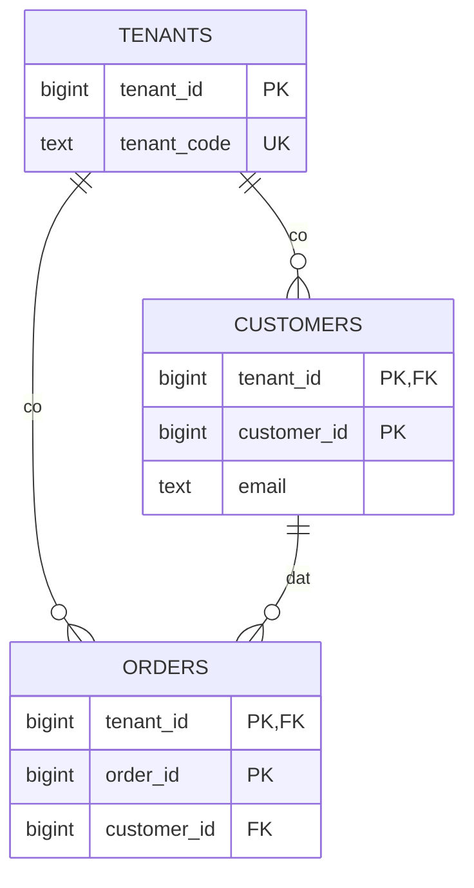

# Khóa ghép và ràng buộc nhiều cột trong PostgreSQL

Trong một cơ sở dữ liệu quan hệ, một hàng không phải lúc nào cũng được nhận diện duy nhất bằng **một cột**. Ví dụ, sản phẩm có thể có ở nhiều kho: mã kho `warehouse_id` không xác định được một dòng tồn, và mã sản phẩm `product_id` cũng không xác định được một dòng tồn. Nhưng **cặp** `(warehouse_id, product_id)` lại đủ để xác định số dư của sản phẩm tại một kho cụ thể.

Tương tự, khi phần mềm phục vụ nhiều công ty (*multi-tenant*), mã khách `customer_id = 10` có thể hợp lệ ở hai tenant khác nhau. Lúc này **cặp** `(tenant_id, customer_id)` là danh tính có ý nghĩa đầy đủ. Khóa và ràng buộc nhiều cột giúp PostgreSQL bảo đảm những quan hệ đó, thay vì dựa hoàn toàn vào kiểm tra của ứng dụng.

Bài học thuộc chương **Ràng buộc**, tập trung vào:

- **Khóa chính ghép** (*composite primary key*): `PRIMARY KEY (col_a, col_b)`.
- **Ràng buộc duy nhất nhiều cột**: `UNIQUE (col_a, col_b)` và ngữ nghĩa `NULL`.
- **Khóa ngoại ghép**: `FOREIGN KEY (a, b) REFERENCES parent (x, y)`.
- **CHECK nhiều cột**: bảo đảm mối liên hệ giữa các giá trị **trong cùng một hàng**.
- Cách PostgreSQL xử lý `MATCH SIMPLE`, `MATCH FULL`, `DEFERRABLE`, chỉ mục, cập nhật/xóa dữ liệu và migration.

Ta sẽ xây dựng ví dụ SQL có thể thực thi, thử dữ liệu hợp lệ và không hợp lệ, rồi phân tích các bẫy thiết kế thường gặp.

## 1. Từ khóa đơn đến khóa ghép

Một **khóa** là tập thuộc tính có thể dùng để xác định duy nhất một hàng. Khi chỉ có một thuộc tính, đó là khóa đơn; khi cần hai hay nhiều thuộc tính, đó là **khóa ghép**.

Giả sử bảng tồn kho:

| warehouse_id | product_id | on_hand_qty |
| ---: | ---: | ---: |
| 1 | 100 | 20 |
| 1 | 200 | 15 |
| 2 | 100 | 8 |

Quan sát:

- `warehouse_id = 1` xuất hiện **hai lần**.
- `product_id = 100` xuất hiện **hai lần**.
- **Cặp** `(warehouse_id, product_id)` không lặp trong dữ liệu hợp lệ.

Do đó, ràng buộc hợp lý là:

```sql
PRIMARY KEY (warehouse_id, product_id)
```

Ý nghĩa của khóa ghép không phải là “nối hai số thành một chuỗi”, mà là PostgreSQL đánh giá **tính duy nhất trên tổ hợp các cột**. Hai hàng được xem là trùng khóa khi các giá trị tương ứng của toàn bộ tổ hợp khóa xung đột theo quy tắc của ràng buộc.

### 1.1. Khóa ghép là một ràng buộc chung

Đừng nhầm:

```sql
-- Một khóa chính ghép:
PRIMARY KEY (warehouse_id, product_id)
```

với:

```sql
-- Hai UNIQUE độc lập: ý nghĩa hoàn toàn khác.
UNIQUE (warehouse_id),
UNIQUE (product_id)
```

Hai `UNIQUE` độc lập sẽ không cho hai sản phẩm cùng ở kho 1, cũng không cho sản phẩm 100 ở hai kho. Điều này trái nghiệp vụ. Một `UNIQUE (warehouse_id, product_id)` chỉ cấm **trùng cặp**, phù hợp với quan hệ nhiều–nhiều.

### 1.2. Candidate key, primary key và alternate key

**Candidate key (khóa ứng viên)** là tập thuộc tính đủ để nhận diện duy nhất một hàng và tối thiểu theo thiết kế logic. Một bảng có thể có nhiều khóa ứng viên. Người thiết kế chọn **một** khóa làm `PRIMARY KEY`, những khóa ứng viên còn lại có thể được bảo vệ bằng `UNIQUE`.

Ví dụ sản phẩm:

```text
product_id: khóa nội bộ được hệ thống cấp
sku:        mã SKU duy nhất theo nghiệp vụ
```

Có thể thiết kế `product_id` làm PK và `sku` làm UNIQUE. Ngược lại, nếu cần định danh sản phẩm theo cặp `(tenant_id, sku)`, tổ hợp này có thể được chọn làm khóa chính hoặc khóa ứng viên tùy yêu cầu.

**Không phải cứ một bảng có nhiều cột thì phải có khóa ghép.** Quyết định xuất phát từ **quy tắc nhận diện và duy nhất của nghiệp vụ**.

## 2. Cú pháp PRIMARY KEY nhiều cột

Trên PostgreSQL, khóa chính ghép được khai báo ở mức **bảng**:

```sql
CREATE TABLE stock_levels (
    warehouse_id BIGINT NOT NULL,
    product_id   BIGINT NOT NULL,
    on_hand_qty  INTEGER NOT NULL DEFAULT 0,
    PRIMARY KEY (warehouse_id, product_id),
    CHECK (on_hand_qty >= 0)
);
```

PostgreSQL bảo đảm:

1. Hai cột khóa chính **không được NULL**.
2. Tổ hợp `(warehouse_id, product_id)` **không được lặp**.
3. Khóa chính được hỗ trợ bởi một **unique B-tree index** phù hợp do PostgreSQL tự tạo.
4. Có thể được các bảng khác tham chiếu bằng **khóa ngoại ghép**.

Một bảng chỉ có **một ràng buộc PRIMARY KEY** nhưng khóa chính đó có thể gồm nhiều cột. Không thể khai báo hai khóa chính độc lập rồi gọi đó là một khóa ghép.

### 2.1. Cách đặt tên ràng buộc

Thay vì để PostgreSQL tự chọn tên, có thể đặt tên tường minh:

```sql
CREATE TABLE stock_levels_named (
    warehouse_id BIGINT NOT NULL,
    product_id   BIGINT NOT NULL,
    on_hand_qty  INTEGER NOT NULL CHECK (on_hand_qty >= 0),
    CONSTRAINT pk_stock_levels_named
        PRIMARY KEY (warehouse_id, product_id)
);
```

Tên rõ ràng giúp nhận diện lỗi trong migration và log:

```text
duplicate key value violates unique constraint "pk_stock_levels_named"
```

Trong các hệ thống lớn, đặt tên ngắn gọn và nhất quán cho `pk_*`, `fk_*`, `uq_*`, `chk_*` giúp vận hành thuận tiện hơn. Tuy nhiên, **tên constraint không quyết định ngữ nghĩa**; danh sách cột mới là phần quan trọng.

### 2.2. Không viết PRIMARY KEY riêng ở từng cột

Ví dụ sau **không hợp lệ theo mục đích có một khóa ghép**:

```sql
-- SAI: cố định nghĩa hai PRIMARY KEY riêng trong cùng bảng.
CREATE TABLE wrong_example (
    warehouse_id BIGINT PRIMARY KEY,
    product_id BIGINT PRIMARY KEY
);
```

PostgreSQL không cho một bảng có hai ràng buộc PK. Cú pháp đúng phải gộp cột:

```sql
CREATE TABLE correct_example (
    warehouse_id BIGINT NOT NULL,
    product_id BIGINT NOT NULL,
    PRIMARY KEY (warehouse_id, product_id)
);
```

Hai bảng `wrong_example`/`correct_example` ở trên chỉ minh họa cú pháp; **không chạy lệnh cố tình sai** trong cùng transaction với những lệnh bạn muốn commit.

## 3. UNIQUE nhiều cột: duy nhất theo tổ hợp

Không nhất thiết phải dùng khóa ghép làm `PRIMARY KEY`. Nhiều trường hợp dùng ID nội bộ đơn, đồng thời có **ràng buộc nghiệp vụ duy nhất trên nhiều cột**.

Ví dụ một sản phẩm chỉ có một mã SKU **trong mỗi tenant**, nhưng tenant khác được sử dụng cùng SKU:

```sql
CREATE TABLE tenant_products_example (
    id BIGINT GENERATED ALWAYS AS IDENTITY PRIMARY KEY,
    tenant_id BIGINT NOT NULL,
    sku TEXT NOT NULL,
    name TEXT NOT NULL,
    CONSTRAINT uq_tenant_products_sku UNIQUE (tenant_id, sku)
);
```

Hệ quả:

| tenant_id | sku | Có được chèn? |
| ---: | --- | --- |
| 1 | BOOK-A5 | Có |
| 1 | PEN-01 | Có |
| 2 | BOOK-A5 | Có, tenant khác |
| 1 | BOOK-A5 lần nữa | **Không**, trùng tổ hợp |

Nếu viết `UNIQUE (sku)`, SKU sẽ phải duy nhất **trên toàn bộ hệ thống**, mạnh hơn yêu cầu “duy nhất trong tenant”.

### 3.1. PRIMARY KEY và UNIQUE khác nhau ở đâu?

| Tiêu chí | `PRIMARY KEY (a, b)` | `UNIQUE (a, b)` |
| --- | --- | --- |
| Cấm trùng tổ hợp | Có | Có |
| Mặc định cấm NULL ở tất cả cột | **Có** | **Không**, trừ khi khai báo NOT NULL hoặc dùng quy tắc NULL đặc biệt |
| Số ràng buộc mỗi bảng | Chỉ một PK | Có thể có nhiều UNIQUE |
| Dùng làm mục tiêu foreign key | Có | Có, nếu thỏa điều kiện của PostgreSQL |
| Được tự tạo index hỗ trợ | Có | Có |
| Vai trò thiết kế | Khóa định danh chính | Khóa ứng viên/điều kiện duy nhất khác |

Vì thế đừng coi `UNIQUE (a, b)` và `PRIMARY KEY (a, b)` là hoàn toàn thay thế được khi các cột có thể `NULL`.

## 4. NULL trong UNIQUE nhiều cột

Đây là phần quan trọng vì có thể khiến dữ liệu trông “trùng” nhưng PostgreSQL vẫn cho phép.

Trong PostgreSQL, hành vi mặc định của ràng buộc `UNIQUE` thường coi các giá trị `NULL` là **khác biệt** khi kiểm tra duy nhất. Vì vậy có thể tồn tại nhiều hàng như:

```text
tenant_id | external_code
----------+--------------
1         | NULL
1         | NULL
```

nếu chỉ khai báo:

```sql
UNIQUE (tenant_id, external_code)
```

### 4.1. Ví dụ có thể chạy

```sql
CREATE TABLE unique_null_demo (
    demo_id BIGINT GENERATED ALWAYS AS IDENTITY PRIMARY KEY,
    tenant_id BIGINT NOT NULL,
    external_code TEXT,
    UNIQUE (tenant_id, external_code)
);

INSERT INTO unique_null_demo (tenant_id, external_code)
VALUES
    (1, NULL),
    (1, NULL),
    (1, 'EXT-001');

-- Thử thêm (1, 'EXT-001') lần nữa sẽ vi phạm UNIQUE.
```

Lưu ý: `NULL` trong SQL nghĩa là **không biết/không có giá trị**, không phải chuỗi rỗng `''`. Chuỗi rỗng được coi là một giá trị cụ thể, nên hai bản ghi `(1, '')` sẽ xung đột với một `UNIQUE` thông thường.

### 4.2. UNIQUE NULLS NOT DISTINCT trong PostgreSQL 15+

Nếu nghiệp vụ yêu cầu **chỉ có tối đa một hàng với mã bên ngoài NULL trong mỗi tenant**, PostgreSQL 15 trở lên hỗ trợ:

```sql
CREATE TABLE unique_nulls_not_distinct_demo (
    demo_id BIGINT GENERATED ALWAYS AS IDENTITY PRIMARY KEY,
    tenant_id BIGINT NOT NULL,
    external_code TEXT,
    CONSTRAINT uq_tenant_external_code
        UNIQUE NULLS NOT DISTINCT (tenant_id, external_code)
);
```

Khi đó:

- `(1, NULL)` lần đầu: hợp lệ.
- `(1, NULL)` lần thứ hai: **bị từ chối**.
- `(2, NULL)`: hợp lệ vì tenant khác.

`NULLS NOT DISTINCT` cho ràng buộc duy nhất không có nghĩa toàn bộ biểu thức so sánh SQL `NULL = NULL` bỗng trả về `TRUE`. Đây là **quy tắc riêng của constraint/index uniqueness**, không thay đổi logic ba trị của biểu thức `=`.

Với PostgreSQL trước phiên bản 15, cần thiết kế giải pháp khác như unique expression/partial index phù hợp hoặc không cho `NULL`, tùy nghiệp vụ. Đừng dùng nguyên cú pháp `NULLS NOT DISTINCT` trên phiên bản không hỗ trợ.

## 5. Khóa ngoại ghép: liên kết chính xác nhiều cột

Nếu bảng cha có khóa chính:

```sql
PRIMARY KEY (tenant_id, customer_id)
```

thì bảng con phải tham chiếu **cả cặp** khi muốn bảo vệ đúng danh tính tenant–khách hàng:

```sql
FOREIGN KEY (tenant_id, customer_id)
REFERENCES customers (tenant_id, customer_id)
```

Lưu ý **thứ tự đối chiếu cột**: giá trị cột thứ nhất ở phía con được so với cột thứ nhất được khai báo ở phía cha trong danh sách `REFERENCES`, tương tự với cột thứ hai, thứ ba. Không được vô tình ghép `tenant_id` với `customer_id` chỉ vì hai cột có cùng kiểu `BIGINT`.

### 5.1. Sơ đồ quan hệ



Nếu chỉ có:

```sql
-- Không đủ bảo vệ đúng tenant trong mô hình này:
FOREIGN KEY (customer_id) REFERENCES customers (customer_id)
```

thì một là PostgreSQL **không chấp nhận** vì `customer_id` đơn lẻ không được bảo đảm duy nhất trong bảng cha, hai là nếu bạn thêm một khóa đơn toàn cục chỉ để cho FK chạy, thiết kế đó có thể **không biểu đạt đúng ràng buộc tenant của quan hệ**. Mục tiêu cần bảo vệ là “đơn này thuộc khách hàng của **cùng tenant**”.

### 5.2. Điều kiện để foreign key tham chiếu nhiều cột

Các cột đích của FK phải được bảo đảm duy nhất phù hợp: thông thường bằng `PRIMARY KEY`, `UNIQUE` **không trì hoãn** hoặc một unique index **không phải partial** đáp ứng yêu cầu PostgreSQL.

Ví dụ bảng cha có `PRIMARY KEY (warehouse_id, product_id)` thì bảng con có thể `REFERENCES parent(warehouse_id, product_id)`. Không thể tham chiếu riêng `product_id` nếu cột này không có ràng buộc/index duy nhất độc lập phù hợp.

Một **partial unique index** như:

```sql
CREATE UNIQUE INDEX ux_active_codes
ON some_table (tenant_id, code)
WHERE active;
```

chỉ bảo vệ tập hàng `active = true`; nó **không phải khóa duy nhất toàn bảng** có thể mặc nhiên làm mục tiêu của FK. Ví dụ chỉ minh họa giới hạn, không chạy nếu `some_table` chưa tồn tại.

### 5.3. Foreign key không tự tạo index ở bảng con

PostgreSQL thường tạo index cho PK/UNIQUE của **bảng cha** nhưng **không tự động tạo index cho những cột tham chiếu ở bảng con**.

Ví dụ:

```sql
CREATE INDEX idx_orders_customer_scope
ON orders (tenant_id, customer_id);
```

Index trên bảng con có thể giúp:

- Truy vấn đơn của một khách.
- Tìm các hàng con khi sửa/xóa khóa bảng cha.
- Giảm chi phí kiểm tra ràng buộc tham chiếu trong workload lớn.

Tuy nhiên, nếu PK ở bảng con đã có tiền tố cột phù hợp hoặc workload rất nhỏ, index mới có thể không cần thiết. Cần kiểm tra các index đang có, truy vấn thực tế và `EXPLAIN` trước khi tạo trùng.

## 6. Mô hình thực hành: nhiều tenant, khách hàng và đơn hàng

Đây là phần DDL **có thể chạy trên một database học PostgreSQL riêng**. Tạo schema mới để tránh ảnh hưởng bảng nghiệp vụ khác. Script giả định các bảng chưa tồn tại trong schema `composite_lab`; khi thực hành lại nên dùng database/schema thử nghiệm mới thay vì xóa nhầm dữ liệu đang sử dụng.

### 6.1. Tạo tenant

```sql
CREATE SCHEMA IF NOT EXISTS composite_lab;

CREATE TABLE composite_lab.tenants (
    tenant_id   BIGINT PRIMARY KEY,
    tenant_code TEXT NOT NULL UNIQUE,
    tenant_name TEXT NOT NULL
);
```

Để người học nhìn rõ các giá trị, bài dùng ID số nguyên được chỉ định trực tiếp. Trong ứng dụng thật, có thể dùng identity/UUID hoặc hệ thống cấp ID khác; lựa chọn đó không thay đổi ý nghĩa của **khóa ghép** ở bảng con.

### 6.2. Khách hàng có khóa chính ghép

```sql
CREATE TABLE composite_lab.customers (
    tenant_id   BIGINT NOT NULL,
    customer_id BIGINT NOT NULL,
    email       TEXT NOT NULL,
    full_name   TEXT NOT NULL,
    CONSTRAINT pk_customers
        PRIMARY KEY (tenant_id, customer_id),
    CONSTRAINT uq_customers_tenant_email
        UNIQUE (tenant_id, email),
    CONSTRAINT fk_customers_tenant
        FOREIGN KEY (tenant_id)
        REFERENCES composite_lab.tenants (tenant_id)
        ON DELETE RESTRICT,
    CONSTRAINT chk_customers_name
        CHECK (length(btrim(full_name)) > 0)
);
```

Ý nghĩa:

- Hai tenant có thể dùng cùng `customer_id`.
- Trong một tenant, mỗi `customer_id` chỉ được xuất hiện một lần.
- Email phải duy nhất **theo tenant** trong mô hình ví dụ, không nhất thiết trên toàn hệ thống.
- Mỗi khách phải thuộc tenant tồn tại.

**Lưu ý:** `UNIQUE (tenant_id, email)` ở đây phân biệt hoa/thường theo ngữ nghĩa so sánh văn bản/collation được sử dụng. Nếu nghiệp vụ muốn email không phân biệt hoa/thường, cần một thiết kế bổ sung như unique expression index trên `lower(email)`, `citext` hoặc collation thích hợp và quy tắc chuẩn hóa được xác nhận.

### 6.3. Đơn hàng tham chiếu khách bằng cả hai cột

```sql
CREATE TABLE composite_lab.orders (
    tenant_id   BIGINT NOT NULL,
    order_id    BIGINT NOT NULL,
    customer_id BIGINT NOT NULL,
    request_key TEXT NOT NULL,
    status      TEXT NOT NULL DEFAULT 'DRAFT',
    placed_at   TIMESTAMPTZ NOT NULL DEFAULT now(),
    CONSTRAINT pk_orders
        PRIMARY KEY (tenant_id, order_id),
    CONSTRAINT uq_orders_request
        UNIQUE (tenant_id, request_key),
    CONSTRAINT fk_orders_customer
        FOREIGN KEY (tenant_id, customer_id)
        REFERENCES composite_lab.customers (tenant_id, customer_id)
        ON UPDATE RESTRICT
        ON DELETE RESTRICT,
    CONSTRAINT chk_orders_status
        CHECK (status IN ('DRAFT', 'PLACED', 'CANCELLED'))
);

-- Cột customer_id chưa được dẫn đầu trong PK của orders.
-- Index này hỗ trợ một số truy vấn lấy đơn theo khách và FK checks.
CREATE INDEX idx_orders_customer
ON composite_lab.orders (tenant_id, customer_id);
```

Điểm cốt lõi của `fk_orders_customer`: một hàng trong `orders` với `tenant_id = 1` và `customer_id = 10` chỉ hợp lệ khi **chính cặp** `(1, 10)` có trong `customers`. Nếu cùng `customer_id = 10` tồn tại ở tenant 2, nó không thay thế được khách của tenant 1.

### 6.4. Sản phẩm và dòng đơn cùng tenant

```sql
CREATE TABLE composite_lab.products (
    tenant_id   BIGINT NOT NULL,
    product_id  BIGINT NOT NULL,
    sku         TEXT NOT NULL,
    name        TEXT NOT NULL,
    price       NUMERIC(12, 2) NOT NULL,
    CONSTRAINT pk_products
        PRIMARY KEY (tenant_id, product_id),
    CONSTRAINT uq_products_sku
        UNIQUE (tenant_id, sku),
    CONSTRAINT fk_products_tenant
        FOREIGN KEY (tenant_id)
        REFERENCES composite_lab.tenants (tenant_id),
    CONSTRAINT chk_products_price
        CHECK (price >= 0)
);

CREATE TABLE composite_lab.order_items (
    tenant_id   BIGINT NOT NULL,
    order_id    BIGINT NOT NULL,
    line_no     INTEGER NOT NULL,
    product_id  BIGINT NOT NULL,
    quantity    INTEGER NOT NULL,
    unit_price  NUMERIC(12, 2) NOT NULL,
    CONSTRAINT pk_order_items
        PRIMARY KEY (tenant_id, order_id, line_no),
    CONSTRAINT uq_order_items_product
        UNIQUE (tenant_id, order_id, product_id),
    CONSTRAINT fk_items_order
        FOREIGN KEY (tenant_id, order_id)
        REFERENCES composite_lab.orders (tenant_id, order_id)
        ON DELETE RESTRICT,
    CONSTRAINT fk_items_product
        FOREIGN KEY (tenant_id, product_id)
        REFERENCES composite_lab.products (tenant_id, product_id)
        ON DELETE RESTRICT,
    CONSTRAINT chk_items_line
        CHECK (line_no > 0),
    CONSTRAINT chk_items_quantity
        CHECK (quantity > 0),
    CONSTRAINT chk_items_unit_price
        CHECK (unit_price >= 0)
);

CREATE INDEX idx_order_items_product
ON composite_lab.order_items (tenant_id, product_id);
```

Mô hình bảo vệ đồng thời hai quan hệ:

1. Dòng hàng `(tenant_id, order_id, line_no)` thuộc đúng đơn `(tenant_id, order_id)`.
2. Sản phẩm `(tenant_id, product_id)` thuộc **cùng tenant** với dòng hàng.

Nếu chỉ đặt FK `product_id` đến một ID toàn cục mà quên `tenant_id`, quy tắc “không đặt sản phẩm của công ty khác vào đơn” có thể không được database bảo vệ.

Ràng buộc `UNIQUE (tenant_id, order_id, product_id)` trong ví dụ có nghĩa **một sản phẩm chỉ xuất hiện một dòng trong cùng đơn**. Nếu nghiệp vụ có nhiều dòng cùng sản phẩm nhưng khác mức giảm giá/lô/thuế, cần bỏ hoặc đổi ràng buộc này; `line_no` vẫn giúp phân biệt từng dòng.

### 6.5. Thêm dữ liệu hợp lệ

```sql
INSERT INTO composite_lab.tenants
    (tenant_id, tenant_code, tenant_name)
VALUES
    (1, 'SHOP-A', 'Cửa hàng A'),
    (2, 'SHOP-B', 'Cửa hàng B');

-- Hai tenant có thể cùng customer_id = 10.
INSERT INTO composite_lab.customers
    (tenant_id, customer_id, email, full_name)
VALUES
    (1, 10, 'lan@shop-a.test', 'Nguyễn Lan'),
    (2, 10, 'lan@shop-b.test', 'Trần Lan'),
    (2, 20, 'minh@shop-b.test', 'Trần Minh');

INSERT INTO composite_lab.products
    (tenant_id, product_id, sku, name, price)
VALUES
    (1, 100, 'BOOK-01', 'Sổ tay A', 45000),
    (2, 100, 'BOOK-01', 'Sổ tay B', 50000),
    (2, 200, 'PEN-02', 'Bút bi B', 8000);

INSERT INTO composite_lab.orders
    (tenant_id, order_id, customer_id, request_key, status)
VALUES
    (1, 500, 10, 'REQUEST-A-500', 'PLACED'),
    (2, 500, 10, 'REQUEST-B-500', 'PLACED');

INSERT INTO composite_lab.order_items
    (tenant_id, order_id, line_no, product_id, quantity, unit_price)
VALUES
    (1, 500, 1, 100, 2, 45000),
    (2, 500, 1, 200, 1, 8000);
```

Ở dữ liệu này, hai tenant **cùng** dùng:

- `customer_id = 10`.
- `order_id = 500`.
- `product_id = 100` (dù hai tenant định nghĩa thông tin sản phẩm khác nhau).

Không có xung đột PK vì **tenant_id là một phần khóa**. Nếu truy vấn chỉ lọc `order_id = 500` và quên tenant, kết quả có thể gồm đơn của **cả hai tenant**. Đây cũng là lý do ứng dụng cần áp dụng **phân quyền/RLS và tenant scoping** trong truy vấn; khóa ghép bảo vệ quan hệ nhưng không tự phân quyền đọc dữ liệu.

### 6.6. Truy vấn đúng quan hệ ghép

```sql
SELECT
    o.tenant_id,
    o.order_id,
    c.full_name,
    i.line_no,
    p.sku,
    i.quantity,
    i.unit_price
FROM composite_lab.orders AS o
JOIN composite_lab.customers AS c
  ON c.tenant_id = o.tenant_id
 AND c.customer_id = o.customer_id
JOIN composite_lab.order_items AS i
  ON i.tenant_id = o.tenant_id
 AND i.order_id = o.order_id
JOIN composite_lab.products AS p
  ON p.tenant_id = i.tenant_id
 AND p.product_id = i.product_id
WHERE o.tenant_id = 1
  AND o.order_id = 500
ORDER BY i.line_no;
```

Mỗi phép JOIN phải so **đủ những cột xác định quan hệ**. Nếu chỉ JOIN theo `customer_id` hoặc `order_id` mà bỏ `tenant_id`, hai tenant có thể bị ghép nhầm, tạo kết quả trùng hoặc rò rỉ dữ liệu.

## 7. Kiểm thử constraint nhiều cột

Các lệnh ở phần này **cố ý vi phạm ràng buộc**. Chỉ chạy chúng trên database thực hành; nếu đang nằm trong một transaction tường minh và gặp lỗi, PostgreSQL có thể đưa transaction vào trạng thái aborted cho tới khi `ROLLBACK`.

### 7.1. Trùng khóa ghép

```sql
-- Đã có customers (1,10); thao tác này phải lỗi duplicate key.
INSERT INTO composite_lab.customers
    (tenant_id, customer_id, email, full_name)
VALUES (1, 10, 'another@shop-a.test', 'Khách trùng ID');
```

Nhưng khách `(2,10)` tồn tại hợp lệ, vì đó là **một tổ hợp khác**.

### 7.2. Trùng UNIQUE theo tenant

```sql
-- Đã có (1,'lan@shop-a.test'); dòng dưới phải lỗi unique.
INSERT INTO composite_lab.customers
    (tenant_id, customer_id, email, full_name)
VALUES (1, 11, 'lan@shop-a.test', 'Khách trùng email trong tenant');
```

Cùng email ở tenant 2 **có thể hợp lệ** nếu không vi phạm khóa khác, bởi vì `UNIQUE (tenant_id, email)` chỉ áp dụng trên cặp.

### 7.3. Đơn tham chiếu khách ở tenant sai

```sql
-- Customer (2,20) có thật, nhưng (1,20) không tồn tại.
INSERT INTO composite_lab.orders
    (tenant_id, order_id, customer_id, request_key, status)
VALUES
    (1, 501, 20, 'WRONG-CUSTOMER-TENANT', 'DRAFT');
```

Lỗi mong đợi là **foreign_key_violation**, SQLSTATE `23503`. Việc `customer_id = 20` tồn tại ở tenant 2 không giúp một order thuộc tenant 1 tham chiếu thành công.

### 7.4. Đặt sản phẩm ở tenant khác

```sql
-- Product (2,200) có thật, nhưng (1,200) không có.
INSERT INTO composite_lab.order_items
    (tenant_id, order_id, line_no, product_id, quantity, unit_price)
VALUES
    (1, 500, 2, 200, 1, 8000);
```

Ràng buộc `fk_items_product` từ chối, vì cần cặp `(1,200)` trong `products`. **Đây là lợi ích trực tiếp của foreign key ghép trong ứng dụng nhiều tenant.**

### 7.5. Thiếu một phần khóa chính

```sql
-- Khóa chính ghép không cho NULL ở bất kỳ thành phần nào.
INSERT INTO composite_lab.customers
    (tenant_id, customer_id, email, full_name)
VALUES
    (1, NULL, 'missing-id@shop-a.test', 'Khách thiếu ID');
```

Lỗi thường là `not_null_violation`, SQLSTATE `23502`.

### 7.6. Trùng sản phẩm trong cùng đơn

```sql
-- Dòng thứ nhất của (1,500) đã dùng product_id=100.
-- line_no khác không tránh UNIQUE(tenant_id,order_id,product_id).
INSERT INTO composite_lab.order_items
    (tenant_id, order_id, line_no, product_id, quantity, unit_price)
VALUES
    (1, 500, 3, 100, 1, 45000);
```

Lỗi được tạo bởi **UNIQUE của bộ ba**, không phải bởi PK `(tenant_id, order_id, line_no)`. Một bảng có thể có nhiều ràng buộc duy nhất với **mỗi quy tắc khác nhau**.

## 8. CHECK nhiều cột: bảo vệ mối liên hệ trong một hàng

`CHECK` không chỉ so sánh một cột với hằng số. Nó có thể kiểm tra **nhiều cột của cùng hàng**.

Ví dụ số dư tồn kho:

```sql
CREATE TABLE composite_lab.stock_levels (
    warehouse_id BIGINT NOT NULL,
    product_id   BIGINT NOT NULL,
    on_hand_qty  INTEGER NOT NULL DEFAULT 0,
    reserved_qty INTEGER NOT NULL DEFAULT 0,
    CONSTRAINT pk_stock_levels
        PRIMARY KEY (warehouse_id, product_id),
    CONSTRAINT chk_stock_levels_balances
        CHECK (
            on_hand_qty >= 0
            AND reserved_qty >= 0
            AND reserved_qty <= on_hand_qty
        )
);
```

Bài dùng bảng này như ví dụ tồn theo kho; trong hệ thống thật, `warehouse_id` và `product_id` thường còn tham chiếu tới bảng kho/sản phẩm. Ở đây ta tập trung vào **ràng buộc giữa các cột**.

Các dữ liệu:

| warehouse_id | product_id | on_hand_qty | reserved_qty | Hợp lệ? |
| ---: | ---: | ---: | ---: | --- |
| 1 | 100 | 20 | 5 | Có |
| 1 | 200 | 10 | 10 | Có |
| 2 | 100 | 3 | 4 | **Không**, giữ nhiều hơn tồn |
| 2 | 200 | -1 | 0 | **Không**, tồn âm |

Thử:

```sql
INSERT INTO composite_lab.stock_levels
    (warehouse_id, product_id, on_hand_qty, reserved_qty)
VALUES (1, 100, 20, 5);

-- Cố ý lỗi CHECK:
INSERT INTO composite_lab.stock_levels
    (warehouse_id, product_id, on_hand_qty, reserved_qty)
VALUES (2, 100, 3, 4);
```

Đây là **bất biến trên một hàng**: với mỗi sản phẩm tại mỗi kho, số lượng đang giữ không được vượt số lượng vật lý.

### 8.1. CHECK với khoảng thời gian

Một ví dụ độc lập:

```sql
CREATE TABLE composite_lab.room_bookings (
    booking_id BIGINT GENERATED ALWAYS AS IDENTITY PRIMARY KEY,
    room_id BIGINT NOT NULL,
    starts_at TIMESTAMPTZ NOT NULL,
    ends_at TIMESTAMPTZ NOT NULL,
    CONSTRAINT chk_booking_interval
        CHECK (ends_at > starts_at)
);
```

Ràng buộc này chỉ cho phép một đặt phòng có thời điểm kết thúc **sau** thời điểm bắt đầu. Nó **không ngăn hai booking khác nhau trùng giờ trong cùng phòng**; đó là quy tắc giữa **nhiều hàng**, cần thiết kế khác như exclusion constraint phù hợp.

### 8.2. CHECK với NULL: UNKNOWN được chấp nhận

Trong PostgreSQL, một biểu thức `CHECK` bị coi là vi phạm khi kết quả là **FALSE**. Nếu kết quả là **TRUE hoặc NULL/UNKNOWN**, ràng buộc không bác bỏ hàng.

Ví dụ:

```sql
CREATE TABLE composite_lab.discount_example (
    discount_id BIGINT PRIMARY KEY,
    subtotal NUMERIC(12,2),
    discount NUMERIC(12,2),
    CONSTRAINT chk_discount_bounds
        CHECK (discount >= 0 AND discount <= subtotal)
);
```

Nếu `subtotal` hoặc `discount` là `NULL`, biểu thức có thể trả về `UNKNOWN`, khiến hàng vẫn được chấp nhận. Nếu nghiệp vụ bắt buộc cả hai giá trị, phải đặt:

```sql
-- Ý tưởng sửa schema khi dữ liệu hiện tại cho phép:
ALTER TABLE composite_lab.discount_example
    ALTER COLUMN subtotal SET NOT NULL,
    ALTER COLUMN discount SET NOT NULL;
```

**Đừng dùng CHECK thay cho NOT NULL** khi yêu cầu không được thiếu giá trị. Sự khác biệt giữa `FALSE` và `UNKNOWN` là một trong những nguyên nhân khiến ràng buộc nhiều cột không hoạt động như người mới học mong đợi.

### 8.3. CHECK không được dùng tùy ý để truy vấn bảng khác

Một ý tưởng sai:

```sql
-- KHÔNG chạy: CHECK không hỗ trợ subquery như thế này.
-- CHECK (
--     quantity <= (SELECT available_qty FROM stock_levels ...)
-- )
```

`CHECK` trong PostgreSQL được thiết kế cho điều kiện trên **hàng đang ghi**, không phải để xác minh các bất biến tùy ý xuyên bảng và xuyên hàng. Để ngăn bán vượt tồn khi nhiều đơn đồng thời, cần transaction và câu `UPDATE ... WHERE ... RETURNING` có điều kiện hoặc cơ chế đồng bộ tương đương, **không chỉ CHECK quantity**.

## 9. MATCH SIMPLE và MATCH FULL của foreign key ghép

Khi khóa ngoại có cột nullable, cách PostgreSQL xử lý `NULL` đặc biệt quan trọng.

### 9.1. MATCH SIMPLE: mặc định

Với một foreign key ghép gồm `(a, b)` và `MATCH SIMPLE` (mặc định), nếu **bất kỳ cột tham chiếu nào là NULL**, PostgreSQL không yêu cầu tìm hàng cha khớp cho cặp đó.

Điều này hữu ích với quan hệ tùy chọn, nhưng cũng có thể cho phép **tham chiếu dở dang một phần**:

```text
a = 10, b = NULL
```

Hàng như vậy không bị từ chối bởi chính FK `MATCH SIMPLE`, dù nó chứa một nửa khóa có giá trị.

### 9.2. MATCH FULL: hoặc đủ cặp, hoặc tất cả NULL

`MATCH FULL` yêu cầu:

- **Tất cả cột FK đều NULL**: được chấp nhận, biểu diễn “không có tham chiếu”.
- **Tất cả cột FK đều khác NULL**: phải khớp hàng cha.
- **Một phần NULL, một phần có giá trị**: bị từ chối.

Ví dụ có thể chạy độc lập:

```sql
CREATE TABLE composite_lab.storage_locations (
    warehouse_id BIGINT NOT NULL,
    location_id BIGINT NOT NULL,
    location_name TEXT NOT NULL,
    PRIMARY KEY (warehouse_id, location_id)
);

CREATE TABLE composite_lab.location_requests (
    request_id BIGINT PRIMARY KEY,
    warehouse_id BIGINT,
    location_id BIGINT,
    note TEXT,
    CONSTRAINT fk_location_requests_location
        FOREIGN KEY (warehouse_id, location_id)
        REFERENCES composite_lab.storage_locations (warehouse_id, location_id)
        MATCH FULL
);

INSERT INTO composite_lab.storage_locations
    (warehouse_id, location_id, location_name)
VALUES (1, 10, 'Kệ A');
```

Kết quả theo từng tình huống:

| warehouse_id | location_id | `MATCH FULL` |
| --- | --- | --- |
| 1 | 10 | Hợp lệ nếu có hàng cha (1,10) |
| NULL | NULL | Hợp lệ: không tham chiếu vị trí nào |
| 1 | NULL | **Lỗi**, cặp không đầy đủ |
| NULL | 10 | **Lỗi**, cặp không đầy đủ |
| 1 | 99 | **Lỗi**, không có hàng cha tương ứng |

Thử:

```sql
-- Hợp lệ:
INSERT INTO composite_lab.location_requests
    (request_id, warehouse_id, location_id, note)
VALUES
    (1, 1, 10, 'Tham chiếu đầy đủ'),
    (2, NULL, NULL, 'Chưa chọn vị trí');

-- Cố ý lỗi MATCH FULL:
INSERT INTO composite_lab.location_requests
    (request_id, warehouse_id, location_id, note)
VALUES
    (3, 1, NULL, 'Thiếu location_id');
```

### 9.3. Khi nào nên dùng MATCH FULL?

Nếu một quan hệ tùy chọn phải được lưu theo nguyên tắc **“đủ cả bộ định danh hoặc không có gì”**, `MATCH FULL` thể hiện yêu cầu rất rõ.

Nhưng với quan hệ:

```text
tenant_id NOT NULL
optional_manager_id NULLABLE
```

và FK `(tenant_id, optional_manager_id)`, nếu dùng `MATCH FULL`, một hàng có tenant_id không NULL và manager_id NULL sẽ **bị từ chối**. Trong trường hợp này, `MATCH SIMPLE` có thể phù hợp hơn: manager không được chỉ định thì bỏ qua FK, còn khi manager_id có giá trị phải khớp người quản lý trong cùng tenant.

Lựa chọn `MATCH SIMPLE` hay `MATCH FULL` phải dựa trên **tính tùy chọn của cả nhóm cột**, không phải luôn ưu tiên một loại cho mọi trường hợp.

## 10. Thứ tự cột trong khóa ghép và chỉ mục B-tree

PostgreSQL dùng index để hỗ trợ PK/UNIQUE, thường là **B-tree trên các cột theo thứ tự đã khai báo**.

Ví dụ:

```sql
PRIMARY KEY (tenant_id, order_id)
```

Tạo một index theo thứ tự `tenant_id` trước, `order_id` sau. Điều đó ảnh hưởng tới việc index có thuận lợi cho điều kiện truy vấn cụ thể không.

| Truy vấn | Mức độ phù hợp thường gặp với index `(tenant_id, order_id)` |
| --- | --- |
| `WHERE tenant_id = 1 AND order_id = 500` | Tốt: đầy đủ hai cột |
| `WHERE tenant_id = 1` | Tốt: dùng tiền tố trái |
| `WHERE order_id = 500` | Không tối ưu theo cách sử dụng tiền tố thông thường; tùy planner/phiên bản và thống kê |
| `ORDER BY tenant_id, order_id` | Có thể tận dụng thứ tự index trong bối cảnh phù hợp |
| `WHERE customer_id = 10` | Không được index PK này bảo vệ vì không nằm trong khóa |

Không nên phát biểu rằng index `(a,b)` **không bao giờ** hỗ trợ điều kiện chỉ có `b`: các phiên bản/tối ưu hóa và lựa chọn cost-based có thể cho cách truy cập khác. Nhưng **không thể kỳ vọng hiệu quả như khi có điều kiện trên cột dẫn đầu** ở mọi workload.

### 10.1. Chọn thứ tự theo các truy vấn quan trọng

Trong hệ thống nhiều tenant, `tenant_id` thường là điều kiện bắt buộc trong hầu hết truy vấn, vì vậy đặt nó trước `order_id` hoặc `customer_id` có thể phù hợp.

Ví dụ:

```sql
SELECT *
FROM composite_lab.orders
WHERE tenant_id = 1
ORDER BY order_id DESC
LIMIT 20;
```

Khóa chính `(tenant_id, order_id)` có thể hỗ trợ đường đọc các đơn theo tenant và thứ tự ID. Nếu workload còn có nhiều truy vấn `WHERE order_id = ...` **không biết tenant**, cần xem lại cách định danh truy vấn và index bổ sung, đồng thời cân nhắc nguy cơ truy cập nhầm tenant.

### 10.2. Khóa ghép quá rộng có chi phí

Khóa ghép gồm nhiều cột dài, đặc biệt là `TEXT`, có thể:

- Tăng kích thước index và các khóa ngoại tham chiếu.
- Làm nhiều câu JOIN phải so nhiều giá trị.
- Tăng dung lượng truyền dữ liệu và chi phí cập nhật khóa.
- Khiến các bảng con phải lưu nhiều cột tham chiếu.

Khi tổ hợp tự nhiên quá rộng hoặc dễ thay đổi, một **surrogate primary key** như `BIGINT`/`UUID` kết hợp với `UNIQUE` trên các cột nghiệp vụ có thể dễ quản lý hơn.

**Tuy nhiên, surrogate key không tự thay thế các ràng buộc nghiệp vụ.** Nếu một người chỉ được ghi danh vào một môn trong một học kỳ, vẫn cần `UNIQUE(student_id, course_id, semester_id)` dù bảng ghi danh có `enrollment_id` riêng.

## 11. Khóa ghép và khóa thay thế: hai thiết kế khác nhau

### 11.1. Cách A: dùng khóa ghép làm PK

```sql
CREATE TABLE composite_lab.enrollments_a (
    student_id BIGINT NOT NULL,
    course_id BIGINT NOT NULL,
    semester_code TEXT NOT NULL,
    enrolled_at TIMESTAMPTZ NOT NULL DEFAULT now(),
    PRIMARY KEY (student_id, course_id, semester_code)
);
```

Mỗi sinh viên chỉ có một bản ghi cho **một môn trong một học kỳ**. Sinh viên vẫn có thể học lại cùng môn ở học kỳ khác.

### 11.2. Cách B: surrogate PK cộng UNIQUE nhiều cột

```sql
CREATE TABLE composite_lab.enrollments_b (
    enrollment_id BIGINT GENERATED ALWAYS AS IDENTITY PRIMARY KEY,
    student_id BIGINT NOT NULL,
    course_id BIGINT NOT NULL,
    semester_code TEXT NOT NULL,
    enrolled_at TIMESTAMPTZ NOT NULL DEFAULT now(),
    CONSTRAINT uq_enrollments_b_business
        UNIQUE (student_id, course_id, semester_code)
);
```

Ở cách B, `enrollment_id` dễ được bảng khác tham chiếu, nhưng uniqueness nghiệp vụ vẫn do bộ ba đảm nhiệm.

| Tiêu chí | PK ghép | Surrogate PK + UNIQUE ghép |
| --- | --- | --- |
| Định danh từ chính nghiệp vụ | Có | Định danh kỹ thuật riêng |
| Số cột FK khi bảng khác tham chiếu PK | Nhiều cột | Thường một cột |
| Khả năng diễn đạt tính duy nhất nghiệp vụ | Trực tiếp | Vẫn phải khai báo UNIQUE |
| Khi mã nghiệp vụ thay đổi | Có thể cần cập nhật PK/FK | Thường giữ nguyên surrogate PK |
| Dung lượng index | Có thể ít index hơn | Có PK index và UNIQUE index riêng |
| Phù hợp | Bảng liên kết, khóa tự nhiên ổn định | Đối tượng có vòng đời/quan hệ tham chiếu phức tạp |

Không có công thức “mọi bảng đều dùng BIGSERIAL” hay “mọi bảng liên kết đều dùng khóa ghép”. Cần xét **danh tính ổn định, tần suất thay đổi, quan hệ phía sau và truy vấn chủ yếu**.

## 12. DEFERRABLE: kiểm tra ràng buộc ở cuối transaction

Một số ràng buộc có thể được khai báo **DEFERRABLE**, nghĩa là kiểm tra tính hợp lệ được phép **trì hoãn** tới thời điểm sau trong transaction.

Điều này hữu ích khi các thao tác tạm thời tạo ra trạng thái chưa hợp lệ **ở giữa transaction**, nhưng kết quả cuối cùng phải hợp lệ.

### 12.1. Khóa ngoại ghép có thể trì hoãn

Ví dụ nhân viên và người quản lý thuộc cùng tổ chức:

```sql
CREATE TABLE composite_lab.employees (
    org_id BIGINT NOT NULL,
    employee_id BIGINT NOT NULL,
    manager_id BIGINT,
    full_name TEXT NOT NULL,
    CONSTRAINT pk_employees
        PRIMARY KEY (org_id, employee_id),
    CONSTRAINT fk_employee_manager
        FOREIGN KEY (org_id, manager_id)
        REFERENCES composite_lab.employees (org_id, employee_id)
        DEFERRABLE INITIALLY DEFERRED
);
```

Ở đây `manager_id` là **tùy chọn**, nên FK mặc định `MATCH SIMPLE` phù hợp khi nó `NULL`. Nếu manager có giá trị, FK buộc quản lý thuộc **cùng `org_id`**.

Thử tạo hai nhân viên tham chiếu nhau trong một transaction:

```sql
BEGIN;

INSERT INTO composite_lab.employees
    (org_id, employee_id, manager_id, full_name)
VALUES (1, 100, 200, 'Nhân viên A');

INSERT INTO composite_lab.employees
    (org_id, employee_id, manager_id, full_name)
VALUES (1, 200, 100, 'Nhân viên B');

COMMIT;
```

Khi FK được trì hoãn đến cuối transaction, hai hàng đều đã có mặt ở thời điểm kiểm tra cuối nên **về mặt tham chiếu FK** giao dịch có thể hợp lệ. Nhưng vòng quản lý A ↔ B thường **không hợp lệ về nghiệp vụ**; FK không tự ngăn chu trình tổ chức. Đây là ví dụ minh họa defer, không phải mô hình nhân sự nên dùng nguyên trạng.

Nếu chỉ chèn hàng A mà không có hàng quản lý 200, `COMMIT` sẽ thất bại do FK, ngay cả khi các statement trước đó đã chạy.

### 12.2. INITIALLY IMMEDIATE và INITIALLY DEFERRED

| Khai báo | Ý nghĩa |
| --- | --- |
| `NOT DEFERRABLE` | Kiểm tra theo thời điểm mặc định; không được dời bằng `SET CONSTRAINTS` |
| `DEFERRABLE INITIALLY IMMEDIATE` | Mặc định kiểm tra ngay theo cơ chế ràng buộc; trong transaction có thể chuyển sang DEFERRED |
| `DEFERRABLE INITIALLY DEFERRED` | Mặc định trì hoãn tới cuối transaction trừ khi đổi chế độ |

Ví dụ:

```sql
BEGIN;

SET CONSTRAINTS fk_employee_manager IMMEDIATE;

-- Các thao tác sau chịu kiểm tra FK theo chế độ mới.

ROLLBACK;
```

Trong ứng dụng thật, tên constraint có thể trùng giữa nhiều bảng/schema; cú pháp `SET CONSTRAINTS` và cách PostgreSQL phân giải tên cần được dùng có chủ đích. Nếu chuyển từ DEFERRED sang IMMEDIATE, PostgreSQL kiểm tra những vi phạm đang chờ; lệnh có thể báo lỗi nếu trạng thái lúc đó chưa hợp lệ.

### 12.3. Những ràng buộc nào được phép DEFERRABLE?

Ở PostgreSQL, **PRIMARY KEY**, **UNIQUE**, **FOREIGN KEY** và **EXCLUDE** có khả năng hỗ trợ các dạng trì hoãn theo quy tắc của loại constraint. **NOT NULL** và **CHECK** không được khai báo `DEFERRABLE` theo cú pháp constraint thông thường.

Một điều khác biệt hữu ích: các ràng buộc duy nhất **DEFERRABLE** không được dùng làm **conflict arbiter** trong `INSERT ... ON CONFLICT`. Nếu ứng dụng dùng UPSERT theo một tổ hợp cột, nên thiết kế unique constraint/index hỗ trợ conflict target theo quy tắc PostgreSQL, thay vì mặc định rằng một UNIQUE deferrable sẽ hoạt động như một unique constraint thông thường trong UPSERT.

### 12.4. Khi nào không nên trì hoãn?

Deferred constraints tạo ra khả năng lỗi xảy ra **tại COMMIT**, thay vì tại câu INSERT/UPDATE đầu tiên. Điều đó làm logic ứng dụng phải:

- Xử lý lỗi commit và rollback.
- Không trả “đã lưu thành công” trước khi commit được xác nhận.
- Không giữ transaction mở lâu chỉ để chờ trạng thái cuối có vẻ hợp lệ.

Chỉ dùng khi luồng nghiệp vụ có lý do rõ ràng; mặc định **kiểm tra sớm** thường dễ chẩn đoán hơn.

## 13. ON DELETE và ON UPDATE với khóa ngoại nhiều cột

Foreign key ghép tuân theo các hành động tham chiếu như FK một cột:

- `ON DELETE RESTRICT`: ngăn xóa hàng cha khi còn hàng con tham chiếu.
- `ON DELETE NO ACTION`: hành vi mặc định, có khác biệt quan trọng về khả năng defer so với RESTRICT trong tình huống thích hợp.
- `ON DELETE CASCADE`: xóa hàng con tương ứng khi xóa cha.
- `ON DELETE SET NULL` / `SET DEFAULT`: đặt giá trị theo cấu hình cho những cột tham chiếu được hỗ trợ.
- `ON UPDATE CASCADE`: cập nhật cột FK ở hàng con khi khóa cha thay đổi, theo ràng buộc tương ứng.

### 13.1. Cẩn thận với SET NULL trên khóa ghép

Giả sử FK `(tenant_id, manager_id)` và `tenant_id NOT NULL`. Nếu `ON DELETE SET NULL` đặt **cả hai** thành NULL, nó sẽ vi phạm `NOT NULL` của tenant.

Trong những phiên bản PostgreSQL hỗ trợ danh sách cột cho hành động `ON DELETE SET NULL`, có thể chọn chỉ đặt thành NULL cột tùy chọn:

```sql
-- Minh họa cú pháp, không chạy thêm lên bảng ví dụ nếu chưa
-- điều chỉnh constraint hiện có:
FOREIGN KEY (tenant_id, manager_id)
REFERENCES employees (org_id, employee_id)
ON DELETE SET NULL (manager_id)
```

Như vậy, một nhân viên vẫn thuộc tenant cũ nhưng không còn người quản lý khi người quản lý bị xóa. Tuy nhiên, việc **được phép xóa người quản lý và để orphan logic** là quyết định nghiệp vụ; nhiều hệ thống chọn RESTRICT hoặc chuyển người quản lý trước khi xóa.

### 13.2. CASCADE có thể lan rất rộng

Trong chuỗi:

```text
tenants -> customers -> orders -> order_items
```

Nếu đặt CASCADE ở mọi FK, xóa một tenant có thể xóa toàn bộ lịch sử đơn và dòng đơn liên quan. Với dữ liệu giao dịch, điều này có thể trái yêu cầu đối soát, bảo toàn chứng từ và audit.

Hãy chọn `ON DELETE` dựa trên vòng đời thật: `RESTRICT` cho lịch sử quan trọng, `CASCADE` khi bản ghi con thực sự không có ý nghĩa độc lập và nghiệp vụ cho phép xóa cùng cha, hoặc xử lý bằng quy trình lưu trữ/ẩn danh hóa có kiểm soát.

## 14. UPSERT với khóa ghép

Khi cần chèn số dư tồn kho, nếu cặp kho–sản phẩm đã tồn tại thì cập nhật, PostgreSQL hỗ trợ `INSERT ... ON CONFLICT` trên tổ hợp khóa phù hợp.

Với bảng `composite_lab.stock_levels`:

```sql
INSERT INTO composite_lab.stock_levels
    (warehouse_id, product_id, on_hand_qty, reserved_qty)
VALUES
    (1, 100, 20, 0)
ON CONFLICT (warehouse_id, product_id)
DO UPDATE
SET on_hand_qty = EXCLUDED.on_hand_qty,
    reserved_qty = EXCLUDED.reserved_qty;
```

`EXCLUDED` đại diện cho các giá trị mà câu `INSERT` đề xuất. Conflict target `(warehouse_id, product_id)` khớp với ràng buộc duy nhất của PK ghép.

**Chú ý quan trọng:** ví dụ trên là *đặt lại số dư theo giá trị nguồn tin cậy*, không phải nghiệp vụ nhập thêm 20 đơn vị. Trong hệ thống kho thật, việc ghi đè số dư có thể mất cập nhật từ giao dịch khác nếu không có quy trình đúng; nên dùng ledger, transaction và phép tăng/giảm nguyên tử theo ngữ nghĩa nghiệp vụ.

### 14.1. ON CONFLICT không thay thế khóa ngoại

`ON CONFLICT` xử lý xung đột với unique constraint/index phù hợp. Nó **không tự bỏ qua lỗi FK hay CHECK**. Nếu UPSERT số dư có `reserved_qty > on_hand_qty`, `CHECK` vẫn phải từ chối. Nếu dòng đơn tham chiếu sản phẩm thuộc tenant sai, FK vẫn phải từ chối.

### 14.2. Một constraint UNIQUE nhiều cột có thể làm arbiter

```sql
INSERT INTO composite_lab.orders
    (tenant_id, order_id, customer_id, request_key, status)
VALUES (1, 502, 10, 'REQUEST-A-500', 'DRAFT')
ON CONFLICT ON CONSTRAINT uq_orders_request
DO NOTHING;
```

Vì `(tenant_id, request_key) = (1, 'REQUEST-A-500')` đã tồn tại, lệnh có thể bỏ qua insert theo đúng unique arbiter.

Tuy nhiên, với **idempotency** của API đặt hàng, `DO NOTHING` không tự xác minh payload của yêu cầu lặp có giống yêu cầu gốc hay không. Ứng dụng còn phải so đối tượng, quantity, tiền và trả đúng kết quả trước đó.

## 15. Chỉ mục và hiệu năng ràng buộc ghép

Một khóa ghép vừa bảo vệ dữ liệu vừa có tác động đến truy vấn.

### 15.1. Cách xem ràng buộc hiện có

Trong `psql`:

```text
\d composite_lab.customers
\d composite_lab.orders
\d composite_lab.order_items
```

Lệnh `\d` là **meta-command của psql**, không phải SQL chuẩn để gửi qua mọi driver.

Với SQL, xem constraint:

```sql
SELECT
    conname,
    contype,
    condeferrable,
    condeferred,
    pg_get_constraintdef(oid) AS definition
FROM pg_constraint
WHERE conrelid = 'composite_lab.order_items'::regclass
ORDER BY conname;
```

Giải thích `contype` phổ biến:

| Giá trị | Constraint |
| --- | --- |
| `p` | Primary key |
| `u` | Unique |
| `f` | Foreign key |
| `c` | Check |
| `x` | Exclusion |

`pg_get_constraintdef` cho cách PostgreSQL diễn giải ràng buộc đã lưu, hữu ích để kiểm tra thứ tự cột và các hành động tham chiếu.

### 15.2. Xem index

```sql
SELECT
    indexname,
    indexdef
FROM pg_indexes
WHERE schemaname = 'composite_lab'
  AND tablename = 'order_items'
ORDER BY indexname;
```

Bạn sẽ thấy index hỗ trợ PK/UNIQUE và index bổ sung do script đã tạo. Không vì bảng có khóa ghép mà tạo thêm một index y hệt `(tenant_id, order_id, line_no)`; như vậy thường chỉ tăng chi phí bảo trì.

### 15.3. Đọc EXPLAIN

```sql
EXPLAIN
SELECT *
FROM composite_lab.order_items
WHERE tenant_id = 1
  AND order_id = 500;
```

Trên dữ liệu mẫu chỉ vài hàng, planner có thể chọn `Seq Scan` vì quét bảng nhỏ rẻ. Điều này **không có nghĩa PK ghép bị bỏ qua về mặt ràng buộc**. PostgreSQL vẫn cưỡng chế uniqueness khi ghi, còn planner chọn đường đọc theo chi phí dự kiến.

Khi bảng lớn, index từ PK `(tenant_id, order_id, line_no)` thường thuận lợi cho điều kiện `tenant_id = ? AND order_id = ?` vì đó là tiền tố trái của index.

### 15.4. Khóa ngoại ở bảng con và deadlock

Khi cập nhật/xóa khóa cha có nhiều hàng con, PostgreSQL cần kiểm tra FK và có thể phải khóa/đọc nhiều hàng. Thiếu index thích hợp ở bảng con dễ khiến thao tác chậm.

Giao dịch nhiều bảng và nhiều hàng cũng có thể deadlock nếu các transaction lấy khóa theo thứ tự khác nhau. **Không được suy luận rằng có khóa ghép là tự động tránh deadlock**. Cần tổ chức thứ tự thao tác, transaction ngắn và chính sách retry phù hợp khi gặp lỗi `40P01`.

## 16. Bổ sung ràng buộc ghép vào bảng đang có dữ liệu

Trong hệ thống đang chạy, thêm PK/FK/UNIQUE không chỉ là sửa vài dòng DDL: phải biết dữ liệu hiện tại có hợp lệ không, câu lệnh giữ khóa thế nào và ứng dụng nào đang ghi.

### 16.1. Tìm cặp bị trùng trước khi thêm UNIQUE

Giả sử muốn bảo vệ `(tenant_id, external_ref)` trong bảng hiện có:

```sql
SELECT
    tenant_id,
    external_ref,
    COUNT(*) AS duplicate_count
FROM some_existing_table
GROUP BY tenant_id, external_ref
HAVING COUNT(*) > 1;
```

Đây là **mẫu truy vấn**, chỉ chạy khi bảng `some_existing_table` thật sự tồn tại. Cần xem ngữ nghĩa `NULL` trước khi kết luận dữ liệu trùng vi phạm UNIQUE thông thường: hai dòng có `external_ref IS NULL` có thể được phép theo quy tắc mặc định, nhưng không được phép nếu bạn dùng `NULLS NOT DISTINCT`.

### 16.2. Thêm khóa ngoại bằng NOT VALID

Với bảng lớn, PostgreSQL hỗ trợ thêm `FOREIGN KEY` dưới dạng `NOT VALID` để tránh bước quét xác minh **toàn bộ dữ liệu cũ ngay tại thời điểm thêm**:

```sql
-- Ví dụ cú pháp migration, giả định bảng/khóa đã tồn tại.
ALTER TABLE some_child
    ADD CONSTRAINT fk_child_parent
    FOREIGN KEY (tenant_id, parent_id)
    REFERENCES some_parent (tenant_id, parent_id)
    NOT VALID;

-- Sau khi xử lý dữ liệu cũ và sắp xếp thời điểm phù hợp:
ALTER TABLE some_child
    VALIDATE CONSTRAINT fk_child_parent;
```

Với FK `NOT VALID`, PostgreSQL vẫn phải kiểm tra các lần ghi/thay đổi mới liên quan theo semantics của constraint, nhưng **các hàng cũ** chưa được chứng minh toàn bộ hợp lệ cho tới khi `VALIDATE CONSTRAINT` thành công.

**Không suy ra** mọi loại constraint đều hỗ trợ `NOT VALID` giống hệt foreign key. Đối với PostgreSQL, cách này thường áp dụng cho FK và CHECK; thêm UNIQUE/PK trên bảng lớn cần chiến lược khác.

### 16.3. Tạo unique index CONCURRENTLY rồi gắn constraint

Với bảng lớn, có thể dùng `CREATE UNIQUE INDEX CONCURRENTLY` trên tổ hợp cột (nếu dữ liệu đã không trùng) để giảm khóa ghi kéo dài trong giai đoạn tạo index:

```sql
-- Chỉ là mẫu migration; bảng/cột cần tồn tại thực sự.
CREATE UNIQUE INDEX CONCURRENTLY ux_existing_tenant_external
ON some_existing_table (tenant_id, external_ref);

ALTER TABLE some_existing_table
    ADD CONSTRAINT uq_existing_tenant_external
    UNIQUE USING INDEX ux_existing_tenant_external;
```

Điểm cần lưu ý:

- `CREATE INDEX CONCURRENTLY` **không chạy trong transaction block tường minh**.
- Lệnh có thể tốn nhiều thời gian và tài nguyên; nếu có dữ liệu trùng, index unique có thể không được tạo thành công.
- Không phải mọi expression index, partial index hoặc cấu hình index đều có thể chuyển thành UNIQUE constraint bằng `USING INDEX`.
- Thao tác `ALTER TABLE ... ADD CONSTRAINT ... USING INDEX` vẫn có chi phí/khóa cần đánh giá trong runbook.
- Với **PRIMARY KEY**, các cột tham gia còn phải `NOT NULL`; migration có thể cần thêm bước bảo đảm thuộc tính này.

Nếu migration thất bại khi tạo index concurrently, có thể còn index ở trạng thái không hợp lệ cần được kiểm tra/dọn theo hướng dẫn PostgreSQL; không đơn giản chạy lại vô hạn trên production.

### 16.4. Không thay đổi khóa chính mà quên bảng phụ thuộc

Chuyển từ PK đơn `id` sang PK ghép `(tenant_id, id)` có thể kéo theo:

- Bổ sung `tenant_id` ở các bảng con.
- Backfill tenant_id bằng dữ liệu tin cậy.
- Kiểm tra dữ liệu tham chiếu có cùng tenant.
- Tạo unique/index phù hợp.
- Chuyển foreign key một cột thành FK ghép.
- Thay query JOIN và mapping trong ORM/JPA.
- Cập nhật API, cache key, idempotency key và event schema.

Một thay đổi như vậy cần migration nhiều bước, kiểm thử ở dữ liệu đại diện và kế hoạch triển khai tương thích ngược; đừng đổi toàn bộ constraint trong một lần mà không kiểm tra ứng dụng.

## 17. Ràng buộc nhiều cột trong hệ thống nhiều tenant

Mô hình tenant giúp khóa ghép rất hữu ích, nhưng cần phân biệt **toàn vẹn tham chiếu** với **phân quyền**.

### 17.1. FK ghép giúp ngăn dữ liệu thuộc tenant khác

Ví dụ:

```text
orders(tenant_id, customer_id)
    -> customers(tenant_id, customer_id)

order_items(tenant_id, order_id)
    -> orders(tenant_id, order_id)

order_items(tenant_id, product_id)
    -> products(tenant_id, product_id)
```

Cả ba FK buộc quan hệ được ghi **trong cùng tenant** theo dữ liệu khóa. Điều này giảm nguy cơ app chèn nhầm record cross-tenant do một lỗi thiếu bộ lọc.

### 17.2. FK không tự chặn SELECT cross-tenant

Nếu role ứng dụng được quyền truy vấn mọi hàng:

```sql
SELECT * FROM composite_lab.orders;
```

thì khóa ghép không tự giới hạn kết quả cho tenant đang đăng nhập. Để bảo vệ dữ liệu nhiều tenant, cần **tenant scoping trong câu truy vấn**, quyền truy cập phù hợp, và có thể dùng **Row-Level Security (RLS)** theo mô hình threat và quy trình thiết kế.

Không dùng `tenant_id` từ request HTTP như một giá trị đã tin cậy nếu chưa được ràng buộc với danh tính authenticated của người dùng.

### 17.3. Idempotency key thường cần phạm vi tenant

Ví dụ ràng buộc:

```sql
UNIQUE (tenant_id, request_key)
```

cho phép tenant A và B cùng sử dụng request key `REQ-001` nhưng ngăn hai request giống key trong **cùng tenant** cùng tạo hai đơn. Tuy nhiên, một API idempotent còn cần kiểm tra payload của retry, trạng thái commit và kết quả đã xử lý; một UNIQUE constraint đơn lẻ không mô tả toàn bộ hợp đồng retry.

## 18. Khi nào cần ràng buộc khác thay cho CHECK nhiều cột?

Không phải mọi quy tắc liên quan nhiều thuộc tính đều phù hợp với PK/FK/UNIQUE/CHECK:

| Quy tắc | Cơ chế thích hợp |
| --- | --- |
| Cặp `(warehouse_id, product_id)` không lặp | `PRIMARY KEY` hoặc `UNIQUE` ghép |
| Dòng đơn trỏ đúng sản phẩm cùng tenant | `FOREIGN KEY (tenant_id, product_id)` |
| `reserved_qty <= on_hand_qty` trong **một hàng** | `CHECK` kết hợp `NOT NULL` |
| Hai lịch đặt phòng **không chồng lấn** trong cùng phòng | **EXCLUDE constraint** với range và index operator class phù hợp |
| Một đơn `PLACED` có **ít nhất một dòng** | Transaction/service hoặc constraint trigger/deferred validation phù hợp |
| Tổng số sản phẩm bán không vượt tồn khi nhiều transaction đồng thời | Guarded UPDATE/row locking + transaction |
| Chỉ một bản ghi `active = true` trong mỗi nhóm | Có thể dùng partial unique index tùy ngữ nghĩa |
| Quy tắc “tổng tiền bằng tổng các dòng” | Transaction, logic cập nhật và kiểm chứng xuyên bảng |

### 18.1. Ví dụ EXCLUDE cho hai khoảng thời gian

Giả sử mỗi phòng không được có hai booking cùng khoảng thời gian. `CHECK (ends_at > starts_at)` chỉ xác nhận **mỗi booking tự hợp lệ**, chưa so với các booking khác.

PostgreSQL cung cấp **exclusion constraint** để mô tả xung đột giữa hàng:

```sql
-- Ví dụ mở rộng: cần quyền cài extension và operator classes.
CREATE EXTENSION IF NOT EXISTS btree_gist;

CREATE TABLE composite_lab.room_reservations (
    reservation_id BIGINT GENERATED ALWAYS AS IDENTITY PRIMARY KEY,
    room_id BIGINT NOT NULL,
    period TSTZRANGE NOT NULL,
    CHECK (NOT isempty(period)),
    EXCLUDE USING gist (
        room_id WITH =,
        period WITH &&
    )
);
```

Ý nghĩa khái quát: không cho hai hàng cùng `room_id` có hai khoảng `period` **giao nhau** theo toán tử `&&`. Extension `btree_gist` bổ sung operator class GiST cho phép so sánh equality trên kiểu phù hợp như `BIGINT`. Đây là cơ chế khác với UNIQUE vì nó phát hiện **xung đột khoảng**, không chỉ trùng toàn bộ giá trị.

Khi định nghĩa khoảng đặt phòng, còn cần chính sách biên đóng/mở; ví dụ hai booking kề nhau tại đúng thời điểm trả phòng có thể được phép nếu dùng khoảng dạng `[)`. Nếu hệ thống có quy định chuyển ca/phòng, cần thể hiện bằng logic phù hợp.

## 19. Những nhầm lẫn thường gặp

| Nhầm lẫn | Giải thích đúng |
| --- | --- |
| “Khóa ghép là hai PRIMARY KEY độc lập.” | Một bảng có **một PK**, nhưng PK có thể gồm nhiều cột. |
| “UNIQUE(a,b) giống UNIQUE(a) và UNIQUE(b).” | UNIQUE ghép chỉ bảo vệ **tổ hợp**, không bắt từng cột duy nhất riêng lẻ. |
| “PRIMARY KEY ghép có thể chứa NULL.” | Tất cả thành phần PK đều `NOT NULL`. |
| “UNIQUE ghép luôn từ chối hai hàng có NULL ở cùng vị trí.” | Mặc định `NULL` được coi là phân biệt; PostgreSQL 15+ có `NULLS NOT DISTINCT` khi cần. |
| “Chỉ cần foreign key customer_id trong hệ thống nhiều tenant.” | Nếu ID có thể trùng giữa tenant, cần tham chiếu **cả tenant_id và customer_id**. |
| “Cột FK cùng tên là PostgreSQL tự nối đúng.” | Cần khai báo rõ các cột theo cặp đúng thứ tự tương ứng. |
| “Có composite PK ở bảng cha thì FK ở bảng con tự có index.” | PostgreSQL **không tự tạo** index cho mọi cột FK phía con. |
| “UNIQUE partial index luôn có thể làm mục tiêu FK.” | FK cần một mục tiêu duy nhất phù hợp trên toàn bảng, không phải partial index tùy ý. |
| “MATCH SIMPLE cấm tham chiếu thiếu một nửa.” | Mặc định có thể bỏ kiểm tra FK khi **bất kỳ** thành phần FK NULL. |
| “MATCH FULL luôn tốt hơn MATCH SIMPLE.” | Với `tenant_id NOT NULL` và cột tham chiếu tùy chọn, MATCH FULL có thể từ chối hàng hợp lệ về nghiệp vụ. |
| “CHECK biết số dư của tất cả hàng khác.” | CHECK chủ yếu kiểm tra một hàng; tổng hợp liên hàng cần cơ chế khác. |
| “CHECK (a <= b) đảm bảo a và b không NULL.” | CHECK cho phép kết quả UNKNOWN; cần NOT NULL nếu bắt buộc có giá trị. |
| “Index (a,b) và (b,a) luôn hiệu năng giống nhau.” | Thứ tự index ảnh hưởng truy vấn và tiền tố truy cập. |
| “Sử dụng ID tự tăng là không cần UNIQUE nghiệp vụ nữa.” | Surrogate key không ngăn trùng mã theo nghiệp vụ. |
| “DEFERRABLE nghĩa là không kiểm tra FK.” | Ràng buộc vẫn phải hợp lệ ở thời điểm kiểm tra cuối, thường là COMMIT. |
| “DEFERRABLE UNIQUE luôn dùng được làm ON CONFLICT arbiter.” | Unique/PK deferrable không phải arbiter được hỗ trợ trong ON CONFLICT. |
| “ON DELETE CASCADE luôn tiện nhất.” | Có thể xóa dây chuyền dữ liệu cần giữ lịch sử. |
| “Khóa ghép đủ bảo vệ dữ liệu tenant khỏi bị đọc chéo.” | Toàn vẹn tham chiếu khác với phân quyền; cần tenant scoping/RLS. |
| “CREATE INDEX trên mọi cột bất kể đã có index PK.” | Dễ tạo index trùng và tăng chi phí ghi. |

## 20. Bài tập thực hành

1. Với bảng tồn kho có ba hàng `(1,100)`, `(1,200)`, `(2,100)`, giải thích vì sao `PRIMARY KEY(warehouse_id,product_id)` phù hợp hơn hai `UNIQUE` độc lập.
2. Tạo bảng `student_course_term` với khóa chính ghép `(student_id, course_id, term_id)`. Chèn hai lần học cùng môn ở **hai học kỳ** khác nhau và thử chèn trùng trong cùng học kỳ.
3. Tạo bảng dùng surrogate `enrollment_id` và `UNIQUE(student_id,course_id,term_id)`. So sánh khả năng tham chiếu của bảng kết quả thi tới hai thiết kế.
4. Tạo bảng `tenants/customers/orders/order_items` ở phần 6. Chứng minh hai tenant có thể cùng `customer_id = 10` và `order_id = 500`.
5. Thử chèn đơn của tenant 1 tham chiếu khách `(2,20)` bằng `customer_id = 20`. Xác định constraint và SQLSTATE gây lỗi.
6. Thử chèn `order_items(tenant_id=1, product_id=200)` trong khi sản phẩm 200 chỉ thuộc tenant 2. Giải thích cách FK ghép ngăn lỗi.
7. Viết query JOIN `orders` với `customers` và `order_items` **đúng đủ cột**, rồi cố ý bỏ điều kiện tenant trong một bản query test. So sánh số hàng trả về và nguy cơ dữ liệu bị ghép sai.
8. Tạo `UNIQUE (tenant_id, external_ref)` với `external_ref` nullable. Hai hàng `(1,NULL)` có được chấp nhận không? Nếu dùng PostgreSQL 15+, thử `UNIQUE NULLS NOT DISTINCT` để quan sát khác biệt.
9. Thử bảng `location_requests` có `MATCH FULL`: hai cột đều NULL, một cột NULL và hai cột đều hợp lệ. Giải thích kết quả.
10. Tạo bảng kho có `CHECK(on_hand_qty >= reserved_qty)`. Điều gì xảy ra khi một giá trị là NULL? Sửa schema để các giá trị bắt buộc có mặt.
11. Phân biệt CHECK hai cột trong cùng một hàng với quy tắc “các lịch đặt phòng cùng phòng không giao nhau”. Nêu cách dùng `EXCLUDE USING gist` và operator `&&` cho khoảng thời gian.
12. Viết một câu `EXPLAIN` để lọc theo `tenant_id`, sau đó theo `order_id` một mình. Giải thích vai trò của thứ tự khóa ghép.
13. Kiểm tra ràng buộc `composite_lab.order_items` bằng `pg_constraint`, chỉ ra PK, UNIQUE, hai FK và các CHECK. Xem index hỗ trợ bằng `pg_indexes`.
14. Thêm một index trên `orders(tenant_id,customer_id)` rồi phân tích truy vấn lấy đơn theo khách và lợi ích có thể có với FK checks. Không tuyên bố index chắc chắn được planner dùng trên bảng nhỏ.
15. Định nghĩa một FK `DEFERRABLE INITIALLY DEFERRED`, tạo hai hàng có tham chiếu vòng trong cùng transaction và kiểm tra điều gì xảy ra nếu chỉ chèn một hàng rồi COMMIT.
16. Xây dựng một mẫu UPSERT vào `stock_levels` với conflict target `(warehouse_id,product_id)`. Giải thích khác biệt giữa “đặt lại số dư” và “nhập thêm số lượng”.
17. Tìm dữ liệu trùng tổ hợp trong một bảng giả định bằng `GROUP BY ... HAVING COUNT(*) > 1`. Nêu cách xử lý riêng khi một cột có thể NULL.
18. Viết migration thêm FK ghép `NOT VALID` rồi `VALIDATE CONSTRAINT`. Giải thích giới hạn và tại sao phải kiểm tra dữ liệu hiện tại.
19. Thiết kế bảng `bookings` theo `(hotel_id, booking_id)` và `booking_lines` tham chiếu cùng khách sạn. Đề xuất ràng buộc tránh tham chiếu booking khác hotel.
20. Một yêu cầu mới cho phép cùng sản phẩm xuất hiện nhiều dòng do chính sách giá theo đợt. Sửa cấu trúc `order_items` để cho phép, nhưng vẫn nhận diện từng dòng bằng khóa ghép.

## 21. Tổng kết

**Khóa ghép và ràng buộc nhiều cột** giúp cơ sở dữ liệu thể hiện đúng những quy tắc không thể bảo vệ bằng từng cột đơn lẻ:

```text
PRIMARY KEY (a, b)
    -> Định danh hàng bằng cả tổ hợp; mọi thành phần NOT NULL.

UNIQUE (a, b)
    -> Ngăn tổ hợp trùng; xem kỹ quy tắc NULL.

FOREIGN KEY (a, b) REFERENCES parent (x, y)
    -> Bảo vệ liên kết theo đúng cặp giá trị.

CHECK (a >= 0 AND b >= 0 AND b <= a)
    -> Bảo vệ quan hệ giữa các cột trong cùng hàng.
```

Trong PostgreSQL, hãy chọn khóa theo **ngữ nghĩa nghiệp vụ**, hiểu rõ **NULL trong UNIQUE/FK/CHECK**, dùng đúng **thứ tự cột**, cân nhắc **DEFERRABLE** và các hành động `ON DELETE/UPDATE`, rồi đánh giá **index và migration** trên dữ liệu thực tế. Đặc biệt trong hệ thống nhiều tenant, khóa ngoại ghép chứa `tenant_id` là một lớp bảo vệ tính toàn vẹn rất hữu ích, nhưng vẫn phải đi cùng phân quyền và kiểm soát truy vấn để bảo vệ dữ liệu.

Thiết kế tốt không phải chọn ràng buộc phức tạp nhất; đó là chọn **ràng buộc vừa đủ chính xác để PostgreSQL từ chối dữ liệu sai ngay tại nơi dữ liệu được lưu**.
