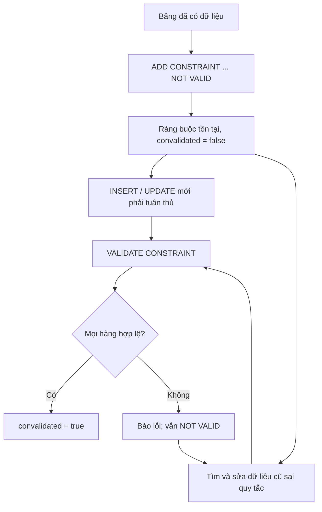

# Thêm ràng buộc với NOT VALID rồi VALIDATE CONSTRAINT trong PostgreSQL

Khi thiết kế bảng PostgreSQL từ đầu, chúng ta thường khai báo ràng buộc (`CONSTRAINT`) ngay trong câu `CREATE TABLE`. Nhưng một hệ thống đã vận hành có thể chứa hàng triệu bản ghi trước khi phát hiện cần thêm quy tắc mới, chẳng hạn tổng tiền đơn hàng không được âm hoặc `customer_id` của đơn hàng phải tham chiếu khách hàng tồn tại.

Nếu thêm ràng buộc theo cách thông thường, PostgreSQL có thể phải **kiểm tra dữ liệu đang tồn tại** trong lúc thực hiện `ALTER TABLE`. Trên bảng lớn, quá trình này tốn thời gian và có thể giữ khóa gây ảnh hưởng giao dịch khác. PostgreSQL cung cấp quy trình hai giai đoạn cho một số loại ràng buộc:

1. **`ADD CONSTRAINT ... NOT VALID`**: khai báo quy tắc và bắt đầu áp dụng cho các thao tác ghi mới, nhưng chưa xác nhận toàn bộ dữ liệu cũ.
2. **`VALIDATE CONSTRAINT`**: kiểm tra dữ liệu đã có, rồi đánh dấu ràng buộc là đã được xác thực khi thành công.

Cách này đặc biệt hữu ích với ràng buộc **`CHECK`** và **`FOREIGN KEY`** khi cập nhật schema một hệ thống đang hoạt động. Nó **không phải cách bỏ qua kiểm tra dữ liệu vĩnh viễn** và không biến mọi loại ràng buộc thành thao tác không khóa.

## 1. Vì sao thêm ràng buộc trên bảng lớn cần một chiến lược riêng?

Giả sử bảng `sales.orders` đã lưu nhiều năm dữ liệu. Bạn muốn bổ sung quy tắc:

```sql
ALTER TABLE sales.orders
ADD CONSTRAINT orders_amount_nonnegative
CHECK (total_amount >= 0);
```

Khi không có `NOT VALID`, PostgreSQL phải bảo đảm dữ liệu hiện hữu phù hợp trước khi hoàn tất thao tác thêm ràng buộc. Nếu bảng lớn hoặc có giao dịch dài đang chạy, thao tác có thể tiêu tốn I/O, chờ khóa và làm chậm hệ thống.

Trong trường hợp có bản ghi `total_amount < 0`, việc thêm trực tiếp còn có thể thất bại. Nếu muốn sửa dữ liệu cũ theo từng đợt mà vẫn chặn các giá trị sai mới, hãy tách quá trình khai báo và xác thực.



Lợi ích quan trọng là khoảng thời gian kiểm tra dữ liệu cũ được **tách khỏi bước thêm quy tắc**. Trong lúc đó, PostgreSQL vẫn kiểm tra các thay đổi dữ liệu phát sinh sau khi ràng buộc được thêm, nên hệ thống không tiếp tục tiếp nhận các giá trị mới vi phạm ràng buộc một cách bình thường.

Tuy nhiên, PostgreSQL **không tự sửa bản ghi cũ**, và việc validate vẫn có thể tốn tài nguyên đáng kể.

## 2. Phạm vi áp dụng và cú pháp cơ bản

Mẫu dùng với `CHECK`:

```sql
ALTER TABLE schema_name.table_name
ADD CONSTRAINT constraint_name
CHECK (boolean_expression)
NOT VALID;

ALTER TABLE schema_name.table_name
VALIDATE CONSTRAINT constraint_name;
```

Mẫu dùng với `FOREIGN KEY`:

```sql
ALTER TABLE schema_name.child_table
ADD CONSTRAINT constraint_name
FOREIGN KEY (parent_id)
REFERENCES schema_name.parent_table(id)
NOT VALID;

ALTER TABLE schema_name.child_table
VALIDATE CONSTRAINT constraint_name;
```

Với cách thêm ràng buộc thông thường, PostgreSQL xác thực dữ liệu hiện tại trước khi hoàn tất `ALTER TABLE`, khi loại ràng buộc yêu cầu kiểm tra toàn bảng. Với `NOT VALID`, bước đó được hoãn đến khi chạy `VALIDATE CONSTRAINT`.

### Ràng buộc nào dùng được NOT VALID?

| Loại ràng buộc | Vai trò | Ghi chú khi triển khai |
| --- | --- | --- |
| `CHECK` | Kiểm tra một biểu thức Boolean của hàng | Hỗ trợ quy trình `NOT VALID` rồi `VALIDATE CONSTRAINT` |
| `FOREIGN KEY` | Bảo đảm khóa tham chiếu tồn tại tại bảng đích | Hỗ trợ quy trình hai giai đoạn; validation phải kiểm tra quan hệ tham chiếu |
| `UNIQUE` | Ngăn các giá trị trùng lặp theo quy tắc unique | Không dùng trực tiếp mẫu `ADD CONSTRAINT ... UNIQUE NOT VALID` như `CHECK`/FK; cân nhắc tạo unique index concurrently rồi gắn constraint khi phù hợp |
| `PRIMARY KEY` | Định danh duy nhất và không NULL | Không dùng trực tiếp mẫu `ADD CONSTRAINT ... PRIMARY KEY NOT VALID` như `CHECK`/FK |
| `EXCLUDE` | Cấm các tổ hợp xung đột theo toán tử đã định nghĩa | Không áp dụng máy móc quy trình `NOT VALID` của CHECK/FK |
| `NOT NULL` | Bắt buộc cột có giá trị | Cú pháp và hỗ trợ validation riêng có thể khác giữa các phiên bản; nhiều phiên bản triển khai bằng `CHECK (col IS NOT NULL) NOT VALID` trước khi chuyển sang `SET NOT NULL` |

Bài học sử dụng `CHECK` và `FOREIGN KEY` vì đây là các trường hợp phổ biến và có hỗ trợ lâu dài. Với PostgreSQL mới hoặc bảng partitioned, hãy đối chiếu cú pháp và giới hạn cụ thể theo **major version server**, đặc biệt đối với `NOT NULL`, partitioning và thao tác đổi trạng thái ràng buộc. Không giả định mọi `CONSTRAINT` đều chấp nhận cùng một cú pháp `NOT VALID`.

### Ba trạng thái cần phân biệt

- **Chưa có constraint**: PostgreSQL chưa áp dụng quy tắc này.
- **Có constraint, `NOT VALID`**: quy tắc đã được thêm và được thực thi cho dữ liệu ghi mới/thay đổi; dữ liệu cũ chưa được kiểm chứng toàn bộ.
- **Có constraint, đã validate**: PostgreSQL đã xác nhận dữ liệu phù hợp tại thời điểm validate thành công và tiếp tục thực thi quy tắc cho các thao tác ghi.

`NOT VALID` là **trạng thái xác thực dữ liệu lịch sử**, không có nghĩa constraint được vô hiệu hóa.

## 3. Thực hành trọn vẹn: thêm CHECK trên bảng chứa dữ liệu không hợp lệ

Chúng ta sẽ tạo dữ liệu thử nghiệm có một đơn hàng âm tiền để thấy quy trình rõ ràng. Tất cả ví dụ được chạy trên **database học tập**; không áp dụng trực tiếp các câu lệnh tạo/xóa dữ liệu mẫu cho production.

### 3.1. Chuẩn bị bảng và dữ liệu lịch sử

```sql
CREATE SCHEMA IF NOT EXISTS constraint_lab;

CREATE TABLE constraint_lab.orders (
    order_id bigint PRIMARY KEY,
    customer_id bigint,
    total_amount numeric(12, 2),
    created_at timestamptz NOT NULL DEFAULT now()
);

INSERT INTO constraint_lab.orders
    (order_id, customer_id, total_amount)
VALUES
    (1001, 1, 120000.00),
    (1002, 999, 80000.00),
    (1003, 1, -5000.00),
    (1004, NULL, 10000.00);
```

Bảng chưa có `CHECK` về tiền và chưa có `FOREIGN KEY` về khách hàng, nên dữ liệu `-5000.00` và `customer_id = 999` vẫn được lưu.

Kiểm tra tình trạng hiện tại:

```sql
SELECT order_id, customer_id, total_amount
FROM constraint_lab.orders
ORDER BY order_id;
```

### 3.2. Thêm CHECK ở trạng thái NOT VALID

```sql
ALTER TABLE constraint_lab.orders
ADD CONSTRAINT orders_total_nonnegative_chk
CHECK (total_amount >= 0)
NOT VALID;
```

PostgreSQL tạo ràng buộc và không cần kiểm tra toàn bộ các hàng đã tồn tại ngay ở bước này. Vì thế, hàng `order_id = 1003` vẫn có thể còn giá trị âm trong bảng.

Ngay sau khi constraint được thêm, thử ghi một đơn hàng mới sai quy tắc:

```sql
-- Câu minh họa lỗi: PostgreSQL từ chối vì CHECK đã có hiệu lực.
INSERT INTO constraint_lab.orders
    (order_id, customer_id, total_amount)
VALUES (1005, 1, -10.00);
```

Thao tác đó thất bại với lỗi check violation (SQLSTATE `23514`). **Không cần đợi `VALIDATE CONSTRAINT` để chặn hàng mới vi phạm.**

Việc cập nhật một hàng cũ mà kết quả vẫn vi phạm `CHECK` cũng có thể bị từ chối. Vì thế, khi sửa bản ghi sai quy tắc, thao tác cập nhật cần đưa hàng về trạng thái hợp lệ, thay vì chỉ thay một cột không liên quan.

### 3.3. Phát hiện những hàng cũ sai quy tắc

```sql
SELECT order_id, total_amount
FROM constraint_lab.orders
WHERE (total_amount >= 0) IS FALSE;
```

Kết quả chứa hàng `1003`. Việc dùng `IS FALSE` ở đây phản ánh đúng ngữ nghĩa `CHECK`: trong PostgreSQL, một `CHECK` chỉ bác bỏ hàng khi biểu thức có kết quả **FALSE**, còn biểu thức có kết quả **TRUE** hoặc **UNKNOWN** (thường do `NULL`) được chấp nhận.

Nếu nghiệp vụ đồng thời cấm `NULL`, phải quy định thêm `NOT NULL` hoặc viết biểu thức CHECK thích hợp (phần 8).

### 3.4. VALIDATE khi dữ liệu còn vi phạm

```sql
ALTER TABLE constraint_lab.orders
VALIDATE CONSTRAINT orders_total_nonnegative_chk;
```

Vì hàng `1003` có tiền âm, validation thất bại. Constraint **vẫn tồn tại ở trạng thái chưa được xác thực**, và các thao tác ghi mới vẫn phải tuân thủ `CHECK`.

Điều này hữu ích: bạn có thể tiếp tục điều tra và sửa bản ghi lịch sử mà không phải xóa ràng buộc mỗi lần validate lỗi.

### 3.5. Sửa dữ liệu theo quyết định nghiệp vụ rồi validate lại

Trong dữ liệu thực, giá trị tiền âm có thể do lỗi nhập, hoàn tiền, hoặc mô hình không phân biệt đơn hàng và bút toán điều chỉnh. **Không được tự động sửa mọi giá trị âm thành 0** khi chưa làm rõ ý nghĩa.

Trong bộ dữ liệu học tập này, giả sử xác nhận đơn `1003` phải có số tiền dương `5000.00`:

```sql
UPDATE constraint_lab.orders
SET total_amount = 5000.00
WHERE order_id = 1003;
```

Sau đó chạy lại:

```sql
ALTER TABLE constraint_lab.orders
VALIDATE CONSTRAINT orders_total_nonnegative_chk;
```

Khi không còn bản ghi vi phạm và validation hoàn tất, PostgreSQL đánh dấu constraint là hợp lệ. Quy tắc đã được bảo đảm cho các hàng hiện hữu và tiếp tục được kiểm soát đối với thay đổi tương lai.

## 4. Kiểm tra trạng thái trong pg_constraint

PostgreSQL lưu metadata ràng buộc trong catalog `pg_constraint`. Cột `convalidated` cho biết ràng buộc đã được đánh dấu xác thực hay chưa.

```sql
SELECT
    con.conname,
    con.contype,
    con.convalidated,
    pg_get_constraintdef(con.oid, true) AS definition
FROM pg_constraint AS con
WHERE con.conrelid = 'constraint_lab.orders'::regclass
ORDER BY con.conname;
```

Các cột đáng chú ý:

| Cột | Ý nghĩa |
| --- | --- |
| `conname` | Tên constraint |
| `contype` | Loại constraint; `c` là CHECK, `f` là FOREIGN KEY, `p` là PRIMARY KEY, `u` là UNIQUE |
| `convalidated` | `false` khi constraint còn chưa được validate; `true` khi đã được xác thực |
| `conrelid` | OID của table mà constraint thuộc về, phù hợp khi tra CHECK/FK trên bảng |
| `pg_get_constraintdef(...)` | Hiển thị định nghĩa constraint từ metadata PostgreSQL |

Trong `psql`, lệnh sau cũng hữu ích:

```text
\d+ constraint_lab.orders
```

Thông tin hiển thị có thể ghi chú ràng buộc `NOT VALID`.

Ví dụ trạng thái của `orders_total_nonnegative_chk` theo từng giai đoạn:

| Thời điểm | `convalidated` | Dữ liệu mới có được vi phạm? |
| --- | --- | --- |
| Ngay sau `ADD ... NOT VALID` | `false` | Không |
| Sau lần `VALIDATE` thất bại | `false` | Không |
| Sau khi sửa dữ liệu và validate thành công | `true` | Không |

Với các ràng buộc được thêm bình thường và validate thành công ngay lúc tạo, `convalidated` thông thường là `true`.

## 5. FOREIGN KEY: thêm kiểm soát tham chiếu mà chưa quét toàn bộ dữ liệu cũ

Một tình huống phổ biến khác: bảng orders đang lưu `customer_id` trước khi hệ thống đưa vào quan hệ tham chiếu chính thức.

### 5.1. Tạo bảng đích cho quan hệ

```sql
CREATE TABLE constraint_lab.customers (
    customer_id bigint PRIMARY KEY,
    full_name text NOT NULL
);

INSERT INTO constraint_lab.customers (customer_id, full_name)
VALUES
    (1, 'Customer One'),
    (2, 'Customer Two');
```

Trong dữ liệu orders đã tạo, `customer_id = 1` hợp lệ, `999` không có khách hàng tương ứng, còn `NULL` chưa được quyết định xử lý.

### 5.2. Thêm FOREIGN KEY NOT VALID

```sql
ALTER TABLE constraint_lab.orders
ADD CONSTRAINT orders_customer_fk
FOREIGN KEY (customer_id)
REFERENCES constraint_lab.customers(customer_id)
NOT VALID;
```

Ràng buộc được khai báo mà chưa bắt buộc phải chứng minh mọi `customer_id` lịch sử đều tồn tại ở bảng `customers`.

Từ thời điểm thêm constraint, thử chèn một đơn hàng tham chiếu khách hàng không tồn tại:

```sql
-- Câu minh họa lỗi: customer_id = 888 chưa có trong customers.
INSERT INTO constraint_lab.orders
    (order_id, customer_id, total_amount)
VALUES (1006, 888, 10000.00);
```

PostgreSQL từ chối với foreign key violation (SQLSTATE `23503`). Với `FOREIGN KEY`, ngoài `INSERT`/`UPDATE` ở bảng con, những thao tác cập nhật/xóa khóa được tham chiếu ở bảng cha cũng chịu quy tắc tham chiếu và các hành động `ON UPDATE`/`ON DELETE` được cấu hình.

**`NOT VALID` không tắt trigger thực thi FK cho dữ liệu mới.**

### 5.3. Tìm orphan rows trước validation

```sql
SELECT
    o.order_id,
    o.customer_id
FROM constraint_lab.orders AS o
LEFT JOIN constraint_lab.customers AS c
    ON c.customer_id = o.customer_id
WHERE o.customer_id IS NOT NULL
  AND c.customer_id IS NULL
ORDER BY o.order_id;
```

Truy vấn trả ra `order_id = 1002` với `customer_id = 999`. Đây là **orphan row**: bản ghi ở bảng con trỏ tới khóa không tồn tại trong bảng cha.

Có thể viết cách tương đương với `NOT EXISTS`:

```sql
SELECT o.order_id, o.customer_id
FROM constraint_lab.orders AS o
WHERE o.customer_id IS NOT NULL
  AND NOT EXISTS (
      SELECT 1
      FROM constraint_lab.customers AS c
      WHERE c.customer_id = o.customer_id
  );
```

Hai cách giúp kiểm tra dữ liệu trước khi chạy `VALIDATE CONSTRAINT`. Với FK nhiều cột, nullable, `MATCH FULL` hoặc các điều kiện đặc thù, logic phát hiện vi phạm phải phản ánh chính xác semantics của FK thay vì sao chép nguyên một truy vấn đơn cột.

### 5.4. Xử lý orphan row rồi validate

Có một số lựa chọn nghiệp vụ:

- Sửa `customer_id` thành khóa khách hàng chính xác nếu xác định được bằng dữ liệu nguồn.
- Tạo bản ghi khách hàng bị thiếu khi thật sự có căn cứ rằng khách hàng đó hợp lệ.
- Nếu nghiệp vụ cho phép thiếu khách hàng, cân nhắc thay bằng `NULL` nhưng phải giữ đúng ý nghĩa dữ liệu và quy tắc liên quan.
- Loại bỏ/cách ly bản ghi nếu xác định nó là dữ liệu lỗi và đã được cho phép xử lý.

Ví dụ chỉ trong môi trường học tập, giả sử đơn `1002` thực sự thuộc về khách hàng `2`:

```sql
UPDATE constraint_lab.orders
SET customer_id = 2
WHERE order_id = 1002;

ALTER TABLE constraint_lab.orders
VALIDATE CONSTRAINT orders_customer_fk;
```

Sau khi validation thành công, `convalidated` của `orders_customer_fk` trở thành `true`.

### 5.5. NULL trong FOREIGN KEY

FK một cột thông thường cho phép `NULL` khi cột không khai báo `NOT NULL`. Vì vậy, đơn `1004` có `customer_id IS NULL` không vi phạm khóa ngoại ví dụ.

Nếu yêu cầu mọi đơn hàng bắt buộc có khách hàng, cần một ràng buộc `NOT NULL` riêng. Không nên nghĩ rằng `FOREIGN KEY` tự động cấm `NULL`.

Đối với khóa ngoại nhiều cột, mặc định `MATCH SIMPLE` có quy tắc bỏ qua kiểm tra khi có một cột tham chiếu là `NULL`; `MATCH FULL` yêu cầu tất cả các cột cùng `NULL` hoặc tất cả cùng có giá trị. Chọn cách thích hợp với mô hình dữ liệu.

## 6. Khóa bảng và chi phí vận hành

Quy trình `NOT VALID` thường được dùng để **giảm thời gian giữ khóa mạnh**, nhưng không có nghĩa các câu lệnh trở thành miễn phí hoặc không chặn nhau.

### 6.1. ADD CONSTRAINT ... NOT VALID

Khi thêm `CHECK ... NOT VALID`, PostgreSQL vẫn cần thay đổi định nghĩa bảng và lấy khóa DDL. Với nhiều lệnh `ALTER TABLE`, mức khóa mặc định có thể là **ACCESS EXCLUSIVE**, dù bước này không quét toàn bộ hàng cũ để xác minh.

Khi thêm `FOREIGN KEY ... NOT VALID`, PostgreSQL thông thường lấy khóa **SHARE ROW EXCLUSIVE** trên cả bảng tham chiếu và bảng được tham chiếu trong lúc khai báo. Khóa này có thể xung đột với một số giao dịch ghi đang hoạt động.

Giữ giai đoạn `ADD` ngắn và commit sớm giúp giảm thời gian giữ các khóa này.

### 6.2. VALIDATE CONSTRAINT

`VALIDATE CONSTRAINT` thường lấy khóa **SHARE UPDATE EXCLUSIVE** trên bảng đang validate. Với foreign key, PostgreSQL còn cần khóa trên bảng được tham chiếu, thông thường mức **ROW SHARE**. Đây là các mức khóa cho phép nhiều hoạt động đọc/ghi thông thường tiếp tục chạy trong khi validation.

Bước validation vẫn phải đọc dữ liệu cũ, có thể tốn I/O, CPU và làm tăng độ trễ. Nó có thể chờ khóa hoặc xung đột với những thao tác DDL/bảo trì khác. Vì vậy, không nên đồng nhất “không cần khóa chặn ghi toàn bộ thời gian” với “không ảnh hưởng hiệu năng”.

### 6.3. Tách transaction của bước ADD và bước VALIDATE

Một kế hoạch triển khai thường dùng hai transaction độc lập:

```sql
-- Giai đoạn 1: đặt ràng buộc vào hệ thống, không quét dữ liệu cũ.
BEGIN;
    SET LOCAL lock_timeout = '3s';

    ALTER TABLE constraint_lab.orders
    ADD CONSTRAINT orders_verified_rule
    CHECK (total_amount IS NULL OR total_amount >= 0)
    NOT VALID;
COMMIT;

-- Giai đoạn 2: sau khi dữ liệu cũ đã được kiểm tra/sửa.
BEGIN;
    SET LOCAL lock_timeout = '3s';
    SET LOCAL statement_timeout = '10min';

    ALTER TABLE constraint_lab.orders
    VALIDATE CONSTRAINT orders_verified_rule;
COMMIT;
```

Đây là ví dụ minh họa với **một tên constraint khác** để tránh trùng ràng buộc trong bài. Trên ứng dụng thật, chỉ tạo một constraint phù hợp với nhu cầu nghiệp vụ.

Các khoảng timeout là ví dụ, cần điều chỉnh theo khối lượng dữ liệu và cửa sổ triển khai. Nếu validation kéo dài hơn `statement_timeout`, statement có thể bị hủy; constraint vẫn ở trạng thái chưa xác thực nếu `ADD` đã được commit trước đó.

Điểm quan trọng là **không giữ transaction của bước ADD mở suốt thời gian điều tra/sửa dữ liệu và validate**. Nếu tạo và validate trong cùng một transaction rồi rollback vì lỗi validation, chính `ADD` cũng có thể bị rollback, khiến constraint biến mất.

## 7. CHECK và NULL: ràng buộc phải diễn đạt đúng ý nghĩa

Một CHECK chỉ bác bỏ hàng khi điều kiện là `FALSE`. Nếu biểu thức trả `NULL` (UNKNOWN), hàng vẫn được chấp nhận.

```sql
CHECK (total_amount >= 0)
```

Nếu `total_amount` là `NULL` thì kết quả `NULL >= 0` là UNKNOWN và CHECK **không bác bỏ** hàng đó. Đây là hành vi SQL có chủ ý.

Khi nghiệp vụ đòi hỏi tổng tiền phải có giá trị và không âm, có hai cách phổ biến:

```sql
-- Cách 1: ràng buộc riêng cho NOT NULL và CHECK.
total_amount numeric(12, 2) NOT NULL,
CONSTRAINT orders_amount_nonnegative CHECK (total_amount >= 0)
```

Hoặc thêm một CHECK phản ánh cả hai quy tắc:

```sql
ALTER TABLE constraint_lab.orders
ADD CONSTRAINT orders_amount_required_nonnegative_chk
CHECK (total_amount IS NOT NULL AND total_amount >= 0)
NOT VALID;
```

Ở đây, giá trị `NULL` khiến `total_amount IS NOT NULL` thành FALSE, nên cả biểu thức CHECK là FALSE và hàng bị từ chối.

Tuy nhiên, `CHECK (... IS NOT NULL ...)` không có nghĩa metadata cột đã có cờ `NOT NULL` mà ORM, công cụ introspection hoặc planner mong đợi. Nếu mục tiêu cuối cùng là `ALTER COLUMN ... SET NOT NULL`, cần một bước riêng.

### 7.1. Lộ trình thêm NOT NULL cho cột đang có dữ liệu

Trên nhiều phiên bản PostgreSQL, một kỹ thuật triển khai là:

```sql
-- 1. Bắt đầu chặn giá trị NULL mới bằng CHECK chưa validate.
ALTER TABLE constraint_lab.orders
ADD CONSTRAINT orders_total_amount_nn_chk
CHECK (total_amount IS NOT NULL)
NOT VALID;

-- 2. Xử lý bản ghi NULL cũ theo quyết định nghiệp vụ.
-- Không tự động gán 0 nếu NULL mang ý nghĩa khác.

-- 3. Khi dữ liệu đạt yêu cầu, xác thực CHECK.
ALTER TABLE constraint_lab.orders
VALIDATE CONSTRAINT orders_total_amount_nn_chk;

-- 4. Chuyển sang NOT NULL chính thức.
ALTER TABLE constraint_lab.orders
ALTER COLUMN total_amount SET NOT NULL;

-- 5. Có thể bỏ CHECK hỗ trợ khi đã chắc NOT NULL được áp dụng.
ALTER TABLE constraint_lab.orders
DROP CONSTRAINT orders_total_amount_nn_chk;
```

Một valid CHECK chứng minh cột không có NULL có thể giúp PostgreSQL tránh quét toàn bảng ở bước `SET NOT NULL` trong những phiên bản và điều kiện được hỗ trợ. Dù vậy, `ALTER COLUMN SET NOT NULL` vẫn là DDL cần khóa; hãy kiểm tra cú pháp, loại bảng và kế hoạch của phiên bản server trước khi triển khai.

Tại các phiên bản PostgreSQL mới có thêm khả năng quản lý trạng thái xác thực riêng của NOT NULL, có thể có cú pháp trực tiếp khác; không nên suy ra tính sẵn có từ các ví dụ CHECK nếu chưa kiểm tra tài liệu đúng phiên bản.

## 8. Lập kế hoạch sửa dữ liệu theo lô

Trên bảng hàng triệu hàng, không nên mặc định một câu `UPDATE` sẽ xử lý an toàn toàn bộ dữ liệu lỗi. Nó có thể tạo lượng WAL lớn, giữ nhiều row lock và khiến VACUUM phải xử lý thêm phiên bản hàng.

Trước tiên, thống kê:

```sql
SELECT
    count(*) AS total_orders,
    count(*) FILTER (
        WHERE (total_amount >= 0) IS FALSE
    ) AS invalid_amount_count,
    count(*) FILTER (
        WHERE customer_id IS NULL
    ) AS missing_customer_count
FROM constraint_lab.orders;
```

Tìm khóa chính của các bản ghi cần sửa và xác định nguồn dữ liệu chính xác. Sau đó xử lý theo từng nhóm nhỏ với transaction ngắn. Với ví dụ học tập:

```sql
-- Chỉ minh họa nếu có bảng đối soát chứa giá trị đúng.
-- correction_id / corrected_amount là dữ liệu đã được xác thực.
UPDATE constraint_lab.orders AS o
SET total_amount = c.corrected_amount
FROM constraint_lab.amount_corrections AS c
WHERE c.order_id = o.order_id
  AND o.total_amount IS DISTINCT FROM c.corrected_amount;
```

Bảng `constraint_lab.amount_corrections` ở đây là **bảng đối soát giả định**, không được tạo tự động trong bài; không chạy ví dụ này nếu chưa chuẩn bị nguồn dữ liệu hiệu chỉnh. Trong thực tế, nên giới hạn batch theo primary key, ghi lại số hàng đã sửa, commit sau từng batch và giữ khả năng chạy lại.

**Cảnh báo về dữ liệu sai:** không chọn cách xóa hàng vi phạm hoặc tạo khách hàng giả chỉ để làm `VALIDATE` chạy qua. Constraint có thể “xanh” nhưng dữ liệu nghiệp vụ đã bị biến dạng. Quy trình sửa dữ liệu cần người phụ trách nguồn dữ liệu và quy tắc thống nhất.

### 8.1. Có nên chạy validation trước khi sửa sạch?

Có thể chạy `VALIDATE CONSTRAINT` để xác nhận bảng còn vi phạm hay không, nhưng nếu biết có nhiều hàng sai, chạy validation lặp đi lặp lại có thể tốn tài nguyên. Thường nên dùng truy vấn phát hiện lỗi có mục tiêu và đối soát nguồn trước. Sau khi sửa, `VALIDATE` là bước PostgreSQL xác nhận cuối cùng.

Quan sát `pg_constraint.convalidated` giúp phân biệt constraint đã tồn tại với constraint thực sự đã được xác minh.

## 9. FOREIGN KEY cần index nào?

Một FK có hai phía:

- **Bảng cha/bảng đích**: các cột được tham chiếu phải phù hợp với khóa chính, unique constraint hoặc unique index được PostgreSQL chấp nhận. Thường đã có index phù hợp ở phía cha.
- **Bảng con/bảng tham chiếu**: PostgreSQL **không tự động tạo index cho các cột FK** chỉ vì thêm ràng buộc. Index ở phía con thường có lợi cho join và các thao tác cập nhật/xóa hàng cha khi cần kiểm tra hàng con.

Với bảng `constraint_lab.orders`:

```sql
CREATE INDEX CONCURRENTLY IF NOT EXISTS
    idx_orders_customer_id
ON constraint_lab.orders (customer_id);
```

`CREATE INDEX CONCURRENTLY` có thể giảm thời gian khóa ghi so với tạo index thông thường trên bảng lớn, nhưng nó vẫn sử dụng I/O/CPU và có các giới hạn quan trọng:

- Không thể chạy `CREATE INDEX CONCURRENTLY` bên trong transaction block.
- Nếu lỗi (ví dụ vì deadlock hoặc sự cố khác), PostgreSQL có thể để lại index không hợp lệ cần xem xét/xử lý.
- `IF NOT EXISTS` chỉ tránh lỗi tên index đã tồn tại; **không xác nhận định nghĩa index hiện có đúng như mong muốn**.

Index này không phải điều kiện bắt buộc cho cú pháp FK trong ví dụ, nhưng cần xem xét theo workload. Khi validation FK kiểm tra từng giá trị ở bảng con và tra bảng cha, hiệu năng còn phụ thuộc index ở bảng cha, phân bố dữ liệu và nguồn lực máy chủ.

## 10. Validation có cần dừng toàn bộ ứng dụng không?

Thông thường không bắt buộc phải dừng mọi truy cập, nhưng việc có thể triển khai trực tuyến tùy vào:

- Kích thước bảng và chỉ số đọc/ghi.
- Các giao dịch dài đang giữ khóa trên bảng.
- Mức cạnh tranh với `VACUUM`, migration khác hoặc tác vụ DDL.
- Chi phí đọc dữ liệu và truy vấn vào bảng tham chiếu.
- Mức timeout và yêu cầu độ trễ của ứng dụng.
- Đặc điểm schema: bảng partitioned, inheritance, ràng buộc nhiều cột hoặc thay đổi đồng thời.

Có thể quan sát các phiên đang chờ khóa:

```sql
SELECT
    pid,
    usename,
    state,
    wait_event_type,
    wait_event,
    now() - query_start AS elapsed,
    pg_blocking_pids(pid) AS blocking_pids,
    left(query, 160) AS query_sample
FROM pg_stat_activity
WHERE datname = current_database()
  AND state <> 'idle'
ORDER BY query_start;
```

Chế độ hiển thị thông tin về phiên khác phụ thuộc quyền giám sát. `pg_blocking_pids(pid)` giúp thấy các session đang chặn session đó; không nên tự động `pg_terminate_backend` mà chưa kiểm tra ảnh hưởng.

Không có một tiến trình `pg_stat_progress_*` chung được bảo đảm dành riêng cho mọi lệnh `VALIDATE CONSTRAINT`. Vì thế, hãy kết hợp metric I/O, thời lượng câu lệnh, khóa, statement timeout và việc quan sát `convalidated` để theo dõi.

### 10.1. Dùng timeout như cơ chế bảo vệ

Ví dụ đặt timeout trong session triển khai:

```sql
BEGIN;
    SET LOCAL lock_timeout = '3s';
    SET LOCAL statement_timeout = '15min';

    ALTER TABLE constraint_lab.orders
    VALIDATE CONSTRAINT orders_customer_fk;
COMMIT;
```

Nếu không lấy được lock trong 3 giây, câu lệnh có thể dừng thay vì chờ vô hạn. Nếu quá 15 phút, `statement_timeout` có thể hủy validation. Khi statement lỗi trong transaction, cần `ROLLBACK` nếu trình chạy migration chưa tự xử lý.

Việc retry cần có lịch và giới hạn rõ ràng, tránh nhiều job đồng thời cùng validate một bảng đang bận.

## 11. VALIDATE thất bại: chuyện gì còn lại trong database?

Giả sử `ADD CONSTRAINT ... NOT VALID` đã **commit thành công** và một batch dữ liệu cũ chưa được sửa. Khi chạy:

```sql
ALTER TABLE constraint_lab.orders
VALIDATE CONSTRAINT orders_customer_fk;
```

nếu vẫn còn giá trị FK không hợp lệ, PostgreSQL trả lỗi và không đánh dấu `convalidated = true`.

Trạng thái sau lỗi:

1. Constraint vẫn nằm trong catalog (vì `ADD` trước đó đã commit).
2. Các lệnh `INSERT`/`UPDATE` mới phải tuân thủ constraint.
3. Những dữ liệu cũ chưa đạt yêu cầu có thể còn nằm trong bảng.
4. Bạn có thể kiểm tra lỗi, sửa dữ liệu rồi chạy `VALIDATE CONSTRAINT` lại.

Không cần `DROP CONSTRAINT` rồi thêm lại sau mỗi lần thất bại. Việc xóa constraint sẽ tạo cửa sổ thời gian quy tắc không còn được áp dụng cho ghi mới, làm mất lợi ích chính của quy trình hai giai đoạn.

### 11.1. Nếu ADD và VALIDATE nằm trong cùng transaction

```sql
BEGIN;
    ALTER TABLE constraint_lab.orders
    ADD CONSTRAINT orders_example_chk
    CHECK (total_amount >= 0)
    NOT VALID;

    ALTER TABLE constraint_lab.orders
    VALIDATE CONSTRAINT orders_example_chk;
ROLLBACK;
```

Đoạn này là minh họa về transaction, **không dùng như migration thực tế**. Nếu validation hoặc một câu trong transaction lỗi và transaction bị rollback, phần `ADD` cũng có thể bị hoàn tác. Do vậy, cần xác định rõ transaction boundaries trong công cụ migration.

### 11.2. Lỗi dữ liệu khác với lỗi khóa hoặc timeout

Khi `VALIDATE` thất bại, cần đọc thông báo SQLSTATE và server log:

| Nhóm lỗi | Ví dụ | Hướng xử lý |
| --- | --- | --- |
| Dữ liệu vi phạm CHECK | `23514` | Tìm hàng có predicate CHECK là FALSE, sửa theo nghiệp vụ |
| Dữ liệu vi phạm FK | `23503` | Tìm orphan row, khôi phục/sửa quan hệ tham chiếu đúng |
| Không lấy được lock | `55P03` khi có `lock_timeout` | Lên lịch lại, giảm giao dịch dài, điều chỉnh thời điểm |
| Quá thời gian câu lệnh | `57014` khi statement bị hủy | Xem thời gian quét, tải hệ thống, timeout và khung chạy |
| Lỗi quyền | Không đủ quyền ALTER bảng | Sử dụng role migration có quyền phù hợp, tránh cấp quyền rộng bừa bãi |

Không nên tự động retry mọi lỗi: dữ liệu vi phạm sẽ không tự trở nên hợp lệ chỉ vì chạy lại nhiều lần.

## 12. Phân biệt NOT VALID với DEFERRABLE và DISABLE TRIGGER

`NOT VALID`, `DEFERRABLE` và thao tác với trigger giải quyết các bài toán khác nhau.

| Cơ chế | Mục đích chính | Ảnh hưởng đến dữ liệu hiện hữu |
| --- | --- | --- |
| `NOT VALID` khi ADD | Hoãn xác thực toàn bộ dữ liệu đã có | Chưa quét hết dữ liệu cũ; ghi mới vẫn phải tuân thủ |
| `VALIDATE CONSTRAINT` | Xác thực dữ liệu cũ | Quét/đối chiếu rồi đánh dấu valid nếu không vi phạm |
| `DEFERRABLE` | Cho phép trì hoãn thời điểm kiểm tra một số ràng buộc trong transaction | Không tự bỏ qua việc kiểm tra dữ liệu lịch sử |
| `SET CONSTRAINTS ... DEFERRED` | Đổi thời điểm kiểm tra cho constraint deferrable trong transaction | Không thay thế `NOT VALID`/`VALIDATE` |
| Tắt trigger có chủ đích | Thay đổi cơ chế thực thi trigger trong ngữ cảnh quản trị đặc biệt | Có thể mở đường cho dữ liệu không hợp lệ; yêu cầu thận trọng rất cao |

Ví dụ FK có thể khai báo deferrable:

```sql
ALTER TABLE constraint_lab.orders
ADD CONSTRAINT orders_customer_deferrable_fk
FOREIGN KEY (customer_id)
REFERENCES constraint_lab.customers(customer_id)
DEFERRABLE INITIALLY IMMEDIATE
NOT VALID;
```

Trong một transaction, khi có quyền và constraint hỗ trợ:

```sql
BEGIN;
    SET CONSTRAINTS orders_customer_deferrable_fk DEFERRED;

    -- Các thay đổi liên quan phải hợp lệ ở thời điểm kiểm tra cuối transaction.
COMMIT;
```

Đây là một **ràng buộc FK có tên khác** để minh họa tùy chọn `DEFERRABLE`, không cần tạo cùng với các FK tương đương trong bài thực hành. `CHECK` trong PostgreSQL không hỗ trợ deferral giống FK. `NOT VALID` không đồng nghĩa `DEFERRABLE`.

Tránh dùng `session_replication_role` hoặc tắt trigger FK để “vượt qua” migration thông thường; đó là các cơ chế đặc biệt có thể làm mất bảo đảm toàn vẹn dữ liệu nếu sử dụng sai.

## 13. UNIQUE và PRIMARY KEY: cách tiếp cận khác

Bạn có thể muốn bổ sung `UNIQUE(email)` hoặc `PRIMARY KEY(id)` cho bảng lớn. Không dùng:

```sql
-- Không phải mẫu hỗ trợ tương đương CHECK/FK:
ALTER TABLE constraint_lab.orders
ADD CONSTRAINT some_unique UNIQUE (order_id) NOT VALID;
```

Đối với unique constraint trên cột phù hợp, PostgreSQL thường cho phép tạo unique index **concurrently** rồi gắn constraint vào index:

```sql
-- Ví dụ minh họa với bảng đã được làm sạch trùng lặp.
-- CREATE INDEX CONCURRENTLY chạy ngoài transaction block.
CREATE UNIQUE INDEX CONCURRENTLY
    idx_users_email_unique
ON constraint_lab.users(email);

-- Khi index đã hợp lệ, có thể gắn unique constraint.
ALTER TABLE constraint_lab.users
ADD CONSTRAINT users_email_unique
UNIQUE USING INDEX idx_users_email_unique;
```

Bảng `constraint_lab.users` là **bảng giả định**, chưa được tạo trong bộ dữ liệu orders/customers ở trên. Đây là mẫu triển khai có điều kiện, không chạy nếu chưa có bảng, dữ liệu và quyền tương ứng.

Cần lưu ý:

- Việc tạo unique index sẽ thất bại khi còn dữ liệu trùng lặp; không có `NOT VALID` để mặc nhiên cho phép dữ liệu cũ trùng.
- `CREATE INDEX CONCURRENTLY` có giới hạn đối với transaction block và có thể để lại invalid index nếu thất bại.
- `ALTER TABLE ... ADD CONSTRAINT ... USING INDEX` yêu cầu index đủ điều kiện (ví dụ unique B-tree phù hợp, không phải index biểu thức hoặc partial index cho trường hợp UNIQUE constraint thông thường).
- Với `PRIMARY KEY`, những cột tham gia phải thỏa `NOT NULL`; nếu chưa có ràng buộc xác nhận, bước thêm PK có thể cần quét bảng/đặt khóa bổ sung.
- Các index/constraint trên partitioned table có quy tắc riêng và không thể sao chép mọi lệnh concurrently như bảng thường.

Vì vậy, lựa chọn quy trình trực tuyến phải dựa trên **loại ràng buộc thực tế**, không chỉ kích thước bảng.

## 14. Khi áp dụng với bảng partitioned và hệ thống nhiều service

Một bảng phân vùng có các partition vật lý, còn ràng buộc có thể được khai báo ở cấp bảng cha hoặc từng phần tùy loại. Việc thêm và validate constraint có thể cần xét từng partition, các quan hệ kế thừa và giới hạn hỗ trợ theo phiên bản PostgreSQL.

Trước khi triển khai, hãy xác định:

- Constraint được khai báo ở bảng partitioned cha hay partition cụ thể?
- PostgreSQL version hiện tại có cho phép `NOT VALID` ở vị trí đó không?
- Bước validate sẽ quét các bảng con nào?
- Có FK tới bảng partitioned hoặc từ bảng partitioned sang bảng khác không?
- Quy tắc `CHECK` có trùng với constraint partition hay làm thay đổi hành vi định tuyến row không?

Không giả định `VALIDATE CONSTRAINT` trên parent luôn tương đương validation trên một bảng thường. Nên thử migration trên bản sao schema và dữ liệu phân vùng đại diện.

Trong hệ thống nhiều service, quá trình sửa dữ liệu lịch sử chỉ giải quyết một phần. Mọi writer vẫn phải thích ứng với quy tắc mới: API, worker, ETL, consumer message, import job và script vận hành. Nếu một writer tiếp tục gửi dữ liệu sai, nó sẽ nhận lỗi ngay từ giai đoạn `NOT VALID`.

## 15. Triển khai với Flyway/Liquibase hoặc migration SQL

Một migration có thể chia rõ ba thời điểm:

**Migration A — Khai báo constraint để chặn lỗi mới**

```sql
ALTER TABLE constraint_lab.orders
ADD CONSTRAINT orders_total_nonnegative_chk
CHECK (total_amount >= 0)
NOT VALID;
```

**Công việc dữ liệu — Tìm và sửa các vi phạm đang tồn tại**

```sql
SELECT order_id, total_amount
FROM constraint_lab.orders
WHERE (total_amount >= 0) IS FALSE;
```

Phần sửa phải được thiết kế theo dữ liệu thực, có đối soát và chạy được theo đợt. Tránh đưa một lệnh `UPDATE` hàng triệu dòng vào migration DDL mà chưa tính lock và thời gian chạy.

**Migration B — Xác thực sau khi dữ liệu sạch**

```sql
ALTER TABLE constraint_lab.orders
VALIDATE CONSTRAINT orders_total_nonnegative_chk;
```

Những đoạn trên là cấu trúc workflow, không phải ba file migration bắt buộc theo một framework cụ thể. Khi sử dụng Flyway hay Liquibase:

- Đảm bảo migration chỉ chạy một lần hoặc có cơ chế quản lý phiên bản và trạng thái đã chạy.
- Đảm bảo transaction boundaries đúng với kế hoạch tách `ADD` và `VALIDATE`.
- Không coi trạng thái “migration SQL chạy qua” là đủ: kiểm tra `pg_constraint.convalidated` sau validation.
- Không để ứng dụng phụ thuộc vào việc chấp nhận dữ liệu sai cũ sau khi rule mới đã chặn ghi.
- Lập phương án đối với môi trường triển khai bị gián đoạn ở trạng thái `NOT VALID`.

PostgreSQL không cung cấp cú pháp `ADD CONSTRAINT IF NOT EXISTS` tổng quát giống một số câu `CREATE`. Nếu cần migration có thể chạy lại, hãy quản lý bằng migration history hoặc kiểm tra catalog có mục tiêu; không âm thầm bỏ qua constraint cùng tên nhưng khác định nghĩa.

## 16. Những sai lầm phổ biến

| Sai lầm | Hậu quả | Cách hiểu đúng |
| --- | --- | --- |
| Nghĩ `NOT VALID` vô hiệu hóa constraint | Ứng dụng vẫn lỗi khi ghi giá trị mới sai quy tắc | `NOT VALID` chỉ hoãn xác minh dữ liệu cũ |
| Nghĩ `VALIDATE` tự sửa dữ liệu | Validation thất bại với dữ liệu vi phạm | Phải tìm và sửa dữ liệu theo nghiệp vụ trước |
| Đặt `ADD` và `VALIDATE` trong một transaction rất dài | Giữ khóa từ giai đoạn ADD quá lâu | Commit ADD sớm rồi validate trong transaction riêng |
| Dùng `CHECK (col > 0)` để cấm NULL | CHECK chấp nhận UNKNOWN | Thêm `NOT NULL` hoặc biểu thức kiểm tra NULL rõ ràng |
| Dùng `FOREIGN KEY` để cấm NULL | FK một cột thường cho phép NULL | Tách quy tắc hiện diện và quy tắc tham chiếu |
| Bỏ constraint sau khi validate lỗi | Tạo khoảng trống cho ghi mới không hợp lệ | Giữ constraint NOT VALID, sửa rồi validate lại |
| Dùng `UNIQUE ... NOT VALID` như FK | Cú pháp/khả năng hỗ trợ khác | Dùng chiến lược unique index phù hợp |
| Không xét index và workload | Validation/ghi dữ liệu có thể nặng hoặc chậm | Xem parent unique index, child FK index và kế hoạch tải |
| Không theo dõi `convalidated` | Không biết migration đã hoàn tất hay chỉ thêm rule | Truy vấn `pg_constraint` sau từng giai đoạn |
| Cho rằng validation không khóa | Có thể chờ DDL/lock hoặc gây áp lực I/O | Dùng timeout, quan sát lock và chọn thời điểm phù hợp |
| Tự sửa mọi giá trị sai thành 0/NULL | Mất ngữ nghĩa dữ liệu nghiệp vụ | Dựa trên dữ liệu nguồn và quyết định có thể đối soát |

## 17. Bài thực hành có hướng dẫn

Hãy làm trong database thử nghiệm với schema `constraint_lab`. Mục tiêu là quan sát rõ **constraint chưa validate vẫn chặn dữ liệu mới** và **validation chỉ thành công sau khi dữ liệu lịch sử đạt yêu cầu**.

### Bài 1 — Tạo CHECK NOT VALID

1. Tạo bảng `constraint_lab.orders` và chèn dòng `1003` có `total_amount = -5000.00` như phần 3.
2. Thêm `orders_total_nonnegative_chk` bằng `ADD CONSTRAINT ... NOT VALID`.
3. Truy vấn `pg_constraint.convalidated` và dự đoán kết quả.
4. Thử `INSERT` một đơn hàng mới có tiền âm và quan sát lỗi `23514`.

### Bài 2 — Validation thất bại và chạy lại

1. Gọi `VALIDATE CONSTRAINT orders_total_nonnegative_chk` khi dòng `1003` còn âm.
2. Kiểm tra constraint vẫn tồn tại và `convalidated` vẫn là `false`.
3. Sửa dòng `1003` dựa trên dữ liệu giả định đã xác nhận.
4. Validate lại và xác nhận `convalidated = true`.

### Bài 3 — Thêm FOREIGN KEY NOT VALID

1. Tạo bảng `constraint_lab.customers` gồm khách `1` và `2`.
2. Thêm FK `orders_customer_fk` ở trạng thái `NOT VALID`.
3. Tìm các order có `customer_id` không tồn tại ở bảng cha bằng `NOT EXISTS`.
4. Thử chèn một order mới với `customer_id = 888` và quan sát lỗi `23503`.
5. Sửa quan hệ tham chiếu của `order_id = 1002` rồi validate.

### Bài 4 — NULL trong CHECK và FK

Hãy trả lời:

- Một order có `total_amount = NULL` có vi phạm `CHECK(total_amount >= 0)` không?
- Một order có `customer_id = NULL` có vi phạm FK một cột thông thường không?
- Nếu nghiệp vụ cấm cả hai giá trị NULL, cần thêm điều kiện/ràng buộc nào?

Viết một truy vấn dùng `COUNT(*) FILTER (WHERE ...)` để đếm các hàng có NULL rồi giải thích vì sao chỉ validate CHECK/FK hiện tại chưa đủ để bảo đảm NOT NULL.

### Bài 5 — Dự kiến lock và kế hoạch triển khai

Giả sử bảng `orders` chứa 50 triệu hàng, được ghi liên tục. Hãy phác thảo thứ tự:

1. Đo số hàng sai và xác định nguồn khắc phục.
2. Thêm constraint `NOT VALID` trong transaction ngắn.
3. Chỉnh mọi writer để tuân thủ.
4. Sửa dữ liệu cũ theo lô, theo dõi WAL/lock và tải máy.
5. Chạy `VALIDATE` với `lock_timeout` và `statement_timeout` hợp lý.
6. Xác nhận `convalidated` và giám sát lỗi ghi sau triển khai.

Giải thích vì sao việc tách giai đoạn giúp giảm thời gian giữ khóa DDL mạnh, nhưng không xóa được chi phí quét dữ liệu trong bước validation.

## 18. Kết luận và nguyên tắc thực hành

`ADD CONSTRAINT ... NOT VALID` cùng `VALIDATE CONSTRAINT` là công cụ quan trọng khi **đưa ràng buộc mới vào bảng đã có dữ liệu**. Nó cho phép PostgreSQL bắt đầu bảo vệ dữ liệu được ghi mới trong khi nhóm vận hành dành thời gian điều tra và sửa dữ liệu cũ.

Ba nguyên tắc cần ghi nhớ:

- **Constraint NOT VALID vẫn thực thi cho thay đổi dữ liệu mới.** Nó chỉ chưa được chứng nhận đối với toàn bộ dữ liệu lịch sử.
- **VALIDATE không sửa dữ liệu và không loại bỏ mọi tác động vận hành.** Nó quét/kiểm tra dữ liệu cũ; cần xem khóa, I/O, timeout, partition và số bản ghi sai.
- **Migration phải có điểm kết thúc có thể kiểm chứng.** Kiểm tra `pg_constraint.convalidated = true`, giữ constraint được thực thi, đồng bộ tất cả writer và xử lý vi phạm cũ theo quyết định nghiệp vụ.

Khi kết hợp ràng buộc đúng kiểu với kế hoạch sửa dữ liệu, quản lý transaction và giám sát phù hợp, PostgreSQL có thể nâng dần độ toàn vẹn của hệ thống đang hoạt động mà tránh được nhiều rủi ro của việc thêm constraint theo một bước duy nhất.
