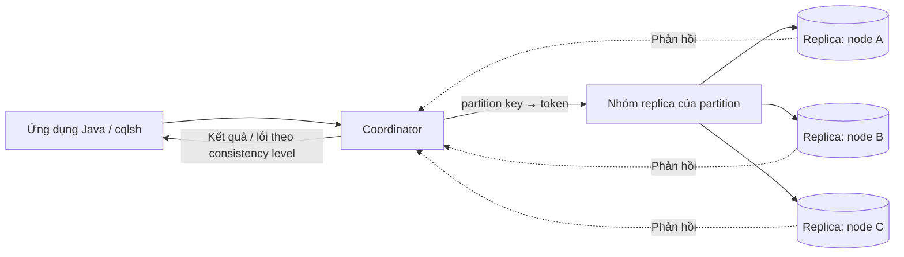

# Apache Cassandra là gì và những bài toán phân tán mà hệ được thiết kế để giải quyết

> **Chương:** Tư duy Cassandra  
> **Phạm vi:** Nền tảng về Apache Cassandra, lý do tồn tại, kiến trúc phân tán, mô hình wide-column, những lựa chọn nhất quán và đánh đổi khi thiết kế hệ thống.

## 1. Mục tiêu học tập

Sau bài này, bạn có thể:

1. Giải thích Cassandra là loại cơ sở dữ liệu gì và vì sao một hệ thống có thể cần nó thay vì chỉ mở rộng một cơ sở dữ liệu quan hệ.
2. Mô tả cách Cassandra phân phối dữ liệu theo **partition key**, lưu nhiều bản sao theo **replication factor** và tiếp nhận yêu cầu qua **coordinator**.
3. Phân biệt khả năng chịu lỗi, tính sẵn sàng và tính nhất quán; hiểu ý nghĩa thực tế của các mức `ONE`, `QUORUM`, `LOCAL_QUORUM` và `ALL`.
4. Nhận biết bài toán phù hợp, bài toán không phù hợp và các đánh đổi về truy vấn, vận hành, lưu trữ.
5. Đọc một ví dụ CQL nhỏ để thấy vì sao thiết kế bảng theo truy vấn là tư duy quan trọng của Cassandra.

## 2. Cassandra là gì?

**Apache Cassandra** là hệ quản trị cơ sở dữ liệu NoSQL phân tán, mã nguồn mở, thuộc họ **wide-column**. Cassandra được xây dựng để phân phối dữ liệu trên nhiều máy, chịu được lỗi của một phần cụm máy và phục vụ khối lượng đọc/ghi lớn với khả năng mở rộng bằng cách bổ sung node.

Hãy hình dung một nền tảng nhận sự kiện từ hàng triệu thiết bị, mỗi thiết bị liên tục gửi nhiệt độ, vị trí hoặc trạng thái. Một máy chủ duy nhất có thể gặp ba vấn đề:

- **Dung lượng và tốc độ:** số sự kiện tăng nhanh, vượt quá khả năng ghi hoặc lưu trữ của một máy.
- **Điểm lỗi tập trung:** máy hoặc ổ đĩa hỏng khiến một phần dịch vụ không thể truy cập dữ liệu.
- **Khoảng cách địa lý:** người dùng và ứng dụng ở nhiều vùng cần truy cập gần nơi hoạt động, trong khi mạng liên vùng có độ trễ và có thể đứt kết nối.

Cassandra giải quyết các bài toán trên bằng **phân vùng (partitioning)** dữ liệu qua nhiều node và **sao chép (replication)** mỗi phân vùng lên nhiều node, có thể thuộc nhiều trung tâm dữ liệu (data center). Các node trong cụm có vai trò tương đương về phục vụ yêu cầu; Cassandra không cần một máy chủ chính duy nhất để nhận mọi thao tác ghi.

Điều này **không** có nghĩa Cassandra luôn nhanh hơn SQL hoặc tự động bảo đảm dữ liệu luôn nhất quán tuyệt đối. Tốc độ, tính sẵn sàng và độ đúng của kết quả phụ thuộc vào cách chọn khóa phân vùng, mức nhất quán, cấu hình replica, mô hình truy cập và điều kiện lỗi.

### 2.1. Cassandra được tối ưu cho điều gì?

| Nhu cầu của hệ thống | Cassandra hỗ trợ bằng cách nào? | Điều cần trả giá |
| --- | --- | --- |
| Dữ liệu rất lớn, phân tán | Chia các partition giữa nhiều node; thêm node để chia tải và dung lượng | Cần quản lý phân phối dữ liệu, node, mạng và cân bằng tải |
| Ghi sự kiện liên tục | Đường ghi sử dụng commit log, memtable, rồi ghi SSTable tuần tự xuống đĩa | Dữ liệu cũ, tombstone và SSTable cần được compaction, repair |
| Tiếp tục phục vụ khi một số node lỗi | Lưu nhiều replica, coordinator có thể nhận yêu cầu ở nhiều node | Mức nhất quán cao có thể làm yêu cầu thất bại khi thiếu đủ replica |
| Phục vụ người dùng ở nhiều data center | Khai báo số replica mỗi data center và dùng mức nhất quán cục bộ | Cần hiểu độ trễ, tình trạng nhân bản và chiến lược chuyển vùng |
| Truy vấn có mẫu truy cập rõ ràng | Bảng và clustering column được tổ chức cho truy vấn cụ thể | Kém linh hoạt cho JOIN, truy vấn tùy ý và tổng hợp phức tạp |

## 3. Những bài toán phân tán Cassandra được thiết kế để giải quyết

### 3.1. Mở rộng ngang khi một máy không còn đủ sức

Trong **mở rộng dọc (vertical scaling)**, hệ thống nâng CPU, RAM hoặc ổ đĩa trên một máy. Cách này có giới hạn vật lý và giới hạn chi phí. Trong **mở rộng ngang (horizontal scaling)**, dữ liệu và yêu cầu được trải ra nhiều máy. Cassandra được thiết kế quanh phương án thứ hai.

Cassandra dùng **partition key** để tính token (thường qua bộ phân vùng Murmur3); token xác định phần dữ liệu thuộc về những vùng token nào trên cụm. Các node chịu trách nhiệm cho những dải token và chứa replica theo chiến lược replication. Khi thêm node, dữ liệu có thể được di chuyển hoặc truyền lại để phân phối tải, nhưng việc này vẫn tiêu tốn mạng, đĩa và thời gian vận hành.

**Điểm mấu chốt:** tăng số node chỉ có ích khi partition key phân bố tốt. Nếu 90% lượt ghi đổ vào cùng một partition, thêm mười node chưa chắc giải quyết được điểm nóng đó.

### 3.2. Chịu lỗi máy, rack hoặc data center

Nếu một partition chỉ có một bản duy nhất, mất node giữ partition đó có thể khiến dữ liệu không truy cập được. Cassandra cho phép đặt nhiều **replica** ở các node khác nhau; khi cấu hình topo phù hợp, các replica còn có thể nằm ở rack hoặc data center khác nhau.

Ví dụ, một data center có `replication factor (RF) = 3` nghĩa là mỗi partition có ba replica trong data center đó. Nếu một node bị ngắt, hai replica còn lại vẫn có thể phục vụ yêu cầu ở mức `LOCAL_QUORUM`. Tuy nhiên, nếu chỉ còn một replica hoạt động, `LOCAL_QUORUM` không đạt và yêu cầu có thể thất bại, dù `LOCAL_ONE` trong một số trường hợp vẫn trả lời được.

**Chịu lỗi không đồng nghĩa bất khả chiến bại:** mất quá nhiều node, mất đĩa đồng thời, sai cấu hình topology hoặc không có bản sao ở vùng còn hoạt động vẫn có thể gây gián đoạn hay mất dữ liệu.

### 3.3. Truy cập đa vùng mà vẫn kiểm soát độ trễ

Một ứng dụng có người dùng ở Việt Nam và Singapore có thể triển khai Cassandra ở hai data center. **`NetworkTopologyStrategy`** cho phép chỉ định RF riêng cho từng data center. Ứng dụng thường đọc/ghi ở data center gần mình với `LOCAL_QUORUM` để không phải chờ xác nhận từ data center xa cho từng yêu cầu.

Đổi lại, ngay sau một lượt ghi được xác nhận cục bộ, bản sao ở data center còn lại **có thể chưa thấy giá trị mới nhất**. Việc định tuyến ứng dụng sang vùng dự phòng, chọn mức nhất quán và xử lý xung đột phải được thiết kế rõ ràng; chỉ tạo nhiều data center chưa đủ để có chiến lược khôi phục thảm họa hoàn chỉnh.

### 3.4. Duy trì dịch vụ trong điều kiện mạng không hoàn hảo

Trong hệ phân tán, độ trễ cao, phân đoạn mạng (network partition) hoặc một replica bị chậm là tình huống bình thường cần dự kiến. Cassandra cho phép ứng dụng chọn **consistency level** ở từng thao tác để cân bằng mức độ phản hồi với yêu cầu phải có bao nhiêu replica tham gia.

Ví dụ `ONE` có thể vẫn nhận ghi khi một replica phản hồi, còn `QUORUM` yêu cầu đa số replica. Ở điều kiện lỗi mạng, chọn mức thấp giúp một số yêu cầu tiếp tục chạy nhưng làm tăng khả năng đọc giá trị cũ; chọn mức cao giúp tăng khả năng thấy giá trị mới nhưng làm giảm số lỗi có thể chịu được mà vẫn trả lời thành công.

## 4. Cấu trúc một cụm Cassandra

Cần phân biệt bốn khái niệm:

| Khái niệm | Ý nghĩa | Câu hỏi nó trả lời |
| --- | --- | --- |
| **Node** | Một tiến trình/máy Cassandra tham gia cụm | Máy nào đang lưu và phục vụ dữ liệu? |
| **Partition** | Nhóm các hàng có cùng partition key; đơn vị quan trọng của phân phối dữ liệu | Dữ liệu này được nhóm và định tuyến theo khóa nào? |
| **Replica** | Một bản sao của partition trên node | Có những bản sao nào có thể phục vụ khi node lỗi? |
| **Coordinator** | Node nhận một yêu cầu từ client, tìm replica phù hợp rồi phối hợp đọc/ghi | Ai tiếp nhận và tổng hợp kết quả yêu cầu này? |



Sơ đồ minh họa RF = 3. Coordinator **không phải master**: bất kỳ node phù hợp nào nhận yêu cầu từ client cũng có thể đóng vai trò coordinator. Coordinator biết replica đích qua metadata của cụm, chuyển tiếp yêu cầu và chờ số phản hồi theo consistency level. Không phải lúc nào tất cả replica cũng phải phản hồi trước khi client nhận kết quả.

Một vài thành phần bổ trợ:

- **Token ring và vnode:** giúp chia dải token cho nhiều node và phân phối partition trong cụm.
- **Gossip và thông tin topology:** giúp các node trao đổi trạng thái; không nên hiểu node seed là một master nhận mọi thao tác dữ liệu.
- **Snitch và replication strategy:** giúp xác định vị trí các replica xét theo data center, rack và dải token.

## 5. Dữ liệu được ghi và đọc như thế nào?

### 5.1. Đường ghi: nhận nhanh, tổ chức lại về sau

Ở mức khái quát, một yêu cầu ghi đi qua các bước:

1. Client gửi câu lệnh CQL cho coordinator; coordinator xác định partition key và các replica cần ghi.
2. Mỗi replica nhận mutation, ghi vào **commit log** và cập nhật **memtable** trong bộ nhớ. Chi tiết bảo đảm bền vững phụ thuộc cấu hình đồng bộ commit log.
3. Khi đủ replica phản hồi theo mức nhất quán, coordinator trả kết quả cho client; những replica khác có thể tiếp tục đồng bộ.
4. Memtable được **flush** thành các file **SSTable** bất biến trên đĩa. Quá trình **compaction** về sau hợp nhất SSTable, giải quyết phiên bản dữ liệu và dọn dữ liệu đã hết hiệu lực theo quy tắc an toàn.

Cấu trúc này phù hợp với nhiều ghi liên tiếp vì không đòi hỏi cập nhật tại chỗ một bản ghi nằm rải rác trên đĩa cho mỗi thao tác. Tuy nhiên, việc ghi nhanh có chi phí đi kèm: compaction tạo I/O nền, dùng thêm dung lượng tạm thời và có thể ảnh hưởng độ trễ truy vấn.

### 5.2. Đường đọc: tìm đúng partition và hòa giải phiên bản

Coordinator xác định replica dựa trên partition key, gửi yêu cầu đọc đến những replica thích hợp và tổng hợp kết quả. Tùy mức nhất quán và tình trạng replica, coordinator có thể cần so sánh kết quả hoặc liên hệ thêm replica. Cassandra sử dụng cơ chế timestamp và tombstone để xác định giá trị hợp lệ khi có các phiên bản khác nhau; sửa chữa nền bằng **repair** giúp các replica hội tụ.

Không nên coi việc một lần đọc thành công là bằng chứng **mọi** replica ở **mọi** data center đã đồng bộ. Tương tự, việc client gặp timeout cũng không chứng minh thao tác ghi chắc chắn chưa xảy ra: một số replica có thể đã nhận ghi trước khi phản hồi bị mất. Vì vậy, ứng dụng cần cân nhắc **retry an toàn và tính idempotent**.

### 5.3. Ba khái niệm dễ nhầm

| Cơ chế | Mục đích chính | Không nên hiểu nhầm |
| --- | --- | --- |
| **Hinted handoff** | Giúp chuyển lại một số mutation cho replica tạm thời không nhận được ghi | Không thay thế anti-entropy repair lâu dài |
| **Repair** | Đối chiếu replica và đồng bộ những khác biệt còn tồn tại | Không tự động sửa một thiết kế partition key gây điểm nóng |
| **Compaction** | Hợp nhất SSTable và dọn phiên bản/tombstone khi đủ điều kiện | Không thay thế replication hoặc backup |

## 6. Mô hình wide-column và tư duy thiết kế bảng theo truy vấn

Trong Cassandra, CQL dùng các khái niệm quen thuộc như `KEYSPACE`, `TABLE`, `INSERT` và `SELECT`, nhưng không nên suy luận rằng bảng CQL hoạt động giống bảng quan hệ.

Một **primary key** có hai phần logic:

- **Partition key** quyết định các hàng nào nằm trong cùng partition và chúng được phân phối tới những replica nào.
- **Clustering column** sắp thứ tự hàng **bên trong một partition**; giúp đọc một dải dữ liệu theo thứ tự. Nó không tạo thứ tự toàn cục giữa mọi partition.

Ví dụ, ứng dụng giám sát muốn xem 100 sự kiện mới nhất của **một thiết bị trong một ngày**. Ta có thể thiết kế bảng theo đúng truy vấn đó:

```sql
-- Giả sử cluster có data center tên dc1 và ít nhất 3 node phù hợp.
CREATE KEYSPACE IF NOT EXISTS telemetry
WITH replication = {'class': 'NetworkTopologyStrategy', 'dc1': 3};

CREATE TABLE IF NOT EXISTS telemetry.device_events (
    device_id text,
    event_day date,
    event_time timestamp,
    event_id uuid,
    event_type text,
    payload text,
    PRIMARY KEY ((device_id, event_day), event_time, event_id)
) WITH CLUSTERING ORDER BY (event_time DESC, event_id ASC);

INSERT INTO telemetry.device_events (
    device_id, event_day, event_time, event_id, event_type, payload
) VALUES (
    'sensor-42', '2026-11-21', '2026-11-21T01:00:00Z',
    11111111-1111-1111-1111-111111111111,
    'temperature', '{"celsius":27.4}'
);

SELECT event_time, event_type, payload
FROM telemetry.device_events
WHERE device_id = 'sensor-42'
  AND event_day = '2026-11-21'
  AND event_time >= '2026-11-21T00:00:00Z'
  AND event_time < '2026-11-22T00:00:00Z'
LIMIT 100;
```

Ở đây, `((device_id, event_day), event_time, event_id)` có ý nghĩa rất cụ thể:

| Thành phần | Vai trò |
| --- | --- |
| `(device_id, event_day)` | Partition key ghép: mỗi cặp thiết bị/ngày tạo một partition logic |
| `event_time` | Clustering column đầu: sắp sự kiện mới trước cũ trong partition |
| `event_id` | Clustering column tiếp theo: phân biệt nhiều sự kiện có cùng thời điểm |
| Điều kiện `WHERE device_id = ... AND event_day = ...` | Định vị một partition rõ ràng, tránh quét ngẫu nhiên toàn cụm |

**Tại sao thêm `event_day`?** Nếu chỉ dùng `device_id` làm partition key, một thiết bị hoạt động trong nhiều năm có thể tạo ra partition quá lớn. Chia theo ngày giới hạn độ lớn theo thời gian, miễn rằng số sự kiện/ngày của thiết bị vẫn nằm trong mức kiểm soát được. Hệ thống có thiết bị cực kỳ nhiều sự kiện có thể cần bucket nhỏ hơn hoặc thêm chiều phân tán; không có kích thước bucket đúng cho mọi workload.

**Tại sao không chọn bảng theo cách chuẩn hóa quan hệ rồi mới viết truy vấn?** Cassandra thường hiệu quả khi ứng dụng biết trước các mẫu truy vấn và tạo bảng tương ứng. Nếu cần tra cứu cùng dữ liệu theo `event_type` trên mọi thiết bị, có thể phải xây một bảng thứ hai hoặc một pipeline tìm kiếm/tổng hợp phù hợp. Sao chép dữ liệu cho nhiều mẫu đọc là đánh đổi có chủ đích; phải chấp nhận việc duy trì các bản ghi đó.

Không nên chữa một truy vấn thiếu partition key bằng cách mặc định thêm `ALLOW FILTERING`. Lệnh này có thể đẩy việc lọc xuống tập dữ liệu lớn và gây chậm, đặc biệt khi dữ liệu tăng. Tính sẵn có của chỉ mục trong các phiên bản Cassandra cũng không làm mất nhu cầu hiểu đường truy cập và độ chọn lọc của truy vấn.

## 7. Replication và consistency level: vì sao có thể đánh đổi?

**Replication factor (RF)** là số replica được cấu hình cho mỗi partition trong một data center (với chiến lược topology phù hợp). **Consistency level (CL)** quy định số hoặc nhóm replica phải phản hồi thành công trước khi thao tác được xem là đạt yêu cầu ở mức đó. Chúng giải quyết hai câu hỏi khác nhau:

- **RF:** Dữ liệu được đặt ở bao nhiêu bản sao?
- **CL:** Một yêu cầu cần bao nhiêu xác nhận từ các bản sao đó?

Với một data center có RF = 3:

| CL | Điều kiện phản hồi, giản lược | Đánh đổi tiêu biểu |
| --- | --- | --- |
| `ONE` | 1 replica | Dễ phục vụ khi node lỗi; có thể đọc giá trị cũ nếu replica chưa cập nhật |
| `QUORUM` | 2/3 replica | Cần đa số; giảm khả năng đọc dữ liệu cũ khi phối hợp với ghi quorum |
| `LOCAL_QUORUM` | 2/3 replica **trong data center cục bộ** | Hữu ích với triển khai đa data center vì không chờ quorum ở vùng xa |
| `ALL` | 3/3 replica | Yêu cầu mọi replica phản hồi; dễ lỗi khi một replica không sẵn sàng |

Trong `cqlsh`, có thể đặt mức nhất quán cho những lệnh tiếp theo:

```sql
CONSISTENCY LOCAL_QUORUM;

SELECT event_time, payload
FROM telemetry.device_events
WHERE device_id = 'sensor-42' AND event_day = '2026-11-21'
LIMIT 10;
```

Trong ứng dụng Java, driver cũng cho phép chọn CL theo từng statement hoặc theo cấu hình phiên; chi tiết API thuộc bài thực hành kết nối Java.

### 7.1. Điều kiện quorum và giới hạn của nó

Về mặt trực giác, nếu tập replica xác nhận ghi và tập replica trả lời đọc **chắc chắn giao nhau**, lần đọc có cơ hội thấy phiên bản mới nhất đã ghi thành công. Với RF = 3, ghi `QUORUM` cần 2 replica và đọc `QUORUM` cần 2 replica, nên hai tập không thể hoàn toàn tách rời:

\[
W + R > RF \quad \text{(ví dụ: } 2+2>3\text{)}
\]

Đây là quy tắc hữu ích để tư duy về quorum **trong cùng phạm vi replica**. Nhưng nó **không** tự biến mọi phép đọc/ghi Cassandra thành giao dịch tuyến tính hóa (linearizable): ghi đồng thời, timestamp và lệch đồng hồ, timeout, xung đột phiên bản hoặc thao tác xuyên partition vẫn cần được phân tích. Với yêu cầu cập nhật có điều kiện kiểu “chỉ ghi nếu chưa tồn tại”, Cassandra có **lightweight transaction (LWT)** như `IF NOT EXISTS` dùng cơ chế đồng thuận và có chi phí cao hơn ghi thông thường.

### 7.2. Khi mạng bị chia cắt: đọc CAP đúng ngữ cảnh

Định lý **CAP** bàn về lựa chọn giữa tính nhất quán theo nghĩa chặt (consistency) và khả năng luôn phản hồi (availability) **khi xảy ra network partition**. Không có câu trả lời chính xác kiểu “Cassandra luôn AP nên mọi thao tác đều trả lời” hoặc “Cassandra luôn CP”. Cassandra cho phép chọn mức nhất quán cho thao tác; khi một phần cụm không liên lạc được, yêu cầu `ONE` và `QUORUM` có thể có kết quả khác nhau.

Ví dụ cùng một partition có RF = 3 bị chia thành hai phía với 2 replica và 1 replica:

- Ở phía có **2 replica**, `QUORUM` có thể đạt nếu cả hai phản hồi đúng hạn.
- Ở phía có **1 replica**, `QUORUM` không thể đạt, nhưng `ONE` có thể thành công nếu replica còn hoạt động và đáp ứng điều kiện của thao tác.
- Hai phía có thể không thấy ngay mọi cập nhật của nhau; cần hội tụ khi kết nối trở lại. Nếu các bên ghi xung đột, chính sách giải quyết theo timestamp có thể khiến một giá trị thắng giá trị khác.

## 8. Cassandra phù hợp với kiểu hệ thống nào?

### Những trường hợp thường phù hợp

**Ví dụ A — Telemetry và IoT:** nhận chuỗi sự kiện theo thiết bị, truy vấn vài giờ hoặc vài ngày gần nhất, khối lượng ghi lớn và có chiến lược lưu giữ rõ ràng. Partition theo thiết bị và time bucket giúp truy vấn định tuyến chính xác.

**Ví dụ B — Nhật ký hoạt động của một tài khoản:** lấy các hoạt động gần nhất của người dùng, ghi liên tục, truy vấn chủ yếu theo `user_id` và thời gian. Có thể dùng time bucket để chặn partition quá lớn; nếu một tài khoản quá nóng, cần điều chỉnh thiết kế.

**Ví dụ C — Dịch vụ cần hoạt động tại nhiều vùng:** một số yêu cầu có thể dùng consistency cục bộ và chấp nhận độ trễ đồng bộ liên vùng, đổi lại giảm độ trễ truy cập và chịu lỗi vùng tốt hơn khi triển khai đúng.

Đặc điểm chung của các ví dụ này là **mẫu truy vấn có thể dự đoán**, có thể xác định partition key tốt và dữ liệu cần phân tán rộng.

### Những trường hợp nên cân nhắc công nghệ khác hoặc kiến trúc kết hợp

| Bài toán | Vì sao Cassandra thường không phải lựa chọn đầu tiên? |
| --- | --- |
| Báo cáo thay đổi liên tục, JOIN nhiều bảng, truy vấn ad hoc | Mô hình Cassandra không tối ưu cho JOIN và quét/tổng hợp tùy ý trên toàn cụm |
| Giao dịch nhiều bản ghi, nhiều partition với ràng buộc ACID mạnh | Ghi thông thường và batch không thay thế giao dịch quan hệ tổng quát; LWT chỉ giải quyết một số điều kiện cụ thể |
| Dữ liệu nhỏ, tải thấp, vận hành đơn giản | Chi phí quản trị cụm, repair và theo dõi replica có thể lớn hơn lợi ích |
| Đếm chính xác tức thì trên toàn hệ thống hoặc cập nhật cạnh tranh rất cao | Counters và tổng hợp phân tán có ngữ nghĩa/chi phí riêng; nên đánh giá kỹ tính đúng đắn và mức tải |

Một kiến trúc thực tế có thể dùng PostgreSQL cho giao dịch nghiệp vụ, Cassandra cho chuỗi sự kiện quy mô lớn, và một hệ thống tìm kiếm/OLAP cho truy vấn phân tích. Quyết định cần xuất phát từ dữ liệu, yêu cầu truy vấn và giới hạn vận hành, thay vì gắn nhãn NoSQL hay SQL tốt hơn.

## 9. Những đánh đổi vận hành cần biết ngay từ đầu

1. **Partition quá lớn hoặc quá nóng:** một partition chứa quá nhiều hàng hoặc nhận phần lớn lưu lượng làm một nhóm replica thành nút thắt. Đo kích thước partition, tần suất truy cập và phân phối partition key trước khi chốt schema.
2. **Tombstone và TTL:** xóa hoặc hết hạn dữ liệu tạo tombstone để replica biết dữ liệu đã bị loại bỏ. Nhiều tombstone có thể khiến đọc chậm; việc thu gom chúng phải phối hợp với quy trình repair và cấu hình lưu giữ, không nên giảm ngưỡng thu gom tùy tiện.
3. **Compaction:** chính sách compaction ảnh hưởng độ trễ đọc, lượng I/O và dung lượng đĩa. Workload dữ liệu theo thời gian có thể cần chiến lược khác workload cập nhật thường xuyên.
4. **Repair:** replication không bảo đảm mọi replica tự đồng bộ hoàn toàn sau mọi lỗi. Cần có lịch và giám sát repair để tránh các bản sao lệch lâu dài.
5. **Thiết kế client:** timeout không khẳng định ghi thất bại hoàn toàn. Retry cần cân nhắc idempotency, độ nhạy trễ, CL và khả năng tạo ghi trùng. Với hệ đa data center còn cần cấu hình định tuyến vùng.
6. **Giám sát và sức chứa:** theo dõi độ trễ p95/p99, timeout, pending compaction, ổ đĩa, tình trạng node/replica, repair, số lượng tombstone và dấu hiệu partition nóng. RF cao làm tăng chi phí lưu trữ và lưu lượng ghi.

Đọc các chỉ số này cùng nhau mới giúp hiểu việc “thêm node” có thực sự giải quyết đúng vấn đề hay không.

## 10. Bài tập tư duy: chọn mô hình cho một dịch vụ sự kiện

Một ứng dụng nhận 50 triệu sự kiện/ngày từ 200.000 thiết bị. Giao diện có hai yêu cầu:

1. Hiển thị 100 sự kiện mới nhất của một thiết bị trong ngày được chọn.
2. Mỗi tháng tổng hợp số sự kiện lỗi của **tất cả** thiết bị theo thành phố, loại thiết bị và phiên bản firmware.

Hãy tự trả lời trước khi đọc phần gợi ý:

- Truy vấn nào khớp tự nhiên với bảng `device_events` ở mục 6?
- Vì sao truy vấn còn lại không nên ép chạy quét toàn bộ bảng sự kiện ở mỗi lần người dùng mở dashboard?
- Nếu một thiết bị tăng đột biến lên hàng triệu sự kiện/ngày, cần đo hoặc điều chỉnh điều gì?
- Với RF = 3 và một node lỗi, mức `LOCAL_QUORUM` còn đạt được không? Nếu hai node cùng mất thì sao?

**Gợi ý giải:**

- Yêu cầu (1) hợp với khóa phân vùng `(device_id, event_day)` và thứ tự theo `event_time`; truy vấn được giới hạn trong một partition và dùng `LIMIT`.
- Yêu cầu (2) là bài toán phân tích nhiều chiều trên phạm vi toàn tập dữ liệu. Nên cân nhắc xử lý dòng sự kiện hoặc ETL sang kho phân tích/bảng tổng hợp được cập nhật có kiểm soát, thay vì quét toàn cụm cho mỗi dashboard.
- Cần đo số hàng, kích thước byte, số lượt ghi/giây theo partition; cân nhắc chia bucket theo giờ hoặc thêm shard logic khi cần, đồng thời tính lại cách truy vấn hợp nhất kết quả.
- Nếu mất một node trong bộ ba replica, còn hai node nên `LOCAL_QUORUM` vẫn có thể đạt; nếu mất hai node, một replica không đủ quorum. Trả lời này giả định ba replica thuộc data center đang xét và hai node còn lại thực sự phản hồi được.

## 11. Tự kiểm tra kiến thức

1. **Cassandra phân phối dữ liệu theo trường nào?** Theo partition key đã khai báo, qua tính token và cơ chế đặt replica; không phải tùy tiện theo thứ tự `INSERT`.
2. **RF = 3 có nghĩa ba bản ghi độc lập cho ba yêu cầu khác nhau?** Không. Nó biểu thị ba replica của mỗi partition trong phạm vi cấu hình tương ứng.
3. **Thêm node luôn giải quyết ghi chậm?** Không. Partition nóng, compaction quá tải, truy vấn kém phù hợp hoặc tài nguyên mạng/đĩa mới có thể là nguyên nhân thực tế.
4. **`LOCAL_QUORUM` trên RF = 3 cần bao nhiêu replica cục bộ?** Hai replica phản hồi thành công.
5. **Tại sao không mặc định dùng `ALLOW FILTERING` cho mọi truy vấn?** Vì lọc trên tập dữ liệu rộng có thể khiến truy vấn rất tốn kém và không mở rộng tốt.
6. **Một thao tác ghi timeout có thể đã được thực hiện không?** Có. Một số replica có thể nhận ghi trước khi client hết thời gian chờ.

## 12. Ghi nhớ trước khi sang các bài tiếp theo

Tư duy Cassandra bắt đầu từ chuỗi quyết định:

**Mẫu truy vấn cần phục vụ → partition key và clustering column → phân phối tải/dung lượng → replication → consistency level → chiến lược vận hành và xử lý lỗi.**

Cassandra đặc biệt có giá trị khi hệ thống cần phân tán dữ liệu lớn, mở rộng ngang, tiếp tục phục vụ sau một phần lỗi và truy cập ở nhiều vùng. Đổi lại, người thiết kế phải biết trước đường truy vấn, kiểm soát kích thước partition và chấp nhận tính nhất quán có thể điều chỉnh. Những bài tiếp theo sẽ đi sâu vào thực hành CQL, replication, compaction, repair, kịch bản lỗi và kết nối ứng dụng Java.
