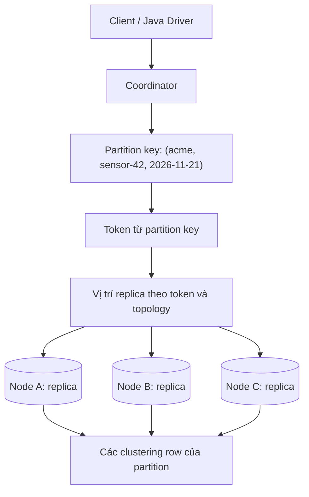
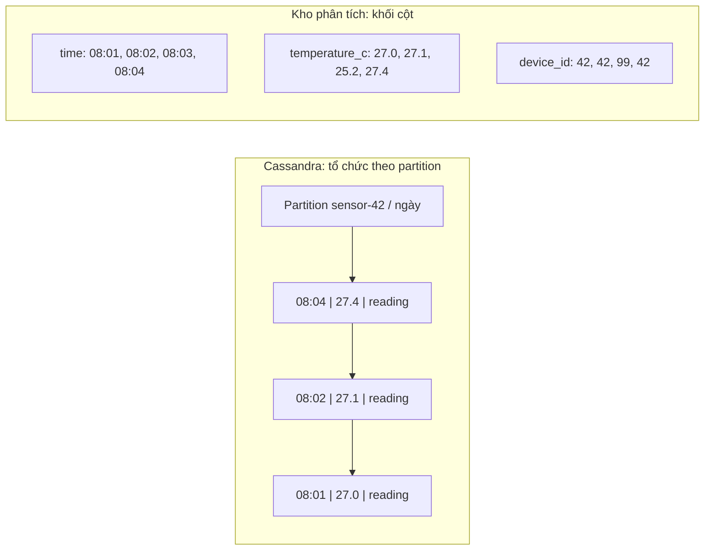
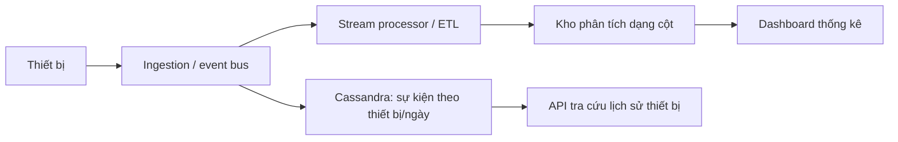

# Mô hình cột rộng, phân vùng dữ liệu và khác biệt với kho phân tích dạng cột

> **Chương:** Tư duy Cassandra  
> **Bối cảnh:** Apache Cassandra là hệ cơ sở dữ liệu NoSQL phân tán, hướng đến lưu trữ và truy cập dữ liệu khối lượng lớn qua nhiều node. Bài học giải thích cách nhìn dữ liệu theo partition và clustering, đồng thời phân biệt mô hình **wide-column** của Cassandra với cách lưu trữ **columnar** trong các hệ phân tích.

## 1. Mục tiêu học tập

Sau bài này, bạn sẽ có thể:

1. Mô tả đúng các khái niệm `keyspace`, bảng CQL, partition, row, cell, partition key và clustering column.
2. Giải thích vì sao partition key chi phối cả vị trí dữ liệu trong cụm và hiệu năng truy vấn; clustering column chỉ sắp xếp các row **bên trong** partition.
3. Phân biệt **wide-column data model** (Cassandra) với **column-oriented physical storage** (ví dụ kho phân tích dùng định dạng cột), dù tên gọi đều có chữ “column”.
4. Thiết kế và đọc một bảng CQL phục vụ truy vấn rõ ràng, nhận diện partition quá lớn hoặc quá nóng, và biết khi nào nên chia dữ liệu theo time bucket.
5. Chọn nơi xử lý phù hợp cho truy vấn thời gian thực theo khóa và báo cáo tổng hợp trên hàng triệu bản ghi.

## 2. Vấn đề đặt ra: cùng một tập dữ liệu, hai cách sử dụng

Giả sử nền tảng IoT tiếp nhận sự kiện từ hàng trăm nghìn thiết bị:

- **Màn hình vận hành:** “Lấy 100 sự kiện mới nhất của thiết bị `sensor-42` trong ngày 21/11/2026”.
- **Màn hình phân tích:** “Tính nhiệt độ trung bình theo từng giờ, thành phố và dòng thiết bị trên toàn hệ thống trong 30 ngày”.

Hai truy vấn đụng đến cùng loại dữ liệu nhưng có hình dạng rất khác nhau. Truy vấn thứ nhất đã biết **khóa thiết bị và ngày**, chỉ cần vài row gần nhau. Truy vấn thứ hai đọc **một thuộc tính qua rất nhiều row** rồi gom nhóm, tổng hợp. Cassandra phát huy thế mạnh ở kiểu thứ nhất khi schema được thiết kế đúng. Kho phân tích dạng cột thường phù hợp hơn với kiểu thứ hai.

Để hiểu lựa chọn đó, trước tiên cần hiểu “cột rộng” trong Cassandra **thực sự** chỉ điều gì.

## 3. Mô hình dữ liệu Cassandra: từ keyspace đến cell

Cassandra từng được mô tả qua khái niệm column family và wide row. Với CQL hiện đại, ta làm việc qua bảng có schema và các row tương tự cú pháp SQL; tuy nhiên đơn vị quan trọng để **định tuyến, lưu cùng nhau và truy cập hiệu quả** là **partition**, không phải một row đơn lẻ.

| Khái niệm | Ý nghĩa trong Cassandra | Ví dụ IoT |
| --- | --- | --- |
| **Keyspace** | Không gian tên chứa bảng và cấu hình replication | `telemetry` |
| **Table** | Cấu trúc dữ liệu được định nghĩa bằng CQL | `device_events_by_day` |
| **Partition key** | Một hoặc nhiều cột xác định partition; dùng để tính token và tìm các replica lưu dữ liệu | `(tenant_id, device_id, event_day)` |
| **Partition** | Tập các row chia sẻ **cùng giá trị partition key** | Mọi sự kiện của một thiết bị trong một ngày |
| **Clustering column** | Cột quyết định vị trí và thứ tự row **bên trong partition** | `event_time`, `event_id` |
| **Row** | Một bản ghi được xác định bởi toàn bộ primary key (partition key + clustering columns, nếu có) | Một sự kiện cụ thể |
| **Cell** | Giá trị cột của một row, cùng metadata liên quan như timestamp/TTL nếu áp dụng | `temperature_c = 27.4` |

### 3.1. Partition và row không phải là một

Giả sử bảng được định nghĩa như sau:

```sql
CREATE TABLE telemetry.device_events_by_day (
    tenant_id text,
    device_id text,
    event_day date,
    event_time timestamp,
    event_id uuid,
    temperature_c double,
    event_type text,
    payload text,
    PRIMARY KEY ((tenant_id, device_id, event_day), event_time, event_id)
) WITH CLUSTERING ORDER BY (event_time DESC, event_id ASC);
```

Một số row minh họa:

| Partition key (tenant, device, day) | Clustering key (time, event_id) | temperature_c | event_type |
| --- | --- | ---: | --- |
| (acme, sensor-42, 2026-11-21) | (08:05, id-3) | 27.4 | reading |
| (acme, sensor-42, 2026-11-21) | (08:02, id-2) | 27.1 | reading |
| (acme, sensor-42, 2026-11-21) | (07:59, id-1) | — | reconnect |
| (acme, sensor-99, 2026-11-21) | (08:04, id-4) | 25.2 | reading |

Ba row đầu có **cùng partition key**, nên cùng thuộc một partition logic; row thứ tư thuộc partition khác. Bên trong partition đầu, row được duyệt theo thứ tự `event_time` giảm dần, sau đó `event_id` tăng dần khi hai row cùng thời điểm.

Giá trị “—” trong bảng minh họa nghĩa là không có giá trị nhiệt độ cho sự kiện đó; không hàm ý Cassandra tự tạo một cột vật lý vô hạn. CQL vẫn có **schema khai báo cột**; sự thưa (sparsity) của dữ liệu thể hiện ở việc một số cell không có giá trị. Cần phân biệt mô hình cột rộng với quan niệm “bảng không có schema” hoặc “muốn thêm bao nhiêu cột tùy ý trong một truy vấn cũng được”.

### 3.2. “Wide” không có nghĩa nên tạo partition càng lớn càng tốt

Trong lịch sử mô hình wide-column, các row liên quan có thể được tổ chức dưới cùng một khóa phân vùng và duyệt theo thứ tự. Với CQL, mô hình một partition chứa **nhiều clustering row** vẫn hữu ích cho lịch sử sự kiện, hộp thư hoặc nhật ký hoạt động.

Tuy vậy, một partition chứa hàng triệu row và tăng mãi có thể gây vấn đề về bộ nhớ, đọc, compaction, repair và tải không cân đối. **Partition rộng là khả năng biểu diễn dữ liệu, không phải mục tiêu hiệu năng.**

## 4. Từ partition key đến vị trí dữ liệu trong cụm

Khái niệm partition trong Cassandra gắn trực tiếp với kiến trúc phân tán:

1. Ứng dụng ghi hoặc truy vấn theo một **partition key**.
2. Cassandra tính **token** từ giá trị partition key bằng partitioner được cấu hình (thông dụng là Murmur3).
3. Token và metadata của cụm xác định những node chịu trách nhiệm lưu **replica** của partition theo chiến lược replication.
4. **Coordinator** nhận yêu cầu client, tìm các replica cần thiết và tổng hợp phản hồi dựa vào consistency level.



Sơ đồ minh họa replication factor bằng 3 trong một trường hợp phù hợp; nó không biểu diễn rằng mỗi row được tự động chia thành ba mảnh. **Mỗi replica lưu bản sao của partition**. Các node thường quản lý nhiều dải token (vnode), nên thực tế không thể suy ra node đích chỉ từ số thứ tự thiết bị.

### 4.1. Hash partition key; không hash clustering column để phân phối

Với khóa:

```sql
PRIMARY KEY ((tenant_id, device_id, event_day), event_time, event_id)
```

- **Partition key ghép** là bộ `(tenant_id, device_id, event_day)`. Thứ tự và giá trị của cả ba thành phần xác định partition.
- **Clustering columns** là `event_time` và `event_id`. Chúng xác định các row **trong** partition đó và trật tự duyệt row, không dùng để phân tán từng row sang node mới.
- Hai thiết bị có cùng thời gian nhưng khác `device_id` có thể đến các token khác nhau. Hai sự kiện khác `event_time` nhưng cùng bộ khóa phân vùng sẽ nằm trong **cùng partition**.

Đây là lý do lựa chọn partition key ảnh hưởng đồng thời đến khả năng chia tải, dung lượng mỗi partition và hình dạng câu `WHERE`.

### 4.2. “Chia dữ liệu theo partition” khác “chia dữ liệu theo cột”

Khi Cassandra phân phối partition lên các node, ta có thể hình dung **đặt các nhóm row** lên những replica khác nhau, căn cứ vào partition key. Cassandra **không** phân công node A chỉ lưu `temperature_c`, node B chỉ lưu `event_type` và node C chỉ lưu `payload` của cùng một row.

Nhầm hai kiểu chia dữ liệu này sẽ dẫn tới kỳ vọng sai rằng truy vấn `AVG(temperature_c)` trên mọi thiết bị tự động đọc ít dữ liệu chỉ vì Cassandra được gọi là “wide-column”.

## 5. Wide-column và columnar analytics khác nhau ở đâu?

Từ “column” xuất hiện trong cả hai thuật ngữ nhưng nói về **hai phương diện khác nhau**.

### 5.1. Wide-column: cách mô hình hóa và truy cập dữ liệu

Ở Cassandra, dữ liệu được mô hình hóa thành partition có các clustering row và cell. **SSTable** là cấu trúc đĩa bất biến chứa dữ liệu sắp theo thứ tự của partition và clustering key, kèm các cấu trúc chỉ mục/phụ trợ giúp tìm partition và row phù hợp. Đây **không phải** định dạng lưu toàn bộ giá trị `temperature_c` của mọi row kế tiếp nhau thành một cột vật lý riêng để quét tổng hợp.

Đường ghi thường đi qua commit log, memtable rồi flush thành SSTable; compaction hợp nhất SSTable về sau. Điều này hỗ trợ ghi phân tán và đọc theo khóa, đồng thời đem lại chi phí vận hành riêng.

### 5.2. Columnar: cách bố trí dữ liệu vật lý để đọc theo cột

Một **column-oriented analytical store** thường sắp và nén dữ liệu **theo từng cột trong một nhóm row hoặc data part**: các giá trị `temperature_c` nằm gần nhau, các giá trị `device_id` nằm trong luồng/khối cột khác. Khi truy vấn chỉ cần một vài cột trên hàng triệu row, bộ máy có thể đọc những cột cần thiết và xử lý theo lô (vectorized execution). Kỹ thuật phân vùng, phân cụm/sắp xếp dữ liệu và chỉ mục vẫn quyết định lượng dữ liệu thực tế phải đọc.

Ví dụ, **ClickHouse** là một hệ quản trị phân tích thường dùng lưu trữ dạng cột. **Apache Parquet** là **định dạng file dạng cột**, không phải một hệ quản trị cơ sở dữ liệu hay dịch vụ truy vấn độc lập; các công cụ như Spark, Trino hoặc một query engine khác có thể đọc Parquet.

### 5.3. So sánh trực quan cùng bốn sự kiện

Giả sử có các hàng:

| device_id | time | temperature_c | event_type |
| --- | --- | ---: | --- |
| sensor-42 | 08:01 | 27.0 | reading |
| sensor-42 | 08:02 | 27.1 | reading |
| sensor-99 | 08:03 | 25.2 | reading |
| sensor-42 | 08:04 | 27.4 | reading |

**Tư duy theo partition của Cassandra:** tìm nhóm `(sensor-42, ngày)`, rồi duyệt các row theo `time`; không cần một đợt quét toàn bộ thiết bị.

**Tư duy quét cột để phân tích:** quét các khối giá trị `temperature_c` và `time` của tập dữ liệu cần xét; chỉ nạp thêm `device_id` nếu truy vấn có lọc hoặc nhóm theo thiết bị. Thao tác này có thể tận dụng nén và thực thi theo lô.



Sơ đồ chỉ minh họa **cách nghĩ về đường truy cập**, không đại diện cho bố trí byte chính xác của SSTable, ClickHouse hay Parquet.

### 5.4. Bảng so sánh để chọn công cụ

| Tiêu chí | Cassandra (wide-column) | Kho phân tích dạng cột (columnar OLAP) |
| --- | --- | --- |
| Tổ chức truy cập chủ đạo | Phân vùng theo partition key; sắp row theo clustering column bên trong partition | Đọc những cột cần thiết qua các khối dữ liệu lớn, có thể kết hợp partition pruning và sắp xếp vật lý |
| Truy vấn mạnh | Lấy dữ liệu một vài partition đã biết, giới hạn theo thứ tự/thời gian | `GROUP BY`, `SUM`, `AVG`, lọc và tổng hợp trên tập bản ghi lớn |
| Tải thường gặp | Nhiều yêu cầu đọc/ghi nhỏ, liên tục và phân tán theo khóa | Truy vấn tổng hợp phức tạp, quét dữ liệu lớn; nạp dữ liệu theo lô hoặc streaming tùy hệ thống |
| Định vị dữ liệu | Partition key được hash thành token; replica theo topology | Tùy engine: partition, shard, sort key, zone map/min-max, projection... |
| Truy vấn không biết khóa chính | Thường cần bảng phụ, index có chọn lọc hoặc pipeline khác; không nên quét tùy tiện | Thường là một phần quan trọng của nghiệp vụ phân tích |
| JOIN và báo cáo biến động | Không phải điểm mạnh của CQL; thiết kế bảng theo truy vấn | Nhiều engine hỗ trợ SQL phân tích và JOIN, năng lực tùy hệ thống |
| Cập nhật/ghi liên tục | Thiết kế để tiếp nhận mutation trên cụm phân tán, với consistency có thể điều chỉnh | Khả năng update, upsert và thời gian thấy dữ liệu mới khác nhau đáng kể giữa các engine |
| Đánh đổi | Schema gắn với mẫu truy cập; partition nóng/lớn; repair/compaction/tombstone | Chi phí ingest/merge, dữ liệu đến trễ, thiết kế partition/sort, dung lượng và tài nguyên quét |

Không có quy tắc “NoSQL thì ghi tốt, OLAP thì không ghi được”. Cả hai họ đều có nhiều biến thể. Sự phân biệt ở đây là **đường truy cập tối ưu** và **đặc tính thực thi**, không phải một tuyên bố tuyệt đối về mọi sản phẩm.

## 6. Thiết kế bảng CQL theo đường truy vấn

Trở lại bài toán **100 sự kiện mới nhất của một thiết bị trong một ngày**. Ta tạo bảng cho truy vấn này, không cố ép mọi loại báo cáo dùng một bảng duy nhất.

### 6.1. Tạo keyspace và bảng

```sql
-- Minh họa: data center thật sự có tên dc1 và có đủ node cho RF = 3.
-- Khi triển khai, phải dùng tên data center và RF phù hợp cluster.
CREATE KEYSPACE IF NOT EXISTS telemetry
WITH replication = {
  'class': 'NetworkTopologyStrategy',
  'dc1': 3
};

CREATE TABLE IF NOT EXISTS telemetry.device_events_by_day (
    tenant_id text,
    device_id text,
    event_day date,
    event_time timestamp,
    event_id uuid,
    temperature_c double,
    event_type text,
    payload text,
    PRIMARY KEY ((tenant_id, device_id, event_day), event_time, event_id)
) WITH CLUSTERING ORDER BY (event_time DESC, event_id ASC);
```

Ở đây:

- `tenant_id` đảm bảo dữ liệu của khách hàng khác không vô tình chia sẻ cùng partition key.
- `device_id` giới hạn dữ liệu về một thiết bị.
- `event_day` là **time bucket**. Ứng dụng thống nhất ngày theo **UTC** từ `event_time`, để sự kiện gần nửa đêm không được ghi nhầm bucket giữa các vùng múi giờ.
- `event_time` giảm dần giúp đọc sự kiện mới trước; `event_id` tạo khóa duy nhất khi có nhiều sự kiện cùng timestamp.
- `temperature_c`, `event_type` và `payload` là các cột dữ liệu bình thường; chúng **không** tự tạo một đường truy cập hiệu quả để tìm trên toàn cụm.

### 6.2. Ghi sự kiện

```sql
INSERT INTO telemetry.device_events_by_day (
    tenant_id, device_id, event_day, event_time,
    event_id, temperature_c, event_type, payload
) VALUES (
    'acme', 'sensor-42', '2026-11-21',
    '2026-11-21T08:05:00Z',
    11111111-1111-1111-1111-111111111111,
    27.4, 'reading', '{"battery_pct":86}'
);
```

Khi ứng dụng Java dùng driver, nên chuẩn bị câu lệnh và **bind parameter** cho dữ liệu đầu vào; không ghép chuỗi CQL bằng dữ liệu người dùng. Nếu có retry sau timeout, giữ nguyên khóa sự kiện cho cùng một sự kiện logic để tránh tạo row mới ngoài ý muốn. Mô hình idempotency toàn hệ thống còn phụ thuộc ngữ nghĩa cập nhật và phát sự kiện của ứng dụng.

### 6.3. Truy vấn trúng một partition

```sql
SELECT event_time, event_id, event_type, temperature_c
FROM telemetry.device_events_by_day
WHERE tenant_id = 'acme'
  AND device_id = 'sensor-42'
  AND event_day = '2026-11-21'
LIMIT 100;
```

Lệnh trên cung cấp **đủ partition key** và lấy các row đầu theo thứ tự clustering đã khai báo. Một truy vấn có điều kiện khoảng thời gian cũng có thể được định tuyến trong partition:

```sql
SELECT event_time, temperature_c
FROM telemetry.device_events_by_day
WHERE tenant_id = 'acme'
  AND device_id = 'sensor-42'
  AND event_day = '2026-11-21'
  AND event_time >= '2026-11-21T08:00:00Z'
  AND event_time < '2026-11-21T09:00:00Z';
```

Do đã biết partition, số row phải duyệt thường được giới hạn bởi thiết kế dữ liệu và điều kiện clustering. `LIMIT 100` giới hạn số kết quả, nhưng **không bảo đảm** mọi truy vấn đều nhanh: partition quá lớn, tombstone dày đặc, lưu trữ đang quá tải hoặc consistency level cao vẫn có thể làm tăng độ trễ.

### 6.4. Truy vấn không phù hợp với bảng này

Những yêu cầu sau không được thiết kế tốt chỉ bằng primary key phía trên:

```sql
-- Ý tưởng nghiệp vụ, KHÔNG phải mẫu truy vấn hiệu quả cho bảng trên:
-- Tìm mọi sự kiện có event_type = 'alarm' từ tất cả thiết bị.
-- SELECT ... FROM telemetry.device_events_by_day
-- WHERE event_type = 'alarm';

-- Tính AVG(temperature_c) cho mọi thiết bị trong 30 ngày.
-- SELECT AVG(temperature_c) ... GROUP BY city, hour;
```

CQL không có khả năng `GROUP BY` tùy ý như một kho phân tích tổng quát. Hệ thống không thể suy ra replica của một partition chỉ từ giá trị `event_type`; nó có thể phải đọc một số lượng partition rất lớn. `ALLOW FILTERING` không làm thay đổi bản chất chi phí của truy vấn quét rộng. Secondary index, Storage-Attached Index (SAI) ở phiên bản hỗ trợ, hoặc bảng bổ sung có thể giúp **một số** mẫu truy vấn, nhưng phải đánh giá độ chọn lọc, độ phân bố giá trị, số lượng kết quả và tải thật.

Nếu yêu cầu là “lấy alarm gần nhất của *một thiết bị*”, có thể bổ sung bảng phục vụ truy vấn đó:

```sql
CREATE TABLE IF NOT EXISTS telemetry.device_alarms_by_day (
    tenant_id text,
    device_id text,
    event_day date,
    event_time timestamp,
    event_id uuid,
    description text,
    PRIMARY KEY ((tenant_id, device_id, event_day), event_time, event_id)
) WITH CLUSTERING ORDER BY (event_time DESC, event_id ASC);
```

Ứng dụng ghi sự kiện alarm vào bảng chuyên dụng này theo quy trình nhất quán với nghiệp vụ. Nó vẫn **không** tự giải quyết báo cáo alarm theo mọi thiết bị/thành phố. Đó là loại truy vấn cần thiết kế một hệ dữ liệu khác hoặc pipeline tổng hợp phù hợp.

## 7. Chọn partition key: đúng truy vấn, đều tải, vừa kích thước

Partition key tốt phải cân bằng **ba yêu cầu đồng thời**:

1. **Định vị:** truy vấn thường biết đầy đủ giá trị partition key.
2. **Phân bố:** lưu lượng và dữ liệu được trải tương đối đều trên nhiều partition/replica, không dồn vào một số khóa nóng.
3. **Kích thước:** một partition được giới hạn hợp lý trong vòng đời dữ liệu và tải đọc/ghi.

### 7.1. Những thiết kế dễ gặp vấn đề

| Cách chọn khóa | Điều gì có thể xảy ra? | Khi nào cân nhắc sửa? |
| --- | --- | --- |
| `PRIMARY KEY ((event_day), device_id, event_time)` | Mọi thiết bị trong một ngày dồn vào một partition; tạo điểm nóng lớn | Khi nguồn ghi có nhiều thiết bị trong cùng ngày |
| `PRIMARY KEY ((device_id), event_time)` | Một thiết bị tích lũy dữ liệu vô hạn theo thời gian; partition ngày càng lớn | Khi dữ liệu giữ lâu và tốc độ ghi đáng kể |
| `PRIMARY KEY ((tenant_id, device_id, event_day), ...)` | Mỗi thiết bị/ngày là một partition; cân bằng tốt hơn khi thiết bị tương đối đồng đều | Khi truy vấn biết ba giá trị và lưu lượng mỗi thiết bị/ngày vừa phải |
| `PRIMARY KEY ((event_id), ...)` | Phân bố theo từng sự kiện nhưng rất khó đọc “100 sự kiện mới nhất của một thiết bị” | Chỉ phù hợp nếu truy vấn chính là tìm theo event ID |

**Không có một khóa tối ưu cho mọi yêu cầu.** Nếu hệ thống tra cứu theo hai chiều độc lập, bạn thường phải chấp nhận nhiều bảng theo truy vấn, một hệ chỉ mục thích hợp hoặc một hệ phân tích riêng.

### 7.2. Vì sao thêm time bucket?

Giả sử một thiết bị ghi 20.000 sự kiện/ngày và một sự kiện có kích thước trung bình khoảng 500 byte trước các chi phí lưu trữ, chỉ riêng payload logic đã khoảng **10 MB/ngày**. Nếu gom nhiều năm vào cùng partition, kích thước sẽ tiếp tục tăng, bất kể cluster được mở rộng bằng bao nhiêu node.

Với bucket theo ngày, kích thước được giới hạn bởi tải **trong một ngày**; nhưng nếu thiết bị ghi hàng triệu sự kiện/ngày, bucket ngày vẫn có thể quá lớn hoặc quá nóng. Có thể chia theo giờ, hoặc dùng shard logic có kiểm soát, đổi lại ứng dụng cần biết cách truy vấn nhiều bucket/shard và hợp nhất kết quả đúng thứ tự.

Vì vậy, hãy dựa trên số row, kích thước thật, tốc độ ghi, độ lệch tải giữa các thiết bị, mục tiêu độ trễ và thời gian lưu giữ khi chọn bucket. Ví dụ 10 MB ở trên chỉ để hình dung quy mô, **không phải ngưỡng partition được Cassandra bảo đảm**.

### 7.3. Cạm bẫy “nhiều partition” và “nhiều row”

- **Nhiều partition nhỏ** có thể phân tán tốt, nhưng truy vấn muốn lấy toàn bộ dữ liệu trong ngày của *mọi* thiết bị sẽ phải chạm đến rất nhiều partition.
- **Một partition rất lớn** có thể thuận tiện cho một điều kiện `WHERE`, nhưng đẩy nhiều thao tác lên cùng nhóm replica, tăng áp lực đọc/ghi và bảo trì.
- **Một khóa có cardinality cao** không đủ để tốt nếu phân bố lưu lượng lệch mạnh: 100.000 thiết bị ít hoạt động và một thiết bị cực nóng vẫn có thể tạo nút thắt.
- **Clustering order** chỉ hữu ích sau khi đã định vị được partition; nó không tạo thứ tự thời gian toàn cụm.

## 8. Tư duy truy vấn: Cassandra và kho phân tích kết hợp ra sao?

Giả sử ứng dụng có ba luồng sử dụng dữ liệu:

| Yêu cầu | Công cụ/cách mô hình thường phù hợp | Lý do |
| --- | --- | --- |
| Hiển thị 100 sự kiện mới nhất của một thiết bị | Cassandra, bảng theo `(tenant, device, day)` | Đọc có khóa rõ ràng, giới hạn theo clustering order |
| Tra cứu trạng thái thiết bị mới nhất theo ID | Cassandra, bảng state hiện tại theo `(tenant, device)` hoặc dịch vụ trạng thái khác | Truy cập điểm (point lookup), cập nhật theo khóa |
| Thống kê nhiệt độ trung bình theo thành phố, loại thiết bị và giờ trong 30 ngày | Kho phân tích dạng cột, bảng tổng hợp hoặc pipeline streaming | Phải gom nhóm trên nhiều thiết bị; chỉ đọc các cột dùng trong phân tích |

Một kiến trúc triển khai có thể như sau:



Đây là một **phương án tham khảo**, không phải cấu trúc bắt buộc. Có thể cấp dữ liệu phân tích từ event bus, từ luồng CDC nếu hạ tầng hỗ trợ, hoặc thông qua ETL có kiểm soát. Cần quy định rõ quy tắc deduplication, dữ liệu đến muộn, timezone, dữ liệu xóa/TTL và độ trễ đồng bộ chấp nhận được.

### 8.1. Vì sao không hỏi Cassandra làm mọi báo cáo?

Một truy vấn “100 sự kiện mới nhất cho sensor-42” thường biết các partition cần đến. Ngược lại, “tính trung bình qua 200.000 thiết bị” có thể phải chạm nhiều partition, truyền dữ liệu lớn qua mạng và tổng hợp ở ứng dụng. Dù Cassandra có nhiều node, mở rộng ngang không biến một phép quét toàn cụm thành truy vấn rẻ.

Để báo cáo nhanh, hệ phân tích có thể dùng cột nén, partition pruning, materialized aggregate, pre-aggregation hoặc cache theo mức thời gian. Những kỹ thuật này cần thiết kế riêng, không tự xuất hiện khi thay đổi nhãn database.

### 8.2. Khi nào vẫn tính toán trên Cassandra?

Nếu câu hỏi **giới hạn một partition nhỏ**, chẳng hạn đọc một loạt điểm đo của một thiết bị trong một giờ rồi ứng dụng tính trung bình, Cassandra vẫn có thể là nguồn dữ liệu hợp lý. Vấn đề không phải cứ có phép tính là phải dùng OLAP; vấn đề là **khối lượng dữ liệu phải đọc, số partition phải truy cập, độ trễ yêu cầu và số lần truy vấn lặp lại**.

## 9. Các đánh đổi vận hành liên quan trực tiếp đến phân vùng

Mô hình partition và cách lưu SSTable dẫn tới một số tác động mà người thiết kế schema phải biết:

### 9.1. Replication và consistency không thay thế thiết kế partition

Replication factor tăng số bản sao và hỗ trợ chịu lỗi. Consistency level (`ONE`, `LOCAL_QUORUM`, `ALL`...) quy định yêu cầu phải nhận bao nhiêu phản hồi trước khi coi là hoàn tất. Chúng **không** chia nhỏ một partition nóng thành nhiều partition. Nếu một khóa nhận phần lớn lưu lượng, các replica của khóa đó vẫn có thể quá tải.

Với RF = 3 trong một data center, `LOCAL_QUORUM` thường cần 2 replica cục bộ phản hồi. Nếu không đủ replica, thao tác có thể thất bại hoặc timeout; ứng dụng phải hiểu rằng timeout không nhất thiết nghĩa là không replica nào đã ghi dữ liệu.

### 9.2. Tombstone, TTL, compaction và repair

- **TTL/xóa:** dữ liệu hết hạn hoặc bị xóa được biểu diễn qua tombstone để các replica biết trạng thái xóa. Đọc qua nhiều tombstone có thể tốn tài nguyên.
- **Compaction:** SSTable bất biến được hợp nhất theo chiến lược cấu hình. Workload sự kiện có tuổi thọ xác định thường cần đánh giá chiến lược compaction dựa trên thời gian; không có một lựa chọn tốt cho mọi bảng.
- **Repair:** so sánh và đồng bộ dữ liệu giữa replica, nhất là sau lỗi hoặc ngắt kết nối lâu. Hinted handoff hỗ trợ một số trường hợp replica tạm vắng nhưng không thay thế lịch repair.
- **Chi phí lưu trữ:** RF, tombstone, dữ liệu bị viết lại trong compaction và dung lượng tạm thời đều ảnh hưởng capacity planning.

Thiết kế time bucket, TTL và thời gian lưu giữ cần ăn khớp với quy trình repair và compaction. Không tùy tiện giảm `gc_grace_seconds` chỉ để dọn tombstone sớm; thiếu điều kiện an toàn có thể dẫn đến nguy cơ dữ liệu đã xóa xuất hiện lại khi replica cũ quay về.

### 9.3. Đọc dữ liệu theo nhiều ngày

Nếu trang lịch sử cần 7 ngày, schema theo ngày khiến ứng dụng phải truy vấn tối đa các bucket liên quan rồi hợp nhất theo thời gian. Cần giới hạn song song, phân trang và kiểm soát số bucket. Phân trang CQL sử dụng paging state của driver và không đồng nghĩa với `OFFSET` kiểu SQL quan hệ. Một API trả “100 sự kiện mới nhất của 7 ngày” phải tự quản lý thứ tự chung giữa các partition.

## 10. Tình huống thực hành: chọn schema trước khi viết CQL

Một hệ thống giao hàng có 50.000 xe, mỗi xe gửi vị trí sau mỗi 10 giây; quản trị viên muốn:

1. Xem lịch sử GPS của một xe trong 15 phút gần nhất.
2. Xem điểm GPS gần nhất của một xe.
3. Lập bản đồ nhiệt mật độ xe theo quận trên toàn quốc trong 90 ngày.

**Câu hỏi A.** Dùng `vehicle_id` làm partition key duy nhất cho bảng lịch sử có hợp lý không?

**Câu hỏi B.** Một bảng lịch sử chia theo `(vehicle_id, event_day)` có giải quyết trực tiếp dashboard 90 ngày không?

**Câu hỏi C.** Nếu một xe bất thường gửi 1.000 bản tin/giây, thêm node có tự làm partition đó hết nóng không?

**Câu hỏi D.** Nếu UI cần tọa độ mới nhất theo ID, có nhất thiết duyệt toàn bộ lịch sử trong partition để tìm không?

### Gợi ý đáp án

**A.** Không nên mặc định. Lịch sử vô hạn của một xe sẽ tích lũy trong một partition. Chia bucket ngày/giờ theo tải và cửa sổ truy vấn giúp hạn chế kích thước.

**B.** Không. Dashboard cần tổng hợp qua nhiều xe, nhiều bucket và nhiều ngày. Nên xây pipeline tổng hợp, bảng đích cho phân tích hoặc dùng kho phân tích dạng cột.

**C.** Không. Partition hot gắn với nhóm replica tương ứng; phải xem lại chiến lược phân vùng, tốc độ ghi, khả năng backpressure và yêu cầu truy vấn. Chia shard có thể giúp nhưng tăng độ phức tạp đọc và sắp xếp.

**D.** Không nhất thiết. Có thể thiết kế bảng `latest_location_by_vehicle` theo `vehicle_id` để phục vụ point lookup; xác định cách cập nhật, xử lý sự kiện đến trễ và yêu cầu tính đúng đắn trước khi triển khai.

## 11. Những ngộ nhận cần tránh

| Ngộ nhận | Cách hiểu đúng |
| --- | --- |
| “Wide-column nghĩa là Cassandra lưu tất cả giá trị của cùng một cột nằm liền nhau như Parquet.” | Wide-column nói về mô hình dữ liệu theo partition và clustering; SSTable của Cassandra phục vụ truy cập theo khóa. Parquet dùng bố trí cột cho phân tích. |
| “Một primary key là một giá trị duy nhất.” | Primary key có thể gồm **partition key ghép** và nhiều clustering column; mỗi phần có vai trò riêng. |
| “Có thứ tự `event_time` nghĩa là đã có thứ tự toàn bảng.” | Thứ tự clustering chỉ tồn tại bên trong mỗi partition. |
| “Partition càng lớn càng tiết kiệm.” | Partition quá lớn hoặc nóng có thể gây nghẽn và tăng chi phí vận hành. |
| “`LIMIT 100` làm mọi truy vấn quét đều rẻ.” | Chi phí tìm và lọc dữ liệu trước khi trả kết quả vẫn có thể lớn. |
| “Tăng replication là đủ chữa khóa nóng.” | Replication tăng số bản sao; thiết kế khóa phân vùng vẫn quyết định nhóm replica chịu tải. |
| “Cassandra và kho columnar loại trừ nhau.” | Trong một kiến trúc dữ liệu, Cassandra có thể phục vụ truy cập theo khóa còn kho phân tích phục vụ quét và tổng hợp. |

## 12. Tự kiểm tra

1. Với `PRIMARY KEY ((account_id, day), created_at, message_id)`, đâu là partition key và đâu là clustering columns? **Đáp án:** `(account_id, day)`; `created_at` và `message_id`.
2. Hai row có cùng partition key nhưng khác clustering key có thể nằm trên hai node không liên quan như hai partition khác nhau không? **Đáp án:** Chúng thuộc cùng partition logic, được đặt trên cùng tập replica của partition đó; không được hash riêng để phân phối độc lập.
3. Nếu muốn tìm 50 sự kiện mới nhất của một thiết bị trong ngày, điều kiện `WHERE` nên chứa gì? **Đáp án:** Đủ các thành phần của partition key, sau đó có thể giới hạn khoảng thời gian theo clustering column và `LIMIT`.
4. Vì sao kho phân tích dạng cột đọc hiệu quả một vài thuộc tính qua rất nhiều hàng? **Đáp án:** Nó thường lưu theo cột thành các khối nén và tối ưu cho quét cột, xử lý theo lô và tổng hợp; hiệu quả còn phụ thuộc layout và điều kiện lọc.
5. Thêm ngày vào partition key có khiến dữ liệu tự động được sắp theo ngày trên toàn cluster không? **Đáp án:** Không. Thành phần ngày góp vào giá trị partition key rồi được hash để định tuyến; nó không tạo một danh sách row sắp theo ngày toàn cụm.
6. Một hệ thống vừa cần tra cứu sự kiện từng thiết bị vừa cần thống kê toàn quốc nên có bắt buộc một database thực hiện cả hai không? **Đáp án:** Không. Có thể tách đường phục vụ truy vấn vận hành và đường phục vụ phân tích, nối bằng pipeline phù hợp.

## 13. Ghi nhớ cốt lõi

Mô hình Cassandra bắt đầu từ **truy vấn nào cần trả lời**. Chọn **partition key** để định vị dữ liệu và phân phối tải; chọn **clustering columns** để duyệt row có thứ tự **trong partition**; sau đó đánh giá kích thước partition, điểm nóng, replication, consistency, compaction và repair.

**Wide-column của Cassandra mô tả cách tổ chức dữ liệu theo khóa và partition. Columnar analytics mô tả cách lưu và xử lý các cột để quét và tổng hợp trên nhiều row.** Hai khái niệm có chung từ “column” nhưng tối ưu cho hai kiểu truy cập khác nhau.

Khi triển khai, hãy xem **CQL và thiết kế bảng theo truy vấn** là phần của thiết kế hệ phân tán, chứ không chỉ là cú pháp SQL khác. Những kiến thức về phân vùng này sẽ tiếp tục chi phối cách cấu hình replication, lựa chọn mức nhất quán, xử lý lỗi, vận hành compaction/repair và viết truy vấn từ ứng dụng Java.
