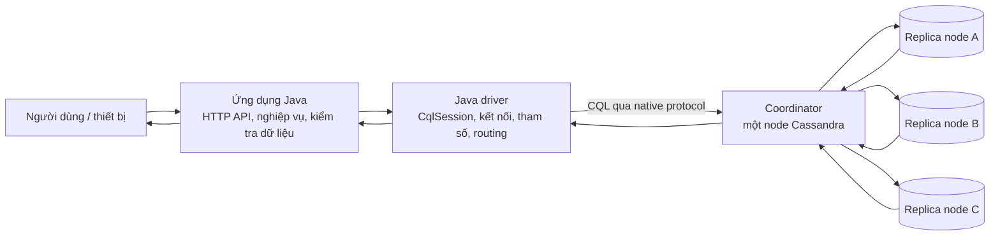
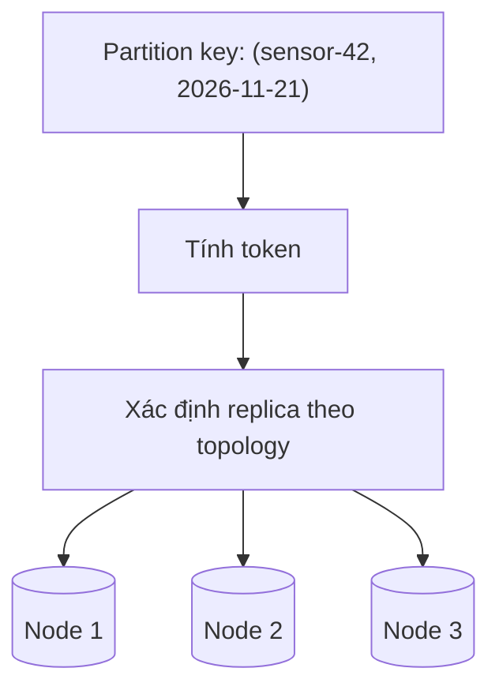
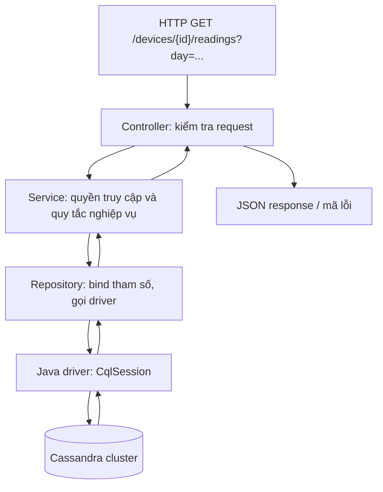

# Phân biệt Cassandra, CQL, driver và ứng dụng Java

> **Chương:** Tư duy Cassandra  
> **Phạm vi:** Nhận diện chính xác trách nhiệm của Apache Cassandra, ngôn ngữ CQL, Java driver và ứng dụng Java trong một hệ thống sử dụng cơ sở dữ liệu wide-column phân tán. Bài có ví dụ CQL và Java, cùng cách suy luận về phân vùng, replication, consistency, lỗi mạng và vận hành.

## 1. Mục tiêu học tập

Sau bài học, bạn có thể:

1. Giải thích bốn thuật ngữ **Cassandra**, **CQL**, **driver** và **ứng dụng Java** mà không dùng lẫn lộn.
2. Vẽ được đường đi của một lệnh đọc/ghi từ ứng dụng qua driver, coordinator đến các replica rồi trở lại ứng dụng.
3. Xác định trách nhiệm của từng lớp đối với schema, partition key, consistency level, retry, tính đúng đắn nghiệp vụ và xử lý lỗi.
4. Viết một cặp ví dụ **CQL + Java driver** truy cập cùng một bảng theo partition key, đồng thời hiểu vai trò của `cqlsh`.
5. Nhận diện các hiểu lầm như “CQL là Java API”, “driver tự phân mảnh dữ liệu”, “timeout chắc chắn chưa ghi”, “dùng driver thì không cần quan tâm schema”.

## 2. Một ứng dụng, bốn khái niệm khác nhau

Giả sử dịch vụ giám sát nhiệt độ tiếp nhận hàng nghìn sự kiện mỗi giây. Giao diện yêu cầu: “Hiển thị 10 lần đo mới nhất của thiết bị `sensor-42` trong ngày”. Người lập trình có thể viết mã Java, gửi câu lệnh CQL qua Java driver, rồi nhận dữ liệu do cluster Cassandra lưu giữ.

| Thành phần | Bản chất | Trả lời câu hỏi nào? | Ví dụ |
| --- | --- | --- | --- |
| **Apache Cassandra** | Hệ quản trị cơ sở dữ liệu NoSQL phân tán, thuộc họ wide-column | **Dữ liệu nằm ở đâu, được nhân bản và phục vụ như thế nào?** | Node, partition, replica, coordinator, memtable, SSTable |
| **CQL (Cassandra Query Language)** | Ngôn ngữ khai báo schema và thao tác dữ liệu của Cassandra | **Muốn tạo bảng, ghi hoặc đọc dữ liệu nào?** | `CREATE TABLE`, `INSERT`, `SELECT` |
| **Java driver** | Thư viện client cho Java, giao tiếp với Cassandra qua native protocol | **Mã Java kết nối, gửi câu lệnh, truyền tham số và nhận kết quả ra sao?** | `CqlSession`, `PreparedStatement`, `Row` |
| **Ứng dụng Java** | Phần mềm chứa quy tắc nghiệp vụ, API, kiểm tra đầu vào và điều phối tác vụ | **Vì sao cần dữ liệu, xử lý kết quả và trả lời người dùng như thế nào?** | API `GET /devices/{id}/readings`, service, controller |

Một cách nhớ đơn giản:

- **Cassandra là nơi dữ liệu được quản lý và phục vụ.**
- **CQL là ngôn ngữ mô tả thao tác đối với dữ liệu ấy.**
- **Driver là cầu nối lập trình giữa Java và cluster Cassandra.**
- **Ứng dụng Java là nơi quyết định nghiệp vụ cần thao tác gì và sử dụng kết quả ra sao.**

Các lớp liên quan chặt chẽ nhưng không thay thế được nhau: có cluster Cassandra mà chưa viết ứng dụng Java vẫn có thể thao tác từ `cqlsh`; có CQL mà thiếu server thì câu lệnh chưa được thực thi; có driver mà không có schema/truy vấn đúng vẫn không tạo ra hệ thống tốt.

## 3. Sơ đồ kiến trúc: mỗi lớp làm một phần việc



Sơ đồ dùng ba replica để minh họa, không khẳng định mọi cluster luôn có replication factor bằng 3. Coordinator là node Cassandra nhận yêu cầu cụ thể, **không phải một máy master cố định**. Số replica cần phản hồi phụ thuộc replication factor và consistency level của thao tác; coordinator không nhất thiết chờ đủ cả ba replica trong ví dụ trên.

### 3.1. Ranh giới mạng và trách nhiệm

Ứng dụng Java thường kết nối qua driver đến cổng **CQL native protocol** của các node Cassandra, thông dụng là TCP **9042**, có thể được bảo vệ bằng TLS tùy triển khai. Driver duy trì kết nối và chuyển dữ liệu thành thông điệp của giao thức. Server Cassandra xử lý truy vấn, tìm replica theo partition key, đọc/ghi dữ liệu và đưa kết quả về.

Lệnh CQL là **nội dung yêu cầu**, không phải một dịch vụ độc lập chạy ngoài Cassandra. Java driver không “chạy database trong JVM”; Cassandra là các tiến trình server riêng. Ứng dụng Java cũng không phải là một replica chỉ vì nó biết partition key.

## 4. Cassandra chịu trách nhiệm gì?

Cassandra là hệ thống quản lý dữ liệu phân tán. Những công việc chính ở **phía server** gồm:

1. **Lưu dữ liệu theo mô hình bảng/partition:** mỗi row thuộc một partition do **partition key** xác định; clustering columns xác định thứ tự row bên trong partition.
2. **Phân phối partition lên cluster:** token được tính từ partition key, rồi topology và replication strategy xác định những node lưu replica.
3. **Duy trì bản sao và phối hợp yêu cầu:** node coordinator giao tiếp với các replica và đợi số phản hồi theo **consistency level**.
4. **Ghi và đọc từ cấu trúc lưu trữ:** commit log, memtable, SSTable, index nội bộ và các bước hòa giải giá trị khi đọc.
5. **Vận hành dữ liệu theo thời gian:** compaction, tombstone/TTL, anti-entropy repair và xử lý tình huống replica tạm thời không sẵn sàng.

Các việc này tạo nên lợi ích của Cassandra khi hệ thống cần khả năng ghi lớn, mở rộng ngang và chịu lỗi từng node hoặc data center.

**Cassandra không tự biết quy tắc nghiệp vụ** như “chỉ khách hàng sở hữu thiết bị mới được xem dữ liệu”, “đọc báo cáo phải quy đổi về múi giờ người dùng”, hay “lệnh thanh toán phải phát sự kiện đúng một lần”. Những điều đó cần được thiết kế tại ứng dụng và các hệ thống liên quan.

### 4.1. Cassandra không đồng nghĩa với một máy duy nhất



Với một partition, mỗi replica lưu bản sao của dữ liệu thuộc partition đó; các clustering row của cùng partition không được hash độc lập để rải ngẫu nhiên sang node mới. Vì vậy, thêm node **không tự khắc phục** tình trạng một partition có lưu lượng quá lớn. Chọn partition key là quyết định thiết kế thuộc trách nhiệm của người xây hệ thống, dù Cassandra thực hiện việc tính token và định tuyến.

## 5. CQL chịu trách nhiệm gì?

**CQL (Cassandra Query Language)** là ngôn ngữ để định nghĩa và thao tác dữ liệu trong Cassandra. Cú pháp có các từ quen thuộc với SQL nhưng ngữ nghĩa truy cập dựa nhiều vào primary key và cách dữ liệu phân vùng.

| Nhóm thao tác | CQL ví dụ | Mục đích |
| --- | --- | --- |
| Khai báo keyspace | `CREATE KEYSPACE ... WITH replication = ...` | Đặt không gian tên và chiến lược replication |
| Khai báo bảng | `CREATE TABLE ... PRIMARY KEY (...)` | Xác định partition key và clustering columns |
| Ghi dữ liệu | `INSERT INTO ... VALUES (...)` | Ghi hoặc cập nhật row theo khóa |
| Đọc dữ liệu | `SELECT ... WHERE ... LIMIT ...` | Lấy row theo điều kiện được mô hình bảng hỗ trợ |
| Xóa dữ liệu | `DELETE FROM ... WHERE ...` | Xóa dữ liệu theo khóa/điều kiện hợp lệ; thường tạo tombstone |
| Lệnh có điều kiện | `INSERT ... IF NOT EXISTS` | Dùng lightweight transaction (LWT) khi cần điều kiện đồng thuận, có chi phí thêm |

### 5.1. CQL không phải SQL quan hệ đầy đủ

Cassandra ưu tiên truy vấn đã biết partition key và các điều kiện clustering phù hợp. CQL không có JOIN quan hệ tổng quát, giao dịch ACID đa bảng tùy ý hoặc khả năng GROUP BY/aggregate tùy ý trên toàn cluster giống kho phân tích.

Nếu ứng dụng muốn xem dữ liệu “10 lần đo mới nhất của thiết bị X trong ngày Y”, ta thiết kế một bảng sao cho cặp `(device_id, reading_day)` định vị chính xác partition; `occurred_at` sắp xếp các lần đo bên trong. Nếu muốn tổng hợp `AVG(temperature_c)` theo thành phố cho mọi thiết bị, cần cân nhắc pipeline tổng hợp hoặc kho phân tích, thay vì mong driver biến CQL thành một phép quét toàn cụm rẻ.

### 5.2. CQL khác `cqlsh`

**`cqlsh`** là công cụ dòng lệnh giúp con người kết nối cluster và gửi truy vấn CQL. Một số lệnh thuận tiện như `CONSISTENCY` hoặc `DESCRIBE` là tính năng của môi trường `cqlsh`; không nên nhầm mọi lệnh shell đều là câu CQL truyền nguyên văn từ ứng dụng Java.

Điều quan trọng: **cqlsh và Java driver đều là client** nói chuyện với Cassandra. Chúng có giao diện khác nhau nhưng cùng làm việc với schema và dữ liệu trên server.

## 6. Java driver chịu trách nhiệm gì?

Trong ứng dụng JVM, Java driver 4.x cung cấp các API như `CqlSession`, `PreparedStatement`, `BoundStatement` và `ResultSet`. Các ví dụ bên dưới sử dụng API thuộc dòng driver này; artifact và phiên bản phụ thuộc môi trường dự án và cần tương thích với phiên bản Cassandra đang chạy.

### 6.1. Những việc driver thường làm

- **Kết nối:** thiết lập/duy trì kết nối đến các node, cung cấp thông tin xác thực, TLS và thời gian chờ theo cấu hình.
- **Khám phá topology:** nhận metadata về cluster, data center, node và token để lựa chọn node gửi yêu cầu phù hợp.
- **Đóng gói yêu cầu:** truyền CQL và giá trị tham số theo native protocol; chuyển đổi giữa kiểu Java và kiểu CQL.
- **Prepared statements:** chuẩn bị câu lệnh có placeholder, sau đó bind giá trị được mã hóa đúng kiểu. Điều này giúp sử dụng lại câu lệnh và tránh nối chuỗi truy vấn bằng đầu vào không tin cậy.
- **Quản lý kết quả:** ánh xạ row trả về thành các giá trị Java; cung cấp paging và API bất đồng bộ theo khả năng driver.
- **Chính sách yêu cầu:** áp dụng timeout, load balancing, retry, consistency level và idempotence theo cấu hình/statement.

### 6.2. Những việc driver **không** quyết định thay bạn

- Không thể tự chọn partition key đúng cho yêu cầu nghiệp vụ nếu schema thiết kế sai.
- Không tự tạo replication strategy, lịch repair hoặc chính sách compaction tối ưu.
- Không biến một câu `SELECT` thiếu partition key thành truy vấn rẻ.
- Không thể xác minh giao dịch nghiệp vụ “đã thanh toán chính xác một lần” thay ứng dụng.
- Không bảo đảm retry là an toàn khi statement có hiệu ứng không idempotent hoặc ID được tạo mới sau mỗi lần thử.
- Không thay thế kiểm soát quyền truy cập của người dùng cuối tại API/service.

Một `CqlSession` thường là đối tượng **tái sử dụng dài hạn** của ứng dụng, có khả năng phục vụ nhiều yêu cầu đồng thời; mở/đóng session cho từng HTTP request có thể gây lãng phí kết nối và độ trễ. Quản lý vòng đời và giải phóng session khi ứng dụng dừng là trách nhiệm của ứng dụng.

## 7. Ứng dụng Java chịu trách nhiệm gì?

Ứng dụng Java là nơi chuyển yêu cầu nghiệp vụ thành những thao tác dữ liệu cụ thể. Chẳng hạn, API đọc lịch sử thiết bị cần:

1. Xác thực người dùng, kiểm tra quyền xem `device_id`.
2. Chuẩn hóa ngày và thời gian, ví dụ quy ước bucket theo UTC.
3. Gọi repository/service gửi câu CQL với đầy đủ partition key.
4. Xử lý timeout và lỗi theo hợp đồng API; chỉ retry khi ngữ nghĩa thao tác cho phép.
5. Chuyển `Row` thành DTO/domain object, lọc thuộc tính cần công khai và trả phản hồi HTTP.
6. Ghi metrics, log có cấu trúc và trace để điều tra độ trễ hoặc sự cố.



Phân tách controller, service và repository chỉ là một ví dụ tổ chức code. Ứng dụng nhỏ có thể có kiến trúc khác, nhưng các trách nhiệm vẫn tồn tại. Dù dùng Spring Boot, Micronaut hay Java thuần, framework HTTP và Java driver là **hai lớp thư viện khác nhau**.

## 8. Một ví dụ xuyên suốt từ CQL đến Java

Ta xây chức năng ghi và đọc nhiệt độ theo **thiết bị + ngày**, sau đó đối chiếu từng dòng CQL với cách Java driver gọi cùng câu lệnh.

### 8.1. Giả định môi trường

Ví dụ bên dưới dành cho **lab một node** hoặc cluster có data center tên `dc1`, với replication factor bằng 1 để dễ chạy. Trong môi trường thật, xác nhận tên data center và cấu hình replication phù hợp; khi có đủ node, có thể dùng RF = 3 và mức nhất quán cục bộ cao hơn theo yêu cầu.

- Cassandra đang chạy, có thể kết nối từ máy Java đến `127.0.0.1:9042` trong lab.
- `cqlsh` có thể gửi lệnh đến cluster để tạo keyspace/bảng.
- Dự án Java đã cấu hình dependency **Java driver 4.x** tương thích; tên artifact/phiên bản cụ thể phụ thuộc bản phát hành được dự án sử dụng.
- Dữ liệu ví dụ không yêu cầu Docker, Maven hay Gradle để hiểu luồng trách nhiệm. Các hướng dẫn cài đặt và chạy thực tế tùy hạ tầng lab.

### 8.2. CQL: tạo nơi lưu dữ liệu

Gửi các câu lệnh sau trong `cqlsh` hoặc một client CQL tương thích:

```sql
-- Lab: tên data center phải đúng 'dc1', RF = 1.
CREATE KEYSPACE IF NOT EXISTS telemetry
WITH replication = {
    'class': 'NetworkTopologyStrategy',
    'dc1': 1
};

CREATE TABLE IF NOT EXISTS telemetry.readings_by_device_day (
    device_id text,
    reading_day date,
    occurred_at timestamp,
    reading_id uuid,
    temperature_c double,
    PRIMARY KEY ((device_id, reading_day), occurred_at, reading_id)
) WITH CLUSTERING ORDER BY (occurred_at DESC, reading_id ASC);
```

**Vì sao primary key có cấu trúc này?**

| Thành phần | Vai trò | Hệ quả |
| --- | --- | --- |
| `(device_id, reading_day)` | Partition key ghép | Các lần đo của cùng thiết bị trong cùng ngày được định vị theo một partition |
| `occurred_at` | Clustering column đầu | Duyệt lần đo mới trước khi đọc lịch sử trong partition |
| `reading_id` | Clustering column thứ hai | Phân biệt những lần đo có cùng timestamp |
| `temperature_c` | Cột dữ liệu thông thường | Được đọc cùng row; không trở thành chỉ mục toàn cluster tự động |

Partition theo ngày giúp hạn chế kích thước partition tăng vô hạn. Nếu một thiết bị ghi quá dày trong ngày, vẫn cần xem xét chia bucket nhỏ hơn, đo partition hot và điều chỉnh cách đọc nhiều bucket.

### 8.3. CQL: thao tác thủ công để hiểu schema

```sql
INSERT INTO telemetry.readings_by_device_day (
    device_id, reading_day, occurred_at, reading_id, temperature_c
) VALUES (
    'sensor-42', '2026-11-21', '2026-11-21T08:00:00Z',
    11111111-1111-1111-1111-111111111111, 27.4
);

SELECT occurred_at, reading_id, temperature_c
FROM telemetry.readings_by_device_day
WHERE device_id = 'sensor-42'
  AND reading_day = '2026-11-21'
LIMIT 10;
```

`WHERE` cung cấp **đầy đủ partition key**, nên Cassandra có thể xác định các replica của đúng partition cần đọc. `LIMIT` giới hạn số row trả về, **không** sửa được một partition quá lớn hoặc một câu truy vấn yêu cầu lọc trên toàn cluster.

### 8.4. Java: gửi cùng thao tác qua driver

Ví dụ Java 11+ sử dụng API của Java driver 4.x:

```java
import java.net.InetSocketAddress;
import java.time.Instant;
import java.time.LocalDate;
import java.util.UUID;

import com.datastax.oss.driver.api.core.CqlSession;
import com.datastax.oss.driver.api.core.DefaultConsistencyLevel;
import com.datastax.oss.driver.api.core.cql.BoundStatement;
import com.datastax.oss.driver.api.core.cql.PreparedStatement;
import com.datastax.oss.driver.api.core.cql.ResultSet;
import com.datastax.oss.driver.api.core.cql.Row;

public class CassandraReadingsExample {
    public static void main(String[] args) {
        try (CqlSession session = CqlSession.builder()
                .addContactPoint(new InetSocketAddress("127.0.0.1", 9042))
                .withLocalDatacenter("dc1")
                .build()) {

            PreparedStatement insert = session.prepare(
                "INSERT INTO telemetry.readings_by_device_day " +
                "(device_id, reading_day, occurred_at, reading_id, temperature_c) " +
                "VALUES (?, ?, ?, ?, ?)"
            );

            // Tạo ID một lần cho sự kiện logic; tái sử dụng nếu cần retry an toàn.
            UUID readingId = UUID.randomUUID();
            BoundStatement insertBound = insert.bind(
                    "sensor-42",
                    LocalDate.of(2026, 11, 21),
                    Instant.parse("2026-11-21T08:05:00Z"),
                    readingId,
                    28.1
                )
                .setConsistencyLevel(DefaultConsistencyLevel.LOCAL_ONE);
            session.execute(insertBound);

            PreparedStatement select = session.prepare(
                "SELECT occurred_at, reading_id, temperature_c " +
                "FROM telemetry.readings_by_device_day " +
                "WHERE device_id = ? AND reading_day = ? LIMIT 10"
            );

            ResultSet results = session.execute(
                select.bind("sensor-42", LocalDate.of(2026, 11, 21))
                    .setConsistencyLevel(DefaultConsistencyLevel.LOCAL_ONE)
            );

            for (Row row : results) {
                System.out.printf(
                    "%s | %s | %.1f C%n",
                    row.getInstant("occurred_at"),
                    row.getUuid("reading_id"),
                    row.getDouble("temperature_c")
                );
            }
        }
    }
}
```

Trong lab RF = 1, `LOCAL_ONE` chỉ cần một replica cục bộ phản hồi. Dùng RF = 1 **không** cung cấp khả năng chịu lỗi node như hệ thống có RF lớn hơn. Ở sản xuất RF = 3 trong data center cục bộ, `LOCAL_QUORUM` thường cần hai replica phản hồi; chọn CL phải căn cứ vào yêu cầu về nhất quán và tính sẵn sàng.

**Đối chiếu bốn lớp trong ví dụ:**

| Việc quan sát được | Thuộc lớp nào? |
| --- | --- |
| Khởi tạo `CqlSession`, tạo `PreparedStatement`, bind `LocalDate` và `Instant` | API Java driver được gọi bởi ứng dụng |
| Chuỗi `INSERT INTO ...` và `SELECT ... WHERE ...` | Câu lệnh CQL |
| Token từ `(device_id, reading_day)`, đặt replica, ghi vào memtable/commit log | Cassandra server |
| Chọn thiết bị, định nghĩa “ngày”, tạo một ID ổn định cho sự kiện, quyết định cách hiển thị | Ứng dụng Java/nghiệp vụ |

**Điểm chú ý về mẫu mã:** `UUID.randomUUID()` mỗi lần **chạy lại toàn bộ chương trình** tạo một sự kiện mới. Muốn retry cùng một thao tác logic, ứng dụng phải giữ nguyên ID và các dữ liệu cần thiết qua các lần thử. Không nên cho rằng một lời gọi `session.execute(...)` có timeout là dữ liệu chắc chắn chưa được ghi.

### 8.5. Vì sao sử dụng PreparedStatement?

```java
PreparedStatement readByDevice = session.prepare(
    "SELECT occurred_at, temperature_c " +
    "FROM telemetry.readings_by_device_day " +
    "WHERE device_id = ? AND reading_day = ? LIMIT 10"
);

// Sử dụng lại câu lệnh cho các bộ tham số khác.
session.execute(readByDevice.bind("sensor-42", LocalDate.of(2026, 11, 21)));
session.execute(readByDevice.bind("sensor-99", LocalDate.of(2026, 11, 21)));
```

Prepared statement cho phép bind tham số **theo kiểu dữ liệu**, tránh các lỗi do tự chèn dấu nháy, escape chuỗi hoặc định dạng ngày giờ. Nó cũng giúp tái sử dụng câu lệnh khi gửi nhiều bộ dữ liệu. **Prepared statement không bảo đảm truy vấn tối ưu** nếu partition key hoặc lược đồ dữ liệu không phù hợp.

## 9. Luồng đọc/ghi đầy đủ: từ HTTP đến replica

Hãy nối các lớp thành một trình tự xử lý.

### 9.1. Khi ứng dụng ghi một lần đo

1. Thiết bị gửi dữ liệu đến API của **ứng dụng Java**.
2. Ứng dụng xác thực, kiểm tra dữ liệu, xác định `reading_day` theo quy ước thời gian và tạo `reading_id`.
3. Repository bind tham số vào câu **CQL** đã prepare; ứng dụng có thể đặt consistency level trên statement.
4. **Driver** mã hóa tham số, chọn node gửi yêu cầu theo metadata/chính sách và chuyển yêu cầu qua native protocol.
5. Node Cassandra nhận yêu cầu làm **coordinator**, tìm replica theo partition key và replication strategy.
6. Các replica xử lý mutation (bao gồm commit log và memtable theo đường ghi), gửi phản hồi về coordinator.
7. Khi đạt điều kiện của **consistency level**, coordinator trả kết quả; driver giải mã phản hồi.
8. **Ứng dụng Java** quyết định trả HTTP thành công, xử lý lỗi hoặc ghi nhận tình trạng chưa xác định.

### 9.2. Khi ứng dụng đọc lịch sử một thiết bị

1. Ứng dụng xác nhận người gọi có quyền xem `sensor-42`.
2. Chuẩn hóa `reading_day` và giới hạn khoảng dữ liệu.
3. Driver gửi câu `SELECT` với đầy đủ partition key.
4. Coordinator xác định replica của partition, thực hiện đọc và hòa giải kết quả theo CL/cơ chế phù hợp.
5. Driver trả các row/giá trị cho Java; ứng dụng map thành DTO và gửi đáp án.

Lưu ý: driver có thể sử dụng metadata token để chọn node phù hợp ngay từ đầu (token-aware routing), nhưng **việc xử lý replica và dữ liệu vẫn thuộc Cassandra server**. Node do driver kết nối vào có thể là coordinator cho request; không phải ứng dụng tự gửi một câu lệnh tới từng replica.

## 10. Replication và consistency thuộc lớp nào?

Đây là chỗ nhiều người mới dễ gán sai trách nhiệm:

| Quyết định | Nơi được khai báo/điều khiển | Nơi thực thi |
| --- | --- | --- |
| Partition key, clustering columns | Lược đồ bằng **CQL** do người thiết kế schema chọn | **Cassandra** tổ chức và định tuyến dữ liệu |
| Replication factor và strategy | Cấu hình keyspace bằng **CQL** hoặc quá trình quản trị schema | **Cassandra** đặt và duy trì replica |
| Consistency level cho một request | **Ứng dụng/driver** (hoặc `cqlsh`) chỉ định, có thể dùng mặc định | **Coordinator và replica Cassandra** đáp ứng số xác nhận cần thiết |
| Timeout, retry policy, load balancing | **Driver/ứng dụng** cấu hình và quyết định | Driver gửi lại/chọn node theo chính sách; Cassandra xử lý request nhận được |
| Thời gian lưu dữ liệu, TTL | Schema/CQL và quyết định nghiệp vụ của ứng dụng | Cassandra lưu tombstone, compaction và xử lý hết hạn |
| Thông báo lỗi, mã HTTP, thông điệp UI | **Ứng dụng Java** | Ứng dụng trả phản hồi cho client |

### 10.1. Ví dụ về consistency level

Giả sử một data center có **RF = 3**, ba replica của một partition là A, B, C:

- Ghi ở `LOCAL_ONE` cần một replica cục bộ phản hồi thành công.
- Ghi ở `LOCAL_QUORUM` thường cần hai trong ba replica cục bộ phản hồi.
- Ghi ở `ALL` cần cả ba replica đáp ứng, nên dễ bị ảnh hưởng khi một replica không hoạt động.

Với đọc/ghi quorum cùng phạm vi replica, các tập replica tham gia có giao nhau khi tổng số xác nhận đọc và ghi lớn hơn RF. Đây là trực giác hữu ích về cơ hội quan sát giá trị mới nhất, **không phải cam kết mọi thao tác Cassandra đều tuyến tính hóa**: ghi đồng thời, timestamp, xung đột và ngữ nghĩa LWT cần được xem xét riêng.

Driver **chỉ chuyển lựa chọn CL thành yêu cầu**; driver không thể biến RF = 1 thành ba bản sao. Ngược lại, server có RF = 3 cũng không tự chọn chính sách nghiệp vụ “request này phải dùng LOCAL_QUORUM” thay người xây dựng hệ thống.

## 11. Lỗi và retry: ai xử lý phần nào?

Trong hệ phân tán, lỗi không phải lúc nào cũng có câu trả lời “đã ghi” hoặc “chưa ghi”. Một timeout có thể xảy ra sau khi replica đã ghi nhưng phản hồi chưa tới client.

| Tình huống | Cassandra/server | Driver | Ứng dụng Java cần làm |
| --- | --- | --- | --- |
| Không kết nối được node liên hệ ban đầu | Node không nhận được kết nối, hoặc mạng bị lỗi | Có thể thử node khác theo cấu hình/chính sách | Trả lỗi phù hợp, log và giám sát khả năng truy cập cluster |
| Không đủ replica đáp ứng CL | Coordinator không đạt điều kiện của yêu cầu | Nhận lỗi unavailable/timeout hoặc lỗi tương ứng | Quyết định thông báo lỗi, retry hay xử lý giảm chức năng |
| Ghi timeout sau một số replica đã nhận | Một phần mutation có thể đã được ghi | Có thể ném exception cho ứng dụng | Không mặc định “chưa ghi”; dùng thao tác idempotent hoặc cơ chế đối soát |
| Bảng/schema không tồn tại | Server từ chối CQL không hợp lệ với schema | Chuyển lỗi truy vấn | Sửa migration, cấu hình hoặc điều kiện triển khai; retry mù không giúp |
| Partition quá nóng | Replica của partition có thể quá tải | Chọn coordinator khác không giải quyết căn nguyên | Đo tải theo partition, thiết kế lại khóa/bucket và kiểm soát nguồn ghi |
| Quyền người dùng cuối không hợp lệ | Server chỉ kiểm tra quyền tài khoản Cassandra theo cấu hình | Dùng credential do ứng dụng được cấp | Xác thực/phân quyền nghiệp vụ trước khi truy cập |

### 11.1. Idempotency cần được xác định ở mức nghiệp vụ

Một lần `INSERT` với **cùng primary key và giá trị** có thể phù hợp để retry trong nhiều trường hợp. Tuy nhiên, nếu mỗi lần retry sinh một `reading_id` mới, bảng sẽ có thêm row. Nếu thao tác cộng bộ đếm, thao tác có điều kiện (LWT) hoặc phụ thuộc ghi hệ thống khác, quy tắc retry còn phức tạp hơn.

Ứng dụng nên gắn ID ổn định cho sự kiện logic, phân biệt lỗi có thể retry và lỗi cần sửa, đồng thời giới hạn số lần thử. Driver có cơ chế idempotence/retry ở cấp statement, nhưng cờ cấu hình đó **không thể xác nhận** một thao tác thực sự idempotent về mặt nghiệp vụ.

### 11.2. Khi cần throughput cao

`session.execute(...)` trong ví dụ là lời gọi đồng bộ, phù hợp để học luồng. Ứng dụng tải cao có thể sử dụng API bất đồng bộ, giới hạn concurrency, batch hợp lý theo trường hợp, backpressure và đo latency. **CQL BATCH không phải công cụ tăng tốc chung cho hàng loạt partition khác nhau**, cũng không thay thế giao dịch quan hệ đa bảng.

## 12. Ranh giới với JDBC, JPA và Spring

Người học Java đôi khi gặp các từ JDBC, JPA, Spring Data rồi nghĩ Cassandra sẽ hoạt động như một RDBMS khi đổi dependency. Nên tách các lớp:

| Công nghệ | Vai trò | Quan hệ với Cassandra |
| --- | --- | --- |
| **JDBC** | Giao diện phổ biến của Java để làm việc với cơ sở dữ liệu qua driver JDBC | Không phải API native driver Cassandra trong ví dụ này |
| **JPA/Hibernate** | ORM, mô hình entity và quan hệ thường gắn với RDBMS | Không làm Cassandra tự hỗ trợ JOIN và transaction kiểu SQL quan hệ |
| **Spring Boot** | Framework tổ chức ứng dụng, DI, API, cấu hình | Có thể quản lý service và vòng đời client Cassandra |
| **Spring Data Cassandra** | Lớp trừu tượng repository/template cho Cassandra trong hệ Spring | Thường dựa trên Java driver và vẫn chịu giới hạn mô hình truy vấn Cassandra |
| **Java driver Cassandra** | API client giao tiếp native protocol với Cassandra | Nền tảng kết nối, gửi CQL, bind tham số, nhận row |

Có thể dùng Spring Data Cassandra cho code ngắn gọn hơn, nhưng thiết kế partition key, replication, CL và xử lý phân tán vẫn cần chủ động. Một repository tên `findByTemperatureCGreaterThan(...)` không có nghĩa Cassandra có sẵn đường truy cập rẻ cho truy vấn toàn cụm theo nhiệt độ.

## 13. Vận hành và bảo mật đi qua nhiều lớp

Chỉ kết nối thành công từ Java chưa đủ để đánh giá một hệ thống Cassandra ở production:

- **Phía Cassandra:** thiết kế topology, replication, phân phối dữ liệu, giám sát node, repair, compaction, tombstone, backup/restore và capacity.
- **Phía driver:** cấu hình contact points/metadata, local data center, TLS, authentication, timeout, retry, paging, pooling và metrics.
- **Phía ứng dụng:** quyền truy cập nghiệp vụ, validation, kiểm soát tải, log/tracing, request ID, dữ liệu nhạy cảm và phản hồi khi sự cố.
- **Phía schema/CQL:** khóa phân vùng, time bucket, TTL, clustering, chỉ mục phù hợp và migration an toàn.

Trong lab, có thể dùng `127.0.0.1:9042`; ở môi trường thật, hãy dùng endpoint, xác thực và TLS theo chính sách của hệ thống. Không hard-code mật khẩu vào mã nguồn hoặc log payload nhạy cảm. `withLocalDatacenter("dc1")` phải khớp tên data center mà cluster báo; `dc1` trong ví dụ không phải tên mặc định được bảo đảm ở mọi bản cài đặt.

## 14. Bài tập tình huống: chẩn đoán lỗi theo đúng lớp

Nhóm phát triển có dịch vụ Java hiển thị lịch sử thao tác của người dùng. Họ gặp bốn sự cố:

1. **Lỗi A:** Khi mở ứng dụng, thông báo “không thể kết nối tới cluster”; cổng 9042 không truy cập được.
2. **Lỗi B:** `SELECT ... WHERE action_type = 'login'` không chạy hiệu quả trên bảng được thiết kế theo `(user_id, day)`.
3. **Lỗi C:** Khi một replica bị ngắt, truy vấn ở CL `ALL` thường lỗi dù hai replica còn lại vẫn hoạt động.
4. **Lỗi D:** Sau timeout, API tự thử lại một lệnh ghi nhưng tạo UUID mới, khiến một sự kiện xuất hiện hai lần.

Hãy xác định lớp **phát hiện vấn đề**, lớp **chứa nguyên nhân chính**, và hướng xử lý:

| Sự cố | Phát hiện ở đâu? | Nguyên nhân trọng tâm | Hướng xử lý |
| --- | --- | --- | --- |
| A | Driver/ứng dụng Java | Kết nối, topology, mạng, endpoint, TLS/auth hoặc cluster chưa sẵn sàng | Kiểm tra mạng/cổng, contact points, local DC, cấu hình bảo mật và trạng thái Cassandra |
| B | Truy vấn CQL/ứng dụng | Schema và partition key không phục vụ tìm theo `action_type` | Thiết kế bảng theo truy vấn, chỉ mục phù hợp sau khi đo, hoặc hệ tìm kiếm/tổng hợp |
| C | Driver nhận lỗi từ coordinator | `ALL` yêu cầu toàn bộ replica, khó đạt khi mất một replica | Xác định CL phù hợp SLA và tính đúng đắn; không tự hạ CL cho mọi trường hợp |
| D | Ứng dụng Java | Retry không idempotent vì ID thay đổi | Giữ khóa sự kiện ổn định qua các lần thử, cân nhắc deduplication và đối soát |

### Tự thực hành mở rộng

Hãy đề xuất hai API: `GET /devices/{id}/readings?day=...` và `GET /analytics/daily-average?city=...`. Với mỗi API, trả lời:

- Ứng dụng có biết đầy đủ **partition key** để truy cập trực tiếp Cassandra không?
- Cần **bảng Cassandra** theo truy vấn, một bảng tổng hợp sẵn hay một **kho phân tích dạng cột**?
- Nếu request bị timeout, ứng dụng phân biệt được lỗi đọc và lỗi ghi như thế nào?
- Java driver có thể giúp gì và điều gì vẫn phải giải quyết trong code nghiệp vụ?

Một lời giải hợp lý là truy vấn lịch sử theo thiết bị/ngày phù hợp Cassandra nếu schema có partition key tương ứng. Báo cáo trung bình theo thành phố qua nhiều thiết bị thường phù hợp pipeline tổng hợp và kho phân tích. Driver gửi truy vấn và phản hồi lỗi, nhưng **không quyết định phép tổng hợp nghiệp vụ** hay tính đúng đắn của nguồn dữ liệu thay ứng dụng.

## 15. Những hiểu nhầm cần tránh

| Nhầm lẫn | Hiểu đúng |
| --- | --- |
| “Cassandra là ngôn ngữ truy vấn.” | Cassandra là hệ cơ sở dữ liệu; CQL là ngôn ngữ truy vấn của nó. |
| “CQL là một thư viện Java.” | CQL là ngôn ngữ; Java driver là thư viện gửi CQL qua giao thức đến server. |
| “Driver tự phân mảnh dữ liệu theo khóa.” | Cassandra tính token, xác định replica và lưu dữ liệu; driver có thể định tuyến thông minh dựa trên metadata. |
| “Có Spring Data thì Cassandra giống PostgreSQL.” | Abstraction Java không thay đổi giới hạn mô hình truy vấn/transaction của Cassandra. |
| “Prepared statement làm mọi câu SELECT nhanh.” | Prepared statement giúp tái sử dụng và bind tham số; hiệu năng phụ thuộc schema và đường đọc. |
| “RF = 3 có nghĩa mỗi lần ghi phải đợi ba node.” | RF là số replica; số phản hồi cần thiết phụ thuộc consistency level. |
| “Timeout nghĩa là chắc chắn chưa ghi.” | Có thể mutation đã được ghi trên một số replica nhưng client chưa nhận xác nhận. |
| “Java driver tự giải quyết phân quyền người dùng cuối.” | Driver dùng credential đến Cassandra; ứng dụng vẫn phải áp dụng quyền nghiệp vụ. |
| “CQL BATCH là transaction SQL và luôn tăng tốc bulk insert.” | Batch Cassandra có ngữ nghĩa và chi phí khác; cần đánh giá từng kiểu thao tác và phân vùng. |

## 16. Tự kiểm tra kiến thức

1. **Ai quyết định row nằm ở replica nào?** Cassandra server sử dụng partition key, token và replication strategy; driver có thể chọn node tiếp nhận thuận lợi.
2. **CQL là server, API hay ngôn ngữ?** Là ngôn ngữ định nghĩa schema và truy vấn dữ liệu.
3. **`cqlsh` có phải Java driver không?** Không. `cqlsh` là công cụ client dòng lệnh, còn Java driver là thư viện tích hợp trong ứng dụng Java.
4. **Ứng dụng muốn giữ một `CqlSession` cho nhiều request có hợp lý không?** Có. Session thường được dùng lại theo vòng đời ứng dụng.
5. **Vì sao phải bind `device_id` và `reading_day`?** Vì chúng tạo partition key ghép, giúp Cassandra định vị đúng partition của truy vấn.
6. **RF = 1 có thể chịu mất node đang chứa partition mà không gián đoạn không?** Không có replica khác để phục vụ partition đó; RF = 1 là cấu hình đơn giản cho lab nhưng không mang khả năng chịu lỗi tương tự RF cao hơn.
7. **Tại sao một thao tác ghi timeout cần retry thận trọng?** Vì một số replica có thể đã ghi; retry sinh khóa mới hoặc có side effect có thể tạo kết quả trùng/lệch.
8. **Ai chịu trách nhiệm biết người dùng được quyền xem sensor-42 hay không?** Ứng dụng Java và cơ chế phân quyền nghiệp vụ, bên cạnh bảo mật kết nối/credential Cassandra.
9. **Khi bảng thiếu đường truy cập theo `event_type`, thay JDBC bằng Java driver có giải quyết được không?** Không. Cần điều chỉnh mô hình truy vấn/schema hoặc chọn hệ thống hỗ trợ truy vấn đó.
10. **Khi hai node ở RF = 3 còn sống, CL nào thường vẫn đạt quorum cục bộ?** `LOCAL_QUORUM` cần hai replica trong data center cục bộ, với điều kiện các replica đó phản hồi đúng hạn.

## 17. Kết nối với lộ trình Cassandra

Có thể mô tả toàn bộ chuỗi như sau:

**Ứng dụng Java xác định nghiệp vụ → driver gửi câu CQL và tham số → coordinator Cassandra định vị partition/replica → Cassandra thực hiện đọc/ghi theo consistency level → driver chuyển kết quả/lỗi về Java → ứng dụng quyết định phản hồi và bước tiếp theo.**

Phân biệt bốn lớp này là nền tảng để học các phần tiếp theo của mô-đun **DATABASE_ENGINE_WIDE_COLUMN_CASSANDRA**: thiết kế bảng theo truy vấn, replication và mức nhất quán đọc/ghi, compaction, repair, kịch bản lỗi và tích hợp vào ứng dụng Java. Khi có vấn đề thực tế, hãy xác định nó thuộc **schema/CQL**, **server phân tán**, **kết nối/driver** hay **nghiệp vụ ứng dụng** trước khi thay đổi cấu hình hoặc mã nguồn.
