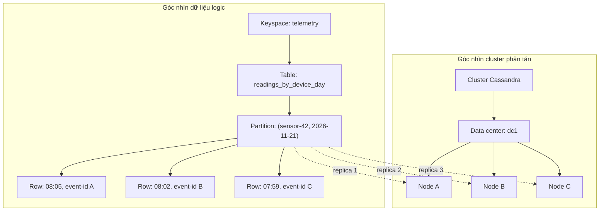
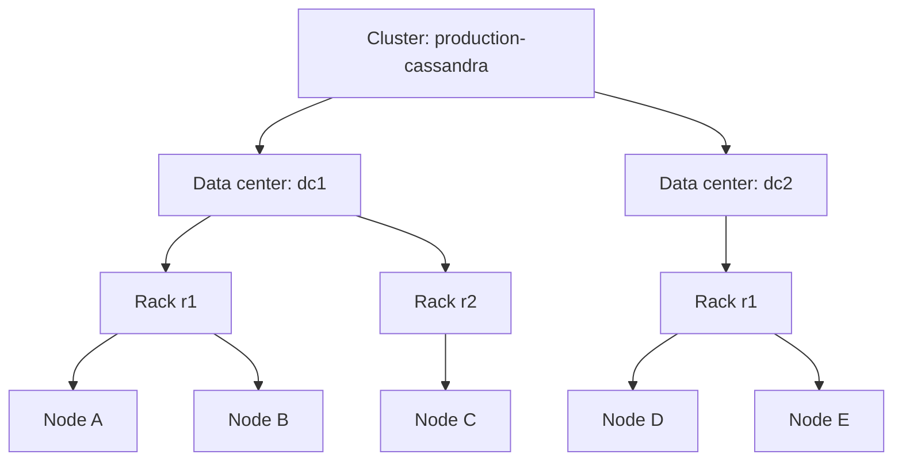
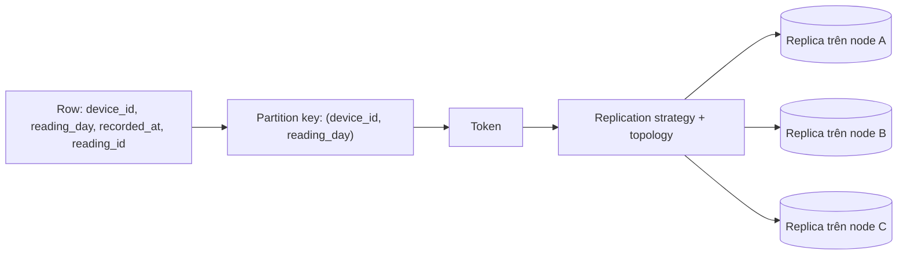
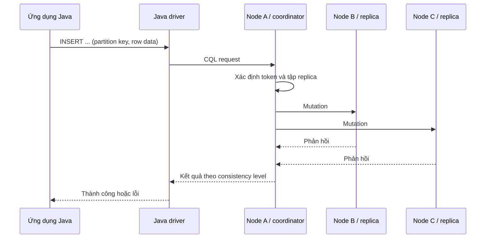

# Bản đồ thuật ngữ: keyspace, table, partition, row, node, replica và cluster

> **Chương:** Tư duy Cassandra  
> **Phạm vi:** Bản đồ thuật ngữ nền tảng của **Apache Cassandra** trong mô-đun **DATABASE_ENGINE_WIDE_COLUMN_CASSANDRA**. Bài học kết nối cấu trúc dữ liệu wide-column với kiến trúc phân tán, khóa phân vùng, thiết kế bảng theo truy vấn, replication và mức nhất quán khi đọc/ghi. Ví dụ CQL và góc nhìn ứng dụng Java giúp chuyển thuật ngữ thành thao tác thực tế.

## 1. Mục tiêu học tập

Sau bài học, bạn có thể:

1. Định nghĩa chính xác **keyspace, table, partition, row, node, replica và cluster** và đặt chúng vào cùng một sơ đồ.
2. Nhìn một khai báo `PRIMARY KEY` để xác định **partition key**, **clustering columns** và một row được nhận diện như thế nào.
3. Phân biệt **partition logic** với **các replica vật lý** của partition; hiểu vì sao thêm node không có nghĩa tách từng row của một partition sang node khác.
4. Giải thích đường đi cơ bản của lệnh đọc/ghi qua **coordinator** và điều kiện phản hồi ở mức `LOCAL_QUORUM` khi replication factor là 3.
5. Dùng CQL tạo keyspace, table, ghi dữ liệu và truy vấn đúng partition; biết những ranh giới mà ứng dụng Java và driver cần tôn trọng.

## 2. Bức tranh lớn: có hai loại “bản đồ”

Khi đọc tài liệu Cassandra, nhiều từ xuất hiện cùng nhau nhưng chúng mô tả **hai góc nhìn**:

- **Bản đồ logic:** dữ liệu được đặt tên, nhóm và định danh ra sao? Đây là thế giới của **keyspace → table → partition → row → cell**.
- **Bản đồ hạ tầng:** dữ liệu được phân phối và nhân bản ở đâu? Đây là thế giới của **cluster → data center/rack → node**, cùng **replica** của từng partition.

Một partition được xác định **về mặt logic** bằng partition key trong một table. Cassandra có thể lưu **nhiều bản sao vật lý** của partition ấy trên những node khác nhau. Vì vậy, “một partition” và “ba replica” không mâu thuẫn nhau.



Sơ đồ mô tả ví dụ một data center có **replication factor (RF) = 3** và ba node đủ điều kiện giữ bản sao. **Mỗi node A, B, C chứa bản sao của cùng partition gồm các row tương ứng**, không phải A giữ row đầu, B giữ row thứ hai, C giữ row thứ ba. Trong một cụm thực tế, mỗi node còn giữ replica của **rất nhiều partition khác**.

## 3. Bảng từ điển nhanh: tên gọi, cấp độ và trách nhiệm

| Thuật ngữ | Định nghĩa ngắn | Nằm ở góc nhìn nào? | Câu hỏi cần trả lời |
| --- | --- | --- | --- |
| **Cluster** | Tập các node Cassandra hoạt động trong cùng một cụm phân tán | Hạ tầng | Những máy nào cùng phục vụ bộ dữ liệu này? |
| **Data center (DC)** | Nhóm node theo miền triển khai/topology để tổ chức sao chép và truy cập cục bộ | Hạ tầng | Replica được đặt ở vùng triển khai nào? |
| **Rack** | Nhóm topo nằm trong một DC để hỗ trợ bố trí replica, thường phản ánh miền lỗi | Hạ tầng | Có thể tránh đặt mọi replica vào cùng miền lỗi không? |
| **Node** | Một instance Cassandra tham gia cluster, lưu dữ liệu và có thể nhận request | Hạ tầng | Máy/instance nào nhận và lưu dữ liệu? |
| **Replica** | Một **bản sao của partition** được lưu trên một node | Quan hệ logic ↔ hạ tầng | Có bao nhiêu bản sao của partition này và nằm ở đâu? |
| **Keyspace** | Namespace chứa các table và cấu hình replication của keyspace | Logic + cấu hình phân tán | Những bảng nào dùng chung chiến lược sao chép? |
| **Table** | Schema CQL gồm cột, primary key và tùy chọn lưu trữ | Logic | Hàng được mô hình theo truy vấn nào? |
| **Partition** | Tập row có cùng **giá trị partition key** trong một table | Logic, có replica trên node | Một truy vấn có khóa này đến nhóm dữ liệu nào? |
| **Row** | Bản ghi duy nhất theo **toàn bộ primary key** của table | Logic | Đây là bản ghi nào trong partition? |
| **Cell** | Giá trị của một cột trong row (cùng metadata liên quan, nếu có) | Logic/lưu trữ | Thuộc tính cụ thể của bản ghi là gì? |

### 3.1. Vì sao không thể xếp tất cả thành một cây duy nhất?

Ta có thể nói **keyspace chứa table**, **table chứa partition**, **partition chứa row**. Tương tự, **cluster gồm nhiều node** (được tổ chức theo DC/rack). Nhưng **replica không phải cấp cha của row trong mô hình logic** và cũng không phải một loại máy mới.

Replica là **mối liên hệ**: partition P có bản sao trên node A, B, C. Node A lại có thể chứa replica của partition Q, R, S; mỗi partition của những table hoặc keyspace khác nhau có thể có tập replica khác nhau.

## 4. Keyspace: phạm vi schema và replication

**Keyspace** là namespace ở cấp cao của dữ liệu Cassandra. Nó nhóm các bảng và chứa cấu hình **replication strategy** cùng **replication factor**. Có thể so sánh lỏng với “database” trong một số hệ quản trị, nhưng keyspace mang ý nghĩa sao chép phân tán rất rõ.

Ví dụ:

```sql
-- Minh họa cho cluster có data center mang tên dc1
-- và có ít nhất 3 node đủ điều kiện để bố trí replica.
CREATE KEYSPACE IF NOT EXISTS telemetry
WITH replication = {
    'class': 'NetworkTopologyStrategy',
    'dc1': 3
};
```

Ở đây:

- `telemetry` là **tên keyspace**.
- `NetworkTopologyStrategy` là chiến lược đặt replica theo topology.
- `'dc1': 3` nghĩa là với các partition của keyspace, Cassandra được cấu hình giữ **ba replica trong data center dc1**, nếu hạ tầng đáp ứng.
- Câu lệnh này **không** tạo ba table, ba partition hay ba cluster.

Trong cluster đa data center, một keyspace có thể khai báo RF cho từng DC, ví dụ:

```sql
-- Ví dụ cấu hình, chỉ dùng khi cluster thực sự có dc1 và dc2.
CREATE KEYSPACE IF NOT EXISTS telemetry_multiregion
WITH replication = {
    'class': 'NetworkTopologyStrategy',
    'dc1': 3,
    'dc2': 3
};
```

Khi đó mỗi partition được cấu hình có **ba replica ở dc1 và ba replica ở dc2**. Đây là một keyspace dùng chung với cấu hình sao chép qua các DC của cùng cluster, không phải hai keyspace độc lập tự đồng bộ bằng ứng dụng.

**Lưu ý triển khai:** `dc1` và `dc2` chỉ là tên minh họa. Phải dùng tên DC thực tế do cluster công bố, đồng thời có đủ node/rack phù hợp và giám sát trạng thái replica. RF = 3 trên cluster có một node **không thể tạo ra ba bản sao chịu lỗi trên ba máy**.

## 5. Table: cách mô hình dữ liệu theo truy vấn

**Table** là cấu trúc CQL khai báo tên các cột, kiểu dữ liệu, khóa chính và tùy chọn. Trong Cassandra, thiết kế table bắt đầu từ **truy vấn cần phục vụ**, nhất là các điều kiện dùng để định vị partition.

Ví dụ hệ thống muốn:

> Lấy 20 lần đo mới nhất của một thiết bị trong một ngày đã chọn.

Schema có thể là:

```sql
CREATE TABLE IF NOT EXISTS telemetry.readings_by_device_day (
    device_id text,
    reading_day date,
    recorded_at timestamp,
    reading_id uuid,
    temperature_c double,
    status text,
    PRIMARY KEY ((device_id, reading_day), recorded_at, reading_id)
) WITH CLUSTERING ORDER BY (recorded_at DESC, reading_id ASC);
```

Tên đầy đủ của bảng là **`telemetry.readings_by_device_day`**:

- `telemetry`: **keyspace**.
- `readings_by_device_day`: **table**.
- `device_id` và `reading_day`: các thành phần **partition key ghép**.
- `recorded_at` và `reading_id`: **clustering columns**.
- `temperature_c` và `status`: cột dữ liệu thông thường.

Nếu bạn tạo thêm `telemetry.latest_reading_by_device`, đây là **table thứ hai** trong cùng keyspace. Nó có thể có primary key khác nhằm phục vụ truy vấn “lần đo mới nhất” mà không quét lịch sử. Tạo thêm table **không tự động nhân bản** dữ liệu sang table mới; ứng dụng hoặc pipeline phải duy trì dữ liệu phù hợp với mô hình.

### 5.1. Table không phải một file duy nhất

Ở lớp lưu trữ, mỗi node lưu replica của nhiều partition/table dưới các cấu trúc như memtable, commit log và các SSTable bất biến. Vì vậy, một table logic không nhất thiết tương ứng một file, một node hay một phân vùng vật lý duy nhất.

Trong cơ sở dữ liệu phân tán, suy nghĩ “table X nằm trên máy Y” thường quá đơn giản: **các partition của một table được phân phối**, còn **mỗi partition có thể được nhân bản**.

## 6. Partition: nhóm dữ liệu theo partition key

**Partition** gồm các row có **cùng giá trị partition key** trong cùng một table. Đây là khái niệm trung tâm của thiết kế Cassandra vì:

1. Giá trị partition key được băm/tính token để xác định **vị trí replica**.
2. Các row thuộc cùng partition có thể được truy cập có trật tự bằng **clustering columns**.
3. Lượng dữ liệu và tải dồn vào một partition ảnh hưởng đến nhóm node giữ bản sao của nó.

Với khai báo:

```sql
PRIMARY KEY ((device_id, reading_day), recorded_at, reading_id)
```

Một partition cụ thể có thể là:

```text
Table: telemetry.readings_by_device_day
Partition key: (device_id = sensor-42, reading_day = 2026-11-21)

recorded_at              reading_id   temperature_c   status
2026-11-21T08:05:00Z     id-C         27.8            normal
2026-11-21T08:02:00Z     id-B         27.5            normal
2026-11-21T07:59:00Z     id-A         29.1            alert
```

Ba dòng trên là **ba row trong một partition**. Nếu một lần đo có `device_id = sensor-99` hoặc `reading_day = 2026-11-22`, nó thuộc **partition khác**.

### 6.1. Partition key ghép là một bộ giá trị

Trong ví dụ, partition key là **toàn bộ bộ `(device_id, reading_day)`**, không phải chỉ `device_id`. Cassandra dùng giá trị của cả hai thành phần để tính token. Vì vậy:

| Giá trị partition key | Partition logic |
| --- | --- |
| `(sensor-42, 2026-11-21)` | P1 |
| `(sensor-42, 2026-11-22)` | P2, khác P1 |
| `(sensor-99, 2026-11-21)` | P3, khác P1/P2 |

Thứ tự ngày không làm cho các partition của từng thiết bị tự động đứng cạnh nhau trên toàn cluster: token thường được tạo bằng hàm băm trên partition key. **Clustering order chỉ sắp row bên trong từng partition.**

### 6.2. Partition lớn và partition nóng khác nhau

- **Partition lớn:** có nhiều row hoặc nhiều byte; có thể khiến đọc, compaction, repair và dùng bộ nhớ tốn kém.
- **Partition nóng:** nhận quá nhiều thao tác đọc/ghi so với năng lực nhóm replica; có thể nóng dù dung lượng hiện tại không lớn.

Nếu mỗi thiết bị có hàng triệu lần đo một ngày, bucket `reading_day` có thể vẫn quá lớn. Có thể cần bucket theo giờ hoặc shard logic để chia tải; khi đó ứng dụng phải truy vấn thêm nhiều partition và hợp nhất kết quả.

**Không có một ngưỡng kích thước partition đúng cho mọi workload.** Cần đo số row, kích thước byte, QPS theo partition, độ trễ và tính phân bố khóa trước khi sửa schema.

## 7. Row: bản ghi được định danh bằng toàn bộ primary key

**Row** là bản ghi được xác định bởi **toàn bộ primary key**. Với table đang xét:

```text
PRIMARY KEY = (partition key, clustering columns)
            = ((device_id, reading_day), recorded_at, reading_id)
```

Nghĩa là:

- Cùng `device_id` và `reading_day` nhưng **khác `recorded_at`**: các row khác nhau trong cùng partition.
- Cùng `recorded_at` nhưng **khác `reading_id`**: vẫn là các row khác nhau trong cùng partition.
- Cùng **toàn bộ** primary key: thao tác `INSERT`/`UPDATE` theo khóa đó tác động cùng row; Cassandra có ngữ nghĩa **upsert** đối với ghi thông thường.

Ví dụ, hai lần đo nhận cùng timestamp cần `reading_id` để không bị gộp thành cùng một row. Trong ứng dụng, ID sự kiện cần được tạo và giữ ổn định nếu retry cùng một thao tác logic.

### 7.1. Row không phải replica

**Row** trả lời “bản ghi nào?”; **replica** trả lời “bản sao của partition này nằm trên node nào?”. Khi RF = 3, một row trong partition thường được lưu trong các bản sao của partition trên ba node thuộc phạm vi topology đã cấu hình. Điều này không tạo ba row logic để `SELECT` trả về ba lần.

### 7.2. Cell và giá trị thiếu

Trong một row, `temperature_c` là một cột dữ liệu. Giá trị cụ thể của cột trong row có thể xem như **cell**. Một số row có thể không có giá trị `status` hoặc `temperature_c`; đó không có nghĩa CQL không có schema.

Cassandra dùng timestamp/TTL và tombstone để quản lý phiên bản, hết hạn, xóa dữ liệu. Những chi tiết này ảnh hưởng quá trình đọc, repair và compaction nhưng không làm thay đổi định nghĩa phân cấp: **partition chứa các row; row có các cell**.

## 8. Cluster: tập node cùng phục vụ dữ liệu

**Cluster Cassandra** là một tập các node cùng tham gia hệ thống lưu trữ phân tán. Các node trao đổi thông tin trạng thái và topology để tìm dữ liệu, phục vụ yêu cầu và thích ứng với thay đổi của cụm. Cassandra có kiến trúc **không yêu cầu một master duy nhất cho mọi thao tác đọc/ghi**.

Trong một cluster có thể có:

- **Nhiều data center:** ví dụ vị trí triển khai hoặc miền hạ tầng khác nhau.
- **Nhiều rack trong một DC:** hỗ trợ bố trí replica trên các miền lỗi khác nhau khi topology được cấu hình tương ứng.
- **Nhiều node trong mỗi rack/DC:** mỗi node có thể nhận request và lưu replica của nhiều partition.



Sơ đồ chỉ minh họa tổ chức cluster; cấu hình thực tế có thể có nhiều node/rack và cần đủ miền lỗi để đạt mục tiêu chịu lỗi. Việc đặt node trên rack khác nhau không tự động đúng chỉ vì ta vẽ chúng tách nhau; Cassandra cần metadata topology và chiến lược sao chép nhất quán với hạ tầng.

**Nhầm lẫn phổ biến:** “Một keyspace tương ứng một cluster.” Sai. Một cluster có thể chứa nhiều keyspace, mỗi keyspace có nhiều table và có thể có cấu hình replication riêng.

## 9. Node: instance Cassandra, không phải một bảng dữ liệu

**Node** thường là một tiến trình Cassandra chạy trên máy chủ hoặc môi trường triển khai phù hợp, tham gia cluster. Node có thể:

1. Lưu replica của nhiều partition từ nhiều table.
2. Nhận kết nối và yêu cầu CQL từ client.
3. Đóng vai trò **coordinator** cho một request mà nó nhận.
4. Đọc/ghi dữ liệu cục bộ và giao tiếp với những node khác.
5. Tham gia vận hành như gossip/trạng thái cluster, streaming, compaction, repair.

Node A có thể giữ replica của partition P, Q, R; node B giữ replica của P, S, T. Một node **không bị ràng buộc phải tương ứng một table hoặc một partition**.

### 9.1. Coordinator là vai trò của node theo từng request

**Coordinator** là node Cassandra tiếp nhận request từ client/driver và phối hợp việc truy cập các replica. Nó không phải lớp mới nằm ngoài cluster, cũng không phải master cố định được ghi cứng.

Ứng dụng Java dùng driver có thể gửi request vào node A; với request đó A là coordinator. Request tiếp theo có thể tới node B và B trở thành coordinator. Driver có thể tận dụng thông tin token/topology để chọn node gửi yêu cầu thuận lợi, nhưng việc đặt dữ liệu và xử lý replica vẫn thuộc Cassandra server.

## 10. Replica: bản sao của một partition, không phải một node riêng

**Replica** là **bản sao vật lý của một partition trên node**. Khi nói “partition P có ba replica”, ta nói tới **ba bản sao của cùng dữ liệu logic** theo cấu hình RF/topology.

Giả sử chỉ xét data center `dc1` với RF = 3:

| Partition logic | Node A | Node B | Node C |
| --- | --- | --- | --- |
| P = `(sensor-42, 2026-11-21)` | Replica của P | Replica của P | Replica của P |
| Q = `(sensor-99, 2026-11-21)` | Có thể có replica Q | Có thể có replica Q | Có thể có replica Q |

Bảng mô tả một ví dụ có ít node; cụm lớn sẽ có nhiều node và tập replica mỗi partition được chọn theo token/topology. **Không suy ra mọi partition đều phải nằm trên đúng A, B, C**, hoặc RF=3 nghĩa là ba node trong cả cluster.

### 10.1. RF là gì và không phải gì?

**Replication factor (RF)** là số bản sao của mỗi partition được cấu hình cho một phạm vi theo chiến lược replication. Với `NetworkTopologyStrategy`, số bản sao được chỉ định **cho từng data center**.

| Phát biểu | Đúng hay sai? | Giải thích |
| --- | --- | --- |
| “RF=3 ở dc1 nghĩa là một partition có ba replica được cấu hình ở dc1.” | Đúng | Khi cluster đủ node/điều kiện để bố trí theo topology |
| “RF=3 nghĩa là ba partition khác nhau.” | Sai | Một partition logic có ba bản sao |
| “RF=3 nghĩa là `SELECT` trả về ba bản ghi giống nhau.” | Sai | Replica là bản sao vật lý; kết quả trả theo row logic |
| “RF=3 nghĩa là có ba node trong toàn cluster.” | Sai | Một cluster có thể có nhiều node hơn; nhiều partition có tập replica khác nhau |
| “RF=3 nghĩa là mọi write phải đợi ba replica.” | Sai | Số xác nhận cần thiết còn phụ thuộc **consistency level** |

### 10.2. Replica hỗ trợ chịu lỗi, nhưng không thay thế repair

Khi một node không phản hồi, những replica còn hoạt động có thể tiếp tục phục vụ nếu mức nhất quán cho phép. Tuy nhiên, việc một replica bị lỡ mutation, bị cô lập lâu ngày hoặc lệch dữ liệu cần cơ chế đồng bộ phù hợp; **hinted handoff** có phạm vi hỗ trợ nhất định và **repair** đóng vai trò quan trọng để các bản sao hội tụ.

Ngoài ra, **compaction** xử lý các SSTable trên mỗi node theo chính sách lưu trữ; compaction không phải việc tự tạo replica và cũng không thay thế backup.

## 11. Kết nối hai bản đồ bằng partition key và token

Câu hỏi cốt lõi là: **partition P trong table T phải được lưu trên node nào?**

Đường suy luận:

1. Dựa vào schema, Cassandra xác định **partition key** của row.
2. Tính **token** từ giá trị partition key bằng partitioner của cluster.
3. Dùng token, thông tin topology và **replication strategy** để xác định **tập node giữ replica** của partition.
4. Với thao tác đọc/ghi, coordinator liên hệ các replica cần thiết và trả kết quả theo consistency level.



Các clustering columns `recorded_at`, `reading_id` **không** được hash riêng để phân phối từng row của P. Chúng quyết định vị trí/thứ tự row **bên trong** P. Vì vậy, thêm node có thể phân phối nhiều partition khác nhau tốt hơn, nhưng **không tự chia một partition nóng** thành nhiều partition mới.

## 12. Đọc và ghi: thuật ngữ xuất hiện trong cùng một request

### 12.1. Luồng ghi từ ứng dụng Java



Đây là sơ đồ giản lược: coordinator cũng có thể là một replica và tham gia xử lý ghi cục bộ; việc gửi yêu cầu và thứ tự phản hồi thực tế tùy topology, trạng thái node và consistency level. Sơ đồ không có nghĩa node A luôn là coordinator hoặc chỉ B/C mới chứa replica.

**Ví dụ:** trong một DC có RF = 3, ghi ở `LOCAL_QUORUM` cần **hai replica cục bộ** phản hồi thành công (giả sử không có điều kiện đặc biệt khác). Không nhất thiết phải chờ replica thứ ba. Nếu chỉ một replica khả dụng, quorum không đạt, dù cùng một thao tác ở `LOCAL_ONE` có thể vẫn thành công.

### 12.2. Luồng đọc theo partition

Giả sử ứng dụng gọi:

```sql
SELECT recorded_at, reading_id, temperature_c
FROM telemetry.readings_by_device_day
WHERE device_id = 'sensor-42'
  AND reading_day = '2026-11-21'
LIMIT 20;
```

Truy vấn có **đầy đủ partition key**. Coordinator xác định replica của đúng partition, thực hiện đọc, xử lý thông tin từ các replica theo consistency level và trả các row kết quả. Driver chuyển dữ liệu về Java, nơi ứng dụng map chúng thành DTO hoặc JSON.

Nếu người dùng cần dữ liệu **nhiều ngày**, ứng dụng có thể phải truy vấn **nhiều partition** và hợp nhất kết quả. Cassandra không tự tạo thứ tự thời gian toàn cluster chỉ vì trong mỗi partition đã khai báo `CLUSTERING ORDER BY`.

### 12.3. Timeout không định nghĩa dữ liệu đã được ghi hay chưa

Ứng dụng Java có thể thấy timeout mặc dù một số replica đã nhận mutation. Driver báo lỗi theo điều kiện thực tế mà nó quan sát; nó không thể xác nhận một cách chắc chắn “không replica nào ghi” chỉ từ việc client không nhận phản hồi.

Đối với ghi sự kiện, nên tạo và giữ **ID ổn định** cho cùng một sự kiện logic nếu retry; đồng thời cân nhắc idempotency, cơ chế đối soát và những trường hợp ghi điều kiện. Đây là trách nhiệm phối hợp giữa ứng dụng, driver và ngữ nghĩa Cassandra, không phải thuộc tính của một thuật ngữ đơn lẻ.

## 13. Thực hành CQL: làm rõ partition và row

Các lệnh trong phần này dùng keyspace và table đã định nghĩa ở trên. Giả sử kết nối với cluster có data center `dc1`, RF và quyền tạo schema phù hợp.

### 13.1. Thêm ba row trong một partition

```sql
INSERT INTO telemetry.readings_by_device_day (
    device_id, reading_day, recorded_at, reading_id, temperature_c, status
) VALUES (
    'sensor-42', '2026-11-21', '2026-11-21T08:05:00Z',
    11111111-1111-1111-1111-111111111111, 27.8, 'normal'
);

INSERT INTO telemetry.readings_by_device_day (
    device_id, reading_day, recorded_at, reading_id, temperature_c, status
) VALUES (
    'sensor-42', '2026-11-21', '2026-11-21T08:02:00Z',
    22222222-2222-2222-2222-222222222222, 27.5, 'normal'
);

INSERT INTO telemetry.readings_by_device_day (
    device_id, reading_day, recorded_at, reading_id, temperature_c, status
) VALUES (
    'sensor-42', '2026-11-21', '2026-11-21T07:59:00Z',
    33333333-3333-3333-3333-333333333333, 29.1, 'alert'
);
```

Vì ba câu `INSERT` có cùng `(device_id, reading_day)`, chúng ghi **ba row vào cùng partition logic**. `recorded_at` và `reading_id` khác nhau nên các row không ghi đè nhau.

### 13.2. Thêm một row thuộc partition khác

```sql
INSERT INTO telemetry.readings_by_device_day (
    device_id, reading_day, recorded_at, reading_id, temperature_c, status
) VALUES (
    'sensor-99', '2026-11-21', '2026-11-21T08:04:00Z',
    44444444-4444-4444-4444-444444444444, 25.0, 'normal'
);
```

Đây là một partition khác **vì partition key khác**, dù thuộc cùng table và keyspace. Cả hai partition có thể được phân phối tới tập replica khác nhau theo token và topology.

### 13.3. Đọc row theo đúng partition

```sql
SELECT recorded_at, reading_id, temperature_c, status
FROM telemetry.readings_by_device_day
WHERE device_id = 'sensor-42'
  AND reading_day = '2026-11-21'
LIMIT 20;
```

Kết quả logic sẽ gồm **ba row của sensor-42**, theo `recorded_at` giảm dần; nó không nhân ba kết quả chỉ vì RF = 3. Row của `sensor-99` không xuất hiện vì thuộc partition khác.

Có thể lọc khoảng thời gian **sau khi** đã xác định partition:

```sql
SELECT recorded_at, temperature_c
FROM telemetry.readings_by_device_day
WHERE device_id = 'sensor-42'
  AND reading_day = '2026-11-21'
  AND recorded_at >= '2026-11-21T08:00:00Z'
  AND recorded_at < '2026-11-21T09:00:00Z';
```

Trong `cqlsh`, có thể đặt consistency level của các lệnh tiếp theo bằng lệnh shell:

```sql
CONSISTENCY LOCAL_QUORUM;
```

**Phân biệt:** `CONSISTENCY` ở đây là tiện ích `cqlsh`; trong ứng dụng Java, driver cho phép cấu hình CL cho statement hoặc profile tương ứng. Nó không thay đổi RF của keyspace.

## 14. Bản đồ lỗi: thuật ngữ nào giúp tìm nguyên nhân?

| Dấu hiệu | Xem xét thuật ngữ nào trước? | Cách suy luận |
| --- | --- | --- |
| Một thiết bị có độ trễ đọc/ghi rất cao | **Partition, partition key, replica** | Một partition nóng có thể tập trung tải lên các node giữ replica của nó |
| Một node không truy cập được, phần lớn request vẫn hoạt động | **Node, replica, RF, CL** | Còn đủ replica đáp ứng consistency level hay không? |
| Không đủ hai xác nhận tại `LOCAL_QUORUM`, RF=3 | **Replica, DC, CL** | Trạng thái và số replica cục bộ đang phản hồi |
| Truy vấn chỉ biết `status='alert'` rất chậm | **Table, partition key** | Table không có đường truy cập hiệu quả theo status trên toàn cluster |
| Thêm nhiều node nhưng một partition vẫn chậm | **Partition, token, replica** | Thêm node không tự cắt nhỏ partition nóng |
| Báo cáo cần tổng hợp mọi thiết bị theo tuần | **Table, partition, dạng truy vấn** | Cần mô hình tổng hợp, pipeline hay hệ OLAP thay vì quét tràn lan |
| Replica lệch dữ liệu sau một lần mất kết nối dài | **Replica, repair, vận hành** | Kiểm tra chiến lược khôi phục, hinted handoff và anti-entropy repair |
| Ứng dụng Java ghi timeout rồi tạo bản ghi trùng | **Row, primary key, retry** | Retry có tái sử dụng khóa của cùng sự kiện logic không? |

Bảng này gợi ý điểm bắt đầu tìm nguyên nhân, không thay thế kiểm tra metrics, logs hoặc trạng thái cluster thực tế.

## 15. Bảy cặp khái niệm dễ nhầm

### 15.1. Keyspace và cluster

Keyspace là **namespace/schema + cấu hình replication**; cluster là **tập node hạ tầng**. Một cluster có thể có nhiều keyspace. Tạo keyspace không tạo một cluster mới.

### 15.2. Table và partition

Table xác định **schema và primary key**; partition là **tập row có cùng giá trị partition key** trong table đó. Một table thường có rất nhiều partition phân bố khắp cụm.

### 15.3. Partition và row

Một partition có thể gồm nhiều row nếu table có clustering columns. Partition key xác định **nhóm**, còn toàn bộ primary key xác định **row**.

### 15.4. Node và replica

Node là **instance Cassandra**; replica là **bản sao của một partition được lưu trên node**. Một node có thể lưu replica của rất nhiều partition khác nhau.

### 15.5. Replica và coordinator

Replica liên quan đến **dữ liệu được lưu ở đâu**; coordinator là **vai trò xử lý một request**. Coordinator có thể đồng thời là replica của partition đang truy cập, nhưng không bắt buộc.

### 15.6. Replication factor và consistency level

RF quy định **bao nhiêu bản sao được bố trí**; CL quy định **bao nhiêu hoặc nhóm replica nào cần phản hồi** để thao tác đạt yêu cầu. RF và CL phải được thiết kế cùng mục tiêu chịu lỗi/độ nhất quán.

### 15.7. “Wide-column” và “mỗi node giữ một cột”

Cassandra là wide-column database vì mô hình dữ liệu và cách truy cập theo partition/clustering. Nó **không** chia mỗi thuộc tính của một row sang node riêng theo tên cột như một cách sharding mặc định, và cũng không nên bị nhầm với kho phân tích lưu trữ theo cột để quét tổng hợp.

## 16. Bài tập tình huống: tự vẽ bản đồ của một dịch vụ

Một ứng dụng đặt hàng lưu lịch sử thay đổi trạng thái theo khách hàng và ngày. Schema:

```sql
CREATE TABLE order_events_by_customer_day (
    customer_id text,
    event_day date,
    occurred_at timestamp,
    event_id uuid,
    order_id text,
    state text,
    PRIMARY KEY ((customer_id, event_day), occurred_at, event_id)
) WITH CLUSTERING ORDER BY (occurred_at DESC, event_id ASC);
```

Giả sử table nằm trong một keyspace có RF = 3 ở `dc1` và ba replica của partition P trên node A, B, C.

**Hãy tự trả lời:**

1. Với khách hàng `customer-7` trong ngày `2026-11-21`, partition key là gì?
2. Nếu khách hàng đó có 25 sự kiện trong ngày, có bao nhiêu partition và bao nhiêu row logic tương ứng trong ví dụ?
3. Node A, B, C mỗi node chỉ lưu một phần trong số 25 sự kiện, hay mỗi replica chứa dữ liệu của partition P?
4. Nếu node B ngắt kết nối, `LOCAL_QUORUM` (RF=3 ở dc1) còn có thể thành công không? Điều kiện là gì?
5. Truy vấn “tìm toàn bộ đơn hàng `order_id='O-900'` của mọi khách hàng” có phù hợp trực tiếp với partition key trên không?

### Gợi ý đáp án

1. Partition key là bộ **`(customer-7, 2026-11-21)`**.
2. Với giả định các sự kiện có toàn bộ primary key khác nhau: **một partition logic chứa 25 row logic**.
3. **Mỗi replica** chứa bản sao của partition P; không có chuyện tự động chia 25 row thành ba nhóm chỉ để mỗi node giữ một phần.
4. **Có thể**, nếu hai replica còn lại trong `dc1` hoạt động và phản hồi đúng hạn; vì local quorum của RF=3 cần hai xác nhận.
5. **Không phù hợp trực tiếp** vì `order_id` không xác định partition. Nên cân nhắc table phục vụ tra cứu theo `order_id`, index phù hợp sau khi đánh giá hoặc pipeline/tầng tìm kiếm tùy yêu cầu.

## 17. Tự kiểm tra nhanh

1. **Keyspace có phải một node không?** Không. Keyspace chứa table và cấu hình replication; node là instance Cassandra.
2. **Table có một partition duy nhất không?** Không nhất thiết; thông thường có nhiều partition phân phối theo giá trị partition key.
3. **Partition key có thể gồm hai cột không?** Có, như `(device_id, reading_day)`.
4. **Clustering column có được hash riêng để phân tán row không?** Không. Nó tổ chức thứ tự row **bên trong** partition.
5. **Hai row cùng partition key nhưng khác clustering key có phải hai partition?** Không. Chúng là hai row trong cùng partition.
6. **Một node có thể giữ replica của nhiều partition không?** Có.
7. **RF = 3 có phải ba row được trả về cho một bản ghi không?** Không. Có ba bản sao vật lý nhưng một row logic.
8. **Node nhận yêu cầu CQL có luôn là master không?** Không. Nó đóng vai trò coordinator cho request; Cassandra không yêu cầu master cố định cho mọi thao tác.
9. **RF = 3 ở dc1 và `LOCAL_QUORUM` cần bao nhiêu replica dc1 trả lời?** Hai, nếu topology đáp ứng RF đúng cách.
10. **Đọc theo partition key tốt có nghĩa Cassandra tự tối ưu báo cáo toàn cụm?** Không. Mẫu truy vấn xuyên nhiều partition cần thiết kế riêng.

## 18. Ghi nhớ trước khi học sâu hơn

Có thể nhớ bản đồ thuật ngữ bằng hai chuỗi:

**Dữ liệu logic:** `keyspace → table → partition (partition key) → row (clustering columns) → cell`.

**Hạ tầng phân tán:** `cluster → data center/rack → node`, trong đó **replica** là **bản sao của mỗi partition** nằm trên những node được chọn theo token, topology và replication strategy.

Với hệ Cassandra thật, hai chuỗi này gặp nhau ở quyết định **partition key**. Khóa quyết định đường truy vấn và phân phối tải; RF quyết định số replica; consistency level chi phối điều kiện đọc/ghi thành công; compaction và repair giữ cluster hoạt động bền vững; ứng dụng Java và driver cần gửi đúng CQL, xử lý timeout và kết quả theo ngữ nghĩa nghiệp vụ. Hiểu đúng thuật ngữ ngay từ đầu sẽ giúp bạn thiết kế bảng, thực hành CQL và xử lý lỗi phân tán có cơ sở hơn.
