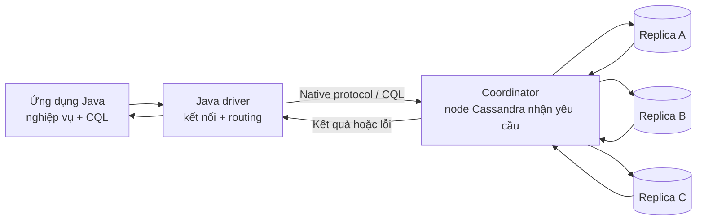
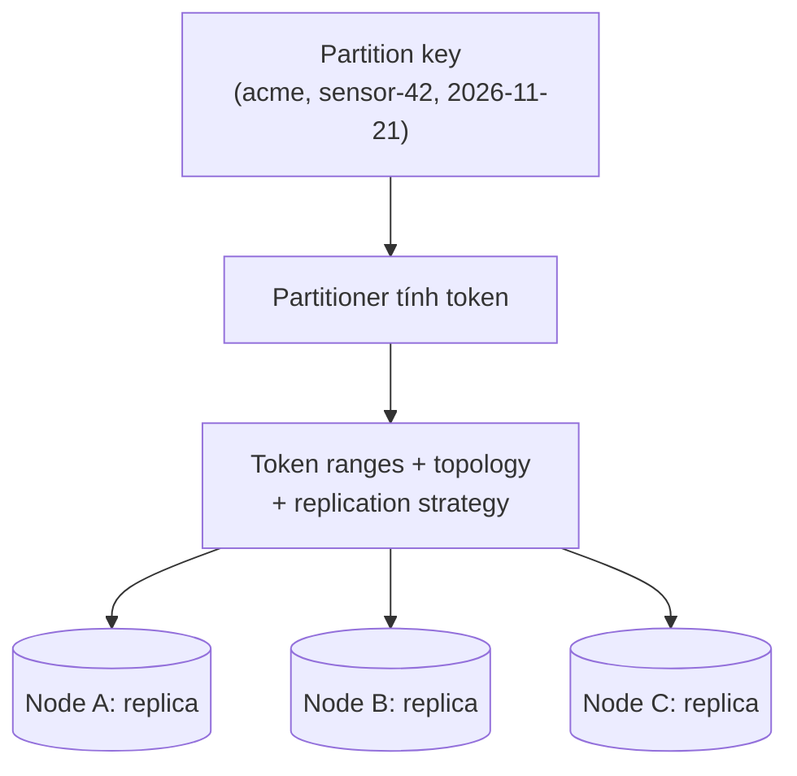
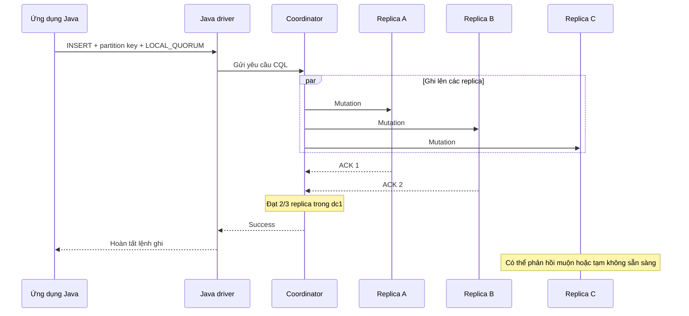
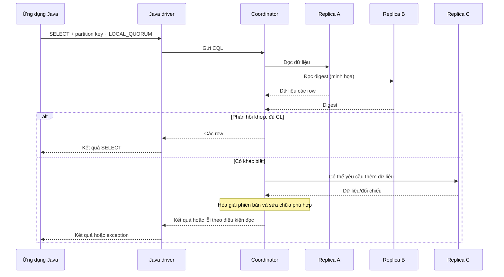
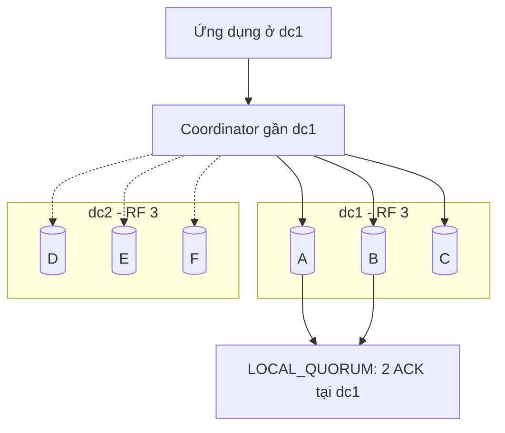

# Luồng từ truy vấn ứng dụng đến nút điều phối và các bản sao

> **Chương:** Tư duy Cassandra  
> **Phạm vi bài học:** Theo dõi một thao tác đọc/ghi của ứng dụng Java từ lúc tạo câu CQL, qua Java driver và nút điều phối (*coordinator*), đến các bản sao (*replica*) trong cụm Apache Cassandra. Bài làm rõ phân vùng dữ liệu, replication, consistency level, phản hồi thành công, timeout và các bước xử lý sự cố.

## 1. Mục tiêu học tập

Sau bài này, bạn có thể:

1. Mô tả vai trò của **ứng dụng**, **CQL**, **driver**, **coordinator**, **replica** trong một yêu cầu.
2. Giải thích vì sao **partition key → token → vị trí replica** là chuỗi quyết định quan trọng của Cassandra.
3. Phân biệt luồng ghi, luồng đọc, số replica tham gia và số phản hồi cần thiết theo **consistency level (CL)**.
4. Tự lần theo kịch bản **RF = 3, CL = LOCAL_QUORUM**, kể cả khi một replica tạm không phản hồi.
5. Hiểu tác động của hai data center, kết quả đọc cũ, timeout, retry và anti-entropy repair.
6. Đọc được ví dụ CQL và Java driver, biết quan sát lỗi/độ trễ mà không kết luận sai về trạng thái ghi.

## 2. Một yêu cầu nghiệp vụ thực sự đi qua những đâu?

Giả sử dịch vụ giám sát IoT ghi một sự kiện nhiệt độ, sau đó hiển thị 10 sự kiện gần nhất của thiết bị `sensor-42` trong ngày 21/11/2026. Ứng dụng lưu dữ liệu vào Apache Cassandra, một hệ cơ sở dữ liệu **NoSQL wide-column phân tán**.

Nhìn từ trên xuống có hai thao tác:

1. Java nhận dữ liệu thiết bị, tạo câu `INSERT` CQL với partition key thích hợp và gọi driver.
2. Java phục vụ API lịch sử, tạo câu `SELECT` CQL, gửi qua driver và đọc các hàng trả về.

Ứng dụng không cần biết máy vật lý nào giữ dữ liệu từng thiết bị. Tuy nhiên, để vận hành hiệu quả, người thiết kế **phải hiểu** cách driver và Cassandra định tuyến yêu cầu qua những node đó.



Sơ đồ minh họa một partition có ba replica. **Coordinator không phải master**: bất kỳ node Cassandra đủ điều kiện nhận yêu cầu client đều có thể làm coordinator cho một yêu cầu cụ thể. Coordinator có thể đồng thời là một trong các replica giữ partition. Trong tình huống khác, nó có thể chỉ đóng vai trò điều phối.

### 2.1. Ai có trách nhiệm gì?

| Thành phần | Việc thực hiện | Việc không nên nhầm là trách nhiệm của nó |
| --- | --- | --- |
| **Ứng dụng Java** | Xác định nghiệp vụ, partition key cần truy vấn, tham số, mức nhất quán mong muốn, xử lý kết quả/lỗi | Không tự sao chép SSTable đến các node |
| **CQL** | Biểu đạt yêu cầu: `INSERT`, `SELECT`, schema, điều kiện `WHERE` | Không phải một máy chủ hay giao thức Java riêng biệt |
| **Java driver** | Duy trì kết nối; bind tham số; chọn node gửi request bằng chính sách routing; nhận kết quả, timeout và exception | Không quyết định replica placement thay Cassandra |
| **Coordinator** | Nhận yêu cầu; xác định replica; chuyển tiếp, gom phản hồi và áp dụng CL cho request | Không nhất thiết lưu mọi partition hay chờ mọi replica |
| **Replica** | Lưu bản sao của partition và thực thi việc đọc/ghi do coordinator yêu cầu | Không tự biết quy tắc nghiệp vụ HTTP của ứng dụng |

*Routing của driver* và *placement của Cassandra* là hai quyết định liên quan nhưng khác nhau: driver chọn **node tiếp nhận yêu cầu**, còn Cassandra dùng token và replication strategy để xác định **các node chứa dữ liệu**.

## 3. Bước chuẩn bị: partition key dẫn đến tập replica

Xét một bảng sự kiện được thiết kế cho truy vấn “lấy các sự kiện trong một ngày của một thiết bị”:

```sql
CREATE TABLE telemetry_flow.device_events_by_day (
    tenant_id text,
    device_id text,
    event_day date,
    event_time timestamp,
    event_id uuid,
    temperature_c double,
    PRIMARY KEY ((tenant_id, device_id, event_day), event_time, event_id)
) WITH CLUSTERING ORDER BY (event_time DESC, event_id ASC);
```

Trong khóa chính:

- **Partition key ghép:** `(tenant_id, device_id, event_day)`.
- **Clustering columns:** `event_time` và `event_id`, sắp xếp và phân biệt hàng **bên trong partition**.

Với bộ giá trị `('acme', 'sensor-42', '2026-11-21')`, Cassandra dùng partitioner, thường là **Murmur3**, để tính một **token**. Các dải token, cấu hình topology và replication strategy quyết định các node chứa bản sao của partition. Các row của cùng partition nằm trong cùng tập replica; hệ thống không tính token mới từ từng `event_time`.



Ví dụ minh họa giả định **RF = 3** trong data center `dc1`, và token của partition được ánh xạ đến các node A, B, C. Cụm có thể có nhiều node hơn ba; điều đó **không** khiến mỗi partition tự động có một bản sao trên mọi node.

### 3.1. Driver có dùng token không?

Có thể. Java driver hỗ trợ định tuyến theo token (*token-aware routing*) khi có metadata và thông tin routing key phù hợp, đặc biệt với prepared statement có đầy đủ giá trị partition key. Driver có thể ưu tiên một replica ở data center cục bộ làm coordinator để giảm bước chuyển tiếp và độ trễ.

Nếu driver không xác định được routing key, thiếu metadata hoặc một node phù hợp không sẵn sàng, nó vẫn có thể gửi yêu cầu đến node phù hợp khác theo chính sách load balancing. Node nhận yêu cầu vẫn có thể làm coordinator và tìm các replica đích. **Token-aware routing là tối ưu đường đi**, không thay đổi partition key hay replication factor.

### 3.2. Những thông số phân tán quyết định hành vi

| Thông số | Câu hỏi trả lời | Ví dụ |
| --- | --- | --- |
| **Partition key** | Đây là partition nào? | `(acme, sensor-42, 2026-11-21)` |
| **Token** | Partition thuộc vùng token nào? | Giá trị do partitioner tính; không tự đoán từ chuỗi thiết bị |
| **Replication strategy** | Đặt bản sao theo topology ra sao? | `NetworkTopologyStrategy` |
| **Replication factor (RF)** | Có bao nhiêu replica trong phạm vi cấu hình? | Ba replica trong `dc1` |
| **Consistency level (CL)** | Bao nhiêu replica cần phản hồi thành công cho request? | `LOCAL_ONE` hoặc `LOCAL_QUORUM` |
| **Timeout** | Client/coordinator chờ trong giới hạn nào? | Do cấu hình driver và server quyết định; không suy ra từ RF |

**RF và CL không phải một:** RF quy định số bản sao; CL là điều kiện hoàn thành một thao tác đọc/ghi.

## 4. Luồng ghi: từ INSERT đến xác nhận

Giả sử client yêu cầu ghi sự kiện với **CL = LOCAL_QUORUM** và **RF = 3 trong dc1**:

```sql
INSERT INTO telemetry_flow.device_events_by_day (
    tenant_id, device_id, event_day, event_time, event_id, temperature_c
) VALUES (
    'acme', 'sensor-42', '2026-11-21',
    '2026-11-21T08:05:00Z',
    11111111-1111-1111-1111-111111111111, 27.4
);
```

### 4.1. Từng bước

1. **Ứng dụng** chuẩn hóa sự kiện: xác định tenant, device, ngày theo múi giờ đã thống nhất (ví dụ UTC), timestamp và ID sự kiện ổn định.
2. **Driver** gửi lệnh CQL hoặc prepared statement đã bind tham số đến một node được chọn; request mang CL mong muốn.
3. Node nhận request trở thành **coordinator**, tra metadata về token và xác định các replica A, B, C.
4. Coordinator chuyển mutation đến các replica liên quan. Replica nhận ghi thực hiện đường ghi của Cassandra, thường gồm **commit log** và **memtable**; cách bảo đảm bền vững cụ thể còn phụ thuộc cấu hình commit log.
5. Mỗi replica hoàn tất phần việc cần thiết cho yêu cầu sẽ phản hồi về coordinator. Một replica chậm hoặc mất kết nối có thể không phản hồi đúng hạn.
6. Khi coordinator nhận **hai xác nhận cục bộ** với RF = 3, điều kiện `LOCAL_QUORUM` đạt. Coordinator trả thành công đến driver rồi ứng dụng.
7. Replica chưa nhận được dữ liệu có thể được bù sau qua các cơ chế phù hợp, như hinted handoff trong một số tình huống và **repair** để đồng bộ khác biệt lâu dài.



**Lưu ý:** Sơ đồ trình bày chuỗi quan sát minh họa. Coordinator có thể bản thân là replica; đường gửi mutation và thời điểm phản hồi nội bộ còn phụ thuộc phiên bản, topology và điều kiện mạng. Điều kiện quan trọng ở đây là **CL cần hai xác nhận**, không phải yêu cầu tuần tự ghi A rồi B rồi C.

### 4.2. Ghi thành công có nghĩa gì?

Với `LOCAL_QUORUM` trên RF = 3 ở `dc1`, thành công nghĩa là coordinator đã nhận đủ phản hồi cục bộ theo CL cho thao tác đó. Nó **không chứng minh** mọi replica trong mọi data center đã có cùng phiên bản, không bảo đảm rằng một job phân tích ngoài Cassandra đã xử lý sự kiện, và cũng không phải cam kết giao dịch nghiệp vụ đa hệ thống.

Trong kiến trúc phân tán, phải phân biệt:

- **Được xác nhận theo CL:** đủ replica phản hồi để coordinator trả thành công.
- **Mọi bản sao đã hội tụ:** tất cả replica cuối cùng nhất quán sau đồng bộ.
- **Nghiệp vụ hoàn tất:** API, event bus, hệ thống khác và mọi điều kiện nghiệp vụ đã được thực hiện đúng.

Ba trạng thái này không đồng nhất.

### 4.3. Nếu chỉ một replica phản hồi?

- Với `LOCAL_ONE`, một phản hồi cục bộ có thể đủ cho thao tác.
- Với `LOCAL_QUORUM` và RF = 3, một phản hồi **không đủ**. Request có thể timeout hoặc thất bại theo tình trạng cluster và thời điểm phát hiện.
- Với `ALL` trong ví dụ một data center RF = 3, phải có cả ba replica phản hồi.

Vì thế, tăng mức CL thường tăng yêu cầu về số replica sẵn sàng và có thể làm giảm khả năng hoàn thành request khi lỗi xảy ra.

## 5. Luồng đọc: một SELECT đi qua những đâu?

Đọc không đơn giản là “coordinator hỏi một node rồi trả lời”, đặc biệt khi CL yêu cầu nhiều replica.

```sql
SELECT event_time, event_id, temperature_c
FROM telemetry_flow.device_events_by_day
WHERE tenant_id = 'acme'
  AND device_id = 'sensor-42'
  AND event_day = '2026-11-21'
LIMIT 10;
```

### 5.1. Từng bước đọc ở LOCAL_QUORUM

1. **Ứng dụng** xác định các giá trị `tenant_id`, `device_id`, `event_day` và gọi driver.
2. **Driver** chọn node tiếp nhận yêu cầu, gửi SELECT và CL.
3. **Coordinator** tìm các replica của partition dựa vào token và topology.
4. Coordinator yêu cầu dữ liệu từ replica thích hợp. Trong một đường đọc quorum thông thường, có thể nhận **dữ liệu đầy đủ từ một replica** và **digest** (tóm tắt để đối chiếu) từ replica khác. Cách chọn, số request và xử lý cụ thể tùy phiên bản/chính sách.
5. Nếu những phản hồi cần thiết nhất quán và CL đạt, coordinator trả các row phù hợp về driver.
6. Nếu phát hiện khác biệt, coordinator có thể lấy thêm dữ liệu, hòa giải phiên bản và thực hiện cơ chế read repair khi thích hợp trước khi hoàn tất hoặc theo quy tắc của phiên bản.
7. Driver giải mã row và trả kết quả cho ứng dụng; ứng dụng ánh xạ DTO, áp dụng kiểm soát quyền và hiển thị.



Sơ đồ nhằm phân biệt **data response** và **digest response**, không phải cam kết Cassandra luôn gửi đúng ba yêu cầu như vậy. Một số đường đọc thực tế có cơ chế tăng số replica được liên hệ khi replica chậm hoặc dữ liệu không nhất quán.

### 5.2. Vì sao có thể đọc giá trị cũ?

Ví dụ A và B vừa nhận ghi mới, trong khi C tạm bị ngắt và chưa có phiên bản đó. Nếu client đọc ở `ONE` từ C khi C trở lại nhưng chưa được đồng bộ, nó có thể nhận dữ liệu cũ. Ở `LOCAL_QUORUM` cùng phạm vi RF = 3, tập hai replica đọc phải giao với tập hai replica đã xác nhận ghi; điều đó giúp đọc thấy phiên bản đã ghi trong tình huống không có ghi xung đột và hoạt động hòa giải đúng.

Nhưng **quorum không phải bảo đảm mọi thao tác tuyến tính hóa**. Ghi đồng thời, timestamp do client/server sử dụng, lệch đồng hồ, xung đột cập nhật, tombstone và yêu cầu đa partition đều có thể làm vấn đề phức tạp hơn. Khi cần cập nhật có điều kiện, Cassandra có **lightweight transaction (LWT)** như `IF NOT EXISTS`, với cơ chế và chi phí khác thao tác ghi thường.

### 5.3. Điều kiện về partition key quan trọng ở bước nào?

Điều kiện `WHERE tenant_id = ... AND device_id = ... AND event_day = ...` giúp định tuyến đến đúng partition. `LIMIT 10` chỉ giới hạn số row trả về trong partition đã chọn; nó **không khắc phục** truy vấn quét toàn cluster hoặc khóa phân vùng tạo điểm nóng. Clustering order chỉ sắp xếp row trong một partition, không tạo thứ tự toàn bộ cụm.

## 6. Đếm xác nhận: RF = 3 và các mức CL

Xét cụm có một data center `dc1`, ba replica của partition là A, B và C:

| CL | Số phản hồi cần thiết, trong ví dụ RF = 3 | Khi một replica không phản hồi | Nhận xét |
| --- | --- | --- | --- |
| `ONE` | 1 replica | Có thể vẫn thành công | Cho phép phản hồi từ ít replica, có khả năng đọc cũ |
| `LOCAL_ONE` | 1 replica trong DC cục bộ | Có thể vẫn thành công | Phù hợp một số request cần ưu tiên khả năng phục vụ cục bộ |
| `QUORUM` | 2/3 replica xét toàn phạm vi RF của request | Có thể thành công nếu hai replica phản hồi | Khi nhiều DC, quorum toàn cục khác quorum cục bộ |
| `LOCAL_QUORUM` | 2/3 replica trong `dc1` | Có thể thành công nếu hai replica cục bộ phản hồi | Thường dùng trong mô hình đa DC để giảm phụ thuộc độ trễ liên vùng |
| `ALL` | Cả 3 replica | Không đạt nếu thiếu một replica cần phản hồi | Yêu cầu nghiêm ngặt về tính sẵn sàng của mọi replica |

**Công thức tính quorum** cho RF trong phạm vi xét:

\[
Q = \left\lfloor\frac{RF}{2}\right\rfloor + 1
\]

Với RF = 3, `Q = 2`. Quy tắc giao nhau giữa tập replica xác nhận ghi (W) và tập replica đọc (R) là:

\[
W + R > RF
\]

Ví dụ đơn giản: ghi và đọc đều dùng quorum với RF = 3 thì `2 + 2 > 3`. Điều kiện này chỉ là mô hình suy luận về **tập replica cùng phạm vi**, không thay thế phân tích concurrency, timestamp, xung đột và LWT.

### 6.1. Ba kết quả cần phân biệt

| Tình trạng ở thời điểm yêu cầu | Ý nghĩa có thể thấy ở client |
| --- | --- |
| Đủ replica đáp ứng yêu cầu trong giới hạn | **Success**, đọc có kết quả hoặc ghi được xác nhận theo CL |
| Coordinator xác định ngay rằng không đủ replica đang hoạt động cho CL | Có thể trả lỗi kiểu **Unavailable** |
| Yêu cầu đã gửi nhưng không nhận đủ phản hồi trước giới hạn chờ | Có thể trả **ReadTimeout** / **WriteTimeout** hoặc timeout từ lớp driver/network |

Một timeout không xác định chắc chắn trạng thái ghi cuối cùng. Ngay cả khi client nhận lỗi do mạng bị đứt sau thời điểm coordinator phản hồi, server vẫn có thể đã hoàn thành yêu cầu.

## 7. Khi có nhiều data center: local nghĩa là gì?

Giả sử keyspace dùng `NetworkTopologyStrategy` với hai data center:

```sql
CREATE KEYSPACE IF NOT EXISTS telemetry_multi_dc
WITH replication = {
    'class': 'NetworkTopologyStrategy',
    'dc1': 3,
    'dc2': 3
};
```

Mỗi partition có **ba replica tại dc1 và ba replica tại dc2** (giả sử các data center đủ node). Ứng dụng chạy gần `dc1` có thể đặt `LOCAL_QUORUM` để yêu cầu **hai phản hồi ở dc1**. Hệ thống vẫn truyền mutation đến những replica liên quan ở dc2 theo cơ chế của Cassandra, nhưng thành công của thao tác ở `LOCAL_QUORUM` không cần chờ quorum ở dc2.



Các đường chấm biểu thị **không phải xác nhận bắt buộc trước khi trả success ở LOCAL_QUORUM**, không có nghĩa coordinator bỏ qua việc sao chép sang dc2. Replica dc2 có thể tạm thời chưa thấy bản ghi vừa được xác nhận tại dc1. Khi chuyển ứng dụng sang vùng khác, phải xác định các yêu cầu về tính mới của dữ liệu và cách đồng bộ giữa vùng.

Với RF toàn cụm bằng 6 trong ví dụ này, `QUORUM` toàn cục thông thường cần **4** replica; `LOCAL_QUORUM` tại mỗi vùng vẫn chỉ dựa trên RF cục bộ bằng 3, nghĩa là **2**. Đừng coi hai mức đó luôn tương đương chỉ vì cả hai đều có chữ “quorum”.

## 8. Ví dụ CQL: tạo dữ liệu và quan sát luồng

### 8.1. Tạo schema cho bài thực hành

Giả định lab có data center tên `dc1` với ít nhất ba node hoạt động và phù hợp RF = 3. Nếu chỉ có một node, cần dùng RF = 1 và thay đổi CL phù hợp để lab chạy được; khi đó các ví dụ chịu lỗi quorum 3 replica chỉ còn là minh họa lý thuyết.

```sql
CREATE KEYSPACE IF NOT EXISTS telemetry_flow
WITH replication = {
    'class': 'NetworkTopologyStrategy',
    'dc1': 3
};

CREATE TABLE IF NOT EXISTS telemetry_flow.device_events_by_day (
    tenant_id text,
    device_id text,
    event_day date,
    event_time timestamp,
    event_id uuid,
    temperature_c double,
    PRIMARY KEY ((tenant_id, device_id, event_day), event_time, event_id)
) WITH CLUSTERING ORDER BY (event_time DESC, event_id ASC);
```

Tên `dc1` chỉ là giả định: phải khớp data center mà cluster thực sự cung cấp. Đặt RF cao hơn số node có thể đặt replica không tạo ra thêm node vật lý.

### 8.2. Gửi request bằng cqlsh

Trong `cqlsh`, `CONSISTENCY` và `TRACING` là **lệnh của công cụ client**, không phải từ khóa CQL nhúng nguyên dạng vào mọi truy vấn ứng dụng:

```sql
CONSISTENCY LOCAL_QUORUM;
TRACING ON;

INSERT INTO telemetry_flow.device_events_by_day (
    tenant_id, device_id, event_day, event_time, event_id, temperature_c
) VALUES (
    'acme', 'sensor-42', '2026-11-21',
    '2026-11-21T08:05:00Z',
    11111111-1111-1111-1111-111111111111, 27.4
);

SELECT event_time, event_id, temperature_c
FROM telemetry_flow.device_events_by_day
WHERE tenant_id = 'acme'
  AND device_id = 'sensor-42'
  AND event_day = '2026-11-21'
LIMIT 10;

TRACING OFF;
```

Tracing có thể cho thấy coordinator, replica liên quan và các bước xử lý tùy phiên bản/đường thực thi; trace không bảo đảm in đúng thứ tự hoặc văn bản như sơ đồ minh họa. Chỉ bật ở mức cần thiết khi chẩn đoán, vì thu thập trace tạo overhead.

### 8.3. Đọc câu lệnh để dự đoán đường đi

Ta có thể trả lời trước khi xem trace:

1. **Partition key** nào gửi xuống server? Bộ `('acme', 'sensor-42', '2026-11-21')`.
2. `event_time` có tham gia chọn replica không? **Không**, đó là clustering column.
3. `LOCAL_QUORUM` ở RF = 3 của `dc1` cần bao nhiêu phản hồi? **Hai**.
4. Nếu một replica chưa trả lời nhưng hai replica còn lại đã xác nhận ghi? **Ghi có thể thành công** theo CL.
5. Nếu request gửi đúng partition nhưng replica bị chậm? **Có thể vẫn timeout** do thời gian chờ, tài nguyên hoặc số phản hồi chưa đạt.

## 9. Ví dụ Java driver: gọi từ ứng dụng

Java driver 4.x cung cấp `CqlSession`, prepared statement, bound statement và API kết quả. Ví dụ này minh họa **một luồng truy vấn**; không khai báo phiên bản dependency cố định vì cách đóng gói, tọa độ Maven và khả năng tương thích thay đổi theo môi trường.

```java
import java.net.InetSocketAddress;
import java.time.Instant;
import java.time.LocalDate;
import java.util.UUID;

import com.datastax.oss.driver.api.core.CqlSession;
import com.datastax.oss.driver.api.core.DefaultConsistencyLevel;
import com.datastax.oss.driver.api.core.cql.BoundStatement;
import com.datastax.oss.driver.api.core.cql.PreparedStatement;
import com.datastax.oss.driver.api.core.cql.ResultSet;
import com.datastax.oss.driver.api.core.cql.Row;

public class CassandraFlowDemo {
    public static void main(String[] args) {
        // Lab: contact point và local data center phải khớp cluster thực tế.
        try (CqlSession session = CqlSession.builder()
                .addContactPoint(new InetSocketAddress("127.0.0.1", 9042))
                .withLocalDatacenter("dc1")
                .build()) {

            PreparedStatement insert = session.prepare(
                "INSERT INTO telemetry_flow.device_events_by_day " +
                "(tenant_id, device_id, event_day, event_time, " +
                "event_id, temperature_c) VALUES (?, ?, ?, ?, ?, ?)"
            );

            // ID ổn định cho sự kiện logic này, không tạo mới trong vòng retry.
            UUID eventId = UUID.fromString(
                "11111111-1111-1111-1111-111111111111"
            );
            BoundStatement writeRequest = insert.bind(
                    "acme",
                    "sensor-42",
                    LocalDate.of(2026, 11, 21),
                    Instant.parse("2026-11-21T08:05:00Z"),
                    eventId,
                    27.4
                ).setConsistencyLevel(DefaultConsistencyLevel.LOCAL_QUORUM);

            session.execute(writeRequest);

            PreparedStatement select = session.prepare(
                "SELECT event_time, event_id, temperature_c " +
                "FROM telemetry_flow.device_events_by_day " +
                "WHERE tenant_id = ? AND device_id = ? " +
                "AND event_day = ? LIMIT 10"
            );

            BoundStatement readRequest = select.bind(
                    "acme", "sensor-42", LocalDate.of(2026, 11, 21)
                )
                .setConsistencyLevel(DefaultConsistencyLevel.LOCAL_QUORUM)
                .setIdempotent(true);

            ResultSet result = session.execute(readRequest);
            for (Row row : result) {
                System.out.printf("%s | %s | %.1f C%n",
                    row.getInstant("event_time"),
                    row.getUuid("event_id"),
                    row.getDouble("temperature_c"));
            }
        }
    }
}
```

Mã sử dụng một session cho nhiều yêu cầu vì driver quản lý kết nối/metadata theo vòng đời ứng dụng. Ứng dụng thực nên chia service/repository theo trách nhiệm, dùng cấu hình cho endpoint/TLS/auth thay vì hard-code secret, và đóng session lúc ngừng dịch vụ.

**Chỗ cần chú ý:**

- `insert.bind(...)` đặt các giá trị tạo nên partition key. Driver có thể tận dụng thông tin này để chọn coordinator gần replica.
- `setConsistencyLevel(LOCAL_QUORUM)` thể hiện yêu cầu của client; **Cassandra** mới kiểm tra số phản hồi replica.
- `setIdempotent(true)` được đặt trên **SELECT** vì truy vấn đọc thuần không tạo mutation. Không đánh dấu mọi INSERT là idempotent một cách tự động; retry ghi phải xét ID, timestamp, TTL và side effect nghiệp vụ.
- `session.execute(...)` có thể ném exception khi không kết nối được, không đủ replica, timeout hoặc CQL sai. Một exception trên ghi **không** tự chứng minh chắc chắn dữ liệu chưa tồn tại.
- Ví dụ giả định keyspace/bảng đã được tạo trước. Java driver không tự chạy lệnh tạo schema chỉ vì mã gọi `session.prepare(...)`.

## 10. Timeout, lỗi replica và retry: nhận định đúng trạng thái

Khi đường đọc/ghi thất bại, hãy hỏi **lỗi xảy ra ở lớp nào** và **những replica nào có thể đã nhận yêu cầu**.

| Tình huống | Biểu hiện từ ứng dụng | Ý nghĩa và hướng xử lý |
| --- | --- | --- |
| Không kết nối được coordinator dự kiến | Lỗi kết nối hoặc request timeout từ client | Driver có thể chọn node khác nếu chính sách cho phép; kiểm tra mạng, TLS, contact points và trạng thái cluster |
| Thiếu số replica được nhận diện đang hoạt động trước khi thực thi | Lỗi kiểu `Unavailable` | CL không thể đạt với tình trạng replica hiện tại; xem topology/RF/CL và tình trạng node |
| Coordinator gửi mutation nhưng chưa đủ phản hồi kịp thời | Lỗi kiểu `WriteTimeout` | **Có thể đã ghi một phần**; cần retry thận trọng và đối soát bằng khóa sự kiện ổn định |
| Coordinator đọc nhưng thiếu phản hồi cần thiết | Lỗi kiểu `ReadTimeout` | Đọc không hoàn thành theo CL; cần điều tra tải, replica, mạng và giới hạn chờ |
| Một replica chậm hơn những replica khác | Độ trễ tăng; có thể có cơ chế liên hệ replica khác | Kiểm tra p95/p99, tài nguyên node, compaction, tombstone và mạng |
| Replica vắng mặt rồi quay lại | Có nguy cơ phiên bản giữa replica khác nhau | Hinted handoff hỗ trợ một số trường hợp ngắn hạn; repair xử lý sai lệch lâu dài |
| Partition key dồn tải vào một vài replica | Chậm dù đã tăng node | Phân tích hot partition và thiết kế bucket/shard, không chỉ đổi coordinator |

### 10.1. Timeout không đồng nghĩa với rollback

Ví dụ sau khi coordinator gửi ghi, A và B đã ghi thành công nhưng phản hồi bị đứt trên đường về client. Ứng dụng nhận timeout và không biết chắc request đã hoàn tất. Nếu nó retry với **UUID mới**, hai hàng có thể được tạo ra. Nếu nghiệp vụ cho phép ghi lại với **cùng primary key** và cùng giá trị, retry có thể an toàn hơn, nhưng timestamp, TTL, counter, LWT và tương tác với các hệ ngoài Cassandra vẫn phải được phân tích.

Không nên tự động retry vô hạn. Nên áp dụng giới hạn lần thử, backoff, timeout hợp lý, theo dõi tỷ lệ lỗi và định nghĩa trường hợp cần **đối soát** kết quả bằng khóa logic.

### 10.2. Hinted handoff, read repair và anti-entropy repair

- **Hinted handoff:** hỗ trợ gửi lại một số mutation cho replica tạm thời không nhận được yêu cầu, trong phạm vi và giới hạn của cấu hình. Đây không phải bằng chứng mọi dữ liệu sẽ luôn được bù tự động.
- **Read repair:** trong một số đường đọc, Cassandra có thể phát hiện phiên bản replica khác nhau và thực hiện cơ chế sửa phù hợp theo phiên bản/cấu hình.
- **Anti-entropy repair:** đối chiếu dữ liệu giữa replica để hội tụ, đặc biệt sau gián đoạn lâu hoặc khi không có yêu cầu đọc kích hoạt sửa.

**Replication không thay thế lịch repair hoặc backup.** Việc một ghi được xác nhận theo `LOCAL_QUORUM` cũng không chứng minh replica tại vùng xa đã hội tụ.

## 11. Cách quan sát và chẩn đoán một request thực tế

Khi cần điều tra “API chậm” hoặc “thỉnh thoảng ghi timeout”, nên quan sát từ ngoài vào trong:

1. **Ứng dụng:** truy vấn nào chạy, partition key nào được dùng, CL nào được đặt, timeout và request ID ra sao?
2. **Driver:** node nào là coordinator, kết nối có ổn định không, request có retry hay chuyển node, lỗi thuộc nhóm nào?
3. **Coordinator:** có thấy request, xác định được replica và nhận bao nhiêu phản hồi trong giới hạn chờ?
4. **Replica:** độ trễ đọc/ghi, commit log/memtable, SSTable, tombstone, compaction, network, GC và ổ đĩa có đang nghẽn?
5. **Topology:** replica của partition có bị lỗi ở cùng rack/DC, RF cấu hình đúng không, lịch repair gần nhất và sức chứa còn đủ không?

Công cụ/nguồn quan sát có thể gồm `cqlsh TRACING` khi cần chẩn đoán truy vấn, `nodetool status` để xem trạng thái node, metrics/log của Cassandra và metrics/tracing từ ứng dụng/driver. **Không đoán coordinator từ tên contact point** hoặc đoán replica từ chỉ số thứ tự thiết bị; quan sát topology và request thực tế.

### 11.1. Các tín hiệu hữu ích

| Tín hiệu | Gợi ý kiểm tra |
| --- | --- |
| Timeout chỉ ở một số partition key | Hot partition, partition quá lớn, tombstone hoặc lệch tải |
| Timeout tăng trên toàn cụm | Mạng, CPU, disk, GC, compaction hoặc quá tải chung |
| `LOCAL_ONE` thành công nhưng `LOCAL_QUORUM` thất bại | Có thể thiếu hai replica cục bộ đáp ứng đúng hạn |
| Đọc thấy giá trị cũ sau khi ghi thành công | CL đọc/ghi, phạm vi DC, ghi đồng thời, thời điểm replica hội tụ |
| Chuyển vùng làm tăng độ trễ hoặc thiếu dữ liệu mới | Routing theo DC, replication liên vùng, CL và cơ chế chuyển vùng |

Mọi kết luận cần kiểm tra thêm logs/metrics và phân biệt nguyên nhân ứng dụng, driver, coordinator, replica.

## 12. Bài tập tình huống: đếm ACK để suy luận đúng

Hãy dùng mô hình **RF = 3 tại dc1**, replica A, B, C cho một partition.

### Tình huống A: một replica tạm ngắt

Ứng dụng ghi ở `LOCAL_QUORUM`. A và B ghi xong, phản hồi đúng hạn; C không trả lời.

**Hỏi:** Ứng dụng nhận thành công hay thất bại? C đã có dữ liệu chắc chắn chưa?  
**Giải thích:** Hai phản hồi đạt quorum cục bộ nên có thể trả thành công. Chưa thể khẳng định C đã nhận mutation; cần cơ chế hội tụ nếu chưa có.

### Tình huống B: một ACK tới coordinator bị trễ

A nhận mutation nhưng phản hồi rất chậm; B xác nhận; C tạm ngắt. Coordinator chỉ nhận được **một** ACK trước timeout.

**Hỏi:** Client thấy gì và có thể kết luận A chưa ghi hay không?  
**Giải thích:** `LOCAL_QUORUM` chưa đạt, request có thể timeout. A có thể đã ghi trước khi ACK bị chậm/mất, nên client không được suy ra “chưa có dữ liệu”.

### Tình huống C: đọc với CL thấp sau khi replica vừa hồi phục

Ghi mới được A và B xác nhận, C chưa đồng bộ; client đọc ở `LOCAL_ONE` từ C.

**Hỏi:** Dữ liệu có thể cũ không?  
**Giải thích:** Có. Một replica có thể chưa thấy mutation mới nhất. Nếu muốn giảm tình huống này, cần thiết kế CL đọc/ghi trong cùng phạm vi replica phù hợp và xử lý xung đột/đồng bộ.

### Tình huống D: đổi coordinator

Driver gửi cùng câu `SELECT` đến node D không giữ partition. D vẫn đang hoạt động bình thường và kết nối đến các replica A, B, C.

**Hỏi:** Request có bắt buộc thất bại vì D không giữ dữ liệu không?  
**Giải thích:** Không. D có thể làm coordinator, chuyển yêu cầu đến replica thích hợp và gom kết quả. Định tuyến ưu tiên replica giúp giảm chuyển tiếp, nhưng không phải điều kiện bắt buộc để hệ thống hoạt động.

### Tình huống E: hai data center

Keyspace có RF = 3 ở `dc1` và RF = 3 ở `dc2`. Ứng dụng chạy ở `dc1` ghi `LOCAL_QUORUM`, được A và B tại `dc1` xác nhận, nhưng kết nối đến `dc2` đang gián đoạn.

**Hỏi:** Có thể trả success không và đọc ngay ở `dc2` có chắc chắn thấy bản ghi không?  
**Giải thích:** Có thể success vì CL cục bộ đã đạt. Không thể khẳng định bản ghi mới đã xuất hiện tại `dc2` nếu replication liên vùng chưa hội tụ.

## 13. Những nhầm lẫn thường gặp

| Nhầm lẫn | Hiểu đúng |
| --- | --- |
| “Driver biết replica nên driver trực tiếp ghi lên mọi replica.” | Driver chọn node/coordinator phù hợp; Cassandra phối hợp các replica. |
| “Coordinator là master của cả cluster.” | Coordinator là vai trò theo từng request, không phải máy chủ chính cố định. |
| “RF = 3 luôn nghĩa là cần ba ACK.” | Số ACK cần thiết do CL quyết định; `LOCAL_QUORUM` với RF = 3 cần hai replica cục bộ. |
| “Coordinator trả success nghĩa là mọi DC đã đồng bộ.” | Success chứng minh CL của request đã đạt, không có nghĩa mọi bản sao đã hội tụ. |
| “SELECT luôn đọc một replica.” | Đường đọc quorum có thể cần dữ liệu và digest từ nhiều replica, cùng hòa giải khi có khác biệt. |
| “Timeout nghĩa là không có replica nào ghi.” | Mutation có thể đã được ghi dù client không nhận xác nhận. |
| “Thêm node tự giảm tải một partition nóng.” | Partition key quyết định nhóm replica; cần xử lý phân bố dữ liệu và tải thực tế. |
| “Hạ CL luôn là cách khắc phục lỗi đúng.” | Hạ CL làm thay đổi bảo đảm của ứng dụng; phải cân nhắc yêu cầu tính đúng đắn. |

## 14. Tự kiểm tra kiến thức

1. **Node do driver chọn có luôn là replica của partition không?** Không. Nó có thể làm coordinator dù không lưu partition; token-aware routing có thể ưu tiên replica để giảm bước chuyển tiếp.
2. **Cassandra dựa vào đâu để tìm replica của một `SELECT` có partition key đầy đủ?** Partition key, token, token ranges, topology và replication strategy.
3. **Clustering column có quyết định replica lưu một row không?** Không. Các row cùng partition key được định vị theo cùng tập replica.
4. **Với RF = 3 trong `dc1`, `LOCAL_QUORUM` cần mấy ACK?** Hai ACK từ các replica cục bộ.
5. **Khi hai ACK đã đến và ACK thứ ba bị mất, một ghi `LOCAL_QUORUM` có thể thành công không?** Có.
6. **Vì sao đọc ở `ONE` sau ghi `QUORUM` đôi khi gặp giá trị cũ?** Replica được đọc có thể chưa nhận giá trị mới; tập đọc một replica không nhất thiết giao với tập ghi quorum.
7. **`QUORUM` và `LOCAL_QUORUM` có luôn giống nhau trong cluster đa DC?** Không. Quorum toàn cục dựa trên tổng RF phù hợp, trong khi local quorum dựa vào RF của DC cục bộ.
8. **Timeout ghi có chứng minh server rollback không?** Không. Cassandra không biến mỗi timeout thành rollback của mutation đã nhận.
9. **Prepared statement giúp gì cho luồng truy vấn?** Bind tham số đúng kiểu, tái sử dụng câu lệnh và cung cấp cơ sở cho driver định tuyến tốt hơn khi biết routing key.
10. **Hinted handoff có thay thế anti-entropy repair không?** Không. Repair vẫn cần để kiểm tra và đồng bộ những khác biệt còn tồn tại giữa replica.

## 15. Ghi nhớ và liên hệ bài thực hành

Điểm mấu chốt của đường đi một yêu cầu Cassandra là:

**Ứng dụng chọn truy vấn và partition key → Java driver chọn node gửi request → node đó làm coordinator → Cassandra xác định replica từ token và topology → replica đọc/ghi → coordinator chờ đủ phản hồi theo CL → driver trả kết quả hoặc lỗi về ứng dụng.**

Khi muốn giải thích vì sao một request **nhanh, chậm, thành công hay timeout**, hãy lần theo đúng chuỗi này và xác định yếu tố ảnh hưởng tại từng bước. Đó là cơ sở để tiếp tục học thực hành CQL, lựa chọn partition key theo truy vấn, replication, consistency đọc/ghi, compaction, repair, xử lý lỗi và kết nối từ ứng dụng Java trong mô-đun **DATABASE_ENGINE_WIDE_COLUMN_CASSANDRA**.
