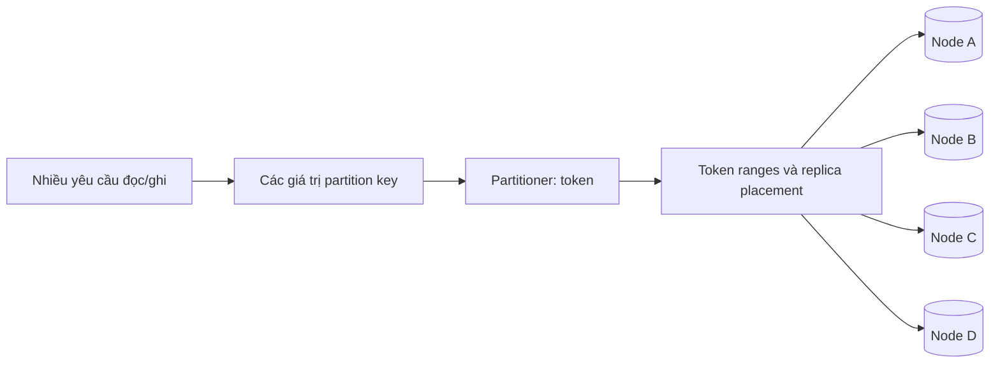
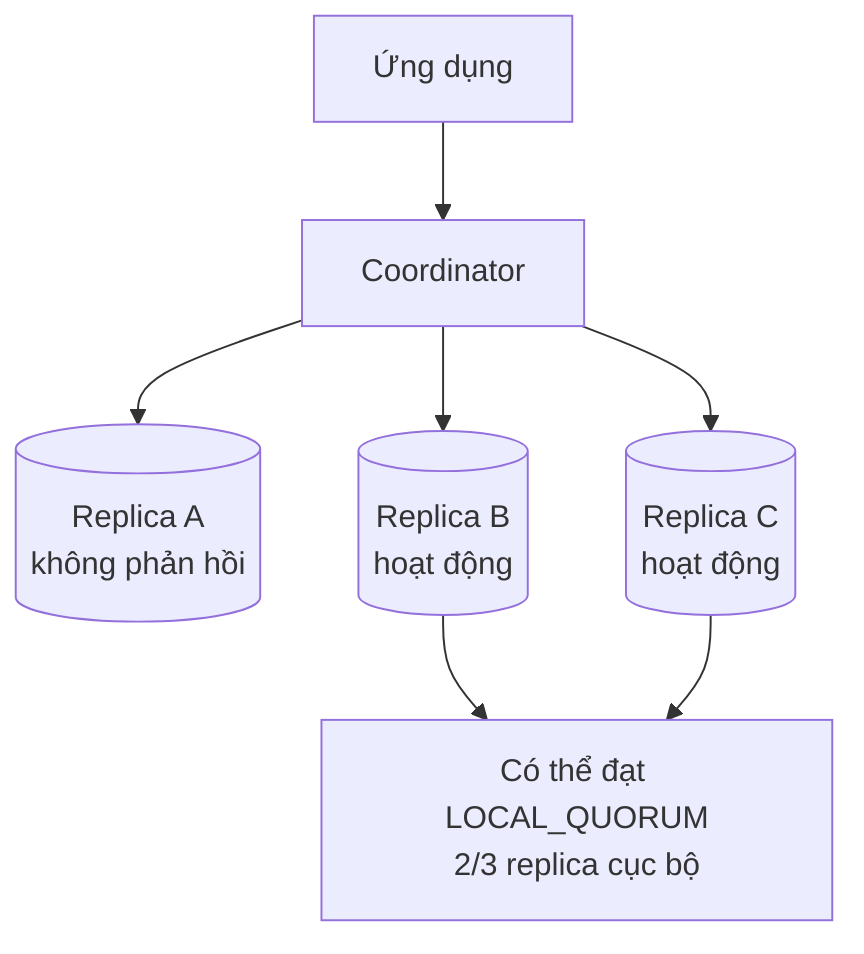
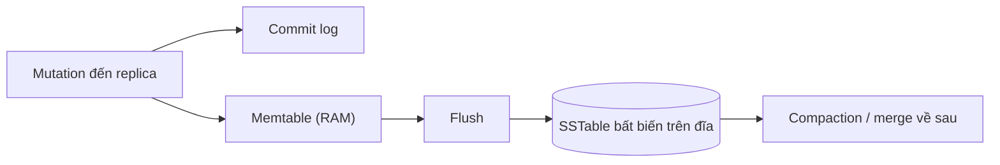
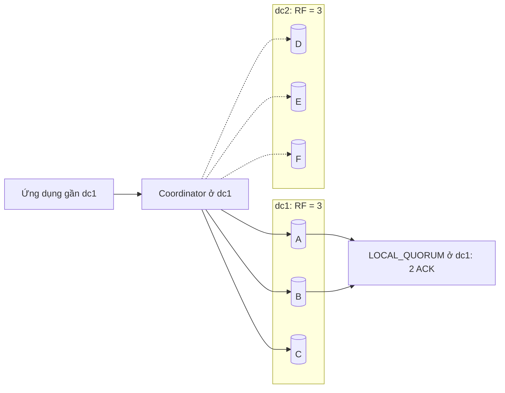
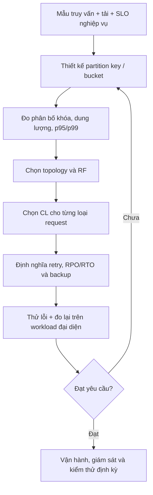

# Mục tiêu về mở rộng tải, tính sẵn sàng, độ bền và các đánh đổi

> **Chương:** Tư duy Cassandra  
> **Bối cảnh:** Apache Cassandra là hệ cơ sở dữ liệu NoSQL phân tán thuộc họ *wide-column*. Những mục tiêu quan trọng khi chọn Cassandra gồm mở rộng tải bằng nhiều node, duy trì khả năng phục vụ khi có lỗi và giảm nguy cơ mất dữ liệu. Bài học phân biệt rõ từng mục tiêu, sau đó giải thích cách partition key, replication, consistency level và vận hành cụm quyết định các đánh đổi thực tế.

## 1. Mục tiêu học tập

Sau bài này, bạn có thể:

1. Phân biệt **scalability** (khả năng mở rộng tải), **availability** (tính sẵn sàng), **durability** (độ bền dữ liệu) và **consistency** (tính nhất quán).
2. Giải thích vì sao Cassandra hỗ trợ mở rộng ngang nhưng **không bảo đảm tăng node thì thông lượng tăng tuyến tính**.
3. Mô tả tác động của replication factor (**RF**) và consistency level (**CL**) tới kết quả đọc/ghi khi node hoặc mạng gặp sự cố.
4. Lý giải đường ghi **commit log → memtable → SSTable**, vai trò của repair, và vì sao replication không thay thế backup.
5. Phân tích các đánh đổi giữa độ trễ, số bản sao, mức nhất quán, khả năng chịu lỗi, chi phí và độ phức tạp vận hành.
6. Đề xuất một cấu hình có điều kiện cho bài toán thực tế, nêu được những giả định cần kiểm chứng thay vì hứa hẹn “luôn sẵn sàng” hay “không bao giờ mất dữ liệu”.

## 2. Bốn khái niệm nghe giống nhau nhưng khác mục đích

Hãy tưởng tượng một nền tảng giám sát 200.000 thiết bị. Mỗi thiết bị thường xuyên gửi phép đo; người dùng muốn xem 100 phép đo mới nhất, và hệ thống phải tiếp tục nhận sự kiện khi một máy trong cụm bị lỗi.

Có bốn câu hỏi độc lập:

| Thuộc tính | Câu hỏi thực tế | Một tín hiệu đánh giá |
| --- | --- | --- |
| **Mở rộng tải – scalability** | Khi số thiết bị và dữ liệu tăng, hệ thống có thể mở rộng sức xử lý/lưu trữ bằng cách thêm tài nguyên không? | Thông lượng, độ trễ p95/p99, tải từng node khi tăng lưu lượng |
| **Tính sẵn sàng – availability** | Trong khoảng thời gian và điều kiện lỗi xác định, ứng dụng còn phục vụ được yêu cầu hợp lệ không? | Tỷ lệ request thành công theo SLO, thời gian gián đoạn |
| **Độ bền – durability** | Sau khi hệ thống xác nhận một ghi, dữ liệu có tồn tại qua những loại sự cố đã dự kiến không? | Khả năng khôi phục dữ liệu đã xác nhận, kiểm thử mất node/đĩa và restore |
| **Tính nhất quán – consistency** | Một lần đọc có quan sát được ghi mới nhất theo bảo đảm nào, trong những điều kiện nào? | Hành vi đọc sau ghi, mức CL, quy tắc xung đột và cập nhật đồng thời |

Một ứng dụng có thể **sẵn sàng** trả lời nhưng trả **dữ liệu cũ**. Nó cũng có thể **bền dữ liệu** trên đĩa nhưng tạm thời **không phục vụ được** vì thiếu đủ replica cho CL. Việc thêm node có thể tăng khả năng chứa dữ liệu nhưng chưa chắc cải thiện tốc độ của một partition đang quá nóng.

### 2.1. Đừng biến các mục tiêu thành một nhãn duy nhất

Ví dụ: một ghi được xác nhận ở `LOCAL_ONE` có thể hoàn tất ngay khi chỉ một replica cục bộ phản hồi. Điều đó hữu ích cho một số yêu cầu về tính sẵn sàng, nhưng không có nghĩa dữ liệu đã được ghi vào tất cả replica hay mọi phiên đọc sẽ thấy giá trị mới. Ngược lại, `ALL` đòi hỏi nhiều xác nhận hơn nhưng một replica chậm hoặc mất kết nối có thể khiến yêu cầu thất bại.

Phải luôn nêu **phạm vi** trước khi đánh giá: cụm có mấy data center, RF là bao nhiêu ở mỗi data center, ứng dụng đặt CL nào, loại lỗi đang xét là gì và giới hạn thời gian là bao nhiêu.

## 3. Mục tiêu thứ nhất: mở rộng ngang khi dữ liệu và lưu lượng tăng

Cassandra được thiết kế để chia dữ liệu và yêu cầu qua nhiều node. Thay vì nâng mãi CPU, RAM, ổ đĩa của một máy (**scale up**), ta có thể bổ sung node và phân bố lại trách nhiệm lưu trữ (**scale out**).

### 3.1. Partition key là điểm bắt đầu của việc mở rộng

Mỗi row CQL thuộc một **partition** dựa vào partition key. Cassandra dùng partitioner (thường là Murmur3) tính **token** từ partition key, rồi căn cứ token ranges và replication strategy để xác định các replica lưu partition đó.



Các node có thể quản lý nhiều dải token (vnode), và mỗi partition được nhân bản theo RF. **Không phải mỗi row được chia ra đều trên tất cả các node**; các row cùng partition key được giữ với cùng tập replica. Điều này mang đến hai hệ quả:

- Khi các khóa phân vùng và lưu lượng phân bố tương đối đều, thêm node có thể giúp trải tải và dung lượng.
- Nếu một khóa nhận phần lớn yêu cầu, tập replica của partition đó vẫn có thể thành nút thắt dù cả cụm còn nhiều node rảnh.

### 3.2. Ví dụ thiết kế partition cho dữ liệu cảm biến

Ứng dụng cần truy vấn “100 sự kiện gần nhất của một thiết bị trong một ngày”. Bảng CQL có thể chọn partition key ghép là `(tenant_id, device_id, event_day)` và clustering column `event_time`:

```sql
CREATE TABLE telemetry.device_events_by_day (
    tenant_id text,
    device_id text,
    event_day date,
    event_time timestamp,
    event_id uuid,
    temperature_c double,
    PRIMARY KEY ((tenant_id, device_id, event_day), event_time, event_id)
) WITH CLUSTERING ORDER BY (event_time DESC, event_id ASC);
```

Truy vấn:

```sql
SELECT event_time, event_id, temperature_c
FROM telemetry.device_events_by_day
WHERE tenant_id = 'acme'
  AND device_id = 'sensor-42'
  AND event_day = '2026-11-21'
LIMIT 100;
```

Nhờ biết đầy đủ partition key, Cassandra xác định được đúng partition cần đọc. `event_time` sắp row **trong partition**, không quyết định node chứa dữ liệu.

Đặt thêm `event_day` tạo **time bucket** để một thiết bị không tích lũy vô hạn mọi sự kiện vào cùng một partition. Tuy nhiên, nếu một thiết bị ghi hàng triệu sự kiện trong một ngày, partition ngày vẫn có thể quá lớn hoặc quá nóng; có thể cần bucket theo giờ hay shard logic, đồng thời bổ sung logic đọc nhiều bucket.

### 3.3. Vì sao tăng node không luôn làm hệ thống nhanh gấp đôi?

Thông lượng và độ trễ phụ thuộc vào toàn bộ đường thực thi:

| Yếu tố giới hạn | Triệu chứng | Hướng xem xét |
| --- | --- | --- |
| **Hot partition** | Một số replica quá tải, node khác vẫn rảnh | Đổi cách phân vùng/bucket; phân bố lại lưu lượng |
| **Ổ đĩa và compaction** | Độ trễ tăng khi SSTable được hợp nhất | Chọn chiến lược compaction theo workload; theo dõi I/O và dung lượng tạm |
| **Replication và mạng** | Lưu lượng giữa node/rack/DC tăng | Kiểm tra RF, topology, băng thông và placement |
| **Truy vấn thiếu partition key** | Quét rộng, độ trễ tăng nhanh theo dữ liệu | Thiết kế bảng theo truy vấn; tránh dựa tùy tiện vào `ALLOW FILTERING` |
| **Nhiều tombstone** | Đọc chậm dù trả về ít hàng | Xem TTL, xóa dữ liệu, compaction và repair |
| **Client quá tải** | Timeout hoặc queue lớn ngay ở ứng dụng | Giới hạn đồng thời, backpressure, timeout và connection/session management |
| **Thêm node/di chuyển dữ liệu** | Tải mạng/đĩa tăng trong đợt mở rộng | Lập kế hoạch capacity và điều tiết streaming/bootstrap |

Vì vậy, **khả năng mở rộng ngang** là một đặc tính thiết kế giúp chia thêm việc, không phải cam kết về tỷ lệ tăng throughput. Khi đo tải, cần quan sát thông lượng **và** p95/p99 latency cùng lúc, trên một tập truy vấn đại diện.

## 4. Mục tiêu thứ hai: tính sẵn sàng khi một phần cụm gặp lỗi

**Tính sẵn sàng** đề cập khả năng xử lý yêu cầu trong giới hạn thời gian và điều kiện đã cam kết. Một hệ thống có thể lưu dữ liệu ở nhiều replica và tiếp tục nhận yêu cầu khi một node mất kết nối, nhưng khả năng hoàn thành từng request vẫn tùy **RF**, **CL**, trạng thái replica, mạng và timeout.

### 4.1. Replica giảm điểm lỗi tập trung

Giả sử một data center `dc1` có RF = 3 cho mỗi partition. Với một partition cụ thể, ba replica là A, B và C. Nếu A tạm lỗi, B và C vẫn giữ bản sao và có thể phục vụ yêu cầu ở một số mức CL.



Coordinator là **vai trò của node nhận request**, không phải master cố định. Driver có thể gửi request tới một node thích hợp khác nếu coordinator dự kiến không truy cập được; Cassandra có metadata để xác định replica của partition.

### 4.2. Ví dụ: RF = 3 và mức nhất quán

| Replica đang đáp ứng trong `dc1` | `LOCAL_ONE` (1 ACK) | `LOCAL_QUORUM` (2 ACK) | `ALL` (3 ACK, giả định chỉ một DC) |
| --- | --- | --- | --- |
| A, B, C | Có thể đạt | Có thể đạt | Có thể đạt |
| A, B (C lỗi) | Có thể đạt | Có thể đạt | Không đạt |
| A (B, C lỗi) | Có thể đạt | Không đạt | Không đạt |
| Không replica nào | Không đạt | Không đạt | Không đạt |

Đây là **khả năng đạt CL xét theo số replica**, không bảo đảm yêu cầu chắc chắn thành công. Ngay cả khi đủ số node đang hoạt động, request vẫn có thể timeout do tải, mạng hoặc lỗi khác.

Với RF = 3, `LOCAL_QUORUM` thường cần:

\[
Q = \left\lfloor \frac{3}{2} \right\rfloor + 1 = 2
\]

**Điểm đánh đổi:** CL thấp hơn có thể cho phép tiếp tục phục vụ khi ít replica sẵn sàng; CL cao hơn đòi hỏi nhiều replica tham gia và có thể khiến request thất bại nhanh hơn trong thời điểm sự cố.

### 4.3. Sẵn sàng của database khác với sẵn sàng của toàn dịch vụ

Ngay cả khi các replica Cassandra hoạt động, người dùng vẫn có thể gặp lỗi vì Java API bị quá tải, cấu hình driver sai data center, DNS/TLS lỗi hoặc đường mạng từ ứng dụng tới cụm bị chặn. Ngược lại, một ứng dụng có thể trả HTTP 200 từ cache trong khi Cassandra đang không truy cập được; điều đó không có nghĩa dữ liệu trả về luôn mới nhất.

Vì vậy phải định nghĩa SLO theo **đường đi của yêu cầu người dùng**, ví dụ tỷ lệ thành công của API đọc lịch sử với p95 latency trong mức mục tiêu do đội sản phẩm đặt. Đo “node Cassandra vẫn chạy” là thông tin cần nhưng chưa đủ.

## 5. Mục tiêu thứ ba: độ bền của dữ liệu đã được xác nhận

**Durability** trả lời: sau khi client nhận thông báo ghi thành công, dữ liệu có thể sống sót qua những lỗi nào? Cassandra có hai nhóm cơ chế giúp đạt mục tiêu này:

1. **Đường ghi và lưu trữ cục bộ:** commit log, memtable, SSTable.
2. **Replication trên nhiều node:** duy trì nhiều bản sao của cùng partition.

### 5.1. Đường ghi: commit log, memtable, SSTable



Ở mức khái quát:

1. Coordinator gửi mutation tới các replica cần thiết.
2. Mỗi replica nhận mutation, ghi vào **commit log** để hỗ trợ phục hồi khi tiến trình gặp sự cố, đồng thời cập nhật **memtable**.
3. Replica phản hồi theo quy tắc đường ghi; coordinator trả thành công khi đạt số xác nhận theo CL.
4. Memtable được flush thành **SSTable** bất biến. **Compaction** về sau hợp nhất nhiều SSTable và xử lý phiên bản/tombstone theo quy tắc an toàn.

Sự tồn tại của commit log không có nghĩa tất cả ghi đều đã được **fsync xuống thiết bị lưu trữ** trước khi trả ACK trong mọi cấu hình. Cassandra có chế độ và tham số **đồng bộ commit log** khác nhau; ý nghĩa của một ACK đối với lỗi mất điện đột ngột phải xét cấu hình, bảo đảm của hệ điều hành/phần cứng và số replica xác nhận.

Đặc biệt, nếu cấu hình xác nhận trước khi log được đồng bộ bền vững xuống đĩa, có thể có cửa sổ rủi ro khi mất điện đồng thời. Khi yêu cầu dữ liệu rất quan trọng, cần **kiểm thử hỏng máy/mất nguồn** với cấu hình thực tế, không suy diễn độ bền chỉ từ từ “commit log”.

### 5.2. RF giúp độ bền như thế nào?

Với RF = 3, mất hoàn toàn một bản sao không nhất thiết làm mất toàn bộ partition vì các replica khác còn giữ dữ liệu. Tuy nhiên:

- **RF không phải số lượng bản sao backup độc lập:** replica cùng nhận mutation sai hoặc thao tác xóa; lỗi logic có thể nhân ra cả ba.
- **Ghi ở CL thấp** có thể mới được xác nhận bởi một replica; nếu replica đó mất dữ liệu trước khi các bản sao khác nhận ghi, có nguy cơ mất giá trị vừa được xác nhận.
- **Ghi ở quorum** yêu cầu nhiều replica phản hồi, giúp giảm phụ thuộc vào một bản sao, nhưng vẫn phải xét đồng bộ commit log, lỗi tương quan và khả năng phục hồi.
- **RF cao** tăng chi phí đĩa và lưu lượng ghi; nó không tự động bảo vệ trước sai lệnh xóa dữ liệu, lỗi ứng dụng hoặc mất toàn bộ data center nếu replica chỉ nằm trong một vùng.

Độ bền tốt là tổng hợp của placement đúng, RF/CL thích hợp, lưu trữ bền vững, repair định kỳ, giám sát, **backup và diễn tập restore**.

### 5.3. Repair, tombstone và backup giải quyết ba vấn đề khác nhau

| Cơ chế | Vấn đề chính được giải quyết | Không thay thế được |
| --- | --- | --- |
| **Replication** | Có thêm bản sao online để đọc/ghi và chịu lỗi node | Backup chống xóa nhầm, hỏng logic trên mọi replica |
| **Hinted handoff** | Chuyển lại một số mutation cho replica tạm vắng trong điều kiện được hỗ trợ | Anti-entropy repair toàn diện |
| **Repair** | So sánh, đồng bộ khác biệt giữa replica để hội tụ | Backup và khôi phục phiên bản cũ |
| **Compaction** | Hợp nhất SSTable, dọn phiên bản/tombstone khi đủ điều kiện | Repair, replication hoặc backup |
| **Backup/snapshot** | Tạo nguồn phục hồi dữ liệu qua một số sự cố logic/vận hành | Cơ chế phục vụ request online |

**Tombstone** cần được lưu đủ lâu theo cấu hình và kế hoạch repair để tránh dữ liệu đã xóa xuất hiện lại khi replica cũ quay về. Không nên giảm `gc_grace_seconds` chỉ nhằm dọn đĩa nhanh khi chưa phân tích chu kỳ repair và phương án an toàn phù hợp.

## 6. Tính nhất quán: trục đánh đổi nối availability với cách đọc/ghi

Cassandra cung cấp **tunable consistency**: client chọn consistency level cho từng thao tác hoặc bằng mặc định của ứng dụng. CL cho biết các replica nào và bao nhiêu phản hồi phải thỏa điều kiện trước khi yêu cầu hoàn tất.

Ví dụ, với một data center và RF = 3:

- Ghi `ONE`: cần một replica đáp ứng.
- Ghi `QUORUM`: cần hai replica đáp ứng.
- Đọc `QUORUM`: cần phản hồi phù hợp từ hai replica.
- Ghi/đọc `ALL`: đòi hỏi ba replica; khi một replica không sẵn sàng, yêu cầu có thể không đạt.

### 6.1. Điều kiện giao nhau của quorum

Trong **cùng một phạm vi replica**, để các tập replica tham gia đọc/ghi bắt buộc giao nhau:

\[
W + R > RF
\]

Với RF = 3, ghi quorum `W = 2` và đọc quorum `R = 2` cho `2 + 2 > 3`. Nếu một ghi đã thành công và không có ghi xung đột, tập đọc quorum không thể chỉ gồm các replica **đều nằm ngoài** tập đã xác nhận ghi.

Tuy nhiên, đây **không phải lời hứa linearizability cho mọi thao tác**. Ghi đồng thời, timestamp, lệch đồng hồ, xung đột phiên bản, TTL/tombstone và thao tác đa partition cần phân tích riêng. Cơ chế **lightweight transaction (LWT)** của Cassandra sử dụng đồng thuận cho thao tác có điều kiện như `IF NOT EXISTS`, nhưng có chi phí và ngữ nghĩa khác ghi thông thường.

### 6.2. Vì sao đọc có thể cũ ngay sau khi ghi?

Giả sử mutation mới được A xác nhận ở CL `ONE`, còn B và C chưa đồng bộ. Một lần đọc `ONE` từ B có thể trả giá trị cũ. Điều đó là một hành vi cần dự tính, không đồng nghĩa bản ghi đã mất hoàn toàn.

Nếu ứng dụng bắt buộc **read-after-write** trong phạm vi đã xác định, cần chọn CL đọc/ghi, mô hình dữ liệu và cơ chế xử lý concurrency tương ứng. Đừng chỉ nhìn giá trị RF mà suy ra mọi phiên đọc đều thấy cập nhật mới ngay lập tức.

### 6.3. CAP phải được hiểu trong bối cảnh có phân đoạn mạng

Khi có **network partition**, các replica không thể liên lạc bình thường. CAP mô tả mâu thuẫn giữa tính nhất quán mạnh theo nghĩa cụ thể của định lý và khả năng mọi yêu cầu tiếp tục được đáp ứng trong tình huống này.

Không nên nói “Cassandra luôn AP nên mọi request đều thành công”. Với cùng lỗi mạng:

- Request `ONE` có thể được một phía phục vụ nếu có replica phù hợp.
- Request `QUORUM` hoặc `LOCAL_QUORUM` có thể không đạt số replica cần thiết trên một phía.
- Request `ALL` càng dễ không đáp ứng khi bất kỳ replica bắt buộc nào tách khỏi mạng.

Cassandra cho phép người dùng chọn CL nên **kết quả sẵn sàng cụ thể phụ thuộc từng thao tác**. Đây là lựa chọn thiết kế cần gắn với yêu cầu nghiệp vụ, không phải nhãn “AP” hay “CP” áp dụng mù quáng.

## 7. Đánh đổi trong kiến trúc đa data center

Một hệ thống phục vụ nhiều vùng có thể muốn:

- Đặt replica gần ứng dụng để giảm độ trễ.
- Tránh để một data center duy nhất là điểm lỗi lớn.
- Vẫn quy định rõ dữ liệu ở vùng dự phòng có thể chậm hơn bao lâu và chuyển vùng mất bao lâu.

CQL minh họa:

```sql
-- Chỉ là ví dụ cấu hình: cluster phải thực sự có dc1 và dc2,
-- với số node phù hợp cho RF được khai báo.
CREATE KEYSPACE telemetry_multi_dc
WITH replication = {
    'class': 'NetworkTopologyStrategy',
    'dc1': 3,
    'dc2': 3
};
```

Khi đó mỗi partition có ba replica ở `dc1` và ba replica ở `dc2` (giả định topology được đáp ứng). Ứng dụng tại `dc1` có thể đọc/ghi bằng `LOCAL_QUORUM`, tức cần quorum **cục bộ ở dc1**. Điều này thường giảm phụ thuộc độ trễ của mạng liên vùng trên đường xác nhận request.



Đường chấm nhắc rằng phản hồi từ `dc2` **không phải điều kiện hoàn tất của LOCAL_QUORUM ở dc1**; nó không có nghĩa Cassandra bỏ qua việc gửi mutation tới vùng còn lại.

### 7.1. Mất data center không đồng nghĩa tự động chuyển vùng thành công

Nếu `dc1` ngừng phục vụ, ứng dụng có thể chuyển sang `dc2` khi hạ tầng, driver, định tuyến và chính sách phục hồi được thiết kế phù hợp. Nhưng cần trả lời:

1. Ứng dụng có thể kết nối `dc2`, xác thực và chuyển request trong thời gian chấp nhận được không?
2. Dữ liệu vừa được xác nhận ở `dc1` đã đến `dc2` đầy đủ chưa?
3. Khi hai vùng từng nhận ghi độc lập, xung đột sẽ được xử lý thế nào?
4. Có quy trình **failback** để đưa lưu lượng trở lại mà không gây ghi trùng hoặc lỗi thời không?

**LOCAL_QUORUM tại dc1 không xác nhận rằng dc2 đã đồng bộ**. Khi kết nối liên vùng bị gián đoạn, vùng dự phòng có thể thiếu một số ghi mới. Vì vậy, tuyên bố “không mất dữ liệu khi cả vùng hỏng” phải dựa trên thiết kế, CL và thử nghiệm thực tế.

### 7.2. RPO và RTO là yêu cầu nghiệp vụ, không phải thuộc tính mặc định

| Chỉ số | Ý nghĩa | Cần kiểm thử bằng gì? |
| --- | --- | --- |
| **RPO – Recovery Point Objective** | Mức mất dữ liệu theo thời gian tối đa có thể chấp nhận khi phục hồi | Giả lập mất vùng, đối chiếu các ghi đã xác nhận với dữ liệu ở vùng dự phòng |
| **RTO – Recovery Time Objective** | Thời gian tối đa chấp nhận để dịch vụ phục hồi | Diễn tập chuyển vùng từ ứng dụng, mạng và database đến trạng thái phục vụ |

RF và CL là **các đầu vào thiết kế** cho RPO/RTO, không phải các giá trị RPO/RTO đo được. Ngoài ra còn có replication lag, quy trình chuyển traffic, khả năng đọc dữ liệu cũ, snapshot/backup và sức chứa của vùng dự phòng.

## 8. Chi phí đánh đổi: không có cấu hình tối ưu cho tất cả

Một quyết định tăng độ bền/nhất quán hoặc khả năng chịu lỗi thường tác động đến mục tiêu khác.

| Lựa chọn | Lợi ích kỳ vọng | Giá phải trả / giới hạn |
| --- | --- | --- |
| **Tăng RF** | Nhiều bản sao hơn giúp chịu lỗi node tốt hơn | Tốn đĩa, băng thông và tài nguyên ghi/repair; lỗi tương quan vẫn tồn tại |
| **Giảm CL từ quorum xuống one** | Một số request dễ hoàn thành hơn khi replica gặp lỗi | Có thể quan sát dữ liệu cũ; một ghi chỉ được một replica xác nhận có rủi ro lớn hơn nếu replica đó mất dữ liệu |
| **Tăng CL từ one lên quorum/all** | Tăng số replica xác nhận tham gia | Độ trễ và khả năng thất bại khi thiếu replica có thể tăng |
| **Thêm data center** | Phục vụ gần nhiều vùng và hỗ trợ khôi phục sự cố vùng | Chi phí liên vùng, đồng bộ dữ liệu, vận hành và xử lý xung đột |
| **Partition nhỏ hơn bằng time bucket** | Giới hạn độ lớn partition, giảm điểm nóng trong một số workload | Truy vấn khoảng thời gian dài phải hợp nhất nhiều partition; tăng độ phức tạp API |
| **TTL cho dữ liệu sự kiện** | Giới hạn dung lượng giữ lâu dài | Tombstone, compaction và yêu cầu phối hợp với repair; dữ liệu hết hạn không còn phục vụ truy vấn |
| **Đặt chính sách backup chặt** | Có điểm khôi phục trước sai thao tác | Tốn dung lượng, thời gian sao lưu/restore và cần kiểm tra khả năng khôi phục |
| **Tối ưu ghi bằng nhiều request đồng thời** | Tăng thông lượng đến ngưỡng thiết bị có thể chịu | Dễ tăng queue, p99 latency, timeout và áp lực compaction khi không có backpressure |

**Nguyên tắc:** chọn cấu hình theo yêu cầu nghiệp vụ và kết quả benchmark/chaos test trên workload đại diện. “RF = 3, LOCAL_QUORUM” là ví dụ phổ biến để phân tích, **không phải đáp án bắt buộc cho mọi dữ liệu**.

## 9. Phân tích sự cố: availability và durability có thể tách rời

Các tình huống sau giả định một data center có RF = 3 cho partition, trừ khi ghi rõ khác.

### 9.1. Một node lỗi khi ứng dụng ghi LOCAL_QUORUM

A hỏng; B và C còn hoạt động, phản hồi đúng hạn.

- **Tính sẵn sàng:** ghi vẫn có thể thành công vì đủ 2/3 replica.
- **Độ bền:** có hai replica xác nhận trong kịch bản; vẫn phải xét cấu hình đồng bộ commit log và các lỗi tương quan.
- **Việc cần làm:** khôi phục node và kiểm tra quá trình đồng bộ/repair, không xem lỗi đã tự giải quyết hoàn toàn chỉ vì request vẫn thành công.

### 9.2. Hai node lỗi, một node còn ghi được ở LOCAL_ONE

Chỉ A phản hồi, B và C không hoạt động.

- **Tính sẵn sàng:** request có thể thành công ở `LOCAL_ONE`.
- **Độ bền:** giá trị mới chỉ có xác nhận từ một replica; mất A trước khi các replica khác phục hồi có thể khiến dữ liệu đó không còn bản sao khả dụng.
- **Đánh đổi:** khả năng tiếp nhận dữ liệu trong lúc sự cố được ưu tiên hơn mức xác nhận nhiều replica.

### 9.3. Ghi timeout: không được tự coi là rollback

Ứng dụng gửi ghi ở `LOCAL_QUORUM`. A và B nhận mutation nhưng phản hồi chậm/mất trên mạng; client nhận timeout.

- **Không thể kết luận** mutation chắc chắn chưa tồn tại: một số replica có thể đã ghi.
- **Ứng dụng Java** cần phân biệt retry an toàn với thao tác có side effect. Một sự kiện nên có `event_id` ổn định qua retry để tránh tạo row mới do sinh UUID khác.
- **Driver** có chính sách timeout/retry và cờ idempotence, nhưng cờ này không chứng minh ngữ nghĩa toàn nghiệp vụ thực sự idempotent.

### 9.4. Replica trở lại nhưng đọc được dữ liệu cũ

A, B vừa xác nhận ghi; C trở lại sau thời gian tắt. Đọc ở `ONE` từ C có thể thấy giá trị cũ trước khi hội tụ.

- **Tính sẵn sàng** của read vẫn có thể đạt.
- **Tính nhất quán** theo yêu cầu “đọc ngay giá trị vừa ghi” có thể chưa đạt.
- **Hướng xử lý:** thiết kế CL trong cùng phạm vi replica, quan sát replica lag/repair và xác định yêu cầu nghiệp vụ thật sự.

### 9.5. Xóa nhầm toàn bộ dữ liệu

Một lệnh xóa hợp lệ có thể được nhân bản trên các replica. Cluster vẫn có thể đang rất sẵn sàng và các node đều “khỏe” trong khi dữ liệu nghiệp vụ đã bị xóa.

- **Replication không phải backup.**
- Cần snapshot/backup và diễn tập phục hồi, bao gồm xác minh dữ liệu sau restore.
- Phải có quy trình bảo vệ thao tác nguy hiểm và kiểm soát quyền ở các lớp ứng dụng, database và vận hành.

## 10. CQL và Java: đặt yêu cầu nhất quán ở lớp nào?

### 10.1. Tạo keyspace cho lab

Ví dụ này giả định cluster có data center tên `dc1` và đủ **ba node phù hợp** để đặt RF = 3. Trên lab một node, có thể dùng RF = 1 và `LOCAL_ONE`; khi đó **không thể kiểm thử thực tế** kịch bản chịu lỗi/quorum của RF = 3.

```sql
CREATE KEYSPACE IF NOT EXISTS telemetry
WITH replication = {
    'class': 'NetworkTopologyStrategy',
    'dc1': 3
};

CREATE TABLE IF NOT EXISTS telemetry.device_events_by_day (
    tenant_id text,
    device_id text,
    event_day date,
    event_time timestamp,
    event_id uuid,
    temperature_c double,
    PRIMARY KEY ((tenant_id, device_id, event_day), event_time, event_id)
) WITH CLUSTERING ORDER BY (event_time DESC, event_id ASC);
```

Trong `cqlsh`, có thể đặt CL cho những thao tác tiếp theo:

```sql
CONSISTENCY LOCAL_QUORUM;

INSERT INTO telemetry.device_events_by_day (
    tenant_id, device_id, event_day, event_time, event_id, temperature_c
) VALUES (
    'acme', 'sensor-42', '2026-11-21',
    '2026-11-21T08:05:00Z',
    11111111-1111-1111-1111-111111111111, 27.4
);

SELECT event_time, temperature_c
FROM telemetry.device_events_by_day
WHERE tenant_id = 'acme'
  AND device_id = 'sensor-42'
  AND event_day = '2026-11-21'
LIMIT 100;
```

**`CONSISTENCY` là lệnh của `cqlsh`**, không phải cú pháp đặt CL trực tiếp vào mọi câu `INSERT` hay `SELECT`. Khi chạy từ Java, dùng API của driver để đặt CL trên statement hoặc cấu hình profile.

### 10.2. Java driver chọn CL cho từng thao tác

Ví dụ rút gọn với API Java driver 4.x:

```java
import java.time.LocalDate;
import java.time.Instant;
import java.util.UUID;

import com.datastax.oss.driver.api.core.CqlSession;
import com.datastax.oss.driver.api.core.DefaultConsistencyLevel;
import com.datastax.oss.driver.api.core.cql.PreparedStatement;
import com.datastax.oss.driver.api.core.cql.BoundStatement;

// CqlSession được khởi tạo và tái sử dụng theo vòng đời ứng dụng.
// Keyspace/bảng telemetry đã được tạo trước.
PreparedStatement ps = session.prepare(
    "INSERT INTO telemetry.device_events_by_day " +
    "(tenant_id, device_id, event_day, event_time, event_id, temperature_c) " +
    "VALUES (?, ?, ?, ?, ?, ?)"
);

UUID stableEventId = UUID.fromString(
    "11111111-1111-1111-1111-111111111111"
);
BoundStatement write = ps.bind(
        "acme",
        "sensor-42",
        LocalDate.of(2026, 11, 21),
        Instant.parse("2026-11-21T08:05:00Z"),
        stableEventId,
        27.4
    ).setConsistencyLevel(DefaultConsistencyLevel.LOCAL_QUORUM);

session.execute(write);
```

Đoạn mã là **trích đoạn bên trong một ứng dụng đã có biến `CqlSession session`**, không phải một lớp Java độc lập để biên dịch trực tiếp. Driver đảm nhiệm kết nối, bind tham số, routing và chuyển yêu cầu; Cassandra coordinator và replica thực hiện ghi, xét CL. Ứng dụng quyết định khi nào retry, cách đối soát timeout và ý nghĩa của sự kiện.

Không tự động đánh dấu mọi ghi là idempotent. Cùng primary key thường giúp retry một thao tác gán giá trị, nhưng timestamp, TTL, counters, LWT và side effect liên hệ khác vẫn có thể làm retry không an toàn nếu thiếu thiết kế.

## 11. Đặt mục tiêu đo được trước khi chọn cấu hình

Để đánh giá một hệ Cassandra, hãy định nghĩa tiêu chí kiểm chứng cho workload cụ thể:

| Câu hỏi thiết kế | Cách kiểm chứng |
| --- | --- |
| Mỗi giây cần ghi/đọc bao nhiêu và dung lượng tăng bao nhiêu theo ngày? | Load test với tỷ lệ đọc/ghi, kích thước row và phân bố khóa thực tế |
| p95/p99 latency mục tiêu là gì? | Đo khi tải bình thường, cao điểm, compaction và lúc có node lỗi |
| Có thể chấp nhận đọc dữ liệu cũ trong bao lâu? | Kiểm thử hành vi read-after-write với CL và nhiều data center |
| Khi một node/rack/DC lỗi, request nào phải tiếp tục thành công? | Chaos/failure injection an toàn, đối chiếu CL và lỗi thực tế |
| Ghi đã xác nhận có thể chịu mất loại lỗi nào? | Kiểm thử mất node/đĩa/nguồn phù hợp, xét cấu hình commit log và RF |
| Dữ liệu xóa nhầm có cần khôi phục không? | Kiểm thử snapshot/backup và restore trên môi trường phù hợp |
| RPO/RTO sau mất vùng là bao nhiêu? | Diễn tập failover/failback và đối soát dữ liệu |
| Chi phí chạy hệ thống có nằm trong ngân sách? | Tính dung lượng nhân theo RF, I/O compaction/repair, lưu lượng giữa DC và dự phòng |

Trong giai đoạn pilot, nên ghi lại **giả định, kết quả đo, ngưỡng hành động và người chịu trách nhiệm**. Không lấy một lần benchmark trên cụm nhỏ làm bảo đảm cho workload sản xuất với partition key khác.

### 11.1. Một chuỗi quyết định thực dụng



Chu trình này giúp tránh tình huống chọn RF/CL trước rồi mới phát hiện partition key gây điểm nóng, hoặc hứa khả năng chuyển vùng mà chưa có đường truy cập và phương án phục hồi ứng dụng.

## 12. Bài tập tình huống: chọn đánh đổi theo nghiệp vụ

Một công ty có hai loại dữ liệu trên cùng cụm Cassandra:

- **Loại A – telemetry:** sự kiện từ cảm biến; việc một màn hình trạng thái trễ trong thời gian ngắn có thể chấp nhận, nhưng cần tiếp tục tiếp nhận dữ liệu khi một node lỗi.
- **Loại B – trạng thái cấu hình thiết bị:** người quản trị cập nhật ngưỡng cảnh báo; ngay sau thao tác, màn hình điều khiển cần quan sát cấu hình mới trong phạm vi đã xác định. Không được xem nhẹ xung đột cập nhật của hai quản trị viên.

Cụm có một data center, RF = 3. Trả lời trước khi đọc gợi ý:

1. `LOCAL_ONE` và `LOCAL_QUORUM` khác nhau gì khi một replica lỗi?
2. Chọn cùng CL cho tất cả request có luôn hợp lý không?
3. Nếu mất hai node và request ghi `LOCAL_ONE` vẫn thành công ở node còn lại, rủi ro độ bền xuất hiện ở đâu?
4. Nếu cần ngăn hai quản trị viên ghi đè một cấu hình dựa trên phiên bản cũ, chỉ tăng CL có giải quyết được không?
5. Nếu toàn bộ cụm nhận lệnh xóa nhầm cấu hình, RF = 3 có khôi phục được trạng thái trước xóa không?

### Gợi ý đáp án

**Câu 1.** Khi còn hai replica phản hồi, cả `LOCAL_ONE` và `LOCAL_QUORUM` đều có thể đạt; khác biệt thể hiện ở số xác nhận cần chờ và ở tình huống chỉ còn một replica.

**Câu 2.** Không. Có thể cân nhắc CL khác nhau theo mục tiêu từng đường đọc/ghi, nhưng phải kiểm chứng tính mới của dữ liệu, thời gian chờ và yêu cầu chịu lỗi. Không thể chỉ gán nhãn telemetry là “không quan trọng” rồi bỏ qua độ bền.

**Câu 3.** Mutation có thể mới chỉ có trên một replica. Nếu replica cuối cùng đó cũng mất dữ liệu trước khi các replica khác hồi phục hoặc bắt kịp, giá trị mới có nguy cơ không còn bản sao khả dụng.

**Câu 4.** Không. Quorum thông thường không thay thế kiểm soát cập nhật đồng thời có điều kiện. Có thể cân nhắc LWT với `IF`/`IF NOT EXISTS` cho trường hợp phù hợp, cùng quy tắc versioning và giải quyết xung đột ở ứng dụng.

**Câu 5.** Không thể dựa vào RF để phục hồi phiên bản cũ đã bị xóa hợp lệ trên các replica. Cần backup/snapshot và quy trình restore đã được kiểm thử.

## 13. Những ngộ nhận cần tránh

| Ngộ nhận | Cách hiểu đúng |
| --- | --- |
| “Thêm gấp đôi số node thì throughput chắc chắn gấp đôi.” | Hiệu quả phụ thuộc phân bố partition, compaction, mạng, ổ đĩa và tải thực tế. |
| “RF = 3 có nghĩa client phải chờ ba ACK.” | Số ACK cần thiết phụ thuộc CL; RF là số replica được cấu hình. |
| “Ghi ONE thành công nghĩa là dữ liệu đã nằm trên mọi node.” | Chỉ đạt điều kiện của CL; có thể còn replica chưa nhận/đồng bộ. |
| “Độ bền dữ liệu và tính sẵn sàng là một.” | Có thể dữ liệu vẫn an toàn nhưng CL không đạt, hoặc request thành công với ít replica xác nhận. |
| “Có commit log là chắc chắn không mất ghi khi mất điện ở mọi cấu hình.” | Cần xét chế độ fsync, phần cứng, lỗi tương quan và replication. |
| “Replication là backup.” | Replica có thể nhân bản cả thao tác xóa nhầm hoặc ghi sai; backup cần điểm phục hồi độc lập. |
| “LOCAL_QUORUM ở một vùng đồng nghĩa vùng khác đã đồng bộ.” | Nó chỉ yêu cầu đủ replica cục bộ cho request ở vùng đó. |
| “CAP bảo đảm Cassandra luôn sẵn sàng.” | Khả năng hoàn thành request khi có network partition tùy CL, phạm vi replica và tình trạng mạng. |
| “Read quorum/write quorum tự tạo giao dịch ACID đa partition.” | Quorum giao nhau không thay thế LWT hay giao dịch quan hệ đa partition. |
| “Timeout ghi có nghĩa server chưa ghi dữ liệu.” | Một số replica có thể đã nhận mutation; retry cần được thiết kế an toàn. |

## 14. Tự kiểm tra kiến thức

1. **Ba mục tiêu scalability, availability và durability khác nhau ở đâu?** Mở rộng tải là đáp ứng tăng trưởng; sẵn sàng là khả năng hoàn thành request; độ bền là khả năng giữ ghi đã xác nhận trước các loại lỗi định nghĩa.
2. **Vì sao partition key liên quan trực tiếp đến khả năng mở rộng?** Token từ partition key quyết định nhóm replica chịu tải; phân phối lệch tạo hot partition.
3. **RF = 3, một node lỗi, LOCAL_QUORUM có thể hoạt động không?** Có, nếu hai replica cục bộ còn lại phản hồi đúng hạn.
4. **RF = 3, còn một replica, LOCAL_ONE có thể hoạt động không?** Có thể, nhưng độ bền của ghi mới có rủi ro lớn hơn và không có nghĩa mọi yêu cầu đều thành công.
5. **Đường ghi của Cassandra có các thành phần nào cần nhớ?** Commit log, memtable, flush SSTable và compaction về sau; độ bền khi ACK phụ thuộc cấu hình và lỗi xét đến.
6. **Vì sao cần repair dù đã có RF > 1?** Replica có thể lệch do lỗi/gián đoạn; repair giúp đối chiếu và hội tụ dữ liệu.
7. **W + R > RF bảo đảm mọi thao tác linearizable không?** Không. Đây là trực giác về giao nhau của tập replica; concurrency, timestamp và LWT là vấn đề khác.
8. **LOCAL_QUORUM ở dc1 có bảo đảm đọc ngay dữ liệu mới nhất ở dc2 không?** Không. Replica dc2 có thể chưa hội tụ.
9. **RPO và RTO có phải số Cassandra tự cung cấp khi đặt RF = 3 không?** Không. Đó là mục tiêu nghiệp vụ phải đo bằng thử nghiệm phục hồi.
10. **Một bảng có TTL và tombstone nhiều gây đọc chậm nên làm gì?** Xem mẫu đọc/xóa, chiến lược compaction, repair và cách giữ dữ liệu; không tùy tiện giảm tham số dọn tombstone.

## 15. Ghi nhớ trước khi triển khai

**Cassandra giúp phân tán dữ liệu và yêu cầu, cung cấp replication và mức nhất quán có thể lựa chọn. Giá trị của hệ thống chỉ đạt được khi ta chủ động thiết kế partition key, RF, CL, đường đọc/ghi và vận hành phù hợp với nghiệp vụ.**

Khi so sánh hai thiết kế Cassandra, hãy hỏi theo thứ tự: **cần mở rộng loại tải nào → dữ liệu được phân vùng thế nào → phải chịu lỗi gì → request cần bảo đảm nhất quán nào → ghi đã xác nhận cần sống sót qua lỗi nào → cơ chế backup/repair và đo RPO/RTO ra sao → chi phí latency, mạng, đĩa, vận hành có chấp nhận được không?**

Tư duy đó là nền tảng của mô-đun **DATABASE_ENGINE_WIDE_COLUMN_CASSANDRA**: thực hành CQL, chọn partition key và schema theo truy vấn, thiết kế replication và consistency đọc/ghi, hiểu compaction, repair, tình huống lỗi và tích hợp từ ứng dụng Java.
