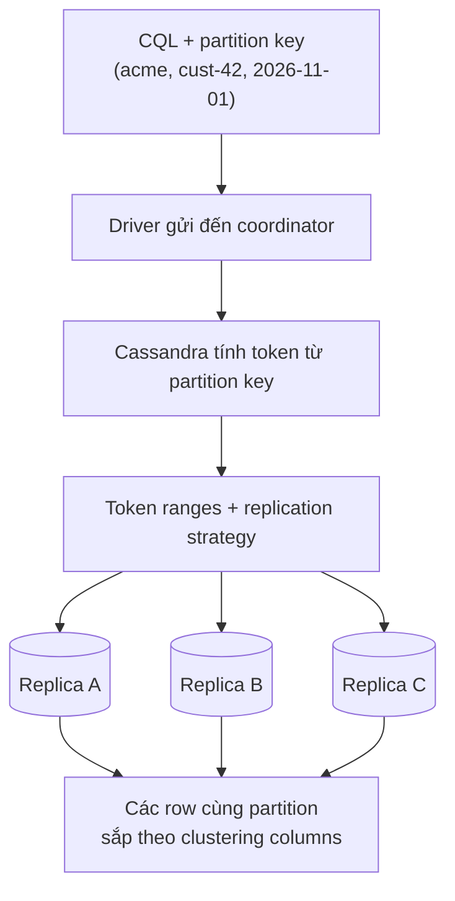
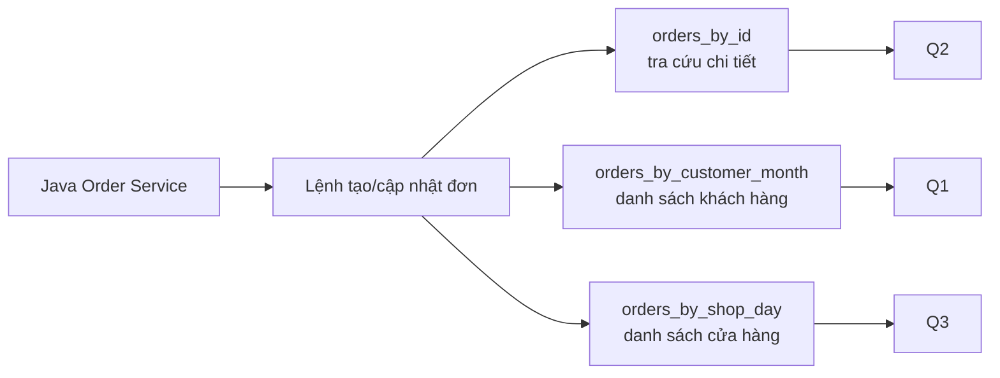
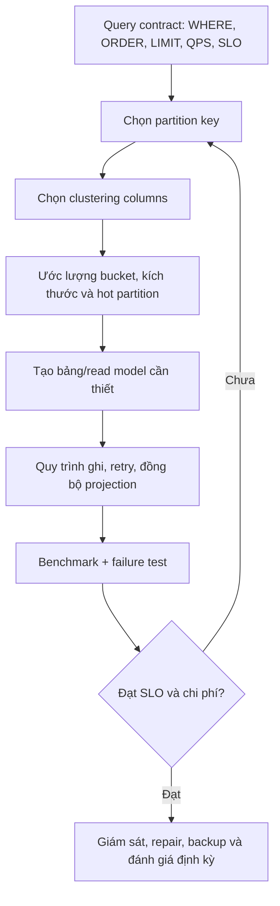

# Thiết kế theo truy vấn và vai trò của khóa phân vùng

> **Chương:** Tư duy Cassandra  
> **Phạm vi:** Hiểu cách thiết kế bảng Apache Cassandra từ các truy vấn mà ứng dụng thực sự cần phục vụ. Bài học tập trung vào partition key, clustering columns, cách phân phối dữ liệu qua cluster, phân vùng theo thời gian, điểm nóng, nhân bản dữ liệu theo đường đọc và những đánh đổi liên quan tới consistency, CQL, vận hành và ứng dụng Java.

## 1. Mục tiêu học tập

Sau bài này, bạn có thể:

1. Chuyển một yêu cầu nghiệp vụ thành **mẫu truy vấn** có điều kiện lọc, thứ tự, giới hạn, tần suất và mục tiêu độ trễ cụ thể.
2. Phân biệt **partition key**, **clustering columns** và **regular columns** khi đọc một khai báo `PRIMARY KEY` trong CQL.
3. Giải thích cách Cassandra tính token từ partition key, phân phối partition tới replica và vì sao việc chọn khóa quyết định khả năng mở rộng ngang.
4. Thiết kế bảng cho ít nhất hai đường truy cập khác nhau, chấp nhận **denormalization** và hiểu trách nhiệm đồng bộ dữ liệu.
5. Nhận diện partition quá lớn, hot partition, truy vấn quét rộng và việc dùng `ALLOW FILTERING` sai mục đích.
6. Chọn chiến lược time bucket/shard có căn cứ đo lường; hiểu chi phí khi đọc qua nhiều partition.
7. Viết CQL và dùng Java driver để truy vấn bằng đầy đủ partition key, đồng thời xác định phạm vi của replication, consistency và retry.

## 2. Bắt đầu từ truy vấn, không bắt đầu từ danh sách thực thể

Trong cơ sở dữ liệu quan hệ, người học thường xây mô hình nghiệp vụ trước, chuẩn hóa các thực thể như `customers`, `orders`, `shops`, rồi sử dụng JOIN hoặc index để trả lời nhiều loại câu hỏi. Cách đó có giá trị riêng, nhưng **không thể bê nguyên sang Cassandra** và kỳ vọng mọi truy vấn vẫn hoạt động hiệu quả.

Cassandra là hệ NoSQL *wide-column* phân tán. Hệ thống định vị dữ liệu chủ yếu nhờ **partition key**, còn các row bên trong partition được sắp theo **clustering columns**. Vì vậy, ở Cassandra, việc thiết kế một bảng phải trả lời câu hỏi:

> “Ứng dụng sẽ truy vấn dữ liệu này như thế nào, có biết khóa gì, cần đọc bao nhiêu row, theo thứ tự nào và với tần suất bao nhiêu?”

Đây là tư duy **query-first data modeling**: xác định đường truy cập thường xuyên trước, sau đó tạo schema đáp ứng đường truy cập ấy.

### 2.1. Ví dụ: hệ thống đơn hàng đa khách thuê

Một ứng dụng thương mại có nhiều khách thuê (*tenant*), nhiều người mua và cửa hàng. Ba màn hình chính cần:

| Mã | Câu hỏi nghiệp vụ | Điều kiện đã biết khi truy vấn | Thứ tự/giới hạn |
| --- | --- | --- | --- |
| **Q1** | Xem 20 đơn gần nhất của một người mua trong tháng | `tenant_id`, `customer_id`, tháng | `ordered_at` mới trước; tối đa 20 |
| **Q2** | Xem chi tiết một đơn qua mã đơn | `tenant_id`, `order_id` | Một đơn cụ thể |
| **Q3** | Xem 50 đơn gần nhất của một cửa hàng trong ngày | `tenant_id`, `shop_id`, ngày | `ordered_at` mới trước; tối đa 50 |

Ba câu hỏi cùng dùng dữ liệu “đơn hàng”, nhưng **bắt đầu từ ba khóa tra cứu khác nhau**. Một bảng chỉ tối ưu theo `order_id` sẽ không tự động phục vụ tốt danh sách theo người mua hoặc cửa hàng.

Ngoài ra, đội phân tích muốn báo cáo “doanh thu toàn quốc theo thành phố và ngành hàng trong 90 ngày”. Đây là một đường truy cập thứ tư, với yêu cầu tổng hợp trên lượng lớn dữ liệu. Ta sẽ quyết định riêng cách đáp ứng nó ở phần sau.

### 2.2. Một query contract cần những gì?

Trước khi viết `CREATE TABLE`, hãy ghi lại ít nhất:

- **Điều kiện lọc bắt buộc:** những trường nào ứng dụng luôn có sẵn? Trường nào tùy chọn?
- **Thứ tự:** mới nhất trước, tăng dần hay theo điểm số?
- **Giới hạn kết quả:** một row, vài chục row hay hàng triệu row?
- **Tần suất và tải:** QPS, số người dùng đồng thời, tỷ lệ đọc/ghi.
- **Kích thước dữ liệu và vòng đời:** một khóa tích lũy bao nhiêu row mỗi ngày/tháng?
- **Yêu cầu độ trễ và tính mới:** p95/p99 mục tiêu; có chấp nhận nhìn thấy bản ghi cũ trong thời gian ngắn không?

Các thông tin này là đầu vào cho việc chọn partition key, clustering, bucket, replication và consistency. Không có chúng, tên trường đẹp không đủ để chứng minh bảng được thiết kế đúng.

## 3. Primary key trong Cassandra có hai phần với trách nhiệm khác nhau

Xét khai báo:

```sql
PRIMARY KEY ((tenant_id, customer_id, order_month), ordered_at, order_id)
```

Cú pháp có thể đọc thành:

| Thành phần | Vai trò | Hệ quả |
| --- | --- | --- |
| `(tenant_id, customer_id, order_month)` | **Composite partition key** | Tổ hợp ba giá trị tạo một partition logic và quyết định token/nhóm replica |
| `ordered_at` | **Clustering column thứ nhất** | Sắp các row theo thời điểm bên trong partition |
| `order_id` | **Clustering column thứ hai** | Phân biệt các đơn có cùng thời điểm và tham gia sắp thứ tự |
| `status`, `total_amount`, `shop_id` | **Regular columns** | Lưu dữ liệu trả về; không tự tạo đường tìm kiếm toàn cụm |

**Partition key** trả lời “dữ liệu nằm ở nhóm replica nào?”. **Clustering columns** trả lời “sau khi định vị partition, row nào và thứ tự nào cần đọc?”. Chúng không thể thay vai trò cho nhau.

### 3.1. Cùng một partition có thể chứa rất nhiều row

Ví dụ có các đơn:

| tenant_id | customer_id | order_month | ordered_at | order_id |
| --- | --- | --- | --- | --- |
| acme | cust-42 | 2026-11-01 | 21/11 09:15 | id-A |
| acme | cust-42 | 2026-11-01 | 21/11 08:02 | id-B |
| acme | cust-42 | 2026-11-01 | 20/11 18:35 | id-C |
| acme | cust-42 | 2026-10-01 | 31/10 21:10 | id-D |
| acme | cust-99 | 2026-11-01 | 21/11 09:00 | id-E |

Ba row đầu thuộc cùng partition `(acme, cust-42, 2026-11-01)`; row thứ tư thuộc partition tháng 10, row cuối thuộc partition của người mua khác. Với `CLUSTERING ORDER BY (ordered_at DESC, order_id ASC)`, các đơn mới hơn xuất hiện trước trong **mỗi** partition.

Một partition chứa nhiều row **không có nghĩa** toàn bảng được sắp theo `ordered_at`. Các partition được định tuyến theo token; Cassandra không lưu sẵn một danh sách thời gian toàn cục cho mọi người mua.

### 3.2. Vì sao cần đủ các thành phần của partition key?

Đối với bảng dùng composite partition key `(tenant_id, customer_id, order_month)`, truy vấn thông thường hiệu quả cần biết **cả ba giá trị**. Chỉ có `tenant_id` và `customer_id` mà thiếu `order_month` không xác định một partition duy nhất.

CQL có một số hình thức truy vấn trên nhiều partition hoặc khả năng chỉ mục tùy phiên bản/tính năng, nhưng chúng không biến điều kiện thiếu partition key thành một point lookup miễn phí. Nếu giao diện phải xem nhiều tháng, ứng dụng nên xác định **những bucket cần đọc**, giới hạn số request và hợp nhất kết quả.

## 4. Partition key quyết định đường đi trên cụm như thế nào?

Khi client gửi một thao tác có partition key, Cassandra dùng partitioner, thông dụng là **Murmur3**, tính **token** từ giá trị khóa. Token cùng các dải token, topology và replication strategy xác định những replica lưu partition.



Sơ đồ chỉ minh họa partition có ba replica; nó không có nghĩa mọi cụm có đúng ba node. **Replica chứa bản sao của partition**, không phải mỗi clustering row được hash lại để gửi sang một node ngẫu nhiên. Coordinator có thể vừa là replica của partition vừa điều phối thao tác, hoặc chỉ là node tiếp nhận yêu cầu.

### 4.1. Tác động tới scalability

Giả sử có 100.000 người mua, lưu lượng tương đối phân bố theo người mua. Khóa bao gồm `customer_id` sẽ giúp trải nhiều partition qua các vùng token. Nhưng nếu một người mua hoặc một tenant tạo ra phần lớn lưu lượng, partition tương ứng vẫn có thể **nóng** dù cluster có nhiều node.

Thêm node có thể giúp chia lại tải **giữa nhiều partition**; nó không tự chia một partition đang nóng thành nhiều partition mới. Đây là lý do lựa chọn partition key quyết định hiệu quả mở rộng ngang ngay từ thiết kế.

### 4.2. Tác động tới replication và consistency

**RF (replication factor)** chỉ định số replica của mỗi partition trong phạm vi topology cấu hình; **CL (consistency level)** chỉ định điều kiện phản hồi cho một request. Ví dụ RF = 3 tại `dc1` và đọc `LOCAL_QUORUM` thường cần **hai replica cục bộ** phản hồi phù hợp.

Chọn CL cao hơn có thể thay đổi độ trễ và khả năng tiếp tục phục vụ khi một replica lỗi. Nhưng điều chỉnh RF hoặc CL **không khắc phục** một partition key gây quét rộng hoặc dồn phần lớn ghi vào một partition. Thiết kế truy vấn, phân vùng và mức nhất quán giải quyết những vấn đề khác nhau.

## 5. Thiết kế bảng thứ nhất: đơn hàng theo người mua và tháng

Ta bắt đầu từ **Q1**, vì ứng dụng đã biết tenant, người mua và tháng. Ngày được chọn theo quy ước thống nhất, chẳng hạn UTC, và cột `order_month` lưu **ngày đầu của tháng** để đại diện bucket.

### 5.1. Khai báo keyspace và bảng

```sql
-- Ví dụ cluster có data center tên dc1, đủ node thích hợp cho RF = 3.
-- Nếu lab chỉ có một node, phải điều chỉnh RF/CL cho phù hợp.
CREATE KEYSPACE IF NOT EXISTS commerce
WITH replication = {
    'class': 'NetworkTopologyStrategy',
    'dc1': 3
};

CREATE TABLE IF NOT EXISTS commerce.orders_by_customer_month (
    tenant_id text,
    customer_id text,
    order_month date,
    ordered_at timestamp,
    order_id uuid,
    shop_id text,
    status text,
    total_amount decimal,
    PRIMARY KEY ((tenant_id, customer_id, order_month), ordered_at, order_id)
) WITH CLUSTERING ORDER BY (ordered_at DESC, order_id ASC);
```

Ở đây, bảng được đặt tên theo **đường truy cập**: `orders_by_customer_month`. Một người đọc tên bảng biết ngay cách ứng dụng dự kiến tìm dữ liệu. Cách đặt tên này không phải yêu cầu cú pháp của Cassandra, nhưng giúp tránh nghĩ nhầm rằng một bảng tên `orders` phải phục vụ mọi dạng báo cáo.

### 5.2. Ghi dữ liệu ví dụ

```sql
INSERT INTO commerce.orders_by_customer_month (
    tenant_id, customer_id, order_month, ordered_at, order_id,
    shop_id, status, total_amount
) VALUES (
    'acme', 'cust-42', '2026-11-01', '2026-11-21T09:15:00Z',
    11111111-1111-1111-1111-111111111111,
    'shop-9', 'PLACED', 590000.00
);

INSERT INTO commerce.orders_by_customer_month (
    tenant_id, customer_id, order_month, ordered_at, order_id,
    shop_id, status, total_amount
) VALUES (
    'acme', 'cust-42', '2026-11-01', '2026-11-21T08:02:00Z',
    22222222-2222-2222-2222-222222222222,
    'shop-3', 'PLACED', 125000.00
);
```

Trong CQL, `INSERT` hoạt động theo ngữ nghĩa **upsert** đối với row có cùng primary key. Ghi lại cùng khóa có thể cập nhật dữ liệu của row đó; Cassandra không tự áp dụng ràng buộc nghiệp vụ như “mã đơn duy nhất trên tất cả bảng” nếu ứng dụng không thiết kế và kiểm soát.

### 5.3. Truy vấn Q1: nhanh vì chạm đúng partition

```sql
SELECT ordered_at, order_id, shop_id, status, total_amount
FROM commerce.orders_by_customer_month
WHERE tenant_id = 'acme'
  AND customer_id = 'cust-42'
  AND order_month = '2026-11-01'
LIMIT 20;
```

Truy vấn biết đầy đủ partition key nên coordinator xác định được nhóm replica tương ứng. Vì `ordered_at` đã được cấu hình giảm dần, các row mới xuất hiện trước trong partition. `LIMIT 20` giới hạn kết quả cần trả về; nó không bảo đảm độ trễ tốt khi partition rất lớn, có nhiều tombstone hoặc replica đang quá tải.

Có thể bổ sung dải thời gian **trong cùng partition**:

```sql
SELECT ordered_at, order_id, status
FROM commerce.orders_by_customer_month
WHERE tenant_id = 'acme'
  AND customer_id = 'cust-42'
  AND order_month = '2026-11-01'
  AND ordered_at >= '2026-11-20T00:00:00Z'
  AND ordered_at < '2026-11-22T00:00:00Z'
LIMIT 20;
```

Phạm vi `ordered_at` có ý nghĩa vì đó là clustering column đầu tiên sau khi đã định vị partition. Không có điều kiện theo partition key, việc thêm `LIMIT 20` hoặc khoảng thời gian **không tự tạo đường định tuyến rẻ**.

## 6. Thiết kế bảng thứ hai: tra cứu trực tiếp theo mã đơn

**Q2** biết `tenant_id` và `order_id`, nhưng không nhất thiết biết người mua, thời gian đặt hay bucket tháng. Nếu chỉ có bảng Q1, ứng dụng không thể tìm đúng partition từ hai giá trị này.

Tạo bảng khác phục vụ Q2:

```sql
CREATE TABLE IF NOT EXISTS commerce.orders_by_id (
    tenant_id text,
    order_id uuid,
    customer_id text,
    shop_id text,
    ordered_at timestamp,
    order_month date,
    status text,
    total_amount decimal,
    PRIMARY KEY ((tenant_id, order_id))
);

INSERT INTO commerce.orders_by_id (
    tenant_id, order_id, customer_id, shop_id,
    ordered_at, order_month, status, total_amount
) VALUES (
    'acme', 11111111-1111-1111-1111-111111111111,
    'cust-42', 'shop-9', '2026-11-21T09:15:00Z',
    '2026-11-01', 'PLACED', 590000.00
);

SELECT customer_id, shop_id, ordered_at, status, total_amount
FROM commerce.orders_by_id
WHERE tenant_id = 'acme'
  AND order_id = 11111111-1111-1111-1111-111111111111;
```

Trong bảng này, **toàn bộ primary key là một composite partition key** gồm `tenant_id` và `order_id`; không có clustering column. Mỗi partition logic theo mã đơn chứa một row trong cách mô hình này.

### 6.1. Vì sao có hai bản ghi logic cho một đơn?

Bảng `orders_by_customer_month` phục vụ danh sách gần đây theo người mua; bảng `orders_by_id` phục vụ point lookup theo mã đơn. Chúng lưu một phần dữ liệu nghiệp vụ trùng nhau. Đó là **denormalization có chủ đích** để hai loại truy vấn đều có đường truy cập theo khóa.

Chi phí là ứng dụng phải có chiến lược cập nhật nhất quán giữa các read model:

- Khi tạo đơn, xác định **ID đơn ổn định** và ghi dữ liệu cho các đường truy cập cần thiết.
- Khi đổi trạng thái đơn, cập nhật những bảng có trường trạng thái, hoặc đưa thay đổi qua pipeline/event đã thiết kế.
- Khi một bước cập nhật thất bại giữa chừng, có cơ chế retry, đối soát hoặc sửa lệch.
- Khi một bảng phục vụ danh sách đã lưu snapshot, xác định rõ có cần trạng thái hiện tại tuyệt đối hay được phép chậm đồng bộ.

**CQL BATCH không phải giao dịch SQL tổng quát** giúp tự động rollback mọi side effect đa bảng/đa partition. Logged batch có ngữ nghĩa bảo đảm và overhead riêng; không được coi batch như công cụ tăng tốc chung hoặc thay thế quy trình xử lý nhất quán nghiệp vụ đa hệ thống.

## 7. Thiết kế bảng thứ ba: danh sách đơn theo cửa hàng và ngày

**Q3** truy vấn theo `tenant_id`, `shop_id` và ngày. Ta có thể có read model riêng:

```sql
CREATE TABLE IF NOT EXISTS commerce.orders_by_shop_day (
    tenant_id text,
    shop_id text,
    order_day date,
    ordered_at timestamp,
    order_id uuid,
    customer_id text,
    status text,
    total_amount decimal,
    PRIMARY KEY ((tenant_id, shop_id, order_day), ordered_at, order_id)
) WITH CLUSTERING ORDER BY (ordered_at DESC, order_id ASC);

INSERT INTO commerce.orders_by_shop_day (
    tenant_id, shop_id, order_day, ordered_at,
    order_id, customer_id, status, total_amount
) VALUES (
    'acme', 'shop-9', '2026-11-21', '2026-11-21T09:15:00Z',
    11111111-1111-1111-1111-111111111111,
    'cust-42', 'PLACED', 590000.00
);

SELECT ordered_at, order_id, customer_id, status, total_amount
FROM commerce.orders_by_shop_day
WHERE tenant_id = 'acme'
  AND shop_id = 'shop-9'
  AND order_day = '2026-11-21'
LIMIT 50;
```

Đây là ví dụ cho thấy **bảng Cassandra thường được thiết kế theo cách đọc**, có thể nhân bản một đối tượng nghiệp vụ thành nhiều row trong các bảng khác nhau. Tuy nhiên, nếu một cửa hàng nhận hàng triệu đơn/ngày, `(tenant_id, shop_id, order_day)` vẫn là hot partition tiềm ẩn. Khi đó bucket theo giờ hoặc shard logic có thể cần thiết.

### 7.1. Có nên tạo một bảng cho mọi API?

Không nhất thiết. Những API có cùng partition key, thứ tự và điều kiện clustering có thể dùng chung bảng. Tạo bảng mới khi **đường truy cập thực sự khác** và phương án index/truy vấn hiện tại không đáp ứng độ trễ, tải hoặc chức năng mong muốn.

Mỗi bảng thêm mới đều tăng:

- Dung lượng đĩa và lượng dữ liệu ghi.
- Số mutation khi tạo hoặc cập nhật đơn.
- Rủi ro lệch dữ liệu giữa các read model và công việc đối soát.
- Công sức migration, repair, backup và giám sát.

Thiết kế theo truy vấn không có nghĩa tạo bảng vô hạn; mục tiêu là **đủ bảng để phục vụ các mẫu truy vấn quan trọng với chi phí chấp nhận được**.

## 8. Những truy vấn dễ khiến người mới chọn khóa sai

Một số yêu cầu có thể trông đơn giản nếu quen SQL quan hệ nhưng cần xem lại trên Cassandra.

| Truy vấn mong muốn | Vì sao schema ở trên chưa đủ? | Hướng xử lý |
| --- | --- | --- |
| “Đơn mới nhất của mọi người mua trong tháng” | Phải truy cập nhiều partition `(tenant, customer, month)` | Pipeline tổng hợp, bảng khác với shard/bucket phù hợp, hoặc kho phân tích |
| “Mọi đơn có `status = 'PLACED'`” | `status` không phải partition key/clustering column cho truy vấn toàn cụm | Thiết kế read model theo phạm vi hợp lý hoặc index/search sau khi đánh giá |
| “20 đơn mới nhất của khách X nhưng không biết tháng” | Thiếu `order_month` của composite partition key | Ứng dụng xác định và đọc các bucket tháng liên quan; hợp nhất kết quả |
| “Doanh thu trung bình 90 ngày theo thành phố” | Tổng hợp trên nhiều partition; CQL không phải engine OLAP tổng quát | Stream aggregation/ETL sang kho phân tích |
| “Đơn theo `customer_id` của mọi tenant” | Thiếu `tenant_id`, không định vị partition và có nguy cơ lẫn phạm vi khách thuê | Xác định tenant từ ngữ cảnh quyền; nếu cần tìm liên tenant, thiết kế đường truy cập riêng |

### 8.1. Cạm bẫy `ALLOW FILTERING`

Ví dụ không nên dùng như một “bản sửa nhanh” cho thiếu đường truy cập:

```sql
-- Truy vấn thiếu partition key, không phù hợp làm đường đọc chính:
-- SELECT * FROM commerce.orders_by_customer_month
-- WHERE status = 'PLACED' ALLOW FILTERING;
```

`ALLOW FILTERING` cho phép server thực hiện một số dạng lọc tốn kém; không bảo đảm nó tìm được dữ liệu hiệu quả khi bảng tăng lên hàng tỷ row. Dù có `LIMIT`, chi phí quét, lọc và liên hệ nhiều partition vẫn có thể lớn.

### 8.2. Secondary index và Storage-Attached Index có giải quyết hết không?

Các dạng secondary index và **Storage-Attached Index (SAI)** ở những phiên bản Cassandra hỗ trợ có thể hữu ích cho một số điều kiện lọc. Nhưng chúng có chi phí ghi/lưu trữ, giới hạn truy vấn và hiệu năng phụ thuộc độ chọn lọc, phân bố giá trị, kích thước dữ liệu và số partition liên quan.

Không nên kết luận “chỉ cần tạo index là mọi kiểu tìm kiếm như PostgreSQL hoặc kho phân tích”. Đánh giá index dựa trên **query contract**, số kết quả dự kiến và benchmark thực tế; với những đường đọc lớn hoặc tổng hợp rộng, một read model riêng hay hệ truy vấn chuyên dụng vẫn có thể phù hợp hơn.

## 9. Phân vùng tốt cần ba đặc tính cùng lúc

Đặt tên field hợp lý chưa đủ. Một partition key tốt cho workload phải cân bằng:

1. **Định vị được:** truy vấn thường biết đủ thành phần partition key.
2. **Phân bố đủ đều:** không dồn phần lớn yêu cầu hoặc dung lượng vào một số partition.
3. **Kích thước và vòng đời kiểm soát được:** partition không tăng mãi, có chiến lược giữ dữ liệu và truy vấn lịch sử.

### 9.1. So sánh vài cách chọn khóa

| Partition key giả định | Lợi thế | Rủi ro |
| --- | --- | --- |
| `(order_month)` | Dễ tìm dữ liệu theo tháng | Tất cả đơn cùng tháng dồn vào rất ít partition, dễ thành điểm nóng |
| `(tenant_id)` | Dễ định vị theo tenant | Tenant lớn tạo partition quá lớn và tải lệch |
| `(order_id)` | Point lookup theo ID đơn | Khó đọc danh sách theo người mua/cửa hàng |
| `(tenant_id, customer_id, order_month)` | Khớp truy vấn Q1, giới hạn bằng bucket tháng | Người mua cực lớn vẫn có thể nóng; đọc qua nhiều tháng phức tạp |
| `(tenant_id, shop_id, order_day)` | Khớp truy vấn Q3 theo cửa hàng/ngày | Cửa hàng có đợt bán lớn có thể quá tải trong một ngày |

**Cùng khóa trong một partition** sẽ được định tuyến đến tập replica tương ứng. Tăng RF tạo thêm bản sao, còn thêm node có thể tái phân phối các partition giữa node; cả hai việc **không tự chia một hot partition** thành những phần nhỏ hơn.

### 9.2. Hiểu chênh lệch tải (*skew*)

Giả sử có 99.999 người mua đặt tối đa vài đơn/tháng và một tài khoản tự động tạo 500.000 đơn/ngày. Dù số lượng `customer_id` rất lớn, partition của tài khoản cực nóng vẫn có nguy cơ quá tải. **Cardinality cao không đồng nghĩa lưu lượng cân bằng.**

Nên quan sát phân phối request/partition, số row, kích thước partition, hoạt động compaction và p95/p99 latency. Cần đo cả phân phối **ghi** và **đọc**, vì đôi khi một partition không quá lớn nhưng bị truy vấn quá thường xuyên.

## 10. Time bucket và shard: chia để giới hạn kích thước và tải

Time bucket là cách thêm một đơn vị thời gian vào partition key: ngày, tuần, tháng hoặc giờ. Nó cho phép giới hạn số sự kiện dồn vào một partition theo thời gian.

### 10.1. Chọn bucket bằng số liệu

Giả sử một cửa hàng có khoảng 4.000 đơn/ngày, mỗi row cần 700 byte dữ liệu logic trung bình. Dung lượng dữ liệu logic trong bucket ngày xấp xỉ:

\[
4.000 \times 700 \text{ byte} = 2.800.000 \text{ byte} \approx 2,8 \text{ MB}
\]

Đây chỉ là **ước tính dữ liệu logic**, không phải số byte SSTable trên đĩa. RF, metadata, compression, tombstone và compaction ảnh hưởng dung lượng thật. Nếu lưu lượng tăng lên 2 triệu đơn/ngày với cùng giả định, dữ liệu logic đã khoảng **1,4 GB/ngày**, rất khác với điều kiện ban đầu.

Vì vậy, cần đo:

- Số row trung bình và cực đại cho **mỗi partition**.
- Kích thước row thật, kích thước SSTable và dữ liệu phát sinh do TTL/xóa/cập nhật.
- Số thao tác đọc/ghi mỗi giây trên các partition nóng nhất.
- Cửa sổ truy vấn thường dùng: vài giờ, một ngày, một tháng.
- Mức chấp nhận được của số partition phải truy vấn và hợp nhất.

Không có một bucket “ngày” hoặc một ngưỡng MB cố định đúng cho mọi hệ thống.

### 10.2. Khi bucket ngày vẫn quá nóng

Có thể chuyển Q3 thành partition theo cửa hàng, giờ:

```sql
-- Sơ đồ ý tưởng: thêm order_hour là bucket UTC theo giờ.
-- PRIMARY KEY ((tenant_id, shop_id, order_day, order_hour),
--              ordered_at, order_id)
```

Hoặc thêm **shard logic** có số lượng shard hữu hạn, ví dụ `shard_id` được tính ổn định từ `order_id`; partition key trở thành `(tenant_id, shop_id, order_day, shard_id)`.

**Đánh đổi:** để trả “50 đơn mới nhất của shop trong ngày”, ứng dụng phải đọc nhiều giờ hoặc shard, rồi thực hiện **merge sort** kết quả theo timestamp và ID. Nếu chọn shard ngẫu nhiên mỗi lần truy vấn mà không có cách tính/tra cứu lại, việc định vị sẽ trở nên khó khăn. Giới hạn fan-out, concurrency và phân trang là phần của thiết kế.

### 10.3. Truy vấn nhiều bucket phải giải quyết thứ tự toàn cục

Giả sử cần 20 đơn mới nhất trong **ba tháng**. Mỗi tháng là một partition riêng, mỗi partition đã được sắp theo `ordered_at`. Tuy nhiên, Cassandra **không bảo đảm** các row trả về từ ba partition tự được sắp chung thành một danh sách.

Ứng dụng có thể:

1. Xác định tối đa ba bucket tháng cần đọc từ phạm vi thời gian.
2. Gửi các truy vấn có partition key đầy đủ, có giới hạn phù hợp.
3. Hợp nhất theo `ordered_at` và khóa tie-break `order_id`, bỏ trùng nếu nghiệp vụ cần.
4. Trả 20 row mới nhất, đồng thời thiết kế cơ chế phân trang và trạng thái từng bucket.

Paging state của Java driver cho một truy vấn CQL không tự biến nhiều partition thành một cursor toàn cục. Muốn có pagination ổn định khi dữ liệu mới liên tục đến, cần quy định mốc thời gian và cách xử lý cập nhật/ghi muộn.

## 11. Thiết kế nhiều read model: đồng bộ và xử lý lỗi

Với Q1, Q2, Q3, một đơn có thể xuất hiện trong ba bảng. Điều này tạo cơ hội tối ưu truy vấn nhưng cũng tạo ra **nhiều bản biểu diễn** của cùng một đối tượng nghiệp vụ.



Sơ đồ minh họa ba đích dữ liệu, **không** thể hiện một giao dịch nguyên tử trên toàn bộ ba bảng.

### 11.1. Rủi ro cập nhật một phần

Giả sử đơn mới đã được ghi vào `orders_by_id` nhưng ghi `orders_by_shop_day` timeout. Khách hàng tra cứu chi tiết có thể thấy đơn, còn nhân viên cửa hàng chưa thấy trong danh sách.

Ứng dụng phải chọn và công bố một chiến lược nhất quán:

- **Ghi nhiều bảng và đối soát:** dùng ID ổn định, retry có giới hạn, biết cách tìm và sửa bản ghi bị thiếu.
- **Event bus/pipeline:** ghi nguồn sự kiện đáng tin cậy rồi dựng các read model từ sự kiện, có theo dõi độ trễ và xử lý bản tin trùng.
- **Nguồn dữ liệu chính + projection:** định nghĩa bảng nào là nguồn sự thật và những bảng nào là projection có thể dựng lại.

Không thể mặc định “nhiều bảng Cassandra sẽ luôn giống nhau tức thì”. Cũng không nên dùng `LOGGED BATCH` như một giao dịch nghiệp vụ đa hệ thống có rollback tổng quát. Cần hiểu bảo đảm riêng của batch, chi phí coordinator, scope partition và yêu cầu chống ghi trùng.

### 11.2. Thay đổi trạng thái đơn

Nếu Q1 và Q3 lưu trường `status`, khi đơn từ `PLACED` sang `SHIPPED`, ứng dụng phải biết **khóa chính đầy đủ** của các row cần cập nhật. Trong bảng theo người mua/tháng, khóa gồm `tenant_id, customer_id, order_month, ordered_at, order_id`; chỉ biết `order_id` chưa đủ để cập nhật row ở bảng đó.

Vì vậy bảng `orders_by_id` có thể giữ thêm metadata như `customer_id`, `shop_id`, `ordered_at` và bucket để định vị các projection khi cần. Đọc dữ liệu nguồn rồi cập nhật các projection vẫn cần xử lý cạnh tranh và trạng thái giữa chừng.

Khi sự kiện cập nhật có thể đến sai thứ tự, cần quy tắc versioning và timestamp nhất quán; một giá trị mới đến muộn không nhất thiết nên ghi đè trạng thái nghiệp vụ mới hơn. Cassandra dùng ngữ nghĩa timestamp cho phiên bản cell; nó **không hiểu** vòng đời đơn hàng thay ứng dụng.

## 12. Kết nối từ Java: query contract trở thành prepared statement

Đường truy cập được thiết kế trong CQL phải được ứng dụng gọi **đúng partition key**. Java driver 4.x cung cấp `CqlSession`, `PreparedStatement` và `BoundStatement` để gửi tham số đúng kiểu.

Ví dụ Java 11+ rút gọn (giả định schema đã được tạo và tên data center là `dc1`):

```java
import java.net.InetSocketAddress;
import java.time.LocalDate;

import com.datastax.oss.driver.api.core.CqlSession;
import com.datastax.oss.driver.api.core.DefaultConsistencyLevel;
import com.datastax.oss.driver.api.core.cql.PreparedStatement;
import com.datastax.oss.driver.api.core.cql.ResultSet;
import com.datastax.oss.driver.api.core.cql.Row;

public final class CustomerOrdersExample {
    public static void main(String[] args) {
        try (CqlSession session = CqlSession.builder()
                .addContactPoint(new InetSocketAddress("127.0.0.1", 9042))
                .withLocalDatacenter("dc1")
                .build()) {

            PreparedStatement recentOrders = session.prepare(
                "SELECT ordered_at, order_id, shop_id, status, total_amount " +
                "FROM commerce.orders_by_customer_month " +
                "WHERE tenant_id = ? AND customer_id = ? " +
                "AND order_month = ? LIMIT 20"
            );

            ResultSet rs = session.execute(
                recentOrders.bind(
                    "acme", "cust-42", LocalDate.of(2026, 11, 1)
                ).setConsistencyLevel(DefaultConsistencyLevel.LOCAL_QUORUM)
                 .setIdempotent(true)
            );

            for (Row row : rs) {
                System.out.printf("%s | %s | %s | %s%n",
                    row.getInstant("ordered_at"),
                    row.getUuid("order_id"),
                    row.getString("status"),
                    row.getBigDecimal("total_amount"));
            }
        }
    }
}
```

Ở đây:

- **Ứng dụng** chọn tenant, khách hàng và bucket tháng dựa trên query contract và quyền truy cập.
- **Driver** bind tham số CQL đúng kiểu; khi có thông tin routing key, driver có thể ưu tiên node phù hợp với partition.
- **Coordinator Cassandra** định vị replica theo token và thực hiện truy vấn theo CL đã yêu cầu.
- **Đọc thuần** được đánh dấu idempotent; với ghi, phải tự phân tích tính idempotent theo ID, timestamp, TTL và side effect nghiệp vụ.

Ví dụ chỉ minh họa API driver; `127.0.0.1` và `dc1` phải phù hợp môi trường lab. RF = 3 với `LOCAL_QUORUM` cần đủ replica cục bộ. Ứng dụng thực cần cấu hình bảo mật, timeout, pooling/session lifecycle, paging và giám sát.

### 12.1. Prepared statement không sửa schema sai

Một câu `SELECT` có prepared statement vẫn có thể rất chậm nếu `WHERE` thiếu partition key, quét nhiều partition hoặc gặp tombstone dày đặc. Prepared statement giải quyết **cách gửi và bind** câu truy vấn; người thiết kế vẫn chịu trách nhiệm về **đường truy cập** và kích thước partition.

## 13. Những giới hạn liên quan đến consistency và vận hành

Thiết kế bảng theo truy vấn phải đi cùng thiết kế vận hành:

| Chủ đề | Liên hệ trực tiếp với schema |
| --- | --- |
| **Replication** | Mỗi partition có nhiều replica; RF cao tăng dung lượng và lưu lượng ghi cho các read model |
| **Consistency** | CL quyết định số replica phải phản hồi; không biến phép tìm kiếm thiếu khóa thành truy vấn tối ưu |
| **Commit log / memtable / SSTable** | Ghi nhanh vào cấu trúc bất biến dẫn đến công việc flush và compaction về sau |
| **Compaction** | Bảng có nhiều cập nhật, TTL/xóa có thể làm tăng I/O và áp lực compaction |
| **Tombstone** | Xóa row/projection và hết hạn TTL tạo tombstone, có thể khiến đọc chậm |
| **Repair** | Replica có thể lệch do lỗi; repair giúp đối chiếu và hội tụ sau gián đoạn |
| **Backup/restore** | Nhiều bảng projection cần chiến lược phục hồi nhất quán; replication không thay thế backup |
| **Hot partitions** | Tăng node, RF hoặc đổi CL không tự chia nhỏ một partition dồn tải |

### 13.1. Một yêu cầu đọc nhanh không có nghĩa mọi replica đã đồng bộ

Giả sử ứng dụng dùng RF = 3 tại `dc1` và đọc `LOCAL_QUORUM`. Thành công nghĩa là coordinator nhận đủ phản hồi phù hợp theo CL; không phải mọi replica, mọi data center và mọi bảng projection đều đã đồng bộ đến trạng thái mới nhất.

Nếu ứng dụng cập nhật các bảng Q1, Q2, Q3 riêng rẽ, việc tất cả truy vấn đều sử dụng quorum **không tạo tính nguyên tử đa bảng**. Khi cần kiểm soát một số ghi có điều kiện trong Cassandra, có thể cân nhắc lightweight transactions (LWT), nhưng chúng có chi phí và phạm vi ngữ nghĩa riêng; không thay thế một mô hình đồng bộ nghiệp vụ đầy đủ.

### 13.2. Timeout ghi và retry

Một ghi timeout **không chứng minh** mutation chưa nằm trên replica nào. Với read model nhiều bảng, retry phải giữ nguyên `order_id`, thông tin định vị và phiên bản cập nhật; nếu mỗi lần retry sinh khóa mới, dữ liệu có thể bị nhân đôi.

Ứng dụng cần giám sát các request thất bại, phát hiện projection lệch, có phương án replay/đối soát và định nghĩa SLO cho độ trễ đồng bộ dữ liệu.

## 14. Quy trình thực hành thiết kế bảng theo truy vấn

Một quy trình dùng được trong review thiết kế:

1. **Viết danh sách query contract:** với từng API, ghi điều kiện đầu vào, thứ tự, kích thước kết quả, tần suất và SLO.
2. **Nhóm các mẫu truy vấn tương thích:** những truy vấn dùng chung partition key, clustering order và vòng đời dữ liệu có thể dùng chung bảng.
3. **Chọn partition key:** đảm bảo query định vị được partition và đánh giá độ lệch tải theo khóa.
4. **Chọn clustering columns:** tối ưu thứ tự và điều kiện phạm vi *bên trong partition*; có tie-break khi thời điểm trùng nhau.
5. **Chọn bucket/shard nếu cần:** đo tốc độ tăng partition và lập kế hoạch hợp nhất kết quả qua nhiều bucket.
6. **Lập bản đồ ghi và đồng bộ:** nếu nhiều read model, chỉ rõ nguồn sự thật, ID ổn định, retry, đối soát và xử lý cập nhật sai thứ tự.
7. **Chọn RF, CL, TTL và chiến lược vận hành:** căn cứ nhu cầu chịu lỗi, độ mới dữ liệu, chi phí và quy trình repair/backup.
8. **Đo trên workload đại diện:** benchmark phân bố khóa, tải p95/p99, timeout, kích thước partition, fan-out, compaction và tombstone.
9. **Kiểm thử lỗi:** tắt replica, gây timeout có kiểm soát, thử đọc qua bucket và kiểm tra khôi phục read model.



Quy trình mang tính lặp. Khi mẫu truy vấn thay đổi, hãy xem đó là **thay đổi thiết kế dữ liệu**, không chỉ thêm một điều kiện vào câu `WHERE`.

## 15. Bài tập tình huống

Một nền tảng giao hàng lưu sự kiện của 60.000 xe. Mỗi xe thường gửi tọa độ sau mỗi 10 giây. Giao diện có bốn yêu cầu:

1. Lấy 100 tọa độ mới nhất của xe `vehicle-7` trong ngày 21/11.
2. Hiển thị tọa độ **mới nhất** của một xe theo ID.
3. Tính số xe hoạt động theo quận trong 30 ngày.
4. Xem toàn bộ lịch sử của xe trong bảy ngày với phân trang.

### Câu hỏi

**A.** Chọn partition key và clustering columns nào cho yêu cầu 1? Nếu xe gửi dữ liệu liên tục nhiều năm, chỉ dùng `vehicle_id` có phù hợp không?

**B.** Yêu cầu 2 nên luôn duyệt bảng lịch sử để tìm row đầu tiên hay có thể thiết kế một bảng trạng thái riêng? Cần xử lý sự kiện đến muộn ra sao?

**C.** Yêu cầu 3 có nên chạy một phép tổng hợp quét toàn bộ bảng lịch sử trên mỗi request không? Có hệ dữ liệu nào phù hợp hơn?

**D.** Với schema time bucket theo ngày, yêu cầu 4 cần chú ý điều gì để trả kết quả được sắp theo thời gian trên nhiều partition?

**E.** Nếu một xe đột ngột gửi 5.000 sự kiện/giây, thêm node có tự chia tải của partition xe/ngày không?

### Gợi ý giải

- **A.** Một phương án là `PRIMARY KEY ((tenant_id, vehicle_id, event_day), event_time, event_id)` với `CLUSTERING ORDER BY (event_time DESC, event_id ASC)`. Bucket theo ngày hạn chế partition tích lũy vô hạn, nhưng cần đo số sự kiện/ngày để xác nhận ngày có đủ nhỏ.
- **B.** Có thể xây bảng `latest_location_by_vehicle` theo `(tenant_id, vehicle_id)` cho point lookup. Ứng dụng phải quy định chính sách cập nhật theo timestamp/version; sự kiện đến muộn không được tùy tiện ghi đè vị trí mới.
- **C.** Thống kê theo quận và thời gian trên toàn bộ xe phù hợp pipeline tổng hợp/OLAP hoặc read model chuyên biệt. Quét toàn cluster mỗi request thường khó kiểm soát chi phí.
- **D.** Truy vấn những bucket ngày liên quan, giới hạn song song và hợp nhất các row theo thời gian/ID; thiết kế paging state chung ở tầng ứng dụng khi cần.
- **E.** Không. Một partition được ánh xạ tới tập replica của nó; nếu nóng, phải đánh giá bucket theo giờ hoặc shard, cân nhắc độ phức tạp đọc lại.

## 16. Những ngộ nhận cần tránh

| Ngộ nhận | Cách hiểu đúng |
| --- | --- |
| “Một thực thể nghiệp vụ phải nằm trong đúng một bảng.” | Một thực thể có thể được biểu diễn ở nhiều bảng theo các đường truy cập khác nhau. |
| “Primary key của Cassandra chỉ là khóa duy nhất như SQL.” | Nó gồm partition key quyết định phân phối và có thể thêm clustering columns để sắp row trong partition. |
| “Chỉ cần biết `customer_id` là đọc được bảng có khóa `(tenant_id, customer_id, order_month)`.” | Truy vấn định vị thông thường cần đầy đủ composite partition key. |
| “Có clustering theo thời gian tức là toàn bộ bảng đã sắp theo thời gian.” | Clustering order chỉ trong một partition. |
| “Tăng RF sẽ giúp partition nóng thành nhiều partition nhỏ.” | RF tăng số bản sao, không thay đổi ranh giới partition key. |
| “`LIMIT 20` luôn khiến truy vấn quét rộng rẻ.” | Chi phí tìm và lọc dữ liệu vẫn có thể lớn trước khi trả 20 row. |
| “Thêm `ALLOW FILTERING` là đã tối ưu truy vấn.” | Nó có thể cho phép lọc nhưng không tạo đường tìm kiếm phân tán hiệu quả. |
| “CQL BATCH làm mọi cập nhật đa bảng thành giao dịch ACID tổng quát.” | Batch có bảo đảm và chi phí riêng, không thay thế quản lý nhất quán nghiệp vụ. |
| “Có prepared statement là partition key được chọn đúng.” | Prepared statement hỗ trợ bind và routing; schema và query contract vẫn phải đúng. |
| “Quorum bảo đảm các read model luôn giống nhau.” | Quorum áp dụng cho yêu cầu trên các replica của dữ liệu; không tạo đồng bộ nguyên tử giữa những bảng projection độc lập. |

## 17. Tự kiểm tra kiến thức

1. **Tại sao Cassandra thường thiết kế bảng theo truy vấn?** Vì định tuyến và sắp dữ liệu theo partition/clustering key, nên đường truy cập quyết định chi phí đọc.
2. **Phần nào của `PRIMARY KEY ((a, b), c, d)` là partition key?** `(a, b)`; `c` và `d` là clustering columns.
3. **Cột `ordered_at` có thể tự xác định replica nếu nó chỉ là clustering column không?** Không. Replica được xác định theo token của partition key.
4. **Tại sao bảng theo mã đơn không tự phục vụ danh sách đơn theo người mua?** Vì truy vấn theo người mua không có partition key của bảng theo mã đơn.
5. **Khi nào time bucket giúp ích?** Khi cần giới hạn partition tích lũy theo thời gian và mẫu đọc có thể xác định bucket.
6. **Thêm shard luôn tốt hơn bucket theo ngày không?** Không. Shard tăng phân bố tải nhưng làm truy vấn phải fan-out, merge và phân trang phức tạp hơn.
7. **Nếu cần xem lịch sử ba tháng từ ba partition, Cassandra có tự trả một danh sách sắp toàn cục không?** Không. Ứng dụng phải hợp nhất kết quả đúng thứ tự nếu truy vấn nhiều partition độc lập.
8. **Lỗi lớn nhất khi duy trì ba read model là gì?** Dữ liệu có thể lệch do cập nhật một phần, ghi trùng, thông điệp đến sai thứ tự hoặc thiếu đối soát.
9. **CL cao hơn có sửa được hot partition không?** Không. CL thay đổi số phản hồi cần thiết và đánh đổi sẵn sàng/nhất quán, không thay đổi placement từ khóa.
10. **Tại sao cần benchmark bằng phân bố khóa thật?** Vì số khóa nhiều không đủ chứng minh tải đều; phân bố lệch và partition lớn quyết định độ trễ thực tế.

## 18. Ghi nhớ trước khi chuyển sang thực hành

Chuỗi quyết định quan trọng là:

**Yêu cầu nghiệp vụ → query contract → partition key để định vị và phân phối dữ liệu → clustering columns để sắp row trong partition → bucket/shard để kiểm soát tải và kích thước → read model khác khi cần → cơ chế đồng bộ, replication, consistency và vận hành.**

Apache Cassandra đặc biệt phát huy giá trị khi ứng dụng có các mẫu đọc/ghi rõ ràng, khối lượng dữ liệu lớn và cần mở rộng ngang qua nhiều node. **Partition key là quyết định kiến trúc**, không chỉ là cú pháp trong `CREATE TABLE`. Chọn khóa sai có thể gây hot partition, truy vấn quét rộng, chi phí repair/compaction cao và latency khó dự đoán.

Từ tư duy này, bạn có thể tiếp tục đi sâu vào CQL, replication, consistency đọc/ghi, compaction, repair, các kịch bản lỗi và kết nối Java driver trong mô-đun **DATABASE_ENGINE_WIDE_COLUMN_CASSANDRA**.
