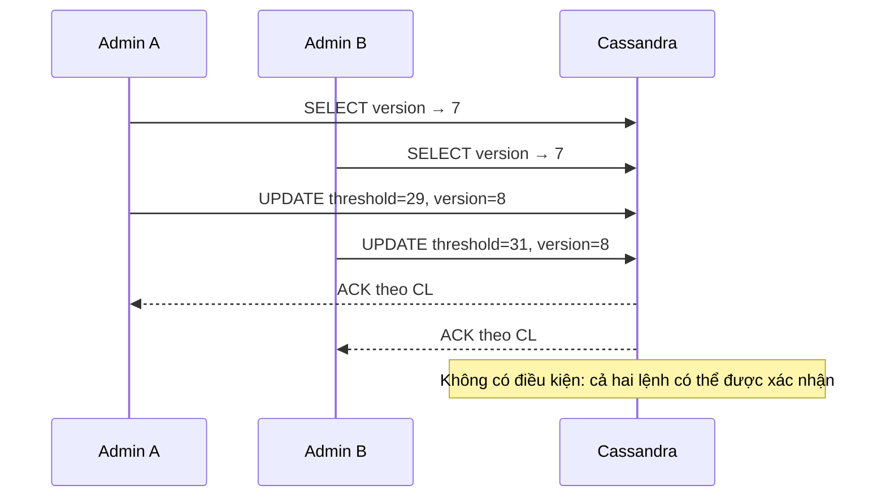
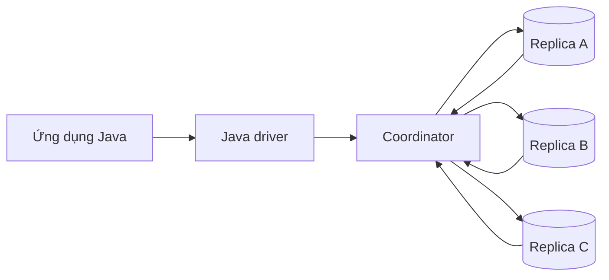
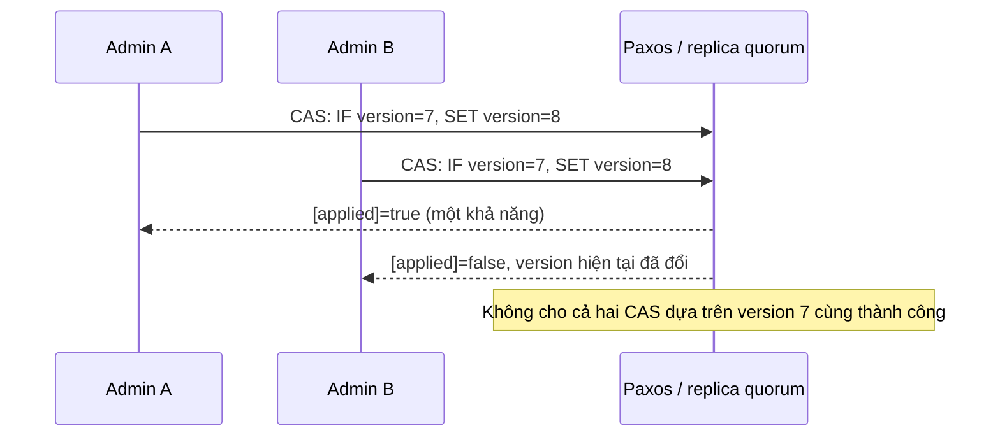
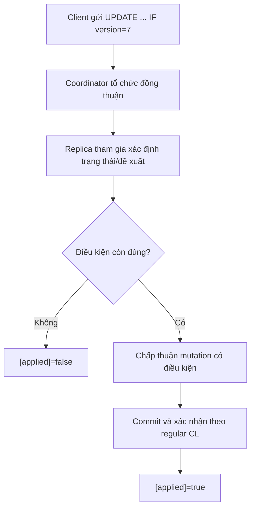

# Phạm vi nguyên tử, mức nhất quán và cập nhật có điều kiện

> **Chương:** Tư duy Cassandra  
> **Phạm vi:** Apache Cassandra là hệ quản trị NoSQL wide-column phân tán, có khả năng nhân bản dữ liệu và điều chỉnh mức nhất quán cho từng yêu cầu. Bài học phân biệt **atomicity**, **isolation**, **consistency level** và **conditional update**; giải thích giới hạn của CQL BATCH, cách lightweight transaction (LWT) hoạt động, cùng cách gọi từ ứng dụng Java và ứng phó với timeout.

## 1. Mục tiêu học tập

Sau bài này, bạn có thể:

1. Phân biệt **nguyên tử** (atomicity), **cô lập** (isolation), **độ bền** (durability), **nhất quán replica** và **nhất quán nghiệp vụ**.
2. Nêu đúng phạm vi các bảo đảm của một mutation, BATCH và thao tác có điều kiện trong Cassandra; không nhầm BATCH với transaction ACID đa bảng tùy ý.
3. Tính số xác nhận cần thiết khi dùng `ONE`, `QUORUM`, `LOCAL_QUORUM` và `ALL` dựa trên replication factor (RF) và phạm vi data center.
4. Giải thích tại sao **quorum đọc/ghi không tự ngăn hai client đồng thời ghi đè nhau**.
5. Viết CQL `INSERT ... IF NOT EXISTS`, `UPDATE ... IF version = ...` và đọc kết quả `[applied]`.
6. Hiểu hai nhóm consistency level của LWT: **serial consistency** cho giai đoạn đồng thuận và **regular consistency** cho giai đoạn xác nhận ghi.
7. Thiết kế mã Java driver phân biệt cập nhật thành công, xung đột phiên bản, timeout không rõ kết quả và lỗi cần đối soát.

## 2. Một bài toán, ba yêu cầu không giống nhau

Một nền tảng IoT giữ ngưỡng cảnh báo của từng thiết bị. Người vận hành đọc cấu hình hiện tại, sửa ngưỡng, rồi lưu lại. Hai quản trị viên có thể cùng sửa một thiết bị.

Giả sử cấu hình ban đầu:

| tenant_id | device_id | threshold_c | version |
| --- | --- | ---: | ---: |
| acme | sensor-42 | 28.0 | 7 |

Quản trị viên A đọc version 7 và muốn đặt 29.0°C. Gần như đồng thời, quản trị viên B cũng đọc version 7 và muốn đặt 31.0°C.

Hệ thống cần trả lời ba câu hỏi khác nhau:

1. **Nguyên tử:** Nếu một thao tác sửa hai cột `threshold_c` và `version` của cùng partition, có thể thấy trạng thái chỉ sửa một cột trong phạm vi bảo đảm của Cassandra không?
2. **Mức nhất quán:** Bao nhiêu replica phải phản hồi để yêu cầu đọc/ghi được coi là thành công? Nếu một replica mất kết nối, thao tác còn phục vụ được không?
3. **Cập nhật có điều kiện:** Làm thế nào để chỉ **một trong hai** quản trị viên sửa thành công dựa trên version 7, thay vì cả hai tưởng mình đã cập nhật độc quyền?

Ba câu hỏi cần cơ chế khác nhau. **Atomicity không tự tạo kiểm soát cạnh tranh; quorum không tự tạo điều kiện “chỉ ghi nếu version chưa đổi”.**

## 3. Tách bạch các bảo đảm trước khi chọn câu CQL

| Khái niệm | Câu hỏi | Minh họa ở Cassandra |
| --- | --- | --- |
| **Atomicity** | Một đơn vị ghi có được áp dụng như một thao tác nguyên tử trong phạm vi xác định không? | Mutation trên một partition; bảo đảm riêng của logged BATCH |
| **Isolation** | Các thao tác cạnh tranh có quan sát trạng thái trung gian của nhau không? | Phạm vi và cơ chế hạn chế; không mặc định có isolation giao dịch SQL trên nhiều partition |
| **Replica consistency** | Đọc/ghi cần bao nhiêu replica phản hồi, dữ liệu các replica đã hội tụ chưa? | `ONE`, `LOCAL_QUORUM`, `ALL`; read reconciliation, repair |
| **Conditional correctness** | Chỉ ghi nếu điều kiện trên dữ liệu hiện tại còn đúng? | `IF NOT EXISTS`, `IF EXISTS`, `IF version = ...` dùng LWT |
| **Durability** | Ghi đã được xác nhận có tồn tại sau loại lỗi dự kiến không? | Commit log, replication, cấu hình đồng bộ đĩa, repair, backup |
| **Business invariant** | Hệ thống có luôn tuân quy tắc nghiệp vụ không? | Kiểm soát phiên bản, trạng thái đơn hàng, bảo toàn số dư, deduplication ở ứng dụng |

### 3.1. “Consistency” có nhiều nghĩa

Chữ *consistency* trong **ACID** nói tới việc các ràng buộc dữ liệu/nghiệp vụ được giữ đúng sau giao dịch. Trong Cassandra, **consistency level (CL)** thường nói về số replica phải trả phản hồi cho đọc/ghi. Hai nghĩa này **không thể thay thế** cho nhau.

Ví dụ, ghi `QUORUM` có thể được xác nhận bởi hai replica ở RF = 3 nhưng vẫn vi phạm nghiệp vụ nếu code cho phép chuyển trạng thái đơn hàng từ `CANCELLED` ngược thành `PAID` mà không kiểm tra điều kiện.

### 3.2. Atomicity không đồng nghĩa durability

Một thay đổi có thể được áp dụng nhất quán trong phạm vi một partition, nhưng khả năng sống sót khi mất điện còn phụ thuộc đường ghi commit log, cấu hình đồng bộ, replica và dạng lỗi. Ngược lại, hai thay đổi nằm trên nhiều partition có thể cuối cùng cùng được lưu bền vững mà không hề có **isolation** giữa chúng đối với một reader quan sát cùng lúc.

Khi thiết kế, cần luôn viết rõ: **nguyên tử đối với đơn vị nào, nhất quán theo CL nào, và chịu được loại lỗi nào?**

## 4. Đơn vị truy cập của Cassandra: partition

Cassandra định vị các row theo **partition key**. Các row cùng partition key nằm trên cùng tập replica; clustering columns sắp thứ tự row bên trong partition, không tự chia row sang node khác.

```sql
-- Hai cột tạo một composite partition key; không có clustering column.
CREATE TABLE IF NOT EXISTS device_control.device_config (
    tenant_id text,
    device_id text,
    threshold_c double,
    version int,
    updated_at timestamp,
    PRIMARY KEY ((tenant_id, device_id))
);
```

Trong bảng này, một cấu hình thiết bị là một partition logic. Bảng lịch sử sự kiện có thể khác:

```sql
CREATE TABLE IF NOT EXISTS device_control.device_events_by_day (
    tenant_id text,
    device_id text,
    event_day date,
    occurred_at timestamp,
    event_id uuid,
    event_type text,
    PRIMARY KEY ((tenant_id, device_id, event_day), occurred_at, event_id)
) WITH CLUSTERING ORDER BY (occurred_at DESC, event_id ASC);
```

Mỗi partition có thể chứa nhiều clustering row ở bảng lịch sử. Một thay đổi chỉ tác động `device_config` của `sensor-42` khác hẳn một quy trình nghiệp vụ muốn **đồng thời** cập nhật cấu hình, ghi nhật ký sự kiện và gọi một dịch vụ bên ngoài.

### 4.1. Vì sao ranh giới partition quan trọng?

Khi hai giá trị nằm trong cùng một partition và được ghi qua một mutation thích hợp, Cassandra có cơ chế bảo đảm tính nguyên tử/cô lập của mutation ở phạm vi partition. Điều này **không kéo dài tự động** sang mọi bảng, mọi partition và mọi hệ thống bên ngoài.

Ngay cả khi BATCH gồm nhiều statement, một reader quét những partition khác nhau vẫn có thể thấy một phần thay đổi trước phần còn lại. Không thiết kế invariant kiểu “tổng hai tài khoản luôn bằng X ở mọi thời điểm” chỉ dựa vào việc hai câu UPDATE được đặt trong cùng `BEGIN BATCH`.

## 5. Mutation bình thường: nguyên tử nhưng không phải compare-and-set

Giả sử thao tác cập nhật cấu hình:

```sql
UPDATE device_control.device_config
SET threshold_c = 29.0, version = 8
WHERE tenant_id = 'acme' AND device_id = 'sensor-42';
```

Đây là mutation trên một partition. Cassandra không cần tìm row qua JOIN; nó dùng partition key để định vị replica. Nhưng câu UPDATE trên **không kiểm tra** version hiện tại có đúng bằng 7 hay không.

### 5.1. Tranh chấp giữa hai writer

Nếu A và B đều đọc version 7 rồi cùng gửi UPDATE bình thường:



Cassandra xử lý xung đột giá trị bằng quy tắc timestamp/phiên bản của cell (thường được mô tả là **last-write-wins theo timestamp**, không nhất thiết theo thứ tự client nhận ACK). Nếu nhiều writer dùng timestamp không đồng bộ hoặc cập nhật các cột khác nhau, trạng thái cuối còn phụ thuộc từng cell và quy tắc xung đột.

Vì vậy, **đọc rồi UPDATE thường** là một cặp thao tác không nguyên tử với nhau. Kể cả cả hai request đều dùng `LOCAL_QUORUM`, chúng vẫn có thể cùng thành công trong khi chỉ một trạng thái cuối cùng còn được nhìn thấy.

### 5.2. Upsert cũng không tự chống tạo trùng logic

`INSERT` và `UPDATE` thường mang ngữ nghĩa upsert theo primary key. Nếu client gửi lại cùng sự kiện nhưng tự tạo `event_id` mới sau timeout, Cassandra nhìn thấy **một khóa chính mới** và có thể tạo thêm row. Ứng dụng phải giữ ID ổn định và định nghĩa tính idempotent của thao tác.

## 6. Replication factor và consistency level điều khiển điều gì?

Giả sử mỗi partition có **RF = 3 tại data center dc1**, với replica A, B, C. Một node nhận request làm **coordinator**, tìm các replica dựa vào token và replication strategy; nó chờ phản hồi theo CL.



| Consistency level | Với RF = 3 trong một DC | Khi một replica không phản hồi |
| --- | --- | --- |
| `ONE` | Một replica phản hồi | Có thể vẫn đạt |
| `LOCAL_ONE` | Một replica trong DC cục bộ | Có thể vẫn đạt |
| `QUORUM` | Đa số tổng replica: 2/3 trong ví dụ | Có thể đạt nếu hai replica đáp ứng |
| `LOCAL_QUORUM` | Đa số replica cục bộ: 2/3 ở `dc1` | Có thể đạt nếu hai replica cục bộ đáp ứng |
| `ALL` | Cả ba replica | Không đạt nếu một replica bắt buộc không phản hồi |

Đây là điều kiện theo **số replica**, không phải lời hứa luôn thành công trong giới hạn thời gian. Node có thể đang chạy nhưng chậm do I/O, compaction, mạng hoặc quá tải. Trong cụm đa DC, `QUORUM` toàn cục và `LOCAL_QUORUM` không nhất thiết cần cùng số ACK.

### 6.1. Tính giao nhau của quorum

Với cùng một tập replica RF, ký hiệu W là số replica cần xác nhận ghi, R là số replica dùng để xác nhận đọc. Tập đọc và ghi bắt buộc có phần tử chung khi:

\[
W + R > RF
\]

Với RF = 3, ghi `QUORUM` (W = 2) và đọc `QUORUM` (R = 2) có `2 + 2 > 3`. Trong các điều kiện phù hợp, điều này giúp đọc quan sát một giá trị đã được ghi xác nhận, bởi ít nhất một replica giao nhau với tập ghi.

Nhưng **W + R > RF không biến ghi thường thành transaction tuyến tính hóa**: hai ghi đồng thời vẫn có thể cùng được ACK, xung đột timestamp vẫn xảy ra, và invariant nghiệp vụ vẫn có thể hỏng. Để nói “chỉ client đầu tiên cập nhật version 7 thành công”, cần **cập nhật có điều kiện**.

### 6.2. Consistency level không phải isolation level

Các mức `ONE`, `QUORUM`, `LOCAL_QUORUM`, `ALL` không tương đương `READ COMMITTED`, `REPEATABLE READ` hay `SERIALIZABLE` của RDBMS. CL nói về **quy tắc phản hồi replica**; isolation nói về các transaction cạnh tranh được phép quan sát gì và xen kẽ ra sao.

## 7. Cập nhật có điều kiện: lightweight transaction (LWT)

Cassandra cung cấp các điều kiện `IF` trong CQL cho một số thao tác `INSERT`, `UPDATE` và `DELETE`. Chúng dùng **lightweight transaction** (LWT), dựa trên cơ chế đồng thuận như Paxos ở các phiên bản triển khai tương ứng, để đạt hành vi so sánh-và-ghi có trật tự trong phạm vi được hỗ trợ.

Các dạng điển hình:

```sql
INSERT INTO device_control.device_config (
    tenant_id, device_id, threshold_c, version
) VALUES ('acme', 'sensor-42', 28.0, 1)
IF NOT EXISTS;

UPDATE device_control.device_config
SET threshold_c = 30.0, version = 2
WHERE tenant_id = 'acme' AND device_id = 'sensor-42'
IF version = 1;

DELETE FROM device_control.device_config
WHERE tenant_id = 'acme' AND device_id = 'sensor-42'
IF version = 2;
```

Các lệnh trên để minh họa **các loại điều kiện**; không phải lời khuyên chạy liên tiếp trên dữ liệu quan trọng. LWT tốn nhiều lượt trao đổi giữa replica hơn ghi thường, nên không dùng mặc định cho mọi sự kiện telemetry nếu không cần CAS/uniqueness.

### 7.1. LWT cập nhật version thế nào?

Giả sử row hiện tại là `version = 7`, `threshold_c = 28.0`. Cả A và B đều đã đọc version 7.

```sql
-- Admin A
UPDATE device_control.device_config
SET threshold_c = 29.0, version = 8
WHERE tenant_id = 'acme' AND device_id = 'sensor-42'
IF version = 7;

-- Admin B, gửi gần như đồng thời
UPDATE device_control.device_config
SET threshold_c = 31.0, version = 8
WHERE tenant_id = 'acme' AND device_id = 'sensor-42'
IF version = 7;
```

Với các điều kiện LWT được áp dụng nhất quán cho cùng partition, **tối đa một trong hai** thao tác dựa trên version 7 có thể được áp dụng; thao tác còn lại nhận kết quả điều kiện không đạt và có thể đọc version hiện tại để giải quyết conflict.



Sơ đồ minh họa thứ tự một trong các kết quả có thể có; A không được ưu tiên chỉ vì gửi trước. Ứng dụng nên xử lý kết quả `[applied]` rõ ràng thay vì giả định câu UPDATE nào không ném exception cũng đã sửa dữ liệu.

### 7.2. Kết quả `[applied]`

Một câu lệnh có điều kiện thường trả về một row kết quả với cột đặc biệt `[applied]`:

- `[applied] = true`: điều kiện đạt, thao tác được chấp nhận theo cơ chế LWT.
- `[applied] = false`: điều kiện không đạt; Cassandra có thể kèm giá trị hiện tại của các cột liên quan để ứng dụng thông báo xung đột.

Các cột giá trị hiện tại được trả về phụ thuộc câu lệnh và đường thực thi; **không giả định** mọi cột luôn có mặt trong kết quả. Lựa chọn an toàn là kiểm tra `[applied]` trước, rồi đọc lại row bằng một truy vấn thích hợp nếu cần lấy đầy đủ trạng thái.

### 7.3. Điều kiện phải dùng đúng phạm vi

LWT không tạo một giao dịch quan hệ bao trùm nhiều partition, nhiều bảng và hệ thống bên ngoài. Các điều kiện `IF` trong một conditional batch có phạm vi/ràng buộc riêng; không dùng nó để ghép tùy ý nhiều partition độc lập thành một transaction ACID toàn hệ thống.

Nếu nghiệp vụ yêu cầu “đặt một đơn hàng và trừ tồn kho ở mọi kho, đồng thời gửi tiền qua dịch vụ thanh toán”, cần thiết kế lại ranh giới invariant và cơ chế điều phối (ví dụ saga, event/outbox theo hạ tầng phù hợp), chứ không kỳ vọng một `IF` CQL bao trùm tất cả.

## 8. Hai nhóm consistency level của LWT

LWT không chỉ là `UPDATE` thường cộng thêm điều kiện. Về mặt mô hình, nó có giai đoạn **đồng thuận về giá trị/điều kiện** và giai đoạn xác nhận mutation. Hai nhóm CL liên quan:

| Nhóm | Ví dụ | Vai trò |
| --- | --- | --- |
| **Serial consistency** | `SERIAL`, `LOCAL_SERIAL` | Phạm vi đồng thuận cho thao tác có điều kiện/LWT |
| **Regular consistency** | `ONE`, `LOCAL_QUORUM`, `QUORUM` | Điều kiện xác nhận của phase ghi/đọc thông thường tương ứng |

Với `SERIAL`, đồng thuận xét replica phù hợp ở phạm vi toàn cụm theo cấu hình. Với `LOCAL_SERIAL`, đồng thuận được giới hạn trong data center cục bộ. Chọn local serial có thể giảm phụ thuộc mạng liên vùng cho workload cục bộ, nhưng **không** được dùng như lời bảo đảm global CAS khi các client ghi cùng khóa ở nhiều DC theo chính sách khác nhau.

### 8.1. Quá trình khái niệm



Sơ đồ là mô hình học tập, **không phải bản mô tả từng thông điệp Paxos hoặc bảo đảm thứ tự ACK cụ thể cho mọi phiên bản**. Cốt lõi là có sự phối hợp giữa các replica để không cho nhiều CAS xung đột cùng vượt qua cùng điều kiện.

### 8.2. Lưu ý về pha đọc và giá trị mới

Một số đường đọc ở consistency `SERIAL` hoặc `LOCAL_SERIAL` có thể tham gia giải quyết transaction LWT đang dở theo cơ chế được Cassandra hỗ trợ. Đây là hành vi khác với một truy vấn thông thường ở `ONE`; không suy ra rằng mọi `SELECT` đều mặc định đọc serial chỉ vì bảng từng dùng LWT.

**Nguyên tắc thực tế:** những writer cùng bảo vệ một invariant bằng CAS phải tuân cùng một mô hình kiểm soát cạnh tranh. Trộn writer `UPDATE` thường với writer `IF version = ...` trên cùng giá trị có thể phá vỡ giả định “mọi cập nhật đã được tuần tự hóa bằng LWT”.

## 9. CQL BATCH: atomicity có phạm vi, không phải transaction SQL

Từ `BATCH` trong CQL rất dễ gây hiểu nhầm. Cassandra hỗ trợ **logged batch**, **unlogged batch** và **counter batch** với mục đích/ngữ nghĩa khác nhau. BATCH được dùng để nhóm các mutation, nhưng **không phải công cụ bulk insert tăng tốc tổng quát** và **không cung cấp isolation xuyên nhiều partition như một giao dịch SQL đa bảng**.

### 9.1. Batch nhiều statement cùng partition

Giả sử bảng lịch sử có nhiều clustering row trong một partition:

```sql
BEGIN UNLOGGED BATCH
  INSERT INTO device_control.device_events_by_day (
      tenant_id, device_id, event_day, occurred_at, event_id, event_type
  ) VALUES (
      'acme', 'sensor-42', '2026-11-21',
      '2026-11-21T08:00:00Z',
      11111111-1111-1111-1111-111111111111, 'BOOT'
  );
  INSERT INTO device_control.device_events_by_day (
      tenant_id, device_id, event_day, occurred_at, event_id, event_type
  ) VALUES (
      'acme', 'sensor-42', '2026-11-21',
      '2026-11-21T08:01:00Z',
      22222222-2222-2222-2222-222222222222, 'HEARTBEAT'
  );
APPLY BATCH;
```

Hai row dùng cùng partition key. Trong phạm vi mutation cùng partition, Cassandra có cơ chế atomicity/isolation phù hợp với kiểu thao tác. **Không** có nghĩa BATCH cho phép transaction nghiệp vụ tùy ý với rollback như hệ quan hệ.

### 9.2. Logged batch đi qua nhiều partition

`BEGIN BATCH` (logged theo mặc định) có cơ chế **batchlog** hỗ trợ hoàn tất các mutation nếu coordinator gặp lỗi trong quá trình xử lý. Mục tiêu là bảo đảm các mutation của batch cuối cùng được áp dụng theo cơ chế khôi phục; **không bảo đảm tất cả partition thay đổi cùng lúc hoặc độc giả không bao giờ thấy trạng thái trung gian**.

Ví dụ, một batch gồm ghi bảng `orders_by_id` và `orders_by_customer_month` nằm ở hai partition khác nhau: client khác đọc hai partition ở hai thời điểm sát nhau vẫn có thể thấy một bên cập nhật, bên kia chưa có. Nếu client nhận timeout, trạng thái áp dụng cuối cùng cần được xác định, không tự coi là rollback.

### 9.3. Khi nào BATCH không phù hợp?

- Gom hàng nghìn câu `INSERT` trên nhiều partition chỉ với mục tiêu “chạy nhanh hơn”.
- Mong có `ROLLBACK` đa hệ thống nếu một dịch vụ bên ngoài thất bại.
- Mong reader đọc nhiều partition luôn có snapshot nguyên tử.
- Dùng BATCH để tăng độ chính xác của điều kiện phiên bản mà không dùng LWT.

Trong nhiều workload ghi phân tán, **prepared statement + các request độc lập có giới hạn đồng thời** hiệu quả và dễ kiểm soát hơn một batch khổng lồ. Chỉ dùng batch khi hiểu rõ bảo đảm cần thiết, kích thước, phạm vi partition và chi phí phối hợp.

## 10. Ví dụ lab: tạo schema và cập nhật cấu hình

Giả sử lab có data center tên `dc1` và **ít nhất ba node thích hợp** cho RF = 3. Nếu chỉ có một node, dùng RF = 1 và CL tương ứng để thử cú pháp; khi đó không thể kiểm thử tình huống chịu lỗi/quorum của RF = 3.

```sql
CREATE KEYSPACE IF NOT EXISTS device_control
WITH replication = {
    'class': 'NetworkTopologyStrategy',
    'dc1': 3
};

CREATE TABLE IF NOT EXISTS device_control.device_config (
    tenant_id text,
    device_id text,
    threshold_c double,
    version int,
    updated_at timestamp,
    PRIMARY KEY ((tenant_id, device_id))
);

-- Tạo lần đầu, chỉ thành công nếu row chưa tồn tại.
INSERT INTO device_control.device_config (
    tenant_id, device_id, threshold_c, version, updated_at
) VALUES (
    'acme', 'sensor-42', 28.0, 7, '2026-11-21T08:00:00Z'
) IF NOT EXISTS;

SELECT threshold_c, version, updated_at
FROM device_control.device_config
WHERE tenant_id = 'acme' AND device_id = 'sensor-42';

-- CAS: cập nhật chỉ nếu phiên bản hiện tại vẫn là 7.
UPDATE device_control.device_config
SET threshold_c = 29.0,
    version = 8,
    updated_at = '2026-11-21T08:05:00Z'
WHERE tenant_id = 'acme' AND device_id = 'sensor-42'
IF version = 7;
```

Lệnh `INSERT ... IF NOT EXISTS` là một CAS cho trường hợp tạo lần đầu, chứ không phải ràng buộc uniqueness trên mọi bảng có `device_id`. Tính duy nhất chỉ được kiểm tra theo **primary key của bảng/partition đang thao tác**.

### 10.1. Lệnh trong cqlsh và trong Java khác nhau ở đâu?

Trong `cqlsh`, câu lệnh:

```sql
CONSISTENCY LOCAL_QUORUM;
SERIAL CONSISTENCY LOCAL_SERIAL;
```

điều chỉnh mức nhất quán của công cụ client (cú pháp hỗ trợ tùy phiên bản `cqlsh`). Đây **không phải** hai câu `UPDATE` gửi như mutation thông thường. Trong Java driver, thiết lập consistency trên **statement** hoặc execution profile, ví dụ dưới đây.

## 11. Java driver: xử lý rõ thành công, conflict và timeout

Một ứng dụng Java nhận request “đặt ngưỡng mới nếu version còn bằng 7”. Hãy bind tham số và kiểm tra cột `[applied]`, không coi mọi kết quả không có exception là cập nhật thành công.

Ví dụ Java 11+ với Java driver 4.x:

```java
import java.net.InetSocketAddress;
import java.time.Instant;
import java.util.UUID;

import com.datastax.oss.driver.api.core.CqlSession;
import com.datastax.oss.driver.api.core.DefaultConsistencyLevel;
import com.datastax.oss.driver.api.core.cql.BoundStatement;
import com.datastax.oss.driver.api.core.cql.PreparedStatement;
import com.datastax.oss.driver.api.core.cql.ResultSet;
import com.datastax.oss.driver.api.core.cql.Row;

public class DeviceConfigCasExample {
    public static void main(String[] args) {
        try (CqlSession session = CqlSession.builder()
                .addContactPoint(new InetSocketAddress("127.0.0.1", 9042))
                .withLocalDatacenter("dc1")
                .build()) {

            PreparedStatement casUpdate = session.prepare(
                "UPDATE device_control.device_config " +
                "SET threshold_c = ?, version = ?, updated_at = ? " +
                "WHERE tenant_id = ? AND device_id = ? " +
                "IF version = ?"
            );

            // expectedVersion đến từ trạng thái mà người dùng đã đọc.
            int expectedVersion = 7;
            BoundStatement request = casUpdate.bind(
                29.0,
                expectedVersion + 1,
                Instant.parse("2026-11-21T08:05:00Z"),
                "acme",
                "sensor-42",
                expectedVersion
            ).setConsistencyLevel(DefaultConsistencyLevel.LOCAL_QUORUM)
             .setSerialConsistencyLevel(DefaultConsistencyLevel.LOCAL_SERIAL);

            // Nếu timeout/exception: chưa thể suy ra CAS đã được áp dụng hay chưa.
            ResultSet result = session.execute(request);
            Row first = result.one();
            if (first == null) {
                throw new IllegalStateException("LWT returned no result row");
            }

            boolean applied = first.getBoolean("[applied]");
            if (applied) {
                System.out.println("Cập nhật cấu hình thành công");
            } else {
                // Trả HTTP 409 Conflict ở tầng API có thể là lựa chọn phù hợp.
                System.out.println("Phiên bản đã thay đổi; cần đọc lại dữ liệu");
            }
        }
    }
}
```

Trong mã trên:

- `CqlSession` quản lý kết nối, topology và gửi CQL đến coordinator.
- `PreparedStatement` giúp bind kiểu dữ liệu chính xác, tránh nối chuỗi CQL từ đầu vào người dùng.
- `LOCAL_SERIAL` xác định phạm vi serial consistency của LWT; `LOCAL_QUORUM` là regular consistency cho yêu cầu.
- `[applied] = false` là **xung đột điều kiện**, không phải lỗi mạng cần retry tự động với giá trị version cũ.
- Nếu `session.execute(request)` ném timeout, client không chắc mutation đã được commit hay chưa; cần xác định trạng thái thay vì lập tức gửi lại thao tác thay đổi ngữ nghĩa.

Đoạn mã chỉ minh họa một thao tác; API production phải xác thực, phân quyền người dùng/tenant, kiểm tra giới hạn ngưỡng, quản lý session dài hạn, TLS/auth, timeout, metrics và bảo vệ trước concurrent edits.

### 11.1. Kịch bản xử lý trong service

| Kết quả | Diễn giải | Hướng xử lý ứng dụng |
| --- | --- | --- |
| `[applied] = true` | CAS đạt và thao tác được xác nhận theo quy tắc LWT/CL | Trả thành công, ghi audit/metric theo thiết kế |
| `[applied] = false` | Version không còn như client kỳ vọng | Trả conflict, lấy lại state mới, yêu cầu người dùng xác nhận |
| Unavailable | Không đủ replica cho yêu cầu | Trả lỗi tạm thời, giám sát cụm, không tùy tiện hạ CL |
| Read/Write/Request timeout | Không thể kết luận chắc trạng thái cuối | Đối soát trạng thái/operation ID, retry có giới hạn và policy rõ |
| CQL/schema error | Lỗi truy vấn hoặc migration | Sửa code/schema; retry mù không có ích |

### 11.2. Đối soát timeout cho CAS

Giả sử client muốn thay version 7 thành 8, gửi LWT rồi nhận timeout. Khi đọc lại thấy version 8, **không thể luôn kết luận** chính request của client đã thành công: một writer khác cũng có thể đã cập nhật version thành 8.

Với tác vụ đòi hỏi phân biệt chính xác, hãy thiết kế thêm **operation ID** hoặc dấu nhận diện cập nhật và bảo đảm quy trình ghi/đọc nó trong cùng ranh giới logic phù hợp. Chỉ sau khi xác nhận giá trị/dấu nhận diện được áp dụng bởi thao tác đó mới thông báo chắc chắn. Không tạo operation ID mới cho mỗi lần retry của cùng một yêu cầu nghiệp vụ.

## 12. LWT không miễn phí: hiệu năng và phân vùng

Ghi thường trong Cassandra thường đi qua coordinator đến replica, commit log/memtable và xác nhận theo CL. LWT cần phối hợp **đồng thuận giữa replica**, nên có nhiều lượt trao đổi hơn và chi phí trễ/độ tranh chấp cao hơn.

| Tình huống | Gợi ý |
| --- | --- |
| Tạo cấu hình duy nhất theo khóa | `INSERT ... IF NOT EXISTS` có thể phù hợp |
| Sửa cấu hình dựa trên version đã đọc | `UPDATE ... IF version = ...` phù hợp cho CAS |
| Ghi telemetry bất biến với ID sự kiện ổn định | Thường ưu tiên `INSERT` bình thường, trừ khi có invariant cần CAS |
| Tăng bộ đếm hiệu năng cao | Không thay bằng vòng `SELECT + UPDATE IF` mà chưa đánh giá contention và tính đúng đắn; cân nhắc mô hình khác |
| Một khóa nhận hàng nghìn CAS/giây | Có thể thành **hot partition/điểm tranh chấp**; cần thiết kế lại luồng ghi hoặc chia ranh giới nghiệp vụ |

**Không có CL hoặc LWT nào chữa được partition key sai.** Một partition quá lớn hoặc quá nóng vẫn tạo áp lực lên cùng tập replica. Khi scale out, cần phân bố khóa phù hợp, có time bucket/shard khi cần, và kiểm tra p95/p99 latency.

## 13. Trường hợp nhiều data center và sai lầm thường gặp

Giả sử keyspace có `NetworkTopologyStrategy` với RF = 3 ở `dc1` và RF = 3 ở `dc2`:

```sql
CREATE KEYSPACE IF NOT EXISTS device_control_multi_dc
WITH replication = {
    'class': 'NetworkTopologyStrategy',
    'dc1': 3,
    'dc2': 3
};
```

Khi ứng dụng ở `dc1` dùng `LOCAL_QUORUM`, regular read/write quorum chỉ cần quorum cục bộ (hai replica của dc1). `LOCAL_SERIAL` cũng chỉ thực hiện serial consensus cục bộ theo phạm vi quy định. Cách đó không đồng nghĩa một CAS ở `dc1` tự cung cấp **global uniqueness hoặc serializability xuyên cả hai DC** nếu ứng dụng ở `dc2` thực hiện thao tác cạnh tranh theo cơ chế cục bộ khác.

Khi cần một invariant duy nhất cho dữ liệu được sửa từ nhiều vùng, phải **thiết kế rõ phạm vi điều phối**: dùng mức serial consistency phù hợp, định tuyến những writer cạnh tranh qua một phạm vi nhất quán, hoặc tổ chức một dịch vụ sở hữu invariant theo mô hình khác. Thêm RF và đặt `LOCAL_QUORUM` không đủ để tự giải quyết vấn đề.

### 13.1. Nếu data center đứt mạng

- Một phía có thể vẫn phục vụ yêu cầu ở CL thấp hơn trong điều kiện replica thích hợp.
- `QUORUM`/`ALL` toàn cục có thể thất bại nếu không đủ replica cần thiết.
- `LOCAL_QUORUM`/`LOCAL_SERIAL` chỉ suy luận trong phạm vi cục bộ; **không** tự bảo đảm bên kia đã thấy mutation mới.
- Khi kết nối hồi phục, replica có thể cần read reconciliation, hinted handoff/repair theo điều kiện hỗ trợ. Không dùng repair như cơ chế thay thế đồng thuận cho invariant cạnh tranh.

## 14. Compaction, tombstone và repair liên quan tới bảo đảm như thế nào?

Cassandra lưu ghi qua commit log, memtable và SSTable; SSTable được hợp nhất qua **compaction**. Điều này tạo đặc tính ghi phân tán nhưng cũng có chi phí đọc và vận hành:

- **Tombstone:** xóa/TTL tạo dấu xóa để các replica nhận biết phiên bản không còn hiệu lực. Đọc qua nhiều tombstone có thể chậm.
- **Repair:** đồng bộ khác biệt giữa replica, quan trọng sau lỗi hoặc thời gian mất kết nối kéo dài.
- **Compaction:** gom SSTable và loại bỏ dữ liệu cũ/tombstone khi đáp ứng các điều kiện an toàn; không phải giao thức đồng thuận cho các CAS.
- **Backup:** bảo vệ trước lỗi logic/xóa nhầm; replication không thay thế backup.

Không nên giảm `gc_grace_seconds` hoặc thay đổi compaction chỉ để “cải thiện tốc độ CAS” khi chưa đánh giá nguy cơ tombstone và chu kỳ repair. Tính đúng đắn của conditional update dựa trên cơ chế đồng thuận và luồng writer, **không** dựa vào việc đã chạy repair gần đây.

## 15. Chọn công cụ theo loại invariant

| Nhu cầu | Cách tiếp cận thường phù hợp | Điều phải kiểm chứng |
| --- | --- | --- |
| Đọc nhiều sự kiện theo `(device, day)` | Bảng CQL theo partition, regular reads | Partition size, clustering order, CL |
| Tạo một cấu hình nếu chưa tồn tại | `INSERT ... IF NOT EXISTS` | CAS theo đúng khóa, serial CL |
| Cập nhật cấu hình nếu version còn cũ | `UPDATE ... IF version = ...` | Mọi writer liên quan tuân một mô hình CAS |
| Cập nhật nhiều row trong cùng partition | Mutation hoặc BATCH phù hợp | Phạm vi atomicity/isolation và kích thước batch |
| Cập nhật nhiều partition và phát sự kiện sang hệ khác | Saga/coordination/pipeline có đối soát theo nghiệp vụ | Partial failure, idempotency, retries, audit |
| Yêu cầu tổng hợp trên hàng triệu partition | Kho phân tích hoặc projection/preaggregation | Tần suất cập nhật, độ trễ đồng bộ, chi phí |
| Giữ một số dư/định mức cực kỳ cạnh tranh | Đánh giá mô hình dữ liệu và hệ giao dịch phù hợp | Contention, invariant toàn cục, latency và failure mode |

**Nguyên tắc:** đưa invariant về **một ranh giới có thể kiểm soát** khi có thể. Nếu invariant bắt buộc vượt qua nhiều partition/hệ thống, đừng giấu độ phức tạp đó dưới một BATCH hay CL cao hơn.

## 16. Tình huống thực hành: nhìn vào điều kiện và dự đoán kết quả

Giả sử đã tạo row:

```text
tenant_id = acme
device_id = sensor-42
threshold_c = 28.0
version = 7
```

Hai API A và B cùng nhận version 7 rồi gửi:

```sql
-- A
UPDATE device_control.device_config
SET threshold_c = 29.0, version = 8
WHERE tenant_id = 'acme' AND device_id = 'sensor-42'
IF version = 7;

-- B
UPDATE device_control.device_config
SET threshold_c = 31.0, version = 8
WHERE tenant_id = 'acme' AND device_id = 'sensor-42'
IF version = 7;
```

Hãy trả lời:

1. Có thể cả A và B cùng trả `[applied] = true` cho cùng version 7, nếu cả hai tuân đúng cùng cơ chế CAS trên partition không?
2. Nếu A nhận timeout thay vì kết quả, A có được tự tuyên bố thao tác đã thất bại và gửi lại với version 8 không?
3. Nếu B nhận `[applied] = false`, có nên tự động đọc version hiện tại rồi ghi đè ngay lập tức không?
4. Nếu A dùng LWT nhưng một luồng khác dùng `UPDATE` không có `IF` để đổi `threshold_c`, bảo đảm CAS về invariant có còn được đảm bảo toàn diện không?
5. Nếu phải cập nhật cấu hình và gửi email thông báo, `BEGIN BATCH` CQL có thể rollback email khi email server lỗi không?

### Gợi ý giải

**1.** Không. Hai CAS cạnh tranh dựa trên cùng version 7 không thể cùng được áp dụng thành công nếu tất cả thao tác liên quan dùng đúng cơ chế và phạm vi đồng thuận.

**2.** Không. Timeout có thể xảy ra sau khi mutation đã được chấp nhận. A cần kiểm tra trạng thái/operation ID hoặc quy trình đối soát trước khi quyết định retry; tăng version theo suy đoán rất nguy hiểm.

**3.** Không mặc định. `[applied] = false` nghĩa là điều kiện client dựa vào đã cũ. Tự ghi đè có thể bỏ qua thay đổi của người khác; cần quy tắc conflict resolution, hiển thị dữ liệu mới hoặc yêu cầu người dùng quyết định.

**4.** Không. Ghi thường chen vào cùng dữ liệu không tham gia đồng thuận LWT có thể phá vỡ invariant mà ứng dụng nghĩ đã khóa bằng CAS.

**5.** Không. Email server là hệ thống bên ngoài; CQL BATCH không cung cấp rollback hoặc transaction xuyên Cassandra và dịch vụ email.

## 17. Những ngộ nhận cần tránh

| Ngộ nhận | Cách hiểu đúng |
| --- | --- |
| “`QUORUM` đồng nghĩa giao dịch serializable.” | Quorum là điều kiện phản hồi replica; không tự điều phối writer cạnh tranh theo CAS. |
| “Một UPDATE nguyên tử nghĩa là cặp SELECT rồi UPDATE cũng nguyên tử.” | Hai request riêng có khoảng cạnh tranh; cần điều kiện LWT nếu phải kiểm tra giá trị hiện tại. |
| “BATCH nhiều partition cho snapshot nguyên tử của mọi reader.” | Logged batch hỗ trợ hoàn tất các mutation, không cung cấp isolation/snapshot đa partition như giao dịch SQL. |
| “LWT giống global lock mọi table.” | Điều kiện được xử lý trong phạm vi khóa/partition và topology/serial CL tương ứng. |
| “`[applied] = false` là lỗi kết nối.” | Đó thường là kết quả điều kiện CAS không đạt. |
| “Không có exception nghĩa là UPDATE IF đã sửa dữ liệu.” | Phải kiểm tra `[applied]`. |
| “Timeout nghĩa là CAS chưa commit.” | Trạng thái có thể chưa xác định với client; cần đối soát. |
| “`LOCAL_SERIAL` luôn bảo đảm global uniqueness khi ghi từ nhiều DC.” | Phạm vi serial consensus là cục bộ; invariant xuyên vùng cần thiết kế rõ. |
| “RF = 3 tự động ngăn lost update.” | RF tăng replica; không thay thế điều kiện phiên bản hay CAS. |
| “Prepared statement làm cập nhật có điều kiện.” | Prepared statement chỉ hỗ trợ bind và tái sử dụng; phải dùng `IF` khi cần CAS. |

## 18. Tự kiểm tra kiến thức

1. **Phân biệt atomicity và consistency level bằng một câu.** Atomicity nói về phạm vi một thao tác được áp dụng nguyên tử; CL nói về phản hồi từ các replica.
2. **Vì sao `UPDATE ... SET x = ...` không chống lost update?** Vì không so sánh trạng thái trước khi ghi, hai writer có thể cùng được xác nhận.
3. **Lệnh CQL nào tạo row chỉ khi chưa tồn tại?** `INSERT ... IF NOT EXISTS`.
4. **Muốn CAS theo phiên bản, dùng điều kiện gì?** `UPDATE ... IF version = expectedVersion` và cập nhật version mới trong cùng thao tác.
5. **Cột nào quyết định một LWT có áp dụng thành công không?** `[applied]` trong kết quả.
6. **RF = 3 ở dc1, `LOCAL_QUORUM` cần mấy replica cục bộ?** Hai.
7. **`SERIAL` và `LOCAL_SERIAL` khác regular CL ở đâu?** Chúng quy định phạm vi đồng thuận của LWT, không thay thế regular CL cho mọi request.
8. **Logged BATCH đa partition có cung cấp snapshot isolation đa partition không?** Không.
9. **Vì sao timeout LWT cần xử lý thận trọng?** Client không nhất thiết biết điều kiện đã được chấp nhận hoặc mutation đã được commit hay chưa.
10. **Có thể dùng LWT để tự động hoàn tác lệnh ở hệ thống thanh toán bên ngoài không?** Không. Cần quy trình nghiệp vụ nhiều hệ thống phù hợp.
11. **Repair giúp điều gì cho Cassandra?** Đối chiếu và đồng bộ khác biệt replica; không phải một giao thức CAS hay rollback giao dịch.
12. **Chọn `LOCAL_QUORUM` có tự khắc phục partition nóng không?** Không. Partition key quyết định nhóm replica chịu tải.

## 19. Tổng kết

Muốn xây một ứng dụng Cassandra chính xác, trước hết phải đặt câu hỏi **bảo đảm nào cần cho thao tác nào**:

**Partition key xác định ranh giới dữ liệu và replica → mutation/BATCH có phạm vi nguyên tử riêng → regular CL quyết định số replica xác nhận → `IF`/LWT bảo vệ cập nhật có điều kiện → serial CL quyết định phạm vi đồng thuận → ứng dụng Java chịu trách nhiệm xử lý conflict, timeout và invariant vượt ngoài Cassandra.**

Quorum, atomicity và CAS bổ sung cho nhau nhưng không hoán đổi vai trò. Chọn được cơ chế đúng sẽ giúp bạn thiết kế CQL, replication, mức nhất quán đọc/ghi, compaction, repair, đường xử lý lỗi và tích hợp Java driver trong mô-đun **DATABASE_ENGINE_WIDE_COLUMN_CASSANDRA** mà không hứa những bảo đảm vượt quá phạm vi thực tế của Cassandra.
