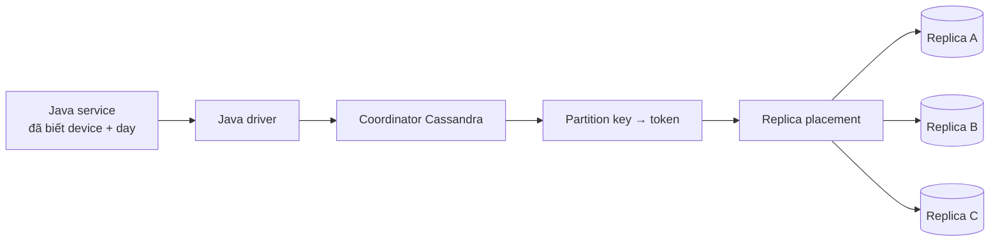
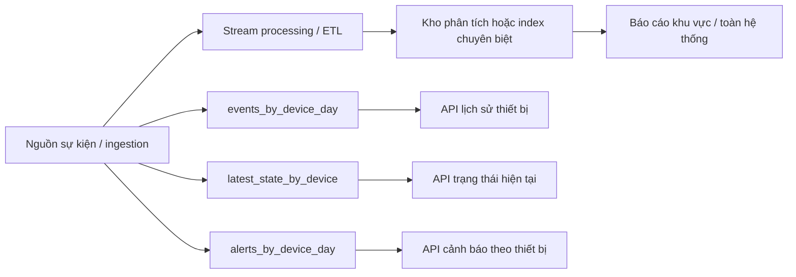

# Tình huống phù hợp với dữ liệu sự kiện, lịch sử hoặc truy cập theo khóa

> **Chương:** Tư duy Cassandra  
> **Bối cảnh:** Apache Cassandra là hệ quản trị cơ sở dữ liệu NoSQL phân tán theo mô hình *wide-column*, thường được cân nhắc khi hệ thống nhận nhiều bản ghi, cần mở rộng ngang và phục vụ các truy vấn có khóa phân vùng rõ ràng. Bài học giúp nhận biết **khi nào nên, khi nào không nên** chọn Cassandra cho sự kiện, lịch sử và tra cứu theo khóa; đi từ yêu cầu nghiệp vụ tới CQL, replication, consistency, vận hành và ứng dụng Java.

## 1. Mục tiêu học tập

Sau bài này, bạn có thể:

1. Nhận diện các mẫu truy vấn mà Cassandra có thể phục vụ hiệu quả: **ghi sự kiện**, **đọc lịch sử theo một đối tượng và khoảng thời gian**, **point lookup theo khóa**, **danh sách gần đây**.
2. Phân biệt dữ liệu **event log**, **lịch sử trạng thái** và **trạng thái hiện tại**, từ đó chọn bảng phù hợp với từng cách đọc.
3. Giải thích điều kiện làm một workload phù hợp: có partition key ổn định, lưu lượng phân tán, thứ tự truy vấn dự đoán được, nhu cầu replication/availability rõ ràng.
4. Xây dựng bảng CQL theo truy vấn, chọn clustering columns và time bucket để tránh partition tăng mãi hoặc trở thành điểm nóng.
5. Đánh giá yêu cầu nhất quán, độ bền, TTL, compaction, repair, sự kiện đến muộn và cập nhật nhiều read model.
6. Nhận diện trường hợp Cassandra **không** phải lựa chọn phù hợp: JOIN tùy ý, báo cáo OLAP quét rộng, tìm kiếm toàn văn, giao dịch ACID đa thực thể hoặc workload quá nhỏ.
7. Viết một truy vấn Java driver có đầy đủ partition key và sử dụng checklist để đề xuất lựa chọn công nghệ có căn cứ.

## 2. Không phải “dữ liệu lớn” là đủ để chọn Cassandra

Giả sử một công ty quản lý 100.000 thiết bị. Mỗi thiết bị gửi một lần đo mỗi phút, tức khoảng:

\[
100.000 \times 1.440 = 144.000.000 \text{ sự kiện/ngày}
\]

Đội vận hành muốn xem 100 lần đo mới nhất của một thiết bị; đội phân tích muốn tính nhiệt độ trung bình theo thành phố trong 90 ngày; đội cảnh báo muốn biết trạng thái gần nhất của thiết bị bất kỳ.

Đều là dữ liệu đo đạc nhưng chúng tạo **ba mẫu truy vấn** rất khác:

| Nhu cầu | Hình dạng truy vấn | Đánh giá sơ bộ |
| --- | --- | --- |
| Lịch sử thiết bị | Biết `tenant_id`, `device_id` và khoảng ngày; lấy một ít hàng sắp theo thời gian | **Phù hợp với Cassandra** nếu thiết kế partition và bucket đúng |
| Trạng thái mới nhất | Biết `tenant_id` và `device_id`; lấy đúng một bản ghi | **Phù hợp** với bảng tra cứu theo khóa |
| Phân tích toàn quốc | Gom nhóm theo thành phố, loại thiết bị, giờ và quét nhiều thiết bị | **Thường phù hợp hơn** với pipeline tổng hợp hoặc kho phân tích dạng cột |

Vấn đề quyết định không chỉ là 144 triệu sự kiện/ngày mà là: **mỗi lần đọc chạm đến bao nhiêu partition, có biết khóa trước không, dữ liệu cần sắp xếp ra sao và SLA là gì?**

Một hệ có vài tỷ sự kiện có thể phù hợp Cassandra nếu đường đọc đã biết khóa. Ngược lại, một tập dữ liệu nhỏ hơn nhiều nhưng toàn bộ người dùng thường xuyên hỏi các câu `JOIN`/`GROUP BY` linh hoạt có thể không phù hợp.

## 3. Ba nhóm workload điển hình nên cân nhắc Cassandra

### 3.1. Sự kiện bất biến theo đối tượng và thời gian

Ví dụ: telemetry IoT, clickstream được chia theo người dùng, lịch sử cảm biến, sự kiện ứng dụng, log hoạt động nghiệp vụ.

- **Ghi:** nhiều sự kiện nhỏ, liên tục; thường không sửa toàn bộ bản ghi cũ.
- **Đọc:** “100 sự kiện mới nhất của `device-42` hôm nay” hoặc “sự kiện trong 15 phút”.
- **Dữ liệu:** nhiều đối tượng độc lập; có thể chia partition theo `(tenant, object, day)` hay bucket thích hợp.
- **Điều kiện phù hợp:** truy vấn đã biết đối tượng và bucket; lượng dữ liệu mỗi partition đủ kiểm soát; replica không bị dồn tải quá lệch.

Không phù hợp nếu yêu cầu chính là “tìm bất kỳ sự kiện có chuỗi lỗi X trong mọi thiết bị, mọi thời điểm” mà không có khóa hoặc một hệ chỉ mục/tìm kiếm bổ sung.

### 3.2. Lịch sử và dòng thời gian theo một chủ thể

Ví dụ: lịch sử đơn hàng của khách, các hoạt động tài khoản, trạng thái một phiên xử lý, feed theo người dùng, lịch sử định vị của một xe.

- **Ghi:** mỗi hoạt động tạo một hàng gắn với chủ thể.
- **Đọc:** “20 hoạt động mới nhất của tài khoản A trong tháng B”.
- **Mô hình:** partition key theo chủ thể và bucket thời gian; clustering columns sắp hoạt động từ mới đến cũ.

**Cần lưu ý:** danh sách này là **lịch sử theo một chủ thể**. “Bảng tin toàn hệ thống sắp theo thời gian thực trên mọi người dùng” là bài toán khác: một partition key chỉ gồm ngày có thể gây điểm nóng, còn nhiều partition cần truy vấn hợp nhất toàn cục.

### 3.3. Tra cứu nhanh theo khóa định danh

Ví dụ: cấu hình thiết bị theo ID, hồ sơ phiên làm việc, trạng thái tác vụ theo job ID, hồ sơ sản phẩm theo `tenant + product_id`, vị trí cuối cùng của xe theo ID.

- **Đọc:** giá trị khóa được biết đầy đủ; chỉ lấy một hoặc vài hàng.
- **Ghi:** cập nhật theo chính khóa đó, thường kèm timestamp hoặc version.
- **Mô hình:** `PRIMARY KEY ((tenant_id, entity_id))`.

Đây là kiểu **key-based access**. Không nhất thiết phải có hàng tỷ sự kiện mới dùng được Cassandra, nhưng lợi ích nổi bật thường xuất hiện khi cần phân phối tải và replication với quy mô đủ lớn để bù chi phí vận hành cluster.

## 4. Các trường hợp tiêu biểu và đường truy cập cần thiết

| Tình huống | Truy vấn thường gặp | Partition key gợi ý | Cần cân nhắc |
| --- | --- | --- | --- |
| IoT telemetry | 100 lần đo gần nhất của một thiết bị/ngày | `(tenant_id, device_id, event_day)` | Tốc độ ghi của thiết bị nóng, TTL |
| GPS fleet tracking | Hành trình một xe trong khoảng giờ/ngày | `(fleet_id, vehicle_id, day)` hoặc bucket giờ | Fan-out khi đọc nhiều ngày, dữ liệu đến muộn |
| Activity timeline | 30 hoạt động mới nhất của một tài khoản | `(tenant_id, account_id, month)` | Thứ tự, khóa hoạt động duy nhất |
| Application audit trail | Lịch sử hoạt động của một tài nguyên | `(tenant_id, resource_id, day)` | Retention, yêu cầu chống sửa/xóa, kiểm toán |
| Trạng thái công việc | Trạng thái hiện tại theo job ID | `(tenant_id, job_id)` | Cập nhật đồng thời, version/CAS |
| Trạng thái thiết bị | Last-known state theo device ID | `(tenant_id, device_id)` | Sự kiện đến trễ không được ghi đè state mới |
| Notifications theo người dùng | 50 thông báo mới nhất của một user | `(tenant_id, user_id, month)` | Xóa/đọc nhiều tạo tombstone |

**Đây là các ví dụ về hình dạng schema**, không phải mẫu áp dụng máy móc. Kích thước bucket, thứ tự clustering, SLA, retention và đặc điểm phân phối tải phải được đo theo dữ liệu thật.

## 5. Vì sao Cassandra có lợi thế ở các đường đọc/ghi này?

Cassandra dùng partition key để tính token; từ token và replication strategy, coordinator xác định những node giữ bản sao của partition. Clustering columns cung cấp thứ tự row **bên trong** partition.



### 5.1. Ghi phân tán và mở rộng ngang

Khi dữ liệu chia thành **nhiều partition với tải tương đối đều**, Cassandra có thể trải yêu cầu và dữ liệu trên các node. Đường ghi replica thường đi qua **commit log** và **memtable**, sau đó flush thành **SSTable** bất biến; compaction hợp nhất SSTable về sau.

Đặc tính này hữu ích cho luồng sự kiện có nhiều nguồn phát, nhưng **không có nghĩa tăng node thì thông lượng tăng tuyến tính**. Những yếu tố như hot partitions, chi phí replication, compaction, disk I/O, networking, tombstone và tải ứng dụng vẫn giới hạn hiệu năng.

### 5.2. Replication và khả năng phục vụ khi lỗi

Replication factor (**RF**) tạo nhiều bản sao của partition. Consistency level (**CL**) cho client lựa chọn số replica cần phản hồi trước khi thao tác thành công.

Ví dụ trong một data center có RF = 3:

- `LOCAL_ONE`: cần phản hồi từ một replica cục bộ.
- `LOCAL_QUORUM`: thông thường cần hai trong ba replica cục bộ.
- `ALL`: cần cả ba replica; một replica không phản hồi có thể làm request thất bại.

Điều này cho phép điều chỉnh đánh đổi giữa độ trễ, tính sẵn sàng và tính mới của dữ liệu. Nó **không thay thế** thiết kế partition key đúng hoặc bảo đảm giao dịch nghiệp vụ đa bảng.

### 5.3. Multi-data-center không phải “zero data loss” tự động

Với `NetworkTopologyStrategy`, có thể đặt replica ở nhiều data center. Client có thể dùng `LOCAL_QUORUM` để giảm phụ thuộc xác nhận liên vùng trong đường phục vụ thông thường.

Tuy nhiên, một ghi được xác nhận ở data center A theo `LOCAL_QUORUM` không chứng minh mọi replica của data center B đã nhận ghi đó. Khi mất cả vùng, ứng dụng phải kiểm thử **RPO/RTO**, quy trình failover/failback, tình trạng replica và độ mới của dữ liệu.

## 6. Thiết kế theo truy vấn: một ví dụ IoT xuyên suốt

Để chọn Cassandra đúng, không bắt đầu từ ý tưởng “một bảng chung cho mọi dữ liệu IoT”. Hãy chốt ba yêu cầu:

| Mã | Query contract | Dữ liệu đầu vào chắc chắn biết |
| --- | --- | --- |
| Q1 | Lấy 100 sự kiện mới nhất của một thiết bị trong một ngày | `tenant_id`, `device_id`, `event_day` |
| Q2 | Lấy một khoảng sự kiện của thiết bị trong ngày | Ba khóa trên và khoảng `event_time` |
| Q3 | Lấy trạng thái mới nhất của thiết bị | `tenant_id`, `device_id` |

Truy vấn Q1 và Q2 có thể dùng chung bảng lịch sử. Q3 thường phù hợp một **bảng current state riêng**, thay vì liên tục duyệt lịch sử nhiều bucket.

### 6.1. Keyspace và bảng lịch sử

Ví dụ giả định cluster có data center thực sự mang tên `dc1` và có đủ node phù hợp để cấu hình RF = 3:

```sql
CREATE KEYSPACE IF NOT EXISTS telemetry
WITH replication = {
    'class': 'NetworkTopologyStrategy',
    'dc1': 3
};

CREATE TABLE IF NOT EXISTS telemetry.events_by_device_day (
    tenant_id text,
    device_id text,
    event_day date,
    event_time timestamp,
    event_id uuid,
    event_type text,
    temperature_c double,
    payload text,
    PRIMARY KEY ((tenant_id, device_id, event_day), event_time, event_id)
) WITH CLUSTERING ORDER BY (event_time DESC, event_id ASC);
```

| Thành phần | Mục đích |
| --- | --- |
| `(tenant_id, device_id, event_day)` | **Partition key ghép**, xác định partition và tập replica |
| `event_time` | Clustering column thứ nhất, đọc sự kiện mới trước |
| `event_id` | Clustering column thứ hai, phân biệt sự kiện có timestamp trùng nhau |
| `event_type`, `temperature_c`, `payload` | Dữ liệu cần đọc, không tự tạo một chỉ mục tìm kiếm toàn cụm |

Ở đây, `event_day` là bucket ngày được tính **nhất quán theo UTC** từ `event_time`. Nếu ứng dụng tính bucket theo múi giờ địa phương của từng server, sự kiện gần nửa đêm có thể được lưu vào partition khác với partition client tìm kiếm.

### 6.2. Ghi một sự kiện

```sql
INSERT INTO telemetry.events_by_device_day (
    tenant_id, device_id, event_day, event_time,
    event_id, event_type, temperature_c, payload
) VALUES (
    'acme', 'sensor-42', '2026-11-21',
    '2026-11-21T08:05:00Z',
    11111111-1111-1111-1111-111111111111,
    'reading', 27.4, '{"battery_pct":86}'
);
```

Ứng dụng cần có một **event ID ổn định cho cùng sự kiện logic**. Nếu request ghi timeout và client sinh UUID mới trước khi retry, Cassandra sẽ xem đây là một primary key khác và có thể lưu bản ghi trùng logic. Không dùng riêng một timestamp làm định danh duy nhất nếu có khả năng nhiều sự kiện cùng thời điểm.

### 6.3. Đọc Q1 và Q2

```sql
-- Q1: mới nhất trong một partition
SELECT event_time, event_id, event_type, temperature_c
FROM telemetry.events_by_device_day
WHERE tenant_id = 'acme'
  AND device_id = 'sensor-42'
  AND event_day = '2026-11-21'
LIMIT 100;

-- Q2: khoảng thời gian trong cùng partition
SELECT event_time, event_id, temperature_c
FROM telemetry.events_by_device_day
WHERE tenant_id = 'acme'
  AND device_id = 'sensor-42'
  AND event_day = '2026-11-21'
  AND event_time >= '2026-11-21T08:00:00Z'
  AND event_time < '2026-11-21T09:00:00Z';
```

Cả hai truy vấn cung cấp **đầy đủ partition key**. Điều kiện theo clustering column giúp Cassandra giới hạn phạm vi hàng trong partition.

`LIMIT 100` chỉ giới hạn số hàng trả về; nó không bảo đảm mọi truy vấn luôn nhanh khi partition quá lớn, tombstone nhiều hoặc replica đang quá tải. Bản ghi không có giá trị `temperature_c` cần được ứng dụng xử lý như thiếu dữ liệu, thay vì giả định mọi sự kiện đều là phép đo.

### 6.4. Bảng trạng thái hiện tại cho Q3

```sql
CREATE TABLE IF NOT EXISTS telemetry.latest_state_by_device (
    tenant_id text,
    device_id text,
    last_event_time timestamp,
    last_event_id uuid,
    last_temperature_c double,
    state text,
    version bigint,
    PRIMARY KEY ((tenant_id, device_id))
);

SELECT last_event_time, last_temperature_c, state, version
FROM telemetry.latest_state_by_device
WHERE tenant_id = 'acme'
  AND device_id = 'sensor-42';
```

Đây là một **read model khác**, tối ưu point lookup. Ứng dụng hoặc pipeline phải cập nhật bảng này khi nhận sự kiện phù hợp; Cassandra không tự động suy ra bảng current state từ bảng lịch sử.

Đặc biệt, một sự kiện mang `event_time` cũ đến muộn không được tùy tiện thay thế trạng thái mới hơn. Nếu nhiều writer cạnh tranh, có thể sử dụng một bộ xử lý theo thứ tự khóa, version check hoặc **LWT với điều kiện `IF version = ...`** cho tình huống thích hợp. Chỉ thêm `last_event_time` vào bảng không tự đem lại cơ chế “giữ giá trị lớn nhất” trong mọi trường hợp.

## 7. Event log, lịch sử và current state: chọn đúng ý nghĩa

| Kiểu dữ liệu | Câu hỏi thường gặp | Mô hình Cassandra gợi ý | Điều cần quyết định |
| --- | --- | --- | --- |
| **Event log** | Đã có sự kiện nào xảy ra? | Nhiều row theo object và bucket | Event ID, event time, dedup, retention |
| **Lịch sử trạng thái** | Trạng thái thay đổi ra sao theo thời gian? | Row theo object, thời điểm, version/sự kiện | Trạng thái đầy đủ hay delta, xử lý sự kiện đến muộn |
| **Current state** | Bây giờ đối tượng có trạng thái gì? | Một row theo `(tenant_id, object_id)` | Nguồn sự thật, writer cạnh tranh, freshness |

“Dữ liệu sự kiện” không tự động nghĩa là kiến trúc **event sourcing** đầy đủ. Event sourcing cần những quy tắc về tính bất biến, thứ tự, phiên bản sự kiện, replay và tái tạo trạng thái. Cassandra có thể lưu event log theo khóa, nhưng các bảo đảm nghiệp vụ và cơ chế replay vẫn cần được thiết kế riêng.

### 7.1. Event time khác ingest time

Sự kiện có thể được thiết bị ghi nhận lúc 08:05 nhưng mạng chập chờn khiến server nhận lúc 09:15. Nếu lấy `event_time` làm clustering key, row sẽ được đặt tại vị trí của 08:05 **bên trong partition tương ứng**, không phải cuối hàng theo thời điểm ingest.

Ứng dụng cần thống nhất:

- Dùng **event time** hay **ingest time** để xác định time bucket?
- Dữ liệu đến muộn được chấp nhận trong bao lâu?
- Màn hình “mới nhất” nghĩa là mới theo **thời gian sự kiện** hay mới theo **thời gian nhận**?
- Có cho phép sửa/cập nhật sự kiện cũ không, và chính sách audit như thế nào?

Đây là quy tắc nghiệp vụ ảnh hưởng trực tiếp đến schema, độ chính xác và vận hành compaction.

## 8. Time bucket: tránh partition tăng vô hạn

Nếu chọn duy nhất `device_id` làm partition key của bảng lịch sử, một thiết bị hoạt động nhiều năm sẽ tích lũy quá nhiều row vào cùng partition. Tăng số node **không** tự chia partition này ra các node mới, vì partition key vẫn không đổi.

### 8.1. Ước lượng tải theo bucket

Giả sử mỗi thiết bị gửi một sự kiện/phút:

- Theo ngày: `24 × 60 = 1.440` sự kiện/thiết bị.
- Theo tháng 30 ngày: khoảng `43.200` sự kiện/thiết bị.
- Nếu một thiết bị bất thường gửi 30 sự kiện/giây: `30 × 86.400 = 2.592.000` sự kiện/ngày.

Bucket ngày có thể hợp lý với mức 1.440 row/ngày nhưng chưa chắc hợp lý với 2,59 triệu row/ngày, đặc biệt nếu thiết bị đó còn nhận nhiều truy vấn cùng lúc. Phải đo kích thước row, số tombstone, I/O, p95/p99 và skew của các partition nóng nhất.

Không có một ngưỡng row/MB cố định được bảo đảm đúng cho mọi cluster.

### 8.2. Bucket nhỏ hơn hay shard logic?

| Cách chia | Khi nào có ích | Chi phí |
| --- | --- | --- |
| Theo tháng | Đối tượng phát ít sự kiện, truy vấn lịch sử theo tháng | Có thể tạo partition lớn khi nguồn phát tăng |
| Theo ngày | Nhiều workload lịch sử theo ngày | Truy vấn nhiều ngày phải hợp nhất nhiều partition |
| Theo giờ | Thiết bị hoặc người dùng rất nóng | Tăng số partition, fan-out khi đọc nhiều giờ |
| Bucket + shard | Một bucket vẫn quá nóng; có thể phân tán theo shard | Ứng dụng phải biết shard, đọc song song có giới hạn và merge kết quả |

Ví dụ shard được tính ổn định từ `event_id` hoặc một khóa thích hợp để phân tán ghi. Tuy nhiên, lấy “100 sự kiện mới nhất” từ tất cả shard đòi hỏi đọc nhiều partition rồi **merge sort** ở ứng dụng. Chọn số shard không thể chỉ dựa trên số node; nó phụ thuộc độ lệch tải, thời gian lưu và chi phí đọc.

### 8.3. Thứ tự chỉ tồn tại bên trong partition

Một bảng có `CLUSTERING ORDER BY (event_time DESC)` không có **thứ tự thời gian toàn cụm**. Nếu UI cần 100 sự kiện mới nhất của một thiết bị trong bảy ngày, ứng dụng phải xác định các bucket ngày, gửi nhiều SELECT phù hợp và hợp nhất theo `event_time`/`event_id`.

Paging state của driver cho một truy vấn CQL không tự động trở thành cursor thống nhất trên nhiều partition. Cần thiết kế pagination, giới hạn concurrency, xử lý sự kiện mới đến trong lúc người dùng lật trang và tránh đọc toàn bộ lịch sử không giới hạn.

## 9. TTL và thời hạn lưu giữ: phù hợp, nhưng không miễn phí

Nhiều luồng sự kiện chỉ cần giữ 30, 90 hoặc 180 ngày. Cassandra hỗ trợ **TTL** trên dữ liệu được ghi hoặc qua cấu hình bảng. Ví dụ retention 30 ngày cho một lần ghi:

```sql
INSERT INTO telemetry.events_by_device_day (
    tenant_id, device_id, event_day, event_time,
    event_id, event_type, temperature_c
) VALUES (
    'acme', 'sensor-42', '2026-11-21',
    '2026-11-21T08:05:00Z',
    11111111-1111-1111-1111-111111111111,
    'reading', 27.4
) USING TTL 2592000;
```

`2592000` giây tương đương 30 ngày, tính từ **thời điểm ghi** theo ngữ nghĩa TTL Cassandra, không nhất thiết từ `event_time`. Với sự kiện đến trễ hoặc backfill, giữ 30 ngày từ ingest time **khác** giữ đến đúng ngày cuối cùng của khoảng lịch sử. Ứng dụng phải xác định chính sách nào đúng.

### 9.1. TTL và xóa sinh tombstone

Dữ liệu hết hạn/xóa được biểu diễn bằng **tombstone** trong các cơ chế lưu trữ để replica có thể hòa giải trạng thái đã xóa. Đọc qua nhiều tombstone có thể tăng công việc; compaction chỉ dọn chúng khi các điều kiện an toàn được đáp ứng.

Cần cân nhắc:

- Dữ liệu có phải chủ yếu **append-only** hay thường xuyên cập nhật/xóa?
- Các row trong cùng SSTable có **thời điểm hết hạn gần nhau** không?
- Dữ liệu đến muộn/backfill có ghi vào các cửa sổ thời gian cũ không?
- Repair có được thực hiện phù hợp để tránh nguy cơ dữ liệu đã xóa xuất hiện lại?

### 9.2. TimeWindowCompactionStrategy khi nào hợp lý?

**TimeWindowCompactionStrategy (TWCS)** thường được cân nhắc cho dữ liệu chuỗi thời gian, nhiều ghi mới, TTL tương đối đồng đều và tuổi thọ row theo các cửa sổ thời gian.

Không chọn TWCS chỉ vì bảng có trường `event_time`. Cần xét **thời gian ghi**, late writes, cập nhật row cũ, TTL hỗn hợp và chiến lược compaction thật của phiên bản cluster. Ghi dữ liệu quá cũ hoặc cập nhật lại cửa sổ trước có thể giảm lợi ích của thiết kế theo cửa sổ thời gian.

Điều chỉnh compaction và `gc_grace_seconds` phải đi cùng kế hoạch repair, capacity và đánh giá an toàn; không tùy tiện giảm thời gian giữ tombstone để lấy lại dung lượng.

## 10. Khi một dữ liệu cần nhiều đường đọc

Một người dùng có thể cần:

1. Đọc lịch sử theo thiết bị.
2. Đọc trạng thái mới nhất theo thiết bị.
3. Đọc danh sách cảnh báo gần nhất theo thiết bị.
4. Tìm tất cả thiết bị phát cảnh báo nhiệt độ trong một khu vực.

Ba truy vấn đầu có thể có các **bảng Cassandra được thiết kế riêng theo khóa**. Truy vấn thứ tư có thể cần projection theo khu vực/bucket, chỉ mục hoặc một hệ phân tích/tìm kiếm phù hợp, phụ thuộc độ chọn lọc và tải.



Đây là kiến trúc minh họa, **không phải cam kết mọi bảng luôn cập nhật nguyên tử cùng lúc**. Nếu event bus phát lại, pipeline có thể nhận sự kiện trùng; cần event ID ổn định, deduplication, theo dõi lag, logic xử lý sự kiện sai thứ tự và cơ chế đối soát.

### 10.1. Denormalization phải có kế hoạch đồng bộ

Cassandra thường ưu tiên **một bảng theo một hoặc vài query contract tương thích** thay vì chuẩn hóa mọi thực thể rồi JOIN khi đọc. Điều này giúp đọc trực tiếp theo khóa nhưng tăng số mutation, chi phí lưu trữ và rủi ro cập nhật một phần.

Một logged CQL BATCH không tương đương transaction ACID tổng quát qua mọi partition, mọi table và dịch vụ ngoài Cassandra. Trong sự cố, một bảng projection có thể đã cập nhật trong khi bảng khác chưa. Thiết kế hệ thống cần xác định nguồn sự thật, khả năng tái tạo projection và quy tắc retry/đối soát.

## 11. Những trường hợp không nên ép Cassandra làm tất cả

| Nhu cầu chủ đạo | Vì sao cần cân nhắc công cụ khác? | Gợi ý hướng giải quyết |
| --- | --- | --- |
| `JOIN` nhiều bảng và truy vấn quan hệ linh hoạt | CQL không hỗ trợ JOIN quan hệ tổng quát | RDBMS hoặc dựng read model chuyên biệt |
| Báo cáo `GROUP BY`/`AVG` đa chiều trên hàng tỷ sự kiện | Cassandra không tối ưu cho quét cột và tổng hợp ad hoc toàn tập | Kho phân tích dạng cột, ETL, streaming aggregate |
| Tìm kiếm toàn văn, fuzzy matching, ranking | Bảng Cassandra theo partition key không phải search engine | Search index chuyên dụng |
| Giao dịch ACID phức tạp qua nhiều thực thể | CL và BATCH không thay thế transaction/isolation quan hệ | Hệ giao dịch phù hợp, saga khi cần điều phối nhiều hệ |
| Một khóa cực nóng, yêu cầu mọi ghi lên đúng một row | Tập replica của partition đó vẫn có thể nghẽn | Đổi data model, phân tán khóa, gom/tổng hợp theo luồng |
| Dữ liệu rất nhỏ, thấp tải, chỉ một nhóm truy vấn đơn giản | Chi phí vận hành, repair, monitoring và backup cluster có thể vượt lợi ích | Chọn hệ dữ liệu đơn giản hơn theo hạ tầng |
| Lưu log bất biến để kiểm toán pháp lý với yêu cầu WORM | Cassandra không tự biến bảng thành lưu trữ chống chỉnh sửa tuyệt đối | Lưu trữ bất biến và kiểm soát audit/retention thích hợp |
| Lưu trữ dài hạn rẻ, hiếm khi đọc | Dùng cụm Cassandra online cho toàn bộ dữ liệu có thể tốn kém | Kết hợp object storage/lakehouse và chính sách archive |

Không phải mọi tính năng chỉ mục đều vô dụng. Secondary index hoặc Storage-Attached Index (SAI) ở phiên bản Cassandra hỗ trợ có thể giúp **một số** truy vấn. Nhưng chúng phải được kiểm chứng bằng độ chọn lọc, phân bố kết quả, số partition liên quan và benchmark thực tế, không được xem là công cụ biến Cassandra thành một RDBMS/OLAP engine tùy ý.

### 11.1. Phân biệt wide-column với columnar analytics

Tên *wide-column* không có nghĩa Cassandra lưu toàn bộ giá trị `temperature_c` từ mọi thiết bị liền nhau như một định dạng file Parquet để quét phân tích. Cassandra tổ chức truy cập chủ đạo theo **partition/clustering key**. Các kho OLAP dạng cột thường bố trí/nén dữ liệu theo cột để đọc một số thuộc tính qua rất nhiều hàng, với khả năng lọc/tổng hợp theo thiết kế của engine.

Một kiến trúc có thể dùng **Cassandra cho serving theo khóa** và **columnar analytics cho báo cáo**; hai hệ không nhất thiết thay thế nhau.

## 12. Kết nối từ Java: dùng đúng partition key

Ứng dụng Java thường dùng Java driver 4.x để gửi CQL qua native protocol. Driver có thể định tuyến theo token nếu biết routing key và metadata, nhưng **driver không sửa được schema thiếu partition key**.

Ví dụ Java 11+ đọc lịch sử theo thiết bị/ngày:

```java
import java.net.InetSocketAddress;
import java.time.LocalDate;

import com.datastax.oss.driver.api.core.CqlSession;
import com.datastax.oss.driver.api.core.DefaultConsistencyLevel;
import com.datastax.oss.driver.api.core.cql.PreparedStatement;
import com.datastax.oss.driver.api.core.cql.ResultSet;
import com.datastax.oss.driver.api.core.cql.Row;

public final class DeviceHistoryExample {
    public static void main(String[] args) {
        // Lab: cluster phải có data center tên "dc1" và RF/CL phù hợp.
        try (CqlSession session = CqlSession.builder()
                .addContactPoint(new InetSocketAddress("127.0.0.1", 9042))
                .withLocalDatacenter("dc1")
                .build()) {

            PreparedStatement recent = session.prepare(
                "SELECT event_time, event_id, event_type, temperature_c " +
                "FROM telemetry.events_by_device_day " +
                "WHERE tenant_id = ? AND device_id = ? " +
                "AND event_day = ? LIMIT 100"
            );

            ResultSet result = session.execute(
                recent.bind(
                    "acme",
                    "sensor-42",
                    LocalDate.of(2026, 11, 21)
                ).setConsistencyLevel(DefaultConsistencyLevel.LOCAL_QUORUM)
                 .setIdempotent(true)
            );

            for (Row row : result) {
                Double temperature = row.isNull("temperature_c")
                    ? null
                    : row.getDouble("temperature_c");
                System.out.printf("%s | %s | %s | %s%n",
                    row.getInstant("event_time"),
                    row.getUuid("event_id"),
                    row.getString("event_type"),
                    temperature);
            }
        }
    }
}
```

**Điều kiện để chạy ví dụ:** keyspace/bảng đã được tạo; contact point và tên DC khớp cluster. Với RF = 3 trong `dc1`, `LOCAL_QUORUM` thường cần hai replica cục bộ. Trên lab một node, dùng RF/CL thích hợp thay vì sao chép mù cấu hình production.

### 12.1. Điều gì thuộc Java, driver và Cassandra?

| Lớp | Trách nhiệm |
| --- | --- |
| Ứng dụng Java | Xác thực quyền xem thiết bị, chọn ngày/bucket, xử lý sự kiện đến muộn, quyết định retry và phản hồi API |
| Java driver | Bind tham số đúng kiểu, duy trì session/kết nối, chọn node tiếp nhận, trả row hoặc exception |
| CQL | Mô tả schema và câu `SELECT`/`INSERT`, điều kiện theo partition/clustering |
| Cassandra coordinator/replica | Định vị partition, đọc/ghi theo CL và cơ chế phân tán của cluster |

Một lệnh ghi timeout **không chứng minh chắc chắn không replica nào đã ghi**. Retry cùng ID sự kiện có thể hạn chế trùng logic trong một số trường hợp, nhưng phải phân tích timestamp, TTL, counters/LWT và side effect ngoài database. Không đánh dấu mọi mutation là idempotent chỉ vì driver có cờ `setIdempotent`.

## 13. Các rủi ro vận hành quyết định “phù hợp” hay không

Cassandra đem lại khả năng chia tải và replication, đồng thời đòi hỏi vận hành có kỷ luật:

- **Capacity planning:** số sự kiện/ngày, dung lượng logic mỗi row, RF, nén, chi phí compaction, dung lượng trống và tăng trưởng.
- **Hot partitions:** các khóa quá phổ biến hoặc partition quá lớn gây nghẽn tập replica; thêm node không tự chia partition.
- **Compaction:** chiến lược phù hợp workload append-only/TTL; theo dõi disk I/O và tác động p95/p99.
- **Repair:** giúp replica hội tụ sau lỗi; hinted handoff hỗ trợ một số trường hợp nhưng không thay thế repair.
- **Tombstones:** xóa và TTL tạo công việc đọc/compaction; không tùy tiện chỉnh `gc_grace_seconds` khi chưa đánh giá repair và nguy cơ resurrection.
- **Backup/restore:** replication không bảo vệ trước xóa nhầm hoặc thao tác ứng dụng sai lan tới mọi replica.
- **Thử lỗi:** kiểm tra mất một node, mất mạng giữa các DC, timeout một phần, failover và độ mới của dữ liệu.
- **Security:** TLS, xác thực Cassandra, phân quyền theo tenant ở ứng dụng và bảo vệ dữ liệu nhạy cảm.

### 13.1. Ước lượng dung lượng phải nói rõ giả định

Với 144 triệu sự kiện/ngày và **300 byte dữ liệu logic trung bình mỗi sự kiện**, dữ liệu logic vào khoảng:

\[
144.000.000 \times 300 = 43,2 \text{ GB/ngày (thập phân)}
\]

Nếu RF = 3, chỉ xét phép nhân logic đơn giản thì khoảng **129,6 GB/ngày** dữ liệu được nhân bản trước khi tính nén, metadata, index nội bộ, tombstones, overhead và compaction. Sau 30 ngày, phép nhân thô là khoảng **3,89 TB** theo các giả định này.

Đây **không phải số dung lượng đĩa Cassandra sẽ sử dụng chính xác**: compression, kích thước SSTable, số update/delete, thời gian giữ dữ liệu, compaction và headroom làm thay đổi đáng kể kết quả. Cần benchmark thực tế và dành dung lượng dự phòng thích hợp.

### 13.2. Đánh giá consistency trên từng API

Một API xem lịch sử có thể chấp nhận một khoảng trễ đồng bộ, trong khi API cập nhật cấu hình thiết bị có yêu cầu read-after-write hoặc CAS mạnh hơn. Chọn CL theo **nghiệp vụ của request**:

| Nhu cầu | Câu hỏi phải trả lời |
| --- | --- |
| Hiển thị telemetry gần đây | Có chấp nhận một replica chậm đồng bộ không? |
| Đọc trạng thái hiện tại | Mới nhất theo event time, ingest time hay version? |
| Ghi sự kiện | Bao nhiêu bản sao cần xác nhận trước khi API trả thành công? |
| Chỉnh cấu hình có cạnh tranh | Có cần `IF version = ...` (LWT) để chống lost update không? |
| Chuyển vùng khi có sự cố | Replica vùng mới có thể thiếu ghi nào? RPO/RTO được đo ra sao? |

`LOCAL_QUORUM` với RF = 3 ở một DC thường cần hai replica cục bộ. Điều kiện quorum giúp các tập đọc/ghi giao nhau trong trường hợp phù hợp, nhưng **không tự tạo transaction ACID đa partition hoặc bảo đảm mọi thao tác linearizable**.

## 14. Ma trận quyết định: Cassandra, RDBMS, OLAP hay hệ tìm kiếm?

| Đặc điểm quan trọng nhất | Cassandra | RDBMS quan hệ | Kho phân tích dạng cột | Search engine |
| --- | --- | --- | --- | --- |
| Ghi nhiều sự kiện phân tán theo nhiều khóa | Thường đáng cân nhắc | Có thể phù hợp tùy quy mô/partitioning | Khả năng ingest tùy engine | Không nhất thiết làm nguồn lưu sự kiện chính |
| Lấy lịch sử ngắn theo entity + thời gian | Rất hợp khi partition đúng | Cũng có thể tốt với index | Thường không phải đường phục vụ chính | Có thể hỗ trợ nếu thiên về tìm kiếm |
| Point lookup theo ID | Rất hợp | Rất hợp | Không phải ưu tiên chính | Có thể, nhưng thường không là lựa chọn đầu |
| JOIN và giao dịch đa bảng nghiêm ngặt | Hạn chế | Thường mạnh | Tùy engine, không thay hệ OLTP | Không phải trọng tâm |
| Ad hoc `GROUP BY`/scan rộng | Không phải thế mạnh | Có thể khi tải vừa | Thường là thế mạnh | Không phải mục tiêu chính |
| Full-text và tìm kiếm gần đúng | Cần giải pháp bổ sung | Có thể có tính năng riêng | Không phải trọng tâm | Thường phù hợp |
| Độ phức tạp vận hành phân tán | Cần quy trình repair, compaction, topology | Tùy công nghệ và mô hình triển khai | Tùy engine/cluster | Cần quản lý index/shard |

Không có hàng nào là kết luận tuyệt đối; cần benchmark và đánh giá vận hành. Một RDBMS được partition/shard tốt có thể phục vụ nhiều workload sự kiện ở quy mô phù hợp. Chọn Cassandra có lý khi **đặc tính phân tán, mô hình truy vấn theo khóa và hiệu quả vận hành tổng thể** thực sự có giá trị.

## 15. Tình huống thực hành: chọn đúng đường lưu và đọc

Một nền tảng logistics quản lý 80.000 xe. Mỗi xe gửi vị trí GPS sau mỗi 10 giây. Giao diện yêu cầu:

1. Xem hành trình 30 phút gần nhất của một xe.
2. Hiển thị vị trí mới nhất của xe theo mã xe.
3. Vẽ heatmap mật độ xe theo quận trong 90 ngày.
4. Tìm tất cả sự kiện có nội dung log chứa “GPS signal lost” trên mọi xe.
5. Tiếp tục ghi khi một replica trong data center tạm dừng.

### Câu hỏi A: lịch sử

Chọn partition key/clustering columns nào để phục vụ yêu cầu 1? Nếu mỗi xe hoạt động nhiều năm, chỉ chọn `vehicle_id` làm partition key có vấn đề gì?

**Gợi ý:** `PRIMARY KEY ((fleet_id, vehicle_id, event_day), event_time, event_id)` là một phương án; clustering theo `event_time DESC`. Phải tính bucket theo quy ước thời gian nhất quán và đo tải/partition. Một partition chỉ theo `vehicle_id` có thể tăng vô hạn.

### Câu hỏi B: trạng thái hiện tại

Có cần duyệt mọi sự kiện mới nhất để tìm tọa độ hiện tại không? Làm gì nếu sự kiện đến muộn?

**Gợi ý:** Có thể có bảng `latest_location_by_vehicle` theo `(fleet_id, vehicle_id)`. Cần chính sách cập nhật dựa trên event time hoặc version và giải quyết cạnh tranh, không để sự kiện cũ ghi đè trạng thái mới.

### Câu hỏi C: báo cáo và tìm kiếm

Hai yêu cầu 3 và 4 có nên trực tiếp quét toàn bộ bảng lịch sử của Cassandra trên mỗi request?

**Gợi ý:** Thường không. Heatmap nhiều chiều phù hợp pipeline tổng hợp/kho phân tích dạng cột; full-text xuyên toàn bộ đội xe phù hợp hệ tìm kiếm chuyên dụng. Cassandra có thể giữ lịch sử theo xe để phục vụ API vận hành.

### Câu hỏi D: replication

RF = 3 trong cùng data center, một replica ngừng phản hồi; `LOCAL_QUORUM` có thể hoàn thành ghi không?

**Gợi ý:** Có, nếu hai replica cục bộ còn lại phản hồi đúng hạn. Tuy nhiên lỗi network, compaction hoặc tải cao vẫn có thể dẫn đến timeout. Nếu chỉ một replica phản hồi thì `LOCAL_QUORUM` không đạt; không tự động hạ CL khi chưa xem xét bảo đảm nghiệp vụ.

### Câu hỏi E: sự kiện trùng và đến muộn

Hệ thống đã ghi sự kiện nhưng client nhận timeout, rồi gửi lại. Cần gì để tránh tạo hai row cho cùng sự kiện?

**Gợi ý:** Giữ `event_id` và khóa chính ổn định qua retry; kiểm tra ngữ nghĩa upsert, TTL/timestamp và các side effect. Với bảng current state, cần giải quyết thứ tự sự kiện riêng; ghi lịch sử thành công không tự làm current state đúng.

## 16. Checklist dùng trước khi quyết định chọn Cassandra

Đánh dấu khi đã có bằng chứng, không chỉ khi “nghe có vẻ phù hợp”:

- [ ] Phần lớn query phục vụ trực tiếp **theo partition key đã biết**, không phải quét toàn bộ bảng.
- [ ] Có **query contract** cho các API quan trọng: điều kiện, thứ tự, giới hạn, QPS và mục tiêu p95/p99.
- [ ] Partition key chia tải tương đối đều; đã kiểm tra các **khóa nóng nhất**, không chỉ số lượng khóa.
- [ ] Dung lượng partition được ước lượng theo retention và peak load; bucket/shard có thể xử lý được khi cần.
- [ ] Ứng dụng biết cách đọc **nhiều bucket** và hợp nhất kết quả đúng thứ tự khi cần.
- [ ] Sự kiện có **ID ổn định**; đã quy định event time, ingest time, dữ liệu đến muộn và retry.
- [ ] Nếu có nhiều bảng theo truy vấn, đã định nghĩa **nguồn sự thật, đồng bộ và đối soát**.
- [ ] Đã chọn RF và CL theo yêu cầu nhất quán/chịu lỗi của từng thao tác; hiểu giới hạn multi-DC.
- [ ] Có kế hoạch TTL, tombstones, compaction, repair, capacity, backup và restore.
- [ ] Đã phân luồng báo cáo OLAP, tìm kiếm toàn văn và nghiệp vụ giao dịch phức tạp sang giải pháp thích hợp khi cần.
- [ ] Đã chạy benchmark và thử lỗi trên mẫu dữ liệu/tải đại diện, bao gồm hot partitions, timeout và lỗi replica.

Nếu nhiều ô đầu tiên không đạt, vấn đề có thể nằm ở **sai hình dạng workload** chứ không chỉ thiếu cấu hình driver hoặc thiếu node.

## 17. Những ngộ nhận cần tránh

| Ngộ nhận | Cách hiểu đúng |
| --- | --- |
| “Cassandra phù hợp với mọi loại dữ liệu lớn.” | Cần mẫu đọc/ghi, partition key, latency và tính chất phân tán phù hợp. |
| “Dữ liệu sự kiện đồng nghĩa có thể SELECT bất kỳ điều kiện nào.” | CQL ưu tiên truy vấn theo partition/clustering key; tìm kiếm tùy ý cần cấu trúc bổ sung. |
| “Một bảng event log là đủ cho mọi API và dashboard.” | Current state, timeline, search và OLAP có đường truy cập khác nhau. |
| “Clustering theo thời gian tạo thứ tự toàn cluster.” | Thứ tự chỉ trong partition; nhiều bucket cần merge ở ứng dụng. |
| “Thêm node sẽ giải quyết mọi hot partition.” | Partition key quyết định tập replica chịu tải; cần bucket/shard phù hợp. |
| “TTL tự xóa dữ liệu không có chi phí.” | TTL tạo tombstone; compaction và repair vẫn cần được lập kế hoạch. |
| “RF = 3 bảo đảm dữ liệu không bao giờ mất.” | Phải xét CL, lỗi tương quan, commit log, backup/restore và thao tác xóa sai. |
| “Timeout ghi nghĩa là chưa ghi gì.” | Replica có thể đã lưu mutation; retry phải an toàn và có đối soát. |
| “Dùng Java driver là tự động có thiết kế partition đúng.” | Driver xử lý giao thức và routing; schema/query contract là trách nhiệm thiết kế. |
| “Cassandra wide-column chính là kho OLAP dạng cột.” | Wide-column và columnar analytics tối ưu những đường truy cập khác nhau. |

## 18. Tự kiểm tra kiến thức

1. **Dấu hiệu mạnh nhất của một truy vấn phù hợp Cassandra là gì?** Biết partition key và đọc tập row có giới hạn theo clustering key.
2. **Vì sao chuỗi thời gian nên có time bucket?** Tránh một partition tăng vô hạn theo đời đối tượng; phải cân bằng kích thước và số partition cần đọc.
3. **Có thể lấy “100 event mới nhất toàn hệ thống” chỉ với một bảng partition theo device/day không?** Không hiệu quả trực tiếp; cần fan-out/merge hoặc một read model/pipeline chuyên biệt.
4. **Điểm khác giữa event history và latest state?** History lưu nhiều sự kiện theo thời gian; latest state là một bản biểu diễn trạng thái hiện tại theo khóa.
5. **Vì sao event time khác ingest time quan trọng?** Sự kiện đến trễ có thể phải nằm trong bucket/thứ tự cũ; TTL và current state cần quy tắc rõ.
6. **Khi nào CQL `LIMIT 100` chưa chắc giúp truy vấn rẻ?** Khi thiếu partition key, phải lọc/quét rộng hoặc partition quá lớn/tombstone nhiều.
7. **RF = 3 với `LOCAL_QUORUM` trong một DC cần bao nhiêu ACK?** Thường là hai replica cục bộ.
8. **Cassandra có thay thế backup chỉ vì đã replication không?** Không. Xóa sai và nhiều lỗi logic có thể lan đến các replica.
9. **Một yêu cầu tổng hợp hàng tỷ sự kiện theo nhiều chiều nên xem xét gì?** Pipeline tổng hợp hoặc kho phân tích dạng cột thay vì quét phân tán trên mỗi request.
10. **Nếu telemetry có retry sau timeout, event_id nên được tạo lại không?** Không cho cùng một sự kiện logic; khóa ổn định giúp hạn chế trùng.
11. **Nếu một thiết bị tạo hàng triệu sự kiện/ngày, bucket ngày luôn đủ không?** Không. Cần đo hot partition, kích thước, I/O và cân nhắc bucket giờ/shard.
12. **Java driver có thể chọn node gửi request; ai quyết định replica lưu partition?** Cassandra dựa trên token và replication strategy.

## 19. Ghi nhớ cốt lõi

**Cassandra thường phù hợp khi có rất nhiều thao tác đọc/ghi nhỏ phân tán theo nhiều khóa, ứng dụng biết trước khóa đối tượng, truy vấn lịch sử theo khoảng thời gian xác định và cần khả năng mở rộng ngang, replication hoặc phục vụ nhiều vùng.**

Để sử dụng đúng, hãy đi theo chuỗi: **mẫu truy vấn → partition key → clustering/time bucket → tải và kích thước partition → RF/CL → TTL/compaction/repair → đồng bộ read model và xử lý lỗi → Java driver → benchmark thực tế**.

Khi hệ thống ưu tiên báo cáo ad hoc, JOIN linh hoạt, tìm kiếm toàn văn hoặc giao dịch đa thực thể nghiêm ngặt, hãy cân nhắc một cơ sở dữ liệu hoặc hệ xử lý bổ sung. Lựa chọn công nghệ tốt không phải là dùng Cassandra cho mọi thứ, mà là đặt **Cassandra đúng vào đường phục vụ dữ liệu sự kiện, lịch sử và truy cập theo khóa** mà nó có lợi thế.

Tư duy đó chuẩn bị cho các phần thực hành của mô-đun **DATABASE_ENGINE_WIDE_COLUMN_CASSANDRA**: CQL, thiết kế bảng theo truy vấn, replication/consistency đọc ghi, compaction, repair, kịch bản lỗi và kết nối từ ứng dụng Java.
