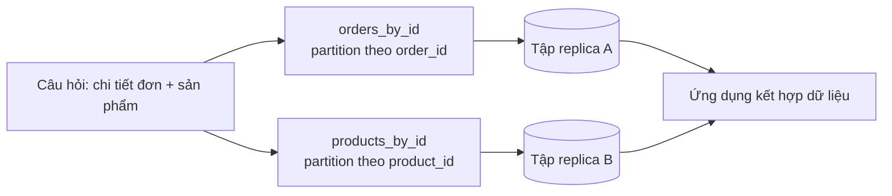
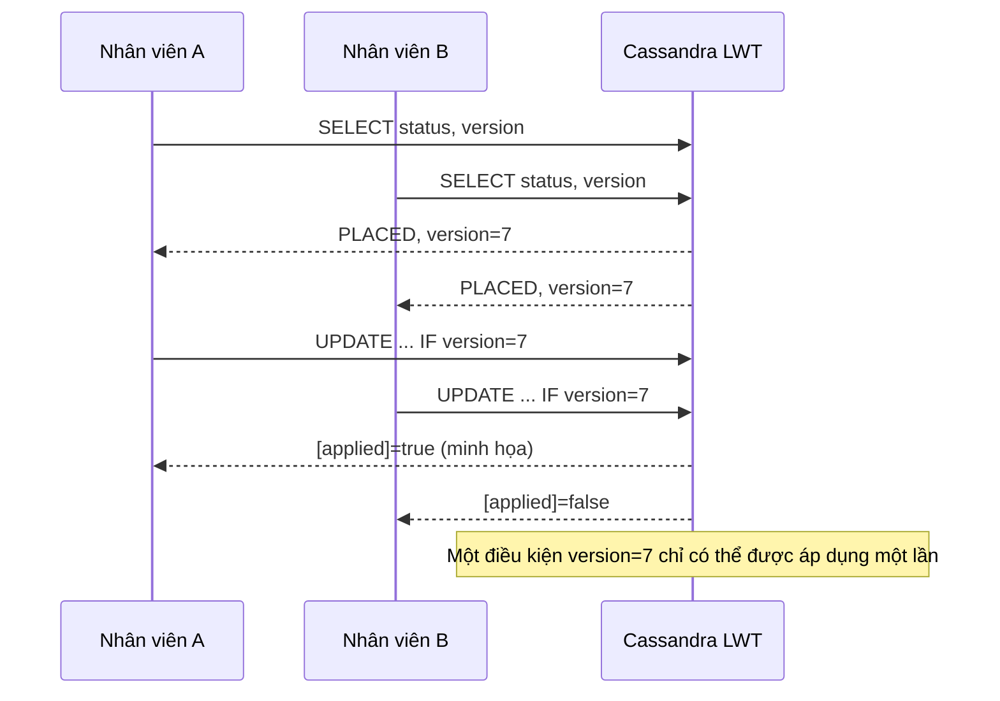

# Giới hạn cần cân nhắc với JOIN, ràng buộc quan hệ và giao dịch theo phiên bản

> **Chương:** Tư duy Cassandra  
> **Phạm vi:** Hiểu những khác biệt quan trọng giữa cơ sở dữ liệu quan hệ và Apache Cassandra khi ứng dụng cần JOIN, foreign key, ràng buộc toàn vẹn hoặc cập nhật/giao dịch dựa trên phiên bản. Bài học giải thích giới hạn của CQL, cách thiết kế bảng theo truy vấn, sự khác nhau giữa quorum và transaction, CQL BATCH, lightweight transaction (LWT), optimistic concurrency và cách xử lý lỗi trong ứng dụng Java.

## 1. Mục tiêu học tập

Sau bài này, bạn có thể:

1. Nêu rõ vì sao **Cassandra không cung cấp JOIN quan hệ tổng quát**, ràng buộc foreign key và giao dịch ACID đa bảng tùy ý theo cách các RDBMS thường hỗ trợ.
2. Giải thích lợi ích và giá phải trả của **denormalization**: tạo nhiều bảng đọc theo khóa, đồng bộ projection và xử lý dữ liệu tạm lệch.
3. Phân biệt **unique primary key theo bảng**, **toàn vẹn tham chiếu giữa bảng** và **tính duy nhất theo nghiệp vụ**.
4. Phân biệt một **mutation**, **CQL BATCH**, **consistency level (CL)** và **lightweight transaction (LWT)** về phạm vi bảo đảm.
5. Mô tả **optimistic concurrency theo phiên bản** bằng `UPDATE ... IF version = ?`, đọc kết quả `[applied]` và giải quyết conflict.
6. Hiểu vì sao version ứng dụng không đồng nghĩa **timestamp/last-write-wins** của Cassandra, và vì sao quorum thông thường không ngăn lost update.
7. Đề xuất giải pháp phù hợp khi một nghiệp vụ bắt buộc bảo vệ invariant xuyên nhiều partition, bảng, hệ thống hoặc data center.

## 2. Tình huống xuất phát: quản lý đơn hàng đa khách thuê

Giả sử nền tảng thương mại có người mua, đơn hàng, dòng hàng, sản phẩm và tồn kho. Ứng dụng cần:

- **Q1:** Hiển thị 20 đơn gần nhất của người mua trong tháng.
- **Q2:** Xem một đơn với các dòng hàng và thông tin sản phẩm.
- **Q3:** Chỉ cho phép tạo đơn nếu người mua tồn tại, sản phẩm còn bán và tồn kho đủ.
- **Q4:** Hai nhân viên sửa trạng thái một đơn; chỉ bản sửa dựa trên **version mới nhất** được chấp nhận.
- **Q5:** Đặt hàng, trừ tồn kho và phát yêu cầu thanh toán như **một nghiệp vụ nhất quán**.

Một thiết kế quan hệ thường có bảng `customers`, `orders`, `order_items`, `products` và `inventory`. Các ràng buộc khóa ngoại và transaction có thể góp phần bảo vệ một số quy tắc khi dữ liệu nằm trong cùng hệ quản trị.

Trong Cassandra, cần tách năm câu hỏi đó ra:

| Nhu cầu | Cách tiếp cận thường gặp ở RDBMS | Điều phải thiết kế lại với Cassandra |
| --- | --- | --- |
| Q1: danh sách theo người mua | JOIN/index và `ORDER BY` | Bảng có partition key theo người mua + bucket |
| Q2: chi tiết đơn | JOIN giữa đơn, dòng hàng, sản phẩm | Dữ liệu đơn được gộp, sao chép snapshot hoặc nhiều point lookup |
| Q3: toàn vẹn tham chiếu | Foreign key/unique/check và transaction | Validation, ranh giới dữ liệu, CAS và quy trình đối soát ở ứng dụng |
| Q4: chống ghi đè | Version column và điều kiện cập nhật trong transaction | `IF version = ...` dùng LWT; kiểm tra `[applied]` |
| Q5: nhiều đối tượng và dịch vụ | Transaction trong một RDBMS; phân tán cần giải pháp riêng | Không thể lấy CQL BATCH thay cho transaction xuyên hệ thống |

Điểm then chốt không phải Cassandra “không hỗ trợ dữ liệu quan hệ”. Cassandra vẫn có keyspace, table và row, nhưng **không tối ưu cho việc truy vấn quan hệ tùy ý và áp dụng invariant xuyên nhiều entity bằng engine giao dịch**.

## 3. Giới hạn thứ nhất: không có JOIN kiểu SQL tổng quát

### 3.1. JOIN giúp gì trong mô hình quan hệ?

Trong SQL quan hệ, yêu cầu Q2 có thể được diễn đạt đại ý như sau (đây **không phải CQL hợp lệ**):

```sql
-- SQL quan hệ minh họa, KHÔNG chạy trong cqlsh:
SELECT o.order_id, o.status, i.product_id, p.name, i.quantity
FROM orders o
JOIN order_items i ON i.order_id = o.order_id
JOIN products p ON p.product_id = i.product_id
WHERE o.tenant_id = 'acme'
  AND o.order_id = 'ORD-42';
```

Query optimizer của RDBMS có thể chọn join order, index và phương pháp JOIN để xử lý. Cassandra CQL **không cung cấp JOIN giữa các table như ví dụ**, cũng không có bộ tối ưu thực thi relational JOIN phân tán tổng quát.

Không nên nghĩ rằng chỉ cần đổi kết nối từ JDBC sang Cassandra Java driver là câu JOIN trên sẽ chạy hoặc trở nên rẻ.

### 3.2. Vì sao JOIN rộng khó khi dữ liệu được chia theo partition key?

Một row `orders_by_id` có thể nằm ở replica chịu token của `(tenant_id, order_id)`, trong khi `products_by_id` lại có partition key `(tenant_id, product_id)` và nằm ở nhóm replica khác. JOIN nhiều phía phải đọc, phối hợp và di chuyển dữ liệu giữa nhiều partition/node; chi phí tăng mạnh nếu không biết trước tập khóa cần tra.



Sơ đồ là ví dụ về **application-side composition**: ứng dụng biết mã sản phẩm từ đơn rồi đọc các sản phẩm tương ứng. Cách này có thể hợp lý nếu số khóa nhỏ và được giới hạn; với hàng nghìn sản phẩm cho mỗi trang hoặc độ trễ xuyên vùng, nó dễ trở thành vấn đề **N+1 queries**, fan-out và timeout.

### 3.3. Denormalization là một lựa chọn, không phải phép màu

Khi truy vấn Q2 cần chi tiết đơn, một phương án là lưu **snapshot thông tin sản phẩm tại thời điểm đặt hàng** ngay trong các dòng của đơn: tên hiển thị, đơn giá, số lượng, mã sản phẩm. Khi khách mở đơn cũ, thường cần thấy giá/tên **khi mua**, không nhất thiết giá/tên hiện tại.

Đó là denormalization có ý nghĩa nghiệp vụ:

- **Lợi ích:** giảm JOIN, đọc theo một partition đã biết.
- **Giới hạn:** trùng dữ liệu, cần phân biệt snapshot với thông tin sống.
- **Trách nhiệm:** ứng dụng xác định dữ liệu nào được sao chép, khi nào cần cập nhật và trường hợp đọc từ nguồn gốc.

Không copy toàn bộ thông tin sản phẩm vào mọi sự kiện chỉ vì “Cassandra không có JOIN”. Mỗi bản sao dữ liệu phải trả lời được một query contract và có chính sách vòng đời.

## 4. Thiết kế bảng CQL theo đường truy cập thay cho JOIN

Giả định cluster lab có data center tên `dc1` và đủ node để cấu hình RF = 3. Với một node lab, điều chỉnh RF/CL tương ứng; các kịch bản chịu lỗi nhiều replica chỉ là minh họa khi không có đủ node.

### 4.1. Bảng đơn hàng theo ID: Q2

```sql
CREATE KEYSPACE IF NOT EXISTS commerce
WITH replication = {
    'class': 'NetworkTopologyStrategy',
    'dc1': 3
};

CREATE TABLE IF NOT EXISTS commerce.orders_by_id (
    tenant_id text,
    order_id uuid,
    customer_id text,
    created_at timestamp,
    status text,
    total_amount decimal,
    version int,
    PRIMARY KEY ((tenant_id, order_id))
);
```

Với `PRIMARY KEY ((tenant_id, order_id))`, Cassandra xác định partition từ cặp tenant và mã đơn. Không có clustering column; theo mô hình này mỗi đơn có một row trong bảng.

```sql
SELECT customer_id, created_at, status, total_amount, version
FROM commerce.orders_by_id
WHERE tenant_id = 'acme'
  AND order_id = 11111111-1111-1111-1111-111111111111;
```

Đây là **point lookup** theo partition key đầy đủ, không cần quét mọi đơn.

### 4.2. Dòng hàng theo ID đơn: chi tiết trong một partition

```sql
CREATE TABLE IF NOT EXISTS commerce.items_by_order (
    tenant_id text,
    order_id uuid,
    line_no int,
    product_id text,
    product_name_at_purchase text,
    unit_price_at_purchase decimal,
    quantity int,
    PRIMARY KEY ((tenant_id, order_id), line_no)
) WITH CLUSTERING ORDER BY (line_no ASC);

SELECT line_no, product_id, product_name_at_purchase,
       unit_price_at_purchase, quantity
FROM commerce.items_by_order
WHERE tenant_id = 'acme'
  AND order_id = 11111111-1111-1111-1111-111111111111;
```

Ứng dụng có thể đọc `orders_by_id` và `items_by_order` bằng **hai point queries** rồi ghép thành DTO. Vì là hai bảng/partition logic độc lập, **hai lần đọc không mặc nhiên tạo một snapshot nguyên tử** của cả đơn.

Nếu query contract cần toàn bộ đơn và dòng hàng trong **một partition/bảng**, có thể thiết kế row cho header và item dưới cùng partition key với clustering và cột/kiểu dữ liệu phù hợp. Tuy vậy, mô hình đó cần xử lý rõ row header, item và kiểm soát kích thước partition. Không có thiết kế duy nhất đúng cho mọi nghiệp vụ.

### 4.3. Danh sách theo người mua: Q1

```sql
CREATE TABLE IF NOT EXISTS commerce.orders_by_customer_month (
    tenant_id text,
    customer_id text,
    order_month date,
    created_at timestamp,
    order_id uuid,
    status text,
    total_amount decimal,
    PRIMARY KEY ((tenant_id, customer_id, order_month), created_at, order_id)
) WITH CLUSTERING ORDER BY (created_at DESC, order_id ASC);

SELECT created_at, order_id, status, total_amount
FROM commerce.orders_by_customer_month
WHERE tenant_id = 'acme'
  AND customer_id = 'cust-42'
  AND order_month = '2026-11-01'
LIMIT 20;
```

Bảng này lặp lại `status` và `total_amount` từ bảng tra cứu theo ID để đọc danh sách nhanh hơn. Cái giá phải trả là ứng dụng phải cập nhật **hai read model** khi trạng thái hoặc tổng tiền thay đổi.

`ORDER BY`/clustering chỉ áp dụng trong partition. Muốn đọc nhiều tháng, ứng dụng xác định từng bucket và hợp nhất kết quả; không trông chờ Cassandra sắp thứ tự thời gian toàn cụm.

## 5. Giới hạn thứ hai: ràng buộc quan hệ không tự được thực thi

Các RDBMS thường cung cấp **PRIMARY KEY, UNIQUE, FOREIGN KEY, CHECK, NOT NULL** và hành vi như `ON DELETE CASCADE` theo khả năng của engine. Cassandra có primary key, định nghĩa kiểu dữ liệu và một số quy tắc schema/CQL riêng, nhưng **không cung cấp hệ ràng buộc quan hệ tổng quát tương đương**.

| Ràng buộc/nhu cầu | Mô hình quan hệ quen thuộc | Cassandra cần xem xét |
| --- | --- | --- |
| **Primary key** | Xác định row và ngăn trùng khóa theo luật bảng | CQL primary key định danh partition và clustering row; ghi thường theo khóa là upsert |
| **Unique business key** | Unique constraint trên email/mã hóa đơn | Không có unique index toàn bảng tùy ý; có thể dùng bảng giữ chỗ theo khóa + LWT, nhưng phải xử lý đồng bộ nghiệp vụ |
| **Foreign key** | Đơn phải trỏ đến khách hàng tồn tại | Cassandra không tự kiểm tra rằng row khách hàng tương ứng tồn tại |
| **ON DELETE CASCADE** | Xóa khách hàng tự xóa dữ liệu phụ thuộc theo rule DB | Ứng dụng/pipeline phải tìm và dọn projection; không có cascade FK tự động |
| **CHECK** | Số lượng phải dương, trạng thái trong tập hợp | Validation ở ứng dụng, quy tắc CQL/schema phù hợp và kiểm thử; không trông chờ constraint SQL tổng quát |
| **Transaction toàn vẹn nhiều bảng** | Cập nhật nhiều entity như một đơn vị dưới isolation xác định | Không được giả định CQL BATCH tạo ACID đa partition tổng quát |

### 5.1. Primary key không phải khóa ngoại

Nếu `items_by_order` có row trỏ tới `order_id` chưa từng xuất hiện trong `orders_by_id`, Cassandra **không tự từ chối** chỉ vì thiếu “đơn cha”. Một kiểm tra ở ứng dụng như `SELECT orders_by_id` rồi `INSERT items_by_order` vẫn có **khoảng tranh chấp**: đơn có thể bị hủy/xóa sau khi kiểm tra nhưng trước khi ghi item.

Nếu tồn tại đơn cha là invariant bắt buộc và việc xóa/thêm diễn ra cạnh tranh, phải thiết kế **ranh giới sở hữu và cơ chế đồng bộ** đủ mạnh; không coi một lần đọc trước ghi là thay thế tương đương foreign key trong RDBMS.

### 5.2. Unique nghiệp vụ khác unique primary key

Ví dụ yêu cầu “mỗi tenant chỉ có một người dùng với email chuẩn hóa `x@example.com`”. Bảng `users_by_id` dùng primary key `(tenant_id, user_id)` **không** ngăn hai user khác ID có cùng email.

Một cách tiếp cận là có bảng ánh xạ:

```sql
CREATE TABLE IF NOT EXISTS commerce.email_reservations (
    tenant_id text,
    normalized_email text,
    user_id uuid,
    PRIMARY KEY ((tenant_id, normalized_email))
);

INSERT INTO commerce.email_reservations (
    tenant_id, normalized_email, user_id
) VALUES (
    'acme', 'x@example.com',
    22222222-2222-2222-2222-222222222222
) IF NOT EXISTS;
```

`IF NOT EXISTS` là **lightweight transaction (LWT)** trên khóa email; chỉ một yêu cầu tranh cùng khóa có thể đặt chỗ thành công trong phạm vi bảo đảm đúng của LWT.

Nhưng đặt chỗ email và tạo row `users_by_id` là **hai thay đổi dữ liệu riêng**. Nếu đặt chỗ thành công rồi tạo user thất bại, còn “email bị giữ chỗ nhưng chưa có user”. Nếu làm theo chiều ngược lại, có thể tạo user mồ côi trước khi giữ chỗ. Cần quy trình trạng thái `PENDING/ACTIVE`, retry/đối soát/compensation phù hợp, hoặc chọn RDBMS khi invariant đa bảng phải nguyên tử.

Không có ý nghĩa nếu chỉ khai báo “chúng ta có unique email” mà không xác định **quy tắc chuẩn hóa email, xử lý xung đột và khôi phục sau lỗi một phần**.

### 5.3. Xóa dữ liệu phụ thuộc là quy trình, không phải cascade ẩn

Nếu xóa người dùng nhưng người đó có lịch sử đơn hàng và các read model, cần quyết định rõ:

- Dữ liệu lịch sử nào phải giữ cho kiểm toán?
- Dữ liệu nào phải xóa hoặc ẩn vì chính sách quyền riêng tư?
- Làm cách nào tìm được **mọi partition** đang chứa dữ liệu liên quan?
- Nếu việc xóa một projection thất bại hoặc bị retry, có cách đối soát không?
- TTL/tombstone, repair và backup/restore tương tác với chính sách xóa như thế nào?

Cassandra không tự lần theo “quan hệ” trong ứng dụng để xóa hết các bản sao. Việc thêm nhiều bảng theo truy vấn làm quy trình xóa phức tạp hơn.

## 6. Giới hạn thứ ba: CL không phải transaction isolation

Cassandra phân phối partition đến nhiều replica. Mỗi request có thể chọn **consistency level**: số replica cần phản hồi phù hợp trước khi coordinator trả kết quả.

Giả sử RF = 3 tại `dc1`:

| CL | Số replica cục bộ cần phản hồi trong ví dụ | Ý nghĩa quan trọng |
| --- | --- | --- |
| `LOCAL_ONE` | 1 | Có thể tiếp tục phục vụ khi nhiều replica chậm, nhưng có nguy cơ quan sát bản cũ |
| `LOCAL_QUORUM` | 2 | Thường cần hai replica cục bộ, có tập đọc/ghi giao nhau khi cùng dùng quorum |
| `ALL` | 3 | Đòi hỏi mọi replica tham gia; giảm khả năng đạt khi một replica không phản hồi |

Với cùng phạm vi replica, điều kiện giao nhau của tập đọc và ghi là:

\[
W + R > RF
\]

Với RF = 3, `W = R = 2` cho `2 + 2 > 3`. Đây là mô hình để hiểu **tập replica được xác nhận**, không phải lời hứa mọi thao tác có thể được xếp thành một giao dịch serializable.

### 6.1. Lost update vẫn có thể xảy ra ở QUORUM

Giả sử hai nhân viên cùng đọc `version = 7`. Không có CAS, họ gửi hai câu:

```sql
-- Admin A: cập nhật thường
UPDATE commerce.orders_by_id
SET status = 'PACKING', version = 8
WHERE tenant_id = 'acme'
  AND order_id = 11111111-1111-1111-1111-111111111111;

-- Admin B: cũng cập nhật thường
UPDATE commerce.orders_by_id
SET status = 'CANCELLED', version = 8
WHERE tenant_id = 'acme'
  AND order_id = 11111111-1111-1111-1111-111111111111;
```

Cả hai request có thể được xác nhận theo `LOCAL_QUORUM` dù xuất phát từ cùng version 7. Xung đột giá trị được hòa giải theo timestamp/cell semantics của Cassandra, không phải bằng quy tắc “chỉ một người được sửa version 7”.

**Quorum không kiểm tra điều kiện version thay ứng dụng.** Nó cũng không tự tạo rollback đa bảng nếu một projection cập nhật thành công còn bảng khác thất bại.

### 6.2. Version ứng dụng không phải Cassandra write timestamp

Cần phân biệt:

- **`version` ứng dụng:** một cột số nguyên hoặc mã phiên bản mang quy tắc nghiệp vụ. Ứng dụng có thể tăng version khi cập nhật thành công.
- **Timestamp của cell Cassandra:** metadata dùng cho hòa giải các giá trị; “last-write-wins” dựa vào timestamp, không nhất thiết theo thời điểm request hoàn tất ở client.
- **`WRITETIME(column)`:** hàm CQL dùng để xem timestamp ghi của cột trong trường hợp được hỗ trợ; không đồng nghĩa optimistic-lock version và không thể dùng như khóa phiên bản nghiệp vụ thay thế.

Chỉ thêm cột `version` rồi cập nhật thường `SET version = 8` **không** bảo đảm optimistic locking. Phải kiểm tra điều kiện cùng thao tác ghi.

## 7. Giao dịch theo phiên bản: optimistic concurrency control

**Optimistic concurrency control** (kiểm soát cạnh tranh lạc quan) dựa trên giả định xung đột không quá thường xuyên. Client đọc trạng thái và version, xử lý, rồi chỉ cập nhật nếu version vẫn đúng.

Quy trình khái niệm:

1. Đọc row hiện tại, ví dụ `status = 'PLACED'`, `version = 7`.
2. Ứng dụng xác định trạng thái mục tiêu `PACKING` có hợp lệ hay không.
3. Gửi lệnh **compare-and-set (CAS)**: “đổi thành PACKING và version 8 **nếu** version vẫn là 7”.
4. Nếu được áp dụng, trả thành công; nếu không, đọc lại state và xử lý conflict.



Thứ tự A thắng trong sơ đồ chỉ là ví dụ, không phải “request đến Java trước chắc chắn thắng”. Đồng thuận của Cassandra quyết định kết quả; ở tình huống lỗi/timeout client có thể không biết ngay trạng thái cuối.

### 7.1. CQL: tạo row ban đầu và cập nhật có điều kiện

```sql
-- Khởi tạo chỉ nếu order ID chưa tồn tại trong bảng này.
INSERT INTO commerce.orders_by_id (
    tenant_id, order_id, customer_id, created_at,
    status, total_amount, version
) VALUES (
    'acme', 11111111-1111-1111-1111-111111111111,
    'cust-42', '2026-11-21T08:00:00Z',
    'PLACED', 590000.00, 7
) IF NOT EXISTS;

-- Chỉ áp dụng nếu trạng thái phiên bản vẫn đúng.
UPDATE commerce.orders_by_id
SET status = 'PACKING', version = 8
WHERE tenant_id = 'acme'
  AND order_id = 11111111-1111-1111-1111-111111111111
IF version = 7;
```

`IF NOT EXISTS` và `IF version = 7` kích hoạt **lightweight transaction (LWT)**. Kết quả thường có cột `[applied]`:

- `true`: điều kiện đạt và thao tác được chấp nhận.
- `false`: điều kiện không đạt; phải xử lý tình huống version đã đổi hoặc row đã tồn tại.

Khi `[applied] = false`, một số giá trị hiện tại có thể được trả kèm; không dựa vào giả định mọi cột luôn có trong kết quả. Nếu cần state đầy đủ, truy vấn lại theo primary key.

### 7.2. LWT khác UPDATE thông thường ở đâu?

LWT dùng cơ chế đồng thuận dựa trên Paxos theo triển khai Cassandra để bảo đảm thao tác có điều kiện được phối hợp trong **phạm vi partition và topology được hỗ trợ**. Nó có chi phí nhiều vòng trao đổi giữa replica, độ trễ và contention cao hơn ghi thường.

Những điều kiện phải nói rõ:

- Các writer cùng bảo vệ invariant phải tuân **cùng mô hình CAS**, không cho luồng khác tùy tiện ghi thường chen vào.
- Phải chọn serial consistency phù hợp khi có nhiều data center.
- Một CAS thành công trên `orders_by_id` **không** đồng thời bảo đảm projection `orders_by_customer_month` đã đổi trạng thái.
- Version không tự “tăng đúng một lần” nếu ứng dụng vẫn có side effect bên ngoài hoặc retry thiếu nhận diện.

## 8. Serial consistency và regular consistency của LWT

Hai nhóm consistency level phục vụ hai nhiệm vụ khác nhau:

| Nhóm | Các ví dụ | Điều được điều khiển |
| --- | --- | --- |
| **Serial consistency** | `SERIAL`, `LOCAL_SERIAL` | Phạm vi đồng thuận cho thao tác có điều kiện |
| **Regular consistency** | `ONE`, `QUORUM`, `LOCAL_QUORUM` | Mức xác nhận của giai đoạn ghi và thao tác đọc/ghi thông thường |

Ví dụ keyspace có RF = 3 tại `dc1`: chọn `LOCAL_SERIAL` và `LOCAL_QUORUM` có thể là một cấu hình cần được xem xét cho workload chỉ có writer cạnh tranh tại data center này. Nếu ứng dụng cho phép các writer cùng sửa khóa tại nhiều DC, **LOCAL_SERIAL không mặc nhiên đem lại global uniqueness/serializability**; phải thiết kế phạm vi đồng thuận và điều phối writer phù hợp.

### 8.1. Tác động tới độ trễ và tính sẵn sàng

Một UPDATE thường không có điều kiện có thể được thực hiện theo đường ghi Cassandra thông thường. LWT cần vòng phối hợp đồng thuận và xử lý thêm xung đột, nên đừng biến mọi sự kiện, log hoặc phép đo telemetry thành LWT chỉ để “an toàn hơn”.

LWT thích hợp khi **tính duy nhất hoặc precondition theo version thực sự là invariant**, chẳng hạn giữ chỗ mã duy nhất hoặc chuyển trạng thái yêu cầu không bị ghi đè. Với hot partition có hàng nghìn writer tranh nhau CAS, throughput có thể bị giới hạn bởi contention dù tăng thêm node.

## 9. CQL BATCH giải quyết điều gì và không giải quyết điều gì?

`BEGIN BATCH`/`APPLY BATCH` có thể nhóm mutation. Cassandra có **logged batch**, **unlogged batch** và **counter batch**, với mục đích và bảo đảm khác nhau. Từ “batch” không có nghĩa “transaction ACID kiểu SQL”.

### 9.1. Một batch cho hai read model

```sql
-- Minh họa: hai partition thuộc hai bảng.
BEGIN BATCH
  UPDATE commerce.orders_by_id
  SET status = 'PACKING'
  WHERE tenant_id = 'acme'
    AND order_id = 11111111-1111-1111-1111-111111111111;

  UPDATE commerce.orders_by_customer_month
  SET status = 'PACKING'
  WHERE tenant_id = 'acme'
    AND customer_id = 'cust-42'
    AND order_month = '2026-11-01'
    AND created_at = '2026-11-21T08:00:00Z'
    AND order_id = 11111111-1111-1111-1111-111111111111;
APPLY BATCH;
```

Logged batch có cơ chế **batchlog** hỗ trợ eventual completion của các mutation khi coordinator gặp lỗi. Nhưng một reader truy cập hai partition/bảng ở hai thời điểm vẫn **có thể thấy một phần trạng thái mới và một phần cũ**. Logged batch **không tạo snapshot isolation đa partition**; nó cũng không tự rollback một email đã gửi hay lệnh thanh toán ngoài Cassandra.

### 9.2. Những đánh đổi thường bị bỏ qua

- Batch có nhiều partition có thể tạo thêm chi phí phối hợp, batchlog và áp lực lên coordinator.
- Batch không phải công cụ bulk insert tăng tốc tổng quát; ghi nhiều partition độc lập thường cần quản lý concurrency và backpressure.
- UPDATE trong batch không tự kiểm tra version nếu không dùng cú pháp conditional/LWT phù hợp.
- Một timeout batch không có nghĩa mọi mutation chưa được thực hiện; cần cơ chế retry và đối soát.
- Nếu các statement cùng partition, Cassandra có phạm vi nguyên tử/cô lập hỗ trợ cho mutation trong partition, nhưng không suy rộng sang mọi bảng/partition/hệ thống.

### 9.3. Transaction theo phiên bản không đồng nghĩa BATCH

Hai nhu cầu khác biệt:

1. **Bảo vệ chuyển trạng thái của một row** khỏi lost update: CAS bằng `IF version = ...`.
2. **Bảo đảm nghiệp vụ nhiều entity** như đặt đơn, trừ tồn kho và yêu cầu thanh toán: cần transaction có phạm vi phù hợp hoặc một workflow phân tán có quản lý bước dở dang.

Đặt nhiều UPDATE vào BATCH không tự chuyển nhu cầu (2) thành một transaction có bảo đảm như RDBMS.

## 10. Khi nào thiết kế Cassandra là lựa chọn rủi ro cho invariant?

Xét nghiệp vụ **trừ tồn kho khi đặt đơn**:

1. Kiểm tra sản phẩm đang bán và tồn kho còn ít nhất 3.
2. Trừ 3 đơn vị.
3. Tạo đơn và dòng hàng.
4. Gửi yêu cầu thanh toán.
5. Nếu thanh toán thất bại, hoàn tồn kho hoặc hủy giữ chỗ theo quy tắc.

Nếu toàn bộ yêu cầu thuộc một transaction quan hệ duy nhất, RDBMS thường cung cấp cơ chế khóa/transaction/isolation, constraint và rollback cho các bảng trong cùng database. Khi gọi dịch vụ thanh toán bên ngoài, **ngay cả RDBMS cũng không tự có một transaction ACID toàn hệ thống**, nên vẫn cần thiết kế điều phối.

Với Cassandra, các partition thường nằm ở các replica khác nhau và CQL không cung cấp transaction ACID tùy ý xuyên toàn bộ các partition đó. Không nên thiết kế bằng chuỗi:

```text
SELECT inventory;
if (inventory >= 3) {
    UPDATE inventory SET remaining = 0; // không có điều kiện bảo vệ
    INSERT order;
    call payment;
}
```

Đây là **pseudo-code minh họa sai lầm**, không phải CQL hoặc Java hoàn chỉnh. Hai request cùng đọc tồn kho 3 có thể cùng trừ/giành hàng nếu không có cơ chế cạnh tranh đúng.

### 10.1. Giữ ranh giới invariant nhỏ nhất có thể

Khi workload phù hợp Cassandra, có thể cân nhắc:

- Một **partition sở hữu state** của một đối tượng cần CAS, ví dụ `inventory_by_sku` theo `(tenant_id, sku_id)`, với version và LWT nếu contention chấp nhận được.
- Một mô hình **reservation**: giữ chỗ hàng với ID và trạng thái rõ ràng, có timeout, hủy giữ chỗ và đối soát.
- **Saga/workflow**: các bước có thể hoàn tất hoặc cần compensation, theo dõi tiến trình đến trạng thái cuối cùng.
- **Event-driven projection**: cập nhật các bảng phục vụ truy vấn từ sự kiện đáng tin cậy; xử lý bản tin trùng và sai thứ tự.
- Chọn **RDBMS làm nguồn sự thật giao dịch** và Cassandra làm hệ phục vụ đọc/lịch sử theo khóa, nếu đó là cách đơn giản hơn để bảo đảm invariant.

Những phương án trên không tự xuất hiện chỉ vì dùng Cassandra. Đội thiết kế phải quy định trạng thái trung gian, kết quả khi client timeout, timeout/cancel, retry, quyền sửa và khả năng khôi phục.

### 10.2. Một “unique reservation” không bao trùm các bước khác

Tạo row reservation bằng `IF NOT EXISTS` chỉ có thể bảo vệ **khóa reservation** đó. Nó không tự bảo đảm đơn hàng được tạo, kho được trừ hay thanh toán thành công. Hãy coi reservation là **một bước** trong workflow có khả năng thất bại một phần.

## 11. Java driver: optimistic versioning với kiểm tra kết quả

Java driver 4.x cung cấp `CqlSession`, `PreparedStatement`, `BoundStatement` và `Row`. Ví dụ sau dùng API driver để thực hiện đúng một CAS trên `commerce.orders_by_id`, không tự giả định một giao dịch xuyên nhiều bảng.

Giả định schema đã được tạo và cluster có data center tên `dc1` phù hợp cấu hình RF/CL:

```java
import java.net.InetSocketAddress;
import java.util.UUID;

import com.datastax.oss.driver.api.core.CqlSession;
import com.datastax.oss.driver.api.core.DefaultConsistencyLevel;
import com.datastax.oss.driver.api.core.cql.BoundStatement;
import com.datastax.oss.driver.api.core.cql.PreparedStatement;
import com.datastax.oss.driver.api.core.cql.ResultSet;
import com.datastax.oss.driver.api.core.cql.Row;

public final class OrderVersionCasExample {
    public static void main(String[] args) {
        UUID orderId = UUID.fromString(
            "11111111-1111-1111-1111-111111111111"
        );
        int expectedVersion = 7;

        try (CqlSession session = CqlSession.builder()
                .addContactPoint(new InetSocketAddress("127.0.0.1", 9042))
                .withLocalDatacenter("dc1")
                .build()) {

            PreparedStatement cas = session.prepare(
                "UPDATE commerce.orders_by_id " +
                "SET status = ?, version = ? " +
                "WHERE tenant_id = ? AND order_id = ? " +
                "IF version = ?"
            );

            BoundStatement statement = cas.bind(
                    "PACKING",
                    expectedVersion + 1,
                    "acme",
                    orderId,
                    expectedVersion
                )
                .setConsistencyLevel(DefaultConsistencyLevel.LOCAL_QUORUM)
                .setSerialConsistencyLevel(DefaultConsistencyLevel.LOCAL_SERIAL)
                .setIdempotent(false);

            // Nếu timeout, chưa thể suy ra mutation đã áp dụng hay chưa.
            ResultSet result = session.execute(statement);
            Row row = result.one();
            if (row == null) {
                throw new IllegalStateException("CAS did not return a row");
            }

            boolean applied = row.getBoolean("[applied]");
            if (applied) {
                System.out.println("Đơn đã chuyển sang PACKING, version = 8");
            } else {
                // Tầng HTTP có thể trả 409 Conflict với dữ liệu hiện tại.
                System.out.println("Conflict: version đã thay đổi; cần đọc lại");
            }
        }
    }
}
```

**Điểm cần chú ý:**

- `IF version = ?` chính là điều kiện CAS, không phải `setConsistencyLevel`.
- `setSerialConsistencyLevel(LOCAL_SERIAL)` quy định phạm vi đồng thuận LWT; `LOCAL_QUORUM` là regular consistency cho request.
- `setIdempotent(false)` thể hiện rằng không nên để driver tự retry CAS một cách tùy tiện nếu chưa thiết kế chắc chắn ngữ nghĩa retry.
- `[applied] = false` là **kết quả điều kiện không đạt**, không phải lỗi hạ tầng.
- Một exception/timeout trên `session.execute` không chứng minh thao tác đã thất bại; cần quy trình đối soát.
- `CqlSession` nên được tái sử dụng dài hạn trong ứng dụng; ví dụ dùng `try-with-resources` để quản lý vòng đời đơn giản.

### 11.1. Phân loại kết quả trong ứng dụng

| Kết quả | Cách diễn giải | Hành động nên xem xét |
| --- | --- | --- |
| `[applied] = true` | Điều kiện đạt, CAS được xác nhận theo ngữ nghĩa tương ứng | Trả success; phát cập nhật projection theo cơ chế nghiệp vụ |
| `[applied] = false` | State/version đã đổi hoặc row không thỏa điều kiện | Trả conflict; lấy state mới, yêu cầu người dùng xác nhận |
| `Unavailable` | Không đủ replica/điều kiện CL ở thời điểm xử lý | Điều tra cụm và yêu cầu về khả năng phục vụ |
| Timeout mạng/đọc/ghi | Client không biết chắc kết quả cuối | Đối soát bằng khóa/operation ID, retry có điều kiện |
| CQL/schema error | Sai câu lệnh, kiểu hoặc schema chưa được deploy | Sửa migration/code, không retry mù |

## 12. Timeout, idempotency và thao tác có phiên bản

Giả sử A gửi CAS từ version 7 sang 8, coordinator/replica đã thực thi nhưng phản hồi không đến ứng dụng. A nhận timeout. Cùng lúc B có thể gửi một CAS khác.

**Không được** áp dụng quy tắc “timeout ⇒ chưa ghi ⇒ tăng version và thử lại”. Điều đó có thể ghi đè cập nhật của B hoặc tạo thêm side effect nghiệp vụ.

### 12.1. Operation ID giúp điều tra, nhưng không phải phép màu

Một cách tiếp cận là thêm `last_operation_id uuid` vào row, và trong CAS cập nhật cả version lẫn ID của thao tác logic:

```sql
-- Giả định schema đã có cột last_operation_id uuid.
-- Mã operation_id phải giữ ổn định qua các lần retry của cùng tác vụ.
UPDATE commerce.orders_by_id
SET status = 'PACKING',
    version = 8,
    last_operation_id = 33333333-3333-3333-3333-333333333333
WHERE tenant_id = 'acme'
  AND order_id = 11111111-1111-1111-1111-111111111111
IF version = 7;
```

Nếu timeout, đọc lại state và `last_operation_id` có thể giúp biết request nào cập nhật cuối. Nhưng nếu sau đó một writer khác đã sửa tiếp, **một field last_operation_id duy nhất có thể bị thay thế**; đọc state hiện tại không nhất thiết chứng minh toàn bộ lịch sử trước đó.

Khi bài toán đòi hỏi chứng minh kết quả chính xác sau mọi tranh chấp, cần thiết kế **operation log/receipt hoặc một nguồn audit có invariant rõ** và quy trình kiểm tra riêng. Một mã UUID không tự biến nhiều ghi độc lập thành transaction nguyên tử.

### 12.2. Nếu cần thêm cột operation ID vào bảng

Schema lab có thể được mở rộng một cách có chủ đích (đây là một câu lệnh migration **tùy chọn**):

```sql
ALTER TABLE commerce.orders_by_id
ADD last_operation_id uuid;
```

Không chạy ví dụ CAS ghi `last_operation_id` trước khi áp dụng migration này. Việc migration schema production cần lịch triển khai tương thích với các phiên bản ứng dụng và quan sát thay đổi metadata trên cluster.

### 12.3. Cẩn trọng với phiên bản và timestamp

Nếu A và B cùng cập nhật `version` bằng lệnh thường, cả hai có thể ghi số 8 và ứng dụng không còn biết ai đã thành công theo quy tắc mong muốn. Khi dùng LWT, việc tăng version và cập nhật các trường cần bảo vệ nên nằm **trong cùng conditional mutation**, đồng thời tất cả writer liên quan phải theo cùng giao thức.

Trạng thái có thể được cập nhật bởi các sự kiện đến muộn hoặc logic bất đồng bộ; quy tắc “version lớn hơn” phải được xác định rõ (phiên bản tăng tuần tự, thời điểm sự kiện hay thứ tự xử lý), tránh trộn lẫn với timestamp nội bộ của Cassandra.

## 13. Đánh đổi trong cụm nhiều data center

Ví dụ keyspace có `NetworkTopologyStrategy` với RF = 3 ở `dc1` và RF = 3 ở `dc2`:

```sql
-- Chỉ minh họa; hai data center phải thực sự tồn tại và đủ node.
CREATE KEYSPACE IF NOT EXISTS commerce_multi_dc
WITH replication = {
    'class': 'NetworkTopologyStrategy',
    'dc1': 3,
    'dc2': 3
};
```

Một thao tác `LOCAL_QUORUM` ở `dc1` cần quorum **cục bộ**; nó không xác nhận rằng mọi replica ở `dc2` đã cập nhật. `LOCAL_SERIAL` cũng có phạm vi đồng thuận cục bộ; không nên dùng đồng thời các CAS độc lập ở hai vùng rồi mặc định có **global unique key** hay **global serial order**.

Nếu nhiều DC cùng ghi vào một khóa quan trọng, cần thiết kế **chính sách writer ownership**, phạm vi serial consistency phù hợp, cách xử lý network partition và quy trình failover/failback. Không có một giá trị CL nào tự đem lại cả latency thấp, availability tối đa và invariant mạnh toàn cục trong mọi lỗi mạng.

### 13.1. RPO/RTO không giải quyết concurrency

Replication, backup và kế hoạch RPO/RTO giúp phục hồi sau sự cố. Chúng **không tự bảo vệ** quy tắc “mã email duy nhất” hoặc “mỗi phiên bản chỉ có một cập nhật thành công”. Đó là bài toán giao dịch/cạnh tranh khác với độ bền và khôi phục.

## 14. Những giới hạn từ schema tới vận hành

Thiết kế read model và CAS còn ảnh hưởng trực tiếp đến chi phí Cassandra:

| Vấn đề | Tác động | Hướng đánh giá |
| --- | --- | --- |
| Nhiều bảng denormalized | Tăng số ghi, dung lượng và đường đối soát | Bảng nào là nguồn sự thật? Có cần mọi projection đồng bộ tức thời? |
| Hot partition cập nhật version | CAS contention, độ trễ tăng | Có chia được ranh giới invariant hoặc giảm số writer cạnh tranh không? |
| Time bucket theo tháng/ngày | Tránh partition tích lũy vô hạn | Truy vấn qua nhiều bucket có fan-out/merge/paging như thế nào? |
| Tombstone sau xóa hoặc TTL | Đọc chậm, thêm công việc compaction | Repair, thời gian giữ dữ liệu, `gc_grace_seconds` và chiến lược compaction |
| Replica gián đoạn | Dữ liệu giữa replica có thể lệch tạm thời | Hinted handoff theo điều kiện hỗ trợ, anti-entropy repair |
| Timeout giữa các bước nghiệp vụ | Row chính có thể đã ghi, projection chưa ghi | Idempotency, operation ID, replay và reconciliation |
| Mất dữ liệu do xóa nhầm | Replica có thể nhân bản thao tác sai | Backup/snapshot và diễn tập restore |
| Nhiều DC | Trạng thái mới có thể chưa hội tụ giữa vùng | CL, failover, RPO/RTO và chính sách đồng thuận |

**Compaction** hợp nhất SSTable và xử lý phiên bản/tombstone khi an toàn; **repair** đối chiếu replica; **LWT** xử lý điều kiện đồng thuận. Ba cơ chế này làm ba việc khác nhau, không thay thế cho nhau.

## 15. Quy trình ra quyết định: khi nào dùng Cassandra, khi nào cần RDBMS?

Một bảng câu hỏi giúp review kiến trúc:

1. **API có biết đầy đủ partition key?** Nếu phần lớn truy vấn là JOIN/ad hoc qua nhiều entity mà không biết khóa, cân nhắc RDBMS hoặc hệ phân tích/tìm kiếm.
2. **Invariant nằm ở một partition hay nhiều partition?** Nếu cần CAS trên một khóa, LWT có thể hữu ích; nếu cần ACID đa entity, đánh giá hệ giao dịch phù hợp.
3. **Bản sao dữ liệu có thể hội tụ sau một khoảng trễ không?** Nếu có, denormalized read model và pipeline có thể phù hợp. Nếu không, cần kiến trúc khác hoặc ranh giới transaction chặt.
4. **Có bao nhiêu writer tranh cùng khóa?** Một hot partition với CAS liên tục có thể khiến lợi ích scale-out giảm.
5. **Có cần uniqueness/foreign key/cascade được DB bảo đảm không?** Nếu đó là yêu cầu chủ đạo, Cassandra làm nguồn sự thật duy nhất có thể khiến logic ứng dụng phức tạp đáng kể.
6. **Tải đủ lớn và phân tán để biện minh chi phí cluster không?** Cần đo throughput, p95/p99, replication, repair, backup và chi phí vận hành.
7. **Lỗi xảy ra ở giữa workflow thì sao?** Ghi rõ idempotency, trạng thái trung gian, đối soát và compensation.

### 15.1. Ma trận lựa chọn nhanh

| Workload/invariant | Cassandra phù hợp khi | RDBMS thường có lợi khi |
| --- | --- | --- |
| Lịch sử sự kiện theo entity | Nhiều ghi, khóa rõ, đọc theo thời gian có bucket | Dữ liệu vừa phải và truy vấn quan hệ linh hoạt quan trọng hơn |
| Tra cứu trạng thái theo ID | Key lookup lớn, phân tán và cần replication | Có nhiều constraint/transaction liên quan cùng state |
| Cập nhật version một row | LWT trên một khóa với contention chấp nhận được | Cần transaction với nhiều row/foreign key cùng lúc |
| Đơn hàng + tồn kho + thanh toán | Có workflow phân tán đã thiết kế, eventual projection chấp nhận được | Cần invariant mạnh giữa order và inventory trong cùng database |
| Báo cáo nhiều chiều | Dữ liệu được preaggregate theo query contract | Truy vấn SQL/BI linh hoạt; thường xem thêm OLAP engine |
| Unique email toàn tenant | Có reservation LWT và đối soát chặt | Unique constraint trong transaction là lựa chọn đơn giản hơn |

Không có hàng nào là quy tắc tuyệt đối. Một hệ có thể dùng **RDBMS cho giao dịch lõi**, Cassandra cho lịch sử/serving theo khóa, và kho OLAP cho báo cáo. Cách phân chia tốt hơn là **đặt dữ liệu vào công cụ có ranh giới bảo đảm phù hợp**, không ép một công cụ làm mọi việc.

## 16. Bài tập tình huống: phát hiện invariant bị bỏ quên

Một nền tảng bán vé có 1.000.000 vé, người dùng có thể tìm theo sự kiện, loại ghế, giá và tên người tham dự. Công ty muốn dùng Cassandra để phục vụ toàn bộ nghiệp vụ.

### Tình huống A: đặt ghế duy nhất

Hai người cùng chọn ghế `A12` của sự kiện `event-7`.

**Câu hỏi:** `INSERT` vào hai row khác nhau với `booking_id` riêng có đủ ngăn đặt trùng ghế không?  
**Gợi ý:** Không. Nếu uniqueness dựa trên `(event_id, seat_id)`, cần một ranh giới giữ chỗ theo khóa ghế, có thể cân nhắc `IF NOT EXISTS`, rồi xử lý kết quả thanh toán/hủy với workflow và đối soát. Ghi riêng row theo booking ID không tự bảo đảm duy nhất ghế.

### Tình huống B: cập nhật đặt chỗ theo version

Hai nhân viên cùng thấy đặt chỗ `version = 3`, một người muốn `CANCELLED` và người kia muốn `PAID`.

**Câu hỏi:** Ghi ở `LOCAL_QUORUM` có ngăn cả hai UPDATE thường được xác nhận không?  
**Gợi ý:** Không. Cần quy tắc chuyển trạng thái, CAS `IF version = 3` hoặc cơ chế concurrency phù hợp. Khi CAS trả `[applied] = false`, không tự ghi đè.

### Tình huống C: hiển thị vé với tên sự kiện

Vé lưu `event_id`, màn hình cần tên sự kiện và tên địa điểm.

**Câu hỏi:** Cassandra có thể tự `JOIN events` và `venues` để phục vụ mọi kết quả không?  
**Gợi ý:** Không có JOIN CQL tổng quát. Có thể lưu snapshot tên tại thời điểm mua, đọc một tập khóa nhỏ ở ứng dụng, hoặc thiết kế read model theo truy vấn; cần xác định tên nào được phép đổi theo thời gian.

### Tình huống D: hủy sự kiện và hoàn tiền

Ứng dụng cần đánh dấu hủy 20.000 vé, giải phóng ghế, phát yêu cầu hoàn tiền và gửi thông báo.

**Câu hỏi:** Một `BEGIN BATCH` qua các partition có làm toàn bộ nghiệp vụ nguyên tử như transaction đa hệ thống không?  
**Gợi ý:** Không. Cần quy trình trạng thái, idempotent event/operation ID, retry, đối soát và compensation, hoặc chọn hệ nguồn sự thật giao dịch phù hợp. CQL batch không rollback giao dịch với nhà cung cấp thanh toán.

### Tình huống E: lỗi timeout sau CAS

Admin gửi `UPDATE ... IF version = 3` và nhận timeout. Sau đó đọc thấy version 4.

**Câu hỏi:** Có thể chắc chắn request của admin đã thành công không?  
**Gợi ý:** Chưa chắc. Một writer khác cũng có thể đã cập nhật version. Cần operation ID/audit và quy trình đối soát có phạm vi bảo đảm rõ.

## 17. Những ngộ nhận cần tránh

| Ngộ nhận | Hiểu đúng |
| --- | --- |
| “CQL giống SQL nên JOIN được như PostgreSQL.” | CQL không có JOIN quan hệ tổng quát. |
| “Denormalization tự bảo đảm dữ liệu lặp lại luôn đồng bộ.” | Ứng dụng phải thiết kế cập nhật, retry và reconciliation cho từng projection. |
| “Primary key của bảng đơn tương đương foreign key tới bảng khách hàng.” | Primary key định danh row/partition, không tự kiểm tra tồn tại row ở bảng khác. |
| “`INSERT` sẽ từ chối trùng primary key như lệnh insert quan hệ thông thường.” | Ghi CQL thường theo khóa có ngữ nghĩa upsert; cần LWT khi muốn `IF NOT EXISTS`. |
| “Thêm `version` là đã có optimistic locking.” | Phải ghi có điều kiện `IF version = ...`. |
| “Ghi QUORUM nghĩa là hai người không thể ghi đè nhau.” | Quorum về số replica, không bảo vệ precondition nghiệp vụ. |
| “`WRITETIME` là version ứng dụng.” | Write timestamp là metadata hòa giải của Cassandra, không thay thế version/CAS. |
| “BATCH nhiều bảng tạo transaction ACID có rollback.” | BATCH có ngữ nghĩa riêng, không có isolation/rollback tổng quát nhiều partition. |
| “LWT có thể khóa cả cluster và mọi dịch vụ thanh toán.” | LWT hoạt động trong phạm vi partition/topology hỗ trợ, không bao trùm hệ bên ngoài. |
| “`LOCAL_SERIAL` đảm bảo global uniqueness giữa nhiều DC.” | Phạm vi serial consistency cục bộ không mặc nhiên cho một invariant toàn vùng. |
| “Timeout nghĩa là CAS chắc chắn chưa áp dụng.” | Client có thể không rõ kết quả; cần đối soát. |
| “Dùng Java driver tự giải quyết quan hệ, invariant và version.” | Driver gửi CQL, bind và routing; kiến trúc nghiệp vụ vẫn thuộc ứng dụng. |

## 18. Tự kiểm tra kiến thức

1. **Vì sao Cassandra không phù hợp với JOIN tùy ý giữa nhiều table?** Vì CQL và mô hình phân vùng không cung cấp relational JOIN planner/execution tổng quát.
2. **Một bảng `orders_by_id` theo `(tenant_id, order_id)` có thể đọc nhanh mọi đơn của khách chỉ bằng `customer_id` không?** Không. Cần read model/index phù hợp với query contract.
3. **Sao chép `status` sang bảng danh sách tạo rủi ro gì?** Có thể lệch khi cập nhật một bảng thành công, bảng khác thất bại hoặc chậm đồng bộ.
4. **Foreign key có được Cassandra CQL tự kiểm tra không?** Không có foreign key quan hệ tổng quát; ứng dụng phải chọn cơ chế bảo vệ invariant.
5. **Muốn giữ một email duy nhất trong mỗi tenant, `users_by_id` đã đủ chưa?** Chưa. Cần mô hình khóa email và CAS/đối soát, hoặc chọn hệ hỗ trợ unique constraint.
6. **`LOCAL_QUORUM` RF = 3 cần bao nhiêu ACK cục bộ?** Hai, trong điều kiện ba replica cục bộ phù hợp.
7. **W + R > RF có bảo đảm hai UPDATE thường không lost update không?** Không. Nó nói về giao nhau của tập replica đọc/ghi, không phải CAS.
8. **Làm sao từ version 7 chuyển thành 8 mà ngăn writer khác cũng dựa trên 7?** `UPDATE ... SET version = 8 ... IF version = 7` qua LWT với phạm vi đồng thuận phù hợp.
9. **Kết quả `[applied] = false` có phải timeout không?** Không, đó là điều kiện không đạt.
10. **Logged BATCH hai partition có cung cấp snapshot isolation cho reader không?** Không.
11. **Khi CAS timeout, có thể tự tăng version rồi retry không?** Không. Cần đối soát kết quả và giữ định danh thao tác logic.
12. **Tại sao một last_operation_id duy nhất chưa đủ chứng minh lịch sử lâu dài?** Writer sau có thể thay thế field; cần operation log/audit khi yêu cầu chứng minh mọi thao tác.
13. **Tại sao tăng RF không tạo foreign key?** RF quản lý số replica của partition, không quản lý quan hệ giữa các entity.
14. **Khi nào nên nghiêng về RDBMS làm nguồn sự thật?** Khi nghiệp vụ cần nhiều JOIN/constraint/transaction liên quan chặt với nhau và chi phí thực thi trên ứng dụng Cassandra quá lớn.

## 19. Tổng kết và liên hệ lộ trình Cassandra

**Cassandra mạnh ở đọc/ghi phân tán theo partition key đã biết, không phải ở JOIN quan hệ hay transaction ACID đa bảng tùy ý.** Để đạt hiệu năng, ứng dụng có thể tạo nhiều bảng theo truy vấn, nhưng phải chủ động quản lý toàn vẹn tham chiếu, tính duy nhất, cập nhật projection và sự cố một phần.

Với cập nhật theo phiên bản, hãy nhớ chuỗi:

**Đọc state/version → kiểm tra nghiệp vụ → LWT `IF version = expected` → đọc `[applied]` → xử lý success/conflict/timeout → cập nhật projection và đối soát theo workflow.**

Trong đó **atomicity**, **regular consistency level**, **serial consistency** và **business transaction** là những khái niệm bổ sung cho nhau, không đồng nghĩa. Chọn đúng ranh giới và công cụ giúp bài toán có độ tin cậy, độ trễ và chi phí vận hành có thể kiểm chứng.

Đây là nền tảng để tiếp tục học mô-đun **DATABASE_ENGINE_WIDE_COLUMN_CASSANDRA**: CQL, partition key và thiết kế bảng theo truy vấn, replication/consistency, compaction, repair, xử lý lỗi và kết nối ứng dụng Java.
