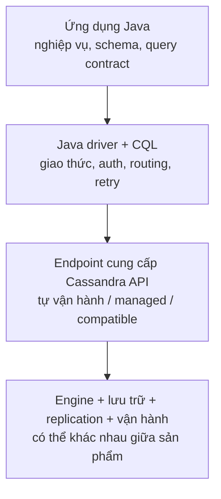
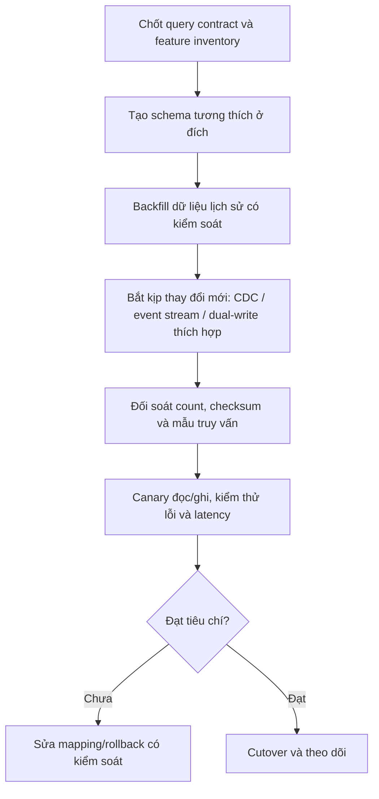

# Phân biệt Apache Cassandra với dịch vụ tương thích hoặc sản phẩm mở rộng

> **Chương:** Tư duy Cassandra  
> **Phạm vi:** Apache Cassandra là cơ sở dữ liệu NoSQL phân tán theo mô hình *wide-column*. Ngoài phần mềm mã nguồn mở của dự án Apache, thị trường còn có bản phân phối thương mại, dịch vụ quản lý Cassandra, hệ thống tương thích giao thức/CQL và những sản phẩm mở rộng tìm kiếm, phân tích, dữ liệu AI. Bài học này giúp xác định **đang sử dụng sản phẩm nào, các mức độ tương thích thực sự là gì, ai chịu trách nhiệm vận hành và phải kiểm thử điều gì trước khi chuyển đổi**, đặc biệt đối với ứng dụng Java.

## 1. Mục tiêu học tập

Sau bài này, bạn có thể:

1. Phân biệt **Apache Cassandra upstream**, **bản phân phối/giải pháp mở rộng dựa trên Cassandra**, **dịch vụ Cassandra được quản lý** và **dịch vụ/hệ lưu trữ cung cấp giao diện tương thích Cassandra**.
2. Giải thích vì sao **tương thích CQL hoặc Java driver không bảo đảm tương đương mọi tính năng, ngữ nghĩa hay khả năng vận hành**.
3. Nêu ví dụ cần phân loại: Apache Cassandra, DataStax Enterprise (DSE), Astra DB, Amazon Keyspaces, ScyllaDB và Azure Cosmos DB for Apache Cassandra.
4. Xây dựng bộ tiêu chí đánh giá portability gồm CQL, schema, partition key, replication, consistency, conditional update, TTL, index, latency và giới hạn dịch vụ.
5. Kết nối ứng dụng Java tới một cụm Apache Cassandra tự vận hành bằng `CqlSession` và nhận biết phần cấu hình cần điều chỉnh ở môi trường được quản lý.
6. Phân biệt trách nhiệm backup, repair, compaction, scaling, monitoring và bảo mật giữa tự vận hành với dịch vụ quản lý.
7. Lập kế hoạch thử nghiệm và di chuyển một workload CQL, tránh coi việc “chạy được một SELECT” là đủ để tuyên bố thay thế tương đương.

## 2. Câu hỏi đầu tiên: đang nói về engine, API hay dịch vụ?

Trong một cuộc họp kỹ thuật, ba phát biểu sau nghe khá giống nhau:

- “Dữ liệu của chúng tôi đang ở **Apache Cassandra**.”
- “Ứng dụng dùng **Cassandra driver/CQL** để kết nối tới database.”
- “Nhà cung cấp nói dịch vụ của họ **Cassandra-compatible**.”

Chúng **không khẳng định cùng một thứ**.

**Apache Cassandra** là một dự án cơ sở dữ liệu mã nguồn mở cụ thể, có mã nguồn, các bản phát hành và các thành phần vận hành của riêng nó. **CQL** là ngôn ngữ truy vấn. **Native protocol/driver** là đường client giao tiếp với endpoint. Một sản phẩm khác có thể hiểu được một phần CQL hoặc hỗ trợ driver mà **không chạy đúng Apache Cassandra server**.

### 2.1. Bốn lớp cần tách bạch



Hai dịch vụ có thể trông giống nhau ở lớp **B** nhưng khác nhau rất nhiều ở lớp **D**: cách đặt replica, cách cấp phát dung lượng, giới hạn throughput, consistency, cơ chế sao lưu, bảo trì, index hoặc tính phí.

Vì vậy, khi chọn một sản phẩm, hãy hỏi theo thứ tự: **Tên engine là gì? Dịch vụ có thực sự chạy một bản phân phối Cassandra không? Nó chỉ cung cấp API tương thích hay còn giữ cùng semantics? Ai vận hành cụm và chịu trách nhiệm khi có lỗi?**

## 3. Apache Cassandra upstream là mốc so sánh

**Apache Cassandra** là hệ quản trị cơ sở dữ liệu phân tán không có một nút master cố định cho mọi request. Ứng dụng gửi câu CQL đến một node/coordinator; Cassandra định vị partition nhờ **partition key → token → dải token/replication strategy**, rồi đọc hoặc ghi trên các replica.

Trong triển khai Cassandra truyền thống, những khái niệm vận hành quan trọng bao gồm:

| Khái niệm | Vai trò trong Apache Cassandra |
| --- | --- |
| **Keyspace** | Không gian tên và cấu hình replication phù hợp topology |
| **Table / CQL** | Lưu dữ liệu theo primary key, gồm partition key và có thể có clustering columns |
| **Partitioner / token** | Phân bố partition tới những vùng token |
| **Coordinator** | Node tiếp nhận yêu cầu, gửi đến replica và chờ theo consistency level |
| **Replication factor (RF)** | Số replica theo chiến lược phân phối và data center |
| **Consistency level (CL)** | Số phản hồi replica cần thiết cho từng thao tác |
| **Commit log / memtable / SSTable** | Thành phần đường ghi và lưu trữ cục bộ |
| **Compaction / repair** | Hợp nhất dữ liệu cục bộ và đồng bộ giữa replica |
| **nodetool / metrics / logs** | Những giao diện quan sát/quản trị thường gặp khi tự vận hành |

### 3.1. Khi tự vận hành Apache Cassandra

Đội vận hành phải quan tâm tới phiên bản server, topology node/rack/data center, triển khai, cấp phát CPU/RAM/đĩa, bootstrap/replace node, security, backup/restore, repair, compaction, giám sát và kế hoạch nâng cấp. Mức tự chủ cao đi kèm trách nhiệm lớn.

Ví dụ một keyspace của cụm có data center `dc1`:

```sql
CREATE KEYSPACE IF NOT EXISTS telemetry
WITH replication = {
    'class': 'NetworkTopologyStrategy',
    'dc1': 3
};
```

Ví dụ chỉ đúng khi topology thực có data center tương ứng và đủ node để đặt replica. Nó **không** phải câu lệnh có thể sao chép nguyên xi sang mọi dịch vụ tương thích: một dịch vụ quản lý có thể kiểm soát topology và replication qua cấu hình sản phẩm, API quản trị hoặc quy tắc riêng.

### 3.2. Phân biệt phiên bản Apache Cassandra

Ngay trong dự án Apache Cassandra, tính năng CQL, index, storage engine, giao thức, công cụ và hành vi vận hành có thể khác giữa các dòng phiên bản. Do đó, câu “Cassandra hỗ trợ tính năng X” cần được hoàn chỉnh thành:

> “**Phiên bản server và cấu hình nào** hỗ trợ tính năng X, với những giới hạn và hành vi nào?”

Đặc biệt với Storage-Attached Index, tính năng tìm kiếm/vector, công cụ CDC, materialized view, security và cú pháp mới, **không suy ra tính năng có mặt ở mọi phiên bản**. Tài liệu hoặc ví dụ của một dịch vụ được quản lý cũng không mặc nhiên tương đương phiên bản Apache Cassandra mà cluster tự vận hành đang sử dụng.

## 4. Bốn loại sản phẩm liên quan Cassandra

Để tránh tranh luận mơ hồ về “Cassandra-compatible”, nên phân loại theo **thứ thực sự được triển khai**.

| Loại | Điểm nhận diện | Câu hỏi kiểm chứng |
| --- | --- | --- |
| **Apache Cassandra upstream (tự quản lý)** | Chạy các bản phát hành/mã nguồn Apache Cassandra, tự quản lý cluster | Server version nào? Ai nâng cấp, repair, backup, trực vận hành? |
| **Bản phân phối hoặc sản phẩm mở rộng dựa trên Cassandra** | Dùng Cassandra làm nền tảng và bổ sung tính năng, công cụ, hỗ trợ hoặc thay đổi đóng gói | Thành phần nào khác upstream? Có tính năng riêng gây phụ thuộc nhà cung cấp không? |
| **Cassandra được quản lý (managed Cassandra)** | Nhà cung cấp triển khai/vận hành cơ sở Cassandra và cung cấp endpoint cho ứng dụng | Có truy cập nodetool không? Ai quản lý RF, repair, compaction, backup? |
| **Engine hoặc dịch vụ tương thích API/CQL** | Cung cấp giao diện CQL/native protocol/driver ở mức được công bố, engine bên trong có thể khác | Tính năng CQL nào được hỗ trợ? RF/CL, TTL, LWT và hệ thống metric có cùng semantics không? |

Hai loại giữa có thể **giao nhau**: một sản phẩm thương mại có thể vừa là một bản mở rộng vừa được cung cấp như dịch vụ quản lý. Điều quan trọng là đánh giá theo cách triển khai cụ thể, không chỉ tên marketing.

## 5. Các ví dụ thường gặp: điểm giống và điểm khác

Các ví dụ dưới đây là **định hướng phân loại**, không phải bảng cam kết tính năng mới nhất. Tính năng, phiên bản tương thích, hình thức triển khai và giới hạn dịch vụ có thể thay đổi; cần xác minh bằng tài liệu của đúng phiên bản/gói dịch vụ trước khi chọn hoặc migration.

### 5.1. Apache Cassandra

- **Bản chất:** hệ cơ sở dữ liệu phân tán mã nguồn mở của Apache Software Foundation.
- **Giao diện:** CQL, native protocol và hệ sinh thái driver, công cụ vận hành.
- **Quyền kiểm soát:** nếu tự triển khai, đội của bạn có thể quyết định topology, RF, cấu hình server, chiến lược compaction và lịch repair, trong giới hạn phiên bản.
- **Điều cần lưu ý:** chi phí triển khai/vận hành, kế hoạch capacity, bảo mật, sự cố và nâng cấp không biến mất chỉ vì phần mềm là mã nguồn mở.

### 5.2. DataStax Enterprise (DSE) và các bản phân phối mở rộng

**DataStax Enterprise (DSE)** là ví dụ về sản phẩm thương mại trong hệ sinh thái Cassandra. Ở những phiên bản và hình thức cung cấp khác nhau, sản phẩm có thể bổ sung tích hợp/công cụ hoặc thay đổi cách vận hành so với Apache Cassandra upstream.

Khi xem một bản phân phối mở rộng, không được chỉ hỏi “CQL có chạy không?”, mà cần kiểm tra:

- Có tính năng **độc quyền nhà cung cấp** nào trong schema, security, index, search, analytics hoặc quản trị không?
- Driver và công cụ vận hành dành cho bản phân phối đó khác upstream như thế nào?
- Nếu chuyển về Apache Cassandra, phần schema và dữ liệu nào cần biến đổi hoặc tái thiết kế?
- Chính sách hỗ trợ, nâng cấp, bản vá và cấp phép của bản đang dùng ra sao?

**Điểm phân biệt:** “dựa trên Cassandra” không có nghĩa mọi tính năng của sản phẩm thương mại sẽ tồn tại trong các binary Apache Cassandra upstream.

### 5.3. Astra DB: dịch vụ cơ sở dữ liệu được quản lý trong hệ sinh thái Cassandra

**Astra DB** là ví dụ về dịch vụ cơ sở dữ liệu được quản lý dựa trên hệ sinh thái Cassandra. Dịch vụ hướng tới việc giảm công việc tự triển khai/quản lý server cho đội phát triển.

Cần phân biệt các giao diện mà một gói dịch vụ cụ thể công bố: kết nối bằng CQL/driver, API dữ liệu khác, chức năng tìm kiếm/vector hoặc các dịch vụ tích hợp. **Có API dữ liệu mới không đồng nghĩa câu CQL tự động tương đương API đó**, và tính năng trên một chế độ sản phẩm không nhất thiết có trên mọi chế độ.

Khi chuyển ứng dụng Java, cần kiểm tra phương thức kết nối cloud (ví dụ endpoint/bundle phù hợp), TLS, xác thực, tên data center logic, session configuration và giới hạn throughput trước khi tái sử dụng code kết nối nội bộ.

### 5.4. Amazon Keyspaces (for Apache Cassandra): dịch vụ CQL tương thích

**Amazon Keyspaces (for Apache Cassandra)** là ví dụ về dịch vụ database được quản lý cung cấp giao diện tương thích Apache Cassandra cho những thao tác được hỗ trợ. Cách quản trị, tính phí/dung lượng, topology và một số khả năng CQL có thể khác một cluster Apache Cassandra do đội tự quản lý.

Đừng giả định bạn có thể:

- Đăng nhập vào các node Cassandra để chạy mọi lệnh `nodetool`.
- Cấu hình rack, token range, commit log, repair và compaction như trên server tự quản lý.
- Dùng mọi tính năng CQL và consistency level với cùng ý nghĩa, giới hạn và hiệu năng.
- Sử dụng lại nguyên cấu hình driver/auth của cluster nội bộ.

Ứng dụng có thể dùng driver/giao thức tương thích trong phạm vi được hỗ trợ, nhưng phải xác minh **TLS, phương thức xác thực, endpoint, connection policy, giới hạn request và schema/CL cụ thể**.

### 5.5. ScyllaDB: CQL-compatible nhưng engine khác

**ScyllaDB** là hệ cơ sở dữ liệu phân tán khác với Apache Cassandra, được thiết kế có tương thích CQL/giao thức ở mức nhất định để giúp tiếp nhận ứng dụng Cassandra. Kiến trúc triển khai và cách tối ưu engine của ScyllaDB không phải là các node Apache Cassandra upstream chạy với tên thương mại khác.

Khi đánh giá, cần kiểm thử:

- Phiên bản CQL và các kiểu dữ liệu/feature mà ứng dụng sử dụng.
- Partitioning/routing, driver tương thích và khuyến nghị driver cụ thể.
- Hành vi compaction, repair, streaming, observability và thay đổi topology.
- Mức nhất quán, LWT, batch, TTL, index và hiệu năng thực trên workload của bạn.

Việc cùng chấp nhận một `CREATE TABLE` **không** chứng minh performance hay các đặc tính khôi phục sự cố giống hệt Apache Cassandra.

### 5.6. Azure Cosmos DB for Apache Cassandra: giao diện Cassandra trên backend khác

**Azure Cosmos DB for Apache Cassandra** là ví dụ về giao diện tương thích Cassandra do một nền tảng cơ sở dữ liệu khác cung cấp. Ứng dụng có thể dùng những driver/câu CQL được hỗ trợ, nhưng backend và mô hình tài nguyên/nhất quán/vận hành thuộc dịch vụ nền tảng của nhà cung cấp.

Cần đặc biệt xác minh:

- CQL, keyspace/table, secondary index và câu truy vấn nào được hỗ trợ.
- Cách partition key Cassandra được ánh xạ vào partitioning của dịch vụ.
- Mô hình throughput/capacity, giới hạn request và các lỗi throttling.
- Các mức nhất quán, độ trễ liên vùng, retry và khả năng phục hồi theo quy định của dịch vụ.
- Có thể dùng những công cụ quản trị Cassandra thông thường hay phải dùng console/API/metrics riêng.

**Cùng cú pháp `SELECT` chưa chứng minh cùng storage engine, data placement, tài nguyên tiêu thụ hay tính năng server.**

## 6. “Tương thích Cassandra” là một phổ, không phải công tắc bật/tắt

Một lời công bố tương thích phải chỉ rõ **tương thích ở tầng nào**.

| Tầng tương thích | Kiểm tra cụ thể | Bẫy suy luận |
| --- | --- | --- |
| **Giao thức (wire/native protocol)** | Driver có kết nối, bắt tay và xử lý phiên bản protocol được không? | Driver connect thành công ≠ mọi CQL đều hợp lệ |
| **Cú pháp CQL** | `CREATE TABLE`, `INSERT`, `SELECT`, `UPDATE`, `DELETE` có hợp lệ không? | Cú pháp hợp lệ ≠ cùng ngữ nghĩa hoặc performance |
| **Kiểu dữ liệu** | `uuid`, `timeuuid`, `timestamp`, `date`, `decimal`, collections, UDT, counters | Kiểu được parse ≠ mọi thao tác trên kiểu được hỗ trợ |
| **Schema/data modeling** | Partition key, clustering, `ORDER BY`, TTL, secondary index, bảng materialized | Tên giống nhau ≠ indexing/partitioning vật lý giống nhau |
| **Consistency và concurrency** | RF, `LOCAL_QUORUM`, `SERIAL`, `IF`, batch và retry | Mức CL cùng tên ≠ luôn cùng bảo đảm giữa backend khác |
| **Failure semantics** | Timeout, unavailable, throttling, partial write, retry policy | Cùng exception class không bảo đảm trạng thái server giống nhau |
| **Vận hành** | Repair, compaction, backup, restore, scaling, monitoring, CDC | Một managed API có thể ẩn hoặc thay toàn bộ lớp vận hành |
| **Hiệu năng/chi phí** | p95/p99 latency, throughput, quota, chi phí IO/đọc/ghi | Benchmark một bảng nhỏ ≠ đáp ứng production |

### 6.1. Bốn câu hỏi cốt lõi trong buổi đánh giá

1. **Kết nối được không?** Giao thức, xác thực, TLS, driver version.
2. **Chạy được không?** CQL, kiểu dữ liệu, schema, chỉ mục và tính năng.
3. **Có đúng không?** Partitioning, CL, LWT, TTL, data reconciliation và hành vi khi lỗi.
4. **Có vận hành được không?** SLO, observability, backup/restore, hạn mức, chi phí và trách nhiệm xử lý sự cố.

Chỉ khi cả bốn được chứng minh bằng workload đại diện mới có cơ sở nói “sản phẩm B là lựa chọn thay thế khả thi cho hệ A trong **phạm vi sử dụng này**”.

## 7. Ví dụ CQL: phần tương đối phổ biến và phần dễ không portable

Giả sử hệ IoT cần ghi các sự kiện theo thiết bị/ngày và đọc 100 sự kiện gần nhất. Một bảng theo truy vấn:

```sql
CREATE TABLE telemetry.events_by_device_day (
    tenant_id text,
    device_id text,
    event_day date,
    event_time timestamp,
    event_id uuid,
    event_type text,
    temperature_c double,
    PRIMARY KEY ((tenant_id, device_id, event_day), event_time, event_id)
) WITH CLUSTERING ORDER BY (event_time DESC, event_id ASC);
```

Mẫu `PRIMARY KEY`, `INSERT`, `SELECT` và các kiểu dữ liệu thường gặp có khả năng là **điểm khởi đầu** để kiểm thử tính di động. Tuy nhiên, không được coi là cam kết rằng mọi dịch vụ ví dụ trong bài đều chấp nhận schema này mà không chỉnh sửa.

```sql
INSERT INTO telemetry.events_by_device_day (
    tenant_id, device_id, event_day, event_time,
    event_id, event_type, temperature_c
) VALUES (
    'acme', 'sensor-42', '2026-11-21',
    '2026-11-21T08:05:00Z',
    11111111-1111-1111-1111-111111111111,
    'READING', 27.4
);

SELECT event_time, event_id, event_type, temperature_c
FROM telemetry.events_by_device_day
WHERE tenant_id = 'acme'
  AND device_id = 'sensor-42'
  AND event_day = '2026-11-21'
LIMIT 100;
```

Đọc hiệu quả vì đã có **đầy đủ partition key** và chỉ yêu cầu một phạm vi row theo clustering order. Dù backend tương thích khác nhau, query-first design vẫn hữu ích: nếu không có khóa phân vùng, truy vấn quét rộng vẫn là một rủi ro kiến trúc.

### 7.1. Kiểm thử riêng phần tạo keyspace

Trên một cluster Apache Cassandra tự vận hành, người dùng có thể tạo keyspace với replication strategy:

```sql
-- Dùng cho Apache Cassandra khi topology thực sự có dc1.
-- Một dịch vụ quản lý có thể không cho chỉnh replication theo cách này.
CREATE KEYSPACE IF NOT EXISTS telemetry
WITH replication = {
    'class': 'NetworkTopologyStrategy',
    'dc1': 3
};
```

Đây là ví dụ **không được coi là portable tuyệt đối**. Một dịch vụ tương thích có thể từ chối cú pháp, ánh xạ khác, hạn chế quyền sửa hoặc quản lý replica hoàn toàn bằng lớp dịch vụ.

### 7.2. Những tính năng phải lập ma trận kiểm thử riêng

Không sử dụng một ô “Cassandra-compatible: yes” thay cho kiểm tra từng tính năng:

| Nhóm | Câu CQL/tính năng đại diện | Vì sao cần thử |
| --- | --- | --- |
| **TTL** | `INSERT ... USING TTL ...`; `TTL(column)` | Chính sách hết hạn, giới hạn giá trị và tombstone/storage có thể khác |
| **Conditional write** | `INSERT ... IF NOT EXISTS`; `UPDATE ... IF version = ...` | CAS/LWT, serial consistency, conflict và timeout |
| **Batch** | `BEGIN BATCH ... APPLY BATCH` | Kích thước, phạm vi nguyên tử, batchlog và giới hạn |
| **Counters** | Kiểu `counter` và UPDATE tăng/giảm | Semantics và hỗ trợ có thể không giống |
| **Collections/UDT** | `list`, `set`, `map`, user-defined type | Giới hạn kích thước, thao tác cập nhật, encoding |
| **Indexes** | Secondary index, SAI, materialized view | Có thể không hỗ trợ hoặc dùng hệ index khác |
| **Tìm kiếm/AI** | Vector/search extension | Dễ phụ thuộc phiên bản hoặc tính năng nhà cung cấp |
| **Security** | Authentication, authorization, TLS, audit | Managed service có mô hình IAM/quyền khác |
| **Data capture** | CDC, stream, export | Có thể dùng công cụ/tích hợp đặc thù |

**Nguyên tắc:** đánh dấu `SUPPORTED` sau khi đã thử trên **đúng phiên bản/gói dịch vụ**, không đánh dấu dựa trên tên sản phẩm.

## 8. Data model tương tự vẫn cần kiểm tra partition và clustering

CQL trong Cassandra định vị row dựa trên partition key. Ví dụ:

```sql
PRIMARY KEY ((tenant_id, device_id, event_day), event_time, event_id)
```

Trong Apache Cassandra, tổ hợp `tenant_id/device_id/event_day` là partition key; `event_time/event_id` là clustering columns, phục vụ thứ tự row **bên trong partition**. Khi chuyển sang một dịch vụ tương thích, cần xác minh cách backend nhận, phân bố, giới hạn kích thước và phục vụ partition đó.

### 8.1. Rủi ro hot partition không biến mất nhờ đổi nhà cung cấp

Nếu `device_id = sensor-42` tạo hàng triệu sự kiện mỗi giờ, partition theo thiết bị/ngày vẫn có thể bị quá tải trên những replica/shard chịu trách nhiệm. Chuyển dịch vụ không thay đổi nhu cầu giới hạn phân vùng theo thời gian hoặc phân tán thêm bằng shard logic.

Lựa chọn bucket theo giờ/tháng/ngày phải dựa vào phân phối tải, kích thước row, số truy vấn cùng lúc và số bucket cần đọc khi xem lịch sử. Backend có thể đặt quota/chi phí khác nhau nên **benchmark lại** cả ghi, đọc và fan-out.

### 8.2. Denormalization vẫn có chi phí

Một ứng dụng có thể có:

- `events_by_device_day`: lịch sử theo khóa thiết bị và ngày.
- `latest_state_by_device`: một row trạng thái mới nhất.
- `alerts_by_device_day`: cảnh báo gần đây.

Ba bảng tương ứng ba query contract. **Không dịch vụ nào tự đồng bộ các read model tùy ý của ứng dụng** chỉ vì cùng hỗ trợ CQL. Khi ingest/stream xử lý sự kiện muộn hoặc retry, cần event ID ổn định, quy tắc versioning và reconciliation.

## 9. Consistency: cùng tên mức CL chưa đủ để so sánh

Ở Apache Cassandra với RF = 3 trong `dc1`, `LOCAL_QUORUM` thường cần phản hồi từ **hai replica cục bộ**. Khi đọc và ghi trong cùng tập replica, điều kiện:

\[
W + R > RF
\]

là trực giác về việc các tập replica đọc/ghi giao nhau. Nó **không** tự bảo đảm linearizability cho mọi thao tác, transaction đa partition hay việc các read model ứng dụng luôn đồng bộ.

### 9.1. Trong dịch vụ tương thích phải xác minh gì?

Không nên áp nguyên mô hình trên nếu chưa biết backend quản lý replication thế nào:

1. Dịch vụ có nhận và thực thi RF/replication strategy do CQL khai báo không?
2. `ONE`, `LOCAL_ONE`, `QUORUM`, `LOCAL_QUORUM`, `ALL` có được hỗ trợ? Nếu có, **ngữ nghĩa chính xác** trong hệ đó là gì?
3. Đọc sau ghi được bảo đảm ra sao khi application/client chạy nhiều vùng?
4. Thao tác có điều kiện `IF`, serial consistency `SERIAL`/`LOCAL_SERIAL` có hoạt động tương đương điều kiện nghiệp vụ dự kiến không?
5. Timeout/throttling xảy ra ở tầng nào? Ghi có thể đã áp dụng dù client nhận exception không?

Với các backend khác Cassandra upstream, mô hình consistency có thể dựa trên cơ chế riêng. Cùng gửi tham số driver `LOCAL_QUORUM` **không đủ** để suy ra cùng số replica vật lý hoặc cùng hành vi khi đứt kết nối mạng.

### 9.2. LWT và conflict cần thử dưới cạnh tranh thực

Ví dụ:

```sql
CREATE TABLE telemetry.device_settings (
    tenant_id text,
    device_id text,
    threshold_c double,
    version int,
    PRIMARY KEY ((tenant_id, device_id))
);

UPDATE telemetry.device_settings
SET threshold_c = 30.0, version = 8
WHERE tenant_id = 'acme' AND device_id = 'sensor-42'
IF version = 7;
```

Trên backend hỗ trợ LWT phù hợp, ứng dụng phải kiểm tra `[applied]`. Để xác nhận compatibility, hãy chạy **hai writer cạnh tranh** trên cùng `version=7`, bảo đảm không cả hai được áp dụng thành công, rồi thử timeout và retry.

Nếu backend không hỗ trợ `IF` hoặc không có semantics tương đương, bạn phải thiết kế lại invariant, chuyển concurrency control sang nơi phù hợp hoặc không di chuyển workload này.

## 10. Kết nối Java: portable đến đâu?

Java driver giao tiếp với Cassandra qua giao thức phù hợp; `CqlSession`, prepared statement và result mapping mang tính quen thuộc giữa nhiều môi trường. Nhưng kết nối thật phụ thuộc cấu hình endpoint và những khả năng nhà cung cấp hỗ trợ.

### 10.1. Ví dụ trên Apache Cassandra tự vận hành

Đây là ví dụ Java driver 4.x dùng contact point nội bộ và data center `dc1`. Giả định keyspace/bảng đã được tạo và có đủ replica cho `LOCAL_QUORUM`:

```java
import java.net.InetSocketAddress;
import java.time.LocalDate;

import com.datastax.oss.driver.api.core.CqlSession;
import com.datastax.oss.driver.api.core.DefaultConsistencyLevel;
import com.datastax.oss.driver.api.core.cql.PreparedStatement;
import com.datastax.oss.driver.api.core.cql.ResultSet;
import com.datastax.oss.driver.api.core.cql.Row;

public final class CassandraHistoryDemo {
    public static void main(String[] args) {
        try (CqlSession session = CqlSession.builder()
                .addContactPoint(new InetSocketAddress("127.0.0.1", 9042))
                .withLocalDatacenter("dc1")
                .build()) {

            PreparedStatement statement = session.prepare(
                "SELECT event_time, event_id, event_type, temperature_c " +
                "FROM telemetry.events_by_device_day " +
                "WHERE tenant_id = ? AND device_id = ? " +
                "AND event_day = ? LIMIT 100"
            );

            ResultSet rows = session.execute(
                statement.bind(
                    "acme", "sensor-42", LocalDate.of(2026, 11, 21)
                ).setConsistencyLevel(DefaultConsistencyLevel.LOCAL_QUORUM)
                 .setIdempotent(true)
            );

            for (Row row : rows) {
                System.out.printf("%s %s %s%n",
                    row.getInstant("event_time"),
                    row.getUuid("event_id"),
                    row.getString("event_type"));
            }
        }
    }
}
```

Các tầng trách nhiệm:

- **Ứng dụng Java:** xác định `tenant_id`, phân quyền, bucket ngày, retry và yêu cầu consistency.
- **Driver:** bind kiểu dữ liệu CQL, duy trì session/connection, chọn node tiếp nhận, giải mã result/exception.
- **Server/endpoint:** quyết định thực thi truy vấn, partition placement, cách kiểm tra CL và áp dụng mutation.

Đoạn Java **không thể được sao chép nguyên xi đến mọi dịch vụ quản lý** chỉ bằng thay `127.0.0.1`. Một endpoint cloud có thể cần TLS bắt buộc, phương thức authentication đặc thù, secure connect bundle, driver extension hoặc cấu hình DC riêng.

### 10.2. Những phần thường cần thay khi chuyển endpoint

| Thành phần cấu hình | Cụm tự vận hành | Dịch vụ managed/compatible cần kiểm tra |
| --- | --- | --- |
| **Contact point** | IP/DNS node nội bộ, native port | Endpoint dịch vụ, gateway/proxy, các cổng TLS cho phép |
| **TLS** | Theo cấu hình cụm | Có thể bắt buộc, yêu cầu CA/truststore phù hợp |
| **Auth** | Cassandra credentials/role hoặc thiết lập cụm | Token, IAM, credentials hay auth provider đặc thù |
| **Local DC** | Tên DC thực trong topology | Tên DC logic hoặc driver option theo dịch vụ |
| **Protocol/driver** | Tương thích với server version | Tương thích với endpoint, có thể cần driver profile/extension |
| **Routing** | Token-aware khi driver biết topology/partition | Có thể qua proxy; topology/routing được che giấu hoặc khác |
| **CL và timeout** | Thiết lập trên statement/profile | Chỉ dùng mức được hỗ trợ; cần điều chỉnh latency/quota |
| **Observability** | Metrics/log/tracing của cả driver và node | Client metrics kết hợp console/API/telemetry của dịch vụ |

### 10.3. Tách code nghiệp vụ khỏi cấu hình hạ tầng

Một hướng đơn giản là cô lập việc tạo `CqlSession` trong một factory/configuration module. Repository nên nhận `CqlSession` đã khởi tạo và dùng prepared statement theo query contract, thay vì tự hard-code endpoint, secret hoặc DC.

```java
// Phác thảo thành phần ứng dụng (không phải factory kết nối hoàn chỉnh):
public final class DeviceEventRepository {
    private final com.datastax.oss.driver.api.core.CqlSession session;

    public DeviceEventRepository(
            com.datastax.oss.driver.api.core.CqlSession session) {
        this.session = session;
    }

    // Các phương thức CQL ở đây có thể được kiểm thử trên từng backend.
    // Chỗ tạo session/TLS/auth/DC nằm ở cấu hình của môi trường chạy.
}
```

**Không** đặt secret hoặc token thật trong source code/tài liệu. Thiết lập chứng chỉ, credentials và cách khởi tạo driver phải tham khảo tài liệu của phiên bản dịch vụ được chọn, không suy ra từ ví dụ local.

## 11. “Managed” thay đổi ai làm việc, không loại bỏ mọi rủi ro

Một dịch vụ quản lý có thể vận hành cluster, nâng cấp, sửa lỗi, mở rộng tài nguyên hoặc cung cấp backup; nhưng **không tự chịu trách nhiệm về mọi quyết định schema và nghiệp vụ của khách hàng**.

| Công việc | Apache Cassandra tự quản lý | Managed Cassandra hoặc compatible service |
| --- | --- | --- |
| Tạo schema và query contract | Đội ứng dụng | Thường vẫn là đội ứng dụng |
| Chọn partition key, kiểm soát hot partition | Đội ứng dụng/DBA | Thường vẫn là trách nhiệm phía ứng dụng |
| OS/server upgrade, node replacement | Đội hạ tầng/DBA | Nhà cung cấp quản lý trong phạm vi dịch vụ |
| Replication/topology | Đội hạ tầng cấu hình | Có thể do dịch vụ quyết định hoặc cung cấp ít lựa chọn |
| Compaction/repair | Đội vận hành quản lý | Thường được dịch vụ vận hành/ẩn đi, tùy sản phẩm |
| Backup, retention, restore test | Đội tự thực hiện | Tùy tính năng dịch vụ; khách hàng vẫn cần kiểm thử khả năng khôi phục |
| TLS, credentials, IAM, phân quyền API | Đội ứng dụng + hạ tầng | Chia sẻ trách nhiệm giữa nhà cung cấp và khách hàng |
| Giới hạn QPS/throughput và chi phí | Từ phần cứng/capacity | Có thể có quota, đơn vị tính phí, throttling, policy dịch vụ |
| Xử lý timeout, event ID, idempotency | Ứng dụng | Vẫn thuộc ứng dụng |

**Managed ≠ không cần DBA mindset.** Bạn có thể không phải điều khiển compaction bằng `nodetool`, nhưng vẫn cần hiểu dữ liệu phân vùng ra sao, tại sao request timeout, vì sao TTL tốn chi phí và liệu một partition có bị nóng.

### 11.1. Repair và compaction có thể bị ẩn

Trong Apache Cassandra tự vận hành, admin thường lập kế hoạch repair, theo dõi SSTable/compaction và bảo vệ quá trình dọn tombstone. Trong backend tương thích không dùng cùng cơ chế storage, những công cụ/công việc ấy có thể **không tồn tại với cùng tên**.

Khi dịch vụ nói “tự động vận hành”, hãy hỏi **cam kết gì được cung cấp và bằng số liệu nào**: độ bền, restore point, throughput, latency, mất vùng, backup và quyền truy cập metric. Không được tự suy rằng dịch vụ đã thực hiện “Cassandra repair” theo lịch của cụm tự quản lý.

## 12. Chuyển dữ liệu: tương thích API không tự mang dữ liệu sang

Kể cả khi cả hai endpoint chạy câu `SELECT` giống nhau, dữ liệu **không** tự di chuyển. Một migration cần thiết kế copy, bắt kịp các cập nhật mới, đối soát và chuyển traffic.



### 12.1. Schema không phải lúc nào ánh xạ 1:1

Những điểm cần ghi rõ trước khi copy:

1. **Keyspace và replication:** dịch vụ đích có cho tạo keyspace/đặt RF như nguồn không?
2. **Partition/clustering key:** có giữ được cùng khóa và thứ tự dữ liệu không?
3. **Kiểu dữ liệu:** `uuid`, `date`, `timestamp`, `decimal`, collection, UDT có encode/giới hạn phù hợp không?
4. **TTL và write timestamp:** dữ liệu ở nguồn còn lại bao lâu? Copy sang đích có vô tình làm TTL “bắt đầu lại” không?
5. **Tombstone/delete:** delete xảy ra khi copy/CDC đang chạy có được phản ánh đúng không?
6. **Counters/LWT/batch:** dữ liệu hoặc mutation có yêu cầu xử lý riêng không?
7. **Index và query:** bảng đã copy nhưng index/CL của đích có đáp ứng được truy vấn không?

Lưu ý đặc biệt: **copy các giá trị hiện có không tự bảo toàn mọi metadata nội bộ** như thời hạn còn lại, timestamp ghi, tombstone hay trạng thái đồng thuận. Nếu yêu cầu khôi phục/consistency phụ thuộc metadata ấy, phải chọn công cụ migration có semantics đã được kiểm chứng hoặc biến đổi dữ liệu có kiểm soát.

### 12.2. Dual-write không đơn giản là hai `INSERT`

Nếu ứng dụng ghi cùng sự kiện sang nguồn và đích:

- Một bên có thể thành công, bên kia timeout.
- Hai backend có thể dùng CL/TTL khác nhau.
- Retry có thể khiến event bị ghi hai lần nếu tạo ID mới.
- Cập nhật có điều kiện có thể thành công ở một bên nhưng conflict ở bên kia.
- Việc đọc từ cả hai bên trong giai đoạn canary có thể cho kết quả khác nhau do độ trễ đồng bộ.

Vì vậy cần định nghĩa **nguồn sự thật**, event/operation ID ổn định, retry có giới hạn, hàng đợi bù/trạng thái đồng bộ và quy trình đối soát. Không chạy dual-write tự phát rồi mặc định hai database luôn ở trạng thái giống nhau.

### 12.3. Cutover và rollback phải có tiêu chí

Trước khi đổi traffic:

- So sánh số row/partition trong phạm vi chọn mẫu và toàn bộ phạm vi có thể kiểm tra được.
- So sánh row theo primary key, đặc biệt dữ liệu mới, dữ liệu sát thời điểm hết hạn và các bản ghi đã xóa.
- Kiểm thử p50/p95/p99 latency, throughput và quota với tải thực.
- Kiểm thử một replica/endpoint chậm, lỗi auth/TLS, timeout, retry và ghi có điều kiện.
- Kiểm tra chi phí theo mô hình thanh toán của dịch vụ mới.
- Xác định **điều kiện quay lại**, tránh rollback làm ghi mới ở đích bị mất.

Một kế hoạch migration thành công phải bảo toàn **độ đúng nghiệp vụ**, không chỉ làm ứng dụng connect được.

## 13. Bộ kiểm thử compatibility tối thiểu

Đối với một workload Cassandra đang chạy, hãy làm một **feature matrix** cụ thể thay vì chỉ ghi “CQL supported”.

| Mã | Thử nghiệm | Kết quả PASS có nghĩa gì? |
| --- | --- | --- |
| **C1** | Mở session Java driver qua TLS/auth | Kết nối và metadata/protocol được xử lý chính xác |
| **C2** | Tạo keyspace/table với composite partition key | Schema đã chấp nhận hoặc được ánh xạ bằng cách tương đương được tài liệu hóa |
| **C3** | Prepared INSERT và SELECT theo đầy đủ partition key | Bind/kiểu dữ liệu/row mapping đúng |
| **C4** | Đọc theo clustering range, thứ tự giảm dần, paging | Hàng và thứ tự kết quả đáp ứng query contract |
| **C5** | TTL, xóa, đọc trước và sau hết hạn | Semantics retention được kiểm chứng theo yêu cầu |
| **C6** | Hai writer tranh `UPDATE ... IF version = 7` | Không đồng thời áp dụng hai CAS xung đột nếu chức năng được yêu cầu |
| **C7** | Thử CL dự kiến và lỗi mạng/endpoint | Bảo đảm, lỗi và timeout thực tế được hiểu rõ |
| **C8** | Ghi lại cùng event ID sau timeout giả lập | Không tạo trùng logic ngoài ý muốn |
| **C9** | Thử batch/index/collection/UDT đang dùng | Tất cả tính năng ứng dụng sử dụng có hỗ trợ hoặc có phương án thay |
| **C10** | Load test với partition skew và nhiều bucket | Đạt p95/p99 và throughput mục tiêu, không vượt quota/chi phí |
| **C11** | Restore hoặc diễn tập phục hồi trong phạm vi sản phẩm | Có thể phục hồi dữ liệu đạt mục tiêu RPO/RTO |

Không có test nào đơn lẻ chứng minh tính tương đương tuyệt đối. Một ứng dụng chỉ dùng CQL cơ bản có thể dễ di chuyển hơn ứng dụng dựa nhiều vào secondary index riêng, mutation có điều kiện, công cụ quản trị hay tích hợp search/analytics đặc thù.

### 13.1. Đo cả độ đúng lẫn hiệu năng

Ví dụ query nhận một row trống thay vì kết quả mong muốn sau cutover có thể đến từ: sai bucket thời gian, mapping `date` khác, dữ liệu chưa backfill, TTL hết hạn, ghi đến chậm hoặc thay đổi consistency. Nếu chỉ đo “thời gian trả SELECT” thì sẽ không phát hiện sai dữ liệu.

Nên so sánh **query result**, tần suất lỗi, quy tắc retry, số hàng quét/liên quan, latency và chi phí theo cùng tập khóa/dữ liệu.

## 14. Quyết định chọn sản phẩm theo use case

| Nhu cầu | Hướng cân nhắc | Rủi ro phải chấp nhận/kiểm chứng |
| --- | --- | --- |
| Muốn kiểm soát sâu topology, repair, storage và cấu hình server | Apache Cassandra tự quản lý hoặc một bản phân phối có quyền vận hành phù hợp | Chi phí đội vận hành, nâng cấp, sự cố và backup |
| Muốn tập trung phát triển API CQL thay vì quản lý node | Managed Cassandra hoặc dịch vụ Cassandra-compatible | Feature limitations, quota, SLO, port/auth/driver, vendor dependency |
| Đã có hệ thống nhiều CQL query tương đối đơn giản | Đánh giá các endpoint tương thích bằng feature matrix | Không mặc định support mọi kiểu dữ liệu/CL/TTL |
| Dựa vào tiện ích thương mại hoặc extension chuyên biệt | Bản phân phối/sản phẩm mở rộng | Lock-in vào schema, extension, công cụ hoặc licensing |
| Cần dữ liệu theo khóa + tìm kiếm/AI/analytics | Kiến trúc kết hợp hoặc sản phẩm có feature chuyên dụng | Đồng bộ read model, độ trễ, chi phí và giới hạn tính năng |
| Cần JOIN linh hoạt và ACID đa bảng | Xem xét RDBMS làm nguồn sự thật, Cassandra làm serving/history khi phù hợp | Không ép giao dịch quan hệ vào BATCH Cassandra |

**Không có lựa chọn tốt nhất cho mọi đội.** Quyết định nên được chứng minh bằng query contracts, yêu cầu nhất quán, lỗi chấp nhận được, người chịu trách nhiệm vận hành, độ trễ đo được và tổng chi phí sở hữu.

## 15. Tình huống thực hành: đề xuất migration có cơ sở

Một công ty có cụm Apache Cassandra tự quản lý, dữ liệu gồm:

- `events_by_device_day`: nhiều `INSERT`, đọc 100 sự kiện mới nhất của từng thiết bị.
- `latest_state_by_device`: một row theo thiết bị, được cập nhật khi nhận sự kiện mới.
- `device_settings`: quản trị viên dùng `IF version = ...` để sửa ngưỡng có cạnh tranh.
- Một dashboard phân tích 90 ngày theo tỉnh/thành phố.
- Đội vận hành dùng `nodetool`, theo dõi repair/compaction và chạy backup.

Nhà cung cấp chào dịch vụ “Cassandra-compatible”, hứa tiếp nhận ứng dụng Java mà không cần sửa code CQL.

### Câu hỏi A — Có nên tin lời hứa tuyệt đối?

**Đáp án gợi ý:** Không. Phải xác minh từng CQL query, driver/auth/TLS, RF/CL, `IF`/serial consistency, TTL, event ID, paging, chỉ mục và quota. “Cassandra-compatible” có nhiều mức, không đảm bảo toàn bộ semantics hay công cụ vận hành giống nhau.

### Câu hỏi B — Bảng lịch sử và bucket

**Hỏi:** Nếu dữ liệu được phân vùng theo `(tenant_id, device_id, event_day)` và sắp `event_time DESC`, có thể giữ thiết kế trên sản phẩm đích không?

**Gợi ý:** Đây là điểm xuất phát hợp lý, nhưng phải thử schema, tốc độ ghi, hot partitions, truy vấn theo dải thời gian, giới hạn partition và chi phí trên workload thật. Đặc biệt kiểm tra dữ liệu đến muộn và cách tính `event_day` ở Java.

### Câu hỏi C — Cập nhật có điều kiện

**Hỏi:** Trước khi chuyển `device_settings`, cần thử kịch bản nào?

**Gợi ý:** Hai writer cùng đọc version 7, cùng gửi CAS để chuyển sang 8; kiểm tra `[applied]`, kết quả xung đột, timeout, retry và serial consistency được hỗ trợ. Nếu backend thiếu bảo đảm cần thiết, phải thiết kế khác hoặc giữ invariant ở hệ phù hợp.

### Câu hỏi D — Repair và backup

**Hỏi:** Dịch vụ nói “không cần repair nữa”, vậy backup/restore cũng không cần kiểm thử?

**Gợi ý:** Không. Cơ chế quản trị nội bộ có thể được dịch vụ ẩn đi, nhưng trách nhiệm kiểm chứng retention, restore, RPO/RTO, khả năng bảo vệ trước xóa nhầm và giới hạn SLA vẫn tồn tại.

### Câu hỏi E — Dashboard phân tích

**Hỏi:** Có nên đưa toàn bộ dashboard `GROUP BY` nhiều chiều vào CQL chỉ vì sản phẩm đích có Cassandra API?

**Gợi ý:** Không. API tương thích không biến Cassandra thành engine OLAP. Cân nhắc stream aggregation, kho phân tích dạng cột hoặc tính năng analytics được kiểm chứng với dữ liệu thật.

### Câu hỏi F — Kế hoạch cutover

**Hỏi:** Sau khi ứng dụng kết nối được và đọc thành công một thiết bị, có nên tắt cụm cũ ngay?

**Gợi ý:** Chưa. Phải backfill và bắt kịp delta, đối soát dữ liệu/TTL/delete, kiểm thử canary read-write/latency/failure/chi phí, lập điều kiện rollback và theo dõi sau chuyển đổi.

## 16. Những ngộ nhận thường gặp

| Ngộ nhận | Hiểu đúng |
| --- | --- |
| “Hỗ trợ Java Cassandra driver nghĩa là đang chạy Apache Cassandra server.” | API/protocol tương thích có thể được triển khai trên engine khác. |
| “CQL chạy được thì mọi kiểu dữ liệu và index đều portable.” | Phải kiểm tra version, feature và semantics theo sản phẩm. |
| “Managed Cassandra không cần quan tâm partition key.” | Hot partition và query-first schema vẫn là trách nhiệm thiết kế của ứng dụng. |
| “RF/CL có cùng tên ở hai dịch vụ nên chắc chắn cùng replica semantics.” | Backend có thể đặt replication/consistency khác; cần kiểm chứng. |
| “Thay địa chỉ IP là Java driver dùng được với mọi cloud service.” | Có thể cần TLS, auth provider, bundle, DC và cấu hình routing khác. |
| “Astra DB, Keyspaces, ScyllaDB và Cosmos DB API là một sản phẩm.” | Đây là những ví dụ khác nhau về loại sản phẩm/engine và mức độ tương thích. |
| “Bản phân phối thương mại có chức năng nào thì Apache Cassandra upstream cũng có.” | Extension/vendor feature có thể không thuộc upstream. |
| “Dịch vụ che `nodetool` nghĩa là không tồn tại rủi ro tombstone/retention.” | Cách vận hành khác đi; độ đúng dữ liệu và workload vẫn phải được kiểm chứng. |
| “Migration CQL tự giữ nguyên TTL, write timestamp và delete.” | Copy giá trị không đồng nghĩa bảo toàn mọi metadata/hành vi. |
| “Dùng QUORUM ngăn mọi lost update.” | Quorum không thay LWT/CAS cho điều kiện phiên bản. |
| “Một thử nghiệm SELECT nhanh chứng minh production sẽ nhanh.” | Phải thử phân bố khóa thực, writes, faults, p95/p99, quota và chi phí. |
| “Replication hoặc managed backup bảo đảm không mất dữ liệu dù xóa nhầm.” | Cần chính sách backup/restore, retention và diễn tập phù hợp. |

## 17. Checklist chọn Cassandra, sản phẩm mở rộng hoặc dịch vụ tương thích

- [ ] Đã ghi **tên sản phẩm, engine, phiên bản, kiểu triển khai và khu vực** cụ thể.
- [ ] Biết sản phẩm là Apache Cassandra upstream, một bản phân phối Cassandra, managed Cassandra hay backend tương thích API.
- [ ] Có danh sách **query contract** và tính năng CQL đang dùng: schema, TTL, collection, batch, LWT, index, counters, CDC.
- [ ] Kiểm thử Java driver kết nối qua đúng TLS/auth/DC/protocol và cấu hình session production.
- [ ] Kiểm chứng partition key/clustering, time bucket, dữ liệu đến muộn và các partition nóng.
- [ ] Kiểm chứng CL, semantics đọc/ghi, consistency đa DC và CAS nếu có.
- [ ] Xác nhận mọi feature không tương thích đã có phương án rewrite/loại bỏ.
- [ ] Biết giới hạn throughput, request size, connection, paging, quota và cách tính phí.
- [ ] Xác định ai chịu trách nhiệm repair/compaction, backup/restore, security, metrics và xử lý sự cố.
- [ ] Có kết quả benchmark p95/p99, lỗi, chi phí và chaos test trên dữ liệu/tải đại diện.
- [ ] Đã lập kế hoạch backfill, đồng bộ delta, đối soát TTL/delete, cutover và rollback.
- [ ] Các invariant nghiệp vụ, retry, operation ID và dữ liệu nhạy cảm được kiểm thử sau migration.

Nếu chỉ hoàn thành các mục “driver kết nối được” và “CQL SELECT chạy được”, **chưa đủ căn cứ** để kết luận một dịch vụ tương thích thay thế an toàn cho ứng dụng Cassandra hiện tại.

## 18. Tự kiểm tra kiến thức

1. **Apache Cassandra upstream là gì?** Một dự án hệ quản trị database phân tán mã nguồn mở cụ thể, không chỉ là tên giao thức.
2. **Tương thích driver có đồng nghĩa engine giống nhau?** Không. Driver nói chuyện với API/protocol; backend có thể khác.
3. **DSE nên được đánh giá khác Apache Cassandra upstream ở đâu?** Tính năng mở rộng, vận hành, hỗ trợ và phụ thuộc sản phẩm/phiên bản.
4. **Điểm khác giữa managed Cassandra và self-managed Cassandra là gì?** Trách nhiệm vận hành được dịch chuyển/chia sẻ; query/data modeling vẫn cần kiểm chứng.
5. **ScyllaDB được coi là chính các node Apache Cassandra đổi tên không?** Không. Đây là engine khác có khả năng tương thích CQL ở mức được công bố.
6. **Amazon Keyspaces hoặc Cosmos DB Cassandra API có nhất thiết hỗ trợ `nodetool repair` không?** Không được mặc định; cần dùng cơ chế quản trị dịch vụ và kiểm tra phạm vi hỗ trợ.
7. **Tại sao `CREATE KEYSPACE WITH replication ...` là điểm rủi ro khi migration?** Dịch vụ quản lý có thể áp đặt hoặc ánh xạ replication theo cách khác.
8. **Tại sao cùng `LOCAL_QUORUM` không tự bảo đảm hành vi tương đương?** Backend và phạm vi replica/consistency có thể khác; cần thử theo tài liệu phiên bản.
9. **Hai writer dùng `IF version = 7` cần kiểm tra gì?** Conflict, `[applied]`, serial CL và xử lý timeout.
10. **Mục đích của query-first design vẫn đúng khi đổi backend không?** Có, nhưng cần benchmark và xác minh partitioning/giới hạn của đích.
11. **Copy row có tự giữ nguyên TTL còn lại và tombstone không?** Không được suy luận như vậy; metadata và delete cần chiến lược riêng.
12. **Driver `CqlSession` giúp gì và không giúp gì?** Quản lý kết nối/gửi CQL/bind; không thay ứng dụng bảo đảm invariant nghiệp vụ hoặc tự migration dữ liệu.
13. **Tại sao managed service vẫn cần kiểm thử restore?** Dịch vụ có thể quản lý hạ tầng, nhưng mục tiêu phục hồi và dữ liệu nghiệp vụ thuộc trách nhiệm chung/khách hàng.
14. **Cassandra-compatible API có tự tối ưu báo cáo OLAP không?** Không. Cần xem xét engine/phương án phân tích riêng.
15. **Một bộ tiêu chí tối thiểu để chấp nhận migration là gì?** Đúng schema và truy vấn, ngữ nghĩa concurrency/CL, dữ liệu đã đối soát, hiệu năng/chi phí đạt SLO, sự cố/rollback có kế hoạch.

## 19. Tổng kết

**Apache Cassandra là một engine cụ thể. CQL và native protocol là giao diện. Bản phân phối mở rộng, managed Cassandra và hệ tương thích CQL có thể chia sẻ một phần giao diện mà khác nhau về storage engine, replication, consistency, vận hành và giới hạn.**

Khi đánh giá sản phẩm, hãy theo chuỗi:

**Nhận diện loại engine/dịch vụ → lập danh sách CQL và query contracts → kiểm tra protocol/driver → kiểm tra schema và semantics → kiểm thử RF/CL/LWT/TTL → đánh giá vận hành và bảo mật → benchmark → đối soát dữ liệu, cutover/rollback.**

Không có phép thay thế an toàn nào chỉ dựa vào nhãn “Cassandra-compatible”. Điểm quyết định là **workload, invariant, yêu cầu dữ liệu và SLO cụ thể của ứng dụng** có được bảo toàn hay không.

Kiến thức này nối phần tư duy của mô-đun **DATABASE_ENGINE_WIDE_COLUMN_CASSANDRA** với thực hành CQL, partition key, mô hình wide-column, replication và consistency đọc/ghi, compaction, repair, xử lý lỗi và kết nối Java driver, đồng thời giúp bạn nhận ra khi nào một dịch vụ tương thích cần cấu hình hoặc thiết kế khác Apache Cassandra.
