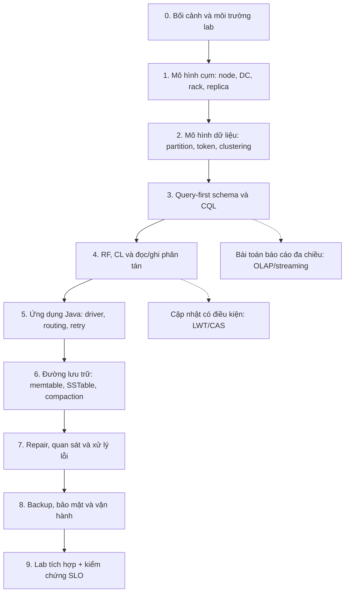
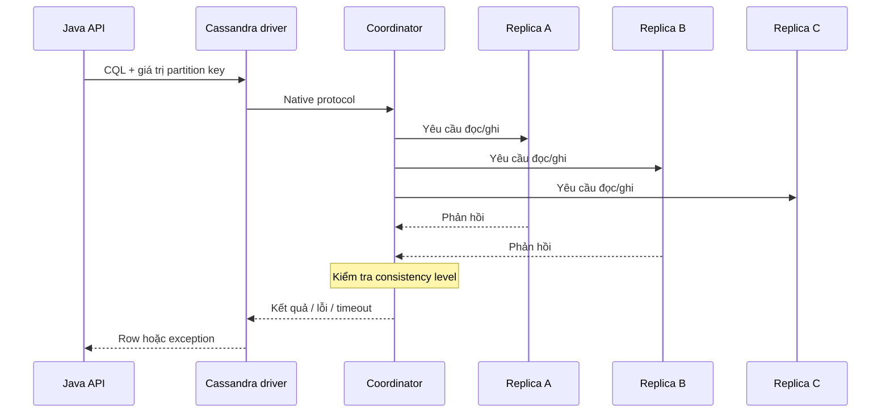
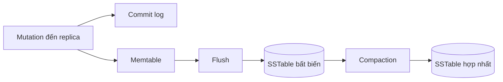

# Trình tự học từ mô hình cụm và dữ liệu đến CQL, ứng dụng và vận hành

> **Chương:** Tư duy Cassandra  
> **Định hướng:** Đây là bản đồ học tập có thứ tự phụ thuộc, không chỉ là danh sách chủ đề. Ta bắt đầu bằng cách Apache Cassandra tổ chức cụm và đặt bản sao, tiếp đến chọn partition key theo truy vấn, thực hành CQL, kết nối ứng dụng Java, rồi kiểm chứng lỗi và vận hành. Mỗi chặng có một sản phẩm thực hành và một tiêu chí tự đánh giá.

## 1. Kết quả mong đợi sau lộ trình

Khi hoàn thành bài học, bạn có thể:

1. Vẽ luồng từ **ứng dụng → Java driver → coordinator → replica** và giải thích vai trò node, token, data center, rack, partition key.
2. Chuyển một yêu cầu truy vấn thành thiết kế bảng Cassandra theo **partition key**, **clustering columns** và bucket thời gian, thay vì dựa vào JOIN hoặc quét tùy ý.
3. Tạo keyspace/table, ghi và đọc bằng CQL; xác định mức nhất quán `LOCAL_ONE`, `LOCAL_QUORUM` và điều kiện cần để thực hành chúng.
4. Kết nối Java driver 4.x, sử dụng `CqlSession`, prepared statement, kiểu dữ liệu CQL, driver metrics và chiến lược retry an toàn.
5. Mô tả đường ghi **commit log → memtable → SSTable**, compaction, tombstone, repair và mối liên hệ tới khả năng phục hồi.
6. Phân biệt **write timeout**, **unavailable**, sự cố node, dữ liệu cũ và lỗi schema/query; đề xuất kiểm tra theo đúng tầng.
7. Xây dựng một bài lab đầu-cuối có **tiêu chí đo**, bằng chứng readback, sơ đồ kiến trúc, checklist rủi ro và kế hoạch backup/restore.

**Mục tiêu quan trọng nhất:** không chỉ “gõ được CQL” mà biết **vì sao truy vấn đến đúng replica, vì sao nó có thể chậm hoặc sai kỳ vọng, và cần vận hành hệ như thế nào khi một phần cụm gặp lỗi**.

## 2. Một tình huống xuyên suốt để không học rời rạc

Giả sử bạn xây hệ IoT cho một công ty có nhiều tenant. Mỗi thiết bị gửi sự kiện nhiệt độ, ứng dụng Java tiếp nhận và lưu lại. Người vận hành cần:

| Mã | Nhu cầu | Mẫu truy cập chính |
| --- | --- | --- |
| **Q1** | Đọc 100 sự kiện mới nhất của một thiết bị trong một ngày | `tenant_id + device_id + event_day` |
| **Q2** | Đọc sự kiện của thiết bị trong khoảng 30 phút | Ba khóa trên và dải `event_time` |
| **Q3** | Đọc trạng thái hiện tại của thiết bị theo ID | `tenant_id + device_id` |
| **Q4** | Xem thống kê 90 ngày của mọi thiết bị theo tỉnh | Tổng hợp toàn tập, nhiều partition |

Ba mẫu đầu có thể phục vụ tốt bằng các bảng theo khóa nếu thiết kế đúng. Q4 đặt câu hỏi về **kho phân tích/stream aggregation** thay vì cố gắng biến mọi truy vấn thành một `SELECT` trên Cassandra.

Lộ trình dùng Q1, Q2 làm bài lab chính, sau đó mở rộng tới Q3 và đánh giá vì sao Q4 cần kiến trúc bổ sung. Mỗi khi học một khái niệm mới, hãy quay lại hỏi: **khái niệm này làm thay đổi điều gì trong đường đi của Q1 hoặc Q2?**

### 2.1. Các yêu cầu phi chức năng mẫu

Để luyện tập có thể đặt các mục tiêu **giả định**, không phải cam kết của Cassandra:

- 10.000 thiết bị, mỗi thiết bị gửi một sự kiện/phút ở tải nền; có một số thiết bị gửi nhiều hơn.
- Truy vấn Q1 trả tối đa 100 sự kiện theo thứ tự mới trước.
- Khi một replica tạm lỗi trong cụm thử nghiệm RF = 3, Q1/Q2 ở `LOCAL_QUORUM` cần được **kiểm tra** xem có thể tiếp tục hoạt động hay không.
- Một lần gửi sự kiện bị timeout không được làm ứng dụng tạo row mới cho cùng sự kiện logic do đổi ID khi retry.
- Dữ liệu có chính sách retention giả định 30 ngày; cần phân tích TTL/tombstone và cách tính thời gian bắt đầu retention.

Các con số là **đầu vào bài thực hành**. Nếu dùng production, phải thay bằng số liệu thực tế, SLO và kết quả benchmark.

## 3. Bản đồ phụ thuộc: học theo “vì sao” rồi mới “cách làm”



Tại sao thứ tự này hợp lý?

- **Nếu học driver trước partition key**, bạn có thể kết nối thành công nhưng viết truy vấn không có đường định tuyến tốt.
- **Nếu học CL trước RF và topology**, bạn dễ suy diễn sai rằng `LOCAL_QUORUM` luôn tương đương “hai node”, bất kể cấu hình.
- **Nếu học compaction trước SSTable**, bạn sẽ nhầm compaction với replication hoặc repair.
- **Nếu học lệnh repair trước khái niệm replica**, bạn có thể chạy lệnh tốn I/O mà không biết đang sửa loại lệch dữ liệu nào.

Lộ trình có các **cổng kiểm tra (gate)**: chỉ chuyển chặng khi bạn giải thích được cơ chế và đưa ra được bằng chứng thực hành tối thiểu.

## 4. Chặng 0 — Chuẩn bị lab và phân biệt lab với production

### 4.1. Hai cấu hình học tập có mục đích khác nhau

| Môi trường | Dùng để học tốt | Không nên tuyên bố |
| --- | --- | --- |
| **Một node, một data center** | CQL cơ bản, schema, partition key, Java driver, kiểu dữ liệu | Đã kiểm chứng replication RF = 3, quorum chịu lỗi hoặc mất một node vẫn phục vụ |
| **Ba node cùng một data center** | RF = 3, consistency level, coordinator/replica, mất một node, sửa lệch replica cơ bản | Đã chứng minh khả năng chịu mất cả data center hoặc độ trễ nhiều vùng |
| **Hai data center (nâng cao)** | Local vs global CL, cross-DC latency, failover/failback | Mọi ghi LOCAL_QUORUM đã đồng bộ vùng còn lại hoặc RPO = 0 |

Các bài tập gây lỗi **chỉ thực hiện trên cluster lab cô lập**, không mô phỏng bằng cách tắt node của môi trường đang phục vụ người dùng.

### 4.2. Ghi vào nhật ký lab trước khi chạy

Nên ghi lại:

- Phiên bản Apache Cassandra, Java runtime và driver đang dùng.
- Tên data center và rack thực tế; ví dụ `dc1` chỉ là tên minh họa.
- Số node, RF thực của keyspace, địa chỉ liên hệ client và cổng native protocol.
- Trường hợp dùng container/VM/cloud: giới hạn CPU, RAM, I/O và khả năng mỗi node nằm trên máy vật lý độc lập hay không.
- Các câu lệnh thay đổi dữ liệu được thực hiện và dự kiến có thể xóa lab như thế nào.

**Lưu ý về sản phẩm:** nếu dùng dịch vụ CQL-compatible thay vì Apache Cassandra upstream, topology, quyền chạy `nodetool`, replication, compaction và các mức CL có thể khác. Trước mỗi bước, kiểm tra khả năng được hỗ trợ trên **đúng sản phẩm và phiên bản**.

### 4.3. Tiêu chí qua chặng 0

Bạn chỉ cần chứng minh được: “Đây là cluster gồm bao nhiêu node, chúng nằm trong DC/rack nào, client đi vào đâu, RF nào là khả thi; những phần nào lab hiện tại không thể kiểm chứng?” Không cần tạo dữ liệu thật ở chặng này.

## 5. Chặng 1 — Hiểu cụm phân tán trước khi tìm hiểu CQL

### 5.1. Bốn đối tượng không thể nhầm lẫn

| Thuật ngữ | Ý nghĩa | Câu hỏi cần trả lời |
| --- | --- | --- |
| **Node** | Một tiến trình/máy tham gia cụm Cassandra | Node có đang hoạt động và tiếp nhận request không? |
| **Data center (DC)** | Nhóm node dùng trong topology/replication strategy | Replica cục bộ của ứng dụng ở DC nào? |
| **Rack** | Miền lỗi trong cùng DC để hỗ trợ phân tán replica khi topology cho phép | Các replica có được tách theo miền lỗi thích hợp không? |
| **Coordinator** | Node tiếp nhận và điều phối từng request | Coordinator có nhất thiết là replica của partition không? **Không.** |

Một node không phải master vĩnh viễn chỉ vì đang làm coordinator. Driver có thể gửi yêu cầu đến node khác; placement của dữ liệu do token và replication strategy quyết định.

### 5.2. Vẽ một đường request



Sơ đồ **khái niệm**, không diễn tả chính xác mọi tối ưu đọc hoặc thứ tự trao đổi nội bộ trong từng phiên bản. Nó giúp đặt đúng trách nhiệm:

1. **Ứng dụng** cung cấp giá trị khóa, CL và thời hạn chờ.
2. **Driver** quản lý kết nối, metadata và chọn coordinator theo policy.
3. **Coordinator** định vị replica và xử lý đủ phản hồi.
4. **Replica** thực hiện công việc lưu trữ/đọc trên dữ liệu của partition.

### 5.3. Quan sát cluster từ công cụ quản trị

Trong lab Apache Cassandra tự quản lý, một số lệnh đọc trạng thái thường gặp:

```bash
nodetool status
nodetool info
nodetool netstats
```

Các lệnh là **ví dụ cần tự chạy trong lab** sau khi đã có môi trường, không phải thao tác bắt buộc trên dịch vụ quản lý. Với `nodetool status`, cần đọc tên DC, trạng thái node và tải dữ liệu. Đừng tự suy ra một node “UN” nghĩa là mọi request đều thành công: nó chỉ cung cấp một phần tình trạng cluster.

### 5.4. Gate 1 — Bằng chứng hoàn thành

Hãy vẽ sơ đồ ba node `A/B/C` trong `dc1`, đánh dấu coordinator cho một request và liệt kê replica của một partition giả định. Giải thích được vì sao **tập replica phụ thuộc partition key** và coordinator có thể không nằm trong tập đó.

## 6. Chặng 2 — Partition key, clustering và mô hình wide-column

### 6.1. Từ query contract đến khóa

Xét Q1:

> “Cho tenant `acme` và thiết bị `sensor-42` trong ngày `2026-11-21`, lấy 100 sự kiện mới nhất.”

Ba giá trị luôn được biết: `tenant_id`, `device_id`, `event_day`. Một partition key hợp lý để bắt đầu đánh giá là:

```sql
PRIMARY KEY ((tenant_id, device_id, event_day), event_time, event_id)
```

Trong đó:

- `(tenant_id, device_id, event_day)` là **composite partition key**. Toàn bộ tổ hợp được hash thành token và định vị một partition.
- `event_time` là **clustering column** thứ nhất; quyết định thứ tự trong partition.
- `event_id` là **clustering column** thứ hai; phân biệt sự kiện trùng timestamp.
- `temperature_c` hoặc `event_type` là dữ liệu thông thường; không tự tạo index xuyên cụm.

Một partition chứa nhiều row theo clustering key, nhưng chúng vẫn nằm trên **cùng tập replica** của partition key đó. Clustering order không đồng nghĩa sắp thứ tự toàn bảng.

### 6.2. Vì sao không dùng một khóa duy nhất cho mọi lịch sử?

Nếu chỉ dùng `device_id`, một thiết bị hoạt động 10 năm có thể tích lũy quá nhiều sự kiện trong một partition. Thêm `event_day` giới hạn dữ liệu theo ngày. Đây là **time bucket**.

Ví dụ một thiết bị gửi một sự kiện mỗi phút:

\[
24 \times 60 = 1.440\ \text{sự kiện/ngày}
\]

Nhưng một thiết bị gửi 1.000 sự kiện mỗi giây có thể tạo 86,4 triệu sự kiện/ngày: bucket ngày khi ấy vẫn có thể quá lớn/nóng. Không có kích thước partition “chuẩn” đúng cho mọi workload; phải đo row size, ghi/đọc mỗi giây, tombstone và tải replica.

### 6.3. Ba câu hỏi kiểm tra thiết kế

1. **Đọc có đủ toàn bộ partition key không?** Nếu Q1 không biết `event_day`, phải xác định nhiều bucket cần đọc.
2. **Partition có tăng vô hạn không?** Nếu có, cân nhắc bucket giờ/ngày/tháng hoặc shard logic, kèm chi phí hợp nhất kết quả.
3. **Tải có tập trung vào ít khóa không?** Số lượng thiết bị lớn không có nghĩa mọi thiết bị tạo số request ngang nhau; cần quan sát các khóa nóng nhất.

### 6.4. Gate 2 — Bằng chứng hoàn thành

Với ít nhất ba query contract, bạn phải chỉ ra được `WHERE` chứa gì, partition key nào được dùng, row được sắp ra sao và trường hợp nào cần tạo **bảng đọc khác**. Nếu mới chỉ đặt tên các thực thể “device, event, user” mà chưa trả lời truy vấn, chưa qua gate này.

## 7. Chặng 3 — Viết CQL cho một đường truy cập thực tế

CQL đủ giống SQL để người mới quen cú pháp, nhưng khác ở **cách truy vấn được định vị**. Luyện từ `CREATE KEYSPACE` đến `CREATE TABLE`, `INSERT`, `SELECT` theo khóa rồi mới học TTL/index/conditional update.

### 7.1. Tạo keyspace phù hợp cấu hình lab

Trên cluster ba node ở `dc1`:

```sql
CREATE KEYSPACE IF NOT EXISTS telemetry_learning
WITH replication = {
    'class': 'NetworkTopologyStrategy',
    'dc1': 3
};
```

Trên lab **một node**, hãy tạo keyspace tương đương với `'dc1': 1` và dùng `LOCAL_ONE`; **không giả lập RF = 3 có đủ ba replica chỉ bằng việc nhập số 3**.

### 7.2. Tạo bảng cho Q1 và Q2

```sql
CREATE TABLE IF NOT EXISTS telemetry_learning.events_by_device_day (
    tenant_id text,
    device_id text,
    event_day date,
    event_time timestamp,
    event_id uuid,
    event_type text,
    temperature_c double,
    PRIMARY KEY ((tenant_id, device_id, event_day), event_time, event_id)
) WITH CLUSTERING ORDER BY (event_time DESC, event_id ASC);
```

Cùng một bảng có thể trả lời Q1 (mới nhất) và Q2 (khoảng thời gian) vì chúng dùng cùng partition key và cùng thứ tự clustering.

### 7.3. Chèn dữ liệu có ID ổn định

```sql
INSERT INTO telemetry_learning.events_by_device_day (
    tenant_id, device_id, event_day, event_time,
    event_id, event_type, temperature_c
) VALUES (
    'acme', 'sensor-42', '2026-11-21',
    '2026-11-21T08:05:00Z',
    11111111-1111-1111-1111-111111111111,
    'READING', 27.4
);

INSERT INTO telemetry_learning.events_by_device_day (
    tenant_id, device_id, event_day, event_time,
    event_id, event_type, temperature_c
) VALUES (
    'acme', 'sensor-42', '2026-11-21',
    '2026-11-21T08:06:00Z',
    22222222-2222-2222-2222-222222222222,
    'READING', 27.8
);
```

`event_id` phải ổn định nếu đây là cùng một sự kiện logic được gửi lại sau timeout. Cassandra ghi theo primary key với ngữ nghĩa upsert; thay ID sau retry có thể tạo thêm row trùng nghiệp vụ.

### 7.4. Đọc theo khóa đầy đủ

```sql
-- Q1: mới nhất trong một ngày
SELECT event_time, event_id, temperature_c
FROM telemetry_learning.events_by_device_day
WHERE tenant_id = 'acme'
  AND device_id = 'sensor-42'
  AND event_day = '2026-11-21'
LIMIT 100;

-- Q2: một khoảng thời gian trong cùng partition
SELECT event_time, event_id, temperature_c
FROM telemetry_learning.events_by_device_day
WHERE tenant_id = 'acme'
  AND device_id = 'sensor-42'
  AND event_day = '2026-11-21'
  AND event_time >= '2026-11-21T08:00:00Z'
  AND event_time < '2026-11-21T09:00:00Z';
```

Không nên “sửa nhanh” câu truy vấn thiếu khóa bằng cách dùng `ALLOW FILTERING` cho đường đọc production. Nó có thể dẫn tới lọc/quét tốn kém, và `LIMIT 100` không đảm bảo query rẻ.

### 7.5. Gate 3 — Bằng chứng hoàn thành

Hãy chứng minh hai sự kiện được trả theo thứ tự giảm dần `event_time`; giải thích row thuộc partition nào và vì sao **không cần JOIN**. Sau đó tự đề xuất thay đổi schema nếu Q3 đòi hỏi current state theo `(tenant_id, device_id)` mà không cần biết ngày.

## 8. Chặng 4 — Replication và consistency đọc/ghi

Học CL sau khi đã biết partition key và RF: **RF là số replica được cấu hình**, **CL là điều kiện phản hồi cho một request**.

Với partition ở `dc1` có RF = 3:

| CL | Điều kiện tối thiểu trong ví dụ | Điều thường bị hiểu sai |
| --- | --- | --- |
| `LOCAL_ONE` | Một replica cục bộ phản hồi | Không có nghĩa các replica khác đã hội tụ |
| `LOCAL_QUORUM` | Hai replica cục bộ phản hồi | Không bảo đảm mọi writer được serialize hoặc không có conflict |
| `ALL` | Ba replica phản hồi | Không bảo đảm request sẽ luôn thành công khi một node chậm |

### 8.1. Công thức quorum

\[
Q=\left\lfloor\frac{RF}{2}\right\rfloor+1
\]

Với RF = 3, `Q = 2`. Tính giao nhau của các tập replica tham gia đọc/ghi trong cùng phạm vi là:

\[
W+R>RF
\]

Ví dụ `W=2` và `R=2` cho `2+2>3`. Điều này hữu ích khi phân tích khả năng quan sát ghi thành công, nhưng không làm Cassandra trở thành cơ sở dữ liệu SQL có transaction serializable trên mọi thao tác.

### 8.2. Thực hành từ cqlsh

```sql
-- Đây là lệnh của công cụ cqlsh, không phải cú pháp CQL
-- được chèn vào từng INSERT/SELECT.
CONSISTENCY LOCAL_QUORUM;
TRACING ON;

SELECT event_time, event_id, temperature_c
FROM telemetry_learning.events_by_device_day
WHERE tenant_id = 'acme'
  AND device_id = 'sensor-42'
  AND event_day = '2026-11-21'
LIMIT 100;

TRACING OFF;
```

Trong lab một node với RF = 1 hãy dùng `CONSISTENCY LOCAL_ONE`. Khả năng bật tracing, thông tin chi tiết và chi phí tracing phụ thuộc môi trường/phiên bản; chỉ dùng khi cần điều tra, không bật liên tục trên tải cao.

### 8.3. Hai lỗi đặc biệt quan trọng

- **Unavailable:** coordinator xác định không đủ replica cần thiết để đáp ứng CL trong tình huống cụ thể.
- **Timeout:** client/coordinator không nhận đủ phản hồi đúng hạn; điều này **không khẳng định** mọi replica đều chưa làm việc.

Một **write timeout** có thể xảy ra sau khi một số replica đã ghi mutation. Vì vậy retry không được tự tạo `event_id` mới cho cùng một sự kiện. Với cập nhật có tác dụng phụ hoặc LWT, quy tắc retry còn phải thận trọng hơn.

### 8.4. Gate 4 — Bằng chứng hoàn thành

Trong sơ đồ RF = 3, nếu A lỗi nhưng B/C còn đáp ứng, hãy xác định CL nào có thể thành công và CL nào không. Giải thích vì sao đọc `LOCAL_ONE` có thể thấy bản cũ và tại sao `LOCAL_QUORUM` không tương đương khóa giao dịch.

## 9. Chặng 5 — Kết nối ứng dụng Java và xác định trách nhiệm từng tầng

Đến đây mới hợp lý để viết client: bạn đã biết **đường truy cập, khóa, RF và CL**. Ứng dụng không chỉ gửi text CQL; nó phải bảo đảm tenant, bucket, ID sự kiện và chính sách retry nhất quán.

### 9.1. Một ví dụ Java driver 4.x đầy đủ

Ví dụ này dùng cluster lab có data center `dc1`, keyspace/table từ chặng 3, Java 11+ và DataStax/Apache-compatible Java driver 4.x. Nó sử dụng một `CqlSession` cho toàn bộ thao tác. Các dependency driver cần được khai báo theo dự án Java thực tế.

```java
import java.net.InetSocketAddress;
import java.time.Instant;
import java.time.LocalDate;
import java.util.UUID;

import com.datastax.oss.driver.api.core.CqlSession;
import com.datastax.oss.driver.api.core.DefaultConsistencyLevel;
import com.datastax.oss.driver.api.core.cql.PreparedStatement;
import com.datastax.oss.driver.api.core.cql.ResultSet;
import com.datastax.oss.driver.api.core.cql.Row;

public final class CassandraLearningPath {
    public static void main(String[] args) {
        // ID này đại diện cho CÙNG một sự kiện qua các lần thử gửi lại.
        UUID eventId = UUID.fromString(
            "33333333-3333-3333-3333-333333333333"
        );
        LocalDate eventDay = LocalDate.of(2026, 11, 21);
        Instant eventTime = Instant.parse("2026-11-21T08:07:00Z");

        try (CqlSession session = CqlSession.builder()
                .addContactPoint(new InetSocketAddress("127.0.0.1", 9042))
                .withLocalDatacenter("dc1")
                .build()) {

            PreparedStatement insert = session.prepare(
                "INSERT INTO telemetry_learning.events_by_device_day " +
                "(tenant_id, device_id, event_day, event_time, event_id, " +
                "event_type, temperature_c) VALUES (?, ?, ?, ?, ?, ?, ?)"
            );

            // Chọn CL theo RF thật: trên lab một node dùng LOCAL_ONE.
            session.execute(
                insert.bind(
                    "acme", "sensor-42", eventDay, eventTime, eventId,
                    "READING", 28.1
                ).setConsistencyLevel(DefaultConsistencyLevel.LOCAL_QUORUM)
            );

            PreparedStatement recent = session.prepare(
                "SELECT event_time, event_id, event_type, temperature_c " +
                "FROM telemetry_learning.events_by_device_day " +
                "WHERE tenant_id = ? AND device_id = ? " +
                "AND event_day = ? LIMIT 100"
            );

            ResultSet results = session.execute(
                recent.bind("acme", "sensor-42", eventDay)
                    .setConsistencyLevel(
                        DefaultConsistencyLevel.LOCAL_QUORUM)
                    .setIdempotent(true)
            );

            for (Row row : results) {
                Double temp = row.isNull("temperature_c")
                    ? null
                    : row.getDouble("temperature_c");
                System.out.printf("%s | %s | %s | %s%n",
                    row.getInstant("event_time"),
                    row.getUuid("event_id"),
                    row.getString("event_type"),
                    temp
                );
            }
        }
    }
}
```

Ví dụ ghi dùng ID và thời gian cố định để dễ thử lại trong lab; **không** có nghĩa mọi ghi có thể được driver tự động retry an toàn. Ghi dùng TTL, client-supplied timestamp, counter, conditional update hoặc side effect bên ngoài có thể cần quy tắc idempotency riêng.

### 9.2. Ai chịu trách nhiệm?

| Lớp | Việc phải làm |
| --- | --- |
| **Ứng dụng Java** | Xác thực tenant, tính bucket nhất quán, tạo ID ổn định, định nghĩa retry và lỗi trả về API |
| **Driver** | Kết nối native protocol, bind tham số, cache prepared statement, chọn coordinator, trả lỗi/row |
| **CQL/schema** | Quy định partition key, clustering, dữ liệu được lưu và điều kiện truy vấn |
| **Coordinator/replica** | Định tuyến theo token, đọc/ghi theo CL, tương tác storage engine |
| **Vận hành** | RF/topology đúng, giám sát, repair, compaction, backup, kiểm tra khả năng phục hồi |

### 9.3. Một số quy tắc Java cần hình thành sớm

- Tái sử dụng `CqlSession` theo vòng đời ứng dụng; không mở session mới cho từng HTTP request.
- Dùng prepared statement và bind kiểu dữ liệu; không ghép chuỗi từ input người dùng thành CQL.
- Đặt CL/timeout theo loại nghiệp vụ, không “một giá trị cho tất cả”.
- Dùng driver metrics để theo dõi in-flight requests, timeout, retry và độ trễ; kết hợp metrics server khi có thể.
- Kiểm soát concurrency/backpressure để không đẩy queue vô hạn vào cluster.
- Nếu đọc nhiều bucket, giới hạn fan-out rồi merge ở ứng dụng; paging state của một CQL query không phải cursor chung trên nhiều partition.
- Với dịch vụ quản lý/tương thích, xác minh TLS, authentication, endpoint, local DC và những CL thực sự được hỗ trợ.

### 9.4. Gate 5 — Bằng chứng hoàn thành

Ứng dụng Java phải ghi/đọc được cùng bảng với `cqlsh`, không dùng `ALLOW FILTERING`, và bạn giải thích được nơi tính `event_day`/`event_id`. Ghi lại kết quả khi đổi sai DC/CL trong lab, nhưng **không đưa mật khẩu hoặc token thật vào log**.

## 10. Chặng 6 — Hiểu đường lưu trữ trước khi chẩn đoán độ trễ

Một mutation được chuyển tới replica không có nghĩa “ngay lập tức thành một file chứa row hoàn chỉnh và không bao giờ thay đổi”. Cassandra dùng kiến trúc lưu trữ có các bước và công việc nền.



### 10.1. Những khái niệm cốt lõi

- **Commit log:** hỗ trợ phục hồi các mutation chưa được flush thành SSTable sau một số dạng sự cố; mức bền vững đối với mất nguồn phụ thuộc chế độ đồng bộ và phần cứng.
- **Memtable:** cấu trúc dữ liệu ở bộ nhớ dùng trước khi flush; không phải nguồn lưu dữ liệu bền vững duy nhất.
- **SSTable:** dữ liệu đã được flush trên đĩa, về cơ bản bất biến.
- **Compaction:** hợp nhất các SSTable, xử lý phiên bản giá trị và tombstone khi các điều kiện an toàn cho phép.
- **Tombstone:** dấu xóa do `DELETE` hoặc TTL hết hạn; không phải một row đã bị xóa sạch khỏi mọi bản sao ngay lập tức.

Điều cần phân biệt là **compaction làm việc với dữ liệu cục bộ của node**, còn **repair đối chiếu và đồng bộ dữ liệu giữa các replica**. Chúng không phải cùng một lệnh hoặc cùng một mục tiêu.

### 10.2. Time series và TTL

Khi lab cần dữ liệu hết hạn sau 30 ngày:

```sql
INSERT INTO telemetry_learning.events_by_device_day (
    tenant_id, device_id, event_day, event_time,
    event_id, event_type, temperature_c
) VALUES (
    'acme', 'sensor-42', '2026-11-21',
    '2026-11-21T08:08:00Z',
    44444444-4444-4444-4444-444444444444,
    'READING', 28.3
) USING TTL 2592000;
```

`2592000` giây là 30 ngày. TTL được áp dụng theo ngữ nghĩa thời gian ghi của Cassandra, **không tự tính từ timestamp sự kiện**. Nếu backfill sự kiện cũ, thời gian retention thực tế có thể khác yêu cầu “giữ đến 30 ngày sau event time”.

### 10.3. Chọn compaction là quyết định theo workload

Các chiến lược như **SizeTieredCompactionStrategy (STCS)**, **LeveledCompactionStrategy (LCS)** hoặc **TimeWindowCompactionStrategy (TWCS)** có mục tiêu và chi phí khác nhau, tùy phiên bản. Với dữ liệu sự kiện ghi theo thời gian và TTL tương đối đồng đều, TWCS là một phương án cần đánh giá; nhưng **event time cũ đến muộn, cập nhật row cũ và TTL khác nhau** có thể làm giảm lợi ích.

Không chọn TWCS chỉ vì bảng có cột `event_time`. Cũng không tùy tiện sửa `gc_grace_seconds` để dọn tombstone nhanh hơn khi chưa hiểu chu kỳ repair và nguy cơ dữ liệu bị xóa xuất hiện lại.

### 10.4. Gate 6 — Bằng chứng hoàn thành

Giải thích được vì sao ghi nhanh vẫn có thể phát sinh I/O nền; vì sao nhiều update/delete hoặc TTL làm read latency tăng; vì sao compaction không thay thế repair. Nêu được **một metric** để quan sát công việc nền của storage, chẳng hạn pending compactions.

## 11. Chặng 7 — Repair, replication lag và xử lý lỗi theo tầng

Trong cụm có RF lớn hơn 1, một replica có thể bị tắt hoặc mất kết nối khi mutation xảy ra. Các cơ chế như **hinted handoff**, **read reconciliation** và **anti-entropy repair** có thể giúp replica hội tụ, nhưng không nên coi bất kỳ cơ chế nào cũng thay thế hoàn toàn các cơ chế còn lại.

### 11.1. Repair làm gì?

Repair đối chiếu dữ liệu giữa các replica của phạm vi được chọn để tìm khác biệt và đồng bộ. Repair **không**:

- Tự khôi phục dữ liệu khỏi một lệnh xóa hợp lệ đã lan tới tất cả replica.
- Thay thế backup/snapshot và thử nghiệm restore.
- Biến ghi thường thành lightweight transaction hoặc ngăn lost update do hai writer.
- Tự sửa mô hình partition key gây hot partition.

Repair có thể tiêu thụ mạng, CPU, I/O và thời gian đáng kể. Phải lập lịch và chọn phạm vi phù hợp với phiên bản, topology, loại workload và chính sách vận hành.

### 11.2. Công cụ quan sát trong lab tự quản lý

```bash
nodetool status
nodetool tablestats telemetry_learning.events_by_device_day
nodetool compactionstats
nodetool tpstats
```

Tên, output và tùy chọn của công cụ cần kiểm tra theo phiên bản Cassandra. **Không chạy `nodetool repair`, thay đổi compaction, xóa dữ liệu, dừng node hoặc thao tác thay thế node trên production chỉ để thử kiến thức.** Khi học repair, nên bắt đầu bằng sơ đồ phạm vi và đọc metrics/log, rồi diễn tập ở lab cô lập có backup nếu cần.

### 11.3. Ma trận triệu chứng → giả thuyết

| Triệu chứng | Những hướng xem xét đầu tiên | Điều không nên kết luận ngay |
| --- | --- | --- |
| Java `Unavailable` khi dùng `LOCAL_QUORUM` | Số replica cục bộ đủ CL không, node/DC có hoạt động không, RF đúng không | “Cassandra đã mất dữ liệu” |
| Java write timeout | Network, coordinator, replica I/O, queue, timeout/CL | “Mutation chưa ghi ở bất cứ đâu” |
| Đọc `LOCAL_ONE` thấy dữ liệu cũ | Replica chưa hội tụ, write CL, topology, event time/version | “Tất cả replica đều hỏng” |
| Q1 chậm dù `LIMIT 100` | Partition quá lớn, tombstone, disk/compaction, hot partition | “Đổi CL xuống ONE sẽ luôn sửa được” |
| CPU/đĩa tăng khi cluster còn ít request | Compaction, streaming, repair, background flush | “Có thể tắt ngay compaction” |
| Kết quả giữa hai read model khác nhau | Ghi/cập nhật một phần, event đến muộn, projection lag | “Tăng RF là đủ để hai bảng đồng bộ” |

### 11.4. Gate 7 — Bằng chứng hoàn thành

Cho một sự cố giả định, hãy ghi: **triệu chứng ở client → yếu tố driver → coordinator → replica → storage → bằng chứng dự kiến → hành động an toàn**. Nếu chỉ có phản xạ “retry mọi exception”, chưa qua gate này.

## 12. Chặng 8 — Vận hành: SLO, observability, backup và bảo mật

Một ứng dụng Cassandra thành công không dừng ở việc `SELECT` trả đúng. Nó cần đáp ứng SLO và khôi phục khi có lỗi.

### 12.1. Bộ chỉ số cần có

| Tầng | Tín hiệu nên theo dõi | Mục đích |
| --- | --- | --- |
| **API/Java** | Error rate, throughput, p95/p99 latency, timeout, retry | Xác định tác động tới người dùng và request |
| **Driver** | In-flight requests, pool/connection state, client-side throttling, coordinator lựa chọn | Tìm nghẽn phía client hoặc routing |
| **Coordinator/replica** | Read/write latency, request errors, queue, dropped messages | Phân biệt vấn đề điều phối và phục vụ |
| **Storage** | SSTable, tombstone, compaction backlog, disk I/O và dung lượng | Giải thích tăng latency theo dữ liệu/vòng đời |
| **Topology** | Node up/down, streaming, DC/rack distribution, RF/CL | Đánh giá mức chịu lỗi còn lại |
| **Data correctness** | Projection lag, duplicate event ID, data reconciliation | Phát hiện dữ liệu nghiệp vụ sai dù HTTP 200 |

Khi so sánh hiệu năng, xem **p95/p99 cùng throughput và kích thước partition**, không chỉ thời gian trung bình của một truy vấn trong lab ít dữ liệu.

### 12.2. Backup và restore

Replication không phải backup: lệnh xóa nhầm có thể được nhân bản; lỗi ứng dụng có thể ghi dữ liệu sai vào tất cả replica. Học cách phân biệt:

- **Replica online:** giúp phục vụ read/write và chịu một số loại sự cố node.
- **Snapshot/backup:** tạo nguồn dữ liệu có thể khôi phục theo chính sách.
- **Repair:** đồng bộ dữ liệu giữa replica.
- **Restore:** đưa dữ liệu về trạng thái có thể phục vụ lại, cần thử với schema và quy trình cụ thể.

Định nghĩa **RPO** (lượng mất dữ liệu tối đa có thể chấp nhận) và **RTO** (thời gian phục hồi tối đa), rồi diễn tập để **đo** chúng. RF = 3 không tự tạo một giá trị RPO/RTO bảo đảm.

### 12.3. Bảo mật và cấu hình

Trong lab và production, không ghi thông tin xác thực vào source code/Markdown. Cần nắm cơ chế TLS, xác thực/ủy quyền, phân quyền theo tenant ở ứng dụng và bảo vệ dữ liệu nhạy cảm. Managed Cassandra hoặc endpoint CQL-compatible có thể yêu cầu auth, TLS, local DC, topology và quota khác cluster tự quản lý.

### 12.4. Gate 8 — Bằng chứng hoàn thành

Viết được một trang runbook cho lỗi “Q1 tăng p99 và timeout”: ai nhận cảnh báo, metric nào xem trước, cách xác định node/partition nóng, rollback cấu hình ra sao và phương án giảm tải an toàn. Mô tả được cách kiểm chứng backup/restore **mà không khẳng định đã restore thành công nếu chưa thực hiện**.

## 13. Nhánh nâng cao A — Cập nhật có điều kiện và read model

Sau khi đã nắm CQL và consistency, mới nên thêm các yêu cầu có **cạnh tranh nghiệp vụ**, chẳng hạn Q3 “cập nhật ngưỡng cảnh báo chỉ khi phiên bản vẫn là 7”.

### 13.1. Một read model trạng thái hiện tại

```sql
CREATE TABLE IF NOT EXISTS telemetry_learning.current_config_by_device (
    tenant_id text,
    device_id text,
    threshold_c double,
    version int,
    PRIMARY KEY ((tenant_id, device_id))
);
```

Đọc lịch sử và đọc cấu hình hiện tại dùng **hai query contract khác nhau**. Cassandra không tự suy ra bảng current state từ bảng sự kiện; ứng dụng hoặc pipeline cần cơ chế cập nhật và đối soát.

### 13.2. Dùng LWT khi precondition thật sự quan trọng

```sql
INSERT INTO telemetry_learning.current_config_by_device (
    tenant_id, device_id, threshold_c, version
) VALUES ('acme', 'sensor-42', 28.0, 7)
IF NOT EXISTS;

UPDATE telemetry_learning.current_config_by_device
SET threshold_c = 29.0, version = 8
WHERE tenant_id = 'acme' AND device_id = 'sensor-42'
IF version = 7;
```

Kết quả conditional update có cột `[applied]`. `true` nghĩa là điều kiện đạt và mutation được chấp nhận theo ngữ nghĩa LWT; `false` nghĩa là dữ liệu không thỏa điều kiện, cần xử lý conflict.

**LWT khác quorum thường:** `LOCAL_QUORUM` quy định số replica cần phản hồi; `IF version = 7` dùng cơ chế lightweight transaction/đồng thuận để chống hai writer cùng ghi dựa trên một phiên bản cũ. LWT có thêm chi phí latency/contention; không dùng cho mọi event telemetry nếu không có invariant đòi hỏi CAS.

### 13.3. Gate nâng cao A

Thử hai request cùng cập nhật từ version 7 sang 8 trong lab và kiểm tra kết quả `[applied]`. Giải thích vì sao một writer dùng UPDATE không có `IF` chen vào cùng row có thể phá giả định concurrency mà ứng dụng muốn bảo vệ.

## 14. Nhánh nâng cao B — Nhiều data center và lựa chọn công nghệ

Không nên học multi-DC bằng cách chỉ tăng RF trong keyspace một DC. Với topology gồm hai DC:

```sql
-- Ví dụ chỉ dành cho môi trường có dc1 và dc2 thực.
CREATE KEYSPACE IF NOT EXISTS telemetry_multi_dc
WITH replication = {
    'class': 'NetworkTopologyStrategy',
    'dc1': 3,
    'dc2': 3
};
```

Ứng dụng ghi `LOCAL_QUORUM` ở `dc1` thường chỉ cần quorum replica tại DC đó cho điều kiện xác nhận. Không được kết luận `dc2` đã nhận mọi ghi mới. Đối với yêu cầu sau mất cả vùng, cần xác định và thử **RPO/RTO, failover, failback và độ trễ đồng bộ**.

### 14.1. Khi nào cần kho dữ liệu khác?

Ví dụ Q4 thống kê 90 ngày theo tỉnh/loại thiết bị cần quét nhiều partition và tổng hợp đa chiều. Cassandra có thể làm **serving store theo khóa**, còn pipeline streaming/ETL và kho phân tích dạng cột phục vụ dashboard. Tương tự, JOIN tùy ý hoặc transaction ACID đa thực thể có thể phù hợp hơn với một RDBMS làm nguồn sự thật.

Đừng học công cụ chỉ theo tên “wide-column”: Cassandra wide-column được tối ưu theo partition/clustering access, không giống hệt engine columnar analytics quét các cột trên hàng tỷ row.

### 14.2. Gate nâng cao B

Vẽ được mô hình hai DC, nêu đúng phạm vi `LOCAL_QUORUM` và phương pháp đo lag/RPO; đồng thời nói được vì sao Q4 không nên được xử lý bằng một phép `ALLOW FILTERING` hoặc quét mọi partition cho mỗi request.

## 15. Bài lab tích hợp: từ yêu cầu đến một đường đi có thể giải thích

Đây là **đầu ra cuối** của lộ trình. Mọi bước đều dùng các công cụ đã học, không yêu cầu Gradle hoặc môi trường ngoài phạm vi module để hiểu nội dung.

### 15.1. Phần A — Thiết kế

1. Ghi query contracts Q1/Q2/Q3, số sự kiện/ngày và chính sách retention.
2. Vẽ topology và chọn RF/CL phù hợp **môi trường lab thực**.
3. Thiết kế `events_by_device_day` với partition key và clustering columns như chặng 3.
4. Giải thích tại sao đọc toàn bộ 7 ngày cần truy vấn nhiều bucket và hợp nhất theo `event_time/event_id` ở ứng dụng.
5. Đánh giá hot partition nếu một thiết bị gửi bất thường 10.000 sự kiện/giây.

**Sản phẩm:** một sơ đồ cluster, một bảng query contract và một giải thích ngắn cho partition key/time bucket.

### 15.2. Phần B — CQL và Java

1. Tạo keyspace/table theo RF thực, không cố đặt RF = 3 trên lab một node rồi tuyên bố đã kiểm chứng quorum.
2. Ghi ít nhất hai sự kiện cùng device/day và một sự kiện ở bucket/người dùng khác.
3. Chạy Q1, Q2, kiểm tra thứ tự và điều kiện lọc.
4. Gọi cùng query bằng prepared statement trong Java driver.
5. Thử lại cùng `event_id` khi client không chắc kết quả ghi, rồi kiểm tra số row logic.
6. Ghi lại CL, timeout, event-time/bucket-time và response/exception thực tế.

**Sản phẩm:** CQL tối thiểu và Java code thực thi được trên lab; log hoặc bản ghi kết quả truy vấn không chứa secret.

### 15.3. Phần C — Lỗi và quan sát

Trên **cluster lab cô lập ba node**:

1. Xác nhận RF = 3 và node ở trạng thái phù hợp trước thử nghiệm.
2. Xây dựng dự đoán về `LOCAL_ONE`/`LOCAL_QUORUM`/`ALL` khi một replica không phản hồi.
3. Tiến hành kịch bản lỗi an toàn theo quy trình lab và ghi lại khác biệt giữa dự đoán với kết quả thật.
4. Quan sát node/driver metrics, timeout và hoạt động nền; không chỉ nhìn HTTP status.
5. Đưa cluster về trạng thái ổn định theo quy trình lab, xác minh dữ liệu và replica.

**Sản phẩm:** bảng “dự đoán → quan sát → giải thích” có ghi điều kiện lab/phiên bản; không tuyên bố đã thử lỗi nếu chỉ mới suy luận trên giấy.

### 15.4. Phần D — Vận hành

1. Ước lượng dung lượng logic/ngày, nhân theo RF rồi nêu rõ overhead và compression chưa được tính.
2. Chỉ ra compaction strategy cần đánh giá và vì sao time-series TTL có thể gây tombstone.
3. Viết kế hoạch repair/backup/restore thử nghiệm cho môi trường phù hợp.
4. Chọn metrics cảnh báo cho timeout, p99, disk usage và pending compactions.
5. Ghi cách xử lý khi một replica gián đoạn và dữ liệu giữa các replica tạm lệch.

**Sản phẩm:** một runbook tối thiểu và danh sách bằng chứng cần thu thập để quyết định có sẵn sàng triển khai hay chưa.

## 16. Ma trận chấm kết quả theo năng lực

Không cần học thuộc mọi cờ dòng lệnh. Hãy tự đánh giá bằng những câu hỏi có thể kiểm chứng:

| Năng lực | Chưa đạt | Đạt cơ bản | Đạt ứng dụng |
| --- | --- | --- | --- |
| **Cluster/topology** | Nhầm coordinator với master, RF với node count | Vẽ đúng node/DC/replica | Phân tích được mất replica và ranh giới CL |
| **Partition key** | Chỉ đặt theo tên thực thể | Chọn khóa khớp Q1/Q2 | Dự đoán hot partition và chi phí cross-bucket |
| **CQL** | Truy vấn thiếu khóa, dựa vào filtering | CRUD/SELECT theo khóa đầy đủ | Dải clustering, paging/TTL phù hợp query contract |
| **Consistency** | Cho rằng QUORUM là transaction | Tính Q từ RF đúng | Phân biệt timeout, unavailable, stale read và CAS |
| **Java driver** | Mở session mỗi request, nối chuỗi CQL | Prepared statement, bind đúng kiểu | Retry/idempotency/metrics và backpressure có thiết kế |
| **Storage** | Nhầm compaction với repair | Giải thích log, memtable, SSTable | Đọc được triệu chứng compaction/tombstone |
| **Reliability** | Coi replication là backup | Nêu đúng phạm vi repair/backup | Có runbook, kiểm thử restore và mục tiêu RPO/RTO |
| **Khả năng chọn công cụ** | Dùng Cassandra cho mọi JOIN/OLAP | Biết query nào hợp | Đề xuất được kiến trúc phối hợp theo nhu cầu |

**Quy tắc đạt:** ít nhất ở mức “Đạt cơ bản” cho tất cả hàng; đạt mức “Đạt ứng dụng” ở các mục mà công việc thực tế của bạn phụ thuộc trực tiếp. Các mức là rubric tự học, không phải chứng chỉ chính thức.

## 17. Những sai lầm về thứ tự học dễ gặp

| Cách học dễ lạc hướng | Tại sao gây vấn đề? | Sửa thứ tự |
| --- | --- | --- |
| Bắt đầu bằng Spring/Java driver, chưa hiểu partition | Gửi CQL chạy được nhưng query sai đường truy cập | Query contract → partition → CQL → driver |
| Học `LOCAL_QUORUM` trước khi biết DC/RF | Không xác định được cần bao nhiêu replica | Topology/RF → CL → kịch bản lỗi |
| Học index rồi kỳ vọng tìm mọi thứ | Có thể phát sinh quét rộng, đọc nhiều partition | Đặt truy vấn chính trước, index sau khi benchmark |
| Cho rằng compaction = repair | Không biết dữ liệu lệch giữa replica do đâu | Commit log/memtable/SSTable → compaction → repair |
| Học `nodetool repair` bằng cách chạy trực tiếp trên production | Có thể tạo tải vận hành lớn và rủi ro | Sơ đồ replica → phạm vi repair → diễn tập trên lab |
| Coi retry mọi timeout là an toàn | Mutation có thể đã áp dụng, tạo ghi trùng/side effect | Semantics timeout → ID ổn định → policy retry |
| Lấy benchmark một node để chứng minh HA | Không có nhiều replica cho bài thử chịu lỗi | Lab một node cho CQL, nhiều node cho replication |
| Dùng một schema để phục vụ mọi truy vấn | JOIN/aggregate và truy cập theo khóa có mục tiêu khác | Query-first read models; bổ sung OLAP/RDBMS khi cần |
| Tăng RF để chữa hot partition | RF không chia lại một partition key thành nhiều khóa | Phân phối khóa, bucket, shard, tải thực |
| Nghĩ managed Cassandra tự giải quyết schema/vận hành ứng dụng | Giới hạn dịch vụ, TLS/auth, quota, backup vẫn cần xác minh | Phân biệt trách nhiệm nhà cung cấp và ứng dụng |

## 18. Tình huống tự luyện và đáp án

### Tình huống 1 — Chưa đủ replica để học quorum

Bạn chạy Cassandra một node, tạo keyspace RF = 3, đặt `LOCAL_QUORUM` và thấy yêu cầu thất bại.

**Câu hỏi:** Lỗi nằm ở Java driver hay lab?  
**Gợi ý:** Không vội đổ lỗi driver. Một node không thể cung cấp ba replica riêng biệt của một partition trong cùng DC. Sửa lại RF/CL cho lab hoặc dùng cluster đủ node để thực hành quorum.

### Tình huống 2 — Truy vấn chạy chậm dù `LIMIT 100`

Q1 chọn `LIMIT 100` nhưng không cung cấp `event_day`; nhà phát triển muốn thêm `ALLOW FILTERING`.

**Gợi ý:** Trước hết xem query contract và partition key ghép. Không biết `event_day` nghĩa là không định vị một partition đơn. Ứng dụng cần xác định bucket ngày và truy vấn có giới hạn, hoặc tạo read model thích hợp.

### Tình huống 3 — Timeout sau ghi

Java gửi sự kiện có `event_id = E1`; client timeout, lập trình viên định tạo UUID E2 để gửi lại.

**Gợi ý:** Timeout không chứng minh chưa replica nào ghi. Tạo E2 có thể tạo bản ghi trùng logic. Giữ khóa/ID ổn định và áp dụng policy đối soát/retry phù hợp với ngữ nghĩa mutation.

### Tình huống 4 — Một replica lỗi nhưng hai replica hoạt động

RF = 3 ở `dc1`, một replica ngừng phản hồi, hai replica còn lại đáp ứng đúng hạn.

**Gợi ý:** `LOCAL_QUORUM` thường vẫn có thể đạt vì cần hai replica cục bộ; `ALL` không đạt khi một replica bắt buộc không phản hồi. Điều kiện đủ số replica không bảo đảm tuyệt đối sẽ không có timeout do tải/mạng.

### Tình huống 5 — LWT và cập nhật theo phiên bản

Hai client đọc `version = 7` và cùng cập nhật ngưỡng cảnh báo.

**Gợi ý:** Ghi thường ở quorum không ngăn cả hai lệnh được ACK. Nếu cần CAS, dùng `IF version = 7` với LWT và xử lý `[applied]`, phân tích serial consistency và chi phí contention.

### Tình huống 6 — TTL đã hết mà dung lượng chưa giảm

Một loạt event hết hạn sau 30 ngày, nhưng ổ đĩa không giảm ngay lập tức.

**Gợi ý:** TTL tạo trạng thái hết hạn/tombstone; reclaim không đồng nghĩa giải phóng byte ngay. Phải hiểu compaction, dữ liệu trong SSTable, repair và giới hạn an toàn khi dọn tombstone.

### Tình huống 7 — Thêm node mà p99 không cải thiện

Đội vận hành thêm hai node vì một thiết bị có tải gấp hàng nghìn lần thiết bị khác.

**Gợi ý:** Có thể là hot partition. Cùng partition key vẫn đến cùng tập replica. Xem lại bucket/shard, phân phối khóa, concurrency và workload chứ không chỉ tăng số node.

### Tình huống 8 — Báo cáo toàn hệ thống

Nhà quản lý muốn `GROUP BY province` trên tất cả sự kiện 90 ngày.

**Gợi ý:** Không ép query quét rộng vào đường serving theo thiết bị. Đánh giá một pipeline tổng hợp, read model chuyên biệt hoặc kho OLAP dạng cột, còn Cassandra tiếp tục phục vụ Q1/Q2 theo khóa.

## 19. Checklist kết thúc lộ trình

Trước khi nói đã “hiểu Cassandra từ kiến trúc đến vận hành”, hãy tự xác nhận:

- [ ] Vẽ được coordinator/replica và đường đi Java → CQL → replica.
- [ ] Phân biệt partition key, clustering key, token, data center, rack và RF.
- [ ] Viết được query contract trước khi tạo bảng; biết tại sao Q1/Q2 khớp cùng partition.
- [ ] Có schema và CQL thực hành với khóa đầy đủ, không dựa vào `ALLOW FILTERING` như giải pháp chính.
- [ ] Biết vì sao bucket thời gian giúp giới hạn partition và làm phát sinh fan-out khi đọc lịch sử dài.
- [ ] Tính được quorum của RF = 3, giải thích `ONE`, `LOCAL_QUORUM`, `ALL` và rủi ro đọc bản cũ.
- [ ] Dùng Java driver để bind kiểu `date`, `timestamp`, `uuid`; tái sử dụng session và xử lý timeout thận trọng.
- [ ] Phân biệt commit log, memtable, SSTable, compaction, tombstone và anti-entropy repair.
- [ ] Có kế hoạch quan sát p95/p99, lỗi client/replica, hot partition và compaction backlog.
- [ ] Biết backup/restore, RPO/RTO là bài toán cần thử nghiệm, không tự phát sinh từ RF.
- [ ] Biết khi nào dùng LWT/cập nhật có điều kiện và khi nào Cassandra không phù hợp JOIN/transaction/OLAP.
- [ ] Phân biệt điều đã **thực sự chạy trong lab** với điều mới chỉ học lý thuyết; không tuyên bố hoàn tất kiểm thử lỗi khi chưa thực hiện.

## 20. Kết luận: học theo chiều từ nguyên nhân đến triệu chứng

**Một trình tự học hiệu quả cho Apache Cassandra là: mô hình cụm → partition key và wide-column → thiết kế bảng theo truy vấn → CQL → replication/consistency → Java driver → storage/compaction → repair/observability → xử lý lỗi → backup/restore và vận hành.**

Trình tự này làm rõ nguyên nhân của mỗi quyết định. **Partition key** trả lời dữ liệu đi đâu; **clustering key** trả lời row được đọc theo thứ tự nào trong partition; **RF/CL** trả lời bao nhiêu replica lưu và cần phản hồi; **Java driver** kết nối ứng dụng với coordinator; **compaction/repair** giữ hệ lưu trữ hoạt động và replica hội tụ; **giám sát/backup/khôi phục** biến một bài demo thành dịch vụ có trách nhiệm vận hành.

Khi hoàn thành, bạn không chỉ có một bộ lệnh CQL, mà có **một câu chuyện kỹ thuật có thể kiểm chứng từ request của người dùng tới bản sao dữ liệu, từ trạng thái bình thường tới tình huống lỗi**. Đó là nền tảng để tiếp tục thực hành sâu các chủ đề của mô-đun **DATABASE_ENGINE_WIDE_COLUMN_CASSANDRA**: thiết kế khóa phân vùng, replication, consistency đọc/ghi, compaction, repair, xử lý lỗi và tích hợp Java.
