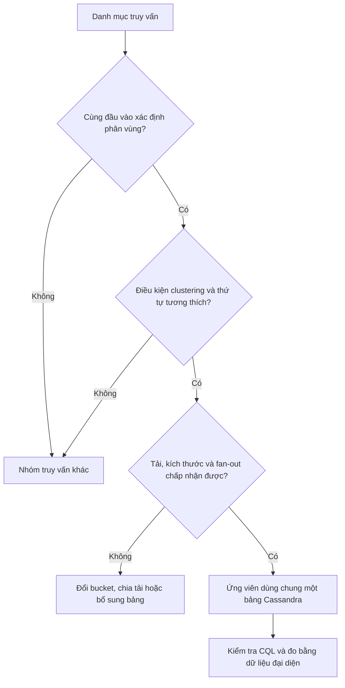

# Một nhóm truy vấn và thiết kế bảng phù hợp

## Mục tiêu bài học

Trong Apache Cassandra, một bảng thường được thiết kế để phục vụ **một kiểu truy cập dữ liệu đã biết**, nhưng điều đó không có nghĩa mỗi câu `SELECT` phải tạo thêm một bảng. Nhiều truy vấn có thể dùng chung **partition key**, quy tắc lọc theo **clustering column**, thứ tự đọc và giới hạn kết quả. Nhiệm vụ của thiết kế theo truy vấn (query-driven design) là nhận ra các **nhóm truy vấn tương thích** và chọn schema phù hợp với từng nhóm.

Bài học thuộc chương **Thiết kế theo truy vấn** trong module `DATABASE_ENGINE_WIDE_COLUMN_CASSANDRA`. Kiến thức về kiến trúc phân tán, mô hình wide-column, CQL, mức nhất quán đọc/ghi, replication và kết nối Java được sử dụng ở mức cần thiết để giải thích vì sao một bảng có thể hoặc không thể phục vụ nhiều yêu cầu đọc.

Sau khi học, bạn có thể:

- Nhận diện một **nhóm truy vấn** (query family) từ các yêu cầu nghiệp vụ và phân biệt với việc nhóm theo cùng tên thực thể.
- Xác định những truy vấn có thể dùng chung partition key và thứ tự clustering; tìm ra truy vấn cần bảng riêng.
- Thiết kế và kiểm tra bảng Cassandra cho một nhóm truy vấn bằng các câu lệnh CQL cụ thể.
- Đánh giá ảnh hưởng của bucket thời gian, phân trang, kích thước phân vùng, dữ liệu nhân bản và cách ứng dụng Java gọi truy vấn.
- Giải thích được vì sao một truy vấn mới đôi khi đòi hỏi thay đổi mô hình dữ liệu thay vì chỉ thêm điều kiện `WHERE`.

## 1. Một nhóm truy vấn là gì?

**Nhóm truy vấn** là tập các hành vi đọc có thể được phục vụ bằng cùng một cách **định tuyến đến phân vùng** và **đọc dữ liệu có thứ tự trong phân vùng**. Các truy vấn cùng nhóm có thể khác cột được trả về, `LIMIT`, khoảng thời gian hoặc hướng đọc được Cassandra hỗ trợ, miễn là chúng không phá vỡ đường truy cập chính của bảng.

Ví dụ, với nhật ký thiết bị trong một ngày:

1. Lấy 30 sự kiện mới nhất của thiết bị A.
2. Lấy các sự kiện của thiết bị A từ 09:00 đến trước 10:00, mới nhất trước.
3. Lấy các sự kiện cũ nhất của thiết bị A trong ngày.
4. Phân trang toàn bộ sự kiện của thiết bị A trong ngày.

Bốn hành vi có thể thuộc **cùng một nhóm**, vì đều biết tenant, thiết bị và ngày; khác biệt chủ yếu nằm ở giới hạn thời gian, thứ tự hoặc cách lấy từng phần kết quả.

Ngược lại, “tra cứu một sự kiện chỉ bằng ID” và “liệt kê sự kiện mức `CRITICAL` của mọi thiết bị trong tenant” **không tự động thuộc nhóm đó**, dù chúng cũng đọc dữ liệu sự kiện. Hai yêu cầu không có cùng các điều kiện nhận diện phân vùng của bảng nhật ký theo thiết bị/ngày.

### 1.1. Nhóm theo đường đọc, không theo tên thực thể

| Cùng đặc điểm | Có đủ cơ sở dùng chung bảng? | Lý do |
| --- | --- | --- |
| Cùng thực thể `event` | Chưa | Truy vấn có thể tìm theo ID, thời gian, trạng thái hoặc cả tenant |
| Cùng màn hình UI | Chưa | Một màn hình có thể ghép nhiều kiểu truy vấn |
| Cùng tập cột được `SELECT` | Chưa | Dữ liệu trả về giống nhau nhưng điều kiện tìm khác nhau |
| Cùng partition key được cung cấp đầy đủ | Là điều kiện quan trọng | Cassandra có thể định tuyến tới đúng phân vùng |
| Cùng thứ tự clustering và điều kiện khoảng hợp lệ | Rất có khả năng | Có thể đọc trực tiếp các hàng cần tìm trong phân vùng |
| Cùng kiểu lọc nhưng khác kích thước/tải phân vùng cực lớn | Cần kiểm tra thêm | Một schema hợp lệ vẫn có thể quá nóng hoặc chậm trong thực tế |

Một nhóm truy vấn là **ứng viên thiết kế**, chưa phải bằng chứng hiệu năng. Vẫn cần kiểm tra tải, phân bố dữ liệu, tombstone, độ trễ và giới hạn phân vùng.

## 2. Cách gom các truy vấn thành một nhóm

Giả sử đã có một **danh mục truy vấn** (query inventory): mỗi truy vấn nêu rõ đầu vào bắt buộc, đầu vào tùy chọn, điều kiện so sánh, thứ tự, số hàng, tần suất và phạm vi dữ liệu. Ta có thể tiến hành theo các bước sau.

### Bước 1. Chuẩn hóa đầu vào và phạm vi truy vấn

Với mỗi truy vấn, phân biệt:

- **Khóa truy cập luôn có:** `tenant_id`, `device_id`, `day_bucket` chẳng hạn.
- **Điều kiện thu hẹp trong phạm vi đó:** khoảng `event_time` hoặc một phần prefix clustering.
- **Điều kiện tùy chọn khác:** `severity`, `event_type`, từ khóa... cần được xét riêng.
- **Phạm vi:** một phân vùng, nhiều phân vùng đã biết, hay quét tập phân vùng không xác định.

Khi sản phẩm chỉ nói “lọc sự kiện theo ngày”, phải xác nhận **ngày của một thiết bị**, **ngày của tất cả thiết bị trong tenant** hay **ngày của toàn hệ thống**. Đây là ba kiểu truy cập khác nhau.

### Bước 2. So khớp partition key khả thi

Các truy vấn cùng nhóm lý tưởng đều cung cấp đủ thành phần của **cùng partition key**. Với khóa phân vùng ghép `((tenant_id, device_id, day_bucket))`, ứng dụng phải xác định cả ba giá trị trước khi đọc một phân vùng.

Nếu một truy vấn chỉ biết `event_id`, nó không xác định được phân vùng trên và nên được xét như một nhóm khác. Nếu truy vấn có thể cần nhiều ngày, phải xác định rõ fan-out (bao nhiêu phân vùng sẽ đọc) và cách hợp nhất kết quả; không được giả định rằng điều kiện ngày sẽ tự động tạo một phép sắp xếp toàn cục.

### Bước 3. So khớp clustering và thứ tự đọc

Trong một phân vùng, Cassandra tổ chức hàng theo clustering column. Truy vấn có thể đọc hiệu quả khi điều kiện và thứ tự phù hợp với cấu trúc khóa đó. Một thiết kế với clustering `(event_time, event_id)` thường hỗ trợ đọc theo thời gian, thêm ràng buộc khoảng trên `event_time` và có một khóa phụ để phân định khi các timestamp trùng nhau.

Cần làm rõ:

- Có truy vấn nào muốn sắp xếp theo một **regular column** như `severity` hoặc `reading_value` không?
- Có truy vấn nào cần lọc theo cột nằm sau một clustering column bị bỏ qua không?
- Thứ tự mong muốn có đồng nhất với thứ tự clustering hoặc **đảo chiều toàn bộ** thứ tự được hỗ trợ không?
- Có truy vấn nào đòi hỏi **thứ tự chung giữa nhiều phân vùng** không?

Chỉ cần một yêu cầu phụ thuộc vào điều kiện hoặc thứ tự không tương thích là phải xem xét tách truy vấn ấy sang nhóm khác.

### Bước 4. Kiểm tra kích thước và chi phí đọc

Các truy vấn có thể dùng chung một bảng về mặt cú pháp mà vẫn gây ra phân vùng quá lớn, phân vùng nóng, đọc nhiều tombstone hoặc fan-out quá rộng. Cần ghi nhận lưu lượng đỉnh, số hàng/byte mỗi phân vùng, độ lệch giữa thiết bị ít và nhiều sự kiện, SLA p95/p99, TTL và tỷ lệ cập nhật/xóa.

### Bước 5. Chốt nhóm và ghi ngoại lệ



Đầu ra nên có **danh sách truy vấn được bảng hỗ trợ** và **danh sách truy vấn chưa được hỗ trợ**, cùng lý do. Đừng chỉ lưu hình vẽ schema mà quên hợp đồng truy vấn dẫn đến schema đó.

## 3. Tình huống thực tế: hệ thống telemetry nhiều tenant

Giả sử một ứng dụng Java thu nhận sự kiện từ thiết bị IoT và lưu vào Cassandra. Mỗi sự kiện gồm tenant, thiết bị, thời gian xảy ra, mã sự kiện, loại, mức độ nghiêm trọng và một số dữ liệu hiển thị. Các giá trị về kích thước trang trong ví dụ là yêu cầu minh họa, không phải khuyến nghị chung cho mọi hệ thống.

### 3.1. Danh sách truy vấn cần hỗ trợ

| ID | Yêu cầu đọc | Đầu vào luôn có | Điều kiện/sắp xếp | Nhóm dự kiến |
| --- | --- | --- | --- | --- |
| Q01 | Xem 30 sự kiện mới nhất của một thiết bị trong ngày | Tenant, device, ngày UTC | Thời gian mới nhất trước, `LIMIT 30` | A |
| Q02 | Xem sự kiện của thiết bị trong một khoảng giờ thuộc ngày đó | Tenant, device, ngày UTC | `from <= event_time < to`, mới nhất trước | A |
| Q03 | Xem 30 sự kiện cũ nhất trong ngày để đối soát | Tenant, device, ngày UTC | Thời gian cũ nhất trước | A, nếu hỗ trợ đọc ngược thứ tự clustering |
| Q04 | Xem tiếp các trang sự kiện trong ngày | Tenant, device, ngày UTC | Cùng thứ tự Q01, page size 30 | A |
| Q05 | Tra cứu đúng một sự kiện bằng ID | Tenant, event ID | Không cần sắp xếp | B |
| Q06 | Xem 30 sự kiện `CRITICAL` của một thiết bị/ngày | Tenant, device, ngày UTC, severity | Mới nhất trước sau khi lọc severity | C |
| Q07 | Liệt kê sự kiện `CRITICAL` trên **mọi thiết bị** của một tenant/ngày | Tenant, ngày UTC, severity | Mới nhất trước trên toàn nhóm thiết bị | D: cần phân tích riêng |

Tất cả đều nói về “sự kiện”, nhưng chỉ Q01–Q04 có cùng đường đọc trực tiếp. Q05, Q06 và Q07 được đánh dấu tách khỏi nhóm A trước khi viết bảng.

### 3.2. Hợp đồng chung của nhóm A

```text
Tên nhóm: DEVICE_EVENTS_IN_DAY
Partition scope: đúng một tenant + device + ngày UTC
Input bắt buộc: tenantId, deviceId, dayBucket
Range tùy chọn: eventTime >= fromInclusive, eventTime < toExclusive
Sort mặc định: eventTime DESC, eventId DESC
Sort đối soát: eventTime ASC, eventId ASC
Projection chính: eventId, eventTime, eventType, severity, readingValue
Limit: tối đa 30 hàng cho màn hình preview Q01/Q03
Paging: nhiều trang cỡ 30 cho Q04; có giới hạn API riêng
Không hỗ trợ trong bảng này: tìm chỉ bằng eventId; lọc severity
  như điều kiện truy vấn chính; tìm toàn tenant không biết deviceId
```

**Giả định cần xác minh:** `event_id` là UUID duy nhất trong phạm vi tenant; `event_time` là thời gian UTC do ứng dụng chuẩn hóa; một thiết bị có thể phát sinh nhiều sự kiện cùng timestamp. Khi đó, `(event_time, event_id)` giúp tạo khóa hàng phân biệt và thứ tự ổn định theo giá trị khóa. Thứ tự của UUID khi cùng timestamp chỉ dùng để phân định, không đại diện cho quan hệ nhân quả của các sự kiện.

## 4. Thiết kế một bảng phù hợp cho nhóm A

```sql
CREATE TABLE telemetry_events_by_device_day (
    tenant_id text,
    device_id uuid,
    day_bucket date,
    event_time timestamp,
    event_id uuid,
    event_type text,
    severity text,
    reading_value double,
    PRIMARY KEY ((tenant_id, device_id, day_bucket), event_time, event_id)
) WITH CLUSTERING ORDER BY (event_time DESC, event_id DESC);
```

Phân tích từng thành phần:

| Thành phần CQL | Vai trò | Liên hệ đến truy vấn |
| --- | --- | --- |
| `(tenant_id, device_id, day_bucket)` | **Composite partition key** | Q01–Q04 đều xác định cùng một phân vùng logic |
| `event_time` | Clustering column thứ nhất | Hỗ trợ thứ tự theo thời gian và điều kiện khoảng |
| `event_id` | Clustering column thứ hai | Phân biệt các sự kiện trùng `event_time` |
| `CLUSTERING ORDER BY (... DESC)` | Thứ tự lưu trữ logic trong mỗi phân vùng | Đọc mới nhất trước theo mặc định |
| `event_type`, `severity`, `reading_value` | Regular columns | Trả dữ liệu cho giao diện; không tự trở thành điều kiện tìm kiếm tối ưu |

```text
Partition: (tenant-A, device-42, 2026-11-21)
  [10:32:16, event-X]  severity=INFO
  [10:31:52, event-Y]  severity=CRITICAL
  [10:31:52, event-Z]  severity=WARN
  [10:29:01, event-W]  severity=INFO
  ...

Partition: (tenant-A, device-42, 2026-11-22)
  [00:02:05, event-K]  severity=INFO
  ...
```

Sơ đồ trên minh họa hai phân vùng **riêng biệt**. Các ID có cùng timestamp được sắp theo thứ tự so sánh khóa `uuid` do Cassandra áp dụng; chữ X/Y/Z chỉ minh họa, không cố ý thể hiện thứ tự từ điển thật của các UUID.

### 4.1. Q01: lấy sự kiện mới nhất trong ngày

```sql
SELECT event_time, event_id, event_type, severity, reading_value
FROM telemetry_events_by_device_day
WHERE tenant_id = ?
  AND device_id = ?
  AND day_bucket = ?
LIMIT 30;
```

Điều kiện `WHERE` cung cấp đủ các phần của partition key. Vì bảng đã có thứ tự clustering giảm dần, không cần thêm `ORDER BY` để lấy các sự kiện mới nhất trước trong phân vùng này. `LIMIT 30` là tổng số hàng tối đa của **câu truy vấn**, phù hợp với một màn hình chỉ hiển thị 30 hàng preview.

### 4.2. Q02: thu hẹp thêm theo khoảng thời gian

```sql
SELECT event_time, event_id, event_type, severity, reading_value
FROM telemetry_events_by_device_day
WHERE tenant_id = ?
  AND device_id = ?
  AND day_bucket = ?
  AND event_time >= ?
  AND event_time < ?
LIMIT 100;
```

Q02 vẫn đi tới cùng phân vùng của Q01, rồi thu hẹp theo clustering column `event_time`. Quy ước `[fromInclusive, toExclusive)` tránh lặp bản ghi tại ranh giới hai khoảng liền nhau.

Ứng dụng phải bảo đảm hai mốc nằm trong ngày tương ứng với `day_bucket`. Nếu một khoảng trải qua nửa đêm UTC, phải tách thành các khoảng theo ngày và đọc các phân vùng tương ứng. **Không** truyền một `day_bucket` rồi ngầm kỳ vọng nhận được sự kiện của ngày sau.

### 4.3. Q03: xem sự kiện cũ nhất trước

```sql
SELECT event_time, event_id, event_type, severity, reading_value
FROM telemetry_events_by_device_day
WHERE tenant_id = ?
  AND device_id = ?
  AND day_bucket = ?
ORDER BY event_time ASC, event_id ASC
LIMIT 30;
```

Đây là yêu cầu **đảo ngược toàn bộ** thứ tự clustering `(event_time DESC, event_id DESC)`. Cassandra hỗ trợ truy vấn đọc theo chiều ngược của thứ tự clustering trong phạm vi phân vùng thích hợp. Tuy nhiên, không thể từ đó suy ra rằng có thể sắp xếp theo **bất kỳ cột nào**, chẳng hạn `severity DESC`, hoặc đảo riêng một cột của khóa theo một kiểu không được CQL chấp nhận.

Nếu ứng dụng dùng Q03 với tải lớn, cần đo thực tế thay vì mặc định lượt đọc đảo chiều có cùng hiệu năng trong mọi cấu hình và khối lượng dữ liệu.

### 4.4. Q04: đọc nhiều trang cùng thứ tự

Với hành vi “tải thêm”, cần phân biệt **cỡ trang** với `LIMIT`:

```sql
SELECT event_time, event_id, event_type, severity, reading_value
FROM telemetry_events_by_device_day
WHERE tenant_id = ?
  AND device_id = ?
  AND day_bucket = ?;
```

Ứng dụng có thể cấu hình **page size = 30** khi thực thi truy vấn này bằng Java driver và dùng **paging state** do driver trả về để lấy trang kế tiếp. Trên truy vấn này, số hàng mỗi trang chịu sự điều khiển của driver; giao diện/API phải tự đặt giới hạn nghiệp vụ về số trang, số hàng và thời lượng đọc. `LIMIT 30` không thay thế một cơ chế phân trang nhiều lần nếu người dùng cần xem toàn bộ các trang.

Paging state phải được coi là dữ liệu **opaque** gắn với nội dung câu truy vấn và các giá trị bind; không dùng state cũ cho bộ lọc hoặc partition key khác. Nếu API lưu token ở phía client, nên mã hóa/kiểm soát tính toàn vẹn theo cơ chế của dịch vụ và kiểm tra tenant cùng phạm vi truy cập trước khi tiếp tục. Khi dữ liệu được ghi hoặc xóa trong lúc phân trang, các trang không nhất thiết biểu diễn một snapshot bất biến của toàn bộ kết quả.

## 5. Gọi nhóm truy vấn từ ứng dụng Java

Với DataStax Java Driver 4.x (API package `com.datastax.oss.driver.api.core`), ứng dụng nên dùng **prepared statement** và bind giá trị cụ thể, chẳng hạn cho Q01:

```java
import com.datastax.oss.driver.api.core.CqlSession;
import com.datastax.oss.driver.api.core.cql.BoundStatement;
import com.datastax.oss.driver.api.core.cql.PreparedStatement;
import com.datastax.oss.driver.api.core.cql.ResultSet;

import java.time.LocalDate;
import java.util.UUID;

public final class EventReader {
    private final CqlSession session;
    private final PreparedStatement latestInDay;

    public EventReader(CqlSession session) {
        this.session = session;
        this.latestInDay = session.prepare(
            "SELECT event_time, event_id, event_type, severity, reading_value " +
            "FROM telemetry_events_by_device_day " +
            "WHERE tenant_id = ? AND device_id = ? AND day_bucket = ? LIMIT ?"
        );
    }

    public ResultSet latest(String tenantId, UUID deviceId, LocalDate utcDay) {
        BoundStatement statement = latestInDay.bind(tenantId, deviceId, utcDay, 30);
        return session.execute(statement);
    }
}
```

`LocalDate` ánh xạ với kiểu CQL `date`; `UUID` ánh xạ với kiểu `uuid`. Đầu vào `utcDay` phải được tính từ **ngày UTC**, đồng nhất với quy tắc tạo `day_bucket` khi ghi. Trong ứng dụng thực tế, nên thiết lập timeout, consistency level, xử lý lỗi, số lượng kết quả và cách đóng/vòng đời `CqlSession` theo cấu hình dịch vụ. Không tạo `CqlSession` mới cho mỗi yêu cầu.

Đối với Q02, chuẩn bị thêm một câu CQL có hai bind marker cho khoảng `event_time`. Việc có hai prepared statement cho các query shape khác nhau **không** đồng nghĩa phải có hai bảng: chúng vẫn dùng cùng partition key và clustering của nhóm A.

Đối với Q04, dùng một prepared statement không có `LIMIT 30`, cấu hình `setPageSize(30)` trên statement và lấy paging state bằng API tương ứng của phiên bản driver đang sử dụng. Tránh lặp kết quả Java đồng bộ một cách vô tình làm driver tải thêm nhiều trang khi API chỉ định trả một trang.

## 6. Vì sao các truy vấn khác không thể gộp vào nhóm A?

### 6.1. Q05: tìm bằng event ID

Q05 chỉ nhận `tenant_id` và `event_id`, không có `device_id` hoặc `day_bucket`, nên không thể xác định một phân vùng của `telemetry_events_by_device_day`. Giải pháp đơn giản là duy trì thêm bảng truy cập theo ID:

```sql
CREATE TABLE telemetry_events_by_id (
    tenant_id text,
    event_id uuid,
    device_id uuid,
    day_bucket date,
    event_time timestamp,
    event_type text,
    severity text,
    reading_value double,
    PRIMARY KEY ((tenant_id, event_id))
);

SELECT device_id, day_bucket, event_time, event_type, severity, reading_value
FROM telemetry_events_by_id
WHERE tenant_id = ? AND event_id = ?;
```

Q05 thuộc nhóm B, dùng **một phân vùng theo ID**, không dựa vào thứ tự thời gian. Nếu ứng dụng chỉ cần bảng theo ID làm một bảng định vị, nó có thể lưu ít cột hơn rồi dùng `device_id` và `day_bucket` để đọc từ bảng nhóm A. Lựa chọn này thêm một lượt đọc; phải so sánh độ trễ, nhu cầu trả dữ liệu và chi phí nhân bản.

### 6.2. Q06: lọc severity là đường đọc chính

Thử thêm điều kiện dưới đây vào Q01 là một yêu cầu **khác** về cấu trúc truy cập:

```sql
-- Không coi đây là truy vấn hiệu quả mặc định trên bảng nhóm A.
-- severity là regular column, không nằm trong primary key.
SELECT event_time, event_id, severity
FROM telemetry_events_by_device_day
WHERE tenant_id = ?
  AND device_id = ?
  AND day_bucket = ?
  AND severity = 'CRITICAL';
```

Trong schema hiện tại, `severity` không có đường lọc chính được thiết kế. Bật `ALLOW FILTERING` để cố chạy không bảo đảm chi phí đọc thấp, đặc biệt khi `CRITICAL` hiếm và dữ liệu ngày rất lớn. Với một truy vấn chính có tần suất/độ trễ quan trọng, cân nhắc bảng riêng:

```sql
CREATE TABLE telemetry_events_by_device_severity_day (
    tenant_id text,
    device_id uuid,
    severity text,
    day_bucket date,
    event_time timestamp,
    event_id uuid,
    event_type text,
    reading_value double,
    PRIMARY KEY ((tenant_id, device_id, severity, day_bucket), event_time, event_id)
) WITH CLUSTERING ORDER BY (event_time DESC, event_id DESC);

SELECT event_time, event_id, event_type, reading_value
FROM telemetry_events_by_device_severity_day
WHERE tenant_id = ?
  AND device_id = ?
  AND severity = 'CRITICAL'
  AND day_bucket = ?
LIMIT 30;
```

Bảng mới của nhóm C giải quyết một đường đọc rõ ràng: **một mức severity của một thiết bị/ngày**. `severity` có thể có ít giá trị nhưng khi ghép cùng `device_id` và `day_bucket` vẫn giúp định vị tập dữ liệu theo trường hợp sử dụng. Phải kiểm tra kích thước phân vùng ở các thiết bị có lưu lượng cao; giá trị `CRITICAL` không bảo đảm hiếm ở mọi thiết bị.

Với các phiên bản Cassandra và môi trường triển khai hỗ trợ, các cơ chế index (chẳng hạn SAI) có thể được đánh giá như phương án khác. Chúng cần được kiểm chứng theo tính chọn lọc, tải và giới hạn `ORDER BY`, chứ không đồng nghĩa mọi kiểu lọc/sắp xếp đều hiệu quả hoặc hợp lệ.

### 6.3. Q07: trên tất cả thiết bị của một tenant

Q07 bỏ `device_id` và yêu cầu thứ tự **toàn tenant** trong ngày. Đây không phải là Q06 với ít tham số hơn. Nếu xây một partition key quá rộng chỉ gồm `(tenant_id, day_bucket, severity)`, một tenant lớn có thể làm phân vùng phình to và trở thành điểm nóng.

Các hướng cần khảo sát khi Q07 thật sự là yêu cầu quan trọng gồm: xây projection phục vụ bảng tin tenant có **bucket hoặc shard được kiểm soát**, lấy dữ liệu từ luồng sự kiện chuyên biệt, hoặc dùng hệ tìm kiếm/phân tích phù hợp. Tất cả đều cần quy định cách đọc nhiều shard, hợp nhất thứ tự, phân trang và đồng bộ dữ liệu. Không nên tự nhận Q07 là đã được hỗ trợ chỉ vì có một bảng tên tương tự.

## 7. Chi phí của một nhóm truy vấn và nhiều bảng

### 7.1. Denormalization là trách nhiệm của đường ghi

Trong ví dụ, cùng một sự kiện có thể nằm trong:

- `telemetry_events_by_device_day` để đọc theo thiết bị và thời gian.
- `telemetry_events_by_id` để tra cứu theo ID.
- `telemetry_events_by_device_severity_day` để đọc theo mức độ nghiêm trọng.

Khi nhận sự kiện, ứng dụng hoặc pipeline phải ghi các biểu diễn cần thiết. Nếu sự kiện được sửa `severity`, cần cập nhật bảng theo ID và bảng thời gian, đồng thời **xóa hàng ở phân vùng severity cũ, thêm hàng ở phân vùng severity mới**. Việc này có thể sinh tombstone và phát sinh trạng thái lệch tạm thời giữa các projection.

**Không** giả định nhiều lệnh ghi vào các partition khác nhau là một giao dịch SQL với mọi thuộc tính ACID. Cần xác định hành vi khi một lần ghi thành công và lần khác thất bại: retry có tính idempotent, hàng đợi sự kiện, đối soát và quy trình khôi phục. Dù replica của một bảng dùng mức nhất quán đọc/ghi phù hợp, điều đó không tự động đồng bộ tức thì mọi bảng nhân bản.

### 7.2. Bucket và giới hạn phân vùng

`day_bucket` là một lựa chọn thiết kế để giới hạn mức tăng trưởng mỗi phân vùng. Nhưng ngày không luôn là bucket phù hợp.

Giả sử một thiết bị phát sinh 100 sự kiện/giây liên tục:

\[
100 \times 60 \times 60 \times 24 = 8{,}640{,}000\;\text{sự kiện/ngày}
\]

Ngay cả khi một hàng chỉ tốn khoảng 200 byte dữ liệu thô, một ngày có thể chứa **xấp xỉ 1,73 GB dữ liệu thô** trong phân vùng logic, chưa tính overhead, index, tombstone và cách lưu trữ thực tế. Đây là dấu hiệu phải đánh giá lại bucket (giờ/phút) hoặc chia tải, chứ không phải ngưỡng kích thước phân vùng phổ quát.

Bucket nhỏ hơn làm phân vùng nhỏ hơn nhưng tăng số phân vùng phải đọc cho truy vấn dài ngày. Bucket lớn hơn đơn giản hóa truy vấn nhưng có nguy cơ tăng kích thước và độ nóng của phân vùng. Cần thử trên phân bố thiết bị thực tế, nhất là nhóm thiết bị có tải cao nhất.

### 7.3. `LIMIT`, phân trang và tombstone

`LIMIT 30` giới hạn số hàng **trả về**, không cam kết hệ thống chỉ đọc đúng 30 hàng vật lý. TTL, cập nhật hoặc xóa có thể để lại tombstone; truy vấn phải đi qua dữ liệu không còn hiển thị trước khi trả đủ hàng. Vì vậy cần đo p95/p99, số tombstone đọc, kích thước phân vùng và tải từng node khi đánh giá nhóm truy vấn.

Khi dùng TTL, thời gian giữ dữ liệu phải phù hợp yêu cầu nghiệp vụ, chiến lược compaction và vận hành repair; không nên chọn TTL hoặc compaction chỉ để khắc phục một partition key quá rộng.

### 7.4. Replication, consistency và multi-DC

Replication quyết định số bản sao dữ liệu theo cấu hình keyspace; consistency level quyết định mức đáp ứng từ replica cho từng thao tác đọc/ghi. Đây là các quyết định vận hành quan trọng đối với độ trễ và khả năng chịu lỗi, nhưng không thay thế đường truy cập theo partition key và clustering.

Ví dụ, chọn `LOCAL_QUORUM` trong một datacenter có replication factor thích hợp có thể đáp ứng một số yêu cầu nhất quán trong phạm vi datacenter. Tuy nhiên, nó **không** làm cho Q07 sắp xếp toàn tenant hiệu quả, cũng không tự đảm bảo các bảng denormalized được cập nhật đồng bộ như một giao dịch duy nhất. Việc chọn mức nhất quán phải dựa vào topology, SLA và yêu cầu đọc sau ghi của ứng dụng.

## 8. Mẫu quyết định: bảng nào phục vụ truy vấn nào?

Sau khi thiết kế, lưu một **bảng ánh xạ** để phát triển, kiểm thử và vận hành dùng chung:

| Query | Bảng phục vụ | Số phân vùng mục tiêu | Cơ chế lọc/sắp xếp | Kết luận |
| --- | --- | --- | --- | --- |
| Q01 | `telemetry_events_by_device_day` | 1 | Partition key đầy đủ, clustering DESC, `LIMIT` | `SUPPORTED` |
| Q02 | `telemetry_events_by_device_day` | 1 | Clustering range trên `event_time` | `SUPPORTED` khi khoảng nằm trong ngày |
| Q03 | `telemetry_events_by_device_day` | 1 | Đảo chiều toàn bộ clustering | `SUPPORTED`, cần đo tải |
| Q04 | `telemetry_events_by_device_day` | 1 | Paging state của driver, cùng đường đọc Q01 | `SUPPORTED` với giới hạn API |
| Q05 | `telemetry_events_by_id` | 1 | Partition key theo event ID | `SUPPORTED` nếu duy trì projection |
| Q06 | `telemetry_events_by_device_severity_day` | 1 | Partition key gồm severity, clustering DESC | `SUPPORTED` nếu duy trì projection |
| Q07 | Chưa chốt | Nhiều hoặc shard chưa xác định | Cần thứ tự chung toàn tenant | `NEEDS_DESIGN` |

`SUPPORTED` trong bảng chỉ nói về **tính phù hợp của đường đọc với schema đề xuất**; đây chưa phải cam kết SLA hoặc bằng chứng đã vượt qua kiểm thử tải.

Một hồ sơ thiết kế đủ để bàn giao nên lưu cả:

1. Danh mục query ID và hợp đồng đầu vào/đầu ra, `LIMIT`, sort, paging.
2. Schema CQL và câu `SELECT` thực tế tương ứng với từng query ID.
3. Các tình huống không được hỗ trợ, nhất là lọc tùy chọn và truy vấn nhiều phân vùng.
4. Ước tính số hàng/byte mỗi partition, QPS đỉnh, giới hạn bucket và mục tiêu độ trễ.
5. Quy trình duy trì dữ liệu nhân bản, ghi/xóa, TTL, lỗi, đối soát, consistency.
6. Kế hoạch thử nghiệm với dữ liệu gần thực tế và tiêu chí chấp nhận.

## 9. Những sai lầm thường gặp

| Sai lầm | Hệ quả | Cách khắc phục |
| --- | --- | --- |
| Mỗi câu `SELECT` đều tạo một bảng mới | Tăng lưu trữ và chi phí đồng bộ dữ liệu không cần thiết | Gom theo đường đọc thực sự tương thích |
| Mọi truy vấn của cùng thực thể dùng chung một bảng | Một số câu thiếu partition key hoặc đòi lọc/sort sai cấu trúc | Chia nhóm theo partition key và clustering |
| Chọn partition key chỉ từ trường hay xuất hiện nhất | Có thể tạo phân vùng cực lớn hoặc quá nóng | Kết hợp phạm vi truy vấn, phân bố dữ liệu và bucket |
| Tưởng `WHERE severity = ?` hợp lệ/nhanh vì có cột `severity` | Cột thường không tự tạo đường đọc hiệu quả | Thiết kế projection/index có kiểm chứng cho query shape ấy |
| Dùng `ALLOW FILTERING` như cách sửa schema | Khó dự đoán số dữ liệu phải quét, dễ tăng độ trễ | Chọn key hoặc bảng phù hợp với yêu cầu đọc |
| Hiểu `LIMIT` là page size và đảm bảo đọc nhẹ | Gặp lỗi phân trang hoặc chi phí tombstone cao | Phân biệt giới hạn câu truy vấn, page size và giới hạn API |
| Nhân bản dữ liệu nhưng không thiết kế cập nhật/xóa | Các cách nhìn dữ liệu sai lệch khi retry hoặc đổi trạng thái | Dùng thao tác idempotent, xử lý lỗi, đối soát |
| Xem nhóm truy vấn là hoàn tất ngay khi CQL chạy được | Schema có thể thất bại dưới tải thật hoặc ở tenant lớn | Test phân vùng cực trị, p95/p99 và fan-out |

## 10. Bài tập áp dụng

Một hệ thống theo dõi đơn giao hàng có các yêu cầu:

```text
R1. Xem 20 lần cập nhật trạng thái gần nhất của một kiện hàng trong ngày.
R2. Xem các lần cập nhật trạng thái của kiện hàng giữa 08:00 và 12:00
    cùng ngày, mới nhất trước.
R3. Phân trang tất cả cập nhật của kiện hàng trong ngày.
R4. Tra cứu một lần cập nhật chỉ bằng updateId.
R5. Xem tất cả cập nhật có status = FAILED trên mọi kiện hàng của tenant.
```

Giả sử mỗi lần cập nhật có `tenant_id`, `parcel_id`, `day_bucket`, `occurred_at`, `update_id`, `status` và `note`.

Hãy thực hiện:

1. Phân nhóm R1–R5 theo **đường đọc**, chỉ ra nhóm nào có thể dùng chung bảng và nhóm nào chưa đủ thông tin để thiết kế.
2. Viết `CREATE TABLE` cho nhóm R1–R3, định nghĩa partition key và thứ tự clustering; giải thích vai trò `update_id`.
3. Viết CQL cho R1 và R2, bao gồm điều kiện khoảng `[from, to)`.
4. Giải thích R4 thiếu gì nếu truy cập trực tiếp bảng R1–R3, và đề xuất khóa cho bảng tra cứu theo ID.
5. Nêu hai rủi ro khi thực hiện R5 bằng cách đọc bảng của R1–R3 và lọc kết quả ở ứng dụng.

**Gợi ý đối chiếu:** R1–R3 là một nhóm nếu luôn có tenant, parcel và ngày. Một schema ứng viên là `PRIMARY KEY ((tenant_id, parcel_id, day_bucket), occurred_at, update_id)` với clustering `DESC`. R4 nên có đường đọc bằng `(tenant_id, update_id)` nếu ID được đảm bảo duy nhất trong tenant. R5 đọc trên toàn bộ kiện hàng của tenant, cần khảo sát projection/bucket/shard, tần suất và thứ tự mong muốn; không thể kết luận một bảng theo parcel/ngày đáp ứng trực tiếp.

## Kết luận

Một nhóm truy vấn phù hợp với một bảng Cassandra khi các truy vấn **chia sẻ cách xác định phân vùng** và có điều kiện, thứ tự đọc tương thích với **clustering key**. Khác biệt về khoảng thời gian, hướng đọc hợp lệ, số hàng hoặc phân trang thường chỉ làm thay đổi câu CQL và tham số; khác biệt về khóa tìm kiếm, bộ lọc chính hoặc thứ tự toàn cục có thể đòi hỏi bảng khác. Thiết kế tốt cần ghi nhận rõ truy vấn nào dùng bảng nào, giới hạn của đường đọc, chi phí dữ liệu nhân bản và cách xác minh bằng dữ liệu cùng tải thực tế.
