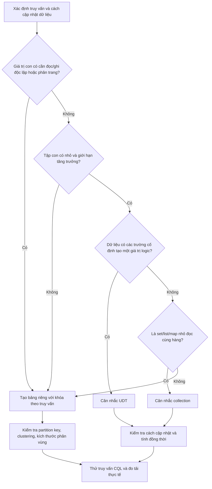

# Nhúng qua UDT/collection hoặc dùng bảng riêng theo truy vấn trong Apache Cassandra

## Mục tiêu học tập

Khi mô hình hóa dữ liệu trong **Apache Cassandra**, một quan hệ có thể được biểu diễn bằng giá trị nằm ngay trong một hàng hoặc bằng các hàng ở bảng khác. Kết thúc bài học, bạn có thể:

- Giải thích sự khác nhau giữa **User-Defined Type (UDT)**, **collection** (`set`, `list`, `map`) và **bảng riêng**.
- Chọn cách biểu diễn dựa trên đường đọc/ghi, kích thước dữ liệu, tần suất cập nhật và **partition key**, thay vì dựa thuần túy vào quan hệ 1:1 hay 1:N.
- Thực hành CQL để tạo kiểu dữ liệu, ghi và cập nhật collection, truy vấn các bảng được thiết kế theo yêu cầu.
- Nhận diện rủi ro về phân vùng lớn, tombstone, cập nhật đồng thời và dữ liệu lặp giữa nhiều bảng.
- Đọc UDT và collection từ ứng dụng Java sử dụng Cassandra Java Driver.

## 1. Từ quan hệ nghiệp vụ đến hình dạng dữ liệu

Trong cơ sở dữ liệu quan hệ, ta thường đặt địa chỉ ở một bảng, đơn hàng ở một bảng và dòng hàng ở bảng khác; `JOIN` dùng để lấy dữ liệu tổng hợp. Cassandra là cơ sở dữ liệu phân tán thuộc nhóm **wide-column**, phân phối các hàng theo **partition key** và tổ chức thứ tự hàng trong phân vùng qua **clustering columns**. Cassandra không cung cấp `JOIN` và ràng buộc khóa ngoại như RDBMS.

Với một đơn hàng, ta có ba nhu cầu khác nhau:

1. Đọc chi tiết đơn bằng `order_id`, kèm địa chỉ giao hàng và vài nhãn ngắn.
2. Đọc các dòng hàng của đơn, cập nhật số lượng hoặc trạng thái từng dòng.
3. Liệt kê 20 đơn mới nhất của khách hàng trong một tháng.

Một lựa chọn hợp lý có thể là:

| Nhu cầu | Cách biểu diễn | Lý do |
| --- | --- | --- |
| Địa chỉ giao hàng thuộc về một đơn | Cột `frozen<shipping_address>` dùng UDT | Các trường tạo thành một giá trị logic, thường được đọc cùng đơn |
| Một số nhãn và thuộc tính nhỏ của đơn | `set<text>`, `map<text,text>` | Dữ liệu ít, có giới hạn, được đọc cùng hàng |
| Nhiều dòng hàng độc lập trong đơn | `order_items_by_order` | Mỗi dòng là một hàng, dễ truy vấn/cập nhật theo khóa |
| Danh sách đơn theo khách hàng và tháng | `orders_by_customer_month` | Cần khóa phân vùng và thứ tự khác với tra cứu theo `order_id` |

Đây là **mô hình hóa theo truy vấn**: trước tiên xác định câu hỏi ứng dụng sẽ hỏi, tiếp theo chọn partition key và cấu trúc CQL cho từng câu hỏi. “Nhúng” không đồng nghĩa với việc Cassandra hỗ trợ truy vấn tùy ý vào mọi trường con của giá trị nhúng.

## 2. Khi nào dùng UDT?

**User-Defined Type** là kiểu dữ liệu do người dùng định nghĩa, gồm một tập trường có tên và kiểu xác định. UDT hợp với **một giá trị ghép có cấu trúc tương đối ổn định**, chẳng hạn địa chỉ, tọa độ, thông tin liên hệ hoặc một bản chụp thông tin giao hàng tại thời điểm đặt đơn.

Trong những ví dụ dưới đây, giả sử keyspace `shop` đã tồn tại và người thực hành đã kết nối tới nó:

```sql
USE shop;

CREATE TYPE shipping_address (
    recipient text,
    street text,
    city text,
    country_code text
);

CREATE TABLE orders_by_id (
    order_id uuid PRIMARY KEY,
    customer_id uuid,
    created_at timestamp,
    status text,
    total_amount decimal,
    shipping_address frozen<shipping_address>,
    labels set<text>,
    metadata map<text, text>
);
```

Ở đây:

- `order_id` là **khóa phân vùng** và toàn bộ khóa chính. Đọc một đơn bằng ID chỉ cần truy vấn một phân vùng.
- `shipping_address` là **UDT dạng `frozen`**: địa chỉ được ghi và thay thế như một giá trị nguyên khối. Không cập nhật riêng `city` trên cột `frozen<shipping_address>`.
- `labels` và `metadata` là **collection không frozen**. Có thể cập nhật phần tử cụ thể theo cú pháp CQL.

Thêm một đơn hàng với UDT và collection:

```sql
INSERT INTO orders_by_id (
    order_id, customer_id, created_at, status, total_amount,
    shipping_address, labels, metadata
) VALUES (
    22222222-2222-4222-8222-222222222222,
    11111111-1111-4111-8111-111111111111,
    '2026-11-21T01:00:00Z',
    'CREATED',
    250000.00,
    {
        recipient: 'Lan',
        street: '12 Nguyen Hue',
        city: 'Ho Chi Minh City',
        country_code: 'VN'
    },
    {'priority', 'gift'},
    {'channel': 'mobile', 'campaign': 'NOVEMBER'}
);

SELECT order_id, shipping_address, labels, metadata
FROM orders_by_id
WHERE order_id = 22222222-2222-4222-8222-222222222222;
```

### `frozen` và cập nhật UDT

Muốn đổi thành phố giao hàng trong cột `frozen` ở ví dụ trên, cần tạo **toàn bộ địa chỉ mới**:

```sql
UPDATE orders_by_id
SET shipping_address = {
    recipient: 'Lan',
    street: '12 Nguyen Hue',
    city: 'Da Nang',
    country_code: 'VN'
}
WHERE order_id = 22222222-2222-4222-8222-222222222222;
```

Với UDT không `frozen` trên các phiên bản Cassandra hỗ trợ, các trường có thể được lưu và cập nhật độc lập. Tuy nhiên, **`frozen`** phù hợp khi toàn bộ giá trị được quản lý như một snapshot và ít sửa từng trường. Nếu nhiều tác nhân cùng sửa các trường khác nhau trên UDT frozen, thao tác ghi toàn bộ giá trị có nguy cơ ghi đè thay đổi của nhau; ứng dụng phải giải quyết xung đột theo nghiệp vụ.

**Không nên nhúng bằng UDT** khi mỗi đối tượng con có vòng đời riêng, cần phân trang, có số lượng tăng không giới hạn, hoặc thường được truy vấn trực tiếp bằng khóa riêng. UDT mô tả cấu trúc **một giá trị**, không thay thế được bảng dùng để truy vấn tập hợp lớn các thực thể con.

## 3. Khi nào dùng collection?

Cassandra có ba collection phổ biến:

| Kiểu | Ý nghĩa | Tình huống phù hợp | Lưu ý |
| --- | --- | --- | --- |
| `set<T>` | Tập giá trị không trùng, không hứa hẹn thứ tự nghiệp vụ | Một vài nhãn, quyền hoặc mã tùy chọn | Không dùng làm danh sách hàng triệu ID |
| `list<T>` | Dãy có thứ tự, có thể có giá trị lặp | Số ít bước hiển thị cố định, điểm dừng theo thứ tự | Thao tác theo vị trí và cập nhật đồng thời dễ phức tạp |
| `map<K,V>` | Cặp khóa–giá trị với khóa không trùng | Một số thuộc tính bổ sung đã giới hạn | Không biến map thành kho thuộc tính vô hạn |

**Quy tắc nền tảng:** collection thích hợp với tập nhỏ, **có giới hạn tăng trưởng**, chủ yếu được đọc cùng hàng chứa nó. Collection không phải công cụ thay thế bảng liên kết khi tập dữ liệu liên tục tăng.

### Thêm, sửa, xóa phần tử collection

Với hai cột `labels` và `metadata` đã khai báo:

```sql
-- Thêm nhãn vào set (không tạo nhãn trùng).
UPDATE orders_by_id
SET labels = labels + {'fragile'}
WHERE order_id = 22222222-2222-4222-8222-222222222222;

-- Gỡ một nhãn.
UPDATE orders_by_id
SET labels = labels - {'gift'}
WHERE order_id = 22222222-2222-4222-8222-222222222222;

-- Cập nhật một khóa trong map.
UPDATE orders_by_id
SET metadata['channel'] = 'web'
WHERE order_id = 22222222-2222-4222-8222-222222222222;

-- Xóa một mục khỏi map.
DELETE metadata['campaign']
FROM orders_by_id
WHERE order_id = 22222222-2222-4222-8222-222222222222;
```

Cassandra lưu các phần tử của collection **không frozen** theo cách cho phép cập nhật một phần. Với collection `frozen`, giá trị được xem là một khối: thay đổi một phần tử nghĩa là ghi lại toàn bộ giá trị collection. Chú ý:

- Xóa phần tử hoặc ghi đè một số cấu trúc có thể sinh **tombstone**. Các collection lớn và nhiều lần thay đổi/xóa làm tăng chi phí đọc và compaction.
- `list` biểu diễn thứ tự, nhưng thao tác chèn/xóa/cập nhật theo vị trí không phù hợp cho danh sách lớn và bị nhiều luồng sửa liên tục. Với danh sách có thể dài, dùng bảng có clustering column thể hiện thứ tự.
- `map` là thuộc tính của **một hàng**, không tự tạo đường tìm kiếm hiệu quả mọi hàng có cùng một giá trị map. Ví dụ “tìm tất cả đơn có `channel = 'web'`” là một truy vấn khác, thường cần mô hình theo khóa riêng.
- Đừng chọn collection chỉ vì viết ít bảng hơn: cần đo số phần tử tối đa, kích thước trên đĩa, tần suất đọc/ghi và cách xử lý xóa.

### Tại sao không dùng `set<uuid>` cho mọi quan hệ 1:N hoặc N:M?

Giả sử cột `course_ids set<uuid>` trong một hàng học viên. Cách này có thể đủ nếu ứng dụng chỉ cần đọc một **tập khóa học rất nhỏ và bị giới hạn** khi tra cứu học viên. Nhưng nếu khóa học có hàng trăm nghìn người học, hệ thống cần liệt kê học viên theo khóa học, phân trang, hoặc cập nhật trạng thái từng lần ghi danh, thì `set` không còn là mô hình phù hợp.

Khi quan hệ phải được đọc từ nhiều hướng hoặc số phần tử không có giới hạn hợp lý, nên tạo các bảng riêng theo từng truy vấn, chẳng hạn `enrollments_by_student` và `enrollments_by_course`. Mỗi bản ghi quan hệ trở thành **một hàng với khóa chính**, không phải phần tử của collection lớn.

## 4. Khi nào dùng bảng riêng theo truy vấn?

Giả sử một đơn hàng có nhiều dòng hàng. Mỗi dòng có `product_id`, `quantity`, `unit_price`; cần đọc toàn bộ dòng của một đơn và sửa từng dòng độc lập. Nếu nhét tất cả vào `list<frozen<order_item>>`, ứng dụng có thể phải đọc/ghi cấu trúc lớn, khó cập nhật riêng và khó phân trang.

Thiết kế mỗi dòng thành **một hàng**:

```sql
CREATE TABLE order_items_by_order (
    order_id uuid,
    line_no int,
    product_id uuid,
    sku text,
    quantity int,
    unit_price decimal,
    PRIMARY KEY ((order_id), line_no)
);

INSERT INTO order_items_by_order
    (order_id, line_no, product_id, sku, quantity, unit_price)
VALUES (
    22222222-2222-4222-8222-222222222222,
    1,
    33333333-3333-4333-8333-333333333333,
    'SKU-KEYBOARD',
    2,
    125000.00
);

SELECT line_no, product_id, sku, quantity, unit_price
FROM order_items_by_order
WHERE order_id = 22222222-2222-4222-8222-222222222222;

UPDATE order_items_by_order
SET quantity = 3
WHERE order_id = 22222222-2222-4222-8222-222222222222
  AND line_no = 1;
```

**Giải thích khóa:** `order_id` là partition key; `line_no` là clustering column. Các dòng của cùng đơn nằm trong cùng phân vùng và được sắp xếp theo `line_no`, giúp truy vấn theo `order_id` hiệu quả. Cấu trúc này vẫn cần bảo đảm **một đơn không có số dòng lớn bất thường**; nếu một quan hệ có thể tăng vô hạn, hãy thiết kế thêm time bucket hoặc bucket có kiểm soát.

### Một thực thể, nhiều đường đọc

Giờ thêm yêu cầu: “Liệt kê 20 đơn mới nhất của khách hàng trong tháng”. `orders_by_id` tối ưu cho `order_id`, nên nó không đáp ứng trực tiếp truy vấn theo `customer_id`. Tạo bảng khác:

```sql
CREATE TABLE orders_by_customer_month (
    customer_id uuid,
    order_month date,
    created_at timestamp,
    order_id uuid,
    status text,
    total_amount decimal,
    PRIMARY KEY ((customer_id, order_month), created_at, order_id)
) WITH CLUSTERING ORDER BY (created_at DESC, order_id ASC);

-- Phần ghi lặp khi tạo một đơn; dùng cùng order_id và created_at.
INSERT INTO orders_by_customer_month (
    customer_id, order_month, created_at,
    order_id, status, total_amount
) VALUES (
    11111111-1111-4111-8111-111111111111,
    '2026-11-01',
    '2026-11-21T01:00:00Z',
    22222222-2222-4222-8222-222222222222,
    'CREATED',
    250000.00
);

SELECT order_id, created_at, status, total_amount
FROM orders_by_customer_month
WHERE customer_id = 11111111-1111-4111-8111-111111111111
  AND order_month = '2026-11-01'
LIMIT 20;
```

Partition key ở bảng mới là **`(customer_id, order_month)`**, giúp giới hạn số đơn trong một phân vùng. `created_at` là cột clustering đầu tiên, sắp xếp giảm dần theo thời gian; `order_id` phân biệt các đơn cùng thời điểm.

Như vậy, một đơn có thể xuất hiện trong **hai bảng** với những cột lặp `status` và `total_amount`. Đây là **denormalization theo truy vấn**, không phải lỗi chuẩn hóa. Nếu trạng thái đơn đổi, ứng dụng phải cập nhật cả hai bảng và có cơ chế khôi phục khi một ghi thành công nhưng ghi còn lại thất bại.

## 5. Sơ đồ quyết định: nhúng hay tách bảng?



Đây là điểm xuất phát, không phải công thức áp dụng cứng nhắc. Một vài tiêu chí thực tế:

| Tiêu chí | UDT | Collection | Bảng riêng |
| --- | --- | --- | --- |
| Đơn vị dữ liệu | Một giá trị ghép nhiều trường | Một tập phần tử trong một hàng | Các hàng có khóa chính độc lập |
| Kích thước phù hợp | Nhỏ, cấu trúc rõ | Nhỏ, có giới hạn tăng trưởng | Có thể nhiều hàng; phải kiểm soát kích thước từng phân vùng |
| Cập nhật | Frozen: thay cả giá trị | Non-frozen: có thao tác từng phần tử | Cập nhật theo khóa từng hàng |
| Truy vấn theo thực thể con | Không phải lựa chọn chính | Không phù hợp truy vấn độc lập quy mô lớn | Thiết kế bảng theo khóa tra cứu |
| Phân trang tập con | Không | Không thuận tiện | Có, qua truy vấn nhiều hàng và paging của driver |
| Trường hợp điển hình | Địa chỉ, tọa độ, snapshot | Nhãn nhỏ, thuộc tính nhỏ | Dòng đơn hàng, lịch sử sự kiện, quan hệ nhiều-nhiều |

### Hai câu hỏi kiểm tra trước khi chốt mô hình

**Một: câu truy vấn có chỉ rõ partition key không?** Với `orders_by_customer_month`, phải cung cấp `customer_id` và `order_month` để truy vấn một phân vùng. Nếu cần tìm tất cả đơn theo `metadata['channel']` trên toàn hệ thống, một cột map ở `orders_by_id` không tự cung cấp đường đọc phù hợp. Có thể phải tạo bảng `orders_by_channel_month` với partition key tương ứng; cũng cần đánh giá tải và kích thước phân vùng.

**Hai: dữ liệu sẽ lớn đến mức nào?** Cả `collection` khổng lồ lẫn phân vùng chứa hàng triệu hàng đều có thể gây vấn đề. Bảng riêng tạo khả năng phân trang và chọn clustering nhưng **không tự động** ngăn phân vùng lớn. Chọn bucket theo thời gian, tenant hoặc cách chia có kiểm soát khi số bản ghi có nguy cơ vượt quy mô vận hành chấp nhận được.

## 6. Cập nhật, nhất quán và xử lý lỗi

Khi dùng UDT hoặc collection trong **một hàng**, bạn cần đặc biệt chú ý việc nhiều tác nhân cùng cập nhật giá trị. Ví dụ, ghi lại toàn bộ UDT frozen bằng dữ liệu cũ có thể làm mất thay đổi mới của trường khác. Collection non-frozen cho phép cập nhật phần tử theo thao tác riêng, nhưng vẫn cần xử lý xung đột theo logic nghiệp vụ.

Khi dữ liệu được lặp qua **nhiều bảng**, thách thức khác xuất hiện. Ví dụ:

1. Ghi thành công `orders_by_id`.
2. Ghi vào `orders_by_customer_month` bị timeout.
3. Trang chi tiết có thể nhìn thấy đơn nhưng trang danh sách chưa thấy đơn đó.

Mức nhất quán như `LOCAL_QUORUM` (khi replication và topology phù hợp) áp dụng cho **từng thao tác**; nó không tự bảo đảm các bảng phi chuẩn hóa được cập nhật đồng thời. `LOGGED BATCH` có thể hỗ trợ hoàn tất các mutation sau lỗi nhất định, nhưng không thay thế giao dịch ACID có cô lập và rollback như RDBMS; batch đa phân vùng cũng có chi phí vận hành. Không mặc định dùng `BATCH` để giải quyết mọi trường hợp dữ liệu lặp.

Ứng dụng nên có một quy trình rõ ràng: sử dụng ID và các giá trị khóa ổn định khi retry, ghi nhận lỗi từng đường ghi, thực hiện retry có giới hạn, và **đối soát** các bảng sau sự cố. Với cập nhật cần điều kiện ở phạm vi một hàng hoặc một partition, có thể đánh giá lightweight transaction (LWT) và chi phí của nó; đừng xem LWT là giải pháp giao dịch xuyên mọi bảng.

Việc xóa nhiều phần tử collection hoặc nhiều hàng tạo **tombstone**. Tombstone được loại bỏ theo cơ chế compaction/garbage collection khi điều kiện an toàn được đáp ứng; vì thế thao tác xóa liên tục trên dữ liệu lớn có thể làm tăng chi phí đọc. Đối với bảng nhiều hàng, cần tính đến TTL, tần suất xóa, compaction và repair theo chiến lược lưu giữ dữ liệu của hệ thống.

## 7. Đọc UDT và collection bằng Java

Với **Apache Cassandra Java Driver 4.x**, ta có thể dùng `CqlSession`, prepared statement và API đọc kiểu tương ứng:

```java
import com.datastax.oss.driver.api.core.CqlSession;
import com.datastax.oss.driver.api.core.cql.PreparedStatement;
import com.datastax.oss.driver.api.core.cql.Row;
import com.datastax.oss.driver.api.core.data.UdtValue;

import java.util.Set;
import java.util.UUID;

// Giả sử session đã kết nối keyspace shop.
UUID orderId = UUID.fromString(
    "22222222-2222-4222-8222-222222222222");

PreparedStatement findOrder = session.prepare(
    "SELECT shipping_address, labels FROM orders_by_id WHERE order_id = ?");

Row row = session.execute(findOrder.bind(orderId)).one();
if (row != null) {
    UdtValue address = row.getUdtValue("shipping_address");
    String city = address == null ? null : address.getString("city");
    Set<String> labels = row.getSet("labels", String.class);

    System.out.println("City: " + city);
    System.out.println("Labels: " + labels);
}
```

`session` ở đây là biến `CqlSession` đã được khởi tạo ở tầng kết nối ứng dụng. Java Driver ánh xạ `set<text>` sang `Set<String>`; `frozen<shipping_address>` được đọc qua `UdtValue`. Với kiểu UDT tự định nghĩa, ứng dụng nên kiểm soát tương thích schema, xử lý giá trị `null` và dùng prepared statement để truyền tham số an toàn.

Không nên nạp toàn bộ collection lớn rồi lọc ở Java thay cho thiết kế bảng đúng partition key. Đối với kết quả nhiều hàng từ bảng riêng, dùng khả năng **paging** của driver để giảm tải bộ nhớ và số hàng cần xử lý trong mỗi đợt đọc.

## 8. Những lỗi thiết kế thường gặp

| Lựa chọn dễ mắc | Vấn đề thực tế | Cách sửa |
| --- | --- | --- |
| Cho hàng nghìn dòng hàng vào `list<frozen<order_item>>` | Khó phân trang, cập nhật từng dòng tốn chi phí, danh sách ngày càng lớn | Dùng `order_items_by_order` với mỗi dòng một hàng |
| Dùng `set<uuid>` chứa toàn bộ học viên của khóa học lớn | Collection phình to, không dễ truy vấn và phân trang từng người | Dùng bảng liên kết theo `course_id`, cân nhắc bucket |
| Lưu `metadata map<text,text>` rồi tìm tất cả đơn theo giá trị `channel` | Map không tự biến `channel` thành partition key | Tạo bảng theo đường đọc `channel`, nếu truy vấn đó cần thiết |
| Dùng UDT frozen nhưng thay đổi riêng từng trường ở nhiều tiến trình | Ghi cả giá trị có thể ghi đè thay đổi đồng thời | Xem xét cập nhật có điều kiện, thay mô hình hoặc quy tắc sở hữu dữ liệu |
| Thiết kế `orders_by_customer` không bucket theo thời gian | Một khách hàng lớn có thể sinh phân vùng khổng lồ | Thêm time bucket có giới hạn và định nghĩa cách đọc nhiều bucket |
| Chỉ cập nhật một trong hai bảng chứa bản sao đơn | Hai màn hình có kết quả không đồng nhất | Ghi/đối soát tất cả các bảng liên quan |
| Dùng `ALLOW FILTERING` để chữa truy vấn thiếu partition key | Quét và lọc nhiều dữ liệu, chi phí khó kiểm soát | Thiết kế lại bảng phục vụ truy vấn chính |

## 9. Bài thực hành

Xây dựng thiết kế cho một nền tảng khóa học:

- Một khóa học có `course_info` gồm tên hiển thị và ngôn ngữ mặc định; hai trường này luôn được đọc cùng khóa học.
- Một khóa học có tối đa năm `labels` để hiển thị.
- Một khóa học có thể có hàng trăm nghìn người đăng ký; cần phân trang danh sách đăng ký theo khóa học.
- Một học viên cần xem danh sách khóa học đã đăng ký của mình.

Hãy tự trả lời: (1) dữ liệu nào nên dùng UDT, (2) dữ liệu nào nên dùng collection, (3) cần những bảng riêng nào và partition key nào để đọc ở cả hai hướng?

**Gợi ý:** `course_info` có thể là UDT frozen nếu được quản lý như một giá trị ghép nhỏ; `labels set<text>` hợp lý vì có giới hạn năm phần tử. Quan hệ đăng ký là nhiều-nhiều với khối lượng lớn, nên dùng `enrollments_by_course` và `enrollments_by_student`. Đối với `enrollments_by_course`, một partition key chỉ có `course_id` có thể quá lớn; cần cân nhắc bucket và cách phân trang phù hợp. Khi đăng ký hoặc hủy đăng ký, ứng dụng phải cập nhật cả hai biểu diễn và xử lý lỗi đồng bộ.

## Kết luận

Trong Cassandra, **UDT** diễn tả một giá trị có cấu trúc; **collection** chứa một tập nhỏ, giới hạn và được đọc cùng hàng; **bảng riêng theo truy vấn** dành cho các thực thể con có nhiều hàng, cần cập nhật độc lập, phân trang hoặc tra cứu theo khóa khác. Mỗi lựa chọn phải được kiểm tra cùng **partition key**, clustering, cách ghi và độ lớn dữ liệu. Thiết kế tốt là thiết kế trả lời hiệu quả những câu hỏi ứng dụng thật sự cần hỏi, đồng thời có cơ chế duy trì các bản dữ liệu lặp khi hệ phân tán gặp lỗi.
