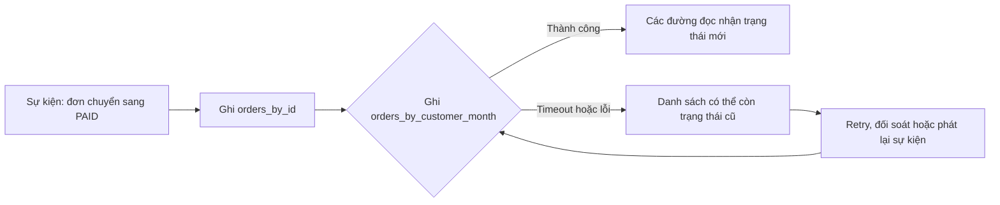

# Chọn dữ liệu cần sao chép sang bảng tra cứu trong Apache Cassandra

## Mục tiêu học tập

Trong chương **Quan hệ và dữ liệu lặp**, bài này tập trung vào một quyết định thường gặp khi thiết kế Apache Cassandra: **bảng tra cứu theo một đường đọc nên chứa những cột nào từ dữ liệu gốc?** Sau bài học, bạn có thể:

- Phân biệt **sao chép dữ liệu ở mức ứng dụng** (denormalization) với **replication giữa các nút** của Cassandra.
- Xuất phát từ truy vấn và dữ liệu cần hiển thị để chọn **khóa chính**, những cột cần sao chép, và những cột nên đọc ở bảng chi tiết.
- Cân nhắc dung lượng, số lần ghi, tần suất thay đổi, độ trễ đọc, yêu cầu bảo mật và độ lệch tạm thời giữa các bảng.
- Viết CQL cho một bảng chi tiết và một bảng danh sách theo truy vấn; xử lý ghi mới, cập nhật, xóa và thay đổi khóa.
- Đề xuất cách đồng bộ và kiểm tra dữ liệu lặp từ ứng dụng Java trong một hệ thống phân tán.

## 1. Vì sao phải cân nhắc dữ liệu sao chép?

Cassandra là cơ sở dữ liệu phân tán theo mô hình **wide-column**. Hàng được định tuyến theo **partition key**, còn **clustering columns** xác định vị trí và thứ tự trong mỗi phân vùng. Cassandra không có `JOIN` và khóa ngoại theo cách của RDBMS. Vì vậy, thay vì đặt toàn bộ dữ liệu vào một cấu trúc chuẩn hóa rồi ghép khi truy vấn, ta thường xây dựng nhiều bảng phục vụ **các cách tra cứu khác nhau**.

Hãy xem hai truy vấn:

1. `GET /orders/{orderId}`: xem đầy đủ một đơn hàng theo ID.
2. `GET /customers/{customerId}/orders?month=2026-11`: xem 20 đơn mới nhất của khách hàng trong tháng, mỗi đơn hiển thị ngày tạo, tổng tiền, đơn vị tiền tệ và trạng thái.

Nếu bảng gốc chỉ có partition key `order_id`, truy vấn thứ hai không thể tìm nhanh tất cả đơn theo `customer_id` bằng đúng đường truy cập của bảng đó. Một phương án là tạo thêm bảng `orders_by_customer_month`. Nhưng có nên sao chép toàn bộ địa chỉ giao hàng, ghi chú nội bộ, danh sách sản phẩm, trạng thái, tổng tiền vào bảng mới?

**Không mặc định sao chép tất cả.** Bảng danh sách nên có đủ dữ liệu để thực hiện truy vấn chủ yếu mà không phải đọc thêm hàng trăm bản ghi chi tiết, đồng thời tránh lặp những trường lớn, nhạy cảm hoặc thay đổi thường xuyên nhưng không được sử dụng tại màn hình đó.

> **Hai nghĩa của “sao chép” cần phân biệt:** `replication factor` quyết định Cassandra lưu bao nhiêu replica của một phân vùng giữa các nút. Ngược lại, `orders_by_id` và `orders_by_customer_month` là **hai bảng logic riêng**, do ứng dụng thiết kế và duy trì để phục vụ hai truy vấn. Chọn `LOCAL_QUORUM` không tự đồng bộ nội dung giữa hai bảng logic ấy.

## 2. Bắt đầu từ hợp đồng truy vấn

Trước khi tạo bảng, hãy viết rõ **dữ liệu mà giao diện hoặc API thật sự cần**.

| Đường đọc | Điều kiện truy vấn | Dữ liệu trả về | Tần suất và đặc điểm |
| --- | --- | --- | --- |
| Chi tiết đơn | `order_id` | Tất cả trường của đơn; có thể đọc dòng hàng ở bảng riêng | Ít lượt đọc hơn danh sách, chấp nhận một số truy vấn bổ sung |
| Danh sách đơn | `customer_id`, tháng | `order_id`, `created_at`, `total_amount`, `currency`, `status` | Đọc thường xuyên, phân trang, cần phản hồi nhanh |
| Tìm theo mã tham chiếu ngoài | `external_reference` | Trả về `order_id` để mở chi tiết | Tra cứu trực tiếp bằng một khóa khác, không cần lặp toàn bộ đơn |

Ba đường đọc này **không cần ba bản sao đầy đủ**. Ta có thể thiết kế:

- `orders_by_id` là bảng chi tiết, chứa dữ liệu nghiệp vụ cần lưu ở cấp đơn hàng.
- `orders_by_customer_month` chỉ chứa khóa và những cột cần hiển thị trên danh sách.
- `order_id_by_external_reference` (nếu thực sự có truy vấn thứ ba) chỉ ánh xạ mã tham chiếu sang ID, rồi ứng dụng đọc chi tiết từ `orders_by_id`.

Cần quyết định rõ hai chiến lược cho từng đường đọc:

**Đọc đủ trong một lần:** sao chép các cột nhỏ cần hiển thị trực tiếp vào bảng danh sách. Phù hợp với trang danh sách nhiều hàng, yêu cầu độ trễ thấp.

**Đọc tiếp theo ID:** bảng tra cứu chỉ lưu ID và ít metadata; ứng dụng dùng ID để tra bảng chi tiết. Phù hợp với thao tác tra cứu ít bản ghi hoặc đường đọc không cần hiển thị nhiều trường. Nếu phải đọc bổ sung 20–100 bản ghi cho mỗi trang danh sách, hãy đo **fan-out** và độ trễ trước khi áp dụng.

## 3. Tiêu chí chọn từng cột để sao chép

Một bảng tra cứu thường phải giữ **đủ khóa để định tuyến, định danh và quản lý vòng đời bản ghi**. Các cột hiển thị ngoài khóa chỉ nên được thêm khi lợi ích đọc vượt chi phí lặp dữ liệu.

### 3.1. Nhóm cột bắt buộc để truy vấn đúng

Trong ví dụ danh sách đơn:

- `customer_id` và `order_month` xác định **partition key** của bảng danh sách.
- `created_at` và `order_id` là **clustering columns** để sắp xếp, phân biệt các đơn cùng thời điểm và xác định một hàng.
- `order_id` còn là khóa để mở trang chi tiết.

Các cột khóa này không thể bỏ chỉ vì giao diện không hiển thị chúng. Ứng dụng cần biết chính xác các giá trị khóa đã ghi để **cập nhật hoặc xóa hàng** trong bảng tra cứu sau này.

### 3.2. Nhóm cột nên sao chép để phục vụ đường đọc phổ biến

`status`, `total_amount`, `currency` là các trường ngắn mà danh sách cần hiển thị. Có thể sao chép để truy vấn danh sách trả về đủ dữ liệu trong một lần:

```sql
SELECT order_id, created_at, total_amount, currency, status
FROM orders_by_customer_month
WHERE customer_id = 11111111-1111-4111-8111-111111111111
  AND order_month = '2026-11-01'
LIMIT 20;
```

Nhưng `status` có thể thay đổi nhiều lần sau khi tạo đơn, nên sao chép nó đồng nghĩa phải lập kế hoạch **lan truyền cập nhật**. `currency` và `created_at` thường ổn định sau khi tạo; chúng ít gây chi phí đồng bộ hơn. Số tiền có thể thay đổi do sửa đơn hoặc hoàn tiền, tùy định nghĩa nghiệp vụ.

### 3.3. Nhóm cột thường không cần sao chép

`delivery_address`, `internal_note`, mô tả hàng hóa dài, payload JSON lớn hoặc những trường chỉ hiển thị trong trang chi tiết thường không nên nằm trong bảng danh sách. Sao chép chúng sẽ:

- Làm tăng dung lượng lưu trữ trên nhiều replica của từng bảng, lưu lượng ghi và chi phí compaction.
- Tăng số nơi phải cập nhật/xóa khi dữ liệu thay đổi.
- Nhân rộng dữ liệu nhạy cảm, khiến kiểm soát truy cập và chính sách lưu giữ phức tạp hơn.

Nếu bảng danh sách chỉ trả về 20 đơn, trường dài không hiển thị cũng làm hàng nặng hơn mà không đem lại lợi ích thực tế.

### 3.4. Bảng đánh giá cụ thể

| Cột | Có đưa vào `orders_by_customer_month`? | Lý do | Khi có thay đổi |
| --- | --- | --- | --- |
| `customer_id` | **Có** | Thành phần partition key | Nếu chuyển chủ đơn: phải chuyển hàng sang khóa mới |
| `order_month` | **Có** | Giới hạn phân vùng theo thời gian | Thường bất biến theo `created_at` gốc |
| `created_at` | **Có** | Sắp xếp danh sách | Là phần của khóa chính, không sửa tại chỗ |
| `order_id` | **Có** | Định danh hàng và mở chi tiết | Bất biến trong vòng đời đơn |
| `status` | **Có** | Danh sách hiển thị trạng thái | Cập nhật hai bảng |
| `total_amount` | **Có** | Danh sách hiển thị tổng tiền | Cập nhật hai bảng nếu tổng tiền thay đổi |
| `currency` | **Có** | Cần để hiển thị số tiền đúng | Quy ước bất biến sau tạo đơn nếu phù hợp |
| `delivery_address` | **Không** | Chỉ trang chi tiết cần | Cập nhật bảng chi tiết |
| `internal_note` | **Không** | Thông tin riêng, không hiển thị | Không nhân bản sang danh sách |
| `line_items` | **Không** | Tập con có thể lớn, cập nhật độc lập | Lưu bảng `order_items_by_order` riêng nếu cần |

Đây là ví dụ có chủ đích, không phải luật chung. Nếu màn hình danh sách bắt buộc hiển thị một trường khác, có thể cần sao chép thêm trường đó, hoặc thay đổi cách đọc. **Đường đọc quyết định hình dạng bảng.**

## 4. Thiết kế bảng chi tiết và bảng tra cứu bằng CQL

Giả sử keyspace `shop` đã được tạo với replication phù hợp môi trường, và phiên CQL đang sử dụng keyspace đó:

```sql
USE shop;

CREATE TABLE orders_by_id (
    order_id uuid PRIMARY KEY,
    customer_id uuid,
    order_month date,
    created_at timestamp,
    status text,
    total_amount decimal,
    currency text,
    delivery_address text,
    internal_note text
);

CREATE TABLE orders_by_customer_month (
    customer_id uuid,
    order_month date,
    created_at timestamp,
    order_id uuid,
    total_amount decimal,
    currency text,
    status text,
    PRIMARY KEY ((customer_id, order_month), created_at, order_id)
) WITH CLUSTERING ORDER BY (created_at DESC, order_id ASC);
```

**Bảng chi tiết:** `order_id` là toàn bộ khóa chính, đồng thời là partition key.

**Bảng danh sách:** partition key gồm `(customer_id, order_month)`; clustering gồm `(created_at, order_id)`. Mỗi phân vùng chứa các đơn của **một khách hàng trong một tháng**. `order_month` có thể được quy ước là ngày đầu tháng UTC của `created_at`, ví dụ `2026-11-01`. Ứng dụng phải thống nhất cách tính tháng và múi giờ.

```sql
-- Bản chi tiết: lưu thêm hai trường không cần trên danh sách.
INSERT INTO orders_by_id (
    order_id, customer_id, order_month, created_at,
    status, total_amount, currency,
    delivery_address, internal_note
) VALUES (
    22222222-2222-4222-8222-222222222222,
    11111111-1111-4111-8111-111111111111,
    '2026-11-01',
    '2026-11-21T01:00:00Z',
    'CREATED', 250000.00, 'VND',
    '12 Nguyen Hue, Ho Chi Minh City',
    'Gift wrapping requested'
);

-- Bản phục vụ danh sách: chỉ sao chép các trường cần thiết.
INSERT INTO orders_by_customer_month (
    customer_id, order_month, created_at, order_id,
    total_amount, currency, status
) VALUES (
    11111111-1111-4111-8111-111111111111,
    '2026-11-01',
    '2026-11-21T01:00:00Z',
    22222222-2222-4222-8222-222222222222,
    250000.00, 'VND', 'CREATED'
);
```

Đọc trang danh sách chỉ cần một truy vấn từ `orders_by_customer_month`; khi người dùng chọn một đơn, đọc chi tiết theo `order_id`:

```sql
SELECT order_id, created_at, total_amount, currency, status
FROM orders_by_customer_month
WHERE customer_id = 11111111-1111-4111-8111-111111111111
  AND order_month = '2026-11-01'
LIMIT 20;

SELECT *
FROM orders_by_id
WHERE order_id = 22222222-2222-4222-8222-222222222222;
```

Hai bảng có thể cùng chứa một số cột, nhưng **mỗi bảng có mục đích đọc và khóa riêng**. Không cần copy `delivery_address` hay `internal_note` chỉ để ứng dụng hiển thị danh sách.

### Tách bảng ánh xạ nếu chỉ cần ID

Một dịch vụ thanh toán gửi `external_reference` và ứng dụng cần biết đơn tương ứng. Nếu tra cứu này thực sự phổ biến, có thể tạo bảng nhỏ:

```sql
CREATE TABLE order_id_by_external_reference (
    external_reference text PRIMARY KEY,
    order_id uuid
);

INSERT INTO order_id_by_external_reference
    (external_reference, order_id)
VALUES (
    'PAY-2026-000123',
    22222222-2222-4222-8222-222222222222
);

SELECT order_id
FROM order_id_by_external_reference
WHERE external_reference = 'PAY-2026-000123';
```

Sau truy vấn này, ứng dụng mở `orders_by_id`. Bảng ánh xạ chỉ sao chép **định danh cần thiết**, không tạo một bản đơn hàng đầy đủ. Nếu nghiệp vụ yêu cầu `external_reference` duy nhất, ứng dụng cần cơ chế bảo đảm duy nhất phù hợp (chẳng hạn `INSERT ... IF NOT EXISTS` với đánh giá chi phí LWT); Cassandra không tự kiểm tra khóa ngoại tới `orders_by_id`.

## 5. Vòng đời dữ liệu lặp: cần cập nhật những gì?

Sao chép `status` và `total_amount` có ích cho đọc nhanh, nhưng ứng dụng phải quản lý chúng trong suốt vòng đời đơn. Ta có thể lập **ma trận sự kiện và bảng bị ảnh hưởng**:

| Sự kiện nghiệp vụ | `orders_by_id` | `orders_by_customer_month` |
| --- | --- | --- |
| Tạo đơn | INSERT toàn bộ chi tiết | INSERT các cột hiển thị và khóa |
| Đổi trạng thái | UPDATE `status` | UPDATE `status` |
| Đổi tổng tiền | UPDATE `total_amount` | UPDATE `total_amount` |
| Sửa ghi chú nội bộ | UPDATE `internal_note` | Không cần ghi |
| Sửa địa chỉ giao hàng | UPDATE `delivery_address` | Không cần ghi |
| Hủy/xóa đơn theo chính sách dữ liệu | Xử lý hàng chi tiết | Xử lý hàng danh sách, và các bảng liên quan khác nếu có |
| Chuyển đơn sang khách hàng khác | UPDATE giá trị `customer_id` trong chi tiết theo quy tắc nghiệp vụ | DELETE hàng ở partition cũ, INSERT hàng ở partition mới |

Ví dụ cập nhật trạng thái:

```sql
UPDATE orders_by_id
SET status = 'PAID'
WHERE order_id = 22222222-2222-4222-8222-222222222222;

UPDATE orders_by_customer_month
SET status = 'PAID'
WHERE customer_id = 11111111-1111-4111-8111-111111111111
  AND order_month = '2026-11-01'
  AND created_at = '2026-11-21T01:00:00Z'
  AND order_id = 22222222-2222-4222-8222-222222222222;
```

Lưu ý: để cập nhật bản danh sách, ứng dụng phải có **đủ khóa chính gốc** của hàng. Nếu chỉ biết `order_id`, có thể đọc `customer_id`, `order_month` và `created_at` từ `orders_by_id` trước khi cập nhật, hoặc lưu những giá trị khóa bất biến này trong ngữ cảnh sự kiện nghiệp vụ.

### Thay đổi cột thuộc khóa chính

Cassandra không hỗ trợ sửa khóa chính một hàng tại chỗ. Nếu chuyển một đơn sang khách hàng khác, không thể `UPDATE customer_id` trong hàng thuộc `orders_by_customer_month`. Phải xóa khóa cũ và ghi hàng mới:

```sql
-- Minh họa khi đã xác nhận chuyển chủ đơn hợp lệ.
DELETE FROM orders_by_customer_month
WHERE customer_id = 11111111-1111-4111-8111-111111111111
  AND order_month = '2026-11-01'
  AND created_at = '2026-11-21T01:00:00Z'
  AND order_id = 22222222-2222-4222-8222-222222222222;

INSERT INTO orders_by_customer_month (
    customer_id, order_month, created_at, order_id,
    total_amount, currency, status
) VALUES (
    55555555-5555-4555-8555-555555555555,
    '2026-11-01',
    '2026-11-21T01:00:00Z',
    22222222-2222-4222-8222-222222222222,
    250000.00, 'VND', 'PAID'
);
```

Đoạn này chỉ minh họa chuyển khóa của **bảng danh sách**; quy trình thực tế còn phải đồng bộ `customer_id` trong bảng chi tiết và xử lý lỗi ở giữa các bước. Với một thực thể mà `customer_id` không bao giờ đổi, nên ghi rõ đó là **bất biến nghiệp vụ** để giảm số tình huống chuyển khóa.

## 6. Độ nhất quán giữa các bảng tra cứu

Mỗi bảng là một tập dữ liệu logic riêng. Dù các hàng được replication qua nhiều nút, hai bảng vẫn có thể lệch nhau khi hệ thống lỗi:



Một số nguyên tắc cần áp dụng:

1. **Ghi cùng ID và khóa ổn định:** retry với cùng `order_id`, `customer_id`, `order_month` và `created_at` để không tạo thêm một bản ghi logic khác.
2. **Theo dõi thành công của từng đường ghi:** chỉ một lệnh được xác nhận không có nghĩa tất cả bảng đã nhận cập nhật.
3. **Dự liệu lỗi và timeout:** một lần timeout không luôn có nghĩa ghi đã thất bại; retry phải an toàn, có giới hạn và có cơ chế đối soát.
4. **Kiểm soát thứ tự sự kiện:** nếu `SHIPPED` đến trước và `PAID` đến muộn, cập nhật đơn giản theo thứ tự nhận được có thể làm trạng thái quay lui. Cassandra dùng timestamp ở mức cell và cơ chế phân giải xung đột; ứng dụng phải quy định phiên bản/sự kiện hợp lệ và cách tránh ghi sự kiện cũ đè trạng thái mới.
5. **Định nghĩa nhu cầu nhất quán của mỗi màn hình:** liệu danh sách được phép trễ vài giây, hay phải phản ánh cập nhật ngay trước khi phản hồi API? Hai yêu cầu dẫn tới chiến lược ghi và kiểm tra khác nhau.

Mức nhất quán đọc/ghi như `LOCAL_QUORUM` có thể tăng xác suất nhìn thấy dữ liệu vừa được xác nhận ở **cùng partition** khi cấu hình replica/topology phù hợp; nó **không biến hai bảng thành một giao dịch nhiều bảng**. `LOGGED BATCH` giúp bảo đảm các mutation trong batch cuối cùng được áp dụng sau một số lỗi, nhưng không tạo isolation hoặc rollback như RDBMS và có chi phí với batch đa phân vùng. Không dùng batch như một giải pháp mặc định cho toàn bộ việc sao chép.

Với đồng bộ qua message broker, người tiêu thụ thường phải chịu được **giao sự kiện lặp**, xử lý lỗi giữa chừng, và giải quyết **sự kiện đến sai thứ tự**. Nếu mô hình yêu cầu trạng thái chính xác theo phiên bản, có thể đánh giá cập nhật có điều kiện (LWT) ở phạm vi phù hợp, chi phí của nó và cách đối soát giữa nhiều bảng. Không giả định LWT cung cấp giao dịch nguyên tử xuyên tất cả bảng tra cứu.

## 7. Viết và đọc bảng tra cứu từ Java

Trong ứng dụng Java sử dụng **Apache Cassandra Java Driver 4.x**, nên chuẩn bị trước câu lệnh, đóng gói các giá trị khóa đã tính một lần và tái sử dụng chúng khi retry:

```java
import com.datastax.oss.driver.api.core.CqlSession;
import com.datastax.oss.driver.api.core.cql.PreparedStatement;
import com.datastax.oss.driver.api.core.cql.BoundStatement;

import java.math.BigDecimal;
import java.time.Instant;
import java.time.LocalDate;
import java.util.UUID;

// Ví dụ trong lớp repository; session là CqlSession đã kết nối
// tới keyspace shop. Các câu INSERT cần được prepare một lần.
PreparedStatement insertDetail = session.prepare(
    "INSERT INTO orders_by_id (" +
    "order_id, customer_id, order_month, created_at, " +
    "status, total_amount, currency, delivery_address, internal_note" +
    ") VALUES (?, ?, ?, ?, ?, ?, ?, ?, ?)");

PreparedStatement insertList = session.prepare(
    "INSERT INTO orders_by_customer_month (" +
    "customer_id, order_month, created_at, order_id, " +
    "total_amount, currency, status" +
    ") VALUES (?, ?, ?, ?, ?, ?, ?)");

UUID orderId = UUID.fromString(
    "22222222-2222-4222-8222-222222222222");
UUID customerId = UUID.fromString(
    "11111111-1111-4111-8111-111111111111");
Instant createdAt = Instant.parse("2026-11-21T01:00:00Z");
LocalDate month = LocalDate.of(2026, 11, 1);
BigDecimal amount = new BigDecimal("250000.00");

BoundStatement detail = insertDetail.bind(
    orderId, customerId, month, createdAt,
    "CREATED", amount, "VND",
    "12 Nguyen Hue, Ho Chi Minh City", "Gift wrapping requested");
BoundStatement list = insertList.bind(
    customerId, month, createdAt, orderId,
    amount, "VND", "CREATED");

session.execute(detail);
session.execute(list);

// Nếu lệnh thứ hai lỗi/timeout: phải ghi nhận và có retry,
// phát lại sự kiện hoặc đối soát. Đây chỉ là ví dụ minh họa.
```

Tình huống hai thao tác trên diễn ra tuần tự giúp thấy rõ **hai bảng nhận hai bộ cột khác nhau**, nhưng chưa phải quy trình production hoàn chỉnh. Trong ứng dụng thực tế, khâu xử lý lỗi và retry cần được thiết kế trước. Các câu prepared statement có thể được tái sử dụng qua nhiều request. Driver hỗ trợ các kiểu `uuid`, `date`, `timestamp`, `decimal` tương ứng với `UUID`, `LocalDate`, `Instant`, `BigDecimal`.

## 8. Chi phí của việc sao chép và cách đánh giá

Một cột được sao chép không chỉ tốn thêm dung lượng đúng bằng kích thước của nó. Việc sao chép còn kéo theo:

- **Write amplification:** một sự kiện cần ghi vào nhiều bảng; mỗi bảng tiếp tục được replication theo cấu hình riêng.
- **Chi phí sửa/xóa:** cập nhật cột lặp ở nhiều bảng, có thể phát sinh tombstone khi xóa.
- **Compaction và repair:** nhiều bản ghi/SSTable hơn làm tăng lượng dữ liệu cần bảo trì; tùy TTL, chiến lược compaction, mô hình xóa và quy mô.
- **Chi phí tiến hóa schema:** thêm một cột vào trang danh sách cần cập nhật đường ghi, triển khai thay đổi schema và có thể backfill dữ liệu cũ.
- **Chi phí vận hành:** cần quan sát độ lệch giữa bảng gốc và bảng tra cứu, xử lý ghi lỗi và kiểm tra tính đầy đủ.

Ngược lại, sao chép những cột cần hiển thị giúp **tránh nhiều lần đọc bảng chi tiết**, có thể giảm độ trễ và tải mạng đáng kể. Để so sánh, đo những chỉ số gắn với truy vấn thật:

| Chỉ số | Ít sao chép, đọc thêm theo ID | Sao chép đủ cột hiển thị |
| --- | --- | --- |
| Lượt đọc cho một trang 20 đơn | Một truy vấn danh sách + có thể thêm tới 20 tra cứu chi tiết | Thường một truy vấn danh sách |
| Dung lượng bảng tra cứu | Nhỏ hơn | Lớn hơn theo số cột và kích thước dữ liệu lặp |
| Số bảng cần cập nhật khi trường hiển thị đổi | Thường chỉ bảng chi tiết, tùy mô hình | Có cả bảng tra cứu |
| Nguy cơ hiển thị dữ liệu cũ trên danh sách | Phụ thuộc dữ liệu nào lưu ở bảng danh sách | Có nếu cập nhật bản sao bị chậm/lỗi |
| Phù hợp khi | Chỉ cần ID, ít bản ghi bổ sung hoặc không thường xuyên | Danh sách đọc nhiều và có mục tiêu độ trễ thấp |

Không có một ngưỡng chung cho mọi hệ thống. Hãy cân nhắc **p95/p99 read latency**, tốc độ ghi, dung lượng phân vùng, kích thước SSTable, tỷ lệ retry và yêu cầu thời gian hiển thị dữ liệu mới.

### Một bảng tra cứu có thể phục vụ nhiều truy vấn

Thiết kế theo truy vấn không có nghĩa “mỗi câu SQL/CQL là một bảng”. Những truy vấn cùng partition key và kiểu thứ tự/giới hạn tương thích có thể dùng chung bảng. Ví dụ, trang danh sách 10 đơn và trang danh sách 20 đơn của cùng khách hàng trong tháng có thể dùng `orders_by_customer_month` với `LIMIT` khác nhau. Chỉ tạo thêm bảng khi **khóa truy cập, thứ tự hoặc tập dữ liệu cần đọc** thực sự khác.

Ngược lại, không nên dựa vào `ALLOW FILTERING` để thường xuyên truy vấn không theo partition key. Các chỉ mục như SAI có thể hữu ích cho những kiểu lọc phù hợp tùy phiên bản Cassandra, phân bố dữ liệu và workload, nhưng cần đo/kiểm chứng riêng; chúng không thay thế mọi thiết kế bảng theo đường đọc.

## 9. Tiến hóa bảng tra cứu mà không làm mất dữ liệu

Giả sử phiên bản đầu tiên của trang danh sách chỉ hiển thị `order_id`, `created_at`, `status`. Sau này sản phẩm yêu cầu hiển thị `total_amount`:

1. Xác định `total_amount` đã có trong bảng danh sách hay chưa. Nếu thiếu, thêm cột bằng `ALTER TABLE` sau khi kiểm tra schema hiện tại và chiến lược triển khai.
2. Cập nhật luồng ghi để mọi đơn mới và các sự kiện sửa tổng tiền đều ghi vào cột mới.
3. **Backfill** các hàng cũ từ `orders_by_id` sang bảng danh sách, dùng đúng khóa gốc; giới hạn tốc độ đọc/ghi theo tải hệ thống.
4. Theo dõi phần dữ liệu chưa đầy đủ hoặc sai lệch, giải quyết cập nhật song song với backfill để không ghi đè dữ liệu mới bằng giá trị cũ.
5. Chỉ chuyển giao diện sang đọc cột mới khi đã có tiêu chí rõ ràng cho hàng cũ thiếu dữ liệu và hệ thống đã đáp ứng tiêu chí đó.

Trong Cassandra, backfill trên quy mô lớn không nên được thực hiện bằng cách quét toàn bộ bảng trong một request trực tuyến. Nên sử dụng công cụ hoặc job theo phân vùng/nguồn dữ liệu phù hợp, có checkpoint và điều tiết tải. Nếu dùng TTL, cần xác định liệu bản sao có TTL giống dữ liệu gốc hay không và lưu ý rằng TTL hết hạn có thể tạo tombstone; giá trị chỉ nên tồn tại theo chính sách lưu giữ mà nghiệp vụ mong muốn.

## 10. Bài tập tình huống

Một hệ thống bán hàng có:

- `products_by_id` gồm `product_id`, `category_id`, `name`, `price`, `currency`, `description`, `stock_quantity`, `supplier_email`, `created_at`.
- Màn hình danh mục đọc **24 sản phẩm** theo `category_id`, hiển thị tên, giá và tình trạng còn bán.
- Người mua chọn sản phẩm để xem mô tả đầy đủ.
- Giá có thể cập nhật mỗi tuần; tồn kho thay đổi liên tục; `supplier_email` chỉ nhân viên được phép xem.

Hãy trả lời:

1. Những cột nào nên sao chép sang `products_by_category`? Cột nào nên giữ ở `products_by_id`?
2. Partition key và clustering key của `products_by_category` nên là gì nếu chỉ cần danh sách theo `category_id`? Cần bổ sung điều gì nếu danh mục quá lớn?
3. Khi giá thay đổi, những bảng nào cần cập nhật? Khi `category_id` thay đổi, cần làm gì với hàng ở bảng tra cứu?
4. Nếu muốn hiển thị `stock_quantity` tức thời mà nó thay đổi hàng trăm lần mỗi giây, có nên sao chép trực tiếp sang mọi bảng danh mục không? Hãy nêu cách đánh giá.

**Gợi ý lời giải:**

- Bảng danh mục tối thiểu giữ `category_id`, `product_id` và `name`, `price`, `currency` nếu các trường này được hiển thị; thêm `is_active` hoặc trạng thái bán nếu là điều kiện trình bày thực tế. `description` và `supplier_email` chỉ ở chi tiết/phạm vi thích hợp. Việc thay `stock_quantity` bằng `is_in_stock` cũng cần quy tắc cập nhật chính xác.
- `PRIMARY KEY ((category_id), product_id)` chỉ là khởi điểm khi mỗi danh mục không quá lớn và không có yêu cầu sắp xếp khác. Nếu muốn sắp xếp theo sản phẩm mới nhất, có thể chọn `created_at` làm clustering column trước `product_id`. Khi phân vùng quá lớn, cần bucket với thiết kế phân trang thích hợp.
- Giá là cột lặp: cập nhật cả bảng chi tiết và bảng danh mục. Chuyển danh mục là **thay khóa phân vùng**, nên xóa hàng ở danh mục cũ và thêm hàng ở danh mục mới, cùng với cập nhật chi tiết.
- Trường tồn kho thay đổi cực thường xuyên có thể tạo **write amplification** lớn nếu sao chép khắp nơi. Cần đánh giá tải đọc/ghi, độ trễ chấp nhận được, mức độ chính xác và có thể chỉ hiển thị cờ còn hàng được cập nhật theo ngưỡng hoặc đọc thêm một nguồn tồn kho chuyên biệt.

## Tổng kết

Để chọn dữ liệu sao chép sang bảng tra cứu Cassandra, hãy đi theo thứ tự: **viết truy vấn thực tế → chọn partition/clustering key → liệt kê cột hiển thị → đánh giá cột thay đổi, kích thước, quyền truy cập và chi phí đồng bộ → kiểm chứng bằng CQL cùng workload**. Sao chép đủ cột giúp đường đọc quan trọng nhanh và dễ dự đoán; giữ các trường không cần thiết ở bảng chi tiết giúp giảm write amplification, rủi ro dữ liệu lệch và chi phí vận hành. Với dữ liệu lặp, cần coi **cập nhật đa bảng, xử lý lỗi, đối soát và thay đổi khóa chính** là một phần của thiết kế ngay từ đầu.
