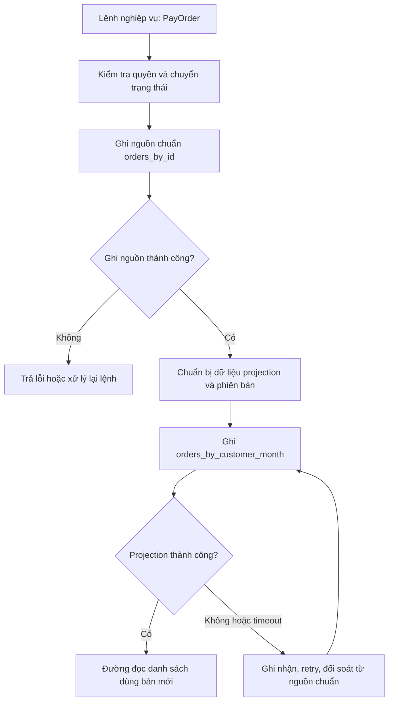

# Xác định bảng nguồn chuẩn và các bảng biểu diễn dẫn xuất trong Apache Cassandra

## Mục tiêu học tập

Trong chương **Quan hệ và dữ liệu lặp**, ta đã biết rằng một thực thể có thể xuất hiện ở nhiều bảng để phục vụ nhiều cách đọc. Bài này giải quyết câu hỏi tiếp theo: **khi dữ liệu có nhiều bản biểu diễn, bản nào được quyền quyết định giá trị đúng và các bản còn lại được tạo, cập nhật, sửa lỗi như thế nào?**

Sau khi học, bạn có thể:

- Phân biệt **bảng nguồn chuẩn** (*canonical/authoritative table*) với **bảng biểu diễn dẫn xuất** (*derived table*, *projection*, *read model*).
- Xác định nơi sở hữu từng dữ kiện nghiệp vụ, các truy vấn dẫn tới mỗi bảng dẫn xuất và quy tắc chuyển đổi từ nguồn.
- Thiết kế khóa phân vùng, khóa sắp xếp và các cột sao chép cho mô hình nhiều đường đọc bằng CQL.
- Xây dựng luồng tạo, cập nhật, xóa, phát lại, đối soát và backfill có thể xử lý lỗi phân tán.
- Giải thích phạm vi bảo đảm của consistency level, replication, LWT và batch khi một thực thể được biểu diễn ở nhiều bảng.

## 1. Vì sao phải xác định nguồn chuẩn?

Apache Cassandra là cơ sở dữ liệu phân tán theo mô hình **wide-column**. Cassandra định tuyến truy vấn qua **partition key**, sắp xếp các hàng trong một phân vùng theo **clustering columns**, và không hỗ trợ `JOIN` cùng ràng buộc khóa ngoại như hệ quản trị quan hệ. Vì vậy, một ứng dụng thường lưu cùng một phần dữ liệu vào nhiều bảng có khóa khác nhau để đọc nhanh theo những đường truy cập thực tế.

Ví dụ, hệ thống quản lý đơn hàng cần:

1. Tra cứu chi tiết bằng `order_id`.
2. Liệt kê đơn hàng theo `customer_id` và tháng, mới nhất trước.
3. Trả về trạng thái, tổng tiền của đơn ngay trong danh sách mà không phải tra thêm hàng chục bản ghi chi tiết.

Ta có thể xây dựng `orders_by_id` và `orders_by_customer_month`. Cả hai cùng chứa `status` và `total_amount`. Khi khách thanh toán, giá trị `status` phải đổi từ `CREATED` sang `PAID`. Nếu hai bảng cho hai kết quả khác nhau, ứng dụng cần biết **bản nào đúng để sửa bản còn lại**.

Giải pháp là định nghĩa một **nguồn chuẩn** và những **bảng dẫn xuất**:

| Khái niệm | Vai trò | Ví dụ |
| --- | --- | --- |
| **Nguồn chuẩn** | Nơi được nghiệp vụ chỉ định làm cơ sở quyết định trạng thái hiện tại; chỉ nhận thay đổi qua quy trình ghi được kiểm soát | `orders_by_id` chứa trạng thái chuẩn của đơn |
| **Bảng dẫn xuất** | Tổ chức lại hoặc sao chép một phần dữ liệu để tối ưu truy vấn cụ thể; có thể tạo lại từ nguồn đáng tin cậy | `orders_by_customer_month` để hiển thị lịch sử đơn theo khách hàng |
| **Quy tắc chiếu dữ liệu** (*projection rule*) | Mô tả từ một thực thể chuẩn, tạo ra hàng nào và những giá trị nào trong bảng dẫn xuất | Lấy `customer_id`, tháng, thời điểm, ID, trạng thái và tổng tiền từ đơn |
| **Đối soát** (*reconciliation*) | So sánh hoặc tái tạo bản dẫn xuất từ nguồn sau sự cố | Tìm đơn có ở `orders_by_id` nhưng thiếu/sai trong danh sách |

**Quan trọng:** Cassandra **không tự đánh dấu bảng nào là nguồn chuẩn**. Đây là quyết định của kiến trúc ứng dụng và quy trình nghiệp vụ. Tên bảng `orders_by_id` cũng không tự khiến nó có thẩm quyền. Trong hệ thống khác, nguồn chuẩn có thể là **sổ sự kiện bất biến**, một dịch vụ quản lý đơn hàng, hoặc hệ thống giao dịch bên ngoài. Khi đó Cassandra chỉ giữ các bảng đọc dẫn xuất; không nên tùy tiện tuyên bố một bảng Cassandra là nguồn chuẩn nếu quyền sở hữu dữ liệu nằm ở hệ thống khác.

### Đừng nhầm với replication của Cassandra

**Replication** sao chép dữ liệu của **cùng một bảng/phân vùng** lên nhiều replica theo cấu hình keyspace. **Denormalization/projection** tạo các **bảng logic khác nhau** để đọc theo khóa khác nhau. Replication và `QUORUM` hoặc `LOCAL_QUORUM` không tự bảo đảm các bảng logic dẫn xuất luôn giống bảng nguồn.

## 2. Chọn nguồn chuẩn từ quyền sở hữu nghiệp vụ

Trước khi viết CQL, cần trả lời bốn câu hỏi:

1. **Ai tạo và thay đổi dữ kiện này?** Ví dụ, dịch vụ Order quyết định `status`, dịch vụ Payment xác nhận thanh toán, dịch vụ Inventory quản lý tồn kho.
2. **Dữ kiện nào là bản gốc?** Có thể là trạng thái đơn do Order quyết định sau khi xử lý sự kiện thanh toán; không mặc nhiên lấy mọi giá trị từ Payment.
3. **Có thể xây dựng lại bảng đọc từ dữ liệu chuẩn không?** Nếu không, có thể một thông tin quan trọng chỉ tồn tại ở bảng dẫn xuất và thiết kế cần điều chỉnh.
4. **Khi hai bản bất đồng, hệ thống dựa vào đâu để xác định giá trị đúng?** Cần nêu rõ cả các trường đã xóa hoặc đã hết hạn lưu giữ.

Một **bảng sở hữu dữ kiện** không nhất thiết chứa mọi chi tiết nghiệp vụ. Ví dụ, `orders_by_id` có thể là nguồn chuẩn cho trạng thái và tổng tiền của đơn, nhưng không phải nguồn chuẩn cho số lượng tồn kho hay thông tin thẻ thanh toán. Những dữ kiện đó có quyền sở hữu riêng.

| Dữ kiện | Nguồn có thẩm quyền trong ví dụ | Có thể sao chép sang bảng đọc? | Quy tắc cập nhật |
| --- | --- | --- | --- |
| `order_id`, `customer_id`, `ordered_at` | Dịch vụ Order/`orders_by_id` | Có, dùng làm khóa | Tạo một lần; thay đổi khóa cần quy trình chuyển hàng |
| `status` | Dịch vụ Order/`orders_by_id` | Có | Chỉ thay qua sự kiện/chuyển trạng thái hợp lệ |
| `total_amount`, `currency` | Dịch vụ Order/`orders_by_id` | Có | Sao chép khi tạo và khi tổng tiền được sửa hợp lệ |
| `shipping_address` | Dịch vụ Order/`orders_by_id` trong ví dụ | Chỉ khi truy vấn cần | Nếu không hiển thị danh sách thì để ở nguồn |
| `stock_quantity` | Dịch vụ Inventory | Không tùy tiện coi bản sao là chuẩn | Có thể cần đường đọc hoặc cache riêng với chính sách trễ rõ ràng |
| `payment_reference` | Dịch vụ Payment hoặc Order, tùy hợp đồng giữa các dịch vụ | Chỉ định danh để tra cứu nếu cần | Phải xác định duy nhất và quy tắc đổi/xóa |

Như vậy, câu “mỗi thực thể có đúng một nguồn chuẩn” là một quy ước thường hữu ích, nhưng thực tế **quyền sở hữu có thể nằm ở cấp trường hoặc ranh giới nghiệp vụ**. Không để nhiều nơi cùng tùy ý ghi một trường mà không có quy tắc xử lý xung đột.

## 3. Từ truy vấn đến hợp đồng của bảng dẫn xuất

Một bảng dẫn xuất cần có **hợp đồng rõ ràng**, không chỉ có tên bảng.

Ví dụ với `orders_by_customer_month`:

| Hạng mục hợp đồng | Quyết định |
| --- | --- |
| Mục tiêu | Hiển thị 20 đơn mới nhất của một khách hàng trong một tháng |
| Điều kiện truy vấn | `customer_id = ? AND order_month = ?` |
| Partition key | `(customer_id, order_month)` |
| Clustering columns | `ordered_at DESC`, sau đó `order_id ASC` để phân biệt đơn cùng thời điểm |
| Trường hiển thị | `order_id`, `ordered_at`, `status`, `total_amount`, `currency` |
| Nguồn xây dựng | Các trường tương ứng từ trạng thái đơn chuẩn |
| Khi cập nhật | Tạo đơn; sửa trạng thái/tổng tiền; đổi khách hàng hoặc tháng; xóa/hủy theo quy tắc |
| Độ trễ đồng bộ cho phép | Do yêu cầu sản phẩm quyết định và phải đo được |
| Khôi phục sau lỗi | Phát lại sự kiện, sửa theo snapshot chuẩn hoặc chạy job đối soát |

**Trước khi thêm bảng**, cần xác nhận truy vấn không có cách đọc hiệu quả bằng bảng hiện có. Hai danh sách có `LIMIT 10` và `LIMIT 20` nhưng cùng partition key, thứ tự thường chỉ cần một bảng. Ngược lại, bảng theo `order_id` không thể cung cấp danh sách theo khách hàng bằng cùng khóa truy cập.

**Trước khi sao chép thêm cột**, hỏi xem nó có thật sự xuất hiện ở đường đọc đó không. Những dữ liệu dài, thay đổi liên tục, cần phân quyền riêng hoặc chỉ hiển thị ở chi tiết có thể chỉ nằm trong nguồn chuẩn.

## 4. Thiết kế CQL: một nguồn chuẩn và một biểu diễn dẫn xuất

Giả sử keyspace `shop` đã tồn tại với chính sách replication phù hợp. Các câu lệnh sau minh họa cách tổ chức dữ liệu:

```sql
USE shop;

-- Nguồn chuẩn do dịch vụ Order sở hữu trong ví dụ.
CREATE TABLE orders_by_id (
    order_id uuid PRIMARY KEY,
    customer_id uuid,
    order_month date,
    ordered_at timestamp,
    status text,
    total_amount decimal,
    currency text,
    shipping_address text,
    version bigint,
    deleted boolean
);

-- Bảng đọc dẫn xuất: danh sách đơn theo khách hàng/tháng.
CREATE TABLE orders_by_customer_month (
    customer_id uuid,
    order_month date,
    ordered_at timestamp,
    order_id uuid,
    status text,
    total_amount decimal,
    currency text,
    source_version bigint,
    PRIMARY KEY ((customer_id, order_month), ordered_at, order_id)
) WITH CLUSTERING ORDER BY (ordered_at DESC, order_id ASC);
```

Giải thích thiết kế:

- Trong `orders_by_id`, `order_id` là partition key. Đây là đường đọc để nhận trạng thái chuẩn và thông tin chi tiết của một đơn.
- Trong `orders_by_customer_month`, partition key gồm `customer_id` và `order_month`. Nó hạn chế lịch sử một khách hàng nằm trong một phân vùng vô hạn, đồng thời cho phép tra cứu theo tháng.
- `ordered_at` là clustering column để sắp xếp giảm dần; `order_id` giúp phân biệt các đơn có cùng thời điểm tạo.
- `source_version` lưu phiên bản trạng thái nguồn dùng tạo hàng dẫn xuất. Nó là **metadata để kiểm tra và đối soát**, không tự chặn ghi cũ nếu câu lệnh ghi bình thường không có điều kiện.
- `deleted` minh họa **soft delete** ở nguồn, hữu ích khi cần phát sự kiện xóa/đối soát trước khi xóa vật lý. Quy tắc lưu giữ và xóa vật lý phải do nghiệp vụ quyết định.

Quy ước `order_month` là **ngày đầu tháng theo UTC** của `ordered_at`. Mọi bộ phận sinh sự kiện hoặc backfill phải dùng cùng một quy ước; nếu dùng tháng theo múi giờ khác, dữ liệu có thể rơi vào phân vùng khác.

### Khởi tạo đơn ở hai bảng

```sql
-- Ghi trạng thái nguồn chuẩn.
INSERT INTO orders_by_id (
    order_id, customer_id, order_month, ordered_at,
    status, total_amount, currency, shipping_address,
    version, deleted
) VALUES (
    22222222-2222-4222-8222-222222222222,
    11111111-1111-4111-8111-111111111111,
    '2026-11-01',
    '2026-11-21T01:00:00Z',
    'CREATED', 250000.00, 'VND',
    '12 Nguyen Hue, Ho Chi Minh City',
    1, false
);

-- Chiếu dữ liệu sang bảng phục vụ truy vấn danh sách.
INSERT INTO orders_by_customer_month (
    customer_id, order_month, ordered_at, order_id,
    status, total_amount, currency, source_version
) VALUES (
    11111111-1111-4111-8111-111111111111,
    '2026-11-01',
    '2026-11-21T01:00:00Z',
    22222222-2222-4222-8222-222222222222,
    'CREATED', 250000.00, 'VND', 1
);
```

Các câu `INSERT` trên là **hai thao tác logic**. Nếu ghi vào bảng nguồn được xác nhận còn ghi sang bảng dẫn xuất bị lỗi, bảng nguồn vẫn có thể đúng, trong khi danh sách chưa thấy đơn. Ứng dụng phải có chiến lược phát lại hoặc đối soát; không nên coi việc chạy tuần tự hai câu CQL là một giao dịch có rollback.

### Đọc qua từng đường truy cập

```sql
-- Đọc dữ liệu chuẩn khi người dùng mở một đơn.
SELECT order_id, status, total_amount, currency, shipping_address, version
FROM orders_by_id
WHERE order_id = 22222222-2222-4222-8222-222222222222;

-- Đọc dữ liệu dẫn xuất khi xem trang danh sách.
SELECT order_id, ordered_at, status, total_amount, currency, source_version
FROM orders_by_customer_month
WHERE customer_id = 11111111-1111-4111-8111-111111111111
  AND order_month = '2026-11-01'
LIMIT 20;
```

Truy vấn danh sách không cần `JOIN` và không cần đọc 20 hàng nguồn chuẩn. Ứng dụng chấp nhận thêm công việc đồng bộ ở đường ghi để có đường đọc trực tiếp theo khóa.

## 5. Quy tắc ghi: nguồn chuẩn trước, bảng dẫn xuất theo sau

Khi **nguồn chuẩn được lưu trong Cassandra**, một quy trình mẫu có thể là:

1. Dịch vụ sở hữu kiểm tra lệnh nghiệp vụ, ví dụ `PayOrder`, và xác định phiên bản trạng thái tiếp theo.
2. Ghi thay đổi hợp lệ vào nguồn chuẩn, kiểm tra kết quả khi có điều kiện.
3. Tạo thông tin cần thiết cho projection: `order_id`, đầy đủ khóa bảng dẫn xuất, các cột cần hiển thị và phiên bản nguồn.
4. Ghi hoặc đưa cập nhật projection vào cơ chế xử lý bền vững có retry và giám sát.
5. Khi projection thành công, có thể đánh dấu sự kiện đã được xử lý; nếu không, hệ thống đối soát để khôi phục.

Nếu nguồn chuẩn nằm **ngoài Cassandra**, bước đầu là xác nhận thay đổi tại hệ thống có thẩm quyền; Cassandra chỉ cập nhật các bảng dẫn xuất từ sự kiện hoặc snapshot được nguồn đó công bố. Tránh cho client tự ghi vào bảng dẫn xuất với nội dung mâu thuẫn nguồn.



Sơ đồ biểu diễn **trách nhiệm logic**, không ngụ ý việc tạo sự kiện hoặc ghi nhiều hệ thống luôn nguyên tử. Nếu ứng dụng dùng message broker hoặc bảng sự kiện để phát lại, cần thiết kế cách ghi sự kiện **bền vững** và xử lý khoảng hở giữa ghi nguồn với phát sự kiện. “Đã ghi nguồn nhưng chưa phát được sự kiện” là tình huống phải giải quyết bằng cơ chế đáng tin cậy hoặc đối soát.

## 6. Cập nhật nguồn và làm mới projection

Giả sử đơn chuyển từ `CREATED` sang `PAID`. Nếu ứng dụng có nhiều tác nhân ghi đồng thời, nên dùng quy tắc **kiểm soát chuyển trạng thái** và phiên bản. Một cách trên nguồn chuẩn là lightweight transaction (LWT) để chỉ nhận cập nhật khi phiên bản hiện tại phù hợp:

```sql
-- Giả sử ứng dụng đã đọc phiên bản hiện tại = 1.
UPDATE orders_by_id
SET status = 'PAID', version = 2
WHERE order_id = 22222222-2222-4222-8222-222222222222
IF version = 1;
```

Kết quả câu lệnh có cột `[applied]`. Chỉ khi điều kiện thành công, dịch vụ mới coi chuyển trạng thái phiên bản 2 đã được nhận và yêu cầu làm mới projection. Nếu `[applied] = false`, phải đọc lại trạng thái chuẩn hoặc xử lý xung đột, không phát bản projection như thể lệnh đã thành công.

Minh họa cập nhật projection tương ứng:

```sql
UPDATE orders_by_customer_month
SET status = 'PAID', source_version = 2
WHERE customer_id = 11111111-1111-4111-8111-111111111111
  AND order_month = '2026-11-01'
  AND ordered_at = '2026-11-21T01:00:00Z'
  AND order_id = 22222222-2222-4222-8222-222222222222;
```

**Cảnh báo:** trường `source_version = 2` được ghi cùng dữ liệu nhưng không tự bảo đảm bản mới thắng bản cũ. Cassandra có cơ chế *last-write-wins* dựa trên timestamp của cell, không dựa vào cột `source_version`. Nếu projection phiên bản 3 đã được ghi mà sự kiện phiên bản 2 đến muộn và bị ghi lại không điều kiện, bảng dẫn xuất có thể quay về dữ liệu cũ.

Các lựa chọn để xử lý sự kiện đến sai thứ tự:

- **Sắp xếp tuần tự theo từng `order_id`** trong luồng tiêu thụ, và xử lý retry trước khi nhận sự kiện mới cùng thực thể.
- **Kiểm tra và cập nhật có điều kiện** ở mức một hàng/phân vùng bằng LWT khi cần, dựa trên phiên bản kỳ vọng; cần xử lý trường hợp projection chưa có hàng và chi phí LWT.
- **Đồng bộ lại từ snapshot nguồn chuẩn** khi phát hiện sự kiện cũ, trạng thái không khớp hoặc thiếu dữ liệu, với cơ chế tránh ghi snapshot cũ đè snapshot mới.

Không nên xem thao tác “đọc phiên bản hiện tại rồi `UPDATE` thường” là bảo vệ đủ trước race condition; giữa hai bước có thể xuất hiện người ghi khác. LWT cũng không biến nhiều bảng thành một giao dịch ACID thống nhất.

### Idempotency khi phát lại sự kiện

Một hệ thống phát sự kiện theo cơ chế *at-least-once* có thể xử lý cùng một thông báo nhiều lần. Để không tạo nhiều bản ghi cho cùng đơn:

- Giữ nguyên `order_id`, `customer_id`, `order_month` và `ordered_at` trong mọi lần retry của cùng một thực thể.
- Phân biệt `event_id` với `order_id`: một đơn có thể có nhiều sự kiện, mỗi sự kiện cần được nhận diện để chống xử lý lặp nếu nghiệp vụ yêu cầu.
- Thiết kế thao tác projection có thể lặp lại an toàn. Ghi lại đúng một giá trị với cùng khóa thường dễ kiểm soát hơn tăng số đếm kiểu `count = count + 1`.
- Nếu dùng TTL, `USING TIMESTAMP` hoặc phiên bản, xác định rõ quy tắc; hai lần “ghi cùng giá trị” không nhất thiết có tác dụng giống nhau lên thời điểm hết hạn hoặc xung đột.

## 7. Xóa, chuyển khóa và trách nhiệm của nguồn chuẩn

Sao chép dữ liệu tạo ra một vấn đề quan trọng: **xóa ở nguồn không tự xóa ở mọi bảng dẫn xuất**. Thao tác `DELETE` ở `orders_by_id` không có `ON DELETE CASCADE` sang `orders_by_customer_month`.

### Xóa logic và xóa vật lý

Một quy trình có thể chọn:

1. Đánh dấu `deleted = true` ở nguồn chuẩn hoặc ghi một sự kiện xóa bền vững.
2. Dùng sự kiện xóa chứa **đầy đủ khóa** để xóa hàng dẫn xuất.
3. Xác minh các projection đã xử lý sự kiện; thực hiện xóa vật lý dữ liệu nguồn theo chính sách lưu giữ.

Ví dụ:

```sql
UPDATE orders_by_id
SET deleted = true, version = 3
WHERE order_id = 22222222-2222-4222-8222-222222222222
IF version = 2;

DELETE FROM orders_by_customer_month
WHERE customer_id = 11111111-1111-4111-8111-111111111111
  AND order_month = '2026-11-01'
  AND ordered_at = '2026-11-21T01:00:00Z'
  AND order_id = 22222222-2222-4222-8222-222222222222;
```

Đây vẫn là **hai thao tác khác nhau**. Nếu thao tác thứ hai lỗi, cần retry và đối soát. Trong các hệ thống có chính sách xóa dữ liệu nhạy cảm, phải bảo đảm mọi bảng, bản sao lưu và thời hạn lưu giữ được xử lý đúng chính sách, không chỉ bảng nguồn. Cassandra sử dụng tombstone để đánh dấu xóa; compaction và repair ảnh hưởng đến việc dọn dữ liệu vật lý.

### Khi thuộc tính khóa thay đổi

Nếu `customer_id` thay đổi, hàng cũ của `orders_by_customer_month` không thể đổi partition key bằng `UPDATE`. Cần **xóa theo khóa cũ và ghi hàng mới theo khóa mới**, đồng bộ với thay đổi nguồn chuẩn:

```sql
-- Xóa hàng ở phân vùng khách hàng cũ.
DELETE FROM orders_by_customer_month
WHERE customer_id = 11111111-1111-4111-8111-111111111111
  AND order_month = '2026-11-01'
  AND ordered_at = '2026-11-21T01:00:00Z'
  AND order_id = 22222222-2222-4222-8222-222222222222;

-- Ghi biểu diễn mới với khóa khách hàng mới.
INSERT INTO orders_by_customer_month (
    customer_id, order_month, ordered_at, order_id,
    status, total_amount, currency, source_version
) VALUES (
    55555555-5555-4555-8555-555555555555,
    '2026-11-01',
    '2026-11-21T01:00:00Z',
    22222222-2222-4222-8222-222222222222,
    'PAID', 250000.00, 'VND', 4
);
```

Ví dụ giả định phiên bản nguồn đã chuyển sang 4 và khách hàng mới được phép sở hữu đơn. **Thông tin khóa cũ** phải có trong sự kiện hoặc hồ sơ chuyển đổi để xóa đúng hàng; không thể chỉ dựa vào khóa mới để xác định hàng cũ. Trong thực tế, hạn chế thay đổi những khóa vốn được định nghĩa là bất biến sẽ làm hệ thống đơn giản và an toàn hơn.

## 8. Khi hệ phân tán gặp lỗi: nguồn chuẩn giúp sửa gì?

| Tình huống | Quan sát từ người dùng | Cách giải quyết |
| --- | --- | --- |
| Nguồn chuẩn ghi thành công, projection timeout | Đọc chi tiết có đơn nhưng danh sách thiếu đơn | Retry dựa trên khóa và snapshot chuẩn; đối soát những bản thiếu |
| Projection ghi trạng thái cũ sau trạng thái mới | Danh sách hiển thị sai trạng thái | Kiểm soát thứ tự/phiên bản; tái tạo từ nguồn chuẩn |
| Thông báo bị tiêu thụ hai lần | Có nguy cơ thao tác cộng dồn, gửi thông báo hoặc thanh toán lặp | Idempotency theo event ID; ghi projection bằng khóa cố định |
| Đã chuyển khóa nhưng chưa xóa hàng cũ | Đơn xuất hiện ở hai danh sách khách hàng | Ghi nhận khóa trước/sau; retry xóa hàng cũ |
| Đã xóa nguồn nhưng thiếu sự kiện xóa | Bảng đọc còn hàng mồ côi | Lưu sự kiện xóa bền vững và đối soát, bảo đảm quy trình lưu giữ |
| Projection có bản ghi nhưng không tìm thấy nguồn | Dữ liệu sai hoặc xóa chưa hoàn tất | Kiểm tra chính sách soft delete/TTL rồi loại bỏ hoặc xây dựng lại |
| Hai dịch vụ cùng ghi trạng thái chuẩn | Có thể mất cập nhật hoặc chuyển trạng thái trái luật | Chốt dịch vụ sở hữu, điều kiện cập nhật hoặc xử lý xung đột |

Một số điểm vận hành quan trọng:

- **Consistency level** như `LOCAL_QUORUM` điều chỉnh số replica phải xác nhận trong từng đọc/ghi (tùy topology và replication factor). Nó không bảo đảm cập nhật nguồn chuẩn và projection là một giao dịch.
- **`LOGGED BATCH`** có thể giúp các mutation của batch cuối cùng được áp dụng trong những tình huống lỗi, nhưng không cung cấp isolation hay rollback như giao dịch quan hệ; batch đa phân vùng còn có chi phí. Không mặc định coi batch là lời giải cho mọi bảng dẫn xuất.
- **Repair và replica synchronization** giúp xử lý bất đồng dữ liệu giữa các replica của cùng bảng, không tự suy ra và sửa sai khác giữa `orders_by_id` và `orders_by_customer_month`.
- **TTL và tombstone** đòi hỏi chính sách lưu giữ thống nhất. Nếu nguồn hết hạn trước khi projection được sửa, việc tái tạo bản đúng có thể không còn khả thi nếu không có lịch sử sự kiện hoặc bản nguồn khác.

## 9. Đối soát, tái tạo và backfill bảng dẫn xuất

Một dấu hiệu thiết kế tốt là có thể trả lời: **“Nếu xóa toàn bộ bảng dẫn xuất, chúng ta có đủ thông tin được phép giữ để dựng lại nó không?”** Không nhất thiết phải thực hiện xóa thật; đây là bài kiểm tra về quyền sở hữu và độ hoàn chỉnh của nguồn.

### Quy trình rebuild an toàn

1. **Chốt định nghĩa projection**: bảng cần những cột nào, partition key/clustering columns, quy tắc xác định tháng và phiên bản schema.
2. **Xác định phạm vi nguồn**: có thể là bảng canonical, event log, snapshot hoặc nguồn ngoài hệ thống. Xác nhận thời hạn lưu giữ và dữ liệu đã bị xóa.
3. **Chọn chiến lược cho ghi đang diễn ra**: tạm dừng cập nhật trong phạm vi phù hợp hoặc xử lý snapshot kết hợp replay thay đổi. Nếu vừa backfill vừa cập nhật trực tiếp, phải có cách tránh dữ liệu cũ ghi đè mới.
4. **Backfill theo các phân vùng/luồng dữ liệu có kiểm soát**: giới hạn tốc độ và ghi checkpoint; không quét toàn bộ bằng một request trực tuyến. Có thể dùng công cụ xử lý phân tán khi quy mô lớn.
5. **Đối chiếu sau backfill**: kiểm tra hàng thiếu, hàng thừa, sai trạng thái, sai phiên bản và các khóa đã chuyển/xóa.
6. **Chuyển đường đọc** sang projection mới sau khi đáp ứng tiêu chí chính xác, rồi tiếp tục giám sát độ lệch.

### Mẫu đối soát cho từng đơn

Giả sử job có `order_id`. Nó đọc `orders_by_id` và xác định:

- Nếu nguồn có đơn đang hoạt động: tính `(customer_id, order_month, ordered_at, order_id)`, sau đó kiểm tra hàng tương ứng trong `orders_by_customer_month`. Nếu thiếu hoặc trường hiển thị/phiên bản không đúng, lập lịch sửa theo trạng thái nguồn.
- Nếu nguồn ghi `deleted = true`: kiểm tra bản dẫn xuất cần được xóa và cả khóa cũ nếu đơn đã chuyển chủ.
- Nếu không thấy nguồn: **không vội kết luận** projection sai, vì còn phải phân biệt xóa hợp lệ, TTL, mất thông tin nguồn, trạng thái đang chuyển tiếp hoặc sự cố đọc. Áp dụng chính sách và lịch sử sự kiện trước khi sửa/xóa.

Đối soát cần bảo vệ trước race condition: trạng thái nguồn có thể đổi sau khi job đọc nhưng trước khi job ghi sửa. Có thể phân đoạn theo phiên bản và dùng điều kiện ghi hoặc đồng bộ lại từ nguồn ở bước cuối. Không nên chỉ dựa vào tổng số hàng bằng nhau: hai bảng có thể có cùng số lượng nhưng chứa các ID hoặc giá trị khác nhau.

### Tiêu chí quan sát

| Chỉ số | Ý nghĩa |
| --- | --- |
| Tuổi của sự kiện chưa chiếu vào bảng đọc | Độ trễ từ thay đổi nguồn đến projection |
| Số sự kiện retry, thất bại hoặc bị giữ để xử lý | Khả năng hoàn thành đồng bộ |
| Số hàng thiếu/thừa/sai phiên bản khi đối soát | Mức độ không nhất quán ở tầng ứng dụng |
| P95/P99 độ trễ truy vấn bảng đọc | Projection có đáp ứng mục tiêu hiệu năng không |
| Kích thước và số hàng của phân vùng nóng | Nguy cơ partition quá lớn hoặc điểm nóng |
| Tốc độ tombstone, compaction và repair | Chi phí duy trì dữ liệu lặp |

## 10. Java Driver: hiện thực hai đường ghi và phát hiện lỗi

Với **Apache Cassandra Java Driver 4.x**, `CqlSession` và prepared statement giúp ràng buộc tham số chính xác. Ví dụ dưới đây cho thấy lệnh tạo đơn ghi vào hai bảng; nó **chưa phải quy trình production với hàng đợi bền vững, retry, điều kiện ghi và đối soát**.

```java
import com.datastax.oss.driver.api.core.CqlSession;
import com.datastax.oss.driver.api.core.cql.PreparedStatement;

import java.math.BigDecimal;
import java.time.Instant;
import java.time.LocalDate;
import java.util.UUID;

// Giả sử session đã kết nối tới keyspace shop.
PreparedStatement writeSource = session.prepare(
    "INSERT INTO orders_by_id (" +
    "order_id, customer_id, order_month, ordered_at, " +
    "status, total_amount, currency, shipping_address, version, deleted" +
    ") VALUES (?, ?, ?, ?, ?, ?, ?, ?, ?, ?)");

PreparedStatement writeProjection = session.prepare(
    "INSERT INTO orders_by_customer_month (" +
    "customer_id, order_month, ordered_at, order_id, " +
    "status, total_amount, currency, source_version" +
    ") VALUES (?, ?, ?, ?, ?, ?, ?, ?)");

UUID orderId = UUID.fromString(
    "22222222-2222-4222-8222-222222222222");
UUID customerId = UUID.fromString(
    "11111111-1111-4111-8111-111111111111");
LocalDate month = LocalDate.of(2026, 11, 1);
Instant orderedAt = Instant.parse("2026-11-21T01:00:00Z");
BigDecimal amount = new BigDecimal("250000.00");

session.execute(writeSource.bind(
    orderId, customerId, month, orderedAt, "CREATED",
    amount, "VND", "12 Nguyen Hue, Ho Chi Minh City",
    1L, false));

session.execute(writeProjection.bind(
    customerId, month, orderedAt, orderId,
    "CREATED", amount, "VND", 1L));

// Nếu lệnh thứ hai thất bại hoặc timeout:
// nguồn có thể đã ghi; phải lưu dấu hiệu cần sửa và đối soát.
```

Với lệnh cập nhật có điều kiện như `UPDATE ... IF version = ?`, Java Driver trả về `ResultSet` và có thể kiểm tra `wasApplied()` trước khi phát dữ liệu dẫn xuất:

```java
var result = session.execute(
    session.prepare(
        "UPDATE orders_by_id SET status = ?, version = ? " +
        "WHERE order_id = ? IF version = ?")
    .bind("PAID", 2L, orderId, 1L)
);

if (!result.wasApplied()) {
    throw new IllegalStateException(
        "Phiên bản nguồn đã thay đổi; cần đọc lại và xử lý xung đột");
}

// Chỉ sau khi điều kiện thành công mới phát yêu cầu làm mới projection.
// Việc phát yêu cầu phải có phương án chống mất sự kiện và retry.
```

Các lệnh đã chuẩn bị có thể tái sử dụng. Các kiểu CQL `uuid`, `date`, `timestamp`, `decimal` tương ứng với `UUID`, `LocalDate`, `Instant`, `BigDecimal`. Nếu dự án dùng phiên bản Java cũ không hỗ trợ `var`, khai báo rõ `ResultSet result` thay thế.

## 11. Bài tập tình huống: hệ thống khóa học

Nền tảng học trực tuyến cần:

- Xem hồ sơ một khóa học theo `course_id`: tên, mô tả đầy đủ, tác giả, giá và trạng thái xuất bản.
- Xem danh sách 24 khóa học mới nhất theo `category_id`: ảnh đại diện, tên, giá và trạng thái xuất bản.
- Xem những khóa học mà một học viên đã đăng ký.
- Chuyên viên nội dung có thể đổi tiêu đề/giá; học viên có thể hủy đăng ký.

Hãy trả lời:

1. Dữ kiện nào do dịch vụ Catalog sở hữu, dữ kiện nào do dịch vụ Enrollment sở hữu?
2. Bảng nào nên làm nguồn chuẩn cho thông tin khóa học? Những bảng nào là biểu diễn dẫn xuất?
3. Bảng danh sách theo danh mục cần khóa chính và các cột sao chép nào? Vì sao không nên sao chép mô tả dài nếu trang danh sách không dùng?
4. Khi tác giả đổi tên khóa học hoặc giá, những projection nào phải được cập nhật? Nếu sự kiện cập nhật bị xử lý sai thứ tự, làm sao phát hiện và sửa?
5. Nếu một khóa học được chuyển sang danh mục khác hoặc bị xóa, cách nào giúp loại bỏ hàng dẫn xuất ở danh mục cũ?
6. Nếu mất bảng dẫn xuất, hệ thống có thể rebuild từ dữ liệu nào và bằng quy trình nào?

**Gợi ý:**

- Catalog có thể sở hữu `courses_by_id` và phát trạng thái đã kiểm chứng; `courses_by_category` là bảng đọc dẫn xuất. Enrollment sở hữu mối quan hệ ghi danh, có thể cần `enrollments_by_student` và `enrollments_by_course` như hai đường đọc.
- Khóa danh mục có thể bắt đầu từ `PRIMARY KEY ((category_id), published_at, course_id)` với `CLUSTERING ORDER BY (published_at DESC, course_id ASC)`. Cần phân bucket nếu một danh mục có lượng khóa học lớn; một truy vấn theo danh mục không được mặc định quét vô hạn.
- `title`, `price`, `thumbnail_url`, `publication_status` là ứng viên cột sao chép vì danh sách sử dụng; mô tả dài nên nằm ở chi tiết nếu không cần ở danh sách.
- Sự kiện đổi giá và đổi tên nên mang `course_id`, phiên bản nguồn cùng đủ khóa projection. Đối soát dựa trên nguồn chuẩn để sửa projection bị lỡ sự kiện hoặc xử lý sai thứ tự.
- Chuyển danh mục là **thay partition key** của bảng danh sách; phải xóa hàng cũ, ghi hàng mới. Sự kiện cần chứa `old_category_id` hoặc một cách truy được khóa cũ đáng tin cậy.
- Muốn rebuild, phải giữ nguồn chuẩn hoặc lịch sử sự kiện có đủ dữ liệu, điều tiết backfill và phối hợp cập nhật mới trong lúc rebuild.

## Tổng kết

Trong Cassandra, **bảng nguồn chuẩn** là nơi nghiệp vụ đặt quyền quyết định giá trị đúng; **bảng biểu diễn dẫn xuất** là những bảng được tạo ra từ nguồn để phục vụ các khóa truy vấn và hình dạng dữ liệu khác nhau. Việc lựa chọn nguồn chuẩn phải được xác định theo **quyền sở hữu dữ kiện**, trong khi thiết kế projection dựa trên **partition key, clustering columns, cột cần hiển thị và khối lượng dữ liệu**. Hệ thống chỉ vận hành đáng tin cậy khi định nghĩa đầy đủ **luồng ghi, xử lý lỗi, chống xử lý lặp, thứ tự sự kiện, xóa/chuyển khóa và khả năng đối soát hoặc tái tạo**. Sự nhất quán của các bảng biểu diễn dẫn xuất là trách nhiệm thiết kế ở tầng ứng dụng, bên cạnh mức nhất quán đọc ghi và cơ chế replication, compaction, repair của Cassandra.
