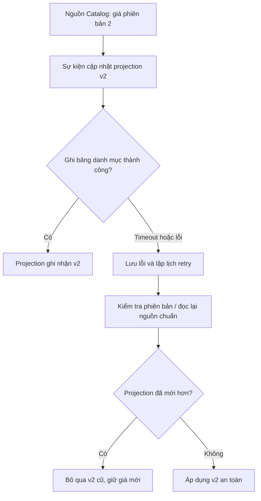

# Tần suất thay đổi thuộc tính và chi phí cập nhật nhiều bản trong Apache Cassandra

## Mục tiêu học tập

Ở chương **Quan hệ và dữ liệu lặp**, bài học này tập trung vào một quyết định cốt lõi khi thiết kế **Apache Cassandra**: **một thuộc tính thay đổi thường xuyên có nên được sao chép sang nhiều bảng phục vụ truy vấn hay không?** Sau bài học, bạn có thể:

- Giải thích quan hệ giữa **tần suất cập nhật**, **số bảng chứa bản sao**, **write amplification** và chi phí đồng bộ.
- Phân loại thuộc tính tương đối ổn định, thay đổi định kỳ và thay đổi liên tục; cân nhắc nhu cầu đọc trước khi sao chép.
- Ước tính số thao tác ghi khi tăng số bảng dẫn xuất và nhận diện các chi phí chưa thể hiện trong phép đếm đơn giản.
- Thiết kế bảng tra cứu theo truy vấn bằng **partition key** và **clustering columns**, trong đó mỗi nhóm thuộc tính có chiến lược cập nhật phù hợp.
- Thực hành CQL, xử lý cập nhật sai thứ tự, retry, đối soát và kết nối từ ứng dụng Java khi hệ thống có nhiều bản biểu diễn dữ liệu.

## 1. Bối cảnh: đọc nhanh thường đánh đổi bằng nhiều lần ghi

Cassandra là cơ sở dữ liệu phân tán theo mô hình **wide-column**: các hàng được định tuyến theo **partition key** và sắp xếp trong phân vùng theo **clustering columns**. Cassandra không cung cấp `JOIN` hay khóa ngoại theo cách của RDBMS. Để trả lời nhiều đường đọc, ứng dụng có thể lưu cùng một thực thể ở nhiều bảng:

- `products_by_id`: tra cứu đầy đủ sản phẩm bằng `product_id`.
- `products_by_category`: hiển thị sản phẩm trong danh mục theo thứ tự đăng bán.
- `products_by_brand`: hiển thị sản phẩm theo thương hiệu.
- `stock_by_product`: tra cứu số lượng tồn kho theo sản phẩm.

Giả sử trang danh mục và thương hiệu đều cần hiển thị `name` và `price`. Việc **sao chép** hai trường này sang các bảng danh sách giúp đọc nhanh mà không phải tìm từng sản phẩm bằng ID. Nhưng khi giá thay đổi, tất cả bản sao của `price` phải được cập nhật theo quy tắc của ứng dụng.

Nếu sao chép thêm `stock_quantity` vào mọi bảng danh sách, mỗi sự kiện bán hàng hoặc nhập hàng lại có thể kích hoạt nhiều lần ghi. Tần suất thay đổi của thuộc tính vì thế ảnh hưởng trực tiếp đến hiệu quả thiết kế.

> **Phân biệt hai loại sao chép:** *denormalization* tạo các **bảng logic khác nhau** để phục vụ truy vấn. *Replication* của Cassandra lưu **nhiều replica cho cùng dữ liệu** theo replication factor của keyspace. Một sự kiện có thể làm phát sinh nhiều thao tác ghi vào các bảng logic, và mỗi thao tác đó lại được nhân bản tới các replica tương ứng.

## 2. Ba nhóm thuộc tính theo tần suất thay đổi

Không có ngưỡng “ít thay đổi” hoặc “thay đổi nhiều” áp dụng cho mọi hệ thống. Hãy đo tần suất trong **workload thật**, đặc biệt lúc cao điểm, rồi kết hợp với số lượt đọc và yêu cầu độ mới của dữ liệu.

| Nhóm | Ví dụ | Đặc điểm | Hướng thiết kế thường phù hợp |
| --- | --- | --- | --- |
| Tương đối ổn định | `product_id`, `created_at`, `brand_id`, tên danh mục | Ít đổi hoặc bất biến theo quy tắc nghiệp vụ | Có thể sao chép rộng hơn nếu nhiều đường đọc thật sự cần |
| Thay đổi định kỳ | Tên sản phẩm, giá, ảnh đại diện, trạng thái xuất bản | Có chỉnh sửa nhưng tốc độ thấp hơn số lượt đọc danh sách | Sao chép có chọn lọc; mọi thay đổi phải được lan truyền |
| Thay đổi liên tục | Số lượng tồn kho, lượt xem, vị trí thiết bị, trạng thái thời gian thực | Ghi thường xuyên, nhiều tác nhân có thể cập nhật đồng thời | Cân nhắc tách nguồn riêng, đọc bổ sung, cache với độ trễ chấp nhận được hoặc mô hình chuyên biệt |

Ví dụ, cùng là `price`, một cửa hàng nhỏ đổi giá vài lần mỗi tuần trong khi hệ thống định giá động có thể đổi nhiều lần mỗi phút. Nhóm thuộc tính được xác định bằng **tần suất và cách sử dụng thực tế**, không phải chỉ bằng tên cột.

### Các câu hỏi trước khi sao chép một thuộc tính

1. **Ai sở hữu giá trị đúng?** Dịch vụ Catalog có thể sở hữu tên và giá; dịch vụ Inventory sở hữu lượng tồn. Bảng tra cứu theo danh mục chỉ là bản biểu diễn dẫn xuất.
2. **Bao nhiêu đường đọc thật sự cần giá trị này?** Nếu trang danh sách không hiển thị mô tả dài thì không cần sao chép mô tả.
3. **Giá trị thay đổi bao nhiêu lần mỗi giây/phút/ngày?** Phải xét trung bình và cao điểm.
4. **Có bao nhiêu bảng dẫn xuất chứa bản sao?** Thêm bảng đồng nghĩa thêm đích cập nhật.
5. **Đọc cũ trong bao lâu thì chấp nhận được?** Tên sản phẩm có thể được cập nhật chậm trong một số hệ thống; số lượng tồn dùng để quyết định đặt hàng có thể cần kiểm tra lại ở nguồn có thẩm quyền.
6. **Điều gì xảy ra khi cập nhật một bản thành công nhưng bản khác thất bại?** Cần retry, xử lý sai thứ tự và đối soát.

## 3. Ước lượng write amplification

Giả sử một thuộc tính được ghi vào **một bảng nguồn chuẩn** và **k bảng dẫn xuất**. Nếu một thay đổi cần cập nhật đủ tất cả bảng, số thao tác ghi CQL logic xấp xỉ:

\[
W_{\text{một thay đổi}} = 1 + k
\]

Nếu thuộc tính thay đổi trung bình **f lần/giây**, tốc độ ghi logic do thuộc tính đó gây ra là:

\[
W_{\text{giây}} \approx f(1+k)
\]

Với nhiều nhóm thuộc tính có tần suất và số bản sao khác nhau, có thể ước lượng:

\[
W_{\text{tổng}} \approx \sum_{i=1}^{n} f_i(1+k_i)
\]

Trong đó `f_i` là số sự kiện thay đổi thuộc tính hoặc **nhóm cột được ghi cùng nhau** trong một đơn vị thời gian, còn `k_i` là số bảng dẫn xuất cần được cập nhật bởi sự kiện đó. Nếu một sự kiện thay đổi nhiều trường trên cùng hàng của một bảng, ứng dụng có thể gộp chúng vào một `UPDATE` cho bảng đó; **không cộng lặp các lần ghi cùng bảng**. Công thức là mô hình ước lượng sơ bộ, chưa bao gồm retry, batch, compaction, repair và các thao tác phụ.

### Ví dụ có số liệu

Giả sử một sản phẩm có số lượng tồn kho thay đổi **10 lần/giây** trong giờ cao điểm:

| Thiết kế | Bảng nguồn | Số bảng dẫn xuất chứa tồn kho | Tổng thao tác CQL logic do tồn kho |
| --- | --- | --- | --- |
| Giữ tồn kho ở nguồn, đọc riêng khi cần | 1 | 0 | 10 ghi/giây |
| Sao chép vào danh mục | 1 | 1 | 20 ghi/giây |
| Sao chép vào danh mục, thương hiệu, danh sách khuyến mãi | 1 | 3 | 40 ghi/giây |

Ở phương án cuối, **30/40 thao tác ghi mỗi giây** nhằm duy trì bản dẫn xuất. Nếu cả bốn bảng có replication factor bằng 3, số đích ghi tới replica trong mô hình đơn giản có thể lên tới khoảng **120 lần ghi replica/giây**, trước khi tính retry và cơ chế nội bộ. Đây là phép minh họa bậc độ lớn: số yêu cầu mạng thực tế, số replica nhận ghi và tài nguyên tiêu thụ còn phụ thuộc consistency level, topology, coordinator và tình trạng cụm.

**Các chi phí đi kèm** không được bỏ qua:

- Lưu thêm dữ liệu trên nhiều bảng và replica, tăng lượng SSTable cần compaction, backup và repair.
- Ghi nhiều phân vùng trong một sự kiện, làm tăng tải coordinator và số lỗi cần xử lý.
- Cập nhật liên tục một số partition key “nóng”, gây mất cân bằng tải.
- Xóa, TTL hết hạn hoặc thay đổi khóa có thể tạo **tombstone**, làm ảnh hưởng chi phí đọc và compaction.
- Việc cập nhật giá trị cũ lặp lại nhiều lần vẫn có thể tạo thêm phiên bản dữ liệu ở tầng lưu trữ trước khi compaction xử lý.

Vì vậy, đánh giá write amplification cần đo cả **thao tác logic, tốc độ ghi theo partition, dung lượng, latency và chi phí vận hành**, không chỉ đếm số bảng.

## 4. Thiết kế bảng: dữ liệu ổn định ở bảng đọc, dữ liệu biến động cao ở nguồn phù hợp

Ví dụ hệ thống bán hàng cần ba kiểu truy vấn:

1. Xem chi tiết sản phẩm theo `product_id`.
2. Xem các sản phẩm mới trong một danh mục, hiển thị tên, giá và đơn vị tiền.
3. Xem **tồn kho hiện tại** khi người mua chuẩn bị đặt hàng.

Giả sử keyspace `shop` đã tồn tại và phiên CQL đang chọn keyspace đó.

```sql
USE shop;

-- Nguồn chuẩn cho dữ liệu Catalog trong ví dụ.
CREATE TABLE products_by_id (
    product_id uuid PRIMARY KEY,
    category_id uuid,
    brand_id uuid,
    published_at timestamp,
    name text,
    price decimal,
    currency text,
    description text,
    catalog_version bigint
);

-- Bảng biểu diễn dẫn xuất cho trang danh mục.
CREATE TABLE products_by_category (
    category_id uuid,
    published_at timestamp,
    product_id uuid,
    name text,
    price decimal,
    currency text,
    projection_version bigint,
    PRIMARY KEY ((category_id), published_at, product_id)
) WITH CLUSTERING ORDER BY (published_at DESC, product_id ASC);

-- Nguồn dữ liệu nghiệp vụ tồn kho, do dịch vụ Inventory sở hữu.
CREATE TABLE stock_by_product (
    product_id uuid PRIMARY KEY,
    available_quantity bigint,
    stock_version bigint,
    updated_at timestamp
);
```

Trong `products_by_category`, `category_id` là **partition key**; `published_at` và `product_id` là **clustering columns**, cho phép liệt kê sản phẩm mới nhất theo danh mục. `name`, `price`, `currency` được sao chép vì trang danh mục cần hiển thị. `description` chỉ có trong bảng chi tiết. `available_quantity` nằm riêng vì thay đổi rất thường xuyên và thuộc quyền sở hữu của Inventory.

**Giới hạn phân vùng:** một danh mục có hàng triệu sản phẩm có thể khiến phân vùng `category_id` quá lớn. Khi đó cần thiết kế bucket, ví dụ theo tháng đăng bán `(category_id, publication_month)`, hoặc phương án phân chia khác dựa trên tải; ứng dụng phải xử lý việc đọc qua nhiều bucket khi cần. Việc tách dữ liệu biến động cao **không tự giải quyết** phân vùng quá lớn.

### Ghi dữ liệu ban đầu

```sql
INSERT INTO products_by_id (
    product_id, category_id, brand_id, published_at,
    name, price, currency, description, catalog_version
) VALUES (
    11111111-1111-4111-8111-111111111111,
    22222222-2222-4222-8222-222222222222,
    33333333-3333-4333-8333-333333333333,
    '2026-11-21T01:00:00Z',
    'Bàn phím cơ', 750000.00, 'VND',
    'Bàn phím cơ dành cho lập trình viên',
    1
);

INSERT INTO products_by_category (
    category_id, published_at, product_id,
    name, price, currency, projection_version
) VALUES (
    22222222-2222-4222-8222-222222222222,
    '2026-11-21T01:00:00Z',
    11111111-1111-4111-8111-111111111111,
    'Bàn phím cơ', 750000.00, 'VND', 1
);

INSERT INTO stock_by_product (
    product_id, available_quantity, stock_version, updated_at
) VALUES (
    11111111-1111-4111-8111-111111111111,
    42, 1, '2026-11-21T01:00:00Z'
);
```

### Đọc danh sách và đọc tồn kho riêng khi cần

```sql
-- Một truy vấn trả về những cột trang danh mục cần.
SELECT product_id, published_at, name, price, currency
FROM products_by_category
WHERE category_id = 22222222-2222-4222-8222-222222222222
LIMIT 24;

-- Khi cần biết số lượng ở thời điểm hiện tại, tra nguồn Inventory.
SELECT available_quantity, stock_version, updated_at
FROM stock_by_product
WHERE product_id = 11111111-1111-4111-8111-111111111111;
```

Với trang 24 sản phẩm, tra tồn kho riêng **có thể tạo nhiều lượt đọc**, nên phải cân nhắc độ trễ và giới hạn số truy vấn song song. Các phương án gồm: chỉ tải tồn kho khi mở chi tiết, đọc bổ sung có kiểm soát cho những sản phẩm đang hiển thị, cache ngắn hạn khi chấp nhận dữ liệu trễ, hoặc tạo projection tồn kho chuyên biệt nếu nhu cầu đọc rất lớn và có ngân sách đồng bộ rõ ràng. Việc hiển thị “còn hàng” chỉ là thông tin giao diện; **quyết định đặt hàng** vẫn cần kiểm tra/giữ chỗ tại hệ thống Inventory có thẩm quyền, không dựa hoàn toàn vào giá trị hiển thị có thể cũ.

## 5. Cập nhật thuộc tính vừa phải: giá sản phẩm

Vì trang danh mục cần `price`, giá được sao chép vào `products_by_category`. Khi giá thay đổi, cần cập nhật **nguồn chuẩn Catalog** và **mọi bảng dẫn xuất chứa giá**.

Minh họa dùng lightweight transaction (LWT) trên hàng nguồn để kiểm tra phiên bản:

```sql
-- Chỉ đổi giá nếu phiên bản Catalog hiện tại bằng 1.
UPDATE products_by_id
SET price = 790000.00, catalog_version = 2
WHERE product_id = 11111111-1111-4111-8111-111111111111
IF catalog_version = 1;
```

Ứng dụng phải đọc kết quả `[applied]`. Nếu điều kiện không thành công, không được tự coi giá đã đổi hoặc phát projection phiên bản mới. Khi nguồn đã chấp nhận cập nhật, có thể cập nhật bảng danh mục:

```sql
UPDATE products_by_category
SET price = 790000.00, projection_version = 2
WHERE category_id = 22222222-2222-4222-8222-222222222222
  AND published_at = '2026-11-21T01:00:00Z'
  AND product_id = 11111111-1111-4111-8111-111111111111
IF projection_version = 1;
```

Trong ví dụ, LWT trên bảng dẫn xuất giúp tránh một số cập nhật đến sai thứ tự **khi có đúng phiên bản kỳ vọng**. Nếu hàng chưa tồn tại, phiên bản đã vượt quá 1, hoặc lỗi mạng xảy ra, ứng dụng cần đọc lại/đối soát và quyết định hành động. Một LWT trên nguồn và một LWT trên projection **không tạo thành một giao dịch ACID xuyên hai bảng**. LWT cũng có chi phí cao hơn ghi thường và cần được đo dưới tải thực tế.

Nếu hệ thống bảo đảm xử lý sự kiện **tuần tự cho từng `product_id`** và có cơ chế sửa lệch, projection có thể dùng ghi thường; nhưng cần biết Cassandra giải quyết xung đột giữa cell dựa trên **timestamp của ghi**, chứ không tự ưu tiên cột `projection_version` lớn hơn. Chỉ lưu `projection_version` mà không kiểm soát điều kiện/thứ tự **không chặn** một sự kiện cũ ghi đè một sự kiện mới.

## 6. Thuộc tính biến động cao: tồn kho, lượt xem và số đếm

### 6.1. Tách dữ liệu biến động mạnh khi đường đọc cho phép

Nếu `available_quantity` thay đổi 10 lần/giây, nhưng giá và tên chỉ đổi vài lần mỗi tuần, việc giữ tồn kho trong `stock_by_product` giúp phần lớn cập nhật Inventory **không đụng đến** các bảng danh mục. Nó tạo một ranh giới rõ: Catalog phục vụ đọc thông tin sản phẩm; Inventory chịu trách nhiệm tính và quyết định lượng tồn.

Minh họa cập nhật có kiểm soát trên một hàng tồn kho:

```sql
UPDATE stock_by_product
SET available_quantity = 41,
    stock_version = 2,
    updated_at = '2026-11-21T01:00:01Z'
WHERE product_id = 11111111-1111-4111-8111-111111111111
IF stock_version = 1;
```

Đoạn này **minh họa so sánh phiên bản**, chưa phải một hệ thống giữ chỗ tồn kho hoàn chỉnh. Muốn tránh bán quá lượng tồn hoặc xử lý nhập–xuất cùng lúc, ứng dụng cần thiết kế invariants, điều kiện cập nhật và quy trình giao dịch nghiệp vụ phù hợp. Với sản phẩm quá nóng, một partition key duy nhất cho tất cả sự kiện tồn kho có thể là điểm nghẽn; cần đo tải và có thể thay đổi mô hình, thay vì chỉ tăng số replica.

### 6.2. Đừng mặc định dùng collection hoặc counter để giải quyết mọi bản sao

- Một `map<uuid,int>` chứa tồn kho của mọi sản phẩm trong một hàng hoặc một `list` gồm toàn bộ sự kiện bán hàng sẽ phình to, khó phân trang và dễ tạo partition nóng. Những thực thể tăng không giới hạn thường cần **bảng riêng** và khóa hợp lý.
- CQL có kiểu `counter` cho một số trường hợp đếm, nhưng counter có ngữ nghĩa và giới hạn riêng; thao tác cộng có thể gặp vấn đề khi retry không kiểm soát. Counter không tự bảo đảm các bất biến nghiệp vụ phức tạp như “không bán âm kho” hoặc giao dịch liên hệ nhiều thực thể.
- Với lượt xem hoặc lượt thích thay đổi cực thường xuyên, đôi khi nên **ghi sự kiện/đếm theo bucket và tổng hợp định kỳ** thay vì cập nhật đồng bộ nhiều bảng theo mỗi sự kiện. Lượt đếm hiển thị trên danh sách có thể chấp nhận độ trễ, trong khi hệ thống thanh toán/tồn kho thường đòi hỏi quy tắc chặt chẽ hơn.

## 7. Các cách giảm số lần ghi mà vẫn đạt yêu cầu đọc

| Chiến lược | Khi phù hợp | Lợi ích | Đổi lại |
| --- | --- | --- | --- |
| Sao chép cột ổn định vào bảng danh sách | Danh sách đọc nhiều, dữ liệu ít thay đổi | Ít truy vấn bổ sung, độ trễ đọc thấp | Phải cập nhật khi trường thay đổi |
| Không sao chép cột biến động cao | Không cần thuộc tính ở mọi danh sách | Giảm fan-out ghi, ít bản cần đồng bộ | Tốn thêm lần đọc nếu giao diện cần |
| Đọc bổ sung theo ID | Cần dữ liệu chính xác cho số ít đối tượng | Giữ bảng tra cứu gọn | Có thể tăng N+1 reads nếu áp dụng cho trang lớn |
| Cache có TTL ngắn | Chấp nhận giá trị hiển thị trễ trong giới hạn | Giảm tải nguồn khi đọc lặp | Cần quy định thời gian cũ được chấp nhận |
| Projection cập nhật bất đồng bộ | Đường đọc chấp nhận trễ và có cơ chế phát lại | Tách tải ghi nghiệp vụ khỏi tải fan-out | Phải xử lý lỗi, out-of-order và quan sát lag |
| Tổng hợp/bucket theo thời gian | Dữ liệu đếm hoặc sự kiện có tốc độ rất cao | Tránh cập nhật cùng hàng liên tục | Kết quả tổng hợp có độ trễ; đọc cần gộp bucket |
| Chia projection theo đường đọc thật sự cần | Có ít truy vấn ổn định, đo được | Tránh nhân bản trường vô ích | Cần theo dõi thay đổi yêu cầu sản phẩm |

**Không chọn theo số bảng ít nhất.** Một bảng danh sách chứa đủ trường hiển thị có thể tiết kiệm hàng chục lượt đọc cho mỗi request. Một bảng danh sách chứa cả trường biến động mạnh nhưng rất ít được xem có thể gây nhiều ghi vô ích. Quyết định nằm ở tổng chi phí đọc, ghi và độ mới yêu cầu.

### Mô hình tải đọc–ghi đơn giản

Giả sử mỗi giây trang danh mục được xem `R` lần, mỗi trang có `m` sản phẩm. Không sao chép giá có thể khiến ứng dụng phát sinh tới `R × m` lần tra giá nếu không có cách gộp, cache hoặc tối ưu khác. Sao chép giá vào bảng danh mục làm giảm nhiều lần tra bổ sung, nhưng mọi lần sửa giá lại cần ghi nhiều đích.

Một cách đánh giá:

\[
\text{Chi phí tương đối}
\approx
\underbrace{\text{số lần đọc} \times \text{chi phí mỗi lần đọc}}_{\text{đường đọc}}
+
\underbrace{\text{số lần ghi} \times \text{chi phí mỗi lần ghi}}_{\text{đường ghi}}
+
\underbrace{\text{chi phí đồng bộ và vận hành}}_{\text{lỗi, lưu trữ, bảo trì}}
\]

Không nên gán một hệ số cố định cho mọi truy vấn: đọc/ghi có partition key rõ ràng, truy cập phân vùng nóng, kích thước row, consistency level và phân phối dữ liệu đều ảnh hưởng chi phí. Đo trên dữ liệu và tải đại diện trước khi chốt.

## 8. Sai lệch giữa các bản và cập nhật đến sai thứ tự

**Đồng bộ nhiều bảng là trách nhiệm của ứng dụng.** Giả sử giá mới được ghi vào `products_by_id`, nhưng ghi vào `products_by_category` timeout. Trang chi tiết hiển thị 790.000 VND trong khi danh mục vẫn hiển thị 750.000 VND. Nếu cùng lúc giá đổi tiếp thành 810.000 VND, sự kiện đổi 790.000 VND có thể đến sau và làm bản dẫn xuất quay lui nếu không có bảo vệ.



Những biện pháp cốt lõi:

1. **Định nghĩa nguồn chuẩn theo trường:** Catalog sở hữu giá; Inventory sở hữu tồn kho. Một bản trên trang danh mục không được ghi ngược vào nguồn tùy ý.
2. **Mang đủ khóa và phiên bản theo sự kiện:** ví dụ `product_id`, `category_id`, `published_at`, `catalog_version`, giá mới. Nếu đổi category, sự kiện cần khóa cũ và khóa mới.
3. **Thiết kế retry an toàn:** timeout không chứng minh ghi thất bại. Dùng khóa ổn định và thao tác idempotent khi có thể; tránh tăng counter hoặc phát lại hành động nghiệp vụ chỉ vì một bảng dẫn xuất timeout.
4. **Xử lý out-of-order:** serialize theo thực thể, dùng điều kiện cập nhật khi cần hoặc đọc lại nguồn chuẩn; không dựa riêng vào thứ tự nhận message.
5. **Đối soát định kỳ hoặc theo sự cố:** tìm bản thiếu, sai phiên bản, sai giá, bản thừa sau xóa/chuyển khóa; sửa từ nguồn có thẩm quyền.

### Consistency level có giải quyết được không?

Với replication factor 3 trong cùng datacenter, `LOCAL_QUORUM` thường yêu cầu 2 replica xác nhận một đọc/ghi trong datacenter đó. Điều này có ích cho tính nhất quán của **một bản ghi thuộc một bảng**, với các điều kiện topology và phiên bản thích hợp. Nó **không biến thao tác ghi Catalog và cập nhật ba bảng dẫn xuất thành một giao dịch nguyên tử**.

`LOGGED BATCH` có cơ chế đảm bảo các mutation trong batch cuối cùng được áp dụng trong những trường hợp lỗi, nhưng không có *isolation* hay rollback như giao dịch quan hệ. Batch trải trên nhiều phân vùng có chi phí, và không phải giải pháp hiệu năng để gom mọi câu `UPDATE` liên quan. `repair` của Cassandra sửa bất đồng giữa các replica của cùng bảng; nó không suy ra rằng giá ở bảng danh mục phải giống nguồn Catalog.

### Khi TTL và delete làm phức tạp hơn

Nếu bảng danh sách dùng TTL ngắn còn bảng nguồn giữ dữ liệu dài hạn, một bản dẫn xuất có thể biến mất trong khi nguồn vẫn còn. Nếu xóa sản phẩm, phải xử lý **mọi bảng chứa sản phẩm**, kể cả những bảng đã sao chép các thuộc tính chỉ dùng để tìm kiếm. Xóa/TTL tạo tombstone; compaction, repair và chính sách lưu giữ quyết định quá trình dọn dữ liệu. Không dùng TTL để che giấu việc thiếu cơ chế xóa và đối soát.

## 9. Ví dụ Java: chỉ lan truyền giá khi phiên bản nguồn hợp lệ

Trong ứng dụng dùng **Apache Cassandra Java Driver 4.x**, có thể chuẩn bị các câu lệnh một lần rồi dùng lại. Ví dụ dưới đây minh họa việc xác nhận cập nhật ở bảng nguồn và kiểm tra cập nhật có điều kiện ở bảng dẫn xuất.

```java
import com.datastax.oss.driver.api.core.CqlSession;
import com.datastax.oss.driver.api.core.cql.PreparedStatement;
import com.datastax.oss.driver.api.core.cql.ResultSet;

import java.math.BigDecimal;
import java.time.Instant;
import java.util.UUID;

// Giả sử session là CqlSession kết nối tới keyspace shop.
PreparedStatement updateSource = session.prepare(
    "UPDATE products_by_id " +
    "SET price = ?, catalog_version = ? " +
    "WHERE product_id = ? IF catalog_version = ?");

PreparedStatement updateCategory = session.prepare(
    "UPDATE products_by_category " +
    "SET price = ?, projection_version = ? " +
    "WHERE category_id = ? AND published_at = ? AND product_id = ? " +
    "IF projection_version = ?");

UUID productId = UUID.fromString(
    "11111111-1111-4111-8111-111111111111");
UUID categoryId = UUID.fromString(
    "22222222-2222-4222-8222-222222222222");
Instant publishedAt = Instant.parse("2026-11-21T01:00:00Z");
BigDecimal newPrice = new BigDecimal("790000.00");

long oldVersion = 1L;
long newVersion = 2L;

ResultSet sourceResult = session.execute(updateSource.bind(
    newPrice, newVersion, productId, oldVersion));
if (!sourceResult.wasApplied()) {
    throw new IllegalStateException(
        "Gia/phiên bản đã thay đổi; cần đọc lại nguồn chuẩn");
}

ResultSet projectionResult = session.execute(updateCategory.bind(
    newPrice, newVersion, categoryId, publishedAt, productId, oldVersion));
if (!projectionResult.wasApplied()) {
    // Có thể projection chưa có hàng hoặc đã ở phiên bản khác.
    // Đọc lại nguồn và projection, rồi đối soát theo quy tắc nghiệp vụ.
    throw new IllegalStateException(
        "Projection cần được kiểm tra và đồng bộ lại");
}
```

Đoạn mã chỉ biểu diễn **đường ghi thành công có kiểm tra phiên bản**, không phải mã hoàn chỉnh cho lỗi/timeout, phát sự kiện và khôi phục. Trong thực tế, thao tác thành công trên nguồn rồi thất bại ở projection phải được **ghi nhận bền vững** hoặc được phát hiện bởi quy trình đối soát. Không nên retry mù toàn bộ hàm: lần đầu có thể đã cập nhật nguồn từ phiên bản 1 lên 2, nên lần thử lại với `IF catalog_version = 1` sẽ thất bại dù thay đổi nguồn đã được áp dụng. Cần xác minh trạng thái trước khi quyết định retry đường ghi nào.

LWT trên projection giúp kiểm tra một hàng cụ thể, nhưng khi cần cập nhật nhiều bảng dẫn xuất, vẫn phải xử lý kết quả riêng của từng bảng. Nếu tần suất ghi rất cao, chi phí LWT có thể trở nên đáng kể; khi đó phải cân nhắc serialization theo khóa, mô hình sự kiện hoặc thiết kế ít bản sao hơn.

## 10. Quan sát và kiểm chứng hiệu quả thiết kế

Trước khi quyết định sao chép `price`, `stock_quantity` hay `view_count` sang bảng đọc, hãy thu thập số liệu theo **một khoảng thời gian đại diện**, bao gồm giờ cao điểm:

| Nhóm chỉ số | Ý nghĩa cần trả lời |
| --- | --- |
| Số thay đổi/giây cho từng thuộc tính | Trường nào thực sự gây nhiều thao tác ghi? |
| Số bảng dẫn xuất phải nhận mỗi sự kiện | Fan-out ghi hiện tại và khi thêm một đường đọc là bao nhiêu? |
| P95/P99 latency của đường đọc | Sao chép cột có thực sự loại bỏ nút thắt đọc? |
| P95/P99 latency của đường ghi và số timeout | Ghi nhiều bảng có ảnh hưởng tốc độ xử lý nghiệp vụ? |
| Hàng thiếu/sai phiên bản ở projection | Bảng đọc có bị cũ và quá thời gian chấp nhận? |
| Tuổi sự kiện chưa được chiếu và số retry | Luồng đồng bộ đang tụt phía sau nguồn bao lâu? |
| Phân vùng lớn/nóng, kích thước SSTable | Khóa phân vùng và lượng dữ liệu lặp có cân bằng không? |
| Tombstone, compaction, repair, dung lượng | Giá vận hành của vòng đời dữ liệu lặp |

Một thử nghiệm hữu ích là so sánh **hai phiên bản của trang danh mục** trên tải đại diện: (A) đọc thuộc tính biến động mạnh từ nguồn khi cần; (B) sao chép thuộc tính sang projection và cập nhật khi thay đổi. Cùng đo latency đọc, số yêu cầu tới Cassandra, write throughput, độ lệch dữ liệu và tải vận hành. Chọn phương án đáp ứng **cả mục tiêu đọc và ngân sách ghi**, thay vì chỉ tối ưu thời gian đọc ở một màn hình.

### Những lỗi dễ gặp

| Lựa chọn | Hệ quả | Điều chỉnh |
| --- | --- | --- |
| Sao chép tất cả cột vào mọi bảng | Dung lượng và write amplification tăng, nhiều điểm sai lệch | Chỉ sao chép cột thực sự cần cho mỗi truy vấn |
| Cập nhật giá ở nguồn nhưng quên bảng danh mục | Chi tiết và danh sách hiển thị giá khác nhau | Lập bảng ánh xạ sự kiện → các projection cần cập nhật |
| Lưu `version` nhưng dùng `UPDATE` thường không kiểm tra | Sự kiện cũ có thể ghi đè bản mới | Kiểm soát thứ tự hoặc dùng điều kiện/version đúng cách |
| Coi `LOCAL_QUORUM` là giao dịch đa bảng | Có thể một bảng đã ghi còn bảng khác thiếu | Retry, phát lại sự kiện và đối soát ở ứng dụng |
| Dồn hàng triệu bản ghi vào cùng partition | Phân vùng lớn, truy vấn/xóa và compaction nặng | Chọn bucket theo workload và cách truy vấn |
| Ghi lượt xem/tồn kho vào nhiều bảng ở từng sự kiện | Tăng đột biến tải ghi, bảng đọc thường xuyên cũ | Tách thuộc tính biến động cao hoặc tổng hợp theo mục tiêu |
| Retry thao tác tăng đếm mà không bảo vệ | Sự kiện bị nhân đôi hoặc tính sai | Xác định idempotency và ngữ nghĩa counter/sự kiện |

## 11. Bài thực hành

Một nền tảng học trực tuyến có bảng `courses_by_id`, `courses_by_category`, `courses_by_author`. Trang danh sách cần `course_id`, `title`, `price`, `thumbnail_url`; trang chi tiết có `description`, `lesson_count` và `enrollment_count`. Các dữ kiện có tần suất thay đổi giả định:

- `title`: khoảng 1 lần/tháng/khóa học.
- `price`: khoảng 1 lần/tuần/khóa học.
- `thumbnail_url`: khoảng 1 lần/quý/khóa học.
- `enrollment_count`: tăng mỗi khi có người đăng ký; với khóa học phổ biến có thể hàng chục lần/giây.
- `description`: lâu lâu mới sửa, chỉ hiển thị ở trang chi tiết.

**Yêu cầu:**

1. Chọn cột nên sao chép vào hai bảng danh sách và giải thích theo cả **tần suất thay đổi** lẫn **yêu cầu hiển thị**.
2. Nếu `enrollment_count` thay đổi 8 lần/giây và được sao chép vào hai bảng danh sách, hãy ước tính số thao tác ghi logic/giây gồm một nguồn và hai projection.
3. Nếu bỏ sao chép `enrollment_count`, người dùng vẫn muốn nhìn thấy lượt đăng ký trên trang chi tiết, cần thiết kế đường đọc và quy tắc độ mới thế nào?
4. Nếu đổi giá từ 299.000 thành 349.000 VND mà chỉ một trong hai projection cập nhật thành công, hệ thống cần khôi phục ra sao?
5. Nếu khóa học chuyển `category_id`, vì sao cập nhật một cột thường ở bảng danh mục là không đủ?

**Gợi ý tự kiểm tra:**

- `title`, `price`, `thumbnail_url` là ứng viên tốt cho bảng danh sách vì được hiển thị thường xuyên và có tần suất thay đổi có thể quản lý. `description` không cần lặp nếu chỉ trang chi tiết dùng. `enrollment_count` có thể được tách sang mô hình đếm/tổng hợp riêng tùy tần suất và độ trễ được phép.
- Với 8 thay đổi/giây và hai bảng dẫn xuất: `8 × (1 + 2) = 24` thao tác ghi logic/giây, giả sử mỗi thay đổi yêu cầu một ghi ở từng bảng và không gộp sự kiện.
- Đường đọc chi tiết có thể lấy bộ đếm từ hệ thống có thẩm quyền, hoặc dùng giá trị tổng hợp được gắn thời điểm cập nhật nếu cho phép trễ. Các thao tác tạo ghi danh phải do mô hình Enrollment quyết định; không lấy bản sao đếm để áp đặt điều kiện nghiệp vụ.
- Sự kiện đổi giá cần phiên bản, retry an toàn và đối soát bảng chưa nhận cập nhật. Khi đổi `category_id`, khóa phân vùng của bảng danh mục thay đổi: phải **xóa hàng ở phân vùng cũ và ghi hàng ở phân vùng mới**, đồng thời cập nhật nguồn chuẩn và xử lý lỗi giữa các bước.

## Tổng kết

Trong Cassandra, **tần suất thay đổi của thuộc tính** là một tham số quan trọng của thiết kế bảng theo truy vấn. Thuộc tính ít thay đổi và được đọc thường xuyên có thể đáng sao chép; thuộc tính biến động cao cần được cân nhắc kỹ vì mỗi bản dẫn xuất tạo thêm thao tác ghi, nguy cơ dữ liệu sai lệch và chi phí vận hành. Hãy đo tần suất thay đổi, số bảng phải cập nhật, mục tiêu độ trễ đọc, khả năng chấp nhận dữ liệu cũ và kích thước phân vùng. Sau đó mới quyết định **sao chép trực tiếp, đọc bổ sung, cache, tổng hợp hay tách nguồn theo nghiệp vụ**. Dù chọn cách nào, xử lý lỗi, idempotency, thứ tự sự kiện và đối soát luôn phải là một phần của thiết kế dữ liệu phân tán.
