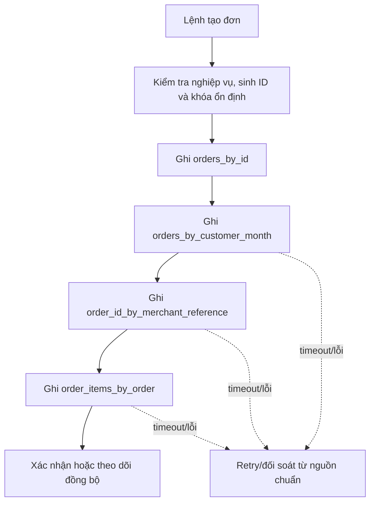
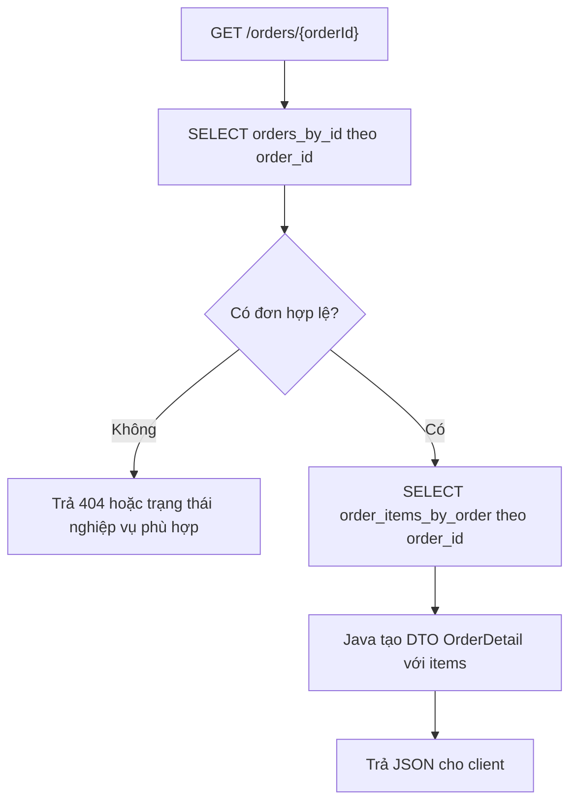

# Ghi đến nhiều bảng (fan-out) và tập hợp dữ liệu tại ứng dụng khi đọc trong Apache Cassandra

## Mục tiêu học tập

Trong chương **Quan hệ và dữ liệu lặp** của Apache Cassandra, việc thiết kế theo truy vấn có thể tạo ra hai kiểu công việc ở tầng ứng dụng:

- **Fan-out khi ghi**: một thay đổi nghiệp vụ tạo nhiều thao tác ghi tới các bảng khác nhau để duy trì những đường tra cứu.
- **Tập hợp khi đọc (application-side assembly)**: ứng dụng đọc nhiều bảng theo các khóa đã biết rồi kết hợp kết quả thành dữ liệu trả về cho API hoặc giao diện.

Hoàn thành bài học, bạn có thể:

1. Phân biệt fan-out ghi, fan-out đọc và replication giữa các node Cassandra.
2. Thiết kế các bảng có partition key phù hợp với danh sách, chi tiết, tra cứu bằng mã bên ngoài và dòng hàng của một đơn.
3. Viết CQL tạo, cập nhật và đọc từ nhiều bảng; chọn cột cần sao chép để tránh những lượt đọc bổ sung không cần thiết.
4. Nhận diện ghi thành công một phần, timeout, đọc lệch phiên bản, sự kiện lặp, sự kiện sai thứ tự và các cách khôi phục.
5. Dùng Java Driver để tập hợp dữ liệu mà không tạo quá nhiều truy vấn, không tải hết dữ liệu lớn vào bộ nhớ và không lầm tưởng nhiều truy vấn là một snapshot nguyên tử.

## 1. Từ một thực thể nghiệp vụ đến nhiều bảng Cassandra

Trong RDBMS, ta thường dùng bảng đơn hàng, dòng hàng và khách hàng, rồi ghép bằng `JOIN`. Cassandra là cơ sở dữ liệu phân tán theo mô hình **wide-column**, nơi các truy vấn hiệu quả thường bắt đầu bằng **partition key**; các **clustering columns** điều khiển thứ tự các hàng trong phân vùng. Cassandra không cung cấp `JOIN` và khóa ngoại theo cách của RDBMS.

Vì thế, cùng một đơn hàng có thể xuất hiện ở nhiều bảng có khóa khác nhau:

| Bảng | Đường đọc phục vụ | Bản chất dữ liệu |
| --- | --- | --- |
| `orders_by_id` | Mở chi tiết theo `order_id` | Trạng thái đơn do dịch vụ Order sở hữu |
| `orders_by_customer_month` | Liệt kê đơn mới nhất của khách hàng trong một tháng | Bản dẫn xuất với một số cột sao chép |
| `order_id_by_merchant_reference` | Tìm `order_id` bằng mã tham chiếu của người bán | Ánh xạ khóa phục vụ tra cứu |
| `order_items_by_order` | Đọc các dòng hàng thuộc một đơn | Dữ liệu con, mỗi dòng là một hàng độc lập |

Một lệnh “tạo đơn” có thể ghi vào **ba bảng đầu**; những dòng hàng có vòng đời và khóa riêng được ghi vào bảng thứ tư. Khi mở trang chi tiết, ứng dụng có thể đọc `orders_by_id` và `order_items_by_order` rồi kết hợp dữ liệu tại Java.

### Ba khái niệm thường bị nhầm

- **Write fan-out**: một sự kiện nghiệp vụ dẫn đến nhiều câu `INSERT`, `UPDATE` hoặc `DELETE` ở **nhiều bảng logic**.
- **Read fan-out/application-side assembly**: một yêu cầu API dẫn đến nhiều truy vấn CQL theo các khóa đã biết; ứng dụng ghép kết quả, áp dụng quy tắc thiếu dữ liệu và trả về DTO.
- **Replication**: mỗi bảng/phân vùng được lưu ở nhiều replica theo replication factor của keyspace; replication **không tự đồng bộ** các bảng logic khác nhau.

Mở rộng số bảng giúp nhiều đường đọc nhanh hơn, nhưng đồng thời tăng công việc ghi, số trường hợp lỗi và khả năng dữ liệu trên các màn hình không khớp tạm thời.

## 2. Bắt đầu bằng hợp đồng truy vấn

Giả sử API yêu cầu:

1. `GET /customers/{customerId}/orders?month=2026-11`: hiển thị 20 đơn mới nhất, gồm ID, thời điểm, trạng thái và tổng tiền.
2. `GET /orders/{orderId}`: hiển thị đơn và toàn bộ dòng hàng.
3. `GET /merchants/{merchantId}/orders/by-reference/{reference}`: tra đơn theo mã tham chiếu bên ngoài do người bán cung cấp.

Ta chưa cần sao chép mọi cột của đơn sang ba bảng. Hãy xác định **khóa tra cứu** và **cột trả về**:

| Đường đọc | Khóa dùng để đọc | Cột cần lấy trực tiếp | Có cần truy vấn tiếp? |
| --- | --- | --- | --- |
| Danh sách theo khách hàng/tháng | `customer_id` + `order_month` | `order_id`, `ordered_at`, `status`, `total_amount`, `currency` | Không, nếu các cột hiển thị đã có trong bảng danh sách |
| Chi tiết đơn | `order_id` | Chi tiết đơn, địa chỉ, phiên bản | Có: đọc thêm dòng hàng theo cùng `order_id` |
| Tra theo mã người bán | `merchant_id` + `external_reference` | `order_id` | Có: từ ID chuyển sang bảng chi tiết |

**Thiết kế theo truy vấn** không có nghĩa một bảng cho mỗi endpoint. Những endpoint có cùng khóa phân vùng và cách sắp xếp tương thích có thể dùng chung một bảng. Tạo bảng mới khi khóa tra cứu, thứ tự hoặc hình dạng dữ liệu thật sự khác.

## 3. Ví dụ CQL: khóa rõ ràng cho từng đường đọc

Giả sử đã tạo keyspace `shop` với chính sách replication phù hợp môi trường, và đang kết nối tới keyspace đó:

```sql
USE shop;

-- Bảng chi tiết được dịch vụ Order quản lý trong ví dụ.
CREATE TABLE orders_by_id (
    order_id uuid PRIMARY KEY,
    merchant_id uuid,
    external_reference text,
    customer_id uuid,
    order_month date,
    ordered_at timestamp,
    status text,
    total_amount decimal,
    currency text,
    shipping_address text,
    source_version bigint,
    deleted boolean
);

-- Bản dẫn xuất phục vụ trang danh sách khách hàng.
CREATE TABLE orders_by_customer_month (
    customer_id uuid,
    order_month date,
    ordered_at timestamp,
    order_id uuid,
    status text,
    total_amount decimal,
    currency text,
    source_version bigint,
    PRIMARY KEY ((customer_id, order_month), ordered_at, order_id)
) WITH CLUSTERING ORDER BY (ordered_at DESC, order_id ASC);

-- Ánh xạ mã tham chiếu của từng merchant về một đơn.
CREATE TABLE order_id_by_merchant_reference (
    merchant_id uuid,
    external_reference text,
    order_id uuid,
    PRIMARY KEY ((merchant_id, external_reference))
);

-- Dòng hàng của đơn: một hàng cho mỗi line_no.
CREATE TABLE order_items_by_order (
    order_id uuid,
    line_no int,
    sku text,
    quantity int,
    unit_price decimal,
    PRIMARY KEY ((order_id), line_no)
);
```

**Giải thích khóa:**

- `orders_by_id`: partition key là `order_id`, phù hợp tra cứu một đơn.
- `orders_by_customer_month`: partition key ghép `(customer_id, order_month)`, clustering `ordered_at` giảm dần và `order_id` để phân biệt các đơn cùng thời điểm.
- `order_id_by_merchant_reference`: partition key ghép hai trường, tối ưu **tra cứu chính xác một cặp** `(merchant_id, external_reference)`. Nó không hỗ trợ tự động liệt kê mọi mã theo `merchant_id`; nếu cần danh sách mã theo merchant, sẽ cần mô hình khác.
- `order_items_by_order`: partition key `order_id`, clustering `line_no`, cho phép lấy các dòng hàng theo thứ tự số dòng.

Trong ví dụ, `order_month` là ngày đầu tháng **UTC** tính từ `ordered_at`, chẳng hạn `2026-11-01`. Ứng dụng phải tính và lưu ổn định giá trị này. Đối với khách hàng có quá nhiều đơn trong một tháng hoặc đơn có số dòng cực lớn, cần đánh giá kích thước phân vùng và cân nhắc bucket nhỏ hơn; không mặc định “một partition theo cha” sẽ luôn đủ nhỏ.

### Tại sao không sao chép tất cả?

Bảng danh sách chỉ cần các cột ngắn mà màn hình hiển thị. `shipping_address` không được sao chép vì chỉ cần khi mở chi tiết và có thể là thông tin nhạy cảm. Danh sách dòng hàng cũng không được nhúng vào bảng danh sách nếu số dòng có thể lớn hoặc cần cập nhật độc lập.

Một vài cột lặp như `status`, `total_amount` là **denormalization có chủ đích** để đọc nhanh, đổi lại ứng dụng phải cập nhật mọi bản sao khi giá trị đó thay đổi.

## 4. Fan-out khi tạo mới: một sự kiện, nhiều thao tác ghi

Khi tạo một đơn, dịch vụ Order có thể thực hiện:



Các mũi tên mô tả **quy trình nghiệp vụ cần thiết**, không khẳng định các ghi trong nhiều phân vùng có tính nguyên tử như giao dịch RDBMS. Thứ tự thực hiện có thể khác tùy thiết kế, nhưng phải xác định rõ **khi nào coi đơn đã được chấp nhận** và cách khôi phục nếu một bước chưa hoàn tất.

Cùng một đơn sử dụng các khóa bất biến:

- `order_id = 11111111-1111-4111-8111-111111111111`;
- `merchant_id = 22222222-2222-4222-8222-222222222222`;
- `customer_id = 33333333-3333-4333-8333-333333333333`;
- `external_reference = 'SHOP-2026-001'`;
- `ordered_at = '2026-11-21T01:00:00Z'`, `order_month = '2026-11-01'`.

### Ghi ba biểu diễn của đơn

```sql
-- 1. Ghi thông tin đơn tại bảng nguồn chuẩn trong ví dụ.
INSERT INTO orders_by_id (
    order_id, merchant_id, external_reference, customer_id,
    order_month, ordered_at, status, total_amount, currency,
    shipping_address, source_version, deleted
) VALUES (
    11111111-1111-4111-8111-111111111111,
    22222222-2222-4222-8222-222222222222,
    'SHOP-2026-001',
    33333333-3333-4333-8333-333333333333,
    '2026-11-01', '2026-11-21T01:00:00Z',
    'CREATED', 420000.00, 'VND',
    '12 Nguyen Hue, Ho Chi Minh City', 1, false
);

-- 2. Ghi bản dẫn xuất cho danh sách đơn.
INSERT INTO orders_by_customer_month (
    customer_id, order_month, ordered_at, order_id,
    status, total_amount, currency, source_version
) VALUES (
    33333333-3333-4333-8333-333333333333,
    '2026-11-01', '2026-11-21T01:00:00Z',
    11111111-1111-4111-8111-111111111111,
    'CREATED', 420000.00, 'VND', 1
);

-- 3. Ghi bảng ánh xạ theo mã bên ngoài.
INSERT INTO order_id_by_merchant_reference (
    merchant_id, external_reference, order_id
) VALUES (
    22222222-2222-4222-8222-222222222222,
    'SHOP-2026-001',
    11111111-1111-4111-8111-111111111111
);
```

### Ghi dòng hàng bằng khóa của đơn

```sql
INSERT INTO order_items_by_order (
    order_id, line_no, sku, quantity, unit_price
) VALUES (
    11111111-1111-4111-8111-111111111111,
    1, 'KEYBOARD-001', 1, 300000.00
);

INSERT INTO order_items_by_order (
    order_id, line_no, sku, quantity, unit_price
) VALUES (
    11111111-1111-4111-8111-111111111111,
    2, 'MOUSE-002', 1, 120000.00
);
```

`order_items_by_order` lưu dữ liệu con độc lập; ghi hai dòng này là một phần thao tác tạo đơn nhưng **không nhất thiết là “sao chép” từ bảng `orders_by_id`**. Cần phân biệt ghi nhiều thực thể con với việc lặp cùng một thuộc tính sang các bảng dẫn xuất.

### Đảm bảo mã tham chiếu không bị chiếm bởi đơn khác

Một `INSERT` thường vào `order_id_by_merchant_reference` có thể ghi đè `order_id` tại cùng khóa. Nếu hệ thống yêu cầu duy nhất một đơn ứng với mỗi cặp `(merchant_id, external_reference)`, có thể dùng:

```sql
INSERT INTO order_id_by_merchant_reference (
    merchant_id, external_reference, order_id
) VALUES (
    22222222-2222-4222-8222-222222222222,
    'SHOP-2026-001',
    11111111-1111-4111-8111-111111111111
) IF NOT EXISTS;
```

Lệnh có điều kiện dùng **lightweight transaction (LWT)**; ứng dụng phải kiểm tra cột `[applied]` hoặc `ResultSet.wasApplied()`. LWT chỉ bảo vệ điều kiện trên hàng/partition phù hợp. Nó **không tự bảo đảm** rằng đã tạo thành công `orders_by_id` và mọi bảng còn lại. Nếu đặt chỗ mã tham chiếu trước rồi ghi đơn thất bại, phải có cơ chế xử lý bản ánh xạ chưa có đơn; nếu ghi đơn trước rồi đặt mã thất bại, phải có cơ chế giải quyết xung đột. Cần xác định quy tắc nghiệp vụ và đối soát cho cả hai hướng lỗi.

## 5. Fan-out khi cập nhật và xóa

Giả sử trạng thái chuyển từ `CREATED` sang `PAID`. Bảng chi tiết và bảng danh sách đều lưu `status` nên cần hai thao tác ghi:

```sql
UPDATE orders_by_id
SET status = 'PAID', source_version = 2
WHERE order_id = 11111111-1111-4111-8111-111111111111;

UPDATE orders_by_customer_month
SET status = 'PAID', source_version = 2
WHERE customer_id = 33333333-3333-4333-8333-333333333333
  AND order_month = '2026-11-01'
  AND ordered_at = '2026-11-21T01:00:00Z'
  AND order_id = 11111111-1111-4111-8111-111111111111;
```

Đây là ví dụ cơ bản khi không có ghi cạnh tranh. Trong môi trường nhiều tác nhân, cần kiểm soát **chuyển trạng thái hợp lệ và phiên bản** tại nguồn, chẳng hạn dùng `UPDATE ... IF source_version = ?` ở nơi phù hợp rồi chỉ chiếu bản đã được chấp nhận. Chỉ thêm cột version mà vẫn cập nhật vô điều kiện **không bảo vệ** khỏi sự kiện đến sai thứ tự, bởi Cassandra giải quyết xung đột giữa các cell dựa trên timestamp ghi.

Bảng `order_id_by_merchant_reference` không chứa `status` nên **không cần ghi khi trạng thái đổi**. Đây là lợi ích của việc chọn dữ liệu lặp vừa đủ.

Nếu đổi `customer_id` hoặc `ordered_at`, các thành phần khóa chính của `orders_by_customer_month` thay đổi. Cassandra không cho thay khóa chính của hàng tại chỗ: ứng dụng phải **xóa bản ở khóa cũ và ghi bản ở khóa mới**. Nếu xóa đơn, phải xử lý tất cả các bảng chứa bản ghi liên quan, bao gồm bảng danh sách, ánh xạ tham chiếu và các dòng hàng, theo chính sách dữ liệu. Cassandra không có `ON DELETE CASCADE` cho các bảng này.

### Bảng ánh xạ sự kiện → ghi cần thực hiện

| Sự kiện | `orders_by_id` | `orders_by_customer_month` | `order_id_by_merchant_reference` | `order_items_by_order` |
| --- | --- | --- | --- | --- |
| Tạo đơn | INSERT | INSERT | INSERT/LWT nếu cần duy nhất | INSERT các dòng |
| Đổi trạng thái | UPDATE | UPDATE | Không cần | Không cần nếu dòng hàng không chứa trạng thái |
| Sửa địa chỉ | UPDATE | Không cần | Không cần | Không cần |
| Thêm dòng hàng | Có thể cập nhật tổng tiền | Cập nhật tổng tiền nếu đổi | Không cần | INSERT dòng |
| Chuyển khách hàng | UPDATE trường tương ứng | DELETE khóa cũ + INSERT khóa mới | Thường giữ nguyên | Thường giữ nguyên |
| Xóa theo nghiệp vụ | Xóa logic/vật lý có kiểm soát | DELETE | DELETE | DELETE/TTL theo chính sách |

Ma trận trên là một **hợp đồng lan truyền thay đổi**. Khi thêm cột mới vào bảng dẫn xuất hoặc thêm một bảng tra cứu, cần cập nhật ma trận, đường ghi, kiểm thử nghiệp vụ và quy trình sửa dữ liệu cũ.

## 6. Ghi thành công một phần và khôi phục

Fan-out tạo tình huống một thao tác thành công còn thao tác khác lỗi. Ví dụ:

1. `orders_by_id` ghi thành công.
2. Ghi `orders_by_customer_month` bị timeout.
3. Ghi `order_id_by_merchant_reference` chưa được thực hiện.
4. Người dùng mở chi tiết bằng ID thấy đơn, nhưng danh sách và tra bằng mã tham chiếu chưa thấy.

**Timeout không đồng nghĩa chắc chắn ghi thất bại.** Coordinator có thể đã gửi mutation tới replica trước khi timeout trả về. Vì vậy, không nên thử lại toàn bộ hành động nghiệp vụ theo cách tạo ID mới, tính tiền lại hoặc phát email lần nữa chỉ vì một bảng dẫn xuất chưa phản hồi.

Một quy trình xử lý lỗi có thể gồm:

1. **Chốt nguồn có thẩm quyền**: trong ví dụ, dịch vụ Order quyết định trạng thái của `orders_by_id`; các bảng tra cứu được tái tạo từ trạng thái nguồn đã chấp nhận.
2. **Giữ bộ khóa ổn định**: tạo `order_id`, `ordered_at`, `order_month` một lần; retry không sinh ID hoặc bucket mới.
3. **Theo dõi các đích ghi**: bảng nào thành công, bảng nào chưa rõ, phiên bản nguồn bao nhiêu.
4. **Có cơ chế khôi phục bền vững**: sự kiện với khả năng phát lại, job đối soát, hoặc phối hợp với nguồn sự kiện đáng tin cậy. Phải giải quyết khoảng hở giữa lúc ghi nguồn thành công và lúc sự kiện được phát ra.
5. **Đối soát theo dữ kiện hiện tại**: nếu có sự kiện mới hơn, không áp dụng sự kiện cũ để ghi đè trạng thái mới.
6. **Dọn bản thừa**: xử lý cả trường hợp bảng tra cứu có bản ghi nhưng nguồn đã xóa, đổi khóa hoặc không còn hợp lệ.

Sự kiện cho projection nên mang đủ dữ liệu để tái tạo: `order_id`, khóa cũ/mới (nếu có), những cột cần sao chép, `source_version` hoặc mã sự kiện, cùng ngữ nghĩa tạo/sửa/xóa. Với luồng phát lại *at-least-once*, các consumer phải chịu được việc nhận cùng sự kiện nhiều lần.

### Có nên dùng BATCH?

Cassandra hỗ trợ `BEGIN BATCH ... APPLY BATCH`, trong đó **logged batch** có cơ chế để các mutation trong batch được áp dụng cuối cùng sau một số trường hợp lỗi. Nhưng:

- Nó **không cung cấp transaction isolation** và rollback như hệ quản trị quan hệ.
- Batch trải trên nhiều phân vùng có chi phí batchlog và có thể gây thêm tải; không phải cách mặc định để tăng tốc toàn bộ ghi.
- Nó không giải quyết riêng các thao tác phụ ngoài Cassandra (message broker, thanh toán, email).
- Không nên cho rằng một lần đọc nhiều bảng trong lúc batch đang được áp dụng sẽ có snapshot nhất quán theo thời điểm.

Có thể cân nhắc batch khi cần ngữ nghĩa phù hợp và đã đánh giá tải, nhưng yêu cầu idempotency, xử lý timeout, đối soát và kiểm soát trạng thái nghiệp vụ vẫn cần được thiết kế riêng.

### Consistency level và replication

`LOCAL_QUORUM`, nếu replication factor/topology đáp ứng, thường giúp đọc và ghi của **cùng dữ liệu** có giao nhau đủ replica trong một datacenter. Tuy nhiên, hai câu ghi vào **hai bảng logic** vẫn là hai mutation độc lập. `LOCAL_QUORUM` không tạo một giao dịch xuyên `orders_by_id` và `orders_by_customer_month`. Tương tự, **repair** của Cassandra xử lý bất đồng giữa các replica thuộc cùng bảng, không tự biết cách tính lại projection từ nguồn chuẩn.

Khi xóa hoặc dùng TTL, dữ liệu hết hạn có thể tạo **tombstone**; compaction và repair ảnh hưởng cách duy trì/dọn tombstone ở các replica. Xóa hàng nguồn không tự xóa hàng ở các bảng dẫn xuất.

## 7. Tập hợp dữ liệu ở ứng dụng khi đọc

Fan-out ghi giúp tối ưu một số truy vấn đọc; tuy nhiên không phải mọi màn hình đều có thể hoặc nên lưu sẵn toàn bộ dữ liệu trong một hàng. Trang chi tiết đơn cần các dòng hàng và có thể cần thông tin khách hàng, nên ứng dụng kết hợp kết quả từ vài truy vấn.



Trường hợp này thường chỉ có **hai truy vấn theo partition key rõ ràng** và mỗi truy vấn trả về đúng một thực thể hoặc một tập dòng của đơn. Java biết `order_id` từ yêu cầu, rồi dùng nó đọc từng bảng, thay vì gửi một truy vấn CQL cố gắng `JOIN`.

### Các truy vấn CQL dùng khi đọc

```sql
-- A. Danh sách 20 đơn mới nhất của khách hàng trong tháng.
SELECT order_id, ordered_at, status, total_amount, currency
FROM orders_by_customer_month
WHERE customer_id = 33333333-3333-4333-8333-333333333333
  AND order_month = '2026-11-01'
LIMIT 20;

-- B. Chi tiết đơn bằng ID.
SELECT order_id, customer_id, status, total_amount,
       currency, shipping_address, source_version, deleted
FROM orders_by_id
WHERE order_id = 11111111-1111-4111-8111-111111111111;

-- C. Các dòng hàng của đơn.
SELECT line_no, sku, quantity, unit_price
FROM order_items_by_order
WHERE order_id = 11111111-1111-4111-8111-111111111111;

-- D. Tìm ID từ mã tham chiếu ngoài trước khi mở chi tiết.
SELECT order_id
FROM order_id_by_merchant_reference
WHERE merchant_id = 22222222-2222-4222-8222-222222222222
  AND external_reference = 'SHOP-2026-001';
```

Trong luồng D → B → C, việc tra theo mã tham chiếu dẫn đến **đọc nối tiếp qua hai khóa truy cập**. Đó là một kiểu application-side join có chủ đích, phù hợp khi mỗi bước trả về một ít bản ghi và có partition key.

### Một lần đọc danh sách không nên dẫn đến hàng chục lần đọc không kiểm soát

Giả sử danh sách có 20 đơn và màn hình còn muốn hiển thị tên của từng sản phẩm trong đơn. Phương án đơn giản “đọc 20 hàng danh sách, rồi đọc từng đơn, từng dòng, từng sản phẩm” có thể tạo **N+1 queries** hoặc nhiều tầng fan-out. Các truy vấn đều hợp lệ nhưng tổng số request và độ trễ có thể trở thành nút thắt.

Có thể cải thiện theo thứ tự:

1. **Chỉ tải dữ liệu mà trang thật sự cần.** Danh sách đơn thường không phải hiển thị toàn bộ dòng hàng.
2. **Sao chép vài cột nhỏ cần thiết** (ví dụ `item_count` hoặc `first_item_name`) vào bảng danh sách nếu lợi ích đọc cao hơn chi phí đồng bộ; ghi rõ quy tắc cập nhật khi dòng hàng đổi.
3. **Tải chi tiết theo yêu cầu**, chẳng hạn khi người dùng mở một đơn hoặc mở rộng dòng.
4. Nếu buộc phải tra bổ sung cho nhiều ID, **giới hạn số request đồng thời**, batch ở tầng UI/API theo nhu cầu và theo dõi p95/p99 latency. Không phát hàng nghìn truy vấn song song vô hạn.
5. **Phân trang** theo driver/paging state và thiết kế bucket; không dùng `ALLOW FILTERING` để chữa đường đọc thiếu partition key.
6. Đo số round-trip thực tế; nếu một đường đọc thường xuyên dùng quá nhiều lần tra chéo, cân nhắc thiết kế projection riêng.

Cassandra không hỗ trợ `OFFSET` để phân trang như một RDBMS. Đọc lần sau nên dùng paging state được driver cung cấp; nếu truy vấn qua nhiều partition/bucket, ứng dụng còn phải sắp xếp và gộp kết quả theo quy tắc rõ ràng.

## 8. Ví dụ Java: kết hợp đơn hàng và dòng hàng

Đoạn mã sử dụng **Apache Cassandra Java Driver 4.x** và cú pháp `record` của Java 17. Nó minh họa một repository có hai câu prepared statement; trong ứng dụng thật, nên quản lý session và statement tại nơi có vòng đời phù hợp.

```java
import com.datastax.oss.driver.api.core.CqlSession;
import com.datastax.oss.driver.api.core.cql.PreparedStatement;
import com.datastax.oss.driver.api.core.cql.Row;

import java.math.BigDecimal;
import java.util.ArrayList;
import java.util.List;
import java.util.UUID;

public final class OrderReadRepository {
    public record LineItemView(
        int lineNo, String sku, int quantity, BigDecimal unitPrice) {}

    public record OrderDetailView(
        UUID orderId,
        String status,
        BigDecimal totalAmount,
        String currency,
        String shippingAddress,
        List<LineItemView> items) {}

    private final CqlSession session;
    private final PreparedStatement loadOrder;
    private final PreparedStatement loadItems;

    public OrderReadRepository(CqlSession session) {
        this.session = session;
        this.loadOrder = session.prepare(
            "SELECT order_id, status, total_amount, currency, " +
            "shipping_address, deleted " +
            "FROM orders_by_id WHERE order_id = ?");
        this.loadItems = session.prepare(
            "SELECT line_no, sku, quantity, unit_price " +
            "FROM order_items_by_order WHERE order_id = ?");
    }

    // Trả null ở repository nếu đơn không tồn tại hoặc đã xóa logic;
    // tầng API tự chuyển thành HTTP 404 khi phù hợp.
    public OrderDetailView findById(UUID orderId) {
        Row order = session.execute(loadOrder.bind(orderId)).one();
        if (order == null ||
                (!order.isNull("deleted") && order.getBoolean("deleted"))) {
            return null;
        }

        List<LineItemView> items = new ArrayList<>();
        for (Row row : session.execute(loadItems.bind(orderId))) {
            items.add(new LineItemView(
                row.getInt("line_no"),
                row.getString("sku"),
                row.getInt("quantity"),
                row.getBigDecimal("unit_price")
            ));
        }

        return new OrderDetailView(
            order.getUuid("order_id"),
            order.getString("status"),
            order.getBigDecimal("total_amount"),
            order.getString("currency"),
            order.getString("shipping_address"),
            List.copyOf(items)
        );
    }
}
```

**Giải thích:**

- `orders_by_id` và `order_items_by_order` đều được truy vấn bằng partition key `order_id`; không phải quét toàn bộ dữ liệu.
- Ứng dụng **tập hợp DTO** từ hai kết quả. Nếu không thấy hàng nguồn hoặc đã xóa logic, trả kết quả “không tồn tại” theo hợp đồng API.
- Vòng `for` trong ví dụ duyệt các dòng hàng của một đơn. Với đơn có hàng triệu dòng, không nên dựng một `List` không giới hạn: cần endpoint phân trang dòng hàng, giới hạn kích thước tập hợp và tận dụng paging của driver.
- Phương pháp đồng bộ đơn giản phù hợp để học. Với tải cao, có thể dùng API bất đồng bộ của Java Driver như `executeAsync`, có kiểm soát concurrency, deadline, cancellation và backpressure. Bất đồng bộ không giảm số truy vấn hay biến chúng thành một giao dịch.
- Đoạn mã kiểm tra `isNull("deleted")` trước khi đọc cờ boolean, và coi cờ null là chưa đánh dấu xóa. Trong thực tế, hãy thống nhất bất biến schema và ý nghĩa của trạng thái xóa.

### Cẩn thận với việc đọc lệch thời điểm

Dù cả hai truy vấn dùng `LOCAL_QUORUM`, hai lệnh `SELECT` **không phải một snapshot nguyên tử**. Giữa lúc Java đọc tổng tiền ở `orders_by_id` và đọc `order_items_by_order`, một thay đổi nghiệp vụ có thể đã thêm dòng hàng nhưng chưa cập nhật tổng tiền, hoặc ngược lại. Kết quả tập hợp có thể đại diện cho **hai thời điểm khác nhau**.

Những lựa chọn khi cần chặt chẽ hơn:

- Chỉ hiển thị dữ liệu có thể chấp nhận lệch tạm thời, và giải thích độ mới dữ liệu cho người dùng nếu cần.
- Giữ một trạng thái “chưa hoàn tất/đang xử lý” và chỉ hiển thị đơn đã hoàn thành một bước nghiệp vụ có kiểm soát.
- Sử dụng phiên bản nguồn và những metadata liên quan để **phát hiện** sự thay đổi trong lúc ghép, sau đó đọc lại có giới hạn hoặc trả trạng thái yêu cầu thử lại. Một cột version đơn lẻ không tự tạo snapshot xuyên bảng.
- Nếu nghiệp vụ đòi hỏi tính nguyên tử/tuần tự mạnh trên nhiều thành phần, đánh giá lại ranh giới tổng hợp dữ liệu, mô hình lưu trữ hoặc dịch vụ giao dịch chuyên trách.

## 9. Cân bằng chi phí fan-out ghi và fan-out đọc

Số thao tác ghi logic cho một sự kiện có thể ước lượng bằng:

\[
W_{\mathrm{event}} = 1 + k
\]

Trong đó `1` là thao tác với nguồn chuẩn và `k` là số bảng dẫn xuất phải cập nhật (nếu sự kiện cần ghi mỗi bảng một lần). Đây chỉ là mô hình sơ bộ: dòng hàng con, retry, ghi gộp, replication và compaction có thể làm chi phí thực tế khác đi.

Khi đọc một danh sách `N` hàng, nếu mỗi hàng buộc đọc thêm một bản chi tiết thì số truy vấn logic có thể gần:

\[
R_{\mathrm{page}} \approx 1 + N
\]

Nếu mỗi chi tiết còn cần một truy vấn dòng hàng, chi phí có thể tiến đến `1 + 2N` hoặc nhiều hơn. Con số **không tự chuyển thành độ trễ theo tỷ lệ tuyến tính** khi các truy vấn chạy song song; dù vậy, tổng tải lên cluster và ứng dụng vẫn tăng.

Giả sử có 100 lượt xem trang danh sách mỗi giây, mỗi trang 20 đơn:

- **Không sao chép** `status` và `total_amount`: có thể phải thực hiện thêm tới `100 × 20 = 2.000` lần tra chi tiết/giây, tùy cache và cách đọc.
- **Sao chép đủ cột danh sách**: mỗi lượt xem có thể dùng một truy vấn danh sách, đổi lại mỗi sự kiện sửa trạng thái/tổng tiền phải cập nhật thêm bảng dẫn xuất.

Bảng quyết định:

| Đặc điểm workload | Thường nên ưu tiên |
| --- | --- |
| Danh sách được đọc rất nhiều; mỗi dòng cần vài cột nhỏ, ít thay đổi | Sao chép đủ cột hiển thị để tránh fan-out đọc lớn |
| Tra cứu bằng mã bên ngoài chỉ trả một ID; sau đó mở chi tiết | Bảng ánh xạ chỉ chứa ID, chấp nhận đọc hai bước |
| Dòng hàng nhiều, thay đổi độc lập, cần phân trang | Bảng `order_items_by_order` với mỗi dòng một hàng |
| Thuộc tính biến động rất nhanh, ít màn hình cần | Giữ nguồn riêng, chỉ đọc khi cần hoặc dùng tổng hợp/cache có chính sách độ trễ |
| Tập dữ liệu con cực lớn hoặc số ID cần làm giàu cao | Thiết kế lại đường đọc, bucket và giới hạn fan-out thay vì tải tất cả trong một request |
| Yêu cầu nhìn thấy dữ liệu nhất quán tuyệt đối qua nhiều bảng | Thiết kế hợp đồng nhất quán và quy trình nghiệp vụ riêng; không giả định Cassandra tự cung cấp transaction xuyên bảng |

### Tác động của song song hóa

Nếu một yêu cầu thực hiện ba truy vấn với thời gian tương ứng `t1`, `t2`, `t3`:

- Chạy nối tiếp có độ trễ xấp xỉ `t1 + t2 + t3`, chưa tính ứng dụng và mạng.
- Chạy đồng thời các truy vấn **độc lập** có thể giảm thời gian chờ về gần `max(t1, t2, t3)` trong điều kiện lý tưởng, nhưng vẫn tiêu thụ tài nguyên của cả ba truy vấn.

Không thể chạy `SELECT` theo `order_id` trước khi biết `order_id` từ bảng ánh xạ; đó là **phụ thuộc dữ liệu**, phải giữ thứ tự. Còn các truy vấn bổ sung độc lập đã biết khóa có thể được song song hóa với số lượng và deadline được giới hạn. Việc tăng song song quá mức dễ gây timeout và áp lực lên pool kết nối/coordinator.

## 10. Checklist thiết kế và vận hành

Trước khi mở rộng fan-out sang một bảng mới, cần trả lời các câu hỏi sau:

| Mặt cần kiểm tra | Câu hỏi thực tế |
| --- | --- |
| Nguồn chuẩn | Ai quyết định giá trị đúng của từng trường? Có thể tái tạo bảng dẫn xuất từ đâu? |
| Partition key | Mỗi `SELECT` có đủ partition key không? Có phân vùng quá lớn hoặc quá nóng không? |
| Dữ liệu lặp | Những cột nào thực sự cần hiển thị? Tần suất thay đổi của từng cột là bao nhiêu? |
| Ghi mới | Những bảng nào phải có hàng ngay lúc tạo? Kết quả một phần được xử lý ra sao? |
| Ghi sửa/xóa | Có bảng nào chỉ chứa ID nên không cần cập nhật? Có sự kiện đổi khóa/xóa cần dọn bản cũ? |
| Idempotency | Retry có dùng lại cùng ID/khóa không? Có nguy cơ tạo thanh toán, email, bộ đếm trùng không? |
| Thứ tự | Sự kiện phiên bản cũ có thể ghi đè phiên bản mới không? Khi nào cần điều kiện/LWT? |
| Đọc tập hợp | Một request cần bao nhiêu truy vấn? Có `N+1`? Có giới hạn kết quả và concurrency? |
| Consistency | Người dùng có được chấp nhận giá trị từ nhiều thời điểm khác nhau không? |
| Quan sát | Có đo fan-out ghi/đọc, lỗi từng projection, lag đồng bộ và độ lệch phiên bản không? |
| Bảo trì | TTL, tombstone, compaction, repair, backfill và dữ liệu nhạy cảm được xử lý thế nào? |

### Chỉ số cần đo dưới tải thật

- **Ghi:** số bảng được ghi/sự kiện, lượng mutation/giây, p95/p99 write latency, timeout và retry.
- **Đọc:** số truy vấn CQL/API, số partition truy cập, p95/p99 end-to-end latency, số kết quả trả về, số request đồng thời.
- **Đồng bộ:** tuổi sự kiện chưa được chiếu, số hàng thiếu/thừa, độ lệch phiên bản, tỷ lệ backfill/đối soát thành công.
- **Cluster:** độ lớn phân vùng, tần suất tombstone, compaction backlog, repair, dung lượng và phân bố tải.

Kết quả quyết định nên được đo bằng bài thử workload với tỷ lệ đọc/ghi, kích thước trang, phân phối khóa và consistency level gần môi trường thực tế; không có một số lượng bảng dẫn xuất “tối ưu” chung cho mọi hệ thống.

## 11. Bài thực hành: ghi danh vào khóa học

Thiết kế một hệ thống học trực tuyến có các truy vấn:

1. Kiểm tra một học viên đã ghi danh vào khóa học hay chưa.
2. Liệt kê các khóa học một học viên đang học.
3. Liệt kê học viên thuộc một khóa học.
4. Hiển thị tên khóa học khi xem danh sách ghi danh.

Giả sử dịch vụ Enrollment là nguồn có thẩm quyền cho trạng thái ghi danh; dịch vụ Catalog sở hữu tên khóa học. Hãy đề xuất:

- Những bảng theo các khóa `student_id`, `course_id` hoặc cặp hai ID để phục vụ từng đường đọc.
- Khi ghi danh, những bảng nào nhận một bản ghi liên kết? Có nên sao chép `course_title` vào mọi bản ghi danh nếu tên khóa học có thể thay đổi?
- Khi hủy ghi danh, phải cập nhật/xóa mấy đường đọc? Nếu một thao tác timeout, làm sao retry mà không làm phát sinh một lần thanh toán thứ hai?
- Khi lấy danh sách 20 khóa học của một học viên, nên sao chép tên khóa học hay đọc Catalog 20 lần? Hãy lập luận theo tần suất đổi tên, lượt đọc và giới hạn truy vấn bổ sung.

**Gợi ý hướng giải:**

- Có thể dùng `enrollments_by_student` với partition key `student_id` và clustering `course_id`; `enrollments_by_course` với partition key `course_id` và clustering `student_id`. Nếu cần tra đúng một mối quan hệ theo hai ID, bảng một trong hai hướng đã hỗ trợ truy vấn cụ thể khi cung cấp đủ khóa; nguồn chuẩn có thể do dịch vụ Enrollment hoặc sự kiện có thẩm quyền quyết định.
- Tạo/hủy ghi danh cần cập nhật **cả hai hướng biểu diễn**. Hai bảng không có khóa ngoại tự kiểm tra và không có cascade.
- Nếu `course_title` được đọc cùng mỗi bản ghi danh rất thường xuyên nhưng thay đổi hiếm, có thể cân nhắc sao chép có chọn lọc. Nếu sao chép, sự kiện đổi tên từ Catalog phải cập nhật các đường đọc liên quan; việc đó có thể gây fan-out lớn với một khóa học rất đông học viên.
- Nếu tên đổi thường xuyên hoặc quy mô sao chép quá lớn, có thể đọc bổ sung từ Catalog với số request song song được kiểm soát hoặc thiết kế mô hình cache/projection khác. Không tự động tạo 20+ truy vấn mỗi trang khi chưa đánh giá độ trễ thực tế.
- Khi một khóa học có hàng triệu học viên, partition key chỉ có `course_id` có thể tạo phân vùng quá lớn; cân nhắc bucket và cách phân trang phù hợp.

## Tổng kết

Trong Cassandra, **fan-out khi ghi** giúp duy trì nhiều bảng phục vụ các khóa truy vấn khác nhau; **tập hợp khi đọc tại ứng dụng** cho phép kết hợp các thực thể con hoặc dữ liệu liên quan theo những khóa đã biết. Cả hai là công cụ thiết kế quan trọng của mô hình wide-column, nhưng mỗi công cụ có chi phí và phạm vi nhất quán riêng. Hãy bắt đầu từ truy vấn, xác định nguồn có thẩm quyền, chọn partition/clustering key, chỉ sao chép các cột cần thiết, đo số thao tác ghi và đọc, rồi xây dựng cơ chế retry, đối soát, phân trang và giới hạn fan-out. **Replication, consistency level, logged batch, compaction và repair** giải quyết những vấn đề cụ thể của Cassandra; chúng không tự thay thế trách nhiệm đồng bộ nhiều bảng logic hoặc việc ghép dữ liệu có kiểm soát ở tầng Java.
