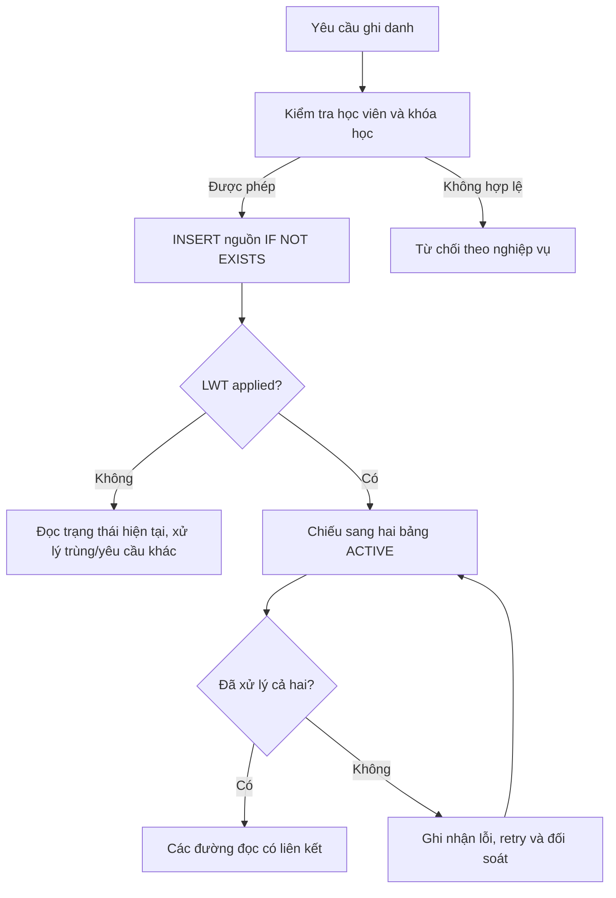

# Giới hạn JOIN, khóa ngoại và trách nhiệm duy trì toàn vẹn trong Apache Cassandra

## Mục tiêu học tập

Trong chương **Quan hệ và dữ liệu lặp** của Apache Cassandra, bài học này giải thích vì sao các quy tắc toàn vẹn vốn được RDBMS hỗ trợ bằng `JOIN`, khóa ngoại và giao dịch cần được thiết kế lại khi dùng cơ sở dữ liệu **wide-column phân tán**. Sau bài học, bạn có thể:

- Giải thích giới hạn của CQL đối với `JOIN`, khóa ngoại, xóa dây chuyền và những ràng buộc liên bảng.
- Phân biệt **toàn vẹn tham chiếu**, **toàn vẹn nghiệp vụ**, **tính duy nhất** và **nhất quán giữa các bảng dẫn xuất**.
- Thiết kế đường đọc cho quan hệ 1:1, 1:N, N:M qua partition key, clustering columns, bảng tra cứu và dữ liệu lặp.
- Dùng điều kiện ghi **LWT** trong phạm vi phù hợp, đồng thời nhận diện những bất biến mà LWT không thể tự bảo đảm xuyên nhiều bảng hoặc nhiều phân vùng.
- Xây dựng quy trình tạo liên kết, đổi trạng thái, xóa, retry và đối soát từ ứng dụng Java; đánh giá hậu quả khi một thao tác thành công một phần.

## 1. Cassandra khác gì một hệ quản trị quan hệ?

Trong một RDBMS, lược đồ thường chứa bảng thực thể và bảng liên kết, với khóa ngoại để kiểm tra mối quan hệ. Truy vấn `JOIN` kết hợp các bảng ở thời điểm đọc; giao dịch có thể nhóm một số thay đổi để duy trì các bất biến phù hợp khả năng của hệ quản trị.

**Apache Cassandra** ưu tiên mở rộng ngang, phân phối dữ liệu theo **partition key** và phục vụ các truy vấn đã xác định trước. CQL nhìn giống SQL ở một số câu lệnh (`SELECT`, `INSERT`, `UPDATE`, `DELETE`) nhưng **không có phép `JOIN` tổng quát** và **không cung cấp khóa ngoại hoặc `ON DELETE CASCADE` theo cách của RDBMS**.

| Nhu cầu | Trong RDBMS điển hình | Trong Cassandra |
| --- | --- | --- |
| Lấy dữ liệu cha–con | `JOIN` trên các bảng theo điều kiện | Thiết kế một bảng đọc phù hợp hoặc tra nhiều bảng theo khóa rồi ghép tại ứng dụng |
| Đảm bảo thực thể con tham chiếu cha tồn tại | `FOREIGN KEY` | Ứng dụng/dịch vụ sở hữu kiểm tra và quản lý vòng đời |
| Hạn chế xóa cha khi còn con | `ON DELETE RESTRICT` hoặc logic trong transaction | Quy tắc nghiệp vụ, soft delete, trạng thái xóa và quy trình đối soát |
| Xóa cha kéo theo con | `ON DELETE CASCADE` | Ứng dụng xác định và xử lý từng bảng/bản ghi liên quan |
| Bảo đảm duy nhất trong một khóa truy cập | `UNIQUE` hoặc khóa chính | Khóa chính xác định hàng; khi cần chống ghi đè do cạnh tranh, cân nhắc `IF NOT EXISTS`/LWT |
| Tính nguyên tử khi sửa nhiều bảng | Transaction, tùy mức isolation | Không mặc định có giao dịch nhiều bảng với isolation và rollback kiểu RDBMS |
| Đọc theo trường không nằm trong khóa | Index hoặc phép ghép, tùy workload | Thiết kế bảng theo truy vấn; index chỉ phù hợp một số kiểu lọc và workload cụ thể |

**Điểm cốt lõi:** Cassandra không tự hiểu quan hệ nghiệp vụ chỉ vì hai bảng cùng chứa một giá trị UUID. Cột `course_id` trong bảng ghi danh là **tham chiếu logic**, không phải khóa ngoại được Cassandra kiểm chứng.

### Ví dụ: một bảng liên kết trong RDBMS

Một hệ quản trị quan hệ có thể khai báo:

```sql
-- SQL mang tính minh họa cho RDBMS, KHÔNG phải CQL Cassandra.
CREATE TABLE enrollments (
    student_id UUID REFERENCES students(student_id),
    course_id UUID REFERENCES courses(course_id),
    enrolled_at TIMESTAMP NOT NULL,
    PRIMARY KEY (student_id, course_id)
);

SELECT c.course_id, c.title
FROM enrollments e
JOIN courses c ON c.course_id = e.course_id
WHERE e.student_id = :student_id;
```

Hai thành phần cần thiết trong ví dụ này là `REFERENCES` và `JOIN`. Chúng **không thể chuyển nguyên xi** sang Cassandra và kỳ vọng Cassandra thực thi ràng buộc tương tự. Thay vào đó, hãy viết các câu hỏi mà ứng dụng cần trả lời, rồi tạo bảng cho những đường đọc ấy.

## 2. Xác định rõ những loại toàn vẹn cần duy trì

Không nên gom mọi yêu cầu thành câu chung chung “dữ liệu luôn nhất quán”. Mỗi loại bất biến cần chủ sở hữu và phương thức xử lý riêng:

| Loại | Ví dụ | Cơ chế có thể áp dụng |
| --- | --- | --- |
| **Tham chiếu hợp lệ** | Ghi danh phải liên kết một học viên và một khóa học tồn tại, được phép ghi danh | Kiểm tra tại dịch vụ có thẩm quyền, kiểm soát thao tác xóa/đóng, xử lý race và đối soát |
| **Tính duy nhất logic** | Một học viên chỉ có một trạng thái ghi danh hiện hành cho mỗi khóa học | Chọn cùng cặp khóa chính, dùng `IF NOT EXISTS` hoặc cập nhật có điều kiện khi cạnh tranh |
| **Chuyển trạng thái hợp lệ** | `ACTIVE -> CANCELLED` theo quyền và điều kiện nghiệp vụ | Một nơi sở hữu trạng thái, kiểm tra lệnh, dùng LWT nếu cần bảo vệ cập nhật đồng thời |
| **Nhất quán bản dẫn xuất** | Danh sách học viên theo khóa học khớp với nguồn ghi danh | Phát sự kiện, cập nhật có kiểm soát, retry an toàn và đối soát |
| **Toàn vẹn số liệu** | Không hoàn tiền hai lần, không cấp phát vượt tồn | Mô hình giao dịch nghiệp vụ chuyên biệt; khóa/điều kiện và quy tắc chống lặp ở ranh giới sở hữu |
| **Xóa và lưu giữ** | Đóng hoặc xóa học viên thì các liên kết không được tiếp tục hiển thị | Chính sách soft delete, sự kiện xóa, dọn các projection và dữ liệu hết hạn |

Một lần `SELECT` kiểm tra “khóa học có tồn tại không” rồi `INSERT` mối quan hệ **không phải ràng buộc khóa ngoại nguyên tử**. Giữa hai thao tác, một tiến trình khác có thể đóng hoặc xóa khóa học. Kiểm tra trước ghi là hữu ích, nhưng phải định nghĩa **quyền sở hữu** và cách ứng xử với trường hợp kiểm tra–ghi có khoảng trống thời gian (*time-of-check to time-of-use*, TOCTOU).

## 3. Ví dụ xuyên suốt: học viên và khóa học

Xét yêu cầu cho một nền tảng học:

1. Đăng ký học viên vào khóa học khi tài khoản còn hoạt động và khóa học đang mở.
2. Kiểm tra một học viên đã đăng ký khóa học chưa.
3. Hiển thị các khóa học đang tham gia của học viên, mới nhất trước.
4. Hiển thị danh sách học viên của một khóa học, mới nhất trước.
5. Hủy ghi danh, khóa học đóng đăng ký hoặc tài khoản bị vô hiệu hóa phải được phản ánh theo chính sách.

Đây là quan hệ **nhiều-nhiều**. Một mô hình Cassandra khả thi gồm bảng thực thể, bảng **nguồn chuẩn trạng thái liên kết** và hai bảng **dẫn xuất cho đường đọc**.

### CQL định nghĩa các bảng

Giả sử keyspace `academy` đã tồn tại với chính sách replication phù hợp, và CQL đang sử dụng keyspace đó:

```sql
USE academy;

CREATE TABLE students_by_id (
    student_id uuid PRIMARY KEY,
    display_name text,
    account_status text
);

CREATE TABLE courses_by_id (
    course_id uuid PRIMARY KEY,
    title text,
    enrollment_status text
);

-- Nguồn chuẩn trạng thái ghi danh trong phạm vi ví dụ.
-- Một cặp (student_id, course_id) có tối đa một hàng.
CREATE TABLE enrollment_state_by_student (
    student_id uuid,
    course_id uuid,
    status text,
    enrolled_at timestamp,
    version bigint,
    PRIMARY KEY ((student_id), course_id)
);

-- Bảng chỉ mục đọc các quan hệ ACTIVE theo học viên và thời gian.
CREATE TABLE active_enrollments_by_student (
    student_id uuid,
    enrolled_at timestamp,
    course_id uuid,
    source_version bigint,
    PRIMARY KEY ((student_id), enrolled_at, course_id)
) WITH CLUSTERING ORDER BY (enrolled_at DESC, course_id ASC);

-- Bảng chỉ mục đọc các quan hệ ACTIVE theo khóa học và thời gian.
CREATE TABLE active_enrollments_by_course (
    course_id uuid,
    enrolled_at timestamp,
    student_id uuid,
    source_version bigint,
    PRIMARY KEY ((course_id), enrolled_at, student_id)
) WITH CLUSTERING ORDER BY (enrolled_at DESC, student_id ASC);
```

**Cách hiểu khóa chính:**

- `students_by_id` và `courses_by_id` có partition key là ID của thực thể tương ứng.
- `enrollment_state_by_student` có partition key `student_id` và clustering column `course_id`; mỗi cặp học viên–khóa học chỉ có **một hàng theo khóa**. Ghi lại cùng khóa thường là *upsert*; khóa chính **không tự bảo đảm** một yêu cầu đăng ký chỉ được thực thi một lần ở tầng nghiệp vụ.
- `active_enrollments_by_student` và `active_enrollments_by_course` có khóa phân vùng phục vụ hai chiều đọc. Clustering theo `enrolled_at DESC` giúp lấy các liên kết mới nhất.
- `source_version` ở bảng dẫn xuất hỗ trợ quan sát và đối soát, nhưng **không tự bảo vệ** khỏi sự kiện đến muộn nếu ứng dụng ghi vô điều kiện.

Để cập nhật/xóa chính xác bản dẫn xuất, ứng dụng phải lưu được **thời điểm `enrolled_at` gốc**; nếu vô tình tạo timestamp mới khi retry, các bảng với khóa `(student_id, enrolled_at, course_id)` sẽ tạo hàng khác thay vì sửa đúng hàng ban đầu.

**Lưu ý về phân vùng:** khóa học có hàng triệu học viên có thể khiến `active_enrollments_by_course` có một phân vùng khổng lồ; học viên đăng ký bất thường nhiều khóa học cũng có thể gây vấn đề. Khi cần, bổ sung bucket có quy tắc, chẳng hạn tháng ghi danh, và thiết kế cách đọc nhiều bucket. Chỉ tách bảng không tự giải quyết được phân vùng quá lớn.

## 4. Tạo liên kết và kiểm tra điều kiện nghiệp vụ

Thử tạo hai thực thể:

```sql
INSERT INTO students_by_id
    (student_id, display_name, account_status)
VALUES (
    11111111-1111-4111-8111-111111111111,
    'Lan', 'ACTIVE'
);

INSERT INTO courses_by_id
    (course_id, title, enrollment_status)
VALUES (
    22222222-2222-4222-8222-222222222222,
    'Apache Cassandra cơ bản', 'OPEN'
);
```

Trước khi chấp nhận ghi danh, dịch vụ Enrollment có thể đọc hai bảng và kiểm tra các điều kiện:

```sql
SELECT account_status
FROM students_by_id
WHERE student_id = 11111111-1111-4111-8111-111111111111;

SELECT enrollment_status
FROM courses_by_id
WHERE course_id = 22222222-2222-4222-8222-222222222222;
```

Ứng dụng quyết định **từ chối** nếu không có học viên, học viên bị khóa, không có khóa học hoặc khóa học đã đóng. Cassandra không từ chối `INSERT` ghi danh chỉ vì không tìm thấy hàng thực thể cha.

### Chống tạo liên kết lần đầu một cách cạnh tranh

Nếu chính sách nghiệp vụ là mỗi cặp học viên–khóa học có một bản ghi trạng thái gốc, có thể thử ghi có điều kiện:

```sql
INSERT INTO enrollment_state_by_student
    (student_id, course_id, status, enrolled_at, version)
VALUES (
    11111111-1111-4111-8111-111111111111,
    22222222-2222-4222-8222-222222222222,
    'ACTIVE', '2026-11-21T02:00:00Z', 1
) IF NOT EXISTS;
```

Kết quả chứa cờ `[applied]`:

- Nếu `[applied] = true`, hàng nguồn chuẩn vừa được tạo.
- Nếu `[applied] = false`, hàng đã tồn tại. Ứng dụng đọc lại để phân biệt đã ghi danh, đã hủy, hoặc một quy trình đang xử lý; không tự tạo khóa mới để né điều kiện.

Lệnh `IF NOT EXISTS` sử dụng **lightweight transaction (LWT)**. Nó giúp tranh chấp ghi trên **hàng/partition chịu điều kiện**, nhưng không tạo khóa ngoại với `students_by_id` và `courses_by_id`. Một tiến trình khác vẫn có thể đổi trạng thái tài khoản hoặc khóa học giữa lúc kiểm tra và ghi. Nếu hệ thống yêu cầu cấm tuyệt đối mọi ghi danh sau khi khóa học đóng, cần một **quy trình điều phối riêng** giữa chủ sở hữu khóa học và ghi danh, chấp nhận chi phí đồng bộ tương ứng; không thể đạt bảo đảm này chỉ bằng hai câu `SELECT` rồi một câu `INSERT` qua các partition.

### Chiếu liên kết sang hai bảng đọc

Khi nguồn chuẩn được chấp nhận ở trạng thái `ACTIVE`, ứng dụng tạo hai hàng dẫn xuất:

```sql
INSERT INTO active_enrollments_by_student
    (student_id, enrolled_at, course_id, source_version)
VALUES (
    11111111-1111-4111-8111-111111111111,
    '2026-11-21T02:00:00Z',
    22222222-2222-4222-8222-222222222222,
    1
);

INSERT INTO active_enrollments_by_course
    (course_id, enrolled_at, student_id, source_version)
VALUES (
    22222222-2222-4222-8222-222222222222,
    '2026-11-21T02:00:00Z',
    11111111-1111-4111-8111-111111111111,
    1
);
```

Đây là **fan-out ghi**: một liên kết logic có trạng thái nguồn và hai bản tổ chức theo hai hướng đọc. Nếu thao tác thứ hai lỗi, dữ liệu có thể xuất hiện trong danh sách của học viên nhưng tạm thiếu ở danh sách của khóa học. Tầng ứng dụng phải nhận trách nhiệm khôi phục.

### Sơ đồ luồng có thể xảy ra lỗi



Sơ đồ mô tả **trình tự logic**, không có nghĩa ghi nguồn, phát sự kiện và ghi projection là một giao dịch nguyên tử. Với hệ thống thực tế, cần cơ chế phát lại bền vững hoặc đối soát để khép khoảng hở giữa “đã ghi nguồn” và “chưa chiếu bảng dẫn xuất”.

## 5. Đọc quan hệ không dùng JOIN

Sau khi viết theo hai đường đọc, những truy vấn chính đều chỉ rõ partition key:

```sql
-- Một cặp học viên–khóa học hiện ở trạng thái nào?
SELECT status, enrolled_at, version
FROM enrollment_state_by_student
WHERE student_id = 11111111-1111-4111-8111-111111111111
  AND course_id = 22222222-2222-4222-8222-222222222222;

-- Các khóa học đang tham gia, mới nhất trước.
SELECT course_id, enrolled_at
FROM active_enrollments_by_student
WHERE student_id = 11111111-1111-4111-8111-111111111111
LIMIT 20;

-- Các học viên của một khóa học, mới nhất trước.
SELECT student_id, enrolled_at
FROM active_enrollments_by_course
WHERE course_id = 22222222-2222-4222-8222-222222222222
LIMIT 20;

-- Lấy thông tin một khóa học theo ID.
SELECT course_id, title
FROM courses_by_id
WHERE course_id = 22222222-2222-4222-8222-222222222222;
```

Ở đây, “danh sách khóa học đang tham gia” là bản dẫn xuất duy trì từ trạng thái nguồn. Cassandra **không tự lọc** liên kết vừa hủy trên tất cả các bảng: ứng dụng phải xóa/sửa projection đúng lúc hoặc trả kết quả với độ trễ chấp nhận được. Trạng thái nguồn mới là cơ sở để khắc phục bản dẫn xuất bị cũ.

### Ghép thông tin tại ứng dụng

Danh sách `active_enrollments_by_student` chứa ID và thời điểm, nhưng không chứa `title`. Nếu API cần tiêu đề, có hai hướng:

1. **Tải thêm thông tin theo ID** từ `courses_by_id` cho số lượng khóa học đã giới hạn; cần kiểm soát số truy vấn song song, thời gian chờ và trường hợp khóa học đã ẩn/xóa.
2. **Sao chép `title` vào bảng danh sách** nếu đây là đường đọc rất phổ biến và chi phí sao chép cập nhật tên chấp nhận được. Khi đổi tên khóa học, có thể phải cập nhật rất nhiều hàng ghi danh; đây là một *write fan-out* đáng cân nhắc.

Đừng mặc định thực hiện 20 hoặc 100 lần đọc bổ sung cho mọi trang danh sách: cách đó dễ tạo **N+1 queries**. Mặt khác, đừng tự động sao chép thông tin thay đổi liên tục vào hàng triệu liên kết chỉ để tránh một phép ghép nhỏ. Hãy đo p95/p99 latency, số lần đọc, tần suất thay đổi và số bản cần ghi.

## 6. Hủy ghi danh, xóa cha và liên kết mồ côi

Vì không có khóa ngoại và cascade, **mọi thay đổi liên quan vòng đời liên kết phải được quy định ở tầng ứng dụng**.

### Hủy ghi danh bằng trạng thái nguồn

Giả sử nguồn có `status = 'ACTIVE'` và `version = 1`. Lệnh có điều kiện giúp tránh hai tác nhân cùng tùy tiện chuyển trạng thái:

```sql
UPDATE enrollment_state_by_student
SET status = 'CANCELLED', version = 2
WHERE student_id = 11111111-1111-4111-8111-111111111111
  AND course_id = 22222222-2222-4222-8222-222222222222
IF status = 'ACTIVE' AND version = 1;
```

Nếu `[applied]` là false, đọc lại hàng nguồn; có thể liên kết đã hủy, đã được cập nhật bởi tiến trình khác hoặc chưa từng tồn tại. Nếu điều kiện thành công, projection `ACTIVE` không còn phản ánh trạng thái mới, cần xóa:

```sql
DELETE FROM active_enrollments_by_student
WHERE student_id = 11111111-1111-4111-8111-111111111111
  AND enrolled_at = '2026-11-21T02:00:00Z'
  AND course_id = 22222222-2222-4222-8222-222222222222;

DELETE FROM active_enrollments_by_course
WHERE course_id = 22222222-2222-4222-8222-222222222222
  AND enrolled_at = '2026-11-21T02:00:00Z'
  AND student_id = 11111111-1111-4111-8111-111111111111;
```

Ở đây `enrolled_at` được giữ nguyên từ khi tạo liên kết. Nếu ứng dụng vô tình dùng thời gian hủy làm clustering key, câu `DELETE` sẽ không xóa đúng hàng cũ.

**Đăng ký lại sau khi đã hủy:** `INSERT ... IF NOT EXISTS` trên bảng nguồn sẽ không thành công vì hàng `CANCELLED` còn tồn tại. Cần định nghĩa một thao tác **re-enrollment** riêng với điều kiện trạng thái/phiên bản, thời điểm mới và quy trình dọn bản cũ. Không coi việc phát lại yêu cầu đăng ký là cách tự động mở lại liên kết đã hủy.

### Khi học viên hoặc khóa học bị xóa

Không có `ON DELETE RESTRICT` hoặc `CASCADE`, nên xóa hàng `courses_by_id` không làm Cassandra tự xóa liên kết ở `enrollment_state_by_student` hay các projection. Chính sách nghiệp vụ có thể chọn:

- **Ngăn xóa ngay** nếu khóa học còn ghi danh; trạng thái “đang đóng/chuẩn bị xóa” giúp chặn đăng ký mới trong quy trình ứng dụng.
- **Soft delete** khóa học, ẩn khỏi đường đọc công khai, phát sự kiện để dọn các liên kết theo chính sách. Dữ liệu nguồn có thể được giữ trong thời hạn cần thiết để audit/đối soát.
- **Xóa có điều phối**: khóa nhận thay đổi theo quy trình nghiệp vụ, xử lý liên kết và bảng dẫn xuất theo từng đợt, kiểm tra hoàn tất rồi xóa vật lý theo chính sách.

Nếu hàng cha bị xóa trong lúc một yêu cầu ghi danh khác đang xử lý, kiểm tra “cha tồn tại” trước đó không tự bảo đảm toàn vẹn. Muốn bất biến mạnh hơn, cần xác định dịch vụ chấp nhận lệnh và cơ chế điều phối với xóa/đóng, hoặc đưa bất biến cần so sánh–ghi về cùng ranh giới giao dịch phù hợp.

### Phân biệt dữ liệu mồ côi và dữ liệu đang chờ đồng bộ

Một liên kết tồn tại ở `active_enrollments_by_course` nhưng không tìm thấy ở nguồn có thể là:

- Sự kiện xóa chưa được chiếu tới bảng đọc.
- Ghi chưa hoàn tất hoặc xử lý theo thứ tự sai.
- Nguồn bị xóa bởi TTL/chính sách lưu giữ.
- Lỗi tạo bản dẫn xuất hoặc dữ liệu sai thực sự.

Không nên xóa hàng tùy tiện sau một lần đọc không thấy nguồn: cần đối chiếu trạng thái, sự kiện và chính sách lưu giữ. Một job **reconciliation** cần có cách phân biệt trạng thái chuyển tiếp với lỗi thật.

## 7. Giới hạn của LWT, consistency level và batch

### LWT làm được gì?

`IF NOT EXISTS`, `UPDATE ... IF ...` là các **conditional statements** dùng lightweight transaction (Paxos) để kiểm tra–ghi có điều kiện trong phạm vi dữ liệu phù hợp. Chúng hữu ích khi nhiều tác nhân tranh chấp cùng hàng/partition, chẳng hạn tạo liên kết một lần hoặc chuyển trạng thái có kiểm tra phiên bản.

Nhưng LWT có giới hạn:

- Không tạo **khóa ngoại** giữa hai bảng.
- Không khóa và kiểm tra nguyên tử sự tồn tại của `students_by_id`, `courses_by_id` và một hàng trong bảng liên kết ở ba partition riêng.
- Không biến fan-out sang hai bảng dẫn xuất thành giao dịch ACID nhiều bảng.
- Có chi phí mạng/đồng thuận và khả năng tăng tranh chấp trên các partition nóng; cần đo với workload thật.

**Nguyên tắc:** dùng LWT để bảo vệ bất biến phù hợp **một ranh giới có điều kiện**, không dùng nó như lời hứa rằng mọi bảng đều đồng bộ.

### Consistency level không thay thế toàn vẹn liên bảng

Với replication factor 3 trong một datacenter, `LOCAL_QUORUM` thường yêu cầu hai replica tham gia xác nhận thao tác. Điều này hỗ trợ ngữ nghĩa đọc/ghi của **cùng dữ liệu**, với các điều kiện về topology, lỗi và cách ghi.

Tuy nhiên, `LOCAL_QUORUM` trên hai bảng **không làm hai bảng thành một giao dịch**. Có thể `enrollment_state_by_student` đã ghi thành công trong khi `active_enrollments_by_course` thất bại hoặc chưa được ghi. Thứ tự quan sát trên các đường đọc cũng có thể khác nhau.

### Logged batch có phải giao dịch thay thế không?

`BEGIN BATCH ... APPLY BATCH` trong Cassandra có nhiều kiểu batch; **logged batch** giúp các mutation trong batch cuối cùng được áp dụng trong một số tình huống lỗi, nhưng **không cung cấp isolation hay rollback như RDBMS**. Batch qua nhiều phân vùng thường có chi phí batchlog/coordinator và không phải mẹo tăng throughput cho các thao tác độc lập.

Ngay cả khi dùng batch, vẫn cần xử lý timeout, sự kiện nghiệp vụ lặp, thứ tự thay đổi và bước nằm ngoài Cassandra (thanh toán, message broker). Không nên dùng batch thay cho định nghĩa một nguồn chuẩn và quy trình đồng bộ.

### Repair không tự sửa tham chiếu mồ côi

**Repair** và các cơ chế chống sai lệch replica của Cassandra nhằm đồng bộ dữ liệu giữa các **replica của cùng bảng/phân vùng**. Chúng không tự suy luận rằng một khóa `course_id` có trong bảng ghi danh nhưng đã bị xóa khỏi `courses_by_id`, hoặc rằng hai bảng liệt kê ghi danh phải chứa cùng tập ID. Việc đó là **đối soát ở tầng ứng dụng**.

TTL và xóa tạo **tombstone**, có liên quan đến compaction, repair và chính sách giữ dữ liệu. Xóa vật lý không đồng nghĩa các bản dẫn xuất hoặc sao lưu sẽ biến mất ngay lập tức; phải quản lý riêng theo yêu cầu lưu giữ và quyền truy cập.

## 8. Java Driver: kiểm tra điều kiện, ghi nguồn và dựng projection

Ví dụ dưới đây dùng **Apache Cassandra Java Driver 4.x**. Nó cho thấy cách liên kết các bước CQL và giải thích điểm cần khôi phục khi một bước thất bại.

```java
import com.datastax.oss.driver.api.core.CqlSession;
import com.datastax.oss.driver.api.core.cql.PreparedStatement;
import com.datastax.oss.driver.api.core.cql.ResultSet;
import com.datastax.oss.driver.api.core.cql.Row;

import java.time.Instant;
import java.util.UUID;

public final class EnrollmentRepository {
    private final CqlSession session;
    private final PreparedStatement findStudent;
    private final PreparedStatement findCourse;
    private final PreparedStatement createCanonical;
    private final PreparedStatement findCanonical;
    private final PreparedStatement addByStudent;
    private final PreparedStatement addByCourse;

    public EnrollmentRepository(CqlSession session) {
        this.session = session;
        findStudent = session.prepare(
            "SELECT account_status FROM students_by_id WHERE student_id = ?");
        findCourse = session.prepare(
            "SELECT enrollment_status FROM courses_by_id WHERE course_id = ?");
        createCanonical = session.prepare(
            "INSERT INTO enrollment_state_by_student " +
            "(student_id, course_id, status, enrolled_at, version) " +
            "VALUES (?, ?, ?, ?, ?) IF NOT EXISTS");
        findCanonical = session.prepare(
            "SELECT status, enrolled_at, version " +
            "FROM enrollment_state_by_student " +
            "WHERE student_id = ? AND course_id = ?");
        addByStudent = session.prepare(
            "INSERT INTO active_enrollments_by_student " +
            "(student_id, enrolled_at, course_id, source_version) " +
            "VALUES (?, ?, ?, ?)");
        addByCourse = session.prepare(
            "INSERT INTO active_enrollments_by_course " +
            "(course_id, enrolled_at, student_id, source_version) " +
            "VALUES (?, ?, ?, ?)");
    }

    // Ví dụ minh họa; không thay thế quy trình điều phối và retry bền vững.
    public void enroll(UUID studentId, UUID courseId, Instant requestedAt) {
        Row student = session.execute(findStudent.bind(studentId)).one();
        Row course = session.execute(findCourse.bind(courseId)).one();

        if (student == null
                || !"ACTIVE".equals(student.getString("account_status"))
                || course == null
                || !"OPEN".equals(course.getString("enrollment_status"))) {
            throw new IllegalStateException("Không được phép ghi danh");
        }

        ResultSet attempted = session.execute(createCanonical.bind(
            studentId, courseId, "ACTIVE", requestedAt, 1L));

        // Kể cả lần INSERT bị từ chối do trùng khóa, một request lặp
        // có thể cần khôi phục projection còn thiếu từ lần đầu.
        Row canonical = session.execute(
            findCanonical.bind(studentId, courseId)).one();
        if (canonical == null
                || !"ACTIVE".equals(canonical.getString("status"))) {
            throw new IllegalStateException(
                "Liên kết chưa ở trạng thái ACTIVE; kiểm tra lại nghiệp vụ");
        }

        Instant stableEnrolledAt = canonical.getInstant("enrolled_at");
        long version = canonical.getLong("version");

        // Ghi lại cùng khóa và cùng giá trị từ nguồn; nếu một thao tác
        // timeout, tầng ứng dụng phải có retry có giới hạn và đối soát.
        session.execute(addByStudent.bind(
            studentId, stableEnrolledAt, courseId, version));
        session.execute(addByCourse.bind(
            courseId, stableEnrolledAt, studentId, version));

        // attempted.wasApplied() cho biết lần thử này đã tạo hàng mới
        // hay hàng đã tồn tại; không cho biết cả hai projection đã xong.
    }
}
```

**Ý nghĩa của ví dụ:**

- Các phép đọc trước khi ghi được thực hiện theo khóa phân vùng. Mã Java phải hiểu rằng **kiểm tra rồi ghi vẫn có race** với thao tác khóa/xóa học viên hoặc khóa học.
- `IF NOT EXISTS` giúp tránh việc hai yêu cầu đồng thời tạo nhiều hàng canonical cho cùng cặp ID; kết quả điều kiện được phản ánh qua `attempted.wasApplied()`.
- Nếu request trước ghi nguồn thành công nhưng chưa chiếu đủ hai bảng, request lặp có thể đọc `enrolled_at` **gốc** từ nguồn để điền những bản còn thiếu.
- Nếu không có request lặp, hệ thống vẫn phải có **cơ chế phát hiện và sửa lỗi** riêng. Đừng coi đoạn mã trên là outbox hay hàng đợi bền vững.
- Việc đọc nguồn rồi ghi projection còn có race với **hủy ghi danh** ngay sau lúc đọc; nếu muốn bảo đảm không tạo lại projection đã xóa, cần kiểm soát thứ tự xử lý theo cặp ID, điều kiện/phiên bản phù hợp và đối soát. Chỉ ghi lại dữ liệu theo khóa ổn định không giải quyết hết cạnh tranh.
- Trong ứng dụng thật, hãy quản lý vòng đời `CqlSession` và prepared statement, cấu hình timeout/consistency level theo yêu cầu và xử lý lỗi từng bước.

Đoạn Java có thể được cải tiến thêm bằng asynchronous API, nhưng tăng concurrency không làm những kiểm tra liên bảng trở thành nguyên tử. Các trường hợp timeout yêu cầu phân biệt “không biết đã ghi hay chưa” với “chắc chắn bị từ chối”, và có chính sách retry rõ ràng.

## 9. Quy trình đối soát toàn vẹn ở tầng ứng dụng

Thiết kế đúng phải trả lời được câu hỏi: **“Nếu một trong hai bảng đọc bị thiếu hoặc thừa liên kết, lấy dữ liệu nào để sửa?”**

Giả sử `enrollment_state_by_student` là nguồn chuẩn được dịch vụ Enrollment quản lý. Một quy trình đối soát có thể:

1. Chọn phạm vi theo ID hoặc một partition/bucket, không quét toàn bộ dữ liệu trong một request trực tuyến.
2. Đọc trạng thái, `enrolled_at` và `version` từ nguồn chuẩn.
3. Nếu trạng thái nguồn `ACTIVE`, tính đúng hai khóa projection cần có; đọc/kiểm tra và bổ sung những bản thiếu hoặc sai.
4. Nếu `CANCELLED`, tìm những bản `ACTIVE` cũ và xóa theo khóa `enrolled_at` gốc.
5. Nếu không tìm thấy nguồn, **không kết luận vội**: kiểm tra quy tắc soft delete, TTL, sự kiện hủy và thời hạn giữ lịch sử trước khi dọn bản mồ côi.
6. Ghi số liệu về lỗi, số lần retry, tuổi sự kiện chưa đồng bộ và chênh lệch giữa bảng chuẩn và projection.
7. Chống race với ghi mới: trước khi sửa, cần xác minh phiên bản hiện hành hoặc bảo đảm sự kiện được xử lý tuần tự theo liên kết.

Một vài chỉ số theo dõi thực tế:

| Chỉ số | Câu hỏi |
| --- | --- |
| Số projection thiếu/thừa theo mỗi lần đối soát | Có nhiều bản không khớp nguồn không? |
| Tuổi sự kiện chưa xử lý | Giao diện có bị cũ quá ngưỡng cho phép không? |
| Tỷ lệ LWT không được áp dụng | Có tranh chấp hoặc nhiều request lặp? |
| Tỷ lệ timeout/retry khi fan-out | Cập nhật nhiều bảng có làm hệ thống quá tải? |
| P95/P99 độ trễ đăng ký và đọc danh sách | Quy tắc toàn vẹn ảnh hưởng trải nghiệm thế nào? |
| Kích thước và số hàng của phân vùng nóng | Một khóa học quá đông có làm mất cân bằng dữ liệu? |
| Tombstone/compaction/repair | Vòng đời xóa và lưu giữ có chi phí gì? |

Bên cạnh đối soát, cần có **một tài liệu hợp đồng nghiệp vụ** nêu chủ sở hữu của trạng thái, ý nghĩa `ACTIVE/CANCELLED`, thời điểm chấp nhận đăng ký, hành vi khi khóa học đóng, chính sách đăng ký lại và ngưỡng độ trễ cho phép ở từng đường đọc. Đây là cách làm rõ cái gì là **bất biến bắt buộc** và cái gì có thể **eventually consistent**.

## 10. Những lỗi thiết kế thường gặp

| Sai lầm | Hệ quả | Hướng giải quyết |
| --- | --- | --- |
| Mang nguyên câu `JOIN` và `FOREIGN KEY` từ RDBMS sang CQL | Schema hoặc truy vấn không có ý nghĩa trong Cassandra | Thiết kế bảng theo các đường đọc, ghép tại ứng dụng khi thích hợp |
| Cho rằng cùng UUID ở hai bảng là ràng buộc tham chiếu | Có thể tạo liên kết tới cha không tồn tại | Kiểm soát nghiệp vụ, vòng đời và đối soát |
| Kiểm tra cha tồn tại rồi tin rằng không có race | Cha có thể bị xóa/đóng trước khi ghi liên kết | Định nghĩa điều phối, trạng thái chuyển tiếp hoặc ranh giới đồng bộ phù hợp |
| Dùng `INSERT` thường để bảo đảm duy nhất khi có ghi cạnh tranh | Có thể ghi đè dữ liệu hiện có ở cùng khóa | LWT `IF NOT EXISTS` ở nguồn khi cần, kiểm tra kết quả |
| Tin rằng LWT trên một bảng bảo đảm hai bảng dẫn xuất được ghi | Một bên có thể thành công, bên kia lỗi | Sự kiện bền vững, retry và đối soát |
| Xóa cha và trông chờ cascade | Bản ghi liên kết mồ côi vẫn có thể tồn tại | Dọn theo chính sách, xử lý từng bảng và soft delete |
| Retry đăng ký lại với timestamp mới | Tạo nhiều bản ghi projection logic cho cùng một liên kết | Dùng khóa và `enrolled_at` gốc từ nguồn |
| Ghi projection cũ đến muộn sau khi hủy | Liên kết `ACTIVE` có thể xuất hiện lại | Kiểm soát thứ tự/phiên bản và đối soát |
| Dùng `LOCAL_QUORUM` hay logged batch như transaction liên bảng | Đọc lệch và ghi một phần vẫn có thể xảy ra | Tách rõ bảo đảm từng mutation và bất biến nghiệp vụ |
| Không kiểm soát độ lớn phân vùng theo `course_id` | Khóa học phổ biến tạo phân vùng khổng lồ | Bucket theo workload và thiết kế phân trang |

## 11. Bài thực hành: xóa sản phẩm có đánh giá đang nằm trong đơn hàng

Giả sử hệ thống bán hàng dùng:

- `products_by_id`: sản phẩm theo ID.
- `order_items_by_order`: dòng hàng theo `order_id` và `line_no`, mỗi dòng chứa `product_id`.
- `orders_by_id`: trạng thái đơn.
- `product_orders_by_product`: bảng dẫn xuất cho truy vấn “sản phẩm này đang nằm trong những đơn nào?”, được xây dựng nếu nhu cầu đó có thật.

**Tình huống:** người quản trị muốn xóa một sản phẩm đã từng xuất hiện trong nhiều đơn hàng. Trong RDBMS, có thể dùng khóa ngoại và quy tắc hạn chế/xóa dây chuyền để bảo vệ các dòng đơn; với Cassandra, hãy trả lời:

1. Vì sao chỉ `DELETE FROM products_by_id WHERE product_id = ?` không làm các dòng đơn biến mất hay bị từ chối?
2. Nếu nghiệp vụ cần giữ lịch sử đơn hàng, có nên xóa thông tin sản phẩm đã được mua hay giữ một snapshot `product_name_at_purchase`, `unit_price_at_purchase` trong dòng hàng?
3. Khi sản phẩm ngừng bán nhưng vẫn có đơn lịch sử, nên dùng trạng thái `INACTIVE/RETIRED` hay xóa vật lý ngay? Ai có quyền quyết định?
4. Nếu bảng `product_orders_by_product` bị thiếu cập nhật, làm sao tìm và khôi phục liên kết? Có thể đối soát từ nguồn nào khi dòng hàng được phân vùng theo `order_id`?
5. Nếu dịch vụ Order đang thêm dòng hàng trong lúc sản phẩm bị ngừng bán, kiểm tra `products_by_id` trước ghi có bảo đảm không phát sinh đơn mới dùng sản phẩm đã ngừng không? Cần quy trình nào để làm chặt hơn?

**Gợi ý giải:**

- Cassandra không có khóa ngoại giữa `product_id` ở bảng dòng hàng và hàng sản phẩm, nên xóa sản phẩm không kiểm tra hay cascade tới những dòng đơn.
- Đơn hàng thường cần **snapshot tại thời điểm mua** để lịch sử còn hiểu được ngay cả khi thông tin Catalog đổi. Không nên dùng xóa dây chuyền để xóa lịch sử giao dịch một cách vô ý.
- Có thể chuyển sản phẩm sang `RETIRED` để chặn bán mới nhưng giữ lịch sử; xóa vật lý phải tuân theo chính sách lưu giữ và quyền truy cập.
- Một bảng ánh xạ sản phẩm–đơn hàng phục vụ truy vấn theo `product_id` có thể cần thiết. Nếu đã mất dữ liệu nguồn và không có event log hoặc đường backfill thích hợp, không thể mặc nhiên dựng lại bảng dẫn xuất với chi phí thấp.
- Kiểm tra trước ghi vẫn có race với việc ngừng bán. Dịch vụ chấp nhận đơn phải quy định thời điểm chốt tính hợp lệ và cơ chế điều phối với Catalog; nếu cần bất biến mạnh, thiết kế lại ranh giới thao tác thay vì chỉ thêm một lần `SELECT`.

## Tổng kết

Giới hạn `JOIN` và khóa ngoại của Cassandra dẫn đến một trách nhiệm rõ ràng cho ứng dụng: **thiết kế bảng theo truy vấn** và **quản lý toàn vẹn theo quyền sở hữu nghiệp vụ**. Partition key và clustering columns quyết định đường đọc hiệu quả; LWT bảo vệ một số điều kiện cạnh tranh trong phạm vi thích hợp; replication, consistency level, batch, compaction và repair có những vai trò riêng nhưng **không tự bảo đảm tham chiếu hợp lệ hay nhất quán xuyên các bảng logic**. Với quan hệ 1:1, 1:N hoặc N:M, hãy xác định nguồn chuẩn, quy tắc tạo/xóa liên kết, các bản dẫn xuất, những race có thể xảy ra, cách retry và đối soát. Dữ liệu chỉ đáng tin cậy khi các giới hạn ấy được phản ánh thành **hợp đồng nghiệp vụ, CQL phù hợp và quy trình vận hành có thể kiểm chứng**.
