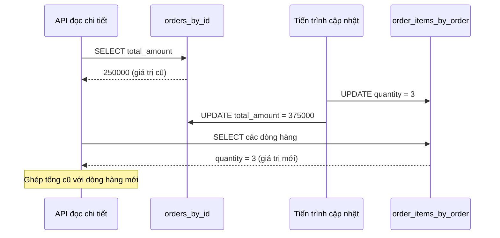
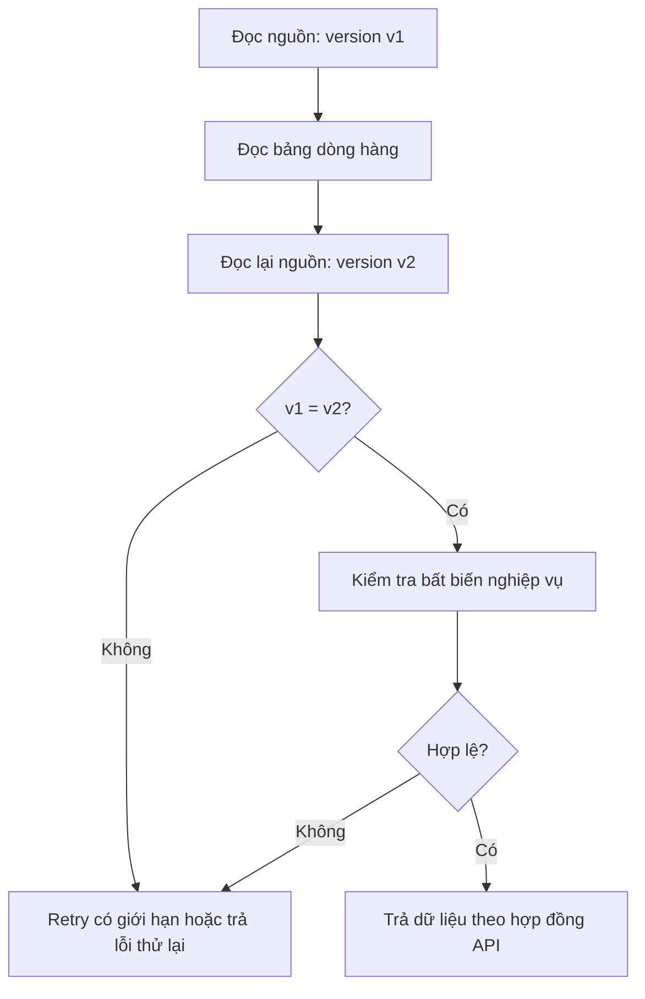
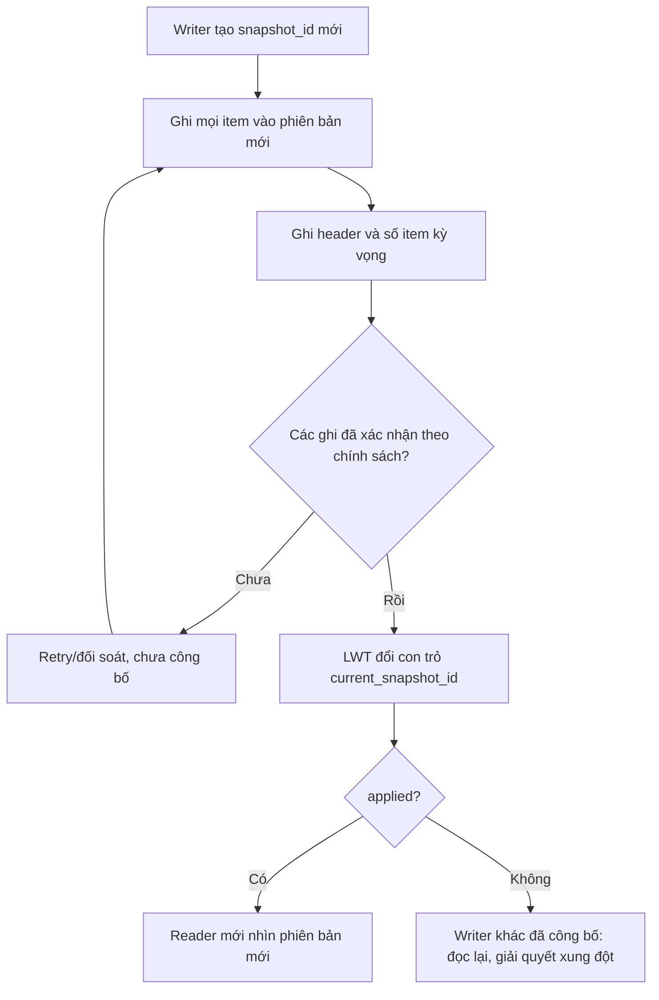

# Đọc dữ liệu từ nhiều bảng trong khi cập nhật đồng thời trong Apache Cassandra

## Mục tiêu học tập

Trong chương **Quan hệ và dữ liệu lặp**, ta thường tạo nhiều bảng cho cùng một thực thể nhằm phục vụ các truy vấn khác nhau. Bài học này giải quyết vấn đề phát sinh khi các bảng đó đang được cập nhật mà ứng dụng cần **đọc và ghép dữ liệu ngay lúc ấy**.

Sau bài học, bạn có thể:

- Nhận diện **read skew**, kết quả đọc bị trộn giữa phiên bản cũ và mới, và dữ liệu dẫn xuất chưa kịp cập nhật.
- Giải thích tại sao `LOCAL_QUORUM`, `LOGGED BATCH`, LWT hay repair không tự tạo một **snapshot nguyên tử xuyên nhiều bảng**.
- Chọn giữa đọc dữ liệu chấp nhận trễ, đọc bổ sung theo khóa, đọc có kiểm tra phiên bản và **snapshot bất biến có con trỏ công bố**.
- Viết CQL và Java Driver để đọc nhiều bảng, phát hiện thiếu dữ liệu và xử lý đồng thời theo hợp đồng API.
- Xây dựng tiêu chí kiểm thử, phân trang, retry và theo dõi độ lệch giữa các bảng dẫn xuất.

## 1. Vấn đề xuất hiện từ đâu?

Apache Cassandra là cơ sở dữ liệu phân tán theo mô hình **wide-column**, định tuyến dữ liệu theo **partition key** và sắp xếp hàng trong phân vùng bằng **clustering columns**. Cassandra không cung cấp `JOIN` tổng quát hoặc khóa ngoại như RDBMS. Ứng dụng thường thiết kế bảng theo truy vấn và **tập hợp dữ liệu khi đọc**.

Xét ứng dụng đặt hàng cần ba đường đọc:

1. `orders_by_id`: đọc trạng thái, tổng tiền, phiên bản của một đơn bằng `order_id`.
2. `order_items_by_order`: đọc các dòng hàng của đơn theo cùng `order_id`.
3. `orders_by_customer_month`: liệt kê đơn theo khách hàng/tháng, kèm một số cột sao chép để tránh đọc chi tiết từng đơn.

Khi trang chi tiết gọi hai câu `SELECT`, giữa hai lần đọc có thể có một lệnh sửa số lượng, thêm dòng hàng, hủy đơn hoặc thanh toán. Kết quả cuối cùng có thể là **tổng tiền cũ đi với danh sách dòng hàng mới**.

### Ví dụ có thể tái hiện

Ban đầu đơn `O1` có một dòng: 2 bàn phím × 125.000 VND = **250.000 VND**. Tiến trình A đọc tổng tiền, trong lúc tiến trình B tăng số lượng lên 3 rồi cập nhật tổng tiền thành **375.000 VND**.

| Thời điểm | Tiến trình A (đọc) | Tiến trình B (ghi) |
| --- | --- | --- |
| t1 | Đọc `orders_by_id.total_amount = 250000` | |
| t2 | | Đổi số lượng ở `order_items_by_order` từ 2 lên 3 |
| t3 | | Đổi tổng tiền `orders_by_id` thành 375000 |
| t4 | Đọc dòng hàng thấy số lượng 3 | |
| t5 | Ghép phản hồi với tổng tiền 250000 và số lượng 3 | |

Tại t5, API có thể trả một đối tượng **không tương ứng với cùng một phiên bản nghiệp vụ**. Hiện tượng này thường được gọi là **read skew** hoặc **fractured read** ở cấp ứng dụng. Nó vẫn có thể xảy ra khi từng câu `SELECT` và `UPDATE` được xác nhận thành công.



Điều quan trọng là **một phiên đọc nhiều bảng không phải giao dịch snapshot**. Hai câu truy vấn cách nhau vài mili giây cũng có thể quan sát các thời điểm khác nhau.

## 2. Phân biệt những kiểu dữ liệu không nhất quán

| Hiện tượng | Ví dụ | Nguyên nhân thường gặp | Ảnh hưởng |
| --- | --- | --- | --- |
| **Read skew** giữa bảng nguồn và bảng con | Tổng tiền cũ, dòng hàng mới | Ghi và đọc nhiều bảng xen kẽ | Phản hồi tự mâu thuẫn |
| **Projection lag** | Danh sách vẫn hiện `CREATED`, chi tiết hiện `PAID` | Cập nhật bảng dẫn xuất sau bảng nguồn | Hai màn hình khác nhau |
| **Partial failure** | Bảng chi tiết ghi xong, bảng danh sách timeout | Fan-out ghi không hoàn tất | Thiếu hoặc sai bản dẫn xuất |
| **Out-of-order event** | Giá phiên bản 3 bị thông báo phiên bản 2 ghi đè | Xử lý sự kiện/retry sai thứ tự | Dữ liệu bị quay lui |
| **Stale replica read** | Đọc một hàng với mức nhất quán yếu nhận giá trị cũ | Replica chưa nhận bản mới hoặc lỗi mạng | Một câu truy vấn đã cũ |
| **Delete/read race** | Danh sách trả ID vừa bị xóa ở bảng chi tiết | Xóa nhiều bảng không có cascade, đọc xen kẽ | ID mồ côi hoặc kết quả thiếu |

Không phải trường hợp nào cũng cần xử lý cùng một cách. Trang thống kê có thể chấp nhận dữ liệu cũ vài giây, trong khi API quyết định hoàn tiền hoặc thanh toán phải có **bất biến nghiệp vụ** mạnh hơn.

### “Mới nhất” không đồng nghĩa “đồng bộ”

Một trang danh sách đọc một bảng dẫn xuất theo `customer_id` có thể trả dữ liệu **chưa được đồng bộ** từ bảng nguồn. Sau đó khi mở chi tiết bằng `order_id`, người dùng có thể thấy phiên bản mới hơn. Dù mỗi thao tác đều sử dụng partition key và chạy nhanh, không có cơ chế mặc định buộc hai bảng trả cùng một phiên bản.

Để thiết kế đúng, cần nói rõ API muốn:

- **Chấp nhận kết quả gần đúng thời điểm hiện tại**: dữ liệu có thể lệch có kiểm soát.
- **Một thực thể tự nhất quán**: tổng tiền và dòng hàng phải thuộc cùng phiên bản.
- **Phản ánh ngay thay đổi vừa được chấp nhận**: yêu cầu đọc sau ghi với phạm vi xác định.
- **Một ảnh chụp toàn hệ thống tại một thời điểm**: yêu cầu mạnh hơn nhiều, không thể đạt chỉ bằng vài `SELECT` Cassandra.

## 3. Mô hình bảng ban đầu và thao tác cập nhật

Giả sử keyspace `shop` đã tồn tại và có cấu hình replication phù hợp với cụm Cassandra đang học.

```sql
USE shop;

-- Bảng chi tiết. Ví dụ đơn giản hóa: ứng dụng sở hữu trạng thái chuẩn.
CREATE TABLE orders_by_id (
    order_id uuid PRIMARY KEY,
    customer_id uuid,
    order_month date,
    ordered_at timestamp,
    status text,
    total_amount decimal,
    source_version bigint,
    deleted boolean
);

-- Một phân vùng chứa các dòng hàng của một đơn.
CREATE TABLE order_items_by_order (
    order_id uuid,
    line_no int,
    sku text,
    quantity int,
    unit_price decimal,
    PRIMARY KEY ((order_id), line_no)
);

-- Bản dẫn xuất phục vụ danh sách đơn theo khách hàng và tháng.
CREATE TABLE orders_by_customer_month (
    customer_id uuid,
    order_month date,
    ordered_at timestamp,
    order_id uuid,
    status text,
    total_amount decimal,
    source_version bigint,
    PRIMARY KEY ((customer_id, order_month), ordered_at, order_id)
) WITH CLUSTERING ORDER BY (ordered_at DESC, order_id ASC);
```

- Ở `orders_by_id`, `order_id` là toàn bộ khóa chính và partition key.
- Ở `order_items_by_order`, `order_id` là partition key, `line_no` là clustering column. Câu truy vấn đọc toàn bộ dòng hàng của một đơn không cần quét các phân vùng khác.
- Ở `orders_by_customer_month`, partition key ghép `(customer_id, order_month)` giới hạn dữ liệu theo khách hàng và khoảng thời gian; `ordered_at DESC` và `order_id` sắp xếp/phân biệt bản ghi.

Một đơn rất nhiều dòng hàng hoặc một khách hàng tạo quá nhiều đơn trong một tháng vẫn có thể tạo phân vùng quá lớn. Khi đó phải đánh giá bucket và cách phân trang dựa trên tải thực, không mặc định khóa phân vùng hiện tại luôn phù hợp.

### Ghi dữ liệu ban đầu

```sql
INSERT INTO orders_by_id (
    order_id, customer_id, order_month, ordered_at,
    status, total_amount, source_version, deleted
) VALUES (
    11111111-1111-4111-8111-111111111111,
    22222222-2222-4222-8222-222222222222,
    '2026-11-01', '2026-11-21T01:00:00Z',
    'CREATED', 250000.00, 1, false
);

INSERT INTO order_items_by_order
    (order_id, line_no, sku, quantity, unit_price)
VALUES (
    11111111-1111-4111-8111-111111111111,
    1, 'KEYBOARD-001', 2, 125000.00
);

INSERT INTO orders_by_customer_month (
    customer_id, order_month, ordered_at, order_id,
    status, total_amount, source_version
) VALUES (
    22222222-2222-4222-8222-222222222222,
    '2026-11-01', '2026-11-21T01:00:00Z',
    11111111-1111-4111-8111-111111111111,
    'CREATED', 250000.00, 1
);
```

### Hai đường đọc thường gặp

```sql
-- Đọc chi tiết theo khóa của đơn.
SELECT order_id, total_amount, status, source_version, deleted
FROM orders_by_id
WHERE order_id = 11111111-1111-4111-8111-111111111111;

-- Đọc dòng hàng để ghép vào chi tiết.
SELECT line_no, sku, quantity, unit_price
FROM order_items_by_order
WHERE order_id = 11111111-1111-4111-8111-111111111111;

-- Đọc danh sách theo khách hàng và tháng.
SELECT order_id, ordered_at, status, total_amount, source_version
FROM orders_by_customer_month
WHERE customer_id = 22222222-2222-4222-8222-222222222222
  AND order_month = '2026-11-01'
LIMIT 20;
```

Ba câu truy vấn đều dùng khóa phù hợp nhưng **không tạo được một ảnh chụp nguyên tử** khi cập nhật diễn ra đồng thời.

### Ví dụ cập nhật khiến hai đường đọc lệch nhau

```sql
-- Tiến trình ghi: sửa số lượng trong bảng dòng hàng.
UPDATE order_items_by_order
SET quantity = 3
WHERE order_id = 11111111-1111-4111-8111-111111111111
  AND line_no = 1;

-- Sau đó sửa nguồn đơn.
UPDATE orders_by_id
SET total_amount = 375000.00, source_version = 2
WHERE order_id = 11111111-1111-4111-8111-111111111111;

-- Cuối cùng chiếu tổng tiền mới sang danh sách.
UPDATE orders_by_customer_month
SET total_amount = 375000.00, source_version = 2
WHERE customer_id = 22222222-2222-4222-8222-222222222222
  AND order_month = '2026-11-01'
  AND ordered_at = '2026-11-21T01:00:00Z'
  AND order_id = 11111111-1111-4111-8111-111111111111;
```

Trong hệ thống thật, việc tăng số lượng còn phải tuân thủ kiểm tra nghiệp vụ, quy tắc tính tiền, idempotency và tính hợp lệ của lệnh sửa. Đoạn CQL nhằm minh họa **thứ tự đọc–ghi có thể đan xen**, không phải một transaction hoàn chỉnh.

## 4. Consistency level, batch, LWT và repair bảo đảm đến đâu?

### 4.1. LOCAL_QUORUM: bảo đảm trong phạm vi một thao tác

Với replication factor `3` trong một datacenter, ghi và đọc ở `LOCAL_QUORUM` thường yêu cầu phần lớn replica (ví dụ 2 trong 3) tham gia xác nhận. Trong điều kiện thích hợp, điều này giúp thao tác đọc sau một lần ghi được xác nhận của **cùng khóa/cùng dữ liệu** có thể quan sát giá trị mới.

Tuy nhiên:

- `LOCAL_QUORUM` của `orders_by_id` không đợi `order_items_by_order` hoặc `orders_by_customer_month` cập nhật.
- Hai `SELECT` chạy nối tiếp hoặc song song vẫn có thể nhìn thấy **hai thời điểm**.
- Nếu một bảng dẫn xuất chưa nhận mutation, tăng consistency level của truy vấn vào bảng ấy không thể tự suy ra dữ liệu cần tạo từ bảng nguồn.
- Với nhiều datacenter, `LOCAL_QUORUM` chỉ dựa trên replica ở datacenter cục bộ; cần thống nhất topology và đường đọc/ghi khi thiết kế yêu cầu nhìn thấy dữ liệu.

Mức nhất quán là một phần của hợp đồng đọc/ghi, **không phải cơ chế snapshot xuyên bảng**.

### 4.2. LOGGED BATCH không cung cấp isolation

Một logged batch có thể giúp các mutation trong batch cuối cùng được áp dụng sau một số lỗi, nhưng **không cung cấp isolation hay rollback kiểu transaction RDBMS**. Một người đọc vẫn có thể thấy một số thay đổi trong batch trước khi những thay đổi khác đã quan sát được. Batch qua nhiều phân vùng còn có chi phí coordinator/batchlog; không nên dùng batch như mẹo tăng throughput hoặc giải pháp chung cho mọi projection.

Nếu bài toán là trả về một đối tượng đơn hàng **tự nhất quán**, cần đặt ra cách đọc và cách công bố trạng thái, không chỉ đặt các câu `UPDATE` vào batch.

### 4.3. LWT kiểm soát tranh chấp ở phạm vi điều kiện

`UPDATE ... IF ...` và `INSERT ... IF NOT EXISTS` (lightweight transaction, LWT) hữu ích để:

- Chỉ công bố phiên bản mới khi con trỏ hiện tại vẫn là phiên bản kỳ vọng.
- Chống hai writer cùng quyết định trạng thái nguồn dựa trên cùng phiên bản cũ.
- Bảo vệ một số bất biến trên một hàng/phân vùng khi ứng dụng dùng câu lệnh có điều kiện đúng phạm vi.

LWT **không tự kiểm tra hoặc khóa nguyên tử mọi hàng thuộc các bảng và partition khác nhau**. Nó có chi phí cao hơn thao tác thường và có thể bị tranh chấp khi tập trung vào một partition nóng.

### 4.4. Repair khác với đối soát bảng dẫn xuất

Repair của Cassandra xử lý bất đồng dữ liệu giữa các **replica của cùng dữ liệu/bảng**, không biết rằng `orders_by_customer_month.status` cần bằng trạng thái ở `orders_by_id`. Muốn sửa một bảng dẫn xuất bị thiếu hoặc chậm, ứng dụng cần **retry sự kiện, tái chiếu từ nguồn chuẩn hoặc đối soát**. Compaction và tombstone cũng không thay thế việc kiểm tra toàn vẹn giữa các bảng logic.

## 5. Cách đơn giản nhất: định nghĩa rõ mức độ lệch được phép

Không phải mọi API cần snapshot nhất quán.

| API hoặc chức năng | Mức lệch có thể chấp nhận | Cách triển khai thường phù hợp |
| --- | --- | --- |
| Trang lịch sử đơn | Có thể chấp nhận trạng thái cũ trong khoảng được quy định | Đọc `orders_by_customer_month`, có hiển thị thời điểm làm mới khi cần |
| Trang chi tiết thông thường | Có thể đọc lệch ngắn hạn, nhưng cần hạn chế nội dung tự mâu thuẫn | Đọc bảng nguồn và bảng con, kiểm tra phiên bản/bất biến, thử lại có giới hạn |
| Xuất hóa đơn đã chốt | Tổng tiền, dòng hàng, thuế phải thuộc cùng phiên bản được công bố | Lưu snapshot bất biến hoặc tài liệu hóa đơn đã chốt theo ID phiên bản |
| Quyết định hoàn tiền | Không được dựa vào dữ liệu tổng hợp cũ | Dịch vụ nghiệp vụ có thẩm quyền kiểm tra điều kiện và thực hiện thao tác được bảo vệ |
| Báo cáo thống kê | Có thể chấp nhận dữ liệu trễ theo kỳ | Đọc projection/tổng hợp có watermark hoặc thời gian cập nhật |

Hãy đặt **ngưỡng cụ thể** trong hợp đồng nghiệp vụ: chẳng hạn trang danh sách cho phép độ trễ đồng bộ tối đa một khoảng đo được; trang hóa đơn chỉ trả bản đã công bố; khi thiếu dữ liệu bắt buộc, API trả lỗi có thể thử lại thay vì ngầm tính số liệu sai.

### Cân nhắc sao chép vào một hàng khi tập dữ liệu nhỏ

Nếu chi tiết chỉ có một tập con **rất nhỏ, giới hạn** và luôn được đọc cùng thực thể, đôi khi có thể lưu snapshot con bằng UDT/collection trong cùng một hàng thay vì truy vấn nhiều bảng. Nhưng không nên nhúng hàng nghìn dòng hàng vào một collection không giới hạn chỉ để giảm số `SELECT`: cập nhật, tombstone, kích thước hàng và phân trang có thể trở nên khó kiểm soát.

Một hướng khác là **vật hóa bản đọc hoàn chỉnh** và công bố nó khi đã sẵn sàng. Giá phải trả là chi phí ghi/đồng bộ, nên cần đánh giá tần suất thay đổi và kích thước dữ liệu.

## 6. Đọc có kiểm tra phiên bản: phát hiện thay đổi nhưng không tự tạo snapshot

Với mô hình ban đầu, một cách cải thiện ở tầng ứng dụng là **đọc hai lần metadata phiên bản nguồn**:

1. Đọc `orders_by_id` để lấy `source_version = v1` và thông tin đơn.
2. Đọc `order_items_by_order` để tập hợp danh sách dòng hàng.
3. Đọc lại `orders_by_id.source_version = v2`.
4. Nếu `v1 != v2`, không trả kết quả đang có; thử lại có giới hạn hoặc báo dữ liệu đang thay đổi.
5. Nếu `v1 == v2`, có thể tiếp tục một số kiểm tra số lượng dòng/tổng tiền, rồi trả kết quả theo mức bảo đảm mà hệ thống cho phép.



**Giới hạn rất quan trọng:** việc đọc `v1 == v2` không chứng minh rằng kết quả từ nhiều bảng là snapshot nguyên tử. Ví dụ:

- Writer đã sửa dòng hàng, nhưng **chưa tăng phiên bản** ở `orders_by_id` khi reader đọc lại.
- Bản ghi con đến trễ hoặc một lần đọc replica trả trạng thái khác.
- Phiên bản tăng nhưng cơ chế cập nhật sai làm nó quay về giá trị cũ (*ABA*) hoặc bị ghi đè.
- Một thay đổi không được quy ước tăng phiên bản nguồn.
- Phép tính tổng tiền và số dòng có thể trùng tình cờ dù dữ liệu con không thuộc cùng lần cập nhật.

Để cách này có giá trị, mọi thay đổi ảnh hưởng dữ liệu đọc phải tuân thủ quy tắc version và thứ tự ghi; tuy vậy, **quy tắc phiên bản thông thường vẫn không thay thế transaction xuyên bảng**. Chỉ dùng phương án này khi yêu cầu chấp nhận rủi ro còn lại và hệ thống có cơ chế xử lý lệch.

### Java mẫu cho kiểm tra hai lần

Ví dụ này minh họa thuật toán trong ứng dụng, chưa đủ logic về rollback và retry:

```java
// Giả sử loadOrder và loadItems đã là PreparedStatement.
Row before = session.execute(loadOrder.bind(orderId)).one();
if (before == null) {
    return null; // Tầng API có thể trả 404.
}

List<Row> items = new ArrayList<>();
for (Row item : session.execute(loadItems.bind(orderId))) {
    items.add(item);
}

Row after = session.execute(loadOrder.bind(orderId)).one();
if (after == null
        || before.getLong("source_version")
            != after.getLong("source_version")) {
    throw new IllegalStateException(
        "Đơn đang thay đổi; cần đọc lại có giới hạn");
}

// Bằng version chỉ là một tín hiệu, KHÔNG chứng minh tính nguyên tử.
// Không dùng các hàng Row này như snapshot cho quyết định thanh toán.
```

Đây là **đoạn mã rút gọn**: `session` là `CqlSession`; `loadOrder` trả cả cột `source_version`; ứng dụng thật phải giới hạn bộ nhớ, số dòng và số lần retry. Với hàng được phép có `source_version = null`, phải định nghĩa cách xử lý thay vì trực tiếp gọi `getLong`.

## 7. Bản đọc tự nhất quán hơn: snapshot bất biến và con trỏ công bố

Nếu cần kết hợp tiêu đề đơn và các dòng hàng **thuộc cùng một phiên bản**, có thể thiết kế một **snapshot logic bất biến**, rồi dùng một **con trỏ hiện hành** để công bố snapshot sau khi các thành phần đã ghi xong.

Đây là một mẫu thiết kế của ứng dụng dựa trên khả năng của Cassandra; Cassandra **không tự tạo snapshot xuyên bảng**. Mẫu này hiệu quả nhất khi một dịch vụ chịu trách nhiệm cập nhật, mỗi snapshot có ID riêng, dữ liệu được ghi một lần và các bản cũ được giữ đủ lâu cho reader đang hoạt động.

### 7.1. CQL schema theo snapshot ID

```sql
USE shop;

-- Một con trỏ hiện hành theo order_id.
CREATE TABLE orders_current_by_id (
    order_id uuid PRIMARY KEY,
    current_snapshot_id uuid
);

-- Header của các snapshot: có thể truy cập một phiên bản cụ thể.
CREATE TABLE order_headers_by_snapshot (
    order_id uuid,
    snapshot_id uuid,
    status text,
    total_amount decimal,
    currency text,
    item_count int,
    PRIMARY KEY ((order_id), snapshot_id)
);

-- Mỗi snapshot có tập dòng hàng độc lập.
CREATE TABLE order_items_by_snapshot (
    order_id uuid,
    snapshot_id uuid,
    line_no int,
    sku text,
    quantity int,
    unit_price decimal,
    PRIMARY KEY ((order_id, snapshot_id), line_no)
);
```

- `orders_current_by_id` chọn snapshot đã được ứng dụng **công bố**. Nó được truy vấn bằng `order_id`.
- `order_headers_by_snapshot` tra bằng `order_id` và `snapshot_id`. Một đơn có thể giữ nhiều header snapshot (cần chính sách dọn sau này).
- `order_items_by_snapshot` dùng partition key ghép `(order_id, snapshot_id)`, clustering `line_no`; các dòng hàng của **một phiên bản** nằm trong một phân vùng. Dữ liệu lớn vẫn cần phân trang và có thể cần bucket; không có bảo đảm tự động rằng mọi snapshot đều nhỏ.

Khóa `snapshot_id` đóng vai trò **định danh bất biến**, không phải khóa timestamp dùng để chọn “bản mới nhất”. Ứng dụng chỉ coi snapshot là hiện hành khi con trỏ trỏ tới nó.

### 7.2. Quy trình công bố một snapshot mới

Giả sử con trỏ đang là `aaaaaaaa-aaaa-4aaa-8aaa-aaaaaaaaaaaa`. Writer muốn tạo bản mới `bbbbbbbb-bbbb-4bbb-8bbb-bbbbbbbbbbbb`:

1. Tạo `snapshot_id` mới, xác định đầy đủ dòng hàng, tổng tiền và trạng thái từ nghiệp vụ.
2. Ghi **toàn bộ dòng hàng** dưới khóa snapshot mới; kiểm tra phản hồi và có cơ chế retry/đối soát nếu lỗi.
3. Ghi **header snapshot** với `item_count` và `total_amount` của đúng tập dòng hàng đó.
4. Chỉ sau khi dữ liệu của snapshot đã được ghi và xác minh theo mức bảo đảm yêu cầu, dùng **LWT đổi con trỏ** từ snapshot cũ sang snapshot mới.
5. Khi LWT công bố thành công, reader mới có thể đọc ID mới và tra tất cả thành phần theo ID đó. Các reader đã lấy ID cũ tiếp tục đọc bản cũ.
6. Không xóa snapshot cũ ngay: giữ đủ lâu theo thời gian đọc tối đa, phân trang và chính sách vận hành; xử lý snapshot mới không được công bố hoặc snapshot cũ theo quy trình dọn riêng.



Một số câu CQL minh họa:

```sql
-- Dòng hàng phiên bản mới.
INSERT INTO order_items_by_snapshot (
    order_id, snapshot_id, line_no, sku, quantity, unit_price
) VALUES (
    11111111-1111-4111-8111-111111111111,
    bbbbbbbb-bbbb-4bbb-8bbb-bbbbbbbbbbbb,
    1, 'KEYBOARD-001', 3, 125000.00
);

-- Header được ghi sau khi mọi dòng hàng của snapshot đã hoàn tất.
INSERT INTO order_headers_by_snapshot (
    order_id, snapshot_id, status, total_amount, currency, item_count
) VALUES (
    11111111-1111-4111-8111-111111111111,
    bbbbbbbb-bbbb-4bbb-8bbb-bbbbbbbbbbbb,
    'CREATED', 375000.00, 'VND', 1
);

-- Công bố bản mới chỉ nếu con trỏ vẫn đang trỏ bản cũ.
UPDATE orders_current_by_id
SET current_snapshot_id = bbbbbbbb-bbbb-4bbb-8bbb-bbbbbbbbbbbb
WHERE order_id = 11111111-1111-4111-8111-111111111111
IF current_snapshot_id = aaaaaaaa-aaaa-4aaa-8aaa-aaaaaaaaaaaa;
```

`UPDATE ... IF ...` dùng LWT; ứng dụng cần kiểm tra `[applied]`. Nếu false, **không ghi đè con trỏ bằng UPDATE thường**. Hãy đọc trạng thái mới, giải quyết xung đột rồi tạo/hoàn thành một snapshot hợp lệ khác. Khi tạo đơn lần đầu, con trỏ có thể được thiết lập bằng `INSERT ... IF NOT EXISTS` sau khi snapshot ban đầu đã sẵn sàng.

**Điều kiện quan trọng:** con trỏ không thay thế bước xác minh dữ liệu. Nếu ứng dụng công bố trước khi hoàn tất các dòng hàng, hoặc ghi các giá trị khác nhau vào cùng một `snapshot_id` về sau, reader vẫn có thể thấy kết quả thiếu/sai. Sử dụng snapshot ID mới cho mỗi phiên bản, tránh tái sử dụng khóa, và bảo đảm dữ liệu được giữ đủ lâu. Với replication và consistency level phù hợp, các bản đã được xác nhận có thể được đọc lại theo chính sách; phải kiểm soát lỗi/timeout trước khi công bố.

### 7.3. Reader ghép đúng snapshot đã chọn

```sql
-- Bước A: lấy ID snapshot hiện hành của đơn.
SELECT current_snapshot_id
FROM orders_current_by_id
WHERE order_id = 11111111-1111-4111-8111-111111111111;

-- Giả sử kết quả là bbbbbbbb-bbbb-4bbb-8bbb-bbbbbbbbbbbb.

-- Bước B: lấy header của chính snapshot đó.
SELECT status, total_amount, currency, item_count
FROM order_headers_by_snapshot
WHERE order_id = 11111111-1111-4111-8111-111111111111
  AND snapshot_id = bbbbbbbb-bbbb-4bbb-8bbb-bbbbbbbbbbbb;

-- Bước C: lấy dòng hàng thuộc CÙNG snapshot.
SELECT line_no, sku, quantity, unit_price
FROM order_items_by_snapshot
WHERE order_id = 11111111-1111-4111-8111-111111111111
  AND snapshot_id = bbbbbbbb-bbbb-4bbb-8bbb-bbbbbbbbbbbb;
```

Nếu writer công bố snapshot tiếp theo giữa bước B và C, reader vẫn dùng **ID snapshot đã pin**, nên không trộn header bản cũ với item bản mới. Tuy vậy, ứng dụng phải xử lý trường hợp header hoặc item của snapshot không thể đọc được, snapshot bị dọn quá sớm, hoặc một lần ghi ban đầu chưa hoàn tất.

**Đây là ảnh chụp logic của một thực thể**, không phải snapshot nguyên tử của toàn bộ Cassandra. Để làm việc trên nhiều đơn hàng/khách hàng cùng lúc với bất biến nghiêm ngặt, cần đánh giá lại ranh giới nghiệp vụ và cơ chế giao dịch thích hợp.

### 7.4. Đánh đổi của mẫu snapshot bất biến

| Khía cạnh | Cập nhật hàng tại chỗ | Snapshot bất biến + con trỏ |
| --- | --- | --- |
| Chi phí ghi | Thường chỉ ghi trường/dòng thay đổi | Có thể phải ghi lại toàn bộ hoặc phần lớn snapshot |
| Đọc nhiều bảng | Có thể trộn trạng thái mới và cũ | Có thể pin cùng `snapshot_id` nếu quy trình công bố đúng |
| Ghi đồng thời | Cần quản lý phiên bản trên các bảng | Con trỏ LWT giải quyết cạnh tranh lúc công bố |
| Dung lượng | Ít phiên bản cùng tồn tại hơn | Lưu nhiều snapshot; cần retention và cleanup |
| Xóa/TTL | Theo từng bảng/hàng | Không xóa bản cũ trước khi mọi reader liên quan hoàn tất |
| Tập con rất lớn | Có thể phân trang theo đơn | Snapshot khổng lồ làm tăng chi phí tạo và giữ phiên bản |
| Truy vấn danh sách theo khách hàng | Cần projection riêng | Vẫn cần projection và hợp đồng độ trễ riêng |

Với đơn hàng ít dòng, snapshot chốt có thể hợp lý. Với dữ liệu biến động mỗi giây và hàng triệu phần tử, việc sao chép toàn bộ mỗi phiên bản có thể rất đắt; cân nhắc thiết kế snapshot theo phần, mô hình sự kiện hoặc giải pháp giao dịch chuyên biệt theo nhu cầu.

## 8. Java Driver: đọc snapshot đã công bố và phát hiện dữ liệu thiếu

Ví dụ dưới đây sử dụng **Apache Cassandra Java Driver 4.x** và `record` của Java 17. Mỗi truy vấn cung cấp đủ partition key. Trong ví dụ, một đơn có **số dòng nhỏ đã được giới hạn**; với danh sách lớn, nên chuyển sang endpoint phân trang thay vì tải mọi dòng vào một `List`.

```java
import com.datastax.oss.driver.api.core.CqlSession;
import com.datastax.oss.driver.api.core.DefaultConsistencyLevel;
import com.datastax.oss.driver.api.core.cql.PreparedStatement;
import com.datastax.oss.driver.api.core.cql.Row;

import java.math.BigDecimal;
import java.util.ArrayList;
import java.util.List;
import java.util.UUID;

public final class OrderSnapshotRepository {
    public record Item(int lineNo, String sku, int quantity,
                       BigDecimal unitPrice) {}

    public record Detail(UUID orderId, UUID snapshotId, String status,
                         BigDecimal total, String currency,
                         List<Item> items) {}

    private final CqlSession session;
    private final PreparedStatement selectCurrent;
    private final PreparedStatement selectHeader;
    private final PreparedStatement selectItems;

    public OrderSnapshotRepository(CqlSession session) {
        this.session = session;
        selectCurrent = session.prepare(
            "SELECT current_snapshot_id FROM orders_current_by_id " +
            "WHERE order_id = ?");
        selectHeader = session.prepare(
            "SELECT status, total_amount, currency, item_count " +
            "FROM order_headers_by_snapshot " +
            "WHERE order_id = ? AND snapshot_id = ?");
        selectItems = session.prepare(
            "SELECT line_no, sku, quantity, unit_price " +
            "FROM order_items_by_snapshot " +
            "WHERE order_id = ? AND snapshot_id = ?");
    }

    // RF/topology phải phù hợp với LOCAL_QUORUM ở môi trường chạy.
    // null chỉ biểu thị không có con trỏ; snapshot thiếu phải xử lý lỗi.
    public Detail getDetail(UUID orderId) {
        Row pointer = session.execute(
            selectCurrent.bind(orderId)
                .setConsistencyLevel(DefaultConsistencyLevel.LOCAL_QUORUM)
        ).one();

        if (pointer == null || pointer.isNull("current_snapshot_id")) {
            return null;
        }
        UUID snapshotId = pointer.getUuid("current_snapshot_id");

        Row header = session.execute(
            selectHeader.bind(orderId, snapshotId)
                .setConsistencyLevel(DefaultConsistencyLevel.LOCAL_QUORUM)
        ).one();

        if (header == null || header.isNull("item_count")) {
            throw new IllegalStateException(
                "Snapshot đã công bố nhưng thiếu header");
        }

        List<Item> items = new ArrayList<>();
        for (Row row : session.execute(
                selectItems.bind(orderId, snapshotId)
                    .setConsistencyLevel(DefaultConsistencyLevel.LOCAL_QUORUM))) {
            items.add(new Item(
                row.getInt("line_no"),
                row.getString("sku"),
                row.getInt("quantity"),
                row.getBigDecimal("unit_price")
            ));
        }

        int expected = header.getInt("item_count");
        if (items.size() != expected) {
            throw new IllegalStateException(
                "Snapshot chưa đủ dòng hàng: expected=" + expected +
                ", actual=" + items.size());
        }

        return new Detail(
            orderId,
            snapshotId,
            header.getString("status"),
            header.getBigDecimal("total_amount"),
            header.getString("currency"),
            List.copyOf(items)
        );
    }
}
```

**Giới hạn và ý nghĩa thực tế:**

- `getDetail` đọc con trỏ một lần rồi **không đổi snapshot ID** giữa các truy vấn. Đó là điểm khác biệt so với đọc trạng thái nguồn hiện tại hai lần.
- Hàm báo lỗi khi header thiếu hoặc số dòng không đúng. Nó **không khẳng định dữ liệu đúng chỉ nhờ kiểm tra số lượng**: hai tập item khác nhau có thể có cùng số dòng. Hệ thống có thể kiểm tra checksum/digest hoặc bất biến nghiệp vụ khi yêu cầu.
- `LOCAL_QUORUM` minh họa cấu hình đọc khi RF/topology tương thích; phía ghi cũng cần mức nhất quán được thiết kế phù hợp. Nếu không có datacenter/replica phù hợp, lệnh sẽ lỗi hoặc không đạt ý nghĩa mong muốn.
- Đoạn mã đồng bộ để dễ học. Dưới tải cao, có thể dùng `executeAsync`, nhưng phải giới hạn concurrency, deadline và số request, tránh fan-out không kiểm soát.
- Vòng `for` có thể kích hoạt paging của driver và thu gom tất cả kết quả. Đối với đơn có nhiều dòng, cần giới hạn số lượng đầu ra và sử dụng paging state cho từng snapshot, giữ ID snapshot ổn định giữa các trang.
- Nếu snapshot đã công bố bị dọn sớm, ứng dụng cần trả lỗi phù hợp và theo dõi sự cố; không nên âm thầm đọc header từ snapshot khác để “bù” vào dữ liệu thiếu.

## 9. Đọc danh sách dẫn xuất trong lúc trạng thái nguồn đổi

Ngay cả khi trang chi tiết dùng snapshot ID, ứng dụng vẫn có thể duy trì bảng `orders_by_customer_month` để trả danh sách nhanh. Ví dụ người dùng mở lịch sử đơn lúc một thao tác thanh toán diễn ra:

- Reader của danh sách thấy `status = 'CREATED'` tại `orders_by_customer_month`.
- Dịch vụ Order đã công bố bản chi tiết `status = 'PAID'`.
- Khi người dùng mở một đơn, trang chi tiết thấy `PAID`.

Đây có thể là **độ trễ projection được chấp nhận** nếu hợp đồng giao diện nêu rõ trạng thái danh sách có thể cũ. Nếu danh sách phải hiển thị đúng ngay, có các đánh đổi:

1. **Không xác nhận lệnh nghiệp vụ cho đến khi những projection bắt buộc đã được đồng bộ** theo quy trình và mức nhất quán đã chọn. Cần xử lý timeout và khả năng một phần đã ghi, không mặc định có rollback.
2. **Đọc lại theo nguồn chuẩn** khi API cần trạng thái xác thực của một đơn, thay vì tin vào cột trạng thái sao chép ở danh sách. Với trang 20 đơn, cách này có thể tạo nhiều lượt đọc bổ sung, cần đo và giới hạn.
3. **Gắn snapshot/version vào projection** để client phân biệt trạng thái đã công bố/độ mới của dữ liệu. Thông tin này hỗ trợ phát hiện lệch nhưng không tự buộc projection cập nhật kịp.
4. **Tách đường đọc hiển thị và đường ra quyết định**: trang lịch sử chấp nhận eventual consistency, còn thao tác hoàn tiền/thu tiền phải hỏi dịch vụ có thẩm quyền.

Một vấn đề khác là **xóa hoặc chuyển khóa**. Nếu thay `customer_id` hoặc `order_month`, ứng dụng cần xóa hàng danh sách ở khóa cũ và thêm hàng ở khóa mới; reader có thể tạm thấy cả hai hoặc không thấy hàng nào. Nếu xóa đơn mà thiếu sự kiện xóa projection, danh sách sẽ còn ID mồ côi. Những trạng thái chuyển tiếp cần có quy trình theo dõi và đối soát.

## 10. Retry, xử lý lỗi và mức nhất quán thực tế

### 10.1. Timeout không cho biết chắc lần ghi đã thất bại

Khi writer nhận timeout lúc cập nhật một bảng, mutation **có thể đã đến một số replica**. Nếu retry tạo ID/timestamp/snapshot mới tùy tiện, dữ liệu có thể bị nhân đôi logic. Cần:

- Giữ cùng `order_id` và `snapshot_id` cho một lần tạo snapshot đang retry.
- Chỉ công bố con trỏ sau khi các thành phần snapshot được xác nhận/đối chiếu theo hợp đồng.
- Nếu LWT đổi con trỏ timeout, **đọc lại con trỏ** để xác định snapshot đã công bố hay writer khác đã thắng, rồi mới quyết định tiếp tục.
- Nếu có hai writer cạnh tranh, LWT điều kiện trên `current_snapshot_id` giúp ngăn writer cũ ghi đè con trỏ mà không kiểm tra.
- Thiết kế retry có giới hạn, quan sát lần ghi không rõ kết quả và có job dọn snapshot không bao giờ được công bố.

### 10.2. Read retry không được thành vòng lặp vô hạn

Nếu reader phát hiện `source_version` khác nhau hoặc snapshot thiếu thành phần, có thể thử lại vài lần trong **deadline** của API. Không nên retry vô hạn hoặc tăng truy vấn song song không kiểm soát khi hệ thống đang lỗi. Sau số lần cho phép, trả lỗi có thể thử lại, dấu hiệu dữ liệu chưa sẵn sàng hoặc phản hồi gần đúng **chỉ khi hợp đồng cho phép**.

### 10.3. Không xóa snapshot cũ khi vẫn còn reader

Một reader có thể đã đọc `current_snapshot_id = A`, trong lúc writer đổi con trỏ sang `B`. Nếu job dọn ngay lập tức xóa A, reader sẽ không thể hoàn thành tập hợp dữ liệu. Nên có **thời gian giữ bản cũ** vượt khoảng thời gian đọc/paging được phép, hoặc cơ chế quản lý vòng đời cụ thể. TTL hết hạn tạo tombstone, cần đánh giá compaction và repair để tránh tăng chi phí đọc khi tạo quá nhiều snapshot.

Khi dữ liệu liên quan tới xóa theo yêu cầu riêng tư hoặc chính sách lưu giữ, retention cũng phải tuân thủ chính sách ấy; không thể giữ vô hạn các snapshot cũ chỉ để hỗ trợ đọc.

### 10.4. Đối soát bảng dẫn xuất không phải repair replica

Nếu nguồn đã công bố snapshot `B` nhưng bảng danh sách chưa phản ánh trạng thái mới, job đối soát cần dựa trên nguồn có thẩm quyền để cập nhật projection. Repair Cassandra không tự thực hiện phép biến đổi logic đó. Tương tự, nếu một snapshot thiếu item nhưng đã bị công bố do lỗi quy trình, cần phát hiện bằng metadata/kiểm tra và xây dựng lại theo nguồn, không kỳ vọng compaction sửa mối quan hệ giữa các bảng.

## 11. Kiểm thử và giám sát khi có cập nhật đồng thời

Một bài thử chỉ chạy tuần tự “ghi xong rồi đọc” sẽ không cho thấy read skew. Nên tạo tình huống **có chủ đích cho writer và reader xen kẽ**, trong môi trường thử nghiệm:

| Kịch bản | Điều mong đợi |
| --- | --- |
| Reader đọc tổng cũ; writer đổi item và tổng; reader đọc item mới | Nhìn thấy nguy cơ read skew ở mô hình cập nhật tại chỗ |
| Ghi nguồn thành công nhưng cập nhật danh sách timeout | Reader danh sách có thể cũ; job đồng bộ phát hiện và sửa |
| Hai writer cùng cố công bố snapshot khác nhau từ con trỏ A | Chỉ một LWT có điều kiện thắng cho cùng giá trị kỳ vọng; writer thua xử lý lại |
| Reader pin snapshot A; writer công bố B | Reader tiếp tục đọc A nếu A còn được giữ và dữ liệu đầy đủ |
| Writer dừng khi mới ghi một phần item của B | Con trỏ không trỏ B; không được công bố snapshot chưa hoàn tất |
| Retry một lần công bố LWT bị timeout | Đọc lại con trỏ trước khi retry hoặc tạo snapshot khác |
| Cleanup xóa A khi reader vẫn pin A | Phát hiện lỗi retention; điều chỉnh chính sách dọn và thời hạn paging |
| Projection nhận sự kiện phiên bản cũ sau mới | Không để sự kiện cũ âm thầm ghi đè, hoặc đối soát để sửa |
| Đọc nhiều bucket/phân vùng trong một trang danh sách | Gộp/sắp xếp đúng; không giả định một paging state duy nhất cho nhiều truy vấn |

Những chỉ số nên quan sát:

- **p95/p99** độ trễ trang chi tiết và danh sách, số `SELECT` trung bình cho một API.
- Số lần retry do version mismatch, số snapshot chưa hoàn chỉnh, số lần LWT `[applied] = false`.
- Tuổi sự kiện chưa được chiếu vào bảng dẫn xuất, số hàng thiếu/thừa/sai phiên bản trong các job đối soát.
- Số snapshot cũ còn lưu, dung lượng, tombstone, áp lực compaction và repair.
- Phân vùng nóng/lớn, số dòng trên snapshot và bộ nhớ dùng để tập hợp kết quả.
- Tỷ lệ lỗi do deadline, mức nhất quán và timeout khi cụm mất node hoặc có sự cố mạng.

Việc thay đổi mô hình nên được đánh giá cùng **tải đọc/ghi thực tế**, kích thước dữ liệu và chính sách replication. Không có cách chung vừa cho snapshot toàn hệ thống, vừa giảm số ghi về tối thiểu, vừa bảo đảm độ trễ thấp cho mọi workload.

## 12. Bài thực hành: trang chi tiết khóa học và tiến độ học viên

Một nền tảng học trực tuyến trên Cassandra có:

- `courses_by_id`: tiêu đề, trạng thái xuất bản, phiên bản chương trình học.
- `lessons_by_course`: danh sách bài học theo `course_id` và thứ tự hiển thị.
- `student_progress_by_course`: tiến độ của một học viên theo `(student_id, course_id)`.
- `courses_by_category`: bản dẫn xuất phục vụ danh sách khóa học theo danh mục.

Trong lúc học viên mở khóa học, tác giả có thể thêm bài, đổi thứ tự bài hoặc xuất bản một phiên bản mới; đồng thời học viên khác có thể hoàn thành bài và dịch vụ tiến độ có thể cập nhật thống kê.

**Yêu cầu:**

1. Chỉ ra ít nhất hai tình huống khi đọc `courses_by_id` rồi `lessons_by_course` có thể ghép dữ liệu không thuộc cùng chương trình học.
2. Nếu thanh điều hướng có thể chấp nhận dữ liệu cũ vài giây, thiết kế đường đọc thế nào để giảm chi phí?
3. Nếu tính điểm chứng chỉ phải dựa trên một phiên bản chương trình học chính xác, nên dùng **ID phiên bản** và con trỏ công bố ra sao?
4. Khi tác giả thêm bài nhưng chưa công bố phiên bản mới, người học có nên thấy bài mới trong danh sách chứng chỉ không? Tại sao?
5. Khi cập nhật `student_progress_by_course`, phiên bản chương trình học có cần được lưu trong tiến độ hay không? Điều gì xảy ra khi khóa học đã chuyển phiên bản?
6. Nếu một job dọn xóa bài của phiên bản cũ khi học viên vẫn đang thực hiện bài kiểm tra, cần thay đổi chính sách retention thế nào?

**Gợi ý đáp án:**

- Header có thể ở phiên bản 3 trong khi danh sách bài đã bắt đầu chuyển sang phiên bản 4. Đọc hai bảng theo khóa hiện hành không cung cấp snapshot chung.
- Với giao diện ít ràng buộc, có thể chấp nhận eventual consistency và dùng projection đã được đánh dấu thời gian làm mới; không nhất thiết tạo snapshot bất biến cho mọi màn hình.
- Với đánh giá chứng chỉ, gắn `curriculum_version_id` vào cả phần metadata và các bài học thuộc phiên bản, công bố con trỏ chỉ sau khi dữ liệu của phiên bản sẵn sàng. Reader pin cùng ID phiên bản.
- Bài mới chưa công bố không được lọt vào tập bài chính thức của phiên bản đã chốt; nếu muốn bản nháp riêng, dùng đường đọc theo trạng thái soạn thảo.
- Lưu phiên bản chương trình mà tiến độ đang theo giúp xác định học viên cần hoàn thành tập bài nào. Đổi phiên bản yêu cầu quy tắc chuyển đổi tiến độ, không chỉ đếm số bài đã học.
- Giữ bản cũ trong thời hạn phù hợp với phiên đang dùng, phân trang và luật lưu giữ; không thể TTL ngay khi con trỏ đổi mà không đánh giá reader còn hoạt động.

## Tổng kết

Khi Cassandra lưu cùng dữ liệu qua nhiều bảng hoặc các thành phần của một thực thể ở nhiều partition, **các câu `SELECT` độc lập không tạo ảnh chụp nguyên tử** trong lúc ghi đồng thời. `LOCAL_QUORUM` giúp trong phạm vi dữ liệu được đọc/ghi, LWT bảo vệ một số điều kiện trên hàng/partition, còn logged batch và repair có mục đích khác; chúng không thay thế hợp đồng nhất quán xuyên các bảng logic.

Với đường đọc chấp nhận trễ, hãy nêu rõ ngưỡng độ mới và xây dựng retry/đối soát. Với đường đọc cần tự nhất quán hơn, có thể áp dụng **phiên bản bất biến + con trỏ công bố có điều kiện**, giữ snapshot cũ đủ lâu để reader pin cùng ID, đồng thời xử lý trường hợp công bố lỗi và snapshot thiếu dữ liệu. Khi yêu cầu bao gồm giao dịch nguyên tử mạnh trên nhiều thực thể, cần thiết kế lại ranh giới nghiệp vụ hoặc dùng giải pháp giao dịch phù hợp. Quyết định cuối cùng phải gắn với **khóa phân vùng, chi phí đọc/ghi, độ trễ, kích thước phân vùng và điều kiện vận hành thật**.
