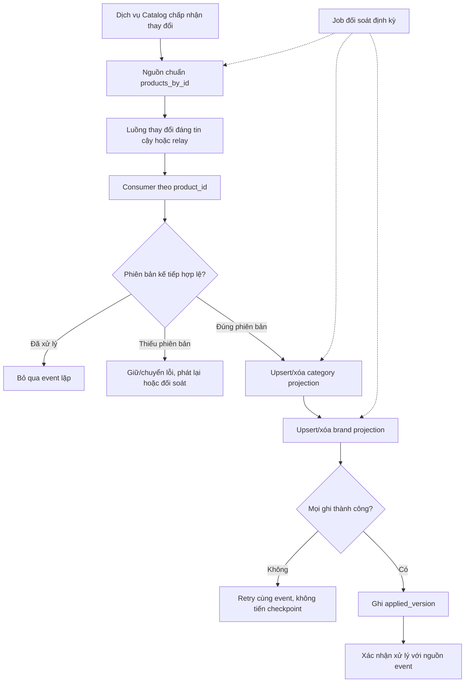

# Ứng dụng sự kiện hoặc công việc nền để đồng bộ dữ liệu lặp trong Apache Cassandra

## Mục tiêu học tập

Trong chương **Quan hệ và dữ liệu lặp**, một thực thể nghiệp vụ có thể xuất hiện ở nhiều bảng Apache Cassandra để phục vụ các cách truy vấn khác nhau. Vấn đề khó không chỉ là tạo được những bảng ấy, mà còn là **duy trì dữ liệu lặp khi một bản ghi được sửa, xóa, chuyển khóa, hoặc một thao tác gặp lỗi**.

Sau bài học, bạn có thể:

- Phân biệt **ghi đồng bộ nhiều bảng**, **đồng bộ hướng sự kiện** (*event-driven projection*) và **công việc nền đối soát** (*reconciliation job*).
- Thiết kế hợp đồng sự kiện chứa ID, phiên bản nguồn, khóa cũ/mới và đủ trường cần thiết để tạo lại bảng dẫn xuất.
- Giải thích tại sao một sự kiện có thể bị gửi lặp, đến sai thứ tự, mất dấu hoặc chỉ được áp dụng một phần; dùng **idempotency**, điều phối theo khóa và checkpoint để hạn chế hậu quả.
- Viết CQL cho bảng nguồn chuẩn, hai bảng tra cứu theo truy vấn và bảng theo dõi tiến độ chiếu dữ liệu.
- Tổ chức worker trong Java Driver để thực hiện fan-out ghi có kiểm soát, retry và báo lỗi.
- Xây dựng công việc nền **backfill/repair ở tầng ứng dụng**, đo độ trễ đồng bộ, và phân biệt nó với repair giữa các replica của Cassandra.

## 1. Tại sao dữ liệu lặp cần một cơ chế đồng bộ riêng?

Apache Cassandra là cơ sở dữ liệu phân tán kiểu **wide-column**, tổ chức hàng theo **partition key** và **clustering columns**. Cassandra không hỗ trợ `JOIN` hay khóa ngoại theo cách của RDBMS, nên ứng dụng thường tạo các bảng khác nhau cho các truy vấn phổ biến.

Ví dụ, dịch vụ Catalog quản lý một sản phẩm và cần:

1. Tra sản phẩm bằng `product_id`.
2. Liệt kê sản phẩm mới nhất theo **danh mục** và tháng công bố.
3. Liệt kê sản phẩm mới nhất theo **thương hiệu** và tháng công bố.

Để tránh lấy danh sách ID rồi đọc lại từng sản phẩm, ứng dụng có thể sao chép `name`, `price` và `currency` sang hai bảng danh sách. Khi giá tăng từ 750.000 lên 790.000 VND, trạng thái đúng phải được thể hiện ở cả các đường đọc, dù chúng không nhất thiết thay đổi cùng một thời điểm.

| Bảng | Vai trò | Truy vấn chính |
| --- | --- | --- |
| `products_by_id` | Nguồn chuẩn của các thuộc tính Catalog trong ví dụ | `WHERE product_id = ?` |
| `products_by_category_month` | Bản biểu diễn dẫn xuất theo danh mục/tháng | `WHERE category_id = ? AND publish_month = ?` |
| `products_by_brand_month` | Bản biểu diễn dẫn xuất theo thương hiệu/tháng | `WHERE brand_id = ? AND publish_month = ?` |
| `product_projection_progress_by_id` | Theo dõi phiên bản đã xử lý của một sản phẩm trong worker | `WHERE product_id = ?` |

**Nguồn chuẩn** (*canonical source*) là quyết định của nghiệp vụ và kiến trúc ứng dụng, không phải chức năng Cassandra tự gắn cho một bảng. Trong một hệ thống khác, nguồn chuẩn có thể ở dịch vụ bên ngoài hoặc event log; các bảng Cassandra chỉ là bản biểu diễn đọc.

**Đừng nhầm hai kiểu sao chép:** *replication* tạo nhiều replica của **cùng dữ liệu** theo replication factor, còn *denormalization* tạo **nhiều bảng logic** có khóa và mục đích đọc khác nhau. Consistency level và repair giữa các replica không tự so sánh hay sửa hai bảng dẫn xuất từ một nguồn.

## 2. Ba cách duy trì bảng dẫn xuất

| Phương án | Luồng cơ bản | Ưu điểm | Rủi ro hoặc đánh đổi |
| --- | --- | --- | --- |
| **Ghi đồng bộ nhiều bảng** | Request cập nhật nguồn, sau đó ghi tất cả projection trước khi phản hồi | Đường ghi kiểm soát trực tiếp các đích; ít thành phần phụ | Timeout/ghi thành công một phần; độ trễ tăng khi nhiều bảng |
| **Đồng bộ hướng sự kiện** | Nguồn chấp nhận thay đổi → công bố sự kiện → consumer cập nhật projection | Tách tải đọc–ghi, có thể retry/buffer và xử lý độc lập | Projection trễ; sự kiện lặp/sai thứ tự; cần phát sự kiện đáng tin cậy |
| **Công việc nền đối soát/backfill** | Job duyệt nguồn theo phạm vi có kiểm soát → đối chiếu/tái tạo bảng dẫn xuất | Sửa bản ghi bỏ sót, hữu ích khi đổi schema hoặc khôi phục | Độ trễ lớn hơn; cần điều tiết tải và chống race với ghi mới |

Trong thực tế, **sự kiện + job đối soát định kỳ** thường bổ sung cho nhau: sự kiện xử lý phần lớn cập nhật nhanh, còn đối soát phát hiện những trường hợp hệ thống chưa xử lý hết. Không có phương án nào tự bảo đảm “exactly once” xuyên Cassandra, message broker và các dịch vụ bên ngoài.

### Mục tiêu nhất quán phải do nghiệp vụ xác định

- Trang danh sách sản phẩm có thể cho phép giá hoặc tên hiển thị cũ trong một khoảng đo được.
- Trang thanh toán có thể cần đọc **giá đã chốt của đơn hàng** từ dịch vụ có thẩm quyền, không dựa vào bảng danh sách Catalog.
- Khi xóa sản phẩm hoặc thu hồi dữ liệu nhạy cảm, yêu cầu lưu giữ và xóa có thể chặt hơn yêu cầu đồng bộ trang hiển thị.

Nếu người dùng yêu cầu trạng thái mới phải xuất hiện **ngay tức khắc** trên mọi bảng trước khi một thao tác được coi là hoàn tất, cần định nghĩa quy trình đồng bộ và xử lý lỗi phù hợp; không thể chỉ gọi đó là “eventual consistency” rồi bỏ qua yêu cầu nghiệp vụ.

## 3. CQL: một nguồn và hai bảng đọc theo truy vấn

Giả sử keyspace `shop` đã tồn tại, với replication phù hợp môi trường học tập. Các bảng bên dưới minh họa một mô hình có phiên bản:

```sql
USE shop;

CREATE TABLE products_by_id (
    product_id uuid PRIMARY KEY,
    category_id uuid,
    brand_id uuid,
    published_at timestamp,
    publish_month date,
    name text,
    price decimal,
    currency text,
    source_version bigint,
    deleted boolean
);

CREATE TABLE products_by_category_month (
    category_id uuid,
    publish_month date,
    published_at timestamp,
    product_id uuid,
    name text,
    price decimal,
    currency text,
    source_version bigint,
    PRIMARY KEY ((category_id, publish_month), published_at, product_id)
) WITH CLUSTERING ORDER BY (published_at DESC, product_id ASC);

CREATE TABLE products_by_brand_month (
    brand_id uuid,
    publish_month date,
    published_at timestamp,
    product_id uuid,
    name text,
    price decimal,
    currency text,
    source_version bigint,
    PRIMARY KEY ((brand_id, publish_month), published_at, product_id)
) WITH CLUSTERING ORDER BY (published_at DESC, product_id ASC);

-- Chỉ ghi tiến độ sau khi mọi projection bắt buộc đã xử lý.
CREATE TABLE product_projection_progress_by_id (
    product_id uuid PRIMARY KEY,
    applied_version bigint,
    updated_at timestamp
);
```

**Cách đọc khóa:**

- `products_by_id` có partition key `product_id`.
- `products_by_category_month` dùng partition key ghép `(category_id, publish_month)`, clustering `published_at DESC` rồi `product_id` để lấy sản phẩm mới nhất theo danh mục/tháng.
- `products_by_brand_month` tương tự nhưng có partition key theo thương hiệu.
- `product_projection_progress_by_id` có một hàng theo `product_id`; worker dùng phiên bản đã xử lý để phát hiện sự kiện lặp hoặc thiếu.

Trong bài học, `published_at` và `publish_month` được quy ước **bất biến** sau khi công bố. `publish_month` là ngày đầu tháng UTC được tính từ `published_at`. Nếu nghiệp vụ cho phép thay đổi thời điểm hoặc tháng công bố, sự kiện phải mang **khóa cũ lẫn khóa mới**, và worker cần xóa hàng theo khóa cũ trước hoặc sau khi tạo hàng mới theo chính sách nhất quán.

Bucket theo tháng giúp giới hạn phân vùng, nhưng chưa đủ nếu một danh mục có số sản phẩm cực lớn trong một tháng. Khi đó cần thiết kế thêm bucket và cách đọc/gộp các bucket theo tải thực tế.

### Ghi sản phẩm nguồn chuẩn

```sql
INSERT INTO products_by_id (
    product_id, category_id, brand_id,
    published_at, publish_month, name,
    price, currency, source_version, deleted
) VALUES (
    aaaaaaaa-aaaa-4aaa-8aaa-aaaaaaaaaaaa,
    cccccccc-cccc-4ccc-8ccc-cccccccccccc,
    bbbbbbbb-bbbb-4bbb-8bbb-bbbbbbbbbbbb,
    '2026-11-21T01:00:00Z', '2026-11-01',
    'Bàn phím cơ', 750000.00, 'VND', 1, false
);
```

### Tạo các hàng dẫn xuất cho phiên bản 1

```sql
INSERT INTO products_by_category_month (
    category_id, publish_month, published_at,
    product_id, name, price, currency, source_version
) VALUES (
    cccccccc-cccc-4ccc-8ccc-cccccccccccc,
    '2026-11-01', '2026-11-21T01:00:00Z',
    aaaaaaaa-aaaa-4aaa-8aaa-aaaaaaaaaaaa,
    'Bàn phím cơ', 750000.00, 'VND', 1
);

INSERT INTO products_by_brand_month (
    brand_id, publish_month, published_at,
    product_id, name, price, currency, source_version
) VALUES (
    bbbbbbbb-bbbb-4bbb-8bbb-bbbbbbbbbbbb,
    '2026-11-01', '2026-11-21T01:00:00Z',
    aaaaaaaa-aaaa-4aaa-8aaa-aaaaaaaaaaaa,
    'Bàn phím cơ', 750000.00, 'VND', 1
);

UPDATE product_projection_progress_by_id
SET applied_version = 1, updated_at = '2026-11-21T01:00:01Z'
WHERE product_id = aaaaaaaa-aaaa-4aaa-8aaa-aaaaaaaaaaaa;
```

Các câu lệnh này **minh họa kết quả** một worker đã áp dụng thành công phiên bản 1, không khẳng định việc chạy tuần tự nhiều `INSERT` và `UPDATE` là một giao dịch ACID. Trong luồng thực tế, chỉ ghi checkpoint sau khi mọi đích bắt buộc đã được xác nhận theo chính sách.

### Đọc bảng dẫn xuất đúng đường truy cập

```sql
SELECT product_id, name, price, currency
FROM products_by_category_month
WHERE category_id = cccccccc-cccc-4ccc-8ccc-cccccccccccc
  AND publish_month = '2026-11-01'
LIMIT 20;

SELECT product_id, name, price, currency
FROM products_by_brand_month
WHERE brand_id = bbbbbbbb-bbbb-4bbb-8bbb-bbbbbbbbbbbb
  AND publish_month = '2026-11-01'
LIMIT 20;
```

Nếu cần xem nhiều tháng, ứng dụng phải truy vấn các bucket liên quan và gộp/sắp xếp/paging có giới hạn; không mặc định một `SELECT` theo danh mục sẽ trả được mọi sản phẩm trên nhiều tháng.

## 4. Hợp đồng sự kiện: cần mang những thông tin nào?

Sự kiện “giá đã thay đổi” chỉ có `product_id` và `new_price` có thể không đủ để dựng một hàng ở bảng dẫn xuất, đặc biệt khi **khóa tra cứu** như `category_id` hoặc `brand_id` thay đổi. Một cách là phát **ảnh trạng thái đã được chấp nhận** cùng metadata trước/sau.

Ví dụ sự kiện cập nhật giá phiên bản 2 (JSON minh họa):

```json
{
  "event_id": "eeeeeeee-eeee-4eee-8eee-eeeeeeeeeeee",
  "event_type": "ProductChanged",
  "product_id": "aaaaaaaa-aaaa-4aaa-8aaa-aaaaaaaaaaaa",
  "source_version": 2,
  "occurred_at": "2026-11-21T01:10:00Z",
  "old_keys": {
    "category_id": "cccccccc-cccc-4ccc-8ccc-cccccccccccc",
    "brand_id": "bbbbbbbb-bbbb-4bbb-8bbb-bbbbbbbbbbbb"
  },
  "new_state": {
    "category_id": "cccccccc-cccc-4ccc-8ccc-cccccccccccc",
    "brand_id": "bbbbbbbb-bbbb-4bbb-8bbb-bbbbbbbbbbbb",
    "published_at": "2026-11-21T01:00:00Z",
    "publish_month": "2026-11-01",
    "name": "Bàn phím cơ",
    "price": "790000.00",
    "currency": "VND",
    "deleted": false
  },
  "schema_version": 1
}
```

Các trường có vai trò riêng:

| Trường | Mục đích |
| --- | --- |
| `event_id` | Nhận diện một lần thay đổi logic; hỗ trợ quan sát và chống xử lý sự kiện lặp ở tầng nghiệp vụ |
| `product_id` | Khóa định danh thực thể, dùng để định tuyến sự kiện đến cùng luồng xử lý và đọc nguồn |
| `source_version` | Thứ tự thay đổi được dịch vụ nguồn chấp nhận cho **một product_id**, không phải timestamp thời gian thực |
| `old_keys` | Xóa chính xác hàng ở khóa cũ khi chuyển danh mục/thương hiệu hoặc xóa |
| `new_state` | Đủ các cột cần để **upsert** bảng đọc theo khóa mới |
| `schema_version` | Cho phép consumer kiểm tra khả năng hiểu định dạng sự kiện và nâng cấp tương thích |
| `occurred_at` | Đo độ trễ xử lý; **không** dùng một mình làm thứ tự thay đổi khi đồng hồ các tác nhân có thể lệch |

Số tiền được biểu diễn dạng chuỗi trong JSON để tránh mất độ chính xác khi qua những bộ xử lý số thực; phía Java chuyển sang `BigDecimal`.

Với event chỉ mô tả phần thay đổi (*delta event*), consumer có thể phải đọc lại nguồn chuẩn để lấy đủ cột. Với *state snapshot event*, consumer có thể upsert projection trực tiếp nhưng payload lớn hơn. Cần chọn theo workload và khả năng đọc lại nguồn khi sự kiện đến muộn.

### Ghi nguồn có kiểm soát phiên bản

Trong ví dụ, Catalog có thể dùng LWT để không cho hai tác nhân cùng dựa trên phiên bản 1 ghi một phiên bản 2 khác nhau:

```sql
UPDATE products_by_id
SET price = 790000.00, source_version = 2
WHERE product_id = aaaaaaaa-aaaa-4aaa-8aaa-aaaaaaaaaaaa
IF source_version = 1;
```

Ứng dụng chỉ coi thay đổi được chấp nhận khi kết quả `[applied] = true`, rồi yêu cầu công bố sự kiện phù hợp với trạng thái đã được chấp nhận. Nếu điều kiện thất bại, phải đọc lại trạng thái nguồn hoặc giải quyết xung đột; không tự phát event v2.

**LWT trên nguồn không làm việc phát sự kiện sang broker trở nên nguyên tử.** Nếu nguồn ghi xong nhưng ứng dụng chết trước khi phát event, projection có thể không được cập nhật nếu không có cơ chế khôi phục.

## 5. Công bố sự kiện đáng tin cậy: dual write, outbox và CDC

Một trong những lỗi phổ biến nhất là luồng:

```text
Ghi products_by_id thành công
    -> gửi ProductChanged tới broker
    -> consumer ghi hai bảng dẫn xuất
```

Nếu tiến trình chết **giữa ghi nguồn và gửi sự kiện**, bản nguồn đúng nhưng không có thông báo để consumer làm việc. Nếu gửi thông báo trước rồi ghi nguồn thất bại, lại có nguy cơ tạo projection của thay đổi chưa được chấp nhận.

### Các chiến lược cần đánh giá

**1. Ghi đồng bộ nhiều bảng.** Dịch vụ Catalog gọi trực tiếp `UPDATE` nguồn rồi `UPDATE/INSERT` từng projection. Không có broker, nhưng vẫn phải ghi nhận thao tác một phần, retry và đối soát. Đây có thể là phương án đủ đơn giản khi số đường ghi ít và yêu cầu độ trễ phù hợp.

**2. Transactional outbox khi nguồn hỗ trợ ranh giới giao dịch phù hợp.** Trong hệ quản trị có transaction thích hợp, cập nhật trạng thái nguồn và thêm hàng outbox trong cùng transaction, rồi một relay phát event từ outbox tới broker. Tuy nhiên **không nên bê nguyên giả định transaction ACID của RDBMS sang Cassandra**. Logged batch của Cassandra có ngữ nghĩa riêng, không cung cấp isolation/rollback kiểu RDBMS và cũng không giao dịch nguyên tử với broker ngoài Cassandra.

**3. CDC hoặc event log đáng tin cậy.** Một luồng thay đổi được trích xuất từ nguồn hoặc dịch vụ có thẩm quyền có thể cấp sự kiện cho consumer. Khả năng CDC, định dạng sự kiện, cấu hình và bảo đảm phát lại **phụ thuộc phiên bản Cassandra, công cụ và kiến trúc triển khai**. Không mặc nhiên coi Cassandra đã có sẵn một sự kiện miền nghiệp vụ với đủ `old_keys` và `new_state`: CDC ở mức mutation có thể không mang những dữ kiện cũ cần để xóa projection. Phải xây dựng, kiểm chứng hoặc bổ sung chúng.

**4. Quét đối soát định kỳ hoặc theo sự cố.** Job so sánh nguồn chuẩn với bảng đọc và tạo lại những hàng thiếu/sai. Cách này giảm sự phụ thuộc vào một event duy nhất nhưng không phù hợp để bảo đảm độ trễ rất thấp nếu chạy thưa; cần kiểm soát tốc độ và khả năng đọc nguồn theo partition.

Trong một hệ phân tán thực tế, cách tiếp cận đáng tin cậy thường kết hợp **đường phát sự kiện được kiểm soát**, **consumer idempotent** và **job đối soát**. Không tuyên bố bảo đảm “exactly once” chỉ vì broker hoặc driver có một tùy chọn hỗ trợ retry.

## 6. Kiến trúc xử lý event và các quy tắc an toàn



Sơ đồ nêu **thứ tự trách nhiệm**; đường truyền cụ thể có thể là một hàng đợi, CDC pipeline hoặc cơ chế nội bộ khác.

### Quy tắc 1: serialization theo định danh thực thể

Để dễ duy trì thứ tự, consumer có thể định tuyến sự kiện bằng `product_id` vào cùng một phân vùng của hệ thống message, với **một worker sở hữu trình tự xử lý cho từng ID** ở mỗi thời điểm. Chỉ bảo đảm thứ tự trong broker là chưa đủ nếu nhiều worker vẫn ghi cùng ID song song mà không kiểm soát ownership, retry hoặc failover.

Không cần tổng thứ tự toàn cục giữa mọi sản phẩm: cần thứ tự **theo từng product_id** để không ghi event v2 sau khi đã áp dụng v3.

### Quy tắc 2: checkpoint là tiến độ **đã hoàn tất**

Với nguồn liên tục sinh `source_version = 1, 2, 3, ...` cho mỗi sản phẩm, worker có thể xử lý như sau:

1. Đọc `product_projection_progress_by_id.applied_version`, coi chưa có hàng là `0` nếu đang khởi tạo từ sự kiện v1.
2. Nếu `event.version <= applied_version`: đây là sự kiện cũ/lặp, bỏ qua.
3. Nếu `event.version > applied_version + 1`: có **lỗ hổng phiên bản**, không được âm thầm nhảy lên phiên bản cao hơn.
4. Nếu `event.version = applied_version + 1`: ghi mọi projection cần thiết, gồm xóa khóa cũ khi đổi danh mục/thương hiệu.
5. **Chỉ sau khi các ghi cần thiết thành công** mới tăng `applied_version` và xác nhận event.
6. Nếu lỗi hoặc timeout ở bất kỳ bước nào, retry **cùng sự kiện, cùng khóa và cùng dữ liệu**, hoặc đưa vào luồng xử lý lỗi/đối soát có kiểm soát.

Giả định quan trọng: phiên bản là **liên tiếp cho từng sản phẩm**. Nếu nguồn dùng số phiên bản có khoảng nhảy, hoặc consumer bắt đầu sau khi nguồn đã có version 100, phải định nghĩa logic bootstrap/checkpoint khác; không được ép giả định `last + 1` sai vào dữ liệu thật.

### Quy tắc 3: checkpoint không tự chống được ghi đè khi có nhiều worker

Cột `applied_version` và phép so sánh đọc rồi ghi **không phải một khóa phân tán**. Nếu hai consumer cùng xử lý một sản phẩm đồng thời, chúng có thể cùng đọc checkpoint cũ rồi ghi kết quả khác nhau. Cần một cơ chế bảo đảm **một chủ sở hữu xử lý cho mỗi ID**, hoặc thiết kế fencing/điều kiện ghi với khả năng xử lý race. LWT có thể giúp bảo vệ trạng thái của một hàng phù hợp, nhưng không biến toàn bộ fan-out nhiều bảng thành giao dịch nguyên tử.

### Quy tắc 4: retry phải idempotent

- `INSERT` CQL theo cùng khóa chính với cùng bộ giá trị có thể dùng làm upsert cho projection.
- `DELETE` cùng khóa có thể được thử lại theo hợp đồng xử lý.
- Không tăng bộ đếm, gửi email hoặc thanh toán lần nữa chỉ vì consumer retry upsert projection.
- Nếu sử dụng TTL, timestamp tùy chỉnh, counter hoặc thao tác cộng dồn, phải đánh giá kỹ **ngữ nghĩa retry**: hai lần ghi “cùng thông tin” không phải lúc nào cũng tương đương.
- Khi sự kiện đã bị thay thế bởi phiên bản mới, không để replay cũ **tái tạo hàng ở khóa cũ** sau khi đã chuyển danh mục.

## 7. CQL cho cập nhật, chuyển khóa và xóa

### 7.1. Khi giá thay đổi mà khóa không đổi

Projection có thể được upsert đầy đủ các trường đã chọn, dùng cùng khóa và `source_version = 2`:

```sql
INSERT INTO products_by_category_month (
    category_id, publish_month, published_at,
    product_id, name, price, currency, source_version
) VALUES (
    cccccccc-cccc-4ccc-8ccc-cccccccccccc,
    '2026-11-01', '2026-11-21T01:00:00Z',
    aaaaaaaa-aaaa-4aaa-8aaa-aaaaaaaaaaaa,
    'Bàn phím cơ', 790000.00, 'VND', 2
);

INSERT INTO products_by_brand_month (
    brand_id, publish_month, published_at,
    product_id, name, price, currency, source_version
) VALUES (
    bbbbbbbb-bbbb-4bbb-8bbb-bbbbbbbbbbbb,
    '2026-11-01', '2026-11-21T01:00:00Z',
    aaaaaaaa-aaaa-4aaa-8aaa-aaaaaaaaaaaa,
    'Bàn phím cơ', 790000.00, 'VND', 2
);
```

**Chú ý:** cột `source_version` giúp quan sát, nhưng bản thân một `INSERT` thường không ngăn sự kiện phiên bản 1 đến muộn ghi đè phiên bản 2. Bảo vệ ở đây dựa vào **xử lý tuần tự theo ID và checkpoint đúng quy trình**. Nếu cần kiểm soát ghi có điều kiện trên hàng cụ thể, có thể đánh giá LWT tương ứng và chi phí của nó; vẫn phải xử lý xóa/chuyển khóa trên nhiều bảng.

### 7.2. Khi sản phẩm chuyển danh mục

Giả sử sản phẩm chuyển từ danh mục `cccc...` sang `dddd...`, cùng `publish_month` và `published_at`. Khóa phân vùng của bảng theo danh mục đổi, không thể sửa bằng `UPDATE category_id` trên hàng cũ. Cần **xóa hàng cũ và tạo hàng mới**:

```sql
DELETE FROM products_by_category_month
WHERE category_id = cccccccc-cccc-4ccc-8ccc-cccccccccccc
  AND publish_month = '2026-11-01'
  AND published_at = '2026-11-21T01:00:00Z'
  AND product_id = aaaaaaaa-aaaa-4aaa-8aaa-aaaaaaaaaaaa;

INSERT INTO products_by_category_month (
    category_id, publish_month, published_at,
    product_id, name, price, currency, source_version
) VALUES (
    dddddddd-dddd-4ddd-8ddd-dddddddddddd,
    '2026-11-01', '2026-11-21T01:00:00Z',
    aaaaaaaa-aaaa-4aaa-8aaa-aaaaaaaaaaaa,
    'Bàn phím cơ', 790000.00, 'VND', 3
);
```

Bảng thương hiệu cũng có thể cần nâng phiên bản dẫn xuất, kể cả khi `brand_id` không đổi, nếu worker áp dụng một **snapshot sản phẩm đầy đủ**. Chỉ xóa từ danh mục cũ được nếu sự kiện chứa `old_keys.category_id` hoặc ứng dụng có cách đáng tin cậy tìm được khóa cũ. Nếu cố truy vấn theo `product_id` trên bảng phân vùng theo category mà không có category, đường truy cập sẽ không đúng thiết kế.

Trong lúc worker xóa rồi thêm, người đọc có thể tạm **không thấy** sản phẩm ở cả hai danh mục; nếu thêm rồi xóa, có thể tạm thấy ở cả hai. Chọn thứ tự và hợp đồng độ trễ theo nghiệp vụ, đồng thời có job đối soát các bản thừa/thiếu.

### 7.3. Khi xóa sản phẩm

Để lan truyền xóa, nguồn có thể sử dụng **soft delete** hay sự kiện tombstone nghiệp vụ chứa đủ khóa cũ. Worker xóa hàng tương ứng ở cả hai projection:

```sql
DELETE FROM products_by_category_month
WHERE category_id = dddddddd-dddd-4ddd-8ddd-dddddddddddd
  AND publish_month = '2026-11-01'
  AND published_at = '2026-11-21T01:00:00Z'
  AND product_id = aaaaaaaa-aaaa-4aaa-8aaa-aaaaaaaaaaaa;

DELETE FROM products_by_brand_month
WHERE brand_id = bbbbbbbb-bbbb-4bbb-8bbb-bbbbbbbbbbbb
  AND publish_month = '2026-11-01'
  AND published_at = '2026-11-21T01:00:00Z'
  AND product_id = aaaaaaaa-aaaa-4aaa-8aaa-aaaaaaaaaaaa;
```

Không xóa mất thông tin về khóa cũ trước khi sự kiện xóa hoặc cơ chế đối soát đã có thể xử lý nó. `DELETE` CQL tạo tombstone; việc dọn dữ liệu vật lý tuân theo compaction, repair và chính sách lưu giữ. Xóa ở một bảng **không có cascade** sang các bảng khác.

## 8. Java Driver 4.x: worker fan-out với checkpoint đơn giản

Ví dụ dưới đây minh họa worker xử lý các sự kiện **đã được một nguồn/consumer đáng tin cậy chuyển tới theo thứ tự phiên bản cho mỗi `product_id`**. Worker chỉ cập nhật Cassandra; phần broker, giải mã JSON, retry queue và khởi tạo `CqlSession` nằm ngoài phạm vi đoạn mã.

**Điều kiện sử dụng ví dụ:** mỗi `product_id` có đúng một luồng xử lý hoạt động; `source_version` tăng liên tiếp từ 1; `published_at` và `publish_month` bất biến; event chứa đủ khóa trước/sau. Nếu các điều kiện này không đúng, phải thay đổi thuật toán checkpoint, không dùng nguyên xi.

```java
import com.datastax.oss.driver.api.core.CqlSession;
import com.datastax.oss.driver.api.core.cql.PreparedStatement;
import com.datastax.oss.driver.api.core.cql.Row;

import java.math.BigDecimal;
import java.time.Instant;
import java.time.LocalDate;
import java.util.UUID;

public final class ProductProjectionWorker {
    public record ProductChanged(
        UUID eventId,
        UUID productId,
        long version,
        UUID oldCategoryId,
        UUID categoryId,
        UUID oldBrandId,
        UUID brandId,
        LocalDate publishMonth,
        Instant publishedAt,
        String name,
        BigDecimal price,
        String currency,
        boolean deleted
    ) {}

    private final CqlSession session;
    private final PreparedStatement loadProgress;
    private final PreparedStatement saveProgress;
    private final PreparedStatement upsertCategory;
    private final PreparedStatement deleteCategory;
    private final PreparedStatement upsertBrand;
    private final PreparedStatement deleteBrand;

    public ProductProjectionWorker(CqlSession session) {
        this.session = session;

        loadProgress = session.prepare(
            "SELECT applied_version FROM product_projection_progress_by_id " +
            "WHERE product_id = ?");
        saveProgress = session.prepare(
            "UPDATE product_projection_progress_by_id " +
            "SET applied_version = ?, updated_at = ? WHERE product_id = ?");

        upsertCategory = session.prepare(
            "INSERT INTO products_by_category_month (" +
            "category_id, publish_month, published_at, product_id, " +
            "name, price, currency, source_version" +
            ") VALUES (?, ?, ?, ?, ?, ?, ?, ?)");
        deleteCategory = session.prepare(
            "DELETE FROM products_by_category_month WHERE " +
            "category_id = ? AND publish_month = ? " +
            "AND published_at = ? AND product_id = ?");

        upsertBrand = session.prepare(
            "INSERT INTO products_by_brand_month (" +
            "brand_id, publish_month, published_at, product_id, " +
            "name, price, currency, source_version" +
            ") VALUES (?, ?, ?, ?, ?, ?, ?, ?)");
        deleteBrand = session.prepare(
            "DELETE FROM products_by_brand_month WHERE " +
            "brand_id = ? AND publish_month = ? " +
            "AND published_at = ? AND product_id = ?");
    }

    public void handle(ProductChanged event) {
        Row row = session.execute(
            loadProgress.bind(event.productId())).one();
        long lastApplied = row == null || row.isNull("applied_version")
            ? 0L : row.getLong("applied_version");

        if (event.version() <= lastApplied) {
            return; // Đã xử lý: event cũ hoặc được giao lặp.
        }
        if (event.version() != lastApplied + 1) {
            throw new IllegalStateException(
                "Thiếu phiên bản: last=" + lastApplied +
                ", received=" + event.version());
        }

        // Xóa bản tại khóa cũ nếu đã chuyển nhóm hoặc bị xóa.
        if (event.oldCategoryId() != null
                && (event.deleted()
                    || !event.oldCategoryId().equals(event.categoryId()))) {
            session.execute(deleteCategory.bind(
                event.oldCategoryId(), event.publishMonth(),
                event.publishedAt(), event.productId()));
        }
        if (event.oldBrandId() != null
                && (event.deleted()
                    || !event.oldBrandId().equals(event.brandId()))) {
            session.execute(deleteBrand.bind(
                event.oldBrandId(), event.publishMonth(),
                event.publishedAt(), event.productId()));
        }

        if (!event.deleted()) {
            if (event.categoryId() != null) {
                session.execute(upsertCategory.bind(
                    event.categoryId(), event.publishMonth(),
                    event.publishedAt(), event.productId(),
                    event.name(), event.price(), event.currency(),
                    event.version()));
            }
            if (event.brandId() != null) {
                session.execute(upsertBrand.bind(
                    event.brandId(), event.publishMonth(),
                    event.publishedAt(), event.productId(),
                    event.name(), event.price(), event.currency(),
                    event.version()));
            }
        }

        // Chỉ lưu checkpoint SAU khi mọi bảng bắt buộc hoàn tất.
        session.execute(saveProgress.bind(
            event.version(), Instant.now(), event.productId()));

        // Sau khi handle thành công, tầng broker mới được ACK.
        // Nếu có timeout/lỗi ở bước nào, cần retry cùng event.
    }
}
```

### Phân tích các trường hợp lỗi của worker

**Lỗi sau khi xóa khóa cũ nhưng trước khi thêm khóa mới:** checkpoint chưa tiến. Khi phát lại cùng event, `DELETE` được thử lại, sau đó `INSERT` cùng khóa mới. Người đọc có thể tạm không thấy sản phẩm.

**Lỗi sau khi cập nhật category nhưng trước khi cập nhật brand:** checkpoint chưa tiến. Retry ghi lại category, rồi tiếp tục brand. Việc ghi lại cùng khóa và giá trị giúp worker có hành vi gần idempotent theo phạm vi ví dụ, nhưng vẫn cần lưu ý timestamp/TTL và cơ chế xung đột của Cassandra.

**Timeout khi ghi checkpoint:** worker không biết chắc checkpoint đã lưu hay chưa. Khi phát lại, đọc lại `applied_version`: nếu đã bằng phiên bản event thì bỏ qua; nếu còn cũ thì xử lý lại.

**Sự kiện v3 đến trước v2:** worker phát hiện gap và không vượt checkpoint lên 3. Cần chờ/khôi phục v2 hoặc dùng quy trình bootstrap từ snapshot nguồn đáng tin cậy. Không bỏ qua v2 nếu nó chứa khóa cũ cần xóa.

**Hai worker cùng xử lý một ID:** ví dụ không có fencing/LWT ở checkpoint, nên **không an toàn** nếu chạy đồng thời cho cùng `product_id`. Hệ thống message phải bảo đảm sở hữu theo khóa hoặc cần thiết kế cơ chế đồng thuận/điều kiện phù hợp.

**Ghi được xác nhận nhưng replica gặp sự cố sau đó:** checkpoint không phải bằng chứng tuyệt đối mọi replica lưu đầy đủ bản dẫn xuất mãi mãi. Phải cấu hình consistency level theo topology, xử lý timeout và dùng job đối soát để phát hiện trạng thái không khớp.

Ví dụ đặt toàn bộ tác vụ trong một hàm đồng bộ để minh họa thứ tự. Khi triển khai bất đồng bộ bằng `executeAsync`, vẫn phải giữ **thứ tự theo sản phẩm**, giới hạn số thao tác đồng thời và chỉ ACK event sau khi các thao tác cần thiết được xử lý. Phát hàng nghìn CQL request song song không kiểm soát có thể làm tăng timeout và tạo các khoảng hở khó sửa.

## 9. Công việc nền đối soát và backfill

Sự kiện giúp cập nhật nhanh, nhưng không nên là **cơ chế duy nhất** để sửa dữ liệu lặp. Job đối soát cần có một nguồn chuẩn đáng tin cậy và khả năng xác định đúng các hàng phải có/must-not-have.

### 9.1. Đối soát theo sản phẩm

Với một `product_id` đã biết, job có thể:

1. Đọc `products_by_id` để nhận giá trị chuẩn, `source_version`, `deleted` và các khóa category/brand hiện hành.
2. Đọc tiến độ từ `product_projection_progress_by_id`, biết pipeline có đang tụt lại hay không.
3. Nếu sản phẩm còn hoạt động, đọc hai hàng projection theo **đúng khóa** và so sánh các trường cần hiển thị, phiên bản, số tiền, đơn vị tiền tệ.
4. Nếu projection thiếu hoặc cũ, lập lịch **tái chiếu từ snapshot hiện hành**, đồng thời tránh ghi snapshot cũ lên một trạng thái mới hơn.
5. Nếu sản phẩm đã xóa, xác minh các bản đọc cũng đã được dọn theo chính sách.
6. Đối soát các hàng **thừa ở khóa cũ** sau chuyển category/brand; chỉ đọc nguồn hiện hành có thể không cho biết khóa cũ, do đó cần lịch sử chuyển khóa, event log, inventory các khóa đã chiếu hoặc một quy trình quét projection có kiểm soát.
7. Ghi checkpoint và số liệu đã sửa, đồng thời giám sát những lỗi chưa thể tự khôi phục.

Không nên chỉ so tổng số hàng của hai bảng: số hàng có thể bằng nhau nhưng ID, giá và khóa không khớp.

### 9.2. Backfill bảng mới hoặc thêm cột mới

Khi tạo bảng `products_by_brand_month` lần đầu, hoặc thêm cột `currency` vào một projection, cần xử lý các bản ghi đã tồn tại trước khi worker mới được triển khai:

1. Chốt định nghĩa schema, khóa, cách tính bucket và nguồn chuẩn.
2. Triển khai luồng ghi mới để không bỏ sót thay đổi đang diễn ra.
3. Chọn **mốc/watermark** hoặc chiến lược snapshot + replay để biết các sự kiện trong lúc backfill sẽ được hòa giải như thế nào.
4. Quét nguồn bằng công cụ/job **có kiểm soát tốc độ**, theo token range, partition hoặc danh mục có nguồn ID rõ ràng; không thực hiện `SELECT *` toàn bộ bảng trong một request trực tuyến.
5. Ghi dữ liệu vào projection mới với khóa và phiên bản nguồn. Tránh để job cũ ghi đè dữ liệu do consumer mới cập nhật.
6. Đối chiếu sai lệch và chỉ chuyển đường đọc sang bảng mới sau khi đạt tiêu chí chính xác/độ trễ đồng bộ.
7. Bật giám sát liên tục, lưu các checkpoint tiến độ và kế hoạch rollback/chuyển đổi nếu cần.

Nếu consumer chỉ chấp nhận phiên bản liên tiếp từ 1, một bản nguồn đã ở v100 **không thể được đưa qua worker bằng event v100 như thể là event đầu tiên**. Bootstrap phải có quy tắc riêng để đặt projection/checkpoint tại v100 một cách an toàn, rồi tiếp tục nhận v101 trở đi. Khi backfill song song với sự kiện, cần cơ chế chặn việc job cũ áp dụng snapshot v90 sau khi pipeline đã chiếu v100.

### 9.3. Đối soát không phải repair giữa replica

**Cassandra repair** giải quyết sự khác nhau giữa các replica của **cùng bảng/phân vùng**. Nó không biết `products_by_category_month` phải là phép biến đổi của `products_by_id`. **Compaction** và TTL có thể giúp quản lý dữ liệu trên đĩa theo chính sách, nhưng cũng không tính lại projection hay sửa bỏ sót sự kiện.

Xóa và TTL tạo **tombstone**; hệ thống có nhiều bảng dẫn xuất, nhiều lần xóa/chuyển khóa sẽ tăng số mutation và chi phí bảo trì. Job đối soát phải tôn trọng chính sách giữ dữ liệu và không vô tình dựng lại một sản phẩm đã bị xóa hợp lệ.

## 10. Quan sát và cảnh báo độ trễ đồng bộ

Một hệ thống đồng bộ hướng sự kiện chỉ có thể vận hành đáng tin cậy nếu biết **nó đang chậm ở đâu và có sai khác gì**.

| Chỉ số | Điều nó trả lời | Gợi ý cảnh báo |
| --- | --- | --- |
| `event_lag_seconds` | Từ nguồn chấp nhận thay đổi tới lúc projection đã áp dụng mất bao lâu? | Vượt ngưỡng độ mới đã thỏa thuận cho API |
| `unprocessed_events` | Còn bao nhiêu sự kiện chưa hoàn tất? | Hàng đợi tăng liên tục dù lưu lượng vào ổn định |
| `projection_write_failures` | Ghi tới category/brand thất bại bao nhiêu? | Tăng đột biến theo bảng hoặc partition |
| `version_gap_count` | Có sự kiện đến thiếu/sai thứ tự không? | Gap kéo dài vượt thời gian khôi phục |
| `retries_per_event` | Có sự kiện cần lặp nhiều lần? | Tăng bất thường, nguy cơ poison event |
| `reconciliation_mismatch_count` | Có bao nhiêu hàng thiếu/thừa/sai giá/sai phiên bản? | Vượt ngân sách lỗi dữ liệu |
| `old_key_orphan_count` | Còn hàng tại category/brand cũ sau chuyển khóa? | Tăng sau triển khai thay đổi schema |
| `large_or_hot_partitions` | Một bucket có quá nhiều hàng/ghi? | P95/P99 latency hoặc tải một số partition tăng |
| `tombstone_compaction_metrics` | Xóa/TTL và compaction có gây chi phí đọc/ghi? | Vượt giới hạn vận hành của cụm |

Cần theo dõi riêng **lỗi tạm thời** với **sự kiện không thể xử lý** (*poison event*) do schema sai, thiếu khóa cũ hoặc dữ liệu nghiệp vụ không hợp lệ. Poison event nên được giữ lại trong cơ chế xử lý lỗi có thông tin truy vết, không ACK rồi mất dấu, cũng không retry nóng vô hạn khiến cả partition sự kiện bị nghẽn.

### Mẫu kịch bản kiểm thử

| Lỗi được chủ động tạo | Kết quả mong đợi |
| --- | --- |
| Consumer nhận cùng event v2 hai lần | Lần sau được bỏ qua sau checkpoint; không làm tăng số hàng logic |
| Consumer chết sau khi cập nhật category, trước brand | Retry hoàn tất brand; checkpoint chỉ tăng khi cả hai đã xong |
| Event v3 đến trước v2 | Phát hiện gap, không chiếu v3 một cách mù quáng |
| Giá v3 đã chiếu nhưng replay giá v2 tới sau | Không để event cũ ghi đè giá mới |
| Chuyển danh mục trong lúc có lỗi | Đối soát phát hiện hàng ở danh mục cũ/thừa và hàng mới/thiếu |
| Xóa sản phẩm nhưng thông báo bị mất | Job đối soát theo nguồn hoặc lịch sử xóa có khả năng dọn các bản |
| Broker timeout sau khi worker ghi checkpoint | Có thể giao event lặp; checkpoint giúp consumer xử lý lại an toàn |
| Backfill snapshot v90 chạy cùng live event v100 | Không để backfill cũ ghi đè projection mới |
| RF/topology thay đổi hoặc một replica bị lỗi | Mức nhất quán và retry được đánh giá; projection được đối soát độc lập với repair |

## 11. Quy trình xử lý sự cố điển hình

Giả sử dịch vụ Catalog đã xác nhận giá mới 790.000 VND với `source_version = 2`, nhưng trang danh mục vẫn hiển thị 750.000 VND.

**Bước 1 — Phân biệt lỗi đọc replica với lỗi projection.** Đọc bảng nguồn và bảng danh mục theo khóa hợp lệ, ở consistency level phù hợp; xác định mỗi bảng đang có phiên bản nào. Nếu bảng dẫn xuất còn v1 trong khi nguồn là v2, cần điều tra pipeline đồng bộ thay vì chỉ tăng consistency level.

**Bước 2 — Kiểm tra luồng sự kiện.** Event v2 có được phát thành công không? Consumer đã nhận chưa? Có gap, lỗi schema, timeout, bị giữ trong queue lỗi hay đang chờ retry? Đừng tự tạo event v3 để “đánh thức” consumer nếu nguồn chưa có phiên bản mới.

**Bước 3 — Kiểm tra từng bảng đích.** Có thể bảng theo thương hiệu đã ghi v2 trong khi bảng theo danh mục còn v1. Checkpoint không được tiến nếu worker chưa hoàn tất mọi đích bắt buộc theo hợp đồng.

**Bước 4 — Khôi phục idempotent.** Phát lại đúng event v2 khi còn phù hợp, hoặc chiếu lại snapshot hiện tại từ nguồn theo quy tắc version. Nếu nguồn đã là v3, tránh ghi một bản v2 cũ trở lại.

**Bước 5 — Kiểm tra trường hợp đổi khóa/xóa.** Nếu category hoặc brand thay đổi, phải xác minh đã dọn bản ở khóa cũ. Nếu bản nguồn đã bị xóa, không được dựng lại sản phẩm từ một thông báo cũ.

**Bước 6 — Đối soát và phòng ngừa.** Chạy đối chiếu có kiểm soát ở phạm vi bị ảnh hưởng; ghi nhận nguyên nhân (event bị mất, worker xử lý cạnh tranh, schema thiếu trường, job backfill ghi đè), bổ sung metric và kiểm thử để tránh lặp lại.

## 12. Bài thực hành: đồng bộ nhiều bảng ghi danh khóa học

Một nền tảng học trực tuyến có nguồn chuẩn ghi danh `enrollment_state_by_student` theo cặp `(student_id, course_id)`. Hai bảng dẫn xuất là:

- `active_enrollments_by_student`: danh sách khóa học đang tham gia của một học viên.
- `active_enrollments_by_course`: danh sách học viên đang tham gia một khóa học.

Một sự kiện `EnrollmentChanged` mang `student_id`, `course_id`, `version`, `status`, `enrolled_at` và `event_id`. Sự kiện được gửi theo cơ chế có thể lặp lại; một học viên có thể hủy rồi đăng ký lại khóa học.

**Yêu cầu thực hành:**

1. Thiết kế CQL khóa chính của hai bảng dẫn xuất sao cho truy vấn theo `student_id` hoặc `course_id` hiệu quả. Nếu một khóa học có hàng triệu học viên, cần làm gì để tránh phân vùng quá lớn?
2. Khi nhận sự kiện `ACTIVE`, worker ghi vào bảng nào? Khi nhận `CANCELLED`, phải xóa những hàng nào và cần khóa cũ nào?
3. Sau khi phiên bản 1 đã được chiếu sang bảng học viên, worker chết trước khi chiếu sang bảng khóa học. Trình bày cơ chế retry và thời điểm được tăng checkpoint.
4. Nếu phiên bản 3 (`ACTIVE` do đăng ký lại) đến trước phiên bản 2 (`CANCELLED`), vì sao không được cập nhật v3 rồi sau đó phát lại v2 vô điều kiện?
5. Nếu sự kiện hủy ghi danh bị mất, job nền phải dựa vào nguồn nào để sửa bản ghi `ACTIVE` còn sót?
6. Khi bổ sung trường `course_title` vào bảng ghi danh, nên xử lý bằng sự kiện cập nhật tên từ Catalog hay đọc bổ sung theo ID? Hãy phân tích **tần suất đổi tên, số học viên, số lần đọc và write fan-out**.
7. Đề xuất ít nhất ba metric có thể dùng để phát hiện sự kiện thiếu và projection không khớp nguồn.

**Gợi ý:**

- Bảng theo học viên có partition key `student_id`, clustering theo thời điểm/`course_id`; bảng theo khóa học có partition key `course_id` và clustering theo thời điểm/`student_id`. Cần bucket khi số quan hệ ở một phân vùng vượt quy mô chấp nhận được, đồng thời có thiết kế truy vấn nhiều bucket.
- Sự kiện hủy cần **`enrolled_at` gốc** nếu thời điểm là một phần của khóa chính. Với đăng ký lại, có thể cần ID chu kỳ ghi danh hoặc khóa lịch sử để không xóa nhầm liên kết mới.
- Checkpoint chỉ tiến sau khi **hai** bảng dẫn xuất đã nhận mutation cần thiết; retry cùng ID và giá trị tránh tạo bản ghi logic mới.
- Phải giữ thứ tự phiên bản hoặc có cách xử lý điều kiện; nếu không event hủy cũ có thể xóa lần đăng ký lại mới.
- Job đối soát đọc trạng thái có thẩm quyền; nếu nguồn hiện hành không còn giữ khóa cũ, cần bổ sung lịch sử sự kiện hoặc metadata chuyển/xóa.
- Sao chép tên khóa học vào từng ghi danh có thể tạo write fan-out lớn khi đổi tên một khóa học phổ biến; không có phương án chung cho mọi workload.

## Tổng kết

**Sự kiện và công việc nền** là hai công cụ bổ sung để duy trì **dữ liệu lặp** trong Cassandra. Sự kiện đưa thay đổi từ nguồn chuẩn tới các bảng truy vấn với độ trễ thấp hơn; job đối soát tìm và sửa bản thiếu, sai phiên bản, bản thừa sau xóa hoặc chuyển khóa, đồng thời hỗ trợ backfill. Để hệ thống đúng khi có lỗi, cần định nghĩa **chủ sở hữu dữ kiện, hợp đồng sự kiện, khóa cũ/mới, phiên bản theo thực thể, thứ tự xử lý, idempotency, checkpoint sau khi hoàn tất và chiến lược replay/đối soát**.

Mức nhất quán đọc ghi, replication, logged batch, compaction và repair đều có vai trò trong vận hành Cassandra nhưng **không thay thế** giao dịch và quy tắc đồng bộ giữa những bảng logic khác nhau. Thiết kế tốt không chỉ làm cho đường đọc nhanh nhờ partition key và clustering columns, mà còn bảo đảm dữ liệu có thể được **tái tạo, giám sát và khôi phục** khi một phần pipeline bị chậm hoặc thất bại.
