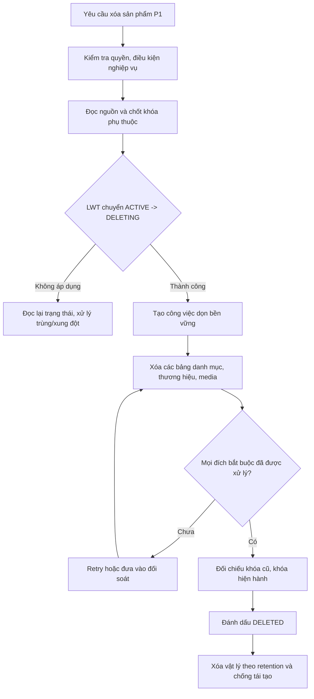
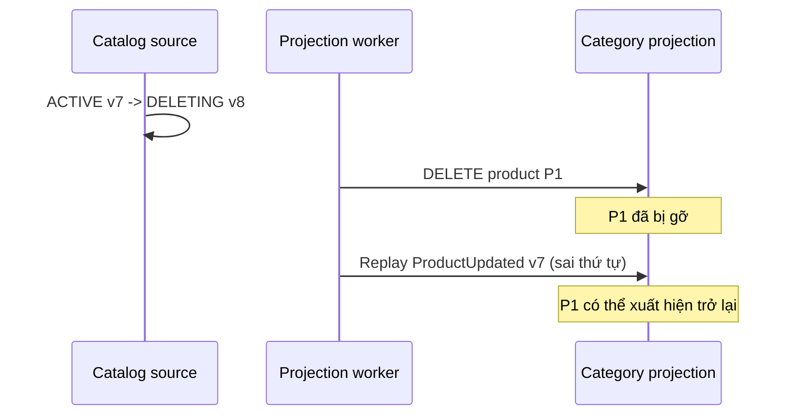

# Xóa dữ liệu gốc và xử lý dữ liệu phụ thuộc trong Apache Cassandra

## Mục tiêu học tập

Trong chương **Quan hệ và dữ liệu lặp**, một thực thể có thể được lưu ở nhiều bảng Apache Cassandra để phục vụ những truy vấn khác nhau. Khi thực thể gốc bị xóa, các bản ghi liên quan **không tự biến mất**: có thể còn bảng tra cứu, dữ liệu con, hàng lịch sử, sự kiện đang chờ xử lý và thậm chí những yêu cầu ghi cũ đến muộn.

Sau bài học, bạn có thể:

- Phân loại các dữ liệu **phải xóa**, **chỉ cần ẩn/ngừng sử dụng**, **phải giữ để bảo toàn lịch sử**, hoặc **cần xử lý theo chính sách lưu giữ riêng**.
- Giải thích vì sao Cassandra không có `FOREIGN KEY`, `ON DELETE CASCADE` và giao dịch nhiều bảng có rollback/isolation như RDBMS.
- Thiết kế quy trình **soft delete → dừng ghi mới → xóa bảng dẫn xuất và dữ liệu con → đối soát → xóa vật lý khi đủ điều kiện**.
- Thực hành CQL với bảng nguồn chuẩn, bảng theo danh mục/thương hiệu và bảng con phân vùng theo ID cha.
- Hiểu vai trò của **tombstone**, TTL, compaction, repair, replication và consistency level khi xóa dữ liệu.
- Dùng Java Driver để triển khai worker dọn dữ liệu có thể retry, đồng thời ngăn sự kiện cũ làm bản ghi xuất hiện trở lại.

## 1. Bài toán: xóa một sản phẩm nhưng dữ liệu vẫn còn ở nhiều nơi

Giả sử một hệ thống bán hàng có bốn đường truy cập:

| Bảng hoặc kho dữ liệu | Chức năng | Quan hệ với sản phẩm gốc |
| --- | --- | --- |
| `products_by_id` | Đọc thông tin chi tiết bằng `product_id` | Bảng nguồn chuẩn của Catalog trong ví dụ |
| `products_by_category_month` | Danh sách sản phẩm theo danh mục và tháng | Bản dẫn xuất sao chép tên, giá, trạng thái |
| `products_by_brand_month` | Danh sách sản phẩm theo thương hiệu và tháng | Bản dẫn xuất thứ hai |
| `product_media_by_product` | Danh sách ảnh/metadata media của sản phẩm | Dữ liệu con có vòng đời phụ thuộc sản phẩm |
| `order_items_by_order` | Các sản phẩm đã mua trong đơn hàng lịch sử | Dữ liệu giao dịch có nghĩa vụ lưu giữ riêng |

Người quản trị yêu cầu “xóa sản phẩm P1 khỏi Catalog”. Nếu chỉ chạy:

```sql
DELETE FROM products_by_id
WHERE product_id = 11111111-1111-4111-8111-111111111111;
```

thì Cassandra **không tự xóa** hàng P1 trong các bảng danh mục/thương hiệu, không xóa ảnh sản phẩm và cũng không kiểm tra dòng đơn hàng nào đang tham chiếu tới P1. Đây là hệ quả của mô hình Cassandra: các bảng logic độc lập, tối ưu theo **partition key** và **clustering columns**, không có khóa ngoại hay phép `JOIN` tổng quát như hệ quản trị quan hệ.

Khi người dùng mở một trang danh mục, P1 có thể vẫn xuất hiện dù tra cứu `products_by_id` đã không còn hàng. Ngược lại, nếu ứng dụng xóa bản danh mục trước rồi bị lỗi trước khi xóa nguồn, trang danh sách không thấy P1 nhưng trang chi tiết vẫn có. Những trạng thái chuyển tiếp này cần được thiết kế và giám sát thay vì coi là sự cố bất ngờ.

### Replication khác với bản ghi phụ thuộc

Cassandra **replication** lưu các replica của **cùng dữ liệu trong một bảng/phân vùng**, theo replication factor của keyspace. **Dữ liệu lặp theo truy vấn** là các bảng logic khác nhau do ứng dụng tạo. Xóa một hàng trong `products_by_id` sẽ được Cassandra truyền tới các replica của dữ liệu đó theo cơ chế ghi, nhưng **không tự phát** lệnh `DELETE` tương ứng sang `products_by_category_month`.

## 2. Định nghĩa “xóa” theo hợp đồng nghiệp vụ trước khi viết CQL

Từ “xóa” có nhiều ý nghĩa khác nhau:

| Yêu cầu | Ví dụ | Cách thường áp dụng |
| --- | --- | --- |
| Ngừng xuất hiện trên Catalog | Sản phẩm hết kinh doanh | Chuyển trạng thái `RETIRED` hoặc `DELETING`; loại khỏi các đường đọc công khai |
| Xóa các bản sao phục vụ tìm kiếm | Sản phẩm đã bị gỡ | Xóa hàng ở bảng danh mục, thương hiệu, chỉ mục tra cứu và cache nếu có |
| Xóa dữ liệu con có vòng đời phụ thuộc | Ảnh đại diện, metadata media chỉ thuộc sản phẩm | Xóa theo `product_id`; xử lý cả tệp trong object storage nếu tồn tại |
| Giữ thông tin giao dịch hợp lệ | Một đơn đã mua sản phẩm trước khi sản phẩm bị gỡ | Giữ snapshot lịch sử giá/tên tại thời điểm mua theo quy định; không cascade tùy tiện |
| Xóa dữ liệu nhạy cảm theo yêu cầu/pháp luật | Thông tin cá nhân trong một sản phẩm, tệp hoặc bản sao | Lập danh mục tất cả nơi lưu; kiểm soát dữ liệu dẫn xuất, cache, bản sao lưu và thời hạn giữ |
| Xóa vật lý sau thời gian giữ | Thông tin nguồn không còn được phép/cần lưu | Xóa hàng nguồn khi các điều kiện và bằng chứng dọn dữ liệu đã đáp ứng |

**Không mặc định mọi quan hệ con đều phải xóa dây chuyền.** Hình ảnh của một sản phẩm có thể phụ thuộc hoàn toàn vào sản phẩm, nhưng đơn hàng đã được thanh toán là thực thể nghiệp vụ khác. Một dòng đơn có thể lưu `product_id` để tham chiếu và đồng thời lưu `product_name_at_purchase`, `unit_price_at_purchase` để lịch sử không phụ thuộc vào Catalog về sau.

### Ba câu hỏi quyết định phạm vi xóa

1. **Ai sở hữu dữ kiện?** Catalog quyết định trạng thái Catalog; Order sở hữu lịch sử đơn; Media service có thể sở hữu tệp vật lý.
2. **Dữ liệu nào có thể tạo lại từ nguồn chuẩn?** Bảng danh mục/thương hiệu là projection; phải có quy trình xóa và chống tạo lại từ sự kiện cũ.
3. **Sau khi xóa, truy vấn nào được phép trả kết quả?** Trang tìm kiếm phải ẩn sản phẩm; trang hóa đơn có thể còn thông tin mua hàng hợp lệ; API quản trị có thể cần xem trạng thái `DELETING` cho đến khi công việc hoàn tất.

## 3. Thiết kế bảng và khóa cho việc dọn dữ liệu

Giả sử keyspace `shop` đã được tạo với replication phù hợp, các câu dưới đây dùng CQL:

```sql
USE shop;

CREATE TABLE products_by_id (
    product_id uuid PRIMARY KEY,
    category_id uuid,
    brand_id uuid,
    published_at timestamp,
    publish_month date,
    name text,
    price decimal,
    currency text,
    lifecycle_status text,
    lifecycle_version bigint,
    deleted_at timestamp
);

CREATE TABLE products_by_category_month (
    category_id uuid,
    publish_month date,
    published_at timestamp,
    product_id uuid,
    name text,
    price decimal,
    currency text,
    PRIMARY KEY ((category_id, publish_month), published_at, product_id)
) WITH CLUSTERING ORDER BY (published_at DESC, product_id ASC);

CREATE TABLE products_by_brand_month (
    brand_id uuid,
    publish_month date,
    published_at timestamp,
    product_id uuid,
    name text,
    price decimal,
    currency text,
    PRIMARY KEY ((brand_id, publish_month), published_at, product_id)
) WITH CLUSTERING ORDER BY (published_at DESC, product_id ASC);

-- Giả sử media là tập con có giới hạn hợp lý cho mỗi sản phẩm.
CREATE TABLE product_media_by_product (
    product_id uuid,
    media_id uuid,
    object_key text,
    content_type text,
    PRIMARY KEY ((product_id), media_id)
);
```

**Cách khóa ảnh hưởng đến xóa:**

- `products_by_id`: biết `product_id` là có thể xóa một hàng nguồn.
- `products_by_category_month`: để xóa đúng hàng, cần **đủ** `category_id`, `publish_month`, `published_at` và `product_id`.
- `products_by_brand_month`: tương tự nhưng cần `brand_id` thay cho `category_id`.
- `product_media_by_product`: vì có partition key `product_id`, có thể xóa các hàng media thuộc đúng sản phẩm bằng thao tác xóa phân vùng, hoặc xóa từng `media_id` khi yêu cầu giám sát chi tiết.

Không thể chỉ đưa `product_id` vào `DELETE` đối với `products_by_category_month` rồi mong Cassandra tự tìm mọi danh mục. Câu truy vấn không có partition key phù hợp không thuộc thiết kế đường truy cập hiệu quả. Nếu một sản phẩm có thể xuất hiện ở **nhiều danh mục cùng lúc**, hệ thống còn cần danh sách đầy đủ các khóa dẫn xuất đã tạo để dọn sạch.

**Giới hạn phân vùng:** bucket tháng giúp giảm quy mô danh sách theo danh mục/thương hiệu, nhưng một danh mục có hàng triệu sản phẩm trong một tháng vẫn có thể tạo phân vùng lớn. Tập media của một sản phẩm cũng cần giới hạn; xóa toàn bộ một partition cực lớn có thể kéo theo tombstone và chi phí compaction/đọc lớn. Thiết kế bucket, kích thước partition và chính sách phân trang dựa trên workload thật.

## 4. Chuẩn bị dữ liệu và quan sát phạm vi phụ thuộc

Giả sử P1 thuộc danh mục `2222...`, thương hiệu `3333...`, công bố vào tháng 11/2026:

```sql
INSERT INTO products_by_id (
    product_id, category_id, brand_id, published_at,
    publish_month, name, price, currency,
    lifecycle_status, lifecycle_version
) VALUES (
    11111111-1111-4111-8111-111111111111,
    22222222-2222-4222-8222-222222222222,
    33333333-3333-4333-8333-333333333333,
    '2026-11-21T01:00:00Z',
    '2026-11-01', 'Bàn phím cơ', 750000.00, 'VND',
    'ACTIVE', 7
);

INSERT INTO products_by_category_month (
    category_id, publish_month, published_at,
    product_id, name, price, currency
) VALUES (
    22222222-2222-4222-8222-222222222222,
    '2026-11-01', '2026-11-21T01:00:00Z',
    11111111-1111-4111-8111-111111111111,
    'Bàn phím cơ', 750000.00, 'VND'
);

INSERT INTO products_by_brand_month (
    brand_id, publish_month, published_at,
    product_id, name, price, currency
) VALUES (
    33333333-3333-4333-8333-333333333333,
    '2026-11-01', '2026-11-21T01:00:00Z',
    11111111-1111-4111-8111-111111111111,
    'Bàn phím cơ', 750000.00, 'VND'
);

INSERT INTO product_media_by_product
    (product_id, media_id, object_key, content_type)
VALUES (
    11111111-1111-4111-8111-111111111111,
    44444444-4444-4444-8444-444444444444,
    'catalog/p1/front.webp', 'image/webp'
);
```

Đọc bảng nguồn trước khi xóa để lấy những **khóa cần dọn**:

```sql
SELECT category_id, brand_id, publish_month, published_at,
       lifecycle_status, lifecycle_version
FROM products_by_id
WHERE product_id = 11111111-1111-4111-8111-111111111111;

SELECT media_id, object_key
FROM product_media_by_product
WHERE product_id = 11111111-1111-4111-8111-111111111111;
```

Thông tin này cần được **giữ an toàn trong ngữ cảnh công việc xóa** hoặc sự kiện xóa đã được ghi nhận bền vững, bởi sau khi xóa nguồn vật lý, không còn hàng nguồn để tra lại `category_id`/`brand_id`. Nếu sản phẩm đã từng di chuyển danh mục, ảnh trạng thái hiện tại có thể **không đủ** để tìm những hàng mồ côi từ danh mục cũ; khi đó cần lịch sử khóa, sổ ghi các projection đã tạo hoặc quá trình quét/đối soát có kiểm soát.

## 5. Quy trình xóa nhiều bước có thể khôi phục

Một cách tổ chức là **state machine** do dịch vụ Catalog sở hữu:

```text
ACTIVE -> DELETING -> DELETED -> PURGED (nếu chính sách cho phép)
             |
             +--> FAILED_RETRYABLE / cần can thiệp vận hành
```

Các tên trạng thái chỉ là quy ước ứng dụng, Cassandra không tự cung cấp workflow này.

**Giai đoạn A — Đánh dấu và chặn thao tác mới.**

1. Xác thực người yêu cầu và lý do xóa; kiểm tra không vi phạm điều kiện nghiệp vụ.
2. Đọc nguồn, ghi lại đầy đủ khóa các projection cần dọn.
3. Dùng kiểm tra trạng thái/phiên bản khi cần để chuyển `ACTIVE -> DELETING`.
4. Đảm bảo các writer và worker khác **không tiếp tục tạo dữ liệu công khai** từ bản đã đánh dấu xóa. Đây là quy tắc ứng dụng; chỉ lưu cột `DELETING` không tự chặn một worker đang thực thi.

**Giai đoạn B — Dọn dữ liệu phụ thuộc.**

1. Xóa các hàng dẫn xuất theo danh mục, thương hiệu và những bảng tra cứu khác đã được thiết kế.
2. Xóa dữ liệu con có vòng đời phụ thuộc, chẳng hạn metadata media; đồng thời yêu cầu dịch vụ quản lý object storage xóa tệp tương ứng nếu thuộc phạm vi.
3. Giữ hoặc ẩn dữ liệu lịch sử theo quy tắc nghiệp vụ và thời hạn lưu giữ; không xóa đơn hàng hợp lệ một cách vô ý.
4. Ghi nhận kết quả từng đích, retry có kiểm soát nếu lỗi/timeout.

**Giai đoạn C — Xác nhận và hoàn tất.**

1. Đối soát những đích bắt buộc; xử lý bản thừa ở khóa cũ.
2. Chuyển `DELETING -> DELETED` chỉ khi điều kiện hoàn tất đã được thỏa thuận đáp ứng.
3. Sau thời hạn lưu giữ hoặc khi được phép, xóa vật lý nguồn và những metadata chỉ cần cho quy trình xóa.
4. Đảm bảo vẫn có cách **ngăn sự kiện cũ tái tạo dữ liệu** sau khi nguồn đã bị xóa, ví dụ sổ xóa tối thiểu tồn tại đủ lâu hoặc quy tắc vòng đời ID không được tái sử dụng.



Sơ đồ là **quy trình nghiệp vụ**, không khẳng định việc ghi nguồn và tạo công việc ở broker hay hệ thống khác là nguyên tử. Nếu tiến trình chết sau khi chuyển `DELETING` nhưng trước khi phát sự kiện, phải có job quét những bản đang `DELETING` qua một nguồn ID đáng tin cậy hoặc cơ chế phát sự kiện bền vững thích hợp.

## 6. CQL thực hành: từ soft delete đến dọn projection

### 6.1. Chuyển trạng thái bằng điều kiện ghi

```sql
UPDATE products_by_id
SET lifecycle_status = 'DELETING',
    lifecycle_version = 8,
    deleted_at = '2026-11-21T03:00:00Z'
WHERE product_id = 11111111-1111-4111-8111-111111111111
IF lifecycle_status = 'ACTIVE' AND lifecycle_version = 7;
```

Đây là **lightweight transaction (LWT)**. Ứng dụng phải kiểm tra `[applied]`:

- `true`: yêu cầu đã chuyển trạng thái với phiên bản 8.
- `false`: trạng thái/phiên bản đã thay đổi hoặc dữ liệu chưa đáp ứng điều kiện. Cần đọc lại nguồn, không tự tiếp tục dựa trên khóa đã đọc cũ.
- Nếu timeout: **không suy diễn chắc chắn lệnh đã thất bại**; đọc lại trạng thái rồi giải quyết theo ID yêu cầu xóa.

Quy ước: mọi thay đổi `category_id`, `brand_id`, `publish_month`, `published_at` và trạng thái vòng đời phải tăng `lifecycle_version` theo luật của Catalog. Nếu một writer thay khóa mà không tăng phiên bản, việc đọc khóa rồi chuyển trạng thái không bảo vệ được khoảng cạnh tranh.

### 6.2. Xóa hàng danh mục và thương hiệu

```sql
DELETE FROM products_by_category_month
WHERE category_id = 22222222-2222-4222-8222-222222222222
  AND publish_month = '2026-11-01'
  AND published_at = '2026-11-21T01:00:00Z'
  AND product_id = 11111111-1111-4111-8111-111111111111;

DELETE FROM products_by_brand_month
WHERE brand_id = 33333333-3333-4333-8333-333333333333
  AND publish_month = '2026-11-01'
  AND published_at = '2026-11-21T01:00:00Z'
  AND product_id = 11111111-1111-4111-8111-111111111111;
```

Những câu lệnh trên chỉ dọn **hai bảng đã biết**. Trong một hệ thống có `products_by_seller`, `product_id_by_slug` hoặc bảng tìm kiếm khác, **mỗi đường đọc là một đích cần xét**. Cần một bảng ánh xạ sự kiện xóa → các bảng ảnh hưởng trong tài liệu vận hành, tránh quên đích khi bổ sung chức năng.

### 6.3. Xóa dữ liệu con

Với `product_media_by_product` chỉ chứa metadata media phụ thuộc sản phẩm, có thể dùng xóa phân vùng:

```sql
DELETE FROM product_media_by_product
WHERE product_id = 11111111-1111-4111-8111-111111111111;
```

Lệnh này không xóa tệp `catalog/p1/front.webp` trên object storage. Ứng dụng cần phối hợp với dịch vụ lưu tệp và theo dõi trạng thái dọn tệp. Nếu cần phục hồi sau lỗi, đừng xóa mất danh sách `object_key` trước khi việc dọn object đã hoàn tất hoặc đã được ghi nhận ở nơi bền vững.

Xóa theo partition key không phải cách miễn phí để xóa vô hạn dữ liệu. Khi số hàng con rất lớn, hãy đánh giá phân vùng, chi phí tombstone, compaction, thời gian phản hồi và khả năng chia việc thành nhiều phần có checkpoint.

### 6.4. Đánh dấu hoàn tất sau khi dọn

```sql
UPDATE products_by_id
SET lifecycle_status = 'DELETED',
    lifecycle_version = 9
WHERE product_id = 11111111-1111-4111-8111-111111111111
IF lifecycle_status = 'DELETING' AND lifecycle_version = 8;
```

Chỉ thực hiện khi các bước bắt buộc đã hoàn tất theo hợp đồng. Đây không phải bằng chứng rằng mọi replica đã được compaction và xóa vật lý; `DELETED` là trạng thái nghiệp vụ **không còn hiển thị/không tiếp nhận ghi mới**. Thời điểm và cách xóa hẳn dữ liệu phải được xử lý riêng.

### 6.5. Xóa vật lý nguồn khi đủ điều kiện

```sql
-- Minh họa thao tác xóa sau khi hoàn tất workflow và retention.
-- Không chạy ngay sau bước chuyển DELETING nếu còn cần dữ liệu
-- nguồn để đối soát hoặc phục hồi sự kiện xóa.
DELETE FROM products_by_id
WHERE product_id = 11111111-1111-4111-8111-111111111111;
```

Không dùng `TRUNCATE` để xóa một sản phẩm: đó là thao tác quản trị trên toàn bảng, không phải cascade theo ID. Không xóa metadata chống tái xuất hiện quá sớm nếu còn bản phát lại hoặc tiến trình backfill có thể dựng lại P1.

## 7. Xóa logic, TTL, tombstone và xóa vật lý khác nhau thế nào?

### 7.1. Soft delete là hợp đồng API, không phải CQL DELETE

Khi `lifecycle_status = 'DELETING'` hoặc `'DELETED'`, hàng nguồn vẫn có thể tồn tại. Các API công khai phải tự kiểm tra trạng thái. CQL không mặc nhiên ẩn hàng dựa trên cột trạng thái này. Ví dụ:

```sql
SELECT lifecycle_status, name, price
FROM products_by_id
WHERE product_id = 11111111-1111-4111-8111-111111111111;
```

Nếu ứng dụng vẫn trả tên/giá chỉ vì `SELECT` có kết quả, soft delete không đạt tác dụng nghiệp vụ. Với bảng danh sách không có cột vòng đời hoặc chưa kịp xóa projection, sản phẩm cũng có thể tạm xuất hiện. Cần cân nhắc hợp đồng nhất quán: ẩn ngay bằng lớp đọc/kiểm tra nguồn có thể tăng chi phí, còn xóa projection bất đồng bộ có độ trễ đo được.

### 7.2. Tombstone là dấu xóa trong cơ chế lưu trữ

Cassandra dùng **tombstone** để biểu diễn xóa. Xóa một hàng, một cell, partition hoặc dữ liệu hết TTL có thể để lại tombstone; dữ liệu không nhất thiết bị gỡ ngay khỏi SSTable trên đĩa. Compaction có thể loại bỏ bản cũ và tombstone khi đủ điều kiện an toàn, liên quan đến cấu hình, các SSTable, repair và thời gian grace.

Không nên mặc định giảm `gc_grace_seconds` xuống `0` để “xóa nhanh”: làm vậy có thể tăng rủi ro **zombie data** khi replica từng bỏ lỡ lệnh xóa, sau đó quay lại với giá trị cũ mà tombstone đã bị dọn. Quy trình repair đầy đủ, topology, downtime và phiên bản Cassandra ảnh hưởng đến lựa chọn vận hành phù hợp.

### 7.3. TTL là hết hạn theo thời gian, không phải cascade

Có thể đặt TTL cho dữ liệu phù hợp với vòng đời ngắn, nhưng:

- TTL ở `products_by_id` không tự áp dụng cho `products_by_category_month` hoặc bảng media.
- TTL khác nhau giữa nguồn và bản dẫn xuất có thể tạo hàng mồ côi hoặc làm mất nguồn cần thiết để đối soát.
- Nếu dữ liệu nguồn hết hạn trước khi job xóa có đủ khóa cũ, hệ thống có thể không còn khả năng xác định phải xóa hàng nào.
- Không dùng TTL như biện pháp thay thế chính sách xóa dữ liệu nhạy cảm ở cache, object storage, backup hoặc các hệ khác.

**Repair** giữa các replica của cùng bảng giúp duy trì tính nhất quán của bản sao lưu trữ; nó **không tự suy ra** rằng một sản phẩm đã bị xóa ở nguồn thì phải xóa ở bảng danh mục/thương hiệu. Phần này thuộc **đối soát logic tại ứng dụng**.

### 7.4. Replication và consistency level không thay thế workflow

Giả sử replication factor 3 trong một datacenter. `LOCAL_QUORUM` thường cần hai replica xác nhận thao tác trong datacenter đó (khi topology phù hợp). Nó cải thiện phạm vi nhìn thấy ghi của **cùng dữ liệu** nhưng không biến ba câu `DELETE` ở ba bảng thành một giao dịch nguyên tử.

`LOGGED BATCH` có thể bảo đảm các mutation trong batch cuối cùng được áp dụng sau một số lỗi, nhưng không có isolation hoặc rollback như RDBMS; batch đa phân vùng còn tăng chi phí. Nó không xử lý xóa tệp ở object storage, hủy cache, queue sự kiện hay việc phân biệt lịch sử đơn cần giữ. Không dùng batch để che lấp quy trình nghiệp vụ chưa rõ.

## 8. Tránh dữ liệu “sống lại” do ghi cũ hoặc sự kiện đến muộn

Một lỗi nghiêm trọng là **resurrection**: sản phẩm đã bị gỡ khỏi bảng danh mục nhưng một consumer xử lý lại sự kiện `ProductUpdated` cũ và `INSERT` hàng P1 vào bảng danh mục. Điều này có thể xảy ra vì một sự kiện đến muộn, một retry không kiểm soát hoặc job backfill dùng snapshot cũ.



**Một tombstone CQL không tự đảm bảo chống tái xuất hiện do mọi ghi tương lai.** Nếu worker phát một mutation mới với timestamp thắng tombstone, dữ liệu có thể được tạo lại. Mức nhất quán đọc/ghi cao hơn không giải quyết logic sự kiện cũ.

### Các tầng phòng vệ

1. **Phiên bản tăng theo thực thể:** sự kiện mang `product_id`, `lifecycle_version`, trạng thái nguồn và các khóa cũ/mới. Xử lý theo thứ tự, không áp dụng sự kiện có phiên bản nhỏ hơn phiên bản xóa đã chấp nhận.
2. **Trạng thái vòng đời chặn tạo mới:** khi nguồn ở `DELETING/DELETED`, đường ghi ứng dụng không được tạo thêm projection công khai; các worker phải tuân theo cùng hợp đồng.
3. **Một chủ sở hữu xử lý theo `product_id`:** kiểm soát consumer song song, retry và failover. Đọc checkpoint rồi ghi thường không phải khóa phân tán.
4. **Sổ xóa hoặc marker có thời hạn phù hợp:** giữ dấu hiệu “P1 đã bị xóa tại v8” trong nguồn đáng tin cậy đủ lâu để chống replay/backfill cũ, kể cả sau khi nguồn Catalog bị xóa vật lý. Không lưu vô hạn dữ liệu cá nhân chỉ để chống replay; cân nhắc ID không tái sử dụng, phạm vi và quy định giữ metadata tối thiểu.
5. **Đối soát sau lỗi:** tìm hàng thừa ở category/brand cũ, khóa mới sai, media còn tồn tại hoặc trạng thái bị tái tạo.

**Giới hạn:** kiểm tra phiên bản ở một bảng tiến độ riêng rồi ghi projection vô điều kiện vẫn có race nếu nhiều worker hoặc một job backfill không đi qua cùng cơ chế. Cần serialization/fencing, hoặc điều kiện ghi phù hợp và kế hoạch đối soát. LWT trên một hàng không tạo transaction xuyên nhiều bảng/partition.

## 9. Java Driver: worker xóa có thể retry

Ví dụ sau dùng **Apache Cassandra Java Driver 4.x**. Dịch vụ Catalog đã chấp nhận yêu cầu xóa, chuyển nguồn sang `DELETING` và tạo một công việc bền vững với **đầy đủ khóa cũ**. Worker này xử lý một sản phẩm theo thứ tự, không có writer khác được phép khôi phục/trả sản phẩm về `ACTIVE` cho đến khi hoàn tất.

Đoạn mã tập trung vào **xóa ba đích Cassandra** và xác nhận trạng thái `DELETED`. Việc xóa tệp object storage, phân trang cho tập con cực lớn và cơ chế broker/retry queue cần được triển khai riêng.

```java
import com.datastax.oss.driver.api.core.CqlSession;
import com.datastax.oss.driver.api.core.cql.PreparedStatement;
import com.datastax.oss.driver.api.core.cql.ResultSet;
import com.datastax.oss.driver.api.core.cql.Row;

import java.time.Instant;
import java.time.LocalDate;
import java.util.UUID;

public final class ProductDeletionWorker {
    public record DeleteJob(
        UUID productId,
        UUID categoryId,
        UUID brandId,
        LocalDate publishMonth,
        Instant publishedAt,
        long deletingVersion
    ) {}

    private final CqlSession session;
    private final PreparedStatement loadSource;
    private final PreparedStatement deleteCategory;
    private final PreparedStatement deleteBrand;
    private final PreparedStatement deleteMedia;
    private final PreparedStatement markDeleted;

    public ProductDeletionWorker(CqlSession session) {
        this.session = session;
        loadSource = session.prepare(
            "SELECT lifecycle_status, lifecycle_version " +
            "FROM products_by_id WHERE product_id = ?");
        deleteCategory = session.prepare(
            "DELETE FROM products_by_category_month WHERE " +
            "category_id = ? AND publish_month = ? AND " +
            "published_at = ? AND product_id = ?");
        deleteBrand = session.prepare(
            "DELETE FROM products_by_brand_month WHERE " +
            "brand_id = ? AND publish_month = ? AND " +
            "published_at = ? AND product_id = ?");
        deleteMedia = session.prepare(
            "DELETE FROM product_media_by_product " +
            "WHERE product_id = ?");
        markDeleted = session.prepare(
            "UPDATE products_by_id " +
            "SET lifecycle_status = ?, lifecycle_version = ? " +
            "WHERE product_id = ? " +
            "IF lifecycle_status = ? AND lifecycle_version = ?");
    }

    public void handle(DeleteJob job) {
        Row source = session.execute(loadSource.bind(
            job.productId())).one();

        if (source == null) {
            throw new IllegalStateException(
                "Không tìm thấy nguồn; cần kiểm tra lịch sử xóa");
        }
        if ("DELETED".equals(source.getString("lifecycle_status"))) {
            return; // Công việc đã hoàn tất trong phạm vi workflow này.
        }

        String status = source.getString("lifecycle_status");
        long version = source.getLong("lifecycle_version");
        if (!"DELETING".equals(status)
                || version != job.deletingVersion()) {
            throw new IllegalStateException(
                "Nguồn đã thay đổi; không được xóa theo khóa cũ");
        }

        // Cùng bộ khóa từ DeleteJob trên mọi lần phát lại.
        session.execute(deleteCategory.bind(
            job.categoryId(), job.publishMonth(),
            job.publishedAt(), job.productId()));
        session.execute(deleteBrand.bind(
            job.brandId(), job.publishMonth(),
            job.publishedAt(), job.productId()));
        session.execute(deleteMedia.bind(job.productId()));

        // Chỉ đánh dấu hoàn tất sau khi các đích CQL bắt buộc đã ghi.
        ResultSet result = session.execute(markDeleted.bind(
            "DELETED", job.deletingVersion() + 1,
            job.productId(), "DELETING", job.deletingVersion()));
        if (!result.wasApplied()) {
            throw new IllegalStateException(
                "Không xác nhận được chuyển DELETING -> DELETED");
        }

        // Tầng điều phối chỉ ACK sau khi mọi đích, kể cả object storage
        // nếu bắt buộc, đã được xử lý theo hợp đồng và kiểm tra.
    }
}
```

### Cách hiểu đúng ví dụ Java

- `DeleteJob` giữ `category_id`, `brand_id`, `publish_month`, `published_at` gốc để xóa đúng khóa; không cần truy vấn `ALLOW FILTERING`.
- `handle` kiểm tra trạng thái/phiên bản trước khi thực hiện công việc. Vì đó là **đọc rồi ghi**, bản thân phép kiểm tra không khóa nguồn khỏi thay đổi đồng thời; ví dụ **giả định quyền sở hữu đơn luồng và trạng thái DELETING không được hoàn tác**. Nếu giả định không đúng, cần cơ chế fencing và điều phối chặt hơn.
- Các câu `DELETE` cùng khóa có thể được thử lại khi timeout; nhưng timeout không chứng minh lần trước đã thất bại. Phải giữ ID và khóa ổn định, retry có giới hạn và theo dõi phần chưa hoàn tất.
- Nếu một đích lỗi, câu `markDeleted` chưa được chạy. Nếu timeout sau khi `markDeleted` đã áp dụng, lần gọi tiếp có thể đọc `DELETED` và coi phần CQL đã xử lý, **với điều kiện** hệ thống không cho phép đánh dấu `DELETED` trước khi mọi đích bắt buộc hoàn thành.
- Đoạn mã **không bảo vệ khỏi** worker khác dùng event cũ ghi lại sản phẩm sau khi đã xóa. Việc chặn resurrection thuộc ranh giới toàn hệ thống, như phần trước đã nêu.
- Trong thực tế nên dùng một job/ledger có trạng thái từng đích khi còn object storage, cache, search index hoặc nhiều projection, để không ACK chỉ dựa vào hai lệnh xóa Cassandra.

## 10. Bảng lịch sử: không xóa nhầm dữ liệu có ý nghĩa độc lập

Một đơn hàng đã thanh toán có thể cần giữ bản chụp hàng hóa tại **thời điểm mua**. Ví dụ:

```sql
CREATE TABLE order_items_by_order (
    order_id uuid,
    line_no int,
    product_id uuid,
    product_name_at_purchase text,
    quantity int,
    unit_price_at_purchase decimal,
    currency text,
    PRIMARY KEY ((order_id), line_no)
);
```

Để mở hóa đơn sau khi sản phẩm bị gỡ khỏi Catalog:

```sql
SELECT product_name_at_purchase, quantity,
       unit_price_at_purchase, currency
FROM order_items_by_order
WHERE order_id = 55555555-5555-4555-8555-555555555555;
```

Bảng này **không dùng `product_id` làm partition key**, vì đường đọc chính là chi tiết đơn theo `order_id`. Việc sản phẩm P1 bị xóa **không phải lý do mặc định** để xóa những dòng đơn chứa P1. Nếu hợp đồng pháp lý/quyền riêng tư yêu cầu xử lý một số dữ liệu đã sao chép vào lịch sử, đó là bài toán riêng cần xác định dữ liệu nào được giữ, ẩn danh hoặc xóa theo thẩm quyền. Không có khóa ngoại, Cassandra cũng không biết `order_items_by_order.product_id` trỏ tới một sản phẩm đã bị xóa.

**Lưu ý thiết kế:** nếu yêu cầu tìm tất cả đơn theo `product_id` để phục vụ thu hồi sản phẩm hoặc xóa dữ liệu, không thể giả định quét `order_items_by_order` theo `product_id` là truy vấn hiệu quả. Cần một bảng tra cứu theo sản phẩm hoặc hệ thống xử lý ngoại tuyến phù hợp, kèm chính sách nhất quán và quyền truy cập.

## 11. Kiểm thử xóa khi có lỗi và cập nhật đồng thời

Một hệ thống chỉ kiểm thử đường xóa thành công chưa đủ. Nên mô phỏng các trường hợp sau trong môi trường thử nghiệm:

| Kịch bản | Kết quả mong đợi |
| --- | --- |
| Xóa nguồn trước, quên xóa projection | Phát hiện hàng mồ côi; không coi xóa nguồn là cascade |
| Chuyển `ACTIVE -> DELETING` nhưng worker chết | Một cơ chế bền vững phát hiện công việc chưa hoàn thành và chạy lại |
| Xóa category thành công, xóa brand timeout | Retry cùng khóa, không đánh dấu `DELETED` quá sớm |
| Xóa meta media nhưng object storage còn tệp | Trạng thái xóa tổng thể chưa được coi là hoàn tất nếu tệp thuộc phạm vi bắt buộc |
| Event `ProductUpdated v7` đến sau sự kiện xóa v8 | Không tái tạo P1 vào bảng danh mục |
| Sản phẩm từng chuyển danh mục C sang D trước khi xóa | Kiểm tra và xử lý cả hàng mồ côi tại C nếu còn sót |
| Reader mở danh sách khi cleanup đang chạy | Kết quả đúng hợp đồng trạng thái chuyển tiếp/độ trễ; không cho thao tác mua hàng bị gỡ |
| Xóa phân vùng media lớn | Đánh giá tombstone, timeout và tác động lên compaction |
| Replica vắng mặt trong lúc xóa | Xác minh chính sách repair và tránh dọn tombstone quá sớm |
| Công việc xóa bị giao hai lần | Retry an toàn, không làm sai dữ liệu hay phát tác vụ bên ngoài lặp ngoài ý muốn |
| Source đã purge nhưng job backfill vẫn chạy snapshot cũ | Job không được phục hồi bản ghi đã xóa |
| Thao tác `TRUNCATE` bị nhầm với xóa một ID | Kiểm thử/quy trình ngăn thao tác phá hủy toàn bảng |

### Chỉ số và cảnh báo nên theo dõi

| Chỉ số | Ý nghĩa |
| --- | --- |
| `deletion_jobs_pending` | Số sản phẩm đang chờ dọn; có tăng liên tục không? |
| `deletion_age_seconds` | Tuổi công việc lâu nhất chưa hoàn tất |
| `projection_orphan_count` | Số hàng còn ở bảng dẫn xuất dù nguồn đã xóa/ngừng hoạt động |
| `cleanup_failures_by_target` | Đích nào thường lỗi: category, brand, media, cache, object storage? |
| `late_event_rejection_count` | Có bao nhiêu sự kiện cũ bị chặn sau khi xóa? |
| `reconciliation_repaired_rows` | Job đối soát đã sửa bao nhiêu hàng thiếu/thừa? |
| `tombstone_read_warnings` | Các truy vấn có bị ảnh hưởng do tombstone không? |
| `compaction_backlog`, `repair_status` | Cụm có theo kịp tải xóa và chính sách đồng bộ replica không? |
| `privacy_retention_overdue` | Có dữ liệu cần xóa theo chính sách nhưng quá thời hạn chưa xử lý? |

Tùy workload, cũng cần đo p95/p99 của `DELETE`, số phân vùng liên quan, thời gian hoàn tất end-to-end, tỷ lệ retry và số snapshot cũ còn tồn tại sau purge.

## 12. Bài tập thực hành: xóa khóa học và các quan hệ ghi danh

Hệ thống học trực tuyến có:

- `courses_by_id`: thông tin nguồn chuẩn một khóa học.
- `courses_by_category`: bảng dẫn xuất tra theo danh mục.
- `lessons_by_course`: các bài học phụ thuộc vào khóa học theo `course_id`.
- `enrollment_state_by_student`: nguồn nghiệp vụ về việc học viên đã ghi danh.
- `active_enrollments_by_course`: danh sách người học trong một khóa học.
- `certificates_by_student`: chứng chỉ đã cấp cho học viên theo chính sách lưu giữ riêng.

Yêu cầu: khóa học C1 bị ngừng xuất bản, sau một khoảng thời gian có thể được xóa vật lý.

**Câu hỏi:**

1. Những bảng nào cần xóa ngay khỏi đường đọc công khai, bảng nào nên chỉ ẩn/ngừng nhận cập nhật, và bảng nào không mặc định được phép xóa?
2. Khi xóa hàng `courses_by_id`, Cassandra có tự xóa `lessons_by_course` hay `active_enrollments_by_course` không? Vì sao?
3. Nếu một khóa học rất lớn, xóa toàn bộ phân vùng `lessons_by_course` có thể gây vấn đề vận hành nào?
4. Sự kiện `CourseDeleted` phải mang những khóa và metadata gì để worker xóa danh mục cũ và các quan hệ phụ thuộc?
5. Một consumer vẫn đang xử lý `CoursePublished` cũ sau khi đã xóa. Hãy đề xuất biện pháp ngăn khóa học xuất hiện trở lại.
6. Nếu quy định yêu cầu giữ chứng chỉ và lịch sử ghi danh, cần lưu dữ liệu lịch sử thế nào để không phải truy lại khóa học đã bị xóa?
7. Thiết kế một công việc nền đối soát những bản ghi mồ côi giữa nguồn khóa học, bảng danh mục và bảng ghi danh.

**Gợi ý hướng giải:**

- Chuyển khóa học sang `RETIRED/DELETING` để chặn đăng ký mới; xóa bản danh mục công khai và xử lý bài học theo vòng đời. Chứng chỉ/lịch sử ghi danh có thể cần được giữ với metadata đã chốt, tùy quy định.
- Không có `ON DELETE CASCADE` giữa các bảng Cassandra. Mọi bản dẫn xuất và tập con được dọn bằng thao tác do ứng dụng phát.
- Phân vùng lớn, tombstone và compaction có thể khiến xóa/đọc bị ảnh hưởng; cần thiết kế bucket và giới hạn tải dọn dữ liệu.
- Event xóa cần `course_id`, danh mục trước/sau nếu có, clustering key cần thiết, phiên bản nguồn và trạng thái xóa. Nếu liên kết ghi danh có khóa riêng, job cũng cần truy vấn hoặc nguồn ID để xác định những liên kết phải xử lý.
- Chặn event cũ theo phiên bản và trạng thái tombstone nghiệp vụ; consumer phải giữ đúng thứ tự hoặc có cơ chế fencing/đối soát.
- Lưu snapshot tên khóa học, thời điểm hoàn thành, ID chứng chỉ hoặc trường bắt buộc tại bảng lịch sử; không dựa duy nhất vào hàng Catalog có thể bị purge.
- Đối soát qua các tập ID có nguồn tin cậy, có checkpoint và tốc độ phù hợp; phân biệt dữ liệu phải dọn với dữ liệu hợp pháp cần giữ.

## Tổng kết

Trong Cassandra, **xóa dữ liệu gốc không đồng nghĩa xóa mọi dữ liệu phụ thuộc**. Không có `JOIN`, khóa ngoại hay cascade tự động giữa các bảng, nên hệ thống cần mô hình rõ ràng cho **nguồn chuẩn, các bảng biểu diễn dẫn xuất, tập dữ liệu con, lịch sử độc lập và kho dữ liệu bên ngoài**. Một quy trình đáng tin cậy thường đánh dấu trạng thái xóa để chặn ghi mới, lưu đủ khóa cũ, xóa các bản cần dọn bằng công việc có thể retry, đối soát kết quả rồi mới xóa vật lý theo chính sách.

Đồng thời, cần hiểu **soft delete, CQL DELETE, tombstone, TTL, compaction và repair** có vai trò khác nhau. Consistency level và logged batch không biến nhiều bảng thành một transaction có rollback/isolation. Khi sự kiện cũ hoặc backfill chạy muộn, hãy dùng **phiên bản, ranh giới sở hữu, marker xóa, xử lý theo khóa và đối soát** để tránh bản ghi xuất hiện trở lại. Thiết kế xóa hoàn chỉnh phải bảo vệ cả **độ đúng nghiệp vụ, khả năng phục hồi, hiệu năng phân tán và quyền riêng tư**.
