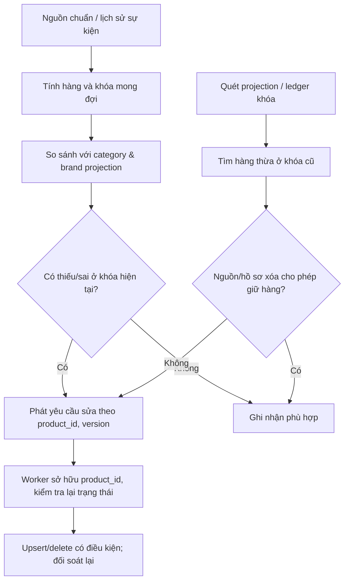

# Đối soát, tái xây dựng bảng đọc và sửa chênh lệch trong Apache Cassandra

## Mục tiêu học tập

Trong chương **Quan hệ và dữ liệu lặp**, Cassandra thường lưu một thực thể dưới nhiều hình dạng để đáp ứng các truy vấn khác nhau. Khi các bảng dẫn xuất bị thiếu hàng, chứa giá trị cũ, lưu hàng thừa sau chuyển khóa hoặc bị hỏng bởi một đợt triển khai, hệ thống cần biết **lấy gì làm chuẩn, phát hiện sai khác ra sao và sửa thế nào mà không gây sai khác mới**.

Sau bài học, bạn có thể:

1. Phân biệt **reconciliation** (đối soát logic giữa các bảng), **repair của Cassandra** (đồng bộ các replica) và **rebuild/backfill** (tạo lại bảng đọc từ nguồn).
2. Nhận diện hàng **thiếu, thừa, sai giá trị, sai phiên bản, sai khóa, sai trạng thái xóa** và phân loại chúng theo mức ảnh hưởng nghiệp vụ.
3. Thiết kế bảng nguồn chuẩn, bảng đọc theo partition key và metadata theo dõi tiến độ để có thể kiểm tra và phục hồi.
4. Triển khai quy trình đối soát hai chiều, sửa theo khóa bằng CQL và Java Driver với kiểm soát ghi đồng thời.
5. Lập kế hoạch rebuild bảng đọc lớn bằng **bảng mới + backfill + replay thay đổi + xác minh + cutover**; nêu được điều kiện để không mất cập nhật đang diễn ra.
6. Đo độ trễ, tỷ lệ sai lệch, tình trạng sửa lỗi và chi phí compaction/repair khi khôi phục dữ liệu.

## 1. Vì sao phải đối soát dù các câu ghi đều có retry?

Apache Cassandra phân phối hàng theo **partition key** và sắp xếp chúng bằng **clustering columns**. Vì không có `JOIN` và khóa ngoại theo cách của cơ sở dữ liệu quan hệ, ứng dụng thường tạo nhiều bảng cho những đường đọc khác nhau.

Ví dụ, dịch vụ Catalog cần:

- `products_by_id` để mở chi tiết bằng `product_id`.
- `products_by_category_month` để lấy 20 sản phẩm mới nhất trong một danh mục theo tháng.
- `products_by_brand_month` để lấy 20 sản phẩm mới nhất của một thương hiệu theo tháng.

Ứng dụng sao chép `name`, `price` và `currency` sang các bảng danh sách. Khi Catalog tăng giá, hai bảng dẫn xuất phải phản ánh giá mới theo hợp đồng độ trễ đã chọn. Tuy nhiên:

- Ghi nguồn thành công nhưng fan-out sang bảng danh mục bị timeout.
- Một event phiên bản 8 đến sau event phiên bản 9 và bị áp dụng sai thứ tự.
- Sản phẩm chuyển danh mục; hàng ở phân vùng danh mục cũ không được xóa.
- Consumer đã ghi một bảng nhưng chết trước khi ghi bảng thứ hai.
- Job backfill dùng snapshot cũ ghi đè bản mới.
- Sau xóa vật lý nguồn, một bản dẫn xuất còn tồn tại hoặc bị tái tạo từ event cũ.

**Retry giúp xử lý một số lỗi tạm thời nhưng không đủ để chứng minh mọi projection đã đúng.** Sau một lần timeout, ứng dụng có thể không biết thao tác đã được replica nhận hay chưa. Sau lỗi phần mềm, event thiếu trường hoặc bỏ sót một đợt xử lý, không có gì bảo đảm luôn tồn tại một retry đang chờ.

Do đó cần hai cơ chế bổ sung:

- **Đối soát (reconciliation):** xác định trạng thái kỳ vọng từ nguồn có thẩm quyền, so với các bản đọc rồi sửa bản thiếu/sai.
- **Tái xây dựng (rebuild):** tạo lại một bảng hoặc một vùng dữ liệu dẫn xuất từ nguồn đáng tin cậy, thường phục vụ sự cố lớn hoặc thay đổi schema/khóa.

### Phân biệt repair của Cassandra và repair logic

| Cơ chế | So sánh cái gì? | Giúp xử lý | Không tự giải quyết |
| --- | --- | --- | --- |
| **Replication** | Nhiều replica của cùng dữ liệu | Tính sẵn sàng khi một node gặp sự cố | Hai bảng logic có cùng nội dung nghiệp vụ hay không |
| **Cassandra repair** | Dữ liệu giữa các replica của cùng bảng/phân vùng | Sai lệch replica và vấn đề liên quan đồng bộ dữ liệu lưu trữ | Tính lại `products_by_category_month` từ `products_by_id` |
| **Đối soát ứng dụng** | Nguồn chuẩn với bảng dẫn xuất; các khóa logic và phiên bản | Hàng thiếu/thừa, trường cũ, chuyển khóa chưa sạch, bản xóa chưa dọn | Tự cung cấp giao dịch nguyên tử giữa các bảng |
| **Rebuild/backfill** | Bảng mới cần được tạo từ dữ liệu nguồn/sự kiện lịch sử | Hỏng dữ liệu diện rộng, tạo bảng v2, thêm đường truy vấn | Tự xử lý các cập nhật xảy ra **trong lúc** backfill |

**Điểm phân định:** dùng `nodetool repair` hoặc đặt `LOCAL_QUORUM` không làm Cassandra hiểu rằng một bảng danh mục là bản sao theo truy vấn của bảng nguồn. Quy tắc chiếu và đối soát nằm ở tầng ứng dụng.

## 2. Quy ước nguồn chuẩn và hợp đồng của từng bảng đọc

Bắt đầu bằng việc ghi rõ **ai có quyền quyết định giá trị đúng**. Trong ví dụ, Catalog sở hữu các trường `category_id`, `brand_id`, `name`, `price`, `currency`, `published_at` và `lifecycle_status`. Sản phẩm có thể được xem theo hai đường đọc, nhưng cả hai chỉ là **projection**.

| Hạng mục | Nguồn chuẩn `products_by_id` | Bảng danh mục | Bảng thương hiệu |
| --- | --- | --- | --- |
| Khóa tra cứu | `product_id` | `(category_id, publish_month)` | `(brand_id, publish_month)` |
| Thứ tự | Không yêu cầu | `published_at DESC`, `product_id` | `published_at DESC`, `product_id` |
| Trường cần hiển thị | Tất cả trường Catalog | `name`, `price`, `currency` | `name`, `price`, `currency` |
| Trường metadata | `source_version`, `lifecycle_status` | `source_version` | `source_version` |
| Khi thay đổi | Quy trình nghiệp vụ nguồn cập nhật | Tái chiếu từ nguồn | Tái chiếu từ nguồn |
| Khi xóa/chuyển khóa | Giữ trạng thái/hồ sơ hợp lệ theo chính sách | Xóa hàng ở khóa cũ, thêm khóa mới nếu còn hoạt động | Tương tự |
| Khi sai | Là cơ sở để quyết định giá trị hợp lệ trong ví dụ | Được sửa từ nguồn | Được sửa từ nguồn |

Cassandra **không tự chỉ định** một bảng là nguồn chuẩn. Nguồn có thẩm quyền có thể nằm trong một dịch vụ khác hoặc một event log. Nếu nguồn thật nằm ngoài Cassandra, việc đối soát phải lấy dữ kiện từ nguồn ấy thay vì coi một bản Cassandra bất kỳ là chân lý.

Một bản dẫn xuất được gọi là **có thể rebuild** khi còn đủ dữ liệu và quy tắc để tạo lại mọi hàng hợp lệ, bao gồm cả **quy tắc xóa**. Nếu đã xóa sạch nguồn nhưng không có thông tin tombstone nghiệp vụ hoặc lịch sử, việc biết rằng một hàng ở projection là mồ côi có thể không đơn giản.

## 3. Thiết kế schema CQL cho một tình huống đối soát

Giả sử đã có keyspace `shop` được cấu hình replication phù hợp. Những bảng dưới đây chủ yếu phục vụ minh họa quy trình, không phải một schema duy nhất cho mọi ứng dụng.

```sql
USE shop;

-- Trạng thái chuẩn của sản phẩm trong dịch vụ Catalog.
CREATE TABLE products_by_id (
    product_id uuid PRIMARY KEY,
    category_id uuid,
    brand_id uuid,
    publish_month date,
    published_at timestamp,
    name text,
    price decimal,
    currency text,
    source_version bigint,
    lifecycle_status text
);

-- Projection theo danh mục và tháng.
CREATE TABLE products_by_category_month (
    category_id uuid,
    publish_month date,
    published_at timestamp,
    product_id uuid,
    name text,
    price decimal,
    currency text,
    source_version bigint,
    PRIMARY KEY ((category_id, publish_month), published_at, product_id)
) WITH CLUSTERING ORDER BY (published_at DESC, product_id ASC);

-- Projection theo thương hiệu và tháng.
CREATE TABLE products_by_brand_month (
    brand_id uuid,
    publish_month date,
    published_at timestamp,
    product_id uuid,
    name text,
    price decimal,
    currency text,
    source_version bigint,
    PRIMARY KEY ((brand_id, publish_month), published_at, product_id)
) WITH CLUSTERING ORDER BY (published_at DESC, product_id ASC);

-- Tiến độ của luồng cập nhật projection; không thay thế nguồn chuẩn.
CREATE TABLE projection_progress_by_product (
    product_id uuid PRIMARY KEY,
    applied_version bigint,
    updated_at timestamp
);
```

Trong bài, `publish_month` là ngày đầu tháng theo UTC tính từ `published_at`. Trừ khi có quy trình chuyển khóa riêng, giả sử `published_at` bất biến sau công bố.

**Vì sao những khóa này quan trọng cho repair?**

- Đọc nguồn theo `product_id` là một truy vấn theo partition key.
- Muốn đọc hoặc sửa projection theo danh mục cần biết cả `category_id`, `publish_month`, `published_at`, `product_id`.
- Muốn đọc hoặc sửa projection theo thương hiệu cần biết `brand_id` thay cho `category_id`.
- Không thể lấy `product_id` rồi yêu cầu Cassandra tìm mọi hàng cùng ID trong bảng phân vùng theo danh mục mà không có đường truy cập tương ứng.
- Một sản phẩm đã nhiều lần chuyển danh mục có thể có **hàng thừa ở những khóa cũ** không còn xuất hiện trong bản nguồn hiện tại.

Đối soát vì thế có hai bài toán khác nhau: **sửa hàng tại khóa hiện tại** và **tìm/loại bỏ những khóa cũ đã từng được tạo**.

### Mô hình giữ các khóa đã từng chiếu (tùy chọn)

Khi thay khóa có thể xảy ra, một hệ thống có thể duy trì *ledger* ghi nhận mọi khóa projection đã **định ghi**, trước khi gửi thao tác ghi tới bảng đích:

```sql
CREATE TABLE projection_keys_by_product (
    product_id uuid,
    view_name text,
    target_partition_id uuid,
    publish_month date,
    published_at timestamp,
    last_attempted_version bigint,
    PRIMARY KEY (
        (product_id),
        view_name, target_partition_id, publish_month, published_at
    )
);
```

Ví dụ `view_name = 'category'` hoặc `'brand'`; `target_partition_id` là `category_id` hoặc `brand_id`. Khi cập nhật projection, worker ghi lại khóa đích vào ledger **trước** khi upsert bảng đích. Một ledger dư khóa nhưng bảng đích chưa từng được ghi có thể gây thêm lần kiểm tra/xóa an toàn; ngược lại, ghi projection thành công mà không ghi lại khóa cần xóa là lỗ hổng khó phát hiện hơn.

**Giới hạn cần nhớ:** ledger trên chỉ có giá trị nếu **mọi writer đều tuân thủ** quy tắc ghi nhận khóa, và quy trình retry/khôi phục cũng xử lý bản ghi đã bắt đầu nhưng chưa hoàn thành. Ledger không tự biến những ghi nhiều bảng thành một giao dịch. Với dữ liệu có hàng triệu lần chuyển khóa, ledger có thể lớn và cần chính sách giữ/chia partition hoặc thay bằng event history. Việc quét projection theo khóa để phát hiện hàng lạ vẫn hữu ích như một lớp kiểm tra độc lập.

## 4. Phân loại sai khác trước khi sửa

Không nên biến đối soát thành một lệnh “cứ không giống là UPDATE” vì nhiều trường hợp có hành động khác nhau.

| Loại sai lệch | Ví dụ | Nguồn kết luận | Hướng xử lý |
| --- | --- | --- | --- |
| **Missing projection** | Nguồn có P1 ACTIVE nhưng bảng thương hiệu không có hàng | Ảnh nguồn hiện tại, khóa kỳ vọng | Bổ sung hàng đúng khóa/phiên bản |
| **Stale value** | Nguồn có giá 790.000 VND ở v7, bảng danh mục vẫn 750.000 VND ở v6 | Giá, trạng thái và phiên bản nguồn | Áp dụng snapshot mới sau khi kiểm soát cạnh tranh |
| **Unexpected projection** | Bảng danh mục có P1 nhưng nguồn đã DELETED | Nguồn có dấu xóa được giữ đúng chính sách | Xóa bản đọc theo chính sách |
| **Wrong partition key** | P1 chuyển C1 → C2 nhưng vẫn hiện ở C1 | Lịch sử khóa/sự kiện, ledger, quét ngược | Dọn C1; đảm bảo C2 đúng |
| **Version ahead of source** | Projection v9 nhưng nguồn đọc được v8 | Race, nguồn đọc cũ, lỗi ghi hoặc nguồn không đúng | Không ghi v8 đè v9; kiểm tra nguồn, pipeline và consistency |
| **Partial projection** | Bảng brand ghi v7, bảng category còn v6 | Theo dõi các bảng đích và phiên bản | Retry hoặc đối soát đích bị thiếu |
| **Schema mismatch** | Bảng đọc v2 thiếu trường mới | Hợp đồng projection/schema | Backfill/chạy lại phép chiếu với phiên bản schema phù hợp |
| **Unknown source** | Có projection nhưng không tìm thấy nguồn | Có thể do purge, TTL, xóa hợp lệ hoặc sự cố | Kiểm tra hồ sơ xóa; không kết luận chỉ từ một lần SELECT |

Trong một hệ thống có mức độ trễ đồng bộ cho phép, việc quan sát projection v6 khi nguồn vừa lên v7 **chưa nhất thiết là lỗi**. Cần phân biệt:

- **Đang chờ đồng bộ hợp lệ:** sự kiện v7 chưa qua SLA; không cần sửa nóng ngay.
- **Độ lệch quá hạn:** v7 chưa đến projection sau ngưỡng; lập lịch repair.
- **Sai lệch cứng:** nguồn đã xóa nhưng projection sống lại, khóa cũ bị bỏ quên lâu, hoặc phiên bản cao hơn bất thường.

### Cấp độ hậu quả

Trang danh mục hiển thị giá cũ có thể là lỗi trải nghiệm; quyết định thanh toán dựa trên giá cũ có thể là lỗi tài chính. Đối soát có thể phục hồi hiển thị, nhưng **không được dùng projection đã sửa để kết luận giao dịch thanh toán trước đó đã đúng**. Đường ra quyết định phải dùng dịch vụ hoặc snapshot giao dịch có thẩm quyền.

## 5. CQL minh họa phát hiện và sửa chênh lệch

Tạo một nguồn chuẩn P1 có giá 790.000 VND tại phiên bản 7; bảng danh mục cố tình còn dữ liệu cũ ở phiên bản 6, còn bảng thương hiệu chưa có hàng:

```sql
INSERT INTO products_by_id (
    product_id, category_id, brand_id, publish_month, published_at,
    name, price, currency, source_version, lifecycle_status
) VALUES (
    11111111-1111-4111-8111-111111111111,
    22222222-2222-4222-8222-222222222222,
    33333333-3333-4333-8333-333333333333,
    '2026-11-01', '2026-11-21T01:00:00Z',
    'Bàn phím cơ', 790000.00, 'VND', 7, 'ACTIVE'
);

INSERT INTO products_by_category_month (
    category_id, publish_month, published_at, product_id,
    name, price, currency, source_version
) VALUES (
    22222222-2222-4222-8222-222222222222,
    '2026-11-01', '2026-11-21T01:00:00Z',
    11111111-1111-4111-8111-111111111111,
    'Bàn phím cơ', 750000.00, 'VND', 6
);
```

Đọc trạng thái chuẩn:

```sql
SELECT category_id, brand_id, publish_month, published_at,
       name, price, currency, source_version, lifecycle_status
FROM products_by_id
WHERE product_id = 11111111-1111-4111-8111-111111111111;
```

Từ khóa hiện hành của nguồn, đọc từng hàng dẫn xuất:

```sql
SELECT name, price, currency, source_version
FROM products_by_category_month
WHERE category_id = 22222222-2222-4222-8222-222222222222
  AND publish_month = '2026-11-01'
  AND published_at = '2026-11-21T01:00:00Z'
  AND product_id = 11111111-1111-4111-8111-111111111111;

SELECT name, price, currency, source_version
FROM products_by_brand_month
WHERE brand_id = 33333333-3333-4333-8333-333333333333
  AND publish_month = '2026-11-01'
  AND published_at = '2026-11-21T01:00:00Z'
  AND product_id = 11111111-1111-4111-8111-111111111111;
```

Kết quả mong đợi trong tình huống minh họa: category đang v6 và giá cũ; brand không có hàng.

### 5.1. Sửa hàng có phiên bản đã đọc

Nếu worker kiểm soát được trình tự xử lý cho P1 và vừa xác minh bản danh mục còn v6, có thể dùng LWT để tránh ghi đè một thay đổi **của chính hàng đó** được áp dụng sau lúc kiểm tra:

```sql
UPDATE products_by_category_month
SET name = 'Bàn phím cơ',
    price = 790000.00,
    currency = 'VND',
    source_version = 7
WHERE category_id = 22222222-2222-4222-8222-222222222222
  AND publish_month = '2026-11-01'
  AND published_at = '2026-11-21T01:00:00Z'
  AND product_id = 11111111-1111-4111-8111-111111111111
IF source_version = 6;
```

Chỉ khi `[applied] = true` mới coi phép sửa đã được áp dụng. Nếu false, đọc lại projection và nguồn rồi quyết định, không retry mù cùng giá trị.

**Quan trọng:** điều kiện trên **bảng projection** không khóa bảng nguồn. Nếu P1 đã lên v8 ở nguồn nhưng projection vẫn v6, một phép cập nhật v7 trên projection có thể hợp lệ về mặt LWT nhưng vẫn **cũ về nghiệp vụ**. Muốn tránh việc repair ghi đè live consumer, nên **đưa yêu cầu repair qua cùng luồng sở hữu/serialization theo product_id**, kiểm tra lại nguồn tại thời điểm được xử lý và có cơ chế ràng buộc thứ tự. Không có giao dịch nguyên tử xuyên hai bảng chỉ vì cả hai dùng LWT.

### 5.2. Bổ sung hàng bị thiếu

Nếu brand projection chưa có hàng, một thao tác an toàn hơn ghi thường trước race tạo hàng là:

```sql
INSERT INTO products_by_brand_month (
    brand_id, publish_month, published_at, product_id,
    name, price, currency, source_version
) VALUES (
    33333333-3333-4333-8333-333333333333,
    '2026-11-01', '2026-11-21T01:00:00Z',
    11111111-1111-4111-8111-111111111111,
    'Bàn phím cơ', 790000.00, 'VND', 7
) IF NOT EXISTS;
```

Nếu `[applied] = false`, một writer khác có thể đã tạo hàng; đọc lại, không coi đây là lỗi luôn phải ghi đè. `IF NOT EXISTS` bảo vệ điều kiện trên hàng được ghi, không xác minh trạng thái nguồn. Cần xử lý thời điểm kiểm tra nguồn như đã nêu.

### 5.3. Dọn hàng thừa ở khóa cũ

Giả sử P1 trước đây ở category C0, nay ở C1; ledger hoặc lịch sử sự kiện xác định khóa cũ C0:

```sql
DELETE FROM products_by_category_month
WHERE category_id = 44444444-4444-4444-8444-444444444444
  AND publish_month = '2026-11-01'
  AND published_at = '2026-11-21T01:00:00Z'
  AND product_id = 11111111-1111-4111-8111-111111111111;
```

**Xóa khóa cũ không thể suy ra chỉ từ `category_id` hiện tại.** Nếu không có ledger, event history hay cách quét đích phù hợp, đối soát chỉ đọc nguồn → projection sẽ bỏ sót các hàng mồ côi ở C0.

## 6. Đối soát hai chiều, không chỉ kiểm tra từ nguồn

Một job đối soát chỉ quét nguồn có thể phát hiện hàng **thiếu hoặc sai ở khóa hiện tại** nhưng bỏ sót hàng **thừa ở khóa cũ**. Do đó cần hai hướng kiểm kê.

### 6.1. Hướng A: nguồn → những projection phải tồn tại

Với từng `product_id` trong phạm vi job:

1. Đọc trạng thái nguồn có thẩm quyền và `source_version`, dùng mức nhất quán phù hợp.
2. Nếu nguồn ở `ACTIVE`, tính toàn bộ khóa và trường dự kiến cho category/brand.
3. Đọc đúng hàng ở các bảng dẫn xuất; so sánh **sự tồn tại, khóa, trường hiển thị, phiên bản**.
4. Nếu thiếu hoặc lệch quá hạn, ghi **yêu cầu repair**; khi xử lý phải kiểm tra lại phiên bản.
5. Nếu nguồn đang `DELETING` hoặc `DELETED`, theo quy tắc vòng đời chuyển sang kiểm tra xóa chứ không dựng lại projection.
6. Phân loại lỗi và ghi số liệu, không âm thầm sửa mọi trường hợp không xác định.

### 6.2. Hướng B: projection → nguồn hoặc hồ sơ xóa

Với một tập hàng từ bảng dẫn xuất hoặc ledger khóa:

1. Lấy `product_id` và những khóa đích đang tồn tại.
2. Tra nguồn theo `product_id`, hoặc hồ sơ xóa được giữ khi nguồn đã purge.
3. Xác định hàng đó còn **đúng khóa, đúng trạng thái và đúng phiên bản** hay không.
4. Với hàng thừa ở khóa cũ, xóa theo đầy đủ khóa; với hàng không tìm được nguồn, kiểm tra TTL, trạng thái chuyển tiếp và lịch sử trước khi quyết định xóa.
5. Với sản phẩm có nhiều category/brand hợp lệ, xác định quan hệ nhiều-một theo hợp đồng thay vì mặc định chỉ có một đích.
6. Dùng checkpoint/paging và điều tiết tốc độ, tránh quét bảng lớn thành một request online.



Hai hướng không nhất thiết chạy cùng nhịp. Có thể chạy nguồn → projection thường xuyên trên những ID vừa thay đổi, còn projection → nguồn được phân đoạn theo bucket, token range hoặc lịch trình ít thường xuyên hơn.

### 6.3. Vì sao “SELECT * toàn bảng” không phải lời giải?

Các bảng Cassandra được phân tán theo token/partition key. Quét toàn bộ một bảng lớn trong request API gây tải lớn và kết quả khó kiểm soát; chỉ mục không tự làm phép kiểm kê mọi phân vùng trở nên rẻ. Với dữ liệu lớn, ưu tiên **job ngoại tuyến**, công cụ xử lý phân tán, token-range scan có kiểm soát hoặc danh sách ID đã được thu thập từ luồng sự kiện/ledger. Lưu checkpoint để có thể chạy tiếp khi job gián đoạn.

## 7. Sửa dữ liệu khi hệ thống vẫn đang ghi: chống race và ghi đè cũ

Đây là phần dễ gây lỗi nhất. Một quy trình repair chạy trên snapshot được đọc tại t1, nhưng tới t2 nguồn hoặc projection có thể đã thay đổi.

### Tình huống race

| Thời điểm | Reconciler | Consumer xử lý cập nhật sống |
| --- | --- | --- |
| t1 | Đọc nguồn v7, giá 790.000 | |
| t2 | Đọc projection v6 | |
| t3 | | Nguồn chuyển v8, giá 810.000 |
| t4 | | Projection ghi v8, giá 810.000 |
| t5 | Reconciler ghi v7 không điều kiện | |
| t6 | Danh sách có nguy cơ quay về 790.000 | |

Cassandra dùng cơ chế giải quyết xung đột theo **write timestamp ở mức cell**, không tự chọn cột `source_version` lớn hơn. Việc lưu phiên bản chỉ để hiển thị **không ngăn** v7 ghi đè v8.

### Thứ tự ưu tiên các biện pháp an toàn

1. **Mọi ghi của cùng product đi qua một ranh giới điều phối.** Reconciler không cập nhật trực tiếp khi consumer có thể đang ghi; nó tạo lệnh `Reproject(product_id)` vào cùng luồng có ordering/ownership, rồi worker đọc trạng thái nguồn **khi đến lượt**.
2. **Guard bằng điều kiện tại hàng đích.** LWT dựa trên `source_version` đã quan sát, hoặc `IF NOT EXISTS` khi thiếu, có thể chặn một phần race với cùng hàng. Nhưng LWT ở đích không bảo đảm nguồn không thay đổi trong lúc sửa.
3. **Dùng số phiên bản tăng đơn điệu từ nguồn.** Mỗi sự kiện có `product_id` và `source_version`. Một consumer tuần tự theo ID không áp dụng phiên bản cũ sau bản mới; phát hiện khoảng trống sự kiện khi nguồn có phiên bản liên tiếp.
4. **Lưu lịch sử khóa cũ/mới.** Đặc biệt khi category hoặc brand thay đổi, một lỗi giữa xóa cũ/ghi mới cần có thông tin để retry cả hai đích.
5. **Sau sửa, xác minh lại theo phiên bản mới nhất.** Không chỉ đo “UPDATE thành công” mà cần kiểm tra giá trị và khóa cuối cùng theo trạng thái hợp lệ.

**Không có phép kiểm tra–ghi nguyên tử xuyên nguồn và nhiều bảng dẫn xuất chỉ bằng vài câu SELECT/LWT.** Nếu cần bảo đảm tuyệt đối cho giao dịch tiền hoặc quyền truy cập, hãy thiết kế ranh giới nghiệp vụ riêng và không dùng bảng đọc eventually consistent làm nguồn quyết định.

### Xử lý xóa và tránh tái xuất hiện

Khi nguồn `DELETED` hoặc đã purge, một event cũ hay job backfill có thể cố tạo lại hàng. Cần **tombstone nghiệp vụ/marker xóa** hoặc lịch sử sự kiện giữ đủ lâu để chặn replay theo ID và phiên bản. Tombstone CQL phản ánh cơ chế lưu trữ, **không phải** một hợp đồng xác nhận rằng mọi ghi tương lai bị cấm.

Nếu retention yêu cầu xóa cả metadata, phải cân đối dấu xóa tối thiểu, thời hạn replay/backfill, cách không tái sử dụng ID và chính sách riêng tư. Không dựng lại bản ghi chỉ vì một snapshot nguồn cũ xuất hiện trong job.

## 8. Java Driver: phát hiện sai giá trị và phát yêu cầu sửa an toàn

Ví dụ sử dụng **Apache Cassandra Java Driver 4.x** và Java 17. Phần Java dưới đây là một **kiểm tra có chủ đích cho một product_id**, không tự ghi thẳng vào projection khi consumer khác có thể đang làm việc. Nó trả về một kế hoạch sai lệch và có thể gửi yêu cầu `Reproject` vào luồng xử lý được điều phối.

```java
import com.datastax.oss.driver.api.core.CqlSession;
import com.datastax.oss.driver.api.core.cql.PreparedStatement;
import com.datastax.oss.driver.api.core.cql.Row;

import java.math.BigDecimal;
import java.time.Instant;
import java.time.LocalDate;
import java.util.ArrayList;
import java.util.List;
import java.util.Objects;
import java.util.UUID;

public final class ProductReconciliationScanner {
    public record RepairRequest(UUID productId,
                                long observedVersion,
                                String target,
                                String reason) {}

    private final CqlSession session;
    private final PreparedStatement readSource;
    private final PreparedStatement readCategory;
    private final PreparedStatement readBrand;

    public ProductReconciliationScanner(CqlSession session) {
        this.session = session;
        readSource = session.prepare(
            "SELECT category_id, brand_id, publish_month, published_at, " +
            "name, price, currency, source_version, lifecycle_status " +
            "FROM products_by_id WHERE product_id = ?");
        readCategory = session.prepare(
            "SELECT name, price, currency, source_version " +
            "FROM products_by_category_month " +
            "WHERE category_id = ? AND publish_month = ? " +
            "AND published_at = ? AND product_id = ?");
        readBrand = session.prepare(
            "SELECT name, price, currency, source_version " +
            "FROM products_by_brand_month " +
            "WHERE brand_id = ? AND publish_month = ? " +
            "AND published_at = ? AND product_id = ?");
    }

    // Chỉ đọc/kiểm kê. Worker sở hữu product_id sẽ đọc lại
    // nguồn chuẩn trước khi quyết định upsert/delete.
    public List<RepairRequest> scan(UUID productId) {
        Row source = session.execute(readSource.bind(productId)).one();
        if (source == null) {
            // Cần lịch sử xóa/ledger trước khi kết luận projection sai.
            return List.of(new RepairRequest(
                productId, -1L, "source", "SOURCE_NOT_FOUND_REVIEW"));
        }

        long version = source.getLong("source_version");
        String lifecycle = source.getString("lifecycle_status");
        if (!"ACTIVE".equals(lifecycle)) {
            return List.of(new RepairRequest(
                productId, version, "all", "CHECK_DELETION_WORKFLOW"));
        }

        UUID categoryId = source.getUuid("category_id");
        UUID brandId = source.getUuid("brand_id");
        LocalDate month = source.getLocalDate("publish_month");
        Instant publishedAt = source.getInstant("published_at");
        String name = source.getString("name");
        BigDecimal price = source.getBigDecimal("price");
        String currency = source.getString("currency");

        List<RepairRequest> issues = new ArrayList<>();

        Row category = session.execute(readCategory.bind(
            categoryId, month, publishedAt, productId)).one();
        if (doesNotMatch(category, name, price, currency, version)) {
            issues.add(new RepairRequest(
                productId, version, "category", "MISSING_OR_STALE"));
        }

        Row brand = session.execute(readBrand.bind(
            brandId, month, publishedAt, productId)).one();
        if (doesNotMatch(brand, name, price, currency, version)) {
            issues.add(new RepairRequest(
                productId, version, "brand", "MISSING_OR_STALE"));
        }
        return List.copyOf(issues);
    }

    private static boolean doesNotMatch(
            Row row, String name, BigDecimal price,
            String currency, long sourceVersion) {
        return row == null
            || row.isNull("source_version")
            || row.getLong("source_version") != sourceVersion
            || !Objects.equals(row.getString("name"), name)
            || !Objects.equals(row.getBigDecimal("price"), price)
            || !Objects.equals(row.getString("currency"), currency);
    }
}
```

### Cách dùng kết quả kiểm kê

Giả sử `scan(productId)` trả `RepairRequest(productId, 7, "brand", "MISSING_OR_STALE")`. Hệ thống điều phối nên:

1. Đưa yêu cầu vào cùng **luồng xử lý theo `product_id`** với các sự kiện Catalog, hoặc cơ chế ownership/fencing tương đương.
2. Tại thời điểm worker nhận lệnh, **đọc lại nguồn**. Nếu nguồn đã là v8 hoặc `DELETED`, bỏ bản snapshot v7 và xử lý trạng thái mới thay vì ghi v7.
3. Với hàng ở khóa hiện tại, dùng upsert/điều kiện phù hợp; nếu khóa đã chuyển, lấy đủ khóa cũ từ lịch sử hoặc ledger để dọn.
4. Chỉ ghi tiến độ/ACK khi những projection bắt buộc đã xử lý; nếu một đích timeout thì retry cùng khóa và không phát lại hành động kinh doanh khác.
5. Theo dõi lỗi và đối soát lần nữa sau khi áp dụng.

Ví dụ chỉ so sánh hai hàng theo **khóa hiện tại**. Nó **không thể** tự tìm hàng thừa ở danh mục cũ mà không quét theo chiều ngược hoặc đọc ledger/hồ sơ lịch sử.

**Lưu ý thêm cho production:** dữ liệu nguồn có trường null cần được kiểm tra theo bất biến schema. So sánh `BigDecimal.equals` có thể phân biệt thang số thập phân, ví dụ `790000.0` và `790000.00`, dù giá trị số bằng nhau; nếu tiền tệ được chuẩn hóa theo đơn vị nhỏ nhất hoặc quy tắc scale, nên so sánh theo biểu diễn chuẩn hoặc `compareTo` khi phù hợp. `scan` là ví dụ về quy trình, không bao gồm logging, paging hàng loạt, timeout, backpressure, xác thực và phân quyền.

## 9. Rebuild một bảng đọc lớn: không chỉ INSERT lại mọi hàng

Một bảng danh mục có thể phải tạo lại khi:

- Thay đổi khóa chính, ví dụ từ `category_id` thành `(category_id, publish_month)` để hạn chế phân vùng quá lớn.
- Thêm một cột sao chép vào bản đọc và cần backfill các bản ghi đã tồn tại.
- Bảng cũ bị lỗi logic diện rộng sau một đợt triển khai.
- Một lớp lưu trữ phụ trợ hoặc một projection cần được dựng lại sau sự cố.

Với thay đổi khóa, **không thể dùng `ALTER TABLE` để biến khóa chính hiện tại thành khóa mới**. Một hướng an toàn là tạo **shadow table** mới, backfill, theo kịp live updates rồi chuyển đường đọc sang bảng mới.

### 9.1. Các giai đoạn rebuild

| Giai đoạn | Hành động | Điều kiện để tiến bước |
| --- | --- | --- |
| 0. Chốt hợp đồng | Định nghĩa phép chiếu, khóa, cột, phiên bản schema và cách xử lý xóa | Không có hai consumer hiểu khóa khác nhau |
| 1. Chuẩn bị đích | Tạo bảng `products_by_category_month_v2`, triển khai writer hiểu v2 | Đích có thể ghi nhận live changes |
| 2. Bảo đảm bắt thay đổi | Bắt đầu luồng replay/delta có watermark hoặc cơ chế hai đường ghi có giám sát | Không có khoảng trống giữa snapshot nguồn và thay đổi live |
| 3. Backfill | Đọc nguồn theo các phạm vi có checkpoint, tính khóa, ghi đích mới | Có thể chạy lại mà không nhân đôi hàng logic |
| 4. Catch-up | Áp dụng mọi thay đổi kể từ watermark, bao gồm đổi khóa và xóa | Lag/độ lệch giảm dưới ngưỡng |
| 5. Xác minh | Đối soát hai chiều, so sánh phiên bản/khóa/cột, thử các truy vấn thực | Thỏa tiêu chí đúng dữ liệu và hiệu năng |
| 6. Cutover | Chuyển API/feature flag/config sang bảng mới theo chiến lược triển khai | Tất cả reader mới dùng schema mới; có đường quay lui |
| 7. Theo dõi và dọn | Giám sát bản mới, giữ bản cũ đủ cho rollback rồi dọn theo chính sách | Không còn reader/job phụ thuộc bảng cũ |

**Điều kiện sống còn:** giữa lần đọc snapshot nguồn cho backfill và lúc chuyển sang bảng mới, **mọi thay đổi được chấp nhận phải có đường đi vào v2**, đồng thời các ghi backfill cũ **không được ghi đè** trạng thái mới.

### 9.2. CQL tạo bảng v2 minh họa

```sql
CREATE TABLE products_by_category_month_v2 (
    category_id uuid,
    publish_month date,
    published_at timestamp,
    product_id uuid,
    name text,
    price decimal,
    currency text,
    source_version bigint,
    PRIMARY KEY ((category_id, publish_month), published_at, product_id)
) WITH CLUSTERING ORDER BY (published_at DESC, product_id ASC);
```

Tên `_v2` chỉ là cách quản lý phiên bản schema ở tầng ứng dụng. Cassandra không tự chuyển `SELECT` từ bảng cũ sang bảng mới khi `CREATE TABLE` hoàn tất. Việc chuyển đường đọc cần triển khai ở code/cấu hình, kèm kiểm thử và rollback.

### 9.3. Watermark, backfill và replay

Một quy trình mẫu nếu có event log lưu thay đổi đáng tin cậy:

1. Ghi nhận **watermark/offset** của log, rồi thiết lập cách đọc nguồn đại diện cho một snapshot. Nếu không có snapshot nhất quán toàn cục, phải có chiến lược replay đủ để bao phủ các thay đổi xảy ra trong suốt thời gian quét.
2. Cho pipeline v2 nhận sự kiện bắt đầu từ watermark đã chọn (hoặc sớm hơn một khoảng an toàn theo khả năng phát lại).
3. Job backfill đọc nguồn theo phạm vi định trước và upsert dữ liệu với phiên bản kèm theo.
4. Consumer v2 áp dụng các thay đổi sau watermark theo thứ tự/phiên bản; xử lý cả thao tác đổi khóa và xóa.
5. Khi backfill hoàn tất, chờ consumer đuổi kịp watermark tại điểm cắt, đối soát rồi chuyển reader.
6. Không ACK các sự kiện chưa thực sự chiếu đủ, không xóa event log trước khi quá trình khôi phục còn cần nó.

**Cảnh báo:** áp dụng các bước theo thứ tự thời gian trên giấy **không tự đủ**. Nếu backfill và consumer ghi đồng thời **không có phối hợp**, job backfill có thể đọc nguồn v7 rồi viết sau khi consumer v8 đã được áp dụng, khiến v7 ghi đè v8. Các lựa chọn an toàn hơn gồm:

- Gửi cả snapshot backfill và live event vào **cùng luồng tuần tự theo product_id**, có số phiên bản và kiểm tra phiên bản trước ghi.
- Tạm dừng ghi/live projection trong một phạm vi có thể kiểm soát, tạo snapshot đích rồi tiếp tục replay từ mốc bảo đảm.
- Sử dụng cơ chế fencing/conditional write thích hợp trên mỗi hàng, cộng với kiểm soát khóa cũ và xác minh sau cùng.

Chỉ dùng cột `source_version` mà upsert vô điều kiện **không giải quyết** race trên. Nếu ứng dụng không có event log hoặc nguồn snapshot đủ mạnh, phải thiết kế lại cách chụp dữ liệu và bắt thay đổi; không tuyên bố “không mất cập nhật” khi không chứng minh được.

### 9.4. Không quét toàn bộ production bằng một request

Một câu `SELECT * FROM products_by_id` trên bảng rất lớn không phải chiến lược backfill production. Dùng công cụ xử lý phân tán, token-range scan hoặc danh sách ID được phân hoạch có checkpoint, giới hạn tốc độ và đo tác động lên read latency của cụm. Quét nguồn không có khóa truy cập phù hợp có thể gây tải nặng; việc triển khai phụ thuộc phiên bản Cassandra, driver và hệ thống xử lý dữ liệu.

Nếu projection có lượng xóa/chuyển khóa lớn, lưu ý tombstone, SSTable/compaction và chính sách TTL/repair. Rebuild không xóa được vấn đề dữ liệu cũ ở các bảng phụ trợ trừ khi phạm vi cleanup được định nghĩa rõ.

## 10. Tiêu chí xác minh và cutover

Đếm số hàng **không đủ** để kết luận bảng mới đúng: hai bảng có thể cùng 100.000 hàng nhưng chứa tập ID khác nhau hoặc giá/khóa sai.

### Các phép kiểm cần làm

1. **Độ bao phủ:** với tập product ID chuẩn còn hoạt động, mỗi ID có đủ projection theo hợp đồng.
2. **Đúng khóa:** category/brand/month và clustering key phải khớp trạng thái nguồn.
3. **Đúng dữ liệu:** `name`, `price`, `currency` và trạng thái công bố đáp ứng phép chiếu.
4. **Đúng phiên bản:** không có bản cũ quá SLA và không có bản “đi trước” nguồn mà không giải thích được.
5. **Đúng xóa:** sản phẩm đã bị xóa không còn ở đường đọc công khai; không có hàng từ khóa cũ bị bỏ quên.
6. **Đúng truy vấn:** API có partition key đúng, phân trang/bucket đúng, latency đáp ứng mục tiêu.
7. **Khả năng rollback:** bản cũ còn đủ dữ liệu và đường ghi để chuyển về trong thời hạn quyết định.

Một bộ kết quả kiểm kê nên lưu **ID, khóa, phiên bản kỳ vọng, phiên bản quan sát, loại sai lệch và thời gian phát hiện**, để có thể truy vết và tái xử lý. Không cần lưu lại nội dung nhạy cảm tràn lan trong log.

### Chiến lược chuyển đường đọc

- Bắt đầu bằng **shadow read**: đọc v2 trong kiểm thử hoặc mẫu lưu lượng, so sánh kết quả với nguồn/đường đọc cũ nhưng chưa trả v2 cho tất cả người dùng.
- Dần chuyển theo feature flag hoặc nhóm request nếu hệ thống có khả năng rollback.
- Khi v2 được phục vụ thật, tiếp tục theo dõi lag, mismatch và truy vấn chậm.
- Không xóa v1 cho đến khi mọi reader, job nền và đường rollback không còn phụ thuộc v1, đồng thời chính sách lưu giữ cho phép.

## 11. Vận hành: đối soát phải đủ nhẹ để không tạo sự cố mới

| Chỉ số | Câu hỏi cần trả lời |
| --- | --- |
| `projection_missing_count` | Có bao nhiêu ID nguồn còn ACTIVE mà thiếu một hoặc nhiều đích? |
| `projection_orphan_count` | Có bao nhiêu hàng thừa sau xóa/chuyển khóa? |
| `projection_stale_version_count` | Có bao nhiêu hàng đã quá ngưỡng độ trễ đồng bộ? |
| `reconciliation_scanned_per_second` | Job đang kiểm kê nhanh/chậm tới mức nào? |
| `reconciliation_repairs_applied` | Bao nhiêu trường hợp thực sự được sửa và xác minh? |
| `reconciliation_retries/errors` | Đích nào thường timeout hoặc gây conflict? |
| `event_lag_seconds` | Luồng live projection còn cách nguồn bao lâu? |
| `rebuild_backfill_progress` | Đã xử lý bao nhiêu token range/phân vùng; có checkpoint không? |
| `rebuild_catchup_lag` | Sau backfill, consumer còn cách mốc cutover bao xa? |
| `partition_size/hot_keys` | Có những bucket quá lớn hoặc quá nóng không? |
| `tombstones/compaction_backlog` | Cleanup/rebuild có tăng chi phí SSTable và đọc không? |
| `repair_status/replica_health` | Đồng bộ các replica có theo kịp chính sách cluster không? |

**Điều tiết tải:** giới hạn số phân vùng đọc đồng thời, số lệnh sửa mỗi giây, băng thông và tác vụ phân tán. Ưu tiên sửa các sai lệch có ảnh hưởng nghiệp vụ lớn và có ngưỡng SLA, thay vì cố sửa mọi khác biệt ngay trong thời điểm cụm đang quá tải.

**Tách quyền truy cập:** job đối soát thường cần đọc nhiều nguồn và ghi nhiều projection. Hãy cấp quyền vừa đủ; tránh đưa nội dung nhạy cảm vào log lỗi, bảng tiến độ hoặc event không được bảo vệ.

**Xử lý sai lệch không thể tự sửa:** nếu nguồn đã mất mà không còn sự kiện/tombstone/khóa cũ, cần đưa trường hợp vào danh sách điều tra; không đoán và ghi dữ liệu tùy ý. Tính “có thể rebuild” phải được xác minh trước khi xảy ra sự cố.

## 12. Các tình huống kiểm thử nên tự tạo

| Kịch bản | Kết quả đúng cần quan sát |
| --- | --- |
| Category projection mất một hàng | Hướng nguồn → projection tìm thấy và lập lịch upsert |
| Brand projection có giá v6 còn nguồn là v7 | Nhận diện stale value, xử lý theo version và SLA |
| Projection đã v8 nhưng job giữ snapshot v7 | Không được ghi v7 đè v8 |
| P1 chuyển category C0 → C1, hàng C0 còn tồn tại | Hướng kiểm kê khóa lịch sử/projection → nguồn tìm và xóa C0 |
| Nguồn `DELETED` nhưng projection vẫn có P1 | Theo workflow xóa, không tạo lại hàng |
| Event cũ đến sau xóa | Sổ xóa/phiên bản ngăn resurrection |
| Job backfill chết giữa token range | Chạy tiếp từ checkpoint mà không làm trùng hàng logic |
| Consumer v8 ghi trong lúc backfill giữ v7 | Kết quả cuối phải theo v8; không có write stale không kiểm soát |
| Chỉ quét nguồn hiện tại | Phát hiện giới hạn: không tự tìm được hàng ở khóa cũ |
| Tỷ lệ mismatch tăng đột biến sau triển khai | Có cảnh báo, có khả năng dừng cutover hoặc rollback |
| Nhiều worker sửa cùng ID | Cơ chế ownership/fencing hoặc điều kiện ghi tránh xung đột không kiểm soát |
| Xóa dữ liệu có TTL trước khi backfill | Không giả định có thể rebuild nguồn không còn giữ |
| Cụm xuất hiện nhiều tombstone/compaction backlog | Job tự điều tiết và không làm tải production tăng quá giới hạn |

## 13. Bài tập thực hành: rebuild bảng ghi danh khóa học

Một nền tảng học trực tuyến dùng Cassandra có:

- `enrollment_state_by_student`: nguồn trạng thái ghi danh theo cặp `(student_id, course_id)`, gồm `status`, `enrolled_at`, `version`.
- `active_enrollments_by_student`: danh sách khóa học đang học của một học viên.
- `active_enrollments_by_course`: danh sách học viên đang học một khóa học.
- Sự kiện `EnrollmentChanged` có thể được phát lại và đôi khi đến muộn.
- Hệ thống muốn đổi khóa bảng theo khóa học để tránh partition quá lớn khi một khóa học có hàng triệu học viên.

**Yêu cầu:**

1. Xác định hàng nào là nguồn có thẩm quyền, hai bảng nào là projection; nêu quy tắc khi `ACTIVE`, `CANCELLED` và đăng ký lại.
2. Thiết kế `active_enrollments_by_course_v2` với bucket phù hợp; giải thích cách query/paging qua bucket.
3. Nếu bảng cũ bỏ sót học viên S1 khi ghi danh, job đối soát cần dùng nguồn nào và truy vấn theo khóa nào để phát hiện?
4. Nếu học viên hủy rồi đăng ký lại trong lúc backfill chạy, làm sao ngăn snapshot `CANCELLED v2` hoặc `ACTIVE v1` đè lên `ACTIVE v3`?
5. Khi đã xóa hàng ở bucket cũ nhưng job crash trước khi ghi bucket mới, cần những metadata nào để retry?
6. Nếu nguồn chỉ được phân vùng theo `student_id`, có thể dễ dàng quét toàn bộ học viên của một khóa học bằng một `SELECT` không? Nêu cách tổ chức backfill quy mô lớn.
7. Đề xuất các tiêu chí xác minh trước khi chuyển API từ bảng theo khóa học cũ sang v2 và những metric phải giám sát sau cutover.

**Gợi ý:**

- Đường ghi danh phải có chủ sở hữu; projection hai chiều chỉ là dữ liệu đọc.
- Bucket có thể theo tháng `(course_id, enrollment_month)` nếu số học viên/tháng đáp ứng giới hạn; nếu một tháng quá lớn, thêm bucket phụ và gộp nhiều phân vùng có kiểm soát.
- Phát hiện hàng thiếu dựa trên nguồn `enrollment_state_by_student` hoặc event log đáng tin cậy. Khi nguồn không hỗ trợ truy vấn toàn bộ theo course hiệu quả, cần job phân tán theo token range hoặc danh sách khóa đã ghi nhận.
- Backfill và live consumer cần chung quy tắc phiên bản/serialization để snapshot cũ không ghi đè mới; hủy/đăng ký lại phải có ID chu kỳ ghi danh hoặc khóa thời điểm phù hợp để dọn bản cũ.
- Cần kiểm tra cả hàng thiếu, hàng thừa ở bucket cũ, độ trễ event, độ chính xác các trường và hiệu năng truy vấn; không chỉ đếm số dòng.

## Tổng kết

**Đối soát** trả lời câu hỏi “bảng đọc đang khác nguồn chuẩn ở đâu, do nguyên nhân gì và phải sửa thế nào?”, còn **rebuild** trả lời “nếu cần tạo lại bảng đọc trên quy mô lớn, làm sao chuyển từ nguồn và lịch sử thay đổi sang bảng mới mà không mất ghi đang diễn ra?”. Trong Cassandra, cả hai là trách nhiệm của kiến trúc ứng dụng, bên cạnh replication, consistency level, compaction và repair giữa replica.

Một quy trình đáng tin cậy cần **nguồn có thẩm quyền, phép chiếu rõ ràng, đủ khóa cũ/mới, trạng thái xóa được lưu giữ phù hợp, phiên bản theo thực thể, kiểm soát race, đối soát hai chiều, job có checkpoint, replay/catch-up và xác minh trước cutover**. Chỉ ghi lại hàng bị thiếu là chưa đủ; muốn vận hành bền vững, hệ thống phải chứng minh được rằng **sai lệch có thể được phát hiện, sửa mà không ghi đè dữ liệu mới và ngăn tái phát khi các sự cố lặp lại**.
