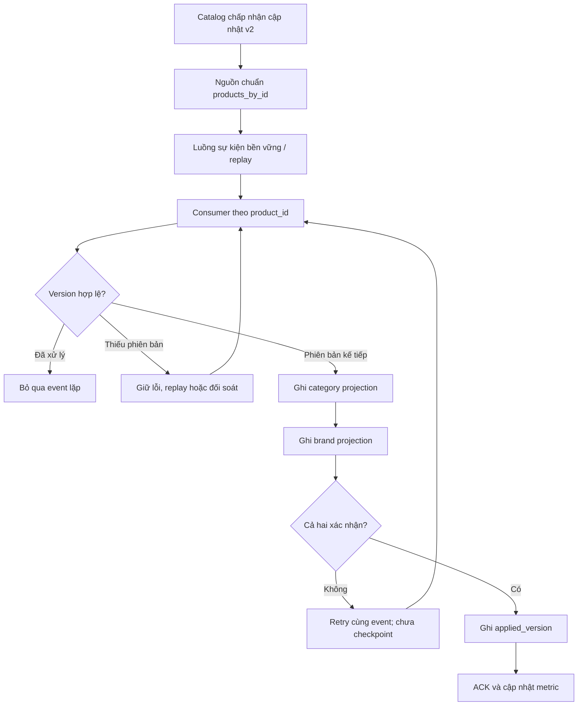

# Đánh đổi giữa độ mới của dữ liệu với chi phí duy trì nhiều bảng trong Apache Cassandra

## Mục tiêu học tập

Trong chương **Quan hệ và dữ liệu lặp**, Cassandra cho phép ứng dụng tối ưu đường đọc bằng cách lưu cùng một phần thông tin trong những bảng có khóa phân vùng khác nhau. Đổi lại, mỗi thay đổi nghiệp vụ có thể phải được lan truyền tới nhiều bản biểu diễn. Chủ đề của bài này là **chọn mức độ mới của dữ liệu phù hợp với chi phí đọc, ghi và vận hành**, thay vì mặc định rằng mọi bảng đều phải cập nhật tức thì hoặc tất cả truy vấn đều chấp nhận dữ liệu cũ.

Sau bài học, bạn có thể:

1. Phân biệt **độ mới của dữ liệu** (*freshness*), **nhất quán của replica**, **nhất quán giữa các bảng logic** và **tính toàn vẹn nghiệp vụ**.
2. Thiết lập ngưỡng độ trễ cập nhật cho từng đường đọc và phân biệt số liệu trung bình với p95/p99.
3. Ước lượng chi phí fan-out ghi, chi phí fan-out đọc và dung lượng của các bảng dẫn xuất trong Cassandra.
4. Chọn giữa **ghi đồng bộ nhiều bảng**, **đồng bộ qua sự kiện**, **đọc bổ sung từ nguồn**, **cache/tổng hợp** hoặc giải pháp kết hợp.
5. Viết CQL và Java Driver minh họa bảng nguồn, bảng đọc theo danh mục/thương hiệu, phiên bản và dấu thời gian đồng bộ.
6. Thiết kế retry, kiểm soát sự kiện sai thứ tự, đối soát và thử nghiệm chịu tải khi cần thay đổi ngưỡng freshness.

## 1. Ví dụ dẫn nhập: tên, giá và tồn kho của một sản phẩm

Một cửa hàng có ba giao diện:

- Trang **chi tiết sản phẩm**: tra cứu bằng `product_id`, hiển thị thông tin đầy đủ.
- Trang **danh mục**: lấy 20 sản phẩm mới nhất của một danh mục/tháng, hiển thị tên và giá.
- Trang **thương hiệu**: lấy 20 sản phẩm mới nhất của một thương hiệu/tháng, cũng hiển thị tên và giá.

Ngoài ra, khi khách chuẩn bị đặt hàng, hệ thống phải kiểm tra **lượng tồn có thể đặt** thông qua dịch vụ Inventory có thẩm quyền.

Trong Cassandra, bảng `products_by_id` có thể là nguồn chuẩn cho dữ liệu Catalog; `products_by_category_month` và `products_by_brand_month` sao chép `name`, `price`, `currency` để không phải thực hiện thêm một lần đọc chi tiết cho mỗi sản phẩm trong danh sách.

Nhưng tần suất thay đổi của các thuộc tính rất khác nhau:

| Thuộc tính | Đường đọc cần | Tần suất thay đổi giả định | Độ mới cần thiết |
| --- | --- | --- | --- |
| `product_id`, `published_at` | Khóa của mọi bảng | Gần như bất biến | Khóa phải nhất quán trong vòng đời bản ghi |
| `name` | Chi tiết, danh mục, thương hiệu | Vài lần/tháng/sản phẩm | Có thể chấp nhận danh sách cập nhật chậm trong một khoảng quy định |
| `price` | Chi tiết, danh sách, hiển thị tham khảo | Có thể vài lần/ngày hoặc nhiều hơn với định giá động | Tùy tính năng; giá chốt ở thanh toán phải theo nguồn nghiệp vụ hợp lệ |
| `currency` | Mọi nơi hiển thị giá | Hiếm khi đổi | Nên được cập nhật cùng giá và có quy tắc định dạng |
| `available_quantity` | Quyết định có thể đặt hàng | Có thể thay đổi từng giây | Đòi hỏi kiểm tra/giữ chỗ tại Inventory, không chỉ đọc số hiển thị ở projection |
| `description` | Chỉ trang chi tiết | Ít thay đổi | Không cần sao chép sang bảng danh sách nếu giao diện không dùng |

Giả sử giá nguồn đổi từ **750.000 VND** sang **790.000 VND**. Trong khoảng thời gian hai bảng dẫn xuất chưa được cập nhật, chi tiết có thể hiển thị 790.000 nhưng danh mục vẫn là 750.000.

Đây không nhất thiết là lỗi nếu **hợp đồng sản phẩm cho phép độ trễ nhỏ trên trang danh sách**, đồng thời giá dùng để tạo đơn được chốt lại tại dịch vụ có thẩm quyền. Nó trở thành lỗi khi ứng dụng hứa “mọi bảng luôn mới” hoặc sử dụng giá danh sách cũ làm cơ sở quyết định tài chính.

> **Nguyên tắc:** Bảng đọc là hình dạng dữ liệu tối ưu cho truy vấn, không mặc nhiên là nơi quyết định giá trị nghiệp vụ đúng.

## 2. “Dữ liệu mới” có nhiều cách hiểu

Nói “eventually consistent” là chưa đủ để thiết kế hay vận hành. Cần xác định chính xác ứng dụng đang bảo đảm điều gì.

### 2.1. Độ trễ chiếu dữ liệu (projection lag)

Giả sử thay đổi nguồn được chấp nhận lúc `t_source`, toàn bộ projection bắt buộc hoàn tất lúc `t_applied`.

\[
L_{\text{projection}} = t_{\text{applied}} - t_{\text{source}}
\]

Nếu cần hai bảng dẫn xuất, nên đo **độ trễ của từng bảng** và độ trễ tới lúc **tất cả** bảng bắt buộc đã xong. Ví dụ, category hoàn tất sau 0,3 giây nhưng brand sau 4 giây; nói “đồng bộ mất 0,3 giây” sẽ đánh lừa những người đọc bảng brand.

Khi đo thời gian qua nhiều máy, cần chú ý **đồng bộ đồng hồ**, nguồn lấy timestamp và sai số đo. Có thể dùng timestamp do hệ thống đáng tin cậy ghi tại lúc chấp nhận sự kiện, offset/checkpoint của pipeline và thời gian áp dụng. Không nên dùng timestamp do client bất kỳ tự gửi rồi coi đó là bằng chứng thời gian chính xác.

### 2.2. Độ cũ của bản đọc (staleness)

Giả sử nguồn chuẩn đang ở `catalog_version = 9` còn bảng danh mục mới có `source_version = 7`. Bảng đọc **chậm hai phiên bản**.

Phiên bản giúp nhận ra trạng thái cũ mà không cần so từng cột, **nếu** phiên bản tăng theo cùng thực thể và mọi thay đổi liên quan đều tăng phiên bản. Nhưng “chậm hai phiên bản” không tương đương “chậm hai giây”: hai thay đổi có thể cách nhau vài mili giây hoặc vài ngày.

Để báo độ cũ theo thời gian, cần liên hệ phiên bản với thời điểm nguồn chấp nhận phiên bản ấy hoặc dùng log sự kiện. `projected_at` chỉ cho biết lần ghi bản dẫn xuất; nó **không đủ để xác định độ cũ của dữ liệu so với nguồn** nếu không biết nguồn đã thay đổi khi nào.

### 2.3. Read-your-writes và đọc nhiều bảng

Người quản trị vừa sửa giá ở nguồn, rồi tải lại trang danh mục. Nếu trang danh mục đi qua projection bất đồng bộ, họ có thể **chưa thấy thay đổi của chính mình**. Đó là nhu cầu *read-your-writes* ở tầng ứng dụng; có thể xử lý bằng cách đọc trực tiếp nguồn ở đường xác nhận hoặc chờ projection đạt phiên bản tương ứng trong một deadline.

Tăng consistency level cho bảng dẫn xuất **không thể** làm xuất hiện một mutation mà ứng dụng chưa gửi tới bảng ấy.

Một trang chi tiết đọc header ở bảng A và các dòng hàng ở bảng B cũng có thể ghép hai phiên bản khác nhau nếu có writer cập nhật đồng thời (**read skew**). Việc cả hai câu `SELECT` dùng `LOCAL_QUORUM` không tạo một snapshot nguyên tử xuyên bảng.

### 2.4. Tính đúng nghiệp vụ mạnh hơn “mới”

Độ mới không phải là toàn bộ bài toán nhất quán. Một danh sách sản phẩm có thể cũ một giây mà vẫn chấp nhận được; ngược lại, một quyết định trừ tiền hoặc giữ chỗ tồn kho có thể **sai nghiêm trọng** dù dữ liệu được đọc chỉ vừa cũ vài mili giây.

Cần nêu rõ **đường đọc hiển thị** và **đường ra quyết định**. Những bất biến quan trọng phải được thực thi tại dịch vụ/bảng có thẩm quyền với điều kiện ghi và quy trình nghiệp vụ phù hợp, không dựa vào projection chỉ phục vụ giao diện.

## 3. Bảng yêu cầu freshness cho từng truy vấn

Một ví dụ hợp đồng dịch vụ (chỉ là số giả định để học, không phải mức chuẩn của Cassandra):

| Đường truy cập | Mục tiêu độ mới | Hành vi khi chưa đạt | Chấp nhận độ lệch nhiều bảng? |
| --- | --- | --- | --- |
| Danh sách theo danh mục | 99% thay đổi được chiếu trong 5 giây | Có thể hiển thị thời điểm cập nhật hoặc làm mới | Có, trong ngưỡng |
| Danh sách theo thương hiệu | 99% thay đổi được chiếu trong 10 giây | Cho phép dữ liệu hơi cũ, ghi metric | Có, trong ngưỡng |
| Chi tiết sau sửa giá | Phản ánh thay đổi nguồn đã được xác nhận | Đọc nguồn trực tiếp hoặc chờ phiên bản | Không được giả định bảng dẫn xuất đã cập nhật |
| Tạo đơn và chốt giá | Giá trị được dịch vụ Order chấp nhận tại thời điểm giao dịch | Từ chối hoặc yêu cầu tính lại nếu điều kiện không hợp lệ | Không dùng giá projection để áp bất biến |
| Hiển thị lượt xem | Cho phép tổng hợp chậm theo đợt | Hiển thị giá trị ước lượng | Có |
| Xuất hóa đơn đã chốt | Dùng bản ghi đã chốt của đúng giao dịch | Không trả bản ghép từ nhiều trạng thái tùy ý | Cần nhất quán theo phiên bản hóa đơn |

**Lưu ý cách viết SLO:** “99% trong 5 giây” là một **mục tiêu phân vị và phạm vi đo**. Cần định nghĩa mẫu đo theo số thay đổi, theo bảng đích, theo cửa sổ thời gian, cách xử lý thay đổi bị lỗi hoàn toàn và cách xác định lúc nguồn chấp nhận thay đổi. Không dùng p50 hoặc độ trễ trung bình để khẳng định mọi người dùng đều thấy dữ liệu trong 5 giây.

Số liệu tương tự có thể khác theo tenant, vùng địa lý, loại sản phẩm hoặc thời điểm cao điểm. Nếu đường đọc không cho phép dữ liệu cũ, phải trả lời bài toán dữ liệu tại chỗ khác hẳn với danh sách chỉ phục vụ trải nghiệm.

## 4. Vì sao một giây mới hơn lại có thể đắt hơn nhiều?

### 4.1. Chi phí ghi vào nhiều bảng

Giả sử một sự kiện thay đổi thuộc tính cần ghi **một bảng nguồn chuẩn** và **k bảng dẫn xuất**. Số mutation CQL logic xấp xỉ:

\[
W_{\text{event}} \approx 1 + k
\]

Nếu tần suất thay đổi là `f` sự kiện/giây:

\[
W_{\text{second}} \approx f(1+k)
\]

Đây là mô hình đơn giản. Nếu một sự kiện thay đổi nhiều cột của cùng hàng, có thể gộp chúng vào một lệnh ghi cho bảng ấy. Ngược lại, sự kiện **chuyển khóa** có thể cần `DELETE` ở khóa cũ **và** `INSERT` ở khóa mới trong cùng một bảng dẫn xuất; số thao tác khi đó lớn hơn `1+k`.

Cassandra còn có **replication**: mỗi mutation được phân phối tới các replica theo cấu hình keyspace. Không nên nhầm số ghi tới **bảng logic** với số công việc vật lý ở các replica, coordinator, commit log, memtable, SSTable và compaction. Consistency level thay đổi số xác nhận cần nhận, nhưng không xóa đi chi phí duy trì các bảng logic.

### 4.2. Chi phí đọc nếu không sao chép

Giả sử có `R` lượt xem trang danh mục/giây, mỗi trang có `N` sản phẩm. Nếu bảng danh mục chỉ chứa ID và ứng dụng phải tra thêm giá từng sản phẩm, số lần đọc CQL logic có thể xấp xỉ:

\[
Q_{\text{page}} \approx 1 + N
\]

\[
Q_{\text{extra, second}} \approx R \times N
\]

Đây là tình huống **N+1 reads**. Đọc song song có thể giảm thời gian chờ cuối cùng nhưng **không loại bỏ** tổng tải; cache có thể làm giảm lượt đọc thực tế, tùy hit rate.

### 4.3. Ví dụ định lượng

Giả sử trong một giờ cao điểm:

- Giá thay đổi **10 lần/giây** trên toàn hệ thống.
- Giá được sao chép sang **3 bảng dẫn xuất**.
- Trang danh mục được truy cập **200 lần/giây**.
- Mỗi trang trả về **20 sản phẩm**.

| Phương án | Ghi logic do thay đổi giá | Đọc bổ sung giá trên trang danh mục |
| --- | ---: | ---: |
| Chỉ ghi nguồn; danh mục chỉ giữ ID | Khoảng 10 ghi/giây | Có thể tới 200 × 20 = 4.000 đọc/giây |
| Ghi nguồn và 3 projection cho mỗi thay đổi | Khoảng 10 × 4 = 40 ghi/giây | Gần 0 cho trường giá đã có ở bảng danh sách |
| Chỉ 1 projection cần giá; những bảng khác giữ ID | Khoảng 10 × 2 = 20 ghi/giây | Tùy đường đọc ở hai bảng còn lại |
| Cache đọc giá và không sao chép trực tiếp | Khoảng 10 ghi nguồn/giây | Phụ thuộc cache hit rate và invalidation |

Dùng thêm 30 ghi logic/giây có thể rẻ hơn hàng nghìn lần tra chi tiết, **nhưng không thể kết luận chỉ từ số phép đếm**. Một ghi có LWT trên partition nóng, một đọc được cache, một truy vấn trả hàng lớn hoặc một operation có độ trễ mạng dài có chi phí khác nhau.

Ngoài throughput, phải tính **dung lượng bản sao, tombstone, repair, compaction, thao tác retry, độ trễ đồng bộ và công sức vận hành**.

### 4.4. Mô hình quyết định có trọng số

Có thể dùng một hàm chi phí tương đối để so sánh các phương án:

\[
C = aW + bQ + cS + dO + eE
\]

Trong đó:

- `W`: số ghi/s hoặc mutation gây ra bởi fan-out;
- `Q`: số truy vấn đọc bổ sung/s;
- `S`: lưu trữ, tombstone và chi phí compaction;
- `O`: chi phí vận hành pipeline, retry, backfill, đối soát;
- `E`: chi phí sai lệch dữ liệu vượt SLO hoặc rủi ro nghiệp vụ;
- `a, b, c, d, e`: trọng số do workload, giá hạ tầng và mức độ quan trọng của dữ liệu quyết định.

Không có bộ trọng số chung cho Cassandra. Hệ thống thanh toán có `e` rất lớn trên đường ra quyết định; trang xem lượt truy cập có thể cho phép độ trễ tổng hợp đáng kể. Mục tiêu là **đo và chọn đánh đổi**, không tối ưu một chỉ số độc lập.

## 5. Bốn chiến lược duy trì độ mới

| Chiến lược | Đường ghi | Độ mới có thể đạt | Chi phí/rủi ro chính |
| --- | --- | --- | --- |
| **Fan-out đồng bộ** | Ghi nguồn rồi ghi các projection trước khi trả kết quả | Có thể giảm khoảng trễ quan sát sau khi hoàn tất | Request chậm hơn; ghi thành công một phần và timeout vẫn xảy ra |
| **Projection qua sự kiện** | Nguồn chấp nhận → event → worker cập nhật các bảng | Có độ trễ phụ thuộc backlog và worker; thiết lập SLO đo được | Retry, xử lý sai thứ tự, mất sự kiện, đối soát, vận hành queue |
| **Đọc nguồn bổ sung khi cần** | Chỉ ghi nguồn cho thuộc tính biến động mạnh | Đường đọc kiểm tra nguồn theo yêu cầu; không bị trễ projection của thuộc tính ấy | N+1 reads, round-trip, tải nguồn và giới hạn song song |
| **Cache/tổng hợp theo kỳ** | Ghi nguồn, làm mới cache hoặc giá trị tổng hợp định kỳ | Thường có độ trễ được chấp nhận theo TTL/kỳ cập nhật | Invalidation, cache stampede, số liệu cũ và quản lý vòng đời |

Nhiều hệ thống dùng **mô hình kết hợp**:

- Sao chép `name` và `price` vào danh mục để giảm đọc; đồng bộ chúng bằng sự kiện với SLO phù hợp.
- Giữ `available_quantity` ở Inventory; khi đặt hàng, dùng đường giữ chỗ có thẩm quyền thay vì tin vào số tồn được sao chép.
- Khi quản trị viên vừa cập nhật giá, API phản hồi trạng thái ở nguồn và `catalog_version` đã chấp nhận; giao diện có thể tạm dùng giá mới đó cho đối tượng vừa sửa, trong khi danh sách công khai tiếp tục theo projection.
- Lượt xem và số đếm có thể được tổng hợp theo bucket theo thời gian thay vì ghi vào nhiều bảng sau mỗi lượt.

### 5.1. Ghi đồng bộ không đồng nghĩa giao dịch nhiều bảng

Nếu request đợi cả hai projection trước khi báo thành công, nó có thể đạt mục tiêu **hoàn tất fan-out trước khi phản hồi**, nhưng vẫn có những tình huống:

1. Nguồn ghi thành công.
2. Category ghi thành công.
3. Brand timeout.
4. Request báo lỗi hoặc timeout, dù một số bảng đã có dữ liệu mới.

**Không có rollback tự động xuyên các bảng Cassandra** như một transaction RDBMS. Retry phải dùng cùng khóa và trạng thái đã chấp nhận; cần cơ chế phát hiện/sửa thao tác chưa rõ kết quả. Khi request mất kết nối, không mặc nhiên suy ra không bảng nào đã ghi.

### 5.2. Bất đồng bộ không có nghĩa chắc chắn sẽ tự đúng

Một projection cập nhật sau qua message broker chỉ **cuối cùng đúng** nếu hệ thống có cách bảo đảm các thay đổi được phát đến consumer hoặc được phát hiện để đối soát.

Sự kiện có thể đến trùng, sai thứ tự, bị giữ trong dead-letter queue hoặc không bao giờ được phát nếu nguồn ghi xong nhưng ứng dụng chết trước bước gửi sự kiện. Nếu dùng outbox hoặc CDC, cần đánh giá ranh giới đảm bảo của **nguồn và công cụ thực tế**. Logged batch Cassandra không phải giao dịch nguyên tử với message broker.

Vì vậy, cần **luồng phát sự kiện đáng tin cậy + idempotency + checkpoint + đối soát**, thay vì một lời hứa “dùng queue thì dữ liệu sẽ đồng bộ”.

## 6. Thiết kế CQL: ghi nguồn và hai bảng đọc có metadata độ mới

Giả sử keyspace `shop` đã tồn tại với replication thích hợp và phiên CQL đang chọn keyspace đó.

```sql
USE shop;

-- Nguồn chuẩn của thông tin Catalog trong ví dụ.
CREATE TABLE products_by_id (
    product_id uuid PRIMARY KEY,
    category_id uuid,
    brand_id uuid,
    publish_month date,
    published_at timestamp,
    name text,
    price decimal,
    currency text,
    catalog_version bigint,
    changed_at timestamp,
    lifecycle_status text
);

-- Bảng danh sách phục vụ SELECT theo category và tháng.
CREATE TABLE products_by_category_month (
    category_id uuid,
    publish_month date,
    published_at timestamp,
    product_id uuid,
    name text,
    price decimal,
    currency text,
    source_version bigint,
    source_changed_at timestamp,
    projected_at timestamp,
    PRIMARY KEY ((category_id, publish_month), published_at, product_id)
) WITH CLUSTERING ORDER BY (published_at DESC, product_id ASC);

-- Bảng danh sách theo brand và tháng.
CREATE TABLE products_by_brand_month (
    brand_id uuid,
    publish_month date,
    published_at timestamp,
    product_id uuid,
    name text,
    price decimal,
    currency text,
    source_version bigint,
    source_changed_at timestamp,
    projected_at timestamp,
    PRIMARY KEY ((brand_id, publish_month), published_at, product_id)
) WITH CLUSTERING ORDER BY (published_at DESC, product_id ASC);

-- Theo dõi phiên bản worker đã xử lý xong ở tất cả projection bắt buộc.
CREATE TABLE catalog_projection_progress_by_id (
    product_id uuid PRIMARY KEY,
    applied_version bigint,
    applied_at timestamp
);
```

**Giải thích mô hình:**

- `products_by_id` có partition key `product_id`, phù hợp đường tra chi tiết.
- Bảng theo category/brand có partition key ghép `(category_id, publish_month)` hoặc `(brand_id, publish_month)`, clustering `published_at DESC` cùng `product_id` để phân biệt và sắp xếp các sản phẩm.
- `source_version` của projection là phiên bản nguồn được dùng để tạo bản sao. `source_changed_at` phản ánh thời điểm thay đổi nguồn (trong hợp đồng sự kiện); `projected_at` là thời điểm worker hoàn thành ghi projection theo chính sách đo lường.
- `catalog_projection_progress_by_id` ghi phiên bản đã hoàn tất ở **cả hai projection** trong luồng worker tuần tự theo ID; nó **không phải một transaction** và cũng không tự chặn worker khác ghi đồng thời.
- `lifecycle_status` giúp phân biệt sản phẩm đang hoạt động với sản phẩm đã gỡ/xóa; một bản đang `RETIRED/DELETED` phải được xử lý theo quy tắc đường đọc, không âm thầm dựng lại từ event cũ.

Trong ví dụ, `publish_month` là ngày đầu tháng UTC tính từ `published_at`. Khi một danh mục/thương hiệu có quá nhiều sản phẩm trong cùng một tháng, phải đánh giá phân bucket nhỏ hơn; không mặc định mỗi partition luôn có kích thước hợp lý.

### 6.1. Ghi nguồn ban đầu

```sql
INSERT INTO products_by_id (
    product_id, category_id, brand_id, publish_month, published_at,
    name, price, currency, catalog_version, changed_at, lifecycle_status
) VALUES (
    11111111-1111-4111-8111-111111111111,
    22222222-2222-4222-8222-222222222222,
    33333333-3333-4333-8333-333333333333,
    '2026-11-01', '2026-11-21T01:00:00Z',
    'Bàn phím cơ', 750000.00, 'VND', 1,
    '2026-11-21T01:00:00Z', 'ACTIVE'
);
```

Worker có thể tạo hai projection từ bản nguồn phiên bản 1:

```sql
INSERT INTO products_by_category_month (
    category_id, publish_month, published_at, product_id,
    name, price, currency, source_version,
    source_changed_at, projected_at
) VALUES (
    22222222-2222-4222-8222-222222222222,
    '2026-11-01', '2026-11-21T01:00:00Z',
    11111111-1111-4111-8111-111111111111,
    'Bàn phím cơ', 750000.00, 'VND', 1,
    '2026-11-21T01:00:00Z', '2026-11-21T01:00:01Z'
);

INSERT INTO products_by_brand_month (
    brand_id, publish_month, published_at, product_id,
    name, price, currency, source_version,
    source_changed_at, projected_at
) VALUES (
    33333333-3333-4333-8333-333333333333,
    '2026-11-01', '2026-11-21T01:00:00Z',
    11111111-1111-4111-8111-111111111111,
    'Bàn phím cơ', 750000.00, 'VND', 1,
    '2026-11-21T01:00:00Z', '2026-11-21T01:00:01Z'
);
```

Đây là các mutation độc lập. Chỉ khi worker xác nhận cả hai theo chính sách mới ghi checkpoint `applied_version = 1` và ACK sự kiện trong cơ chế message.

### 6.2. Thay đổi giá có kiểm tra phiên bản

Giả sử Catalog chấp nhận đổi giá từ 750.000 lên 790.000 VND, từ phiên bản 1 lên 2:

```sql
UPDATE products_by_id
SET price = 790000.00,
    catalog_version = 2,
    changed_at = '2026-11-21T01:05:00Z'
WHERE product_id = 11111111-1111-4111-8111-111111111111
IF catalog_version = 1;
```

Ứng dụng phải kiểm tra `[applied]`. Chỉ khi nguồn chấp nhận phiên bản 2 mới công bố event tương ứng qua cơ chế đáng tin cậy. Nếu `[applied] = false`, không phát sự kiện giá mới như thể thao tác đã thành công.

Ví dụ worker chiếu giá mới vào hai bảng:

```sql
UPDATE products_by_category_month
SET price = 790000.00,
    source_version = 2,
    source_changed_at = '2026-11-21T01:05:00Z',
    projected_at = '2026-11-21T01:05:01Z'
WHERE category_id = 22222222-2222-4222-8222-222222222222
  AND publish_month = '2026-11-01'
  AND published_at = '2026-11-21T01:00:00Z'
  AND product_id = 11111111-1111-4111-8111-111111111111;

UPDATE products_by_brand_month
SET price = 790000.00,
    source_version = 2,
    source_changed_at = '2026-11-21T01:05:00Z',
    projected_at = '2026-11-21T01:05:02Z'
WHERE brand_id = 33333333-3333-4333-8333-333333333333
  AND publish_month = '2026-11-01'
  AND published_at = '2026-11-21T01:00:00Z'
  AND product_id = 11111111-1111-4111-8111-111111111111;
```

Hai lần ghi được áp dụng sau khi source chuyển phiên bản, do đó hai đường đọc có thể quan sát trạng thái không đồng thời. `source_version` được lưu để phát hiện sai lệch, **không tự bảo vệ** khỏi event cũ nếu worker ghi thường mà không kiểm soát thứ tự.

### 6.3. Đọc danh sách và quan sát độ mới

```sql
SELECT product_id, name, price, currency, source_version,
       source_changed_at, projected_at
FROM products_by_category_month
WHERE category_id = 22222222-2222-4222-8222-222222222222
  AND publish_month = '2026-11-01'
LIMIT 20;

SELECT product_id, name, price, currency, source_version,
       source_changed_at, projected_at
FROM products_by_brand_month
WHERE brand_id = 33333333-3333-4333-8333-333333333333
  AND publish_month = '2026-11-01'
LIMIT 20;
```

Mỗi hàng có thể mang phiên bản riêng vì các sản phẩm được thay đổi ở thời điểm khác nhau. **Không dùng giá trị `projected_at` lớn nhất của trang để khẳng định cả trang đều mới**: những sản phẩm khác có thể đang thiếu event hoặc chưa được chiếu. Để đo mức độ mới của một sản phẩm so với nguồn, có thể kiểm tra mẫu nguồn theo `product_id` hoặc đối chiếu với log phiên bản đã được chấp nhận.

## 7. Luồng sự kiện: chi phí đổi lấy độ mới có thể kiểm soát



Các điểm thiết kế:

1. **Event mang đủ dữ liệu:** `product_id`, `source_version`, thời điểm nguồn chấp nhận, những cột hiển thị cần sao chép, khóa hiện tại và **khóa cũ** nếu category/brand thay đổi, trạng thái xóa và schema version.
2. **Thứ tự theo ID:** các sự kiện của cùng một `product_id` cần được xử lý có kiểm soát. Không nhất thiết sắp thứ tự toàn bộ sản phẩm trên toàn hệ thống.
3. **Retry an toàn:** cùng một event dùng lại khóa và các giá trị nguồn đã chấp nhận. Không vì projection timeout mà thanh toán, gửi email hoặc thực hiện lại nghiệp vụ.
4. **Checkpoint sau fan-out:** `applied_version` chỉ tiến sau khi mọi projection bắt buộc thành công. Nếu một bảng lỗi, retry có thể ghi lại bảng trước; cần định nghĩa idempotency.
5. **Không xử lý sự kiện thiếu phiên bản tùy tiện:** nếu nguồn đánh số liên tiếp và consumer nhận v4 khi checkpoint ở v2, phải giải quyết v3 hoặc dùng quy trình khôi phục đáng tin cậy.
6. **Kiểm soát ownership:** đọc checkpoint rồi so sánh trong ứng dụng không đủ nếu hai worker cùng ghi `product_id`. Cần sở hữu luồng, fencing hoặc điều kiện ghi phù hợp; không được khẳng định checkpoint là transaction nhiều bảng.
7. **Đối soát định kỳ:** event giúp cập nhật nhanh nhưng không chứng minh mọi bản đều đúng vĩnh viễn. Job nền phát hiện hàng thiếu/thừa, sai giá, sai phiên bản và khóa cũ chưa dọn.

Nếu cần giảm lag, việc tăng số worker chỉ có ích khi có đủ các `product_id` độc lập và cluster còn tài nguyên. Tăng số worker cùng tranh chấp một partition nóng có thể **không cải thiện** throughput, thậm chí tăng timeout.

### Fan-out khi khóa tra cứu thay đổi

Khi sản phẩm chuyển danh mục, `category_id` là **thành phần partition key** ở bảng danh sách. Cassandra không cho đổi khóa chính tại chỗ. Worker phải xóa hàng theo khóa cũ và tạo hàng mới theo khóa mới, đồng thời theo dõi tình huống một trong hai bước lỗi.

```sql
DELETE FROM products_by_category_month
WHERE category_id = 22222222-2222-4222-8222-222222222222
  AND publish_month = '2026-11-01'
  AND published_at = '2026-11-21T01:00:00Z'
  AND product_id = 11111111-1111-4111-8111-111111111111;

INSERT INTO products_by_category_month (
    category_id, publish_month, published_at, product_id,
    name, price, currency, source_version,
    source_changed_at, projected_at
) VALUES (
    44444444-4444-4444-8444-444444444444,
    '2026-11-01', '2026-11-21T01:00:00Z',
    11111111-1111-4111-8111-111111111111,
    'Bàn phím cơ', 790000.00, 'VND', 3,
    '2026-11-21T01:06:00Z', '2026-11-21T01:06:01Z'
);
```

Trong lúc xóa rồi thêm, sản phẩm có thể tạm không xuất hiện trong hai danh mục; nếu thêm rồi xóa, có thể tạm xuất hiện ở cả hai. **Độ mới và tính liên tục của đường đọc** đều là lựa chọn cần thỏa thuận, không thể loại bỏ hoàn toàn bằng tăng consistency level.

## 8. Java Driver 4.x: consumer có tiến độ và thời điểm cập nhật

Đoạn mã sau minh họa **worker chỉ xử lý cập nhật giá/tên khi khóa category, brand và thời điểm công bố không đổi**. Chuyển khóa và xóa cần nhánh xử lý riêng có đủ old/new key; không áp dụng nguyên xi đoạn mã cho các sự kiện ấy.

Điều kiện của ví dụ:

- Event được nguồn Catalog chấp nhận, có phiên bản **liên tiếp theo `product_id`** bắt đầu từ 1 hoặc có quy trình bootstrap checkpoint.
- Một consumer sở hữu quá trình áp dụng event cho mỗi `product_id` tại một thời điểm; không có backfill khác ghi đè không kiểm soát.
- Khi nhận event lặp, worker đọc checkpoint rồi bỏ qua; khi nhận gap, yêu cầu replay/đối soát.
- Cả hai projection đã có hàng đúng khóa hoặc event dạng snapshot có thể dùng `INSERT` để tạo chúng; ví dụ dùng **upsert đầy đủ**.
- Cấu hình consistency level, timeout và cách ACK message của hệ thống chạy thực được thiết lập ngoài đoạn mã.

```java
import com.datastax.oss.driver.api.core.CqlSession;
import com.datastax.oss.driver.api.core.cql.PreparedStatement;
import com.datastax.oss.driver.api.core.cql.Row;

import java.math.BigDecimal;
import java.time.Instant;
import java.time.LocalDate;
import java.util.UUID;

public final class CatalogProjectionWorker {
    public record ProductChanged(
        UUID productId,
        UUID categoryId,
        UUID brandId,
        LocalDate publishMonth,
        Instant publishedAt,
        String name,
        BigDecimal price,
        String currency,
        long version,
        Instant sourceChangedAt
    ) {}

    private final CqlSession session;
    private final PreparedStatement readProgress;
    private final PreparedStatement writeCategory;
    private final PreparedStatement writeBrand;
    private final PreparedStatement saveProgress;

    public CatalogProjectionWorker(CqlSession session) {
        this.session = session;

        readProgress = session.prepare(
            "SELECT applied_version FROM catalog_projection_progress_by_id " +
            "WHERE product_id = ?");

        writeCategory = session.prepare(
            "INSERT INTO products_by_category_month (" +
            "category_id, publish_month, published_at, product_id, " +
            "name, price, currency, source_version, " +
            "source_changed_at, projected_at) " +
            "VALUES (?, ?, ?, ?, ?, ?, ?, ?, ?, ?)");

        writeBrand = session.prepare(
            "INSERT INTO products_by_brand_month (" +
            "brand_id, publish_month, published_at, product_id, " +
            "name, price, currency, source_version, " +
            "source_changed_at, projected_at) " +
            "VALUES (?, ?, ?, ?, ?, ?, ?, ?, ?, ?)");

        saveProgress = session.prepare(
            "UPDATE catalog_projection_progress_by_id " +
            "SET applied_version = ?, applied_at = ? " +
            "WHERE product_id = ?");
    }

    public void handle(ProductChanged event) {
        Row row = session.execute(
            readProgress.bind(event.productId())).one();
        long last = (row == null || row.isNull("applied_version"))
            ? 0L : row.getLong("applied_version");

        if (event.version() <= last) {
            return; // Event lặp hoặc cũ: không được ghi đè.
        }
        if (event.version() != last + 1L) {
            throw new IllegalStateException(
                "Thiếu phiên bản cần replay: last=" + last +
                ", received=" + event.version());
        }

        // Dùng cùng ảnh trạng thái/khóa đã được Catalog chấp nhận.
        Instant projectedAt = Instant.now();
        session.execute(writeCategory.bind(
            event.categoryId(), event.publishMonth(),
            event.publishedAt(), event.productId(),
            event.name(), event.price(), event.currency(),
            event.version(), event.sourceChangedAt(), projectedAt));

        session.execute(writeBrand.bind(
            event.brandId(), event.publishMonth(),
            event.publishedAt(), event.productId(),
            event.name(), event.price(), event.currency(),
            event.version(), event.sourceChangedAt(), Instant.now()));

        // Chỉ tiến checkpoint sau khi cả hai ghi hoàn tất.
        session.execute(saveProgress.bind(
            event.version(), Instant.now(), event.productId()));

        // Tầng điều phối ACK event SAU khi handle() thành công.
    }
}
```

### 8.1. Ý nghĩa của checkpoint

Nếu ghi category thành công nhưng ghi brand timeout, `saveProgress` chưa được chạy. Worker retry cùng event: câu `INSERT` vào category lại được thực hiện cùng khóa và trường nghiệp vụ, rồi brand được thử tiếp.

Nhưng **`projected_at` có thể thay đổi trong lần retry**, và Cassandra sẽ nhận một mutation mới. Việc retry không đồng nghĩa “không phát sinh chi phí” hoặc bảo đảm *exactly once*. Mục tiêu idempotency ở đây là **không sinh thêm hàng logic hay làm lại thao tác nghiệp vụ**. Nếu cần đo độ trễ của lần áp dụng đầu tiên, phải chọn rõ dấu thời gian và cách không ghi đè nó tùy tiện.

Nếu lưu checkpoint thành công nhưng broker không nhận ACK, event được giao lại và worker có thể bỏ qua theo `applied_version`. Nếu có nhiều consumer cùng xử lý một ID, phép đọc `last` rồi ghi thường **không đủ để chống race**: phải bảo đảm serialization/ownership hoặc fencing phù hợp.

Nếu nguồn đã ở version 100 mà worker mới được bật và checkpoint chưa tồn tại, không thể mong event v100 được xử lý như event đầu tiên trong chuỗi 1, 2, 3. Cần một quy trình bootstrap/backfill riêng để tạo projection và đặt checkpoint tương ứng trước khi nhận các phiên bản mới.

### 8.2. Bảo đảm của pipeline và giới hạn cần nêu rõ

Ví dụ này không tự tạo luồng sự kiện đáng tin cậy, cũng không chặn một job repair khác ghi snapshot v1 lên hàng v2. Worker đạt độ đúng khi mọi đường ghi của projection tuân thủ cùng quy tắc phiên bản và quyền sở hữu; nếu không, có thể cần LWT trên hàng đích, fencing hoặc job đối soát.

Ngay cả khi worker xử lý tuần tự, một lỗi giữa ghi nguồn và **công bố event** có thể khiến bảng đọc không nhận cập nhật. Hãy đánh giá CDC, outbox hay event log có đủ bảo đảm theo kiến trúc thực tế, và giữ cơ chế đối soát làm lớp phòng vệ bổ sung.

## 9. Chọn giải pháp kết hợp để tránh trả giá quá nhiều cho freshness

Thay vì đặt một SLA giống nhau cho mọi trường, phân chia theo **mục đích sử dụng và chi phí thay đổi**.

### 9.1. Trường ổn định: sao chép vào danh sách

Tên sản phẩm, đơn vị tiền tệ, ảnh đại diện có thể thích hợp để sao chép vì chúng được đọc nhiều nhưng ít thay đổi. Mục tiêu vài giây có thể phù hợp với đường đọc công khai, nếu được sản phẩm chấp nhận và hệ thống theo dõi sai lệch.

### 9.2. Trường biến động mạnh: tránh nhân bản bừa bãi

Tồn kho được bán liên tục có thể thay đổi hàng trăm lần/giây ở sản phẩm nóng. Sao chép lượng tồn sang nhiều bảng theo từng thay đổi dễ gây write amplification, partition nóng và độ trễ projection tăng đúng lúc tải cao.

Có thể giữ đường đọc tồn kho riêng theo `product_id` để giao diện chỉ tra khi cần; tại thời điểm chốt đơn, dịch vụ Inventory phải thực thi điều kiện nghiệp vụ và chính sách giữ chỗ. Một số bộ đếm hiển thị có thể tổng hợp theo bucket/thời gian thay vì sao chép chính xác mỗi lần thay đổi.

### 9.3. Đường đọc ngay sau khi ghi: định tuyến thông minh

Sau khi người quản trị sửa giá, API có thể trả về `product_id` và `catalog_version` đã ghi thành công ở nguồn. Nếu màn hình quản trị cần đọc lại:

- Đọc trực tiếp bảng nguồn trong một khoảng thời gian hoặc cho những đối tượng vừa sửa.
- Hoặc đợi bảng dẫn xuất đạt ít nhất phiên bản vừa chấp nhận, **có deadline và đường xử lý khi chưa kịp**.
- Không coi một lần `LOCAL_QUORUM` trên bảng category là đủ nếu worker còn chưa gửi mutation category.

Đây là cách tránh bắt mọi người đọc danh mục công khai trả chi phí đồng bộ tức thời chỉ vì một số ít trang quản trị cần *read-your-writes*.

### 9.4. Tính nhất quán theo phiên bản cho một đối tượng nhiều bảng

Nếu màn hình cần ghép header và các dòng con thuộc đúng một phiên bản, lựa chọn có thể là **snapshot bất biến + con trỏ công bố**: ghi đầy đủ thành phần của phiên bản mới, xác nhận theo chính sách rồi cập nhật con trỏ hiện hành bằng điều kiện; reader pin cùng ID phiên bản.

Giải pháp này tăng dung lượng và số ghi, cần giữ các phiên bản cũ đủ lâu cho những reader đang hoạt động; không dùng nó mặc định cho mọi dữ liệu thay đổi liên tục. **Phiên bản trên từng hàng mà không có quy tắc công bố** không tự tạo snapshot nguyên tử giữa nhiều bảng.

## 10. Giám sát: kiểm tra lời hứa freshness bằng số liệu thật

Không thể kiểm chứng SLO chỉ bằng “queue không có nhiều message” hoặc “average latency thấp”. Cần đo **đầu cuối**, theo từng đích và kiểm tra sai khác.

| Chỉ số | Cách hiểu | Tình huống cần điều tra |
| --- | --- | --- |
| `source_to_category_lag_seconds` | Từ lúc nguồn chấp nhận đến lúc category được áp dụng | p99 vượt giới hạn 5 giây đã công bố |
| `source_to_brand_lag_seconds` | Tương tự cho brand | Brand luôn chậm hơn category |
| `projection_all_targets_lag` | Độ trễ đến khi mọi bảng đích bắt buộc hoàn tất | Một bảng nhanh che mất bảng khác lỗi |
| `unprocessed_event_age` | Tuổi sự kiện chưa hoàn tất | Một partition/message mắc kẹt lâu |
| `version_gap_count` | Thiếu phiên bản hoặc event đến sai thứ tự | Tăng sau failover/rebalance |
| `projection_mismatch_count` | Hàng thiếu/thừa, giá sai, sai phiên bản hoặc khóa | Cao dù queue đã hết |
| `retry_and_dead_letter_count` | Sự kiện timeout hoặc không xử lý được | Retry vòng lặp, schema lỗi |
| `write_fanout_per_event` | Số mutation logic phát sinh cho một thay đổi | Tăng khi thêm bảng truy vấn |
| `read_queries_per_page` | Số truy vấn CQL để dựng một trang | Tăng do N+1 hoặc cache hit thấp |
| `read_write_p95_p99` | Độ trễ trên đường ghi và đọc | Mất cân bằng giữa trải nghiệm và chi phí |
| `hot_partitions` | Phân vùng nhận quá nhiều ghi/đọc | Tăng tải khi cùng sản phẩm/bucket nóng |
| `compaction_tombstone_repair` | Chi phí duy trì các replica và dữ liệu lặp | Tăng sau xóa/chuyển khóa hoặc TTL |

### Không đo freshness chỉ từ một timestamp

- `projected_at - source_changed_at` ước lượng độ trễ của **phiên bản đã áp dụng**, không trực tiếp cho biết có một **phiên bản mới hơn chưa đến**.
- Queue lag có thể thấp dù ứng dụng **đã mất sự kiện** trước khi gửi vào queue.
- Chỉ số checkpoint ở một bảng có thể tiến trong khi các bảng khác còn thiếu nếu worker ghi checkpoint sai thứ tự.
- Sampling đối soát **nguồn → projection** và **projection → nguồn/hồ sơ xóa** phát hiện các bản thiếu, thừa và hàng còn ở khóa cũ.

Do đó, nên phối hợp timestamp, version, log sự kiện, checkpoint và đối soát để phản ánh đầy đủ “dữ liệu mới tới đâu”.

### Khi cụm chịu tải cao

Giảm độ trễ projection bằng cách tăng số consumer có thể làm tăng throughput nhưng cũng tăng mutation tới cluster, compaction, network và hot partition. Khi cluster bắt đầu quá tải, thêm worker có thể làm timeout nhiều hơn, khiến lag lại tăng.

Cần giới hạn concurrency, quản lý backpressure, chọn partition/bucket phù hợp, và có đường giảm tải cho các tính năng độ mới thấp. Đặc biệt lưu ý thay khóa hoặc xóa tạo **tombstone**, kéo theo chi phí compaction/repair và khả năng đọc chậm trên phân vùng nhiều tombstone.

## 11. Quy trình ra quyết định thiết kế

Một cách đánh giá có thể thực hiện trên từng tính năng:

1. **Liệt kê truy vấn và trường cần trả:** trang nào đọc bao nhiêu lần mỗi giây, theo partition key nào, giới hạn bao nhiêu hàng?
2. **Đo thay đổi của từng trường:** bao nhiêu lần/giây, có burst hay hot key không; thuộc tính nào thực sự cần sao chép?
3. **Phân loại ngữ nghĩa:** thông tin tham khảo có thể cũ, thông tin cần read-your-writes, hay dữ kiện dùng để quyết định giao dịch?
4. **Đặt SLO độ mới cụ thể:** p95/p99, thời gian bắt đầu/kết thúc, phạm vi theo đích, và hành vi khi quá hạn.
5. **Ước lượng fan-out đọc và ghi:** số bảng và hàng được cập nhật cho một sự kiện; số truy vấn bổ sung nếu không sao chép.
6. **Thử nhiều phương án:** synchronous projection, async event, đọc nguồn có kiểm soát, cache/aggregate hoặc tổ hợp.
7. **Thiết kế lỗi trước khi triển khai:** timeout ở từng đích, sự kiện lặp/sai thứ tự, source change bị mất event, thay khóa, xóa và job backfill.
8. **Chạy thử tải và kiểm soát giả lập sự cố:** dùng phân phối dữ liệu, tỷ lệ đọc/ghi, replication/consistency level và độ lớn phân vùng gần môi trường thật.
9. **Theo dõi và điều chỉnh:** đo end-to-end freshness, chi phí cluster, tỷ lệ lệch và kết quả người dùng nhìn thấy; đừng chỉ đo throughput của message broker.

### Ma trận quyết định ngắn

| Đường đọc/thuộc tính | Đọc nhiều? | Đổi nhiều? | Chấp nhận trễ? | Hướng đề xuất để thử nghiệm |
| --- | --- | --- | --- | --- |
| Tên và giá trên danh sách sản phẩm | Có | Thường vừa phải | Có thể có SLO vài giây | Projection theo truy vấn với event + reconciliation |
| Giá chốt ở đơn hàng | Theo lần tạo đơn | Có thể thay đổi | Không chấp nhận sai bất biến | Dịch vụ nghiệp vụ chốt giá/snapshot lúc đặt hàng |
| Lượng tồn để quyết định bán | Có | Rất nhiều ở sản phẩm nóng | Không dựa vào giá trị hiển thị cũ | Inventory có thẩm quyền, kiểm tra/giữ chỗ |
| Lượt xem công khai | Có | Cực nhiều | Thường chấp nhận | Tổng hợp/bucket và cache theo kỳ |
| Chi tiết ngay sau cập nhật quản trị | Ít hơn danh sách | Phụ thuộc thao tác | Cần read-your-writes | Đọc nguồn hoặc chờ version projection có deadline |
| Danh sách hiếm khi truy cập | Ít | Có thể nhiều | Tùy nghiệp vụ | Cân nhắc tránh tạo thêm bảng dẫn xuất chỉ cho vài lượt đọc |

## 12. Bài thực hành: tìm điểm cân bằng cho ứng dụng khóa học

Một nền tảng học trực tuyến có:

- `courses_by_id`: nguồn chuẩn cho `title`, `price`, `publication_status`.
- `courses_by_category` và `courses_by_teacher`: hai bảng danh sách sao chép các trường cần hiển thị.
- `enrollment_count_by_course`: tổng số học viên hoặc một giá trị tổng hợp được dịch vụ Enrollment sở hữu.
- Mỗi ngày có hàng trăm nghìn lượt xem danh sách; tên khóa học đổi vài lần mỗi tháng, giá có thể đổi hằng ngày, số ghi danh thay đổi liên tục trong đợt mở bán.

**Yêu cầu:**

1. Đề xuất SLO độ mới khác nhau cho `title`, `price`, `publication_status` và `enrollment_count` ở **trang danh sách**, giải thích tại sao các ngưỡng đó có thể khác nhau.
2. Nếu giá đổi 8 lần/giây trên toàn hệ thống và được cập nhật vào một nguồn cùng hai projection, ước tính số ghi logic/giây. So với trường hợp chỉ cập nhật nguồn, chênh lệch là bao nhiêu?
3. Nếu 150 lượt xem danh sách/giây, mỗi trang có 20 khóa học, ước tính số truy vấn bổ sung khi bỏ sao chép `title` và phải đọc `courses_by_id` cho từng khóa học.
4. Trang quản trị vừa đổi giá rồi tải lại danh sách: làm cách nào hỗ trợ *read-your-writes* mà không buộc tất cả client phải đợi đồng bộ tức thì?
5. Consumer gặp event `CourseChanged v5` sau khi đã chiếu `v6`. Nên xử lý thế nào để không làm danh sách hiển thị giá cũ?
6. Khi khóa học chuyển danh mục, vì sao độ trễ không chỉ là “giá cũ vài giây” mà còn liên quan **hàng ở partition cũ và mới**?
7. Nếu job backfill dùng snapshot v3 sau khi consumer đã cập nhật v6, cần kiểm soát điều gì?
8. Chọn ít nhất năm metric để chứng minh các SLO đã đạt trong giờ cao điểm, bao gồm cả phát hiện sự kiện bị mất.

**Gợi ý tự kiểm tra:**

- Với 8 thay đổi/giây và hai projection, `8 × (1+2) = 24` mutation CQL logic/giây; nhiều hơn `16` so với chỉ ghi nguồn, chưa tính replication, retry và compaction.
- Nếu cần đọc thêm chi tiết cho 20 khóa học ở 150 lượt xem/giây: tối đa khoảng `150 × 20 = 3.000` truy vấn bổ sung/giây trong mô hình đơn giản chưa xét cache.
- Trang quản trị có thể dùng giá/version được nguồn xác nhận hoặc đọc trực tiếp nguồn sau sửa, trong khi các bảng danh sách công khai có SLO riêng.
- Đừng áp dụng v5 ghi thường sau khi đã có v6; cần xử lý thứ tự theo khóa, checkpoint hoặc điều kiện thích hợp. Khi đổi danh mục phải xóa đúng hàng ở khóa cũ và ghi ở khóa mới.
- Backfill và live consumer phải chia sẻ cơ chế version/serialization hoặc fencing để snapshot cũ không ghi đè snapshot mới.
- Đo lag theo từng đích, p95/p99 end-to-end, số sự kiện pending/gap, phiên bản lệch khi đối soát, hot partitions và tác động đọc/ghi trên cụm.

## Tổng kết

Cassandra cho phép **đọc nhanh theo partition key và clustering columns** bằng cách lặp lại một phần dữ liệu sang nhiều bảng phù hợp truy vấn. Tuy nhiên, càng đòi hỏi nhiều đường đọc **thấy giá trị mới sớm**, ứng dụng càng phải trả chi phí fan-out ghi, xử lý lỗi, retry, event ordering, đối soát, lưu trữ và vận hành.

Quyết định đúng không phải “luôn mới ngay” hoặc “luôn eventual consistency”, mà là **đặt mục tiêu freshness theo từng tính năng và tính chất nghiệp vụ**: trường ổn định, được đọc thường xuyên có thể đáng sao chép; trường biến động mạnh có thể nên đọc từ nguồn có thẩm quyền hoặc tổng hợp; đường quyết định giao dịch phải thực thi bất biến riêng. Replication, consistency level, LWT, logged batch, compaction và repair có vai trò riêng trong Cassandra nhưng **không thay thế** một hợp đồng đồng bộ giữa các bảng logic.

Hãy đo **số ghi và số đọc phát sinh, p95/p99 độ trễ cập nhật, tỷ lệ lệch dữ liệu, chi phí khi lỗi và khả năng khôi phục**. Một thiết kế tốt là thiết kế có thể chứng minh **mức độ mới đủ cho người dùng, chi phí duy trì chấp nhận được và dữ liệu vẫn sửa được khi một phần hệ thống gặp sự cố**.
