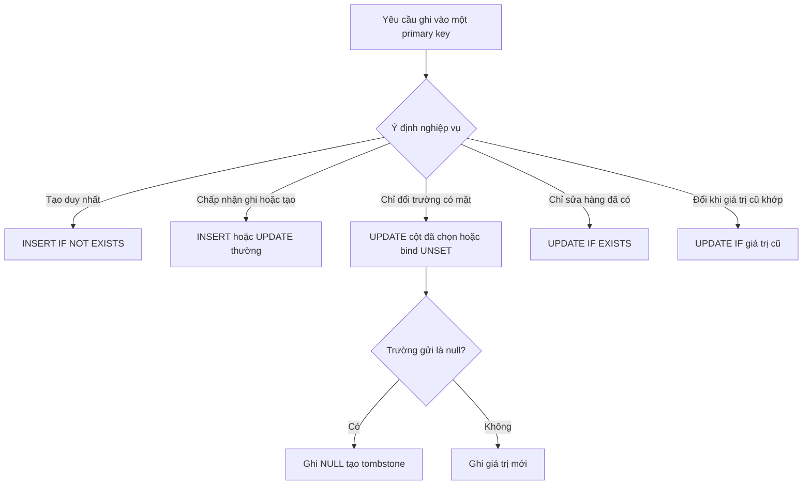

# Upsert và phân biệt ghi mới với thay đổi một phần dữ liệu trong Cassandra

Trong chương **Ghi và xóa bằng CQL** của Apache Cassandra, câu hỏi “bản ghi này đã tồn tại chưa?” không được giải quyết tự động chỉ bằng cách chọn `INSERT` hay `UPDATE`. Cả hai câu lệnh, khi không có điều kiện `IF`, đều có thể ghi dữ liệu vào khóa chưa từng tồn tại hoặc thay đổi dữ liệu tại khóa đã có. Đây là hành vi **upsert** (*update or insert*).

Điều quan trọng với ứng dụng Java là phân biệt **ý định nghiệp vụ** với **cú pháp ghi**:

- **Tạo mới có ràng buộc:** chỉ tạo nếu khóa chưa tồn tại; nếu trùng khóa phải báo xung đột.
- **Upsert không điều kiện:** ghi các cột được cung cấp tại khóa xác định, bất kể hàng đã tồn tại hay chưa.
- **Cập nhật một phần (partial update/patch):** chỉ thay trường được yêu cầu; giữ nguyên trường còn lại.
- **Thay thế toàn bộ (replace):** trạng thái hàng sau thao tác phải tương ứng đầy đủ với biểu diễn mới, bao gồm quy tắc xử lý các trường không được gửi.

Cassandra là cơ sở dữ liệu **wide-column phân tán**, tổ chức dữ liệu theo **partition key**, thiết kế bảng theo truy vấn, nhân bản trên các replica và cung cấp nhiều **consistency level**. Những đặc điểm này khiến ngữ nghĩa của thao tác ghi, retry và xóa giá trị cần được thiết kế rõ ở tầng ứng dụng. Bài học tập trung vào CQL và kết nối với Java Driver.

## 1. Một mô hình dữ liệu để theo dõi thay đổi

Giả sử dịch vụ tài khoản truy vấn hồ sơ khách hàng theo `customer_id`. Ta dùng bảng minh họa sau; keyspace `demo` được giả định đã tồn tại:

```sql
CREATE TABLE demo.customer_profile_by_id (
    customer_id uuid PRIMARY KEY,
    display_name text,
    email text,
    phone text,
    city text,
    sms_opt_in boolean,
    updated_at timestamp
);
```

Ở bảng này, `customer_id` vừa là **full primary key** vừa là **partition key**. Khi ghi cùng một UUID, Cassandra định vị cùng phân vùng/hàng logic; UUID khác là một hàng khác. Nếu bảng dùng primary key ghép, mọi thành phần khóa định danh hàng đều phải được xem xét.

Tạo dữ liệu ban đầu:

```sql
INSERT INTO demo.customer_profile_by_id (
    customer_id, display_name, email, phone, city, sms_opt_in
)
VALUES (
    11111111-1111-4111-8111-111111111111,
    'Lan',
    'lan@example.test',
    '0900000001',
    'Hà Nội',
    false
);

SELECT customer_id, display_name, email, phone, city, sms_opt_in
FROM demo.customer_profile_by_id
WHERE customer_id = 11111111-1111-4111-8111-111111111111;
```

Ví dụ trên được dùng xuyên suốt. Khi không có ghi cạnh tranh, đồng hồ bất thường hoặc TTL, dữ liệu sau lần ghi đầu là:

| customer_id (rút gọn) | display_name | email | phone | city | sms_opt_in |
| --- | --- | --- | --- | --- | --- |
| `1111...1111` | Lan | lan@example.test | 0900000001 | Hà Nội | false |

## 2. Upsert là gì?

**Upsert** nghĩa là gửi một mutation tới khóa đích mà không yêu cầu Cassandra xác minh hàng đã tồn tại. Xét hai lệnh sau:

```sql
INSERT INTO demo.customer_profile_by_id (
    customer_id, display_name
)
VALUES (
    11111111-1111-4111-8111-111111111111,
    'Lan Nguyễn'
);

UPDATE demo.customer_profile_by_id
SET city = 'Đà Nẵng'
WHERE customer_id = 11111111-1111-4111-8111-111111111111;
```

Cả hai đều ghi vào **cùng một khóa**:

- `INSERT` thứ hai ghi lại giá trị của `display_name` thành `Lan Nguyễn`.
- `UPDATE` ghi lại giá trị của `city` thành `Đà Nẵng`.
- `email`, `phone` và `sms_opt_in` **giữ nguyên** vì không được hai lệnh này ghi lại.
- Không sinh thêm hàng chỉ vì chạy lại `INSERT` với cùng khóa.

Sau hai lệnh trên, giả sử các mutation được áp dụng và không có xung đột timestamp, hàng trở thành:

| display_name | email | phone | city | sms_opt_in |
| --- | --- | --- | --- | --- |
| Lan Nguyễn | lan@example.test | 0900000001 | Đà Nẵng | false |

**Điểm dễ nhầm:** `INSERT` không có nghĩa “thay thế toàn bộ hàng bằng những cột được nêu trong VALUES”. Với câu lệnh ghi cột thông thường, cột **không được nhắc tới** không bị xóa chỉ vì bị bỏ qua.

### UPDATE khi chưa có hàng

Chạy `UPDATE` trên UUID mới:

```sql
UPDATE demo.customer_profile_by_id
SET city = 'Huế'
WHERE customer_id = 22222222-2222-4222-8222-222222222222;

SELECT customer_id, display_name, email, city
FROM demo.customer_profile_by_id
WHERE customer_id = 22222222-2222-4222-8222-222222222222;
```

Kết quả là **một hàng mới** với `city = 'Huế'`; `display_name` và `email` đọc ra `null`. CQL không bắt `UPDATE` phải chạm một hàng đã có. Một hàng “thưa” như vậy là hợp lệ trong mô hình wide-column.

| Khía cạnh | `INSERT` không có `IF` | `UPDATE` không có `IF` |
| --- | --- | --- |
| Khóa đã tồn tại | Ghi các cột được chỉ định vào hàng đó | Ghi các cột trong `SET` vào hàng đó |
| Khóa chưa tồn tại | Có thể tạo hàng mới | Có thể tạo hàng mới |
| Cột không được ghi | Giữ giá trị hiện tại của cột | Giữ giá trị hiện tại của cột |
| Kiểm tra trùng khóa | Không | Không |
| Cách nêu cột | Danh sách cột và `VALUES` | `SET` và `WHERE` theo khóa |

Sự khác nhau chủ yếu nằm ở **cách biểu đạt mutation**, không phải ở cam kết tạo mới hay cập nhật đã tồn tại.

## 3. Partial update: chỉ đổi đúng những trường được yêu cầu

Hãy xét tình huống người dùng sửa thành phố nhưng không muốn đụng tới số điện thoại hoặc email. Một câu lệnh có mục đích rõ ràng:

```sql
UPDATE demo.customer_profile_by_id
SET city = 'TP. Hồ Chí Minh'
WHERE customer_id = 11111111-1111-4111-8111-111111111111;
```

Về kết quả, lệnh này tương tự một `INSERT` chỉ chứa `customer_id` và `city`. Tuy nhiên, `UPDATE ... SET` thường diễn đạt ý định “sửa một số trường” dễ đọc hơn, đặc biệt khi xây dựng API `PATCH`.

### Ba trạng thái cần phân biệt: bỏ qua, có giá trị, NULL

Đối với mỗi cột thường, request của ứng dụng có ít nhất ba ý nghĩa khác nhau:

| Trạng thái request | Ý định | Kết quả mong muốn trong Cassandra |
| --- | --- | --- |
| Trường **không được gửi** | Không chỉnh sửa trường này | Bỏ cột khỏi mutation hoặc bind **UNSET** |
| Trường được gửi với giá trị, ví dụ `city = 'Huế'` | Đặt giá trị mới | Ghi giá trị mới vào cell của cột |
| Trường được gửi rõ ràng với `null` | Xóa giá trị của trường | Bind/gán **NULL**, tạo dấu xóa (tombstone) |

Ví dụ chỉ xóa số điện thoại:

```sql
UPDATE demo.customer_profile_by_id
SET phone = NULL
WHERE customer_id = 11111111-1111-4111-8111-111111111111;
```

Sau thao tác, `phone` được đọc thành `null` khi các replica phục vụ lần đọc nhìn thấy việc xóa. Các cột khác vẫn không đổi.

**NULL không phải UNSET.** Trong CQL, `NULL` với cột thường mang nghĩa xóa giá trị bằng **tombstone**. `UNSET` là trạng thái tham số trong prepared statement để Cassandra **không áp dụng phép ghi cho cột đó**. Không được thay thế hai trạng thái này cho nhau trong API cập nhật từng phần.

Tombstone là thông tin cần thiết trong hệ thống phân tán: replica tạm thời chưa nhận thao tác xóa cần biết rằng dữ liệu cũ không còn hợp lệ. Tombstone nhiều có thể làm nặng đọc, compaction và repair; tránh tạo tombstone vô ích cũng giúp hiệu năng ổn định hơn.

### Ví dụ bẫy: DTO Java mặc định null

Giả sử client gửi:

```json
{
  "city": "Huế"
}
```

Nếu ứng dụng ánh xạ JSON vào đối tượng Java có `displayName == null`, `email == null` và `phone == null`, rồi bind mọi trường thành CQL `NULL`, yêu cầu sửa thành phố sẽ vô tình xóa tên, email và điện thoại. Cần nhận biết **sự hiện diện của trường trong payload**; trường vắng mặt phải được bỏ qua hoặc bind UNSET, còn trường có mặt với `null` mới mang nghĩa xóa nếu API cho phép.

Ví dụ hợp đồng API:

```json
{
  "city": "Huế",
  "phone": null
}
```

Ý nghĩa: đổi `city`, xóa `phone`, giữ nguyên trường không xuất hiện. Trong Java cần cách theo dõi presence (ví dụ `JsonNode`, field mask hoặc wrapper được thiết kế cho PATCH), thay vì dựa duy nhất vào field nullable của DTO thông thường.

## 4. INSERT JSON có một mặc định cần đặc biệt chú ý

Cassandra hỗ trợ `INSERT ... JSON`, nhưng cách xử lý **trường thiếu trong đối tượng JSON** khác với `INSERT` theo danh sách cột nếu không chọn đúng cấu hình.

```sql
-- Giả sử hàng của Lan đã có email và phone.
INSERT INTO demo.customer_profile_by_id JSON
'{"customer_id":"11111111-1111-4111-8111-111111111111","city":"Cần Thơ"}'
DEFAULT UNSET;
```

Với `DEFAULT UNSET`, những cột không có trong JSON không bị ghi lại; đây thường là lựa chọn phù hợp nếu muốn nhập dữ liệu một phần. Nếu sử dụng `DEFAULT NULL` (mặc định khi không chỉ định trong CQL JSON insert), các trường thiếu được xem như null, có thể xóa giá trị cũ bằng tombstone.

| Cách ghi | Cột thiếu trong đầu vào | Phù hợp cho cập nhật một phần? |
| --- | --- | --- |
| `INSERT ... (customer_id, city) VALUES (...)` | Không được nhắc tới, không bị ghi lại | Có, nếu chấp nhận upsert |
| `UPDATE ... SET city = ... WHERE ...` | Không nằm trong `SET`, không bị ghi lại | Có, nếu chấp nhận upsert |
| `INSERT ... JSON '...' DEFAULT UNSET` | Không ghi cột thiếu | Có, nếu hiểu rõ JSON insert |
| `INSERT ... JSON '...' DEFAULT NULL` | Cột thiếu được coi như null | **Cẩn thận:** có thể xóa dữ liệu cũ |

Không nên suy ra “JSON object chỉ có hai trường” đồng nghĩa “mutation chỉ sửa hai trường” khi dùng CQL JSON. Hãy chỉ định rõ chính sách xử lý trường thiếu.

## 5. Khi nào cần thật sự phân biệt ghi mới và cập nhật?

Nếu nghiệp vụ có ràng buộc “một tài khoản chỉ được đăng ký một lần với ID này”, upsert thông thường chưa đủ. Hai request tạo cùng khóa có thể ghi đè dữ liệu của nhau. Cassandra cung cấp **lightweight transaction (LWT)** khi cần điều kiện.

### Chỉ tạo khi chưa tồn tại: INSERT IF NOT EXISTS

```sql
INSERT INTO demo.customer_profile_by_id (
    customer_id, display_name, city
)
VALUES (
    33333333-3333-4333-8333-333333333333,
    'Minh',
    'Đà Nẵng'
)
IF NOT EXISTS;
```

Kết quả có cột `[applied]`: `true` nếu được ghi, `false` nếu điều kiện không thỏa. Ứng dụng có thể ánh xạ `false` thành lỗi nghiệp vụ như HTTP `409 Conflict`. Kết quả điều kiện thất bại có thể kèm dữ liệu hiện có, tùy lệnh và phiên bản.

### Chỉ sửa khi hàng đang tồn tại: UPDATE IF EXISTS

```sql
UPDATE demo.customer_profile_by_id
SET city = 'Nha Trang'
WHERE customer_id = 33333333-3333-4333-8333-333333333333
IF EXISTS;
```

Với `IF EXISTS`, nếu không có hàng tại khóa đó, Cassandra không tạo hàng thưa do lệnh cập nhật này. Đó là khác biệt giữa “PATCH tài nguyên có sẵn” và “upsert theo khóa”.

### Chỉ đổi khi giá trị cũ đúng kỳ vọng: compare-and-set

```sql
UPDATE demo.customer_profile_by_id
SET sms_opt_in = true
WHERE customer_id = 11111111-1111-4111-8111-111111111111
IF sms_opt_in = false;
```

Nếu hai client đồng thời muốn thay đổi cùng trạng thái, LWT bảo đảm điều kiện được kiểm tra và quyết định áp dụng một cách đồng thuận trên các replica. `SELECT` trước rồi `UPDATE` không điều kiện **không bảo vệ được** khoảng thời gian giữa đọc và ghi.

| Nhu cầu | CQL phù hợp | Đặc điểm |
| --- | --- | --- |
| Ghi bất kể hàng đã có hay chưa | `INSERT` hoặc `UPDATE` không `IF` | Upsert, chi phí ghi thông thường |
| Tạo lần đầu, không cho trùng | `INSERT ... IF NOT EXISTS` | LWT, có `[applied]` |
| Chỉ sửa hàng đã có | `UPDATE ... IF EXISTS` | LWT, có `[applied]` |
| Chỉ sửa nếu giá trị cũ thỏa điều kiện | `UPDATE ... IF column = old_value` | LWT, compare-and-set |

LWT cần thêm các vòng phối hợp/đồng thuận giữa replica, thường có độ trễ cao hơn ghi thông thường. Chỉ dùng khi có yêu cầu nghiệp vụ về điều kiện hoặc tranh chấp. Nếu chấp nhận upsert, ghi không điều kiện là lựa chọn tự nhiên của Cassandra.

## 6. Partial update không đồng nghĩa thay thế toàn bộ

Trong HTTP API, nhà phát triển thường dùng `PUT` cho thao tác thay thế biểu diễn tài nguyên và `PATCH` cho thao tác thay đổi một phần. Cassandra **không tự áp đặt** ngữ nghĩa HTTP đó.

Giả sử tài nguyên hiện tại là:

```json
{
  "display_name": "Lan Nguyễn",
  "email": "lan@example.test",
  "phone": "0900000001",
  "city": "Đà Nẵng"
}
```

Nếu API nhận payload “thay thế toàn bộ” chỉ có:

```json
{
  "display_name": "Lan Nguyễn",
  "city": "Huế"
}
```

thì backend phải **tự định nghĩa** cách xử lý `email` và `phone`: xóa theo hợp đồng replace, giữ nguyên theo hợp đồng patch, hay từ chối do thiếu trường bắt buộc. Chạy `INSERT` với hai cột không tự thực hiện “full replace”.

Nếu thực sự cần full replace, có thể liệt kê các cột của bảng và quyết định giá trị mới/`NULL` một cách có chủ đích, đồng thời cân nhắc ghi cạnh tranh, TTL và chi phí tombstone. Cũng có thể thiết kế một dạng dữ liệu phù hợp hơn với nhu cầu thay thế nguyên khối. Không nên xóa rồi chèn lại hàng chỉ vì nghĩ rằng Cassandra yêu cầu như vậy: xóa tạo tombstone và các mutation cạnh tranh vẫn phải xét theo timestamp.

Sơ đồ quyết định:



## 7. Timestamp: các cột được hòa giải riêng

Cassandra sử dụng timestamp ghi cho từng cell (với cột thường); các giá trị cạnh tranh tại cùng cell được hòa giải bằng cách ưu tiên timestamp lớn hơn, thường được gọi là *last-write-wins*. Hai request có thể ghi khác cột và cùng tồn tại:

```text
Tại customer_id = A:
  Client 1 ghi city  = 'Huế'          timestamp = T1
  Client 2 ghi email = 'new@test.dev' timestamp = T2

Sau khi các replica hội tụ:
  city  = 'Huế'
  email = 'new@test.dev'
```

Nhưng nếu cả hai client đều ghi `city`, kết quả phụ thuộc timestamp của hai phiên bản tại `city`, không chỉ thứ tự các lời gọi HTTP hoặc thời điểm tới coordinator:

```text
Client 1: city = 'Huế'      @ timestamp 2000000
Client 2: city = 'Hà Nội'   @ timestamp 1000000
=> city = 'Huế', kể cả khi Client 2 gửi sau.
```

Các số timestamp chỉ minh họa; timestamp thực tế của Cassandra có đơn vị **microsecond** từ Unix epoch. Sai lệch đồng hồ hoặc timestamp do ứng dụng tự cấp có thể khiến một cập nhật đến sau không thắng như dự kiến. Trường hợp timestamp bằng nhau có quy tắc hòa giải riêng; không nên dựa vào timestamp trùng để quyết định kết quả nghiệp vụ.

**Hệ quả với partial update:** cập nhật chỉ một cột giúp tránh ghi đè không cần thiết lên những cột khác, nhưng không biến nhiều thao tác liên quan thành giao dịch nghiệp vụ có điều kiện. Nếu phải bảo đảm “email chỉ đổi khi phiên bản tài nguyên vẫn là N”, cần thiết kế điều kiện thích hợp (ví dụ LWT) thay vì chỉ gửi thêm `updated_at` như một cột thường. Cassandra không tự cập nhật cột `updated_at`; ứng dụng phải ghi giá trị này nếu cần.

## 8. TTL, retry và consistency trong thao tác upsert

CQL hỗ trợ gắn thời gian sống (*time to live*, TTL) cho các giá trị được ghi:

```sql
UPDATE demo.customer_profile_by_id USING TTL 3600
SET phone = '0900000099'
WHERE customer_id = 11111111-1111-4111-8111-111111111111;
```

Trong ví dụ, TTL áp dụng cho `phone` được ghi trong mutation, không tự áp TTL một giờ lên `display_name`, `email` hay `city` vốn không có trong `SET`. Giá trị có TTL có thể biến mất khỏi kết quả đọc sau khi hết hạn; Cassandra xử lý giá trị hết hạn bằng cơ chế tombstone. Nếu ghi lại cùng cột, thời điểm hết hạn của giá trị mới có thể thay đổi theo TTL mới và `default_time_to_live` của bảng (nếu được cấu hình).

Khi một request ghi bị timeout, client **không thể kết luận chắc chắn** ghi đã thất bại: một số replica có thể đã nhận mutation. Vì vậy:

- Dùng primary key ổn định cho cùng đối tượng nghiệp vụ để retry không tạo hàng mới ngoài ý muốn.
- Dùng giá trị ghi xác định; tránh biến retry thành phép cộng dồn hoặc chuyển trạng thái không kiểm soát lần thứ hai.
- Cân nhắc timestamp và TTL: retry cùng giá trị nhưng với timestamp/TTL mới có thể ảnh hưởng thứ tự thắng hoặc thời điểm hết hạn.
- Với LWT, đọc và xử lý `[applied]`; nếu kết quả mạng không rõ ràng, kiểm tra lại trạng thái nghiệp vụ trước khi quyết định retry.

**Consistency level** như `ONE` hoặc `QUORUM` quy định số replica cần xác nhận yêu cầu, không biến `INSERT` thành “chỉ insert”, cũng không thay thế LWT khi cần kiểm tra điều kiện cạnh tranh. Ví dụ với replication factor 3, `QUORUM` thường cần ít nhất hai replica xác nhận trong phạm vi phù hợp. Thiết kế cần cân nhắc cả đọc và ghi, độ trễ, mức sẵn sàng và các tình huống timeout.

Trong một hệ thống có nhiều bảng denormalized phục vụ các truy vấn khác nhau, ghi hồ sơ vào bảng này không tự động cập nhật các bản sao logic ở bảng khác. Ứng dụng phải lập kế hoạch ghi các bảng liên quan và xử lý lỗi/retry nhất quán với hợp đồng nghiệp vụ.

## 9. Java Driver: bind UNSET cho trường không cập nhật

Với Apache Cassandra Java Driver 4.x, prepared statement cho phép cố định CQL và bind các tham số theo tên. Ví dụ giả định đã có đối tượng `CqlSession session` và `UUID customerId` hợp lệ:

```java
PreparedStatement statement = session.prepare(
    "UPDATE demo.customer_profile_by_id " +
    "SET display_name = :display_name, " +
    "    email = :email, city = :city " +
    "WHERE customer_id = :customer_id");

BoundStatementBuilder builder = statement.boundStatementBuilder()
    .setUuid("customer_id", customerId)
    .unset("display_name")
    .unset("email")
    .setString("city", "Huế");

session.execute(builder.build());
```

Trong request này:

| Marker | Trạng thái bind | Tác động |
| --- | --- | --- |
| `customer_id` | UUID hợp lệ | Định vị hàng |
| `display_name` | `unset(...)` | Không đổi tên |
| `email` | `unset(...)` | Không đổi email |
| `city` | `setString(..., "Huế")` | Ghi giá trị mới |

Muốn **xóa email** có chủ đích, thay `unset("email")` bằng `setToNull("email")`. Ví dụ minh họa API của Java Driver 4.x; cần dùng đúng phiên bản driver trong dự án khi triển khai.

Một cách khác là tạo câu `UPDATE` chỉ chứa các cột có mặt trong request và bind giá trị tương ứng. Dù chọn cách nào, hãy lấy **tên cột** từ danh sách thuộc tính cho phép của ứng dụng; không ghép tên cột hoặc chuỗi CQL tùy ý từ người dùng. **Giá trị** nên được bind thay vì nối chuỗi.

### Không đánh đồng nullable DTO với patch

Trong Java, chỉ dùng mô hình sau là **chưa đủ** để hỗ trợ đầy đủ cập nhật từng phần:

```java
record ProfilePatch(String displayName, String email, String city) {}
```

Với cách giải mã thông thường, `email == null` có thể xuất hiện trong cả hai trường hợp “khách không gửi email” và “khách muốn xóa email”. Hãy biểu diễn sự hiện diện riêng biệt, chẳng hạn đọc JSON tree và dùng `has("email")` cùng `isNull()`, hoặc sử dụng field mask:

```text
request thiếu "email"               -> giữ nguyên (UNSET)
request có "email": null            -> xóa giá trị (NULL/tombstone)
request có "email": "a@example.test" -> ghi giá trị mới
```

Nếu API không cho phép xóa email, phải trả lỗi validation khi nhận `null` thay vì âm thầm chuyển thành UNSET hoặc xóa dữ liệu.

## 10. Bài thực hành: quan sát trạng thái trước và sau

Thực hiện trên môi trường thử nghiệm với bảng `demo.customer_profile_by_id` đã tạo ở phần 1. Nên khởi tạo lại dữ liệu bằng lệnh `INSERT` ban đầu trước khi thực hành để kết quả dễ đối chiếu, do các ví dụ ở phần trên có thể đã chỉnh sửa cùng hàng.

**Bước 1 — Đọc trước khi thay đổi**

```sql
SELECT customer_id, display_name, email, phone, city, sms_opt_in
FROM demo.customer_profile_by_id
WHERE customer_id = 11111111-1111-4111-8111-111111111111;
```

**Bước 2 — Upsert thay đúng một cột**

```sql
UPDATE demo.customer_profile_by_id
SET city = 'Hải Phòng'
WHERE customer_id = 11111111-1111-4111-8111-111111111111;
```

Đọc lại như bước 1: chỉ `city` đổi thành `Hải Phòng` so với trạng thái ngay trước lệnh (nếu không có mutation cạnh tranh).

**Bước 3 — Gán NULL có chủ đích**

```sql
UPDATE demo.customer_profile_by_id
SET phone = NULL
WHERE customer_id = 11111111-1111-4111-8111-111111111111;
```

Đọc lại: `phone` là `null`; `email` giữ nguyên giá trị trước đó.

**Bước 4 — Kiểm tra tạo mới có điều kiện**

```sql
INSERT INTO demo.customer_profile_by_id (
    customer_id, display_name
)
VALUES (
    11111111-1111-4111-8111-111111111111,
    'Tên không được thay'
)
IF NOT EXISTS;
```

Vì hàng của Lan đã tồn tại, dự kiến `[applied] = false` và tên không thay đổi. Điều này khác với `INSERT` thông thường.

**Bước 5 — Kiểm tra UPDATE tạo hàng mới**

```sql
UPDATE demo.customer_profile_by_id
SET city = 'Quy Nhơn'
WHERE customer_id = 44444444-4444-4444-8444-444444444444;

SELECT customer_id, display_name, email, city
FROM demo.customer_profile_by_id
WHERE customer_id = 44444444-4444-4444-8444-444444444444;
```

Hàng mới có `city = 'Quy Nhơn'`; các cột chưa được ghi khác đọc ra `null`. Đây là bằng chứng thực tế rằng `UPDATE` cũng là upsert.

### Câu hỏi tự kiểm tra

1. `INSERT` chỉ ghi `customer_id` và `city` vào khóa đã có email. Email có bị xóa không? **Không**, với cú pháp danh sách cột và không có mutation khác ảnh hưởng email.
2. Backend bind `NULL` cho `email` vì JSON không gửi email. Lỗi ngữ nghĩa ở đâu? **Biến “không thay đổi” thành “xóa giá trị”**, đồng thời tạo tombstone.
3. Muốn báo lỗi khi tạo trùng UUID dùng gì? **`INSERT ... IF NOT EXISTS`**, kiểm tra `[applied]`.
4. `UPDATE` không điều kiện trỏ đến UUID chưa có thì sao? **Có thể tạo hàng mới** với những cột được ghi.
5. Hai client sửa cùng một cột, điều gì quyết định phiên bản thắng? **Timestamp của cell**; nếu cần điều kiện nghiệp vụ, dùng LWT phù hợp.

## 11. Checklist thiết kế API ghi dữ liệu

Trước khi triển khai tạo/sửa dữ liệu Cassandra từ Java, hãy xác định:

1. **Bảng phục vụ truy vấn nào?** Primary key và partition key có cho phép định vị hàng cần ghi mà không quét bảng không?
2. **Thao tác là create, upsert, patch hay replace?** API đã quy định khi nào cho phép tạo hàng mới hoặc phải báo lỗi trùng khóa chưa?
3. **Trường bị thiếu có nghĩa gì?** Bỏ qua, dùng giá trị mặc định hay xóa? Mã xử lý có phân biệt JSON missing với JSON null không?
4. **Có tranh chấp nghiệp vụ không?** Nếu cần kiểm tra tồn tại hoặc giá trị cũ, dùng `IF`/LWT; không dựa vào `SELECT` rồi cập nhật thường.
5. **Có TTL, retry và lỗi mạng không?** Ghi lại có thể thay timestamp hoặc thời gian hết hạn; cần xử lý kết quả không chắc chắn.
6. **Có phát sinh tombstone nhiều không?** Tránh bind NULL hàng loạt khi chỉ cần cập nhật vài trường; xem xét compaction, repair và chi phí đọc.
7. **Consistency level có phù hợp không?** Xác định kỳ vọng đọc sau ghi và số replica cần xác nhận; không nhầm consistency với tính duy nhất hay LWT.

**Ghi nhớ:** trong Cassandra, `INSERT` và `UPDATE` mặc định đều có hành vi **upsert**, còn “chỉ tạo”, “chỉ sửa hàng đã có”, “cập nhật một phần” và “thay thế toàn bộ” là các **hợp đồng nghiệp vụ** phải được diễn đạt bằng danh sách cột, `UNSET`/`NULL` và `IF` khi cần. Hiểu rõ khác biệt này giúp ứng dụng Java tránh mất dữ liệu, tạo hàng ngoài ý muốn và xử lý sai khi các replica hoặc client cùng ghi.
