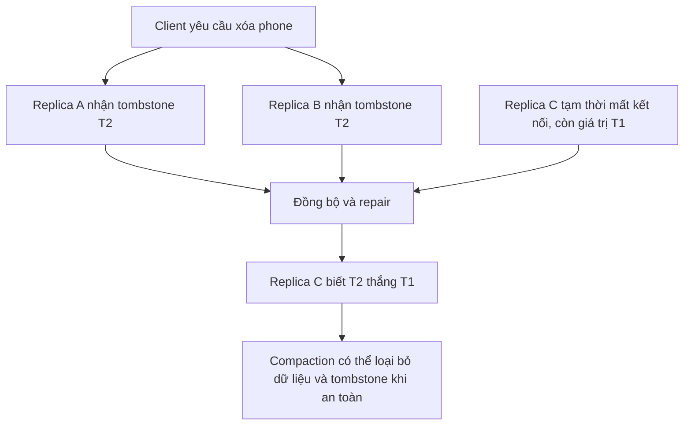

# NULL, UNSET và tác động đến dữ liệu hoặc dấu xóa trong Cassandra

Trong chương **Ghi và xóa bằng CQL**, việc một trường không có giá trị có thể mang những ý nghĩa rất khác nhau: người dùng **không gửi trường đó**, người dùng **yêu cầu xóa giá trị**, hoặc giá trị **đã hết hạn**. Nếu ứng dụng Java nhầm các tình huống này, một yêu cầu sửa số điện thoại có thể vô tình xóa email, tạo nhiều *tombstone* và làm khó xử lý dữ liệu trên các replica.

Apache Cassandra là cơ sở dữ liệu **wide-column phân tán**. Dữ liệu được định vị bởi **primary key**, phân phối theo **partition key**, nhân bản theo cấu hình replication và đọc/ghi với consistency level được chọn. Vì thế, ý nghĩa của `NULL` và `UNSET` không chỉ ảnh hưởng kết quả `SELECT`: chúng còn ảnh hưởng các phiên bản cell được hòa giải, dấu xóa, compaction và repair.

Sau bài này, bạn sẽ:

- Phân biệt **bỏ qua cột**, **gán NULL**, **bind UNSET** và **ghi một giá trị**.
- Giải thích vì sao `NULL` tạo tombstone, còn `UNSET` không tạo mutation cho cột tương ứng.
- Hiểu vì sao `SELECT` trả `null` không chứng minh có một giá trị NULL được lưu trên đĩa.
- Xử lý `INSERT`, `UPDATE`, `DELETE`, `INSERT JSON` và tham số Java Driver đúng ý định.
- Nhận diện tác động của timestamp, TTL, replication, compaction và repair đối với dấu xóa.
- Thiết kế API cập nhật một phần mà không làm mất những trường người dùng không gửi.

## 1. Mô hình dữ liệu để quan sát từng cell

Giả sử hệ thống truy vấn thông tin liên hệ theo mã khách hàng. Keyspace `demo` được giả định đã tồn tại:

```sql
CREATE TABLE demo.customer_contact_by_id (
    customer_id uuid PRIMARY KEY,
    full_name text,
    email text,
    phone text,
    locale text,
    temporary_note text
);
```

Ở bảng này, `customer_id` vừa là **partition key** vừa là **full primary key**. Mỗi lệnh ghi với cùng UUID sẽ nhắm đến cùng hàng logic. Các cột `full_name`, `email`, `phone`, `locale` và `temporary_note` là **regular column**, được ghi và hòa giải độc lập ở mức cell.

Tạo dữ liệu ban đầu:

```sql
INSERT INTO demo.customer_contact_by_id (
    customer_id, full_name, email, phone, locale
)
VALUES (
    11111111-1111-4111-8111-111111111111,
    'Nguyễn Mai',
    'mai@example.test',
    '0900000001',
    'vi-VN'
);

SELECT full_name, email, phone, locale, temporary_note
FROM demo.customer_contact_by_id
WHERE customer_id = 11111111-1111-4111-8111-111111111111;
```

Giả sử không có ghi cạnh tranh và bảng không có TTL mặc định, các giá trị quan sát được:

| Cột | Giá trị |
| --- | --- |
| `full_name` | `'Nguyễn Mai'` |
| `email` | `'mai@example.test'` |
| `phone` | `'0900000001'` |
| `locale` | `'vi-VN'` |
| `temporary_note` | `null` (chưa được ghi) |

Lưu ý: việc `temporary_note` được đọc thành `null` **không có nghĩa Cassandra đang lưu một cell mang giá trị NULL**. Trong CQL, `null` ở kết quả đọc thường biểu diễn sự vắng mặt của một giá trị đang sống.

## 2. Bốn hành vi ghi cần phân biệt

Đây là bảng quan trọng nhất của bài:

| Trường hợp | Biểu đạt | Tác động lên cột thường |
| --- | --- | --- |
| **Bỏ qua cột** | Không nêu cột trong `INSERT`/`UPDATE` | Không ghi lại cột; giá trị cũ không bị mutation này thay đổi |
| **Ghi giá trị** | `SET phone = '090...'` | Ghi phiên bản mới cho cell của cột |
| **Ghi NULL** | `SET phone = NULL` hoặc bind null | Ghi dấu xóa (*tombstone*) cho cột |
| **Bind UNSET** | Marker trong prepared statement được đặt trạng thái `UNSET` | Không thực hiện phép ghi đối với cột tương ứng |

**NULL và UNSET không phải hai cách viết của cùng một hành vi.** `NULL` mang ý định xóa dữ liệu; `UNSET` mang ý định không cập nhật dữ liệu.

Một cách ghi nhớ:

```text
Hàng có phone = '0900000001'

UPDATE ... SET locale = 'en-US'
    -> phone không được nhắc tới -> giữ nguyên.

UPDATE ... SET phone = '0900000099'
    -> phone có giá trị mới -> ghi phiên bản mới.

UPDATE ... SET phone = NULL
    -> phone bị xóa về mặt logic -> sinh tombstone.

Prepared UPDATE ... SET phone = :phone; bind :phone = UNSET
    -> phone không được ghi -> giữ nguyên.
```

Sự “giữ nguyên” ở đây được hiểu **chỉ xét mutation đang thực hiện**. Một client khác vẫn có thể ghi cột đó; TTL cũ có thể hết hạn; hoặc lần đọc từ replica khác có thể quan sát trạng thái chưa hội tụ tùy consistency level.

### Vì sao UNSET không phải một giá trị CQL thông thường?

`UNSET` là trạng thái **tham số giao thức khi bind prepared statement**, được hỗ trợ trong các phiên bản giao thức Cassandra phù hợp và các driver hiện đại. Nó không phải chuỗi `'UNSET'`, không phải từ khóa giá trị dùng thay thế cho mọi chỗ có thể viết `NULL` trong câu CQL.

Vì vậy:

- Trong câu CQL trực tiếp ở `cqlsh`, muốn không sửa cột thì **bỏ cột đó khỏi lệnh**.
- Trong prepared statement, marker của cột không cần cập nhật có thể được đặt `UNSET`.
- Với thành phần **primary key bắt buộc**, cả `NULL` và `UNSET` đều không phải giá trị khóa hợp lệ. Hãy cung cấp đầy đủ khóa cần thiết.

## 3. Thực hành: bỏ qua cột, gán NULL và DELETE

### A. Không gửi cột: giữ nguyên dữ liệu hiện có

Ví dụ chỉ sửa ngôn ngữ:

```sql
UPDATE demo.customer_contact_by_id
SET locale = 'en-US'
WHERE customer_id = 11111111-1111-4111-8111-111111111111;
```

Ở mutation này, `locale` được ghi lại, còn `email` và `phone` không được ghi lại. Sau khi ghi thành công, chúng tiếp tục có giá trị cũ nếu không bị thao tác khác tác động.

Một `INSERT` thông thường cũng có semantics **upsert từng cột**:

```sql
INSERT INTO demo.customer_contact_by_id (customer_id, locale)
VALUES (
    11111111-1111-4111-8111-111111111111,
    'ja-JP'
);
```

`INSERT` ở cùng primary key chỉ ghi `locale`; việc `email` và `phone` vắng mặt trong danh sách cột không biến chúng thành null. Câu `INSERT` không có `IF` cũng không kiểm tra lỗi khóa đã tồn tại như cơ sở dữ liệu quan hệ.

### B. Gán NULL: xóa giá trị ở mức logic

```sql
UPDATE demo.customer_contact_by_id
SET phone = NULL
WHERE customer_id = 11111111-1111-4111-8111-111111111111;

SELECT email, phone, locale
FROM demo.customer_contact_by_id
WHERE customer_id = 11111111-1111-4111-8111-111111111111;
```

Nếu không có ghi cạnh tranh và lần đọc thấy thao tác xóa, `phone` sẽ trả về `null`, `email` và `locale` vẫn còn. Lúc này Cassandra đã ghi một **tombstone** để đánh dấu phiên bản phone cũ không còn hợp lệ.

### C. DELETE cột: cùng ý định xóa

```sql
DELETE phone
FROM demo.customer_contact_by_id
WHERE customer_id = 11111111-1111-4111-8111-111111111111;
```

Với một cột scalar thông thường như `phone`, `DELETE phone` và `UPDATE ... SET phone = NULL` đều biểu đạt **xóa giá trị cột**. Không cần chạy cả hai lệnh khi chỉ muốn xóa một lần. Cả hai đều có thể tạo dấu xóa, không đơn thuần “xóa sạch ngay cell khỏi mọi SSTable”.

### D. Ghi lại sau khi xóa

```sql
UPDATE demo.customer_contact_by_id
SET phone = '0900000077'
WHERE customer_id = 11111111-1111-4111-8111-111111111111;
```

Nếu lần ghi mới có timestamp lớn hơn dấu xóa và được đọc tại consistency level thích hợp, `phone` có thể xuất hiện trở lại với giá trị `'0900000077'`. Tombstone không phải lệnh cấm tuyệt đối mọi lần ghi về sau: nó làm vô hiệu **những phiên bản cũ hơn** trong quá trình hòa giải.

## 4. Tombstone là gì và vì sao không xóa ngay?

Cassandra ghi dữ liệu vào **commit log** và **memtable**, sau đó dữ liệu được flush thành các tệp **SSTable** bất biến. Một bản ghi cũ có thể đang nằm trong SSTable ở node này, trong khi một mutation xóa mới xuất hiện ở memtable/SSTable khác. Cơ sở dữ liệu không thể sửa trực tiếp mọi phiên bản trên đĩa và mọi replica ngay tại thời điểm client chạy `SET NULL`.

**Tombstone** là một dấu xóa có timestamp, cho Cassandra biết rằng dữ liệu cũ hơn dấu xóa không được xuất hiện như dữ liệu còn sống.

```text
Cell phone của customer A:

SSTable cũ:  phone = '0900000001'     timestamp = T1
Mutation mới: DELETE phone           timestamp = T2

Với T2 > T1, phiên bản T1 bị dấu xóa che khuất.
SELECT phone -> null (khi đọc thấy tombstone T2).
```

Vì Cassandra có nhiều replica, node tạm thời mất kết nối có thể bỏ lỡ lệnh xóa. Tombstone được giữ đủ lâu để cơ chế đồng bộ/repair có cơ hội lan truyền thông tin xóa:



Đây là mô hình minh họa, không phải sơ đồ đảm bảo thời điểm giao nhận của từng replica.

### Những điều cần tránh hiểu sai

- **Tombstone không luôn biến mất ngay sau một mốc thời gian.** `gc_grace_seconds` liên quan đến thời gian chờ trước khi tombstone đủ điều kiện thu gom; việc loại bỏ thực tế còn phụ thuộc compaction và khả năng loại bỏ an toàn các phiên bản cũ.
- **Hạ `gc_grace_seconds` bừa bãi là nguy hiểm.** Nếu tombstone bị loại bỏ trước khi replica vắng mặt biết về lệnh xóa, dữ liệu cũ có thể “sống lại” (*zombie data*) khi được đồng bộ.
- **Repair và compaction có vai trò khác nhau.** Repair giúp replica hội tụ, còn compaction hợp nhất SSTable và có thể thu gom dữ liệu đã xóa khi đủ điều kiện.
- **`SELECT col` trả `null` không tiết lộ tombstone.** Kết quả giống nhau nếu cột chưa từng được ghi, đã bị xóa, hoặc giá trị trước đó hết hạn.

### NULL không phải cùng khái niệm với “hàng bị xóa”

Gán `phone = NULL` xóa **một cột**, không có nghĩa xóa toàn bộ hàng hoặc phân vùng. CQL cũng hỗ trợ xóa hàng hoặc cả phân vùng theo khóa; các loại thao tác này có thể tạo tombstone ở phạm vi lớn hơn, chẳng hạn row tombstone hoặc partition tombstone.

Với hàng chỉ còn primary key hoặc nhiều cột đã xóa, việc hàng có xuất hiện trong một lần `SELECT` còn liên quan đến trạng thái tồn tại của hàng, row liveness marker và các cell còn sống. Vì vậy, **đừng dựa vào việc tất cả cột thường đều đọc ra null để kết luận hàng đã bị xóa hoàn toàn**.

## 5. Ghi cạnh tranh: tombstone cũng mang timestamp

Những cập nhật cạnh tranh trên cùng một cell được Cassandra hòa giải theo **timestamp**. Với các phiên bản thông thường, giá trị có timestamp mới hơn sẽ được ưu tiên; một tombstone có thể che các phiên bản sống cũ hơn.

| Phiên bản | Thao tác | Timestamp minh họa | Kết quả khi hòa giải |
| --- | --- | --- | --- |
| A | `phone = '0901'` | 100 | Giá trị cũ |
| B | `phone = NULL` | 200 | B che A |
| C | `phone = '0902'` | 150 | C vẫn bị B che |
| D | `phone = '0903'` | 300 | D mới hơn B và có thể hiện ra |

Các số 100, 200, 300 chỉ giúp so sánh. Cassandra biểu diễn write timestamp theo **microsecond tính từ Unix epoch**. Thứ tự timestamp quyết định kết quả hòa giải, không đơn thuần là thứ tự request đi vào ứng dụng. Trường hợp timestamp trùng nhau có quy tắc hòa giải riêng; không nên cố tình tạo timestamp bằng nhau để dựa vào kết quả đó trong logic nghiệp vụ.

### Hệ quả khi retry

Một lệnh xóa được chạy lại với timestamp mới có thể tiếp tục thắng một phép ghi khôi phục giá trị vừa được client khác thực hiện. Ngược lại, lệnh xóa đến muộn nhưng có timestamp cũ có thể không che được một phiên bản mới hơn.

Nếu request bị timeout, ứng dụng **không thể mặc định rằng xóa đã thất bại**: một phần replica có thể đã ghi tombstone. Thiết kế retry cần cân nhắc timestamp, thao tác khác đang cạnh tranh và mức nhất quán đọc/ghi. Nếu nghiệp vụ yêu cầu “chỉ xóa nếu email vẫn là X”, dùng LWT với điều kiện thích hợp, thay vì chỉ `SELECT` rồi `SET NULL` không điều kiện.

Ví dụ xóa email khi email chưa đổi:

```sql
UPDATE demo.customer_contact_by_id
SET email = NULL
WHERE customer_id = 11111111-1111-4111-8111-111111111111
IF email = 'mai@example.test';
```

Đây là một **lightweight transaction (LWT)**. Ứng dụng phải kiểm tra cột `[applied]` trong kết quả để biết điều kiện thành công hay thất bại. LWT cần cơ chế đồng thuận, thường đắt hơn ghi thông thường, nên chỉ dùng khi điều kiện cạnh tranh là yêu cầu nghiệp vụ.

## 6. INSERT JSON: trường thiếu có thể thành NULL nếu không chú ý

Với `INSERT` theo danh sách cột thông thường, cột không xuất hiện sẽ bị bỏ qua. Nhưng **CQL JSON insert** có cơ chế xử lý mặc định riêng cho thuộc tính không có trong JSON.

### DEFAULT NULL và DEFAULT UNSET

Giả sử hàng của Mai vẫn có `full_name` và `email`, và ta chỉ muốn sửa `locale`:

```sql
INSERT INTO demo.customer_contact_by_id JSON
'{"customer_id":"11111111-1111-4111-8111-111111111111","locale":"fr-FR"}'
DEFAULT UNSET;
```

Với `DEFAULT UNSET`, các cột **không xuất hiện trong JSON** không bị ghi lại. Trong trường hợp này, `locale` được cập nhật còn những cột khác không bị mutation này thay đổi.

Nếu không chỉ định mặc định, `INSERT ... JSON` dùng **DEFAULT NULL**; những thuộc tính vắng mặt có thể bị xử lý như null:

```sql
-- Chỉ minh họa nguy cơ; đừng chạy trên dữ liệu cần giữ nguyên!
INSERT INTO demo.customer_contact_by_id JSON
'{"customer_id":"11111111-1111-4111-8111-111111111111","locale":"fr-FR"}'
DEFAULT NULL;
```

Khi đó `full_name`, `email`, `phone` hoặc `temporary_note` vắng mặt trong JSON có thể chịu phép ghi NULL và xuất hiện tombstone. Đây là bẫy thường gặp khi ứng dụng gửi một object JSON chỉ chứa trường muốn sửa.

| Cú pháp | Cột **thiếu** trong JSON | Cột được gửi **rõ ràng là null** |
| --- | --- | --- |
| `INSERT ... JSON '...' DEFAULT NULL` | Được xử lý theo chính sách NULL | Ghi NULL |
| `INSERT ... JSON '...' DEFAULT UNSET` | Bỏ qua, không ghi cell | Vẫn là NULL, thể hiện ý định xóa |

`DEFAULT UNSET` chỉ thay đổi cách xử lý **thuộc tính thiếu**; nó không biến một giá trị `"phone": null` được gửi rõ ràng thành thao tác no-op.

Ví dụ so sánh:

```json
{"customer_id":"11111111-1111-4111-8111-111111111111","locale":"en-US"}
```

Với `DEFAULT UNSET`, `phone` không được gửi nên giữ nguyên. Nhưng:

```json
{"customer_id":"11111111-1111-4111-8111-111111111111","locale":"en-US","phone":null}
```

thì `phone` được yêu cầu xóa một cách tường minh. Hãy xác định rõ ý nghĩa của JSON null theo hợp đồng API, rồi chọn cách bind CQL tương ứng.

### So sánh với NULL trong câu lệnh INSERT theo danh sách cột

```sql
INSERT INTO demo.customer_contact_by_id (
    customer_id, email
)
VALUES (
    11111111-1111-4111-8111-111111111111,
    NULL
);
```

Trong lệnh này, `email` **được nêu rõ với giá trị NULL** nên có ý nghĩa xóa. Nếu bỏ cột `email` khỏi danh sách cột/`VALUES`, mutation không ghi email.

## 7. TTL: giá trị tự hết hạn không phải UNSET

Cassandra hỗ trợ **time to live (TTL)** cho các cột được ghi. Giá trị có TTL sẽ không còn được xem là đang sống sau khi hết hạn; về mặt lưu trữ, cơ chế hết hạn của Cassandra liên quan đến tombstone. TTL không phải phép “bỏ qua” như UNSET.

```sql
UPDATE demo.customer_contact_by_id USING TTL 60
SET temporary_note = 'Ma xac minh tam thoi'
WHERE customer_id = 11111111-1111-4111-8111-111111111111;

SELECT temporary_note, TTL(temporary_note),
       WRITETIME(temporary_note)
FROM demo.customer_contact_by_id
WHERE customer_id = 11111111-1111-4111-8111-111111111111;
```

Đọc ngay sau lần ghi có thể thấy:

- `temporary_note` có giá trị vừa ghi.
- `TTL(temporary_note)` là số giây còn lại, giảm dần về 0.
- `WRITETIME(temporary_note)` là timestamp ghi của cell tính bằng microsecond từ Unix epoch.

Sau khi TTL hết hạn, `temporary_note` thường được đọc thành `null`. Điều đó **khác nguyên nhân** với trường hợp cột chưa từng được ghi hay được gán NULL tường minh, dù cả ba có thể cùng xuất hiện là `null` ở kết quả `SELECT`.

Một lệnh chỉ sửa `locale` không làm mới TTL của `temporary_note`:

```sql
UPDATE demo.customer_contact_by_id
SET locale = 'de-DE'
WHERE customer_id = 11111111-1111-4111-8111-111111111111;
```

TTL cũ của `temporary_note` vẫn tiếp tục đếm xuống nếu cột không được ghi lại. Ngược lại, nếu ghi lại chính cột `temporary_note`, giá trị mới sẽ có đặc tính TTL theo lần ghi mới hoặc cấu hình `default_time_to_live` của bảng. Không nên hiểu một mutation có TTL là thay đổi TTL của tất cả cột trong hàng.

**Quan sát tombstone:** `WRITETIME` và `TTL` là công cụ hữu ích cho cell còn sống, nhưng `SELECT` thông thường không hiển thị bản ghi tombstone hay timestamp của tombstone như một hàng dữ liệu độc lập. Để kiểm tra nhiều tombstone bất thường trong vận hành thực tế, dùng các chỉ số và công cụ theo phiên bản Cassandra đang triển khai, kết hợp theo dõi latency đọc, compaction và repair.

## 8. Java Driver: truyền UNSET thay vì vô tình truyền NULL

Trong API cập nhật một phần, người dùng thường chỉ gửi những trường muốn sửa. Ví dụ HTTP PATCH:

```json
{
  "locale": "en-US"
}
```

Ý định: đổi `locale`, **giữ nguyên** `email` và `phone`. Nếu backend giải mã payload thành một Java DTO với `email == null` và `phone == null`, rồi bind cả hai vào Cassandra bằng `setToNull`, dữ liệu sẽ bị xóa không chủ ý.

API cần phân biệt **trường không xuất hiện** và **trường có mặt với giá trị JSON null**. Với Jackson, có thể dùng `JsonNode.has(...)` và `JsonNode.isNull()` để tách hai trường hợp.

### Prepared statement có marker cho mọi cột tùy chọn

Ví dụ sử dụng Apache Cassandra Java Driver 4.x. Giả sử ứng dụng đã có `CqlSession session`, `UUID customerId` và `JsonNode patch` là JSON object hợp lệ:

```java
PreparedStatement prepared = session.prepare(
    "UPDATE demo.customer_contact_by_id " +
    "SET email = :email, phone = :phone, locale = :locale " +
    "WHERE customer_id = :customer_id"
);

BoundStatementBuilder builder = prepared.boundStatementBuilder()
    .setUuid("customer_id", customerId)
    .unset("email")
    .unset("phone")
    .unset("locale");

boolean hasChange = false;

if (patch.has("email")) {
    JsonNode value = patch.get("email");
    if (value.isNull()) {
        builder.setToNull("email");        // Xoa email co chu dich
    } else if (value.isTextual()) {
        builder.setString("email", value.textValue());
    } else {
        throw new IllegalArgumentException("email phai la chuoi hoac null");
    }
    hasChange = true;
}

if (patch.has("phone")) {
    JsonNode value = patch.get("phone");
    if (value.isNull()) {
        builder.setToNull("phone");        // Xoa phone co chu dich
    } else if (value.isTextual()) {
        builder.setString("phone", value.textValue());
    } else {
        throw new IllegalArgumentException("phone phai la chuoi hoac null");
    }
    hasChange = true;
}

if (patch.has("locale")) {
    JsonNode value = patch.get("locale");
    if (value.isNull()) {
        builder.setToNull("locale");       // Chi neu API cho phep xoa
    } else if (value.isTextual()) {
        builder.setString("locale", value.textValue());
    } else {
        throw new IllegalArgumentException("locale phai la chuoi hoac null");
    }
    hasChange = true;
}

if (hasChange) {
    session.execute(builder.build());
}
```

Các import của Java Driver và Jackson được lược bỏ để tập trung vào ngữ nghĩa bind. Trong ứng dụng thật, cần thêm validation, kiểm tra quyền sửa trường, giới hạn độ dài, kiểm tra định dạng email và xử lý exception từ driver.

| JSON đầu vào | Cách bind tương ứng | Tác động |
| --- | --- | --- |
| Không có `"email"` | `unset("email")` | Không ghi email |
| `"email": null` | `setToNull("email")` | Ghi tombstone cho email |
| `"email": "new@example.test"` | `setString("email", ...)` | Ghi giá trị email mới |
| `"locale": "en-US"` và không có hai trường còn lại | Bind locale, email/phone UNSET | Chỉ ghi locale |

**Không dùng `patch.hasNonNull("email")` làm phép kiểm tra duy nhất** nếu JSON null mang ý nghĩa “xóa email”: cách kiểm tra đó bỏ qua cả trường email được gửi rõ ràng là null và làm mất ý định của người dùng.

Nếu API không cho phép xóa một trường, khi JSON chứa null cho trường đó hãy **trả lỗi validation**; đừng tự động xử lý như UNSET hoặc xóa mà không được thỏa thuận.

### Tránh một câu UPDATE không có thay đổi

Khi payload không có trường nào có thể cập nhật, tất cả marker trừ khóa đều UNSET. Trong trường hợp này nên chủ động coi request là **no-op** hoặc trả lỗi validation; không cần gửi một mutation vô nghĩa. Cũng không được dùng `NULL` hoặc `UNSET` cho `customer_id`, vì Cassandra cần giá trị khóa hợp lệ để định vị hàng.

### Khi chỉ sửa một cột

Ứng dụng còn có thể chuẩn bị câu CQL gọn hơn:

```sql
UPDATE demo.customer_contact_by_id
SET locale = ?
WHERE customer_id = ?;
```

Cách này không cần marker cho email/phone và loại bỏ nguy cơ bind nhầm hai cột đó. Với API nhiều tổ hợp trường, có thể dùng prepared statement cố định với UNSET hoặc tạo câu CQL theo **danh sách cột được phép** do ứng dụng kiểm soát, luôn bind giá trị thay vì ghép chuỗi từ request.

## 9. Các ngoại lệ và giới hạn cần biết

### Primary key không thể bị xóa bằng cách bind NULL hoặc UNSET

Các thành phần của full primary key phải xác định được hàng cần ghi. Cả `customer_id = NULL` và `customer_id = UNSET` đều không phải cách “bỏ khóa” để sửa nhiều hàng. Với bảng có khóa ghép, cần tuân thủ điều kiện khóa của thao tác ghi. Nếu muốn đổi primary key, ứng dụng phải xem đó là việc tạo dữ liệu ở khóa mới và xử lý khóa cũ, không phải `UPDATE SET primary_key = NULL`.

### NULL đối với collection có thể xóa cả collection

Nếu bảng có cột `attributes map<text, text>`, gán `attributes = NULL` mang ý nghĩa xóa collection đó. Nó khác với việc **không đề cập** `attributes`, và cũng khác thao tác xóa **một phần tử** của map. Với collection không frozen, các thao tác ghi toàn collection và ghi/xóa từng phần tử có đặc tính tombstone riêng; chọn đúng phạm vi thao tác để tránh ảnh hưởng dữ liệu không liên quan.

### Counter có cú pháp và semantics riêng

Counter được cập nhật bằng phép cộng/trừ theo quy tắc đặc biệt, không hoạt động như cột scalar có thể tự do `SET counter = NULL`. Không áp dụng mù quáng hướng dẫn NULL/UNSET của cột thường cho counter. Các thao tác cộng dồn cũng cần chính sách retry riêng vì chạy lại có thể làm tăng/giảm lần thứ hai.

### “Không có giá trị” chưa chắc là “chưa từng ghi”

Khi chạy:

```sql
SELECT email
FROM demo.customer_contact_by_id
WHERE customer_id = 11111111-1111-4111-8111-111111111111;
```

Kết quả `null` có thể xuất phát từ nhiều nguyên nhân:

1. Email chưa từng được ghi vào hàng.
2. Email đã bị xóa bằng `SET NULL` hoặc `DELETE`.
3. Email đã hết TTL.
4. Một phiên bản/dấu xóa thắng theo timestamp hoặc lần đọc đang quan sát dữ liệu ở các replica khác nhau.

Nếu nghiệp vụ cần phân biệt “chưa từng cung cấp email” với “đã chủ động yêu cầu xóa email”, hãy **mô hình hóa trạng thái nghiệp vụ đó thành một cột/sự kiện riêng**; không trông đợi `SELECT email` tự phân biệt các nguyên nhân.

## 10. Bài thực hành: dự đoán mutation trước khi chạy

Thực hiện trên môi trường thử nghiệm, dùng một UUID riêng để không phụ thuộc những ví dụ trước.

**Bước 1 — Khởi tạo hàng**

```sql
INSERT INTO demo.customer_contact_by_id (
    customer_id, full_name, email, phone, locale
)
VALUES (
    55555555-5555-4555-8555-555555555555,
    'Linh',
    'linh@example.test',
    '0911111111',
    'vi-VN'
);
```

**Bước 2 — Không gửi email và phone**

```sql
UPDATE demo.customer_contact_by_id
SET locale = 'en-US'
WHERE customer_id = 55555555-5555-4555-8555-555555555555;

SELECT email, phone, locale
FROM demo.customer_contact_by_id
WHERE customer_id = 55555555-5555-4555-8555-555555555555;
```

Kỳ vọng: `email = 'linh@example.test'`, `phone = '0911111111'`, `locale = 'en-US'`.

**Bước 3 — Gán NULL cho phone**

```sql
UPDATE demo.customer_contact_by_id
SET phone = NULL
WHERE customer_id = 55555555-5555-4555-8555-555555555555;

SELECT email, phone, locale
FROM demo.customer_contact_by_id
WHERE customer_id = 55555555-5555-4555-8555-555555555555;
```

Kỳ vọng: `phone` đọc ra `null`, email và locale vẫn còn. Mutation tạo dấu xóa cho phone.

**Bước 4 — Đổi tên bằng JSON, bỏ qua các cột khác**

```sql
INSERT INTO demo.customer_contact_by_id JSON
'{"customer_id":"55555555-5555-4555-8555-555555555555","full_name":"Linh Tran"}'
DEFAULT UNSET;
```

Kỳ vọng: tên đổi thành `'Linh Tran'`; email vẫn là `'linh@example.test'` và locale vẫn là `'en-US'`. Phone tiếp tục vắng mặt do đã bị xóa ở bước 3.

**Bước 5 — Ghi giá trị có TTL**

```sql
UPDATE demo.customer_contact_by_id USING TTL 120
SET temporary_note = 'Phan hoi trong 2 phut'
WHERE customer_id = 55555555-5555-4555-8555-555555555555;

SELECT temporary_note, TTL(temporary_note), email, locale
FROM demo.customer_contact_by_id
WHERE customer_id = 55555555-5555-4555-8555-555555555555;
```

Kỳ vọng: `temporary_note` có TTL gần 120 giây ngay sau khi ghi; email và locale không bị thay đổi bởi lệnh này. Sau khi TTL hết hạn, note có thể đọc ra `null` dù email/locale vẫn còn.

### Bảng trạng thái dự kiến

| Thời điểm | `full_name` | `email` | `phone` | `locale` |
| --- | --- | --- | --- | --- |
| Sau bước 1 | Linh | linh@example.test | 0911111111 | vi-VN |
| Sau bước 2 | Linh | linh@example.test | 0911111111 | en-US |
| Sau bước 3 | Linh | linh@example.test | null | en-US |
| Sau bước 4 | Linh Tran | linh@example.test | null | en-US |
| Sau bước 5 | Linh Tran | linh@example.test | null | en-US |

Kết quả minh họa giả định không có ghi cạnh tranh, timestamp tùy chỉnh hoặc TTL khác. Bạn có thể kiểm tra thêm `WRITETIME(email)` trước và sau bước 2: lệnh chỉ sửa `locale` không có nhiệm vụ làm mới timestamp ghi của email.

### Câu hỏi tự kiểm tra

1. Backend nhận JSON chỉ chứa `locale` rồi bind `email = NULL`. Điều gì sai? **Đã chuyển “trường không gửi” thành “yêu cầu xóa email”, gây tombstone không chủ đích.**
2. Khi `phone` đọc ra `null`, có chứng minh được phone đã bị xóa không? **Không.** Phone có thể chưa từng ghi, bị xóa hoặc hết TTL.
3. Cách nào giữ nguyên cột khi bind prepared statement? **`UNSET` hoặc không đưa cột đó vào câu CQL.**
4. `DEFAULT UNSET` có bỏ qua thuộc tính JSON được gửi rõ ràng là `null` không? **Không.** Nó chỉ xử lý các thuộc tính **thiếu** trong JSON.
5. Vì sao tombstone tồn tại sau khi `DELETE` đã thành công? **Để che các phiên bản cũ và truyền thông tin xóa khi các replica chưa đồng bộ.**
6. Hạ `gc_grace_seconds` xuống quá thấp mà không bảo đảm repair có rủi ro gì? **Dữ liệu cũ trên replica bỏ lỡ lệnh xóa có thể xuất hiện lại.**

## 11. Checklist khi triển khai với Cassandra và Java

Trước khi đưa một endpoint cập nhật vào production, cần trả lời:

1. **Trường thiếu và trường null có ý nghĩa khác nhau không?** Nếu có, dữ liệu đầu vào phải biểu diễn được sự hiện diện của trường.
2. **Có cột nào bị bind NULL ngoài ý định?** Chỉ gọi `setToNull` hoặc `DELETE` khi thật sự muốn xóa.
3. **Các cột không gửi đã được bỏ qua/UNSET chưa?** Đặc biệt cẩn thận khi dùng `INSERT JSON` vì mặc định `DEFAULT NULL`.
4. **Primary key có đầy đủ và hợp lệ không?** Không dùng NULL/UNSET để định vị hàng.
5. **Có yêu cầu bảo vệ ghi cạnh tranh không?** Khi cần điều kiện giá trị cũ, dùng `IF`/LWT và kiểm tra `[applied]`.
6. **TTL, compaction và repair có được vận hành phù hợp không?** Tránh tạo tombstone hàng loạt và không rút ngắn thời gian bảo vệ dấu xóa thiếu cơ sở.
7. **Consistency level có phù hợp mục tiêu đọc/ghi không?** Mức nhất quán tác động khả năng xác nhận và quan sát dữ liệu giữa replica, không thay thế điều kiện nghiệp vụ.
8. **Retry có thể thay timestamp hoặc tác động đến phiên bản mới hơn không?** Khi timeout, xác định chiến lược kiểm tra trạng thái và retry.

**Ghi nhớ:** Trong Cassandra, **NULL là yêu cầu xóa giá trị**, còn **UNSET là yêu cầu không ghi cột tương ứng**. Hai cách xử lý có thể cùng khiến một số trường trông như `null` khi đọc, nhưng tác động lưu trữ rất khác nhau. Nắm rõ chênh lệch này giúp API Java cập nhật từng phần an toàn, hạn chế tombstone, tránh dữ liệu “sống lại” khi replica chưa repair và làm chủ ngữ nghĩa ghi/xóa trong hệ thống phân tán.
