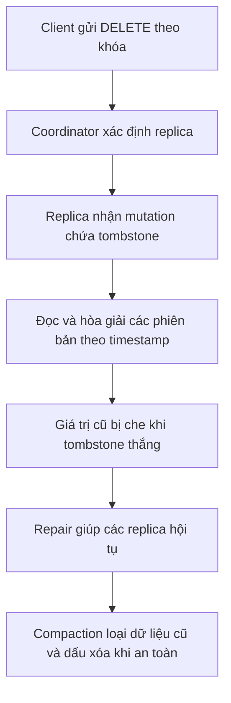

# DELETE theo cột, hàng, khoảng clustering hoặc phân vùng trong Cassandra

Trong Apache Cassandra, một câu lệnh `DELETE` không nhất thiết có nghĩa “xóa một bản ghi”. Tùy các cột được nêu sau `DELETE` và điều kiện `WHERE`, thao tác có thể **xóa giá trị của một cột**, **xóa một hàng**, **xóa một khoảng hàng theo clustering key**, hoặc **xóa toàn bộ phân vùng**. Mỗi phạm vi ghi dấu xóa khác nhau và có hậu quả khác nhau đối với truy vấn, hiệu năng, replication và repair.

Bài thuộc chương **Ghi và xóa bằng CQL** của module **DATABASE_ENGINE_WIDE_COLUMN_CASSANDRA**, nơi người học tìm hiểu kiến trúc wide-column phân tán, thiết kế bảng theo truy vấn và consistency level của Cassandra. Nội dung này giúp bạn dự đoán đúng phạm vi tác động của lệnh xóa, đồng thời triển khai thao tác xóa có kiểm soát từ ứng dụng Java.

Sau bài học, bạn có thể:

- Đọc primary key để xác định một lệnh xóa chạm đến cột, hàng, clustering range hay partition.
- Viết `DELETE` đúng cú pháp CQL với partition key ghép và nhiều clustering column.
- Hiểu tombstone ở cấp cell, row, range và partition; phân biệt xóa logic với thu gom dữ liệu vật lý.
- Giải thích ảnh hưởng của timestamp, TTL, replication, compaction, repair và consistency level.
- Viết prepared statement Java để xóa đúng phạm vi, xử lý timeout và yêu cầu xóa có điều kiện.

## 1. Khóa quyết định phạm vi DELETE

Giả sử hệ thống thu thập sự kiện thiết bị cần đọc các sự kiện của **một thiết bị trong một ngày**, theo thời điểm sự kiện. Keyspace `demo` được giả định đã được tạo.

```sql
CREATE TABLE demo.events_by_device_day (
    device_id       uuid,
    event_day       date,
    event_time      timestamp,
    event_id        uuid,
    event_type      text,
    severity        int,
    payload         text,
    location_name   text static,
    PRIMARY KEY ((device_id, event_day), event_time, event_id)
);
```

Phân tích khóa:

| Thành phần | Cột | Ý nghĩa khi DELETE |
| --- | --- | --- |
| **Partition key ghép** | `(device_id, event_day)` | Xác định phân vùng logic và các replica chịu trách nhiệm |
| **Clustering column thứ nhất** | `event_time` | Tổ chức các hàng theo thời điểm bên trong phân vùng; có thể giới hạn một khoảng |
| **Clustering column thứ hai** | `event_id` | Phân biệt các sự kiện cùng thời điểm |
| **Regular column** | `event_type`, `severity`, `payload` | Có thể xóa giá trị riêng của từng cột tại một hàng |
| **Static column** | `location_name` | Giá trị chung của toàn phân vùng, có thể xóa bằng partition key |

**Full primary key** là `(device_id, event_day, event_time, event_id)`. Khi xóa một hàng cụ thể, phải xác định hàng bằng khóa đầy đủ. Khi xóa cả phân vùng, chỉ cần toàn bộ partition key. Khi xóa một khoảng các hàng, dùng partition key đầy đủ và điều kiện hợp lệ trên clustering column.

Sơ đồ tư duy:

```text
Partition (device_id=A, event_day=2026-11-21)
|
+-- Static: location_name = 'Kho A'
|
+-- Row (09:00, event_id=X)
|    event_type = 'BOOT', payload = '...'
|
+-- Row (09:15, event_id=Y)
|    event_type = 'WARN', payload = '...'
|
+-- Row (10:30, event_id=Z)
     event_type = 'INFO', payload = '...'
```

Tương ứng với sơ đồ trên:

- **DELETE một cột:** chỉ xóa `payload` của hàng Y.
- **DELETE một hàng:** xóa hàng Y, giữ X và Z.
- **DELETE một khoảng clustering:** xóa các hàng có `event_time` nằm trong khoảng lựa chọn.
- **DELETE một phân vùng:** xóa toàn bộ X, Y, Z cùng giá trị static của phân vùng.

### Tạo dữ liệu ban đầu

Các ví dụ tiếp theo dùng thiết bị `11111111-1111-4111-8111-111111111111` trong ngày `2026-11-21`. Các UUID `event_id` cố định giúp đọc và xóa chính xác.

```sql
UPDATE demo.events_by_device_day
SET location_name = 'Kho A'
WHERE device_id = 11111111-1111-4111-8111-111111111111
  AND event_day = '2026-11-21';

INSERT INTO demo.events_by_device_day (
    device_id, event_day, event_time, event_id,
    event_type, severity, payload
)
VALUES (
    11111111-1111-4111-8111-111111111111,
    '2026-11-21', '2026-11-21 09:00:00+0700',
    aaaaaaaa-aaaa-4aaa-8aaa-aaaaaaaaaaaa,
    'BOOT', 1, 'Startup completed'
);

INSERT INTO demo.events_by_device_day (
    device_id, event_day, event_time, event_id,
    event_type, severity, payload
)
VALUES (
    11111111-1111-4111-8111-111111111111,
    '2026-11-21', '2026-11-21 09:15:00+0700',
    bbbbbbbb-bbbb-4bbb-8bbb-bbbbbbbbbbbb,
    'WARN', 3, 'High temperature'
);

INSERT INTO demo.events_by_device_day (
    device_id, event_day, event_time, event_id,
    event_type, severity, payload
)
VALUES (
    11111111-1111-4111-8111-111111111111,
    '2026-11-21', '2026-11-21 10:30:00+0700',
    cccccccc-cccc-4ccc-8ccc-cccccccccccc,
    'INFO', 1, 'Cooling enabled'
);
```

Trạng thái dự kiến nếu không có ghi cạnh tranh:

| Giờ sự kiện | event_id (rút gọn) | event_type | severity | payload |
| --- | --- | --- | ---: | --- |
| 09:00 | `aaaa...` | BOOT | 1 | Startup completed |
| 09:15 | `bbbb...` | WARN | 3 | High temperature |
| 10:30 | `cccc...` | INFO | 1 | Cooling enabled |

Mọi hàng cùng phân vùng nhìn thấy `location_name = 'Kho A'`. Các ví dụ ở phần 2–5 minh họa từng loại xóa; khi muốn so sánh độc lập, hãy khởi tạo lại dữ liệu trong môi trường thử nghiệm. Phần 10 cung cấp chuỗi thực hành riêng để tránh phụ thuộc trạng thái này.

## 2. DELETE theo cột: xóa giá trị, giữ lại hàng

Muốn loại bỏ nội dung chi tiết `payload` của sự kiện cảnh báo lúc 09:15 nhưng vẫn giữ loại sự kiện và mức nghiêm trọng:

```sql
DELETE payload
FROM demo.events_by_device_day
WHERE device_id = 11111111-1111-4111-8111-111111111111
  AND event_day = '2026-11-21'
  AND event_time = '2026-11-21 09:15:00+0700'
  AND event_id = bbbbbbbb-bbbb-4bbb-8bbb-bbbbbbbbbbbb;
```

Với **regular column**, `WHERE` của thao tác xóa cột cần định vị hàng đích bằng full primary key. Kết quả đọc lại:

```sql
SELECT event_time, event_id, event_type, severity, payload
FROM demo.events_by_device_day
WHERE device_id = 11111111-1111-4111-8111-111111111111
  AND event_day = '2026-11-21'
  AND event_time = '2026-11-21 09:15:00+0700'
  AND event_id = bbbbbbbb-bbbb-4bbb-8bbb-bbbbbbbbbbbb;
```

Nếu xóa đã được replica phục vụ lần đọc quan sát, `payload` trả `null`, trong khi `event_type = 'WARN'` và `severity = 3`. **Hàng vẫn tồn tại**, vì việc xóa một regular column không có nghĩa xóa toàn bộ hàng.

### Xóa nhiều cột của cùng hàng

```sql
DELETE payload, severity
FROM demo.events_by_device_day
WHERE device_id = 11111111-1111-4111-8111-111111111111
  AND event_day = '2026-11-21'
  AND event_time = '2026-11-21 09:15:00+0700'
  AND event_id = bbbbbbbb-bbbb-4bbb-8bbb-bbbbbbbbbbbb;
```

Lệnh này yêu cầu xóa hai giá trị cột được nêu rõ tại hàng đã chọn. Nó không thay đổi `event_type` và không xóa các sự kiện khác có cùng partition key.

### Cột static là một ngoại lệ theo partition key

`location_name` được khai báo `static`, nên thuộc **phân vùng**, không thuộc một hàng sự kiện. Xóa giá trị static:

```sql
DELETE location_name
FROM demo.events_by_device_day
WHERE device_id = 11111111-1111-4111-8111-111111111111
  AND event_day = '2026-11-21';
```

Ở đây **chỉ cần partition key đầy đủ**, không có `event_time` hay `event_id`. Mọi hàng sự kiện trong phân vùng sẽ thấy `location_name` bị xóa khi đọc. Các regular column vẫn giữ giá trị.

Không thể áp dụng cú pháp xóa static chỉ theo partition key cho một regular column như `payload`:

```sql
-- SAI: payload là regular column, không xác định hàng clustering.
DELETE payload
FROM demo.events_by_device_day
WHERE device_id = 11111111-1111-4111-8111-111111111111
  AND event_day = '2026-11-21';
```

### DELETE cột và gán NULL

Với regular column scalar:

```sql
UPDATE demo.events_by_device_day
SET payload = NULL
WHERE device_id = 11111111-1111-4111-8111-111111111111
  AND event_day = '2026-11-21'
  AND event_time = '2026-11-21 09:15:00+0700'
  AND event_id = bbbbbbbb-bbbb-4bbb-8bbb-bbbbbbbbbbbb;
```

`SET payload = NULL` cũng biểu đạt **xóa giá trị cột**, thường tạo tombstone. **Không gửi cột** hoặc bind **UNSET** trong prepared statement lại có nghĩa không cập nhật cột đó. Đừng nhầm “trường thiếu trong JSON PATCH” với “người dùng muốn xóa giá trị”.

## 3. DELETE theo hàng: cần full primary key

Muốn xóa riêng sự kiện WARN 09:15, không nêu tên cột sau `DELETE` và dùng **full primary key**:

```sql
DELETE FROM demo.events_by_device_day
WHERE device_id = 11111111-1111-4111-8111-111111111111
  AND event_day = '2026-11-21'
  AND event_time = '2026-11-21 09:15:00+0700'
  AND event_id = bbbbbbbb-bbbb-4bbb-8bbb-bbbbbbbbbbbb;
```

Cassandra ghi tombstone cho **hàng đó**, khiến các giá trị thường thuộc hàng này không còn xuất hiện khi đọc sau khi dấu xóa được quan sát. Sự kiện BOOT và INFO ở cùng phân vùng không bị xóa bởi lệnh này.

Đặc biệt, `location_name` là static column và **không bị xóa** khi chỉ xóa một clustering row. Sau lệnh xóa hàng WARN, hai sự kiện còn lại vẫn nhìn thấy giá trị static nếu chưa có lệnh xóa static riêng.

### Hai sự kiện cùng thời điểm

Vì full primary key có cả `event_time` và `event_id`, hai sự kiện cùng timestamp nhưng khác UUID là **hai hàng khác nhau**. Để xóa chính xác một sự kiện, phải cung cấp đủ `event_id`.

Thiếu `event_id` có thể làm điều kiện không còn mô tả “đúng một hàng”. Trong các schema có nhiều clustering column, Cassandra có thể cho phép thao tác xóa theo **prefix clustering**, tác động tới nhiều hàng cùng prefix. Vì thế, khi API có ý nghĩa “xóa một sự kiện theo ID”, hãy buộc có full primary key và kiểm tra đầy đủ các thành phần trước khi tạo CQL.

### Không thể đổi khóa bằng DELETE cột

`event_time` và `event_id` là thành phần primary key. Chúng không phải regular column để có thể chạy `DELETE event_id` hoặc gán `event_time = NULL`. Muốn sửa định danh sự kiện, ứng dụng phải ghi dữ liệu ở khóa mới và xử lý xóa khóa cũ theo nghiệp vụ; đây là hai thao tác ảnh hưởng các vị trí lưu trữ khác nhau.

## 4. DELETE theo khoảng clustering: range tombstone

Giả sử cần xóa mọi sự kiện trong phân vùng ngày `2026-11-21`, từ **09:00 (bao gồm)** đến **10:00 (không bao gồm)**. Clustering column đầu tiên là `event_time` nên có thể dùng điều kiện khoảng:

```sql
DELETE FROM demo.events_by_device_day
WHERE device_id = 11111111-1111-4111-8111-111111111111
  AND event_day = '2026-11-21'
  AND event_time >= '2026-11-21 09:00:00+0700'
  AND event_time <  '2026-11-21 10:00:00+0700';
```

Đây là **range delete** trong **một phân vùng xác định**, không phải một câu lệnh lọc sự kiện trên toàn bảng. Trong dữ liệu minh họa, hàng 09:00 và 09:15 nằm trong khoảng; hàng 10:30 nằm ngoài.

| event_time | Thuộc khoảng `[09:00, 10:00)`? | Tác động |
| --- | --- | --- |
| 09:00:00 | Có, vì cận đầu dùng `>=` | Xóa |
| 09:15:00 | Có | Xóa |
| 10:00:00 | Không, vì cận cuối dùng `<` | Giữ |
| 10:30:00 | Không | Giữ |

Khoảng nửa mở `[start, end)` rất hữu ích để chia thời gian thành các đoạn liền nhau mà không xóa trùng hoặc bỏ sót sự kiện đúng biên. Nếu đổi `<` thành `<=` ở cận cuối, sự kiện lúc đúng 10:00 cũng thuộc phạm vi xóa.

### Vì sao gọi là range tombstone?

Khi xóa một khoảng clustering, Cassandra có thể ghi **range tombstone** mô tả ranh giới của các clustering row bị loại bỏ. Hệ thống không nhất thiết phải đọc toàn bộ hàng khớp rồi tạo hàng nghìn câu `DELETE` riêng ở cấp ứng dụng. Một range tombstone có thể che các phiên bản dữ liệu cũ nằm trong khoảng đó.

```text
Trong partition (device A, ngày 2026-11-21):

Clustering event_time tăng dần:
09:00  09:15  09:45  10:00  10:30
  |      |      |      |      |
  +------[ range delete )---+      [minh họa khoảng 09:00 .. <10:00]
  X      X      X      OK     OK
```

Minh họa trên giả định có các hàng tại những thời điểm đó. Một hàng không tồn tại trước khi xóa cũng có thể nằm trong phạm vi bị range tombstone che nếu sau này một mutation mang **timestamp cũ hơn tombstone** được đồng bộ tới.

**Range tombstone không phải một luật “cấm insert trong khoảng này mãi mãi”.** Nếu ứng dụng ghi một hàng mới trong cùng khoảng với timestamp **mới hơn** dấu xóa, hàng mới có thể xuất hiện. Cần phân biệt thao tác xóa dữ liệu đã ghi với quy tắc nghiệp vụ không chấp nhận dữ liệu quá thời hạn; quy tắc sau phải được thực thi riêng ở ứng dụng.

### Quy tắc sử dụng clustering range

Trong schema `PRIMARY KEY ((device_id, event_day), event_time, event_id)`:

1. Cần cung cấp **đầy đủ** hai thành phần partition key: `device_id` và `event_day`.
2. Có thể giới hạn một khoảng trên `event_time` vì đây là **clustering column đầu tiên**.
3. Nếu đã dùng bất đẳng thức (ví dụ `event_time >= ...`), không thể tùy ý thêm điều kiện lọc trên clustering column sau nó như thể CQL là SQL tổng quát.
4. Không thể bỏ qua `event_time` rồi viết điều kiện range chỉ trên `event_id` để quét toàn bộ các hàng với một UUID; phải tuân thủ thứ tự tiền tố clustering.
5. Xóa theo khoảng hàng phải dùng dạng `DELETE FROM ...`; không dùng `DELETE payload FROM ... WHERE event_time >= ...` để mô phỏng “xóa một regular column trong nhiều hàng”.

Ví dụ những cách viết sai về phạm vi:

```sql
-- SAI: thiếu partition key đầy đủ.
DELETE FROM demo.events_by_device_day
WHERE device_id = 11111111-1111-4111-8111-111111111111
  AND event_time < '2026-11-21 10:00:00+0700';

-- SAI: không thể xóa theo event_type vì đây là regular column.
DELETE FROM demo.events_by_device_day
WHERE event_type = 'WARN';

-- SAI: bỏ qua clustering column đầu tiên, chỉ hạn chế event_id.
DELETE FROM demo.events_by_device_day
WHERE device_id = 11111111-1111-4111-8111-111111111111
  AND event_day = '2026-11-21'
  AND event_id = bbbbbbbb-bbbb-4bbb-8bbb-bbbbbbbbbbbb;
```

Nếu cần xóa các sự kiện `WARN` theo một điều kiện nghiệp vụ, ứng dụng phải định danh đúng các khóa hàng cần xóa, hoặc cần thiết kế một bảng/dòng xử lý phù hợp. Không nên trông đợi `ALLOW FILTERING` biến một câu `DELETE` theo cột thường thành thao tác quét và xóa toàn bảng.

### Chi phí và giới hạn của range delete

Range delete là công cụ hữu ích cho dữ liệu theo thời gian, nhưng lượng dữ liệu cũ và tombstone vẫn cần được xử lý khi đọc/compaction. Xóa khoảng rất rộng, lặp đi lặp lại hoặc xóa những khoảng trùng nhau có thể gây thêm áp lực cho hệ thống. Một chiến lược **bucketing** theo ngày/tháng, TTL phù hợp hoặc phân vùng dữ liệu theo kỳ lưu giữ có thể thuận lợi hơn, tùy yêu cầu đọc và xóa.

## 5. DELETE toàn bộ partition: chỉ cần full partition key

Nếu phải xóa **mọi sự kiện của một thiết bị trong đúng một ngày**, đồng thời xóa metadata static của ngày đó:

```sql
DELETE FROM demo.events_by_device_day
WHERE device_id = 11111111-1111-4111-8111-111111111111
  AND event_day = '2026-11-21';
```

Lệnh không chỉ định `event_time` hay `event_id` và không nêu tên cột sau `DELETE`. Với schema đang xét, đó là **partition delete**:

- Tất cả các hàng sự kiện có full partition key `(device_id, event_day)` tương ứng bị xóa về mặt logic.
- Static column `location_name` của phân vùng đó cũng thuộc phạm vi xóa.
- Những phân vùng có ngày khác hoặc thiết bị khác không bị lệnh này tác động.

Điều này khác hoàn toàn với `UPDATE ... SET location_name = ... WHERE <partition key>`, vì cập nhật static theo partition key chỉ ghi cell static, không phải xóa mọi hàng clustering.

### Partition key ghép phải được cung cấp đầy đủ

Ví dụ sau **không có nghĩa xóa tất cả các ngày của một thiết bị**:

```sql
-- SAI: không chỉ định event_day, nên chưa định danh một partition.
DELETE FROM demo.events_by_device_day
WHERE device_id = 11111111-1111-4111-8111-111111111111;
```

Muốn loại bỏ nhiều ngày, ứng dụng phải xác định các partition key tương ứng và xử lý xóa có kiểm soát theo từng partition/bucket. Nếu mục tiêu là giữ dữ liệu theo thời gian, cần thiết kế partition key và chính sách TTL/lưu giữ từ đầu.

### So sánh bốn phạm vi xóa

| Phạm vi | Phần sau `DELETE` | Điều kiện `WHERE` | Dấu xóa logic điển hình |
| --- | --- | --- | --- |
| Cột regular | `payload` hoặc `payload, severity` | Full primary key của hàng | Cell tombstone |
| Hàng | Không nêu cột | Full primary key | Row tombstone |
| Khoảng clustering | Không nêu cột | Full partition key + khoảng hợp lệ trên clustering key | Range tombstone |
| Phân vùng | Không nêu cột | Full partition key, không ràng buộc clustering | Partition tombstone |

Với **static column**, `DELETE location_name ... WHERE <full partition key>` xóa giá trị static ở cấp phân vùng; đây là ngoại lệ có chủ đích so với việc xóa regular column phải định danh hàng.

### Xóa cả bảng là một mục tiêu khác

`DELETE` trong CQL hướng vào các khóa cụ thể hoặc khoảng clustering thuộc phân vùng. Không có ngữ nghĩa `DELETE FROM table` thiếu `WHERE` để quét và xóa toàn bảng như một số hệ SQL quan hệ. `TRUNCATE` là lệnh quản trị làm rỗng bảng với phạm vi và hậu quả rất lớn, không phải công cụ thay thế cho API xóa một thiết bị/ngày; chỉ dùng theo quy trình vận hành đã phê duyệt.

## 6. Điều gì được ghi khi DELETE thành công?

Cassandra sử dụng cơ chế lưu trữ theo **LSM tree**: mutation đi qua commit log/memtable và có thể được flush thành SSTable bất biến. Một giá trị cũ đã lưu trong SSTable không nhất thiết bị xóa vật lý ngay tại thời điểm câu `DELETE` trả về thành công.

Thay vào đó, Cassandra ghi **tombstone** với thông tin phiên bản/timestamp để đánh dấu dữ liệu nào không còn được xem là đang sống.



Các nút trong sơ đồ biểu diễn những vai trò logic; repair và compaction là quá trình riêng, không tự động diễn ra ngay trong mỗi lệnh `DELETE`.

### Các loại tombstone cần phân biệt

| Loại | Ví dụ phát sinh | Phạm vi che dữ liệu cũ |
| --- | --- | --- |
| Cell tombstone | `DELETE payload` | Một giá trị cột được chỉ định |
| Row tombstone | `DELETE FROM ... WHERE <full primary key>` | Các dữ liệu thuộc một hàng clustering |
| Range tombstone | `DELETE FROM ... WHERE <partition key> AND event_time >= ... AND event_time < ...` | Các hàng có clustering key nằm trong khoảng |
| Partition tombstone | `DELETE FROM ... WHERE <partition key>` | Dữ liệu thuộc cả phân vùng, bao gồm static |

Khi Cassandra đọc dữ liệu từ memtable/SSTable hoặc trao đổi phiên bản giữa các replica, dấu xóa có timestamp đủ mới làm vô hiệu dữ liệu cũ trong phạm vi của nó. Vì vậy một bản ghi đã xóa có thể còn tồn tại dưới dạng byte vật lý trong SSTable nhưng không được trả về như dữ liệu đang sống.

### DELETE không đồng nghĩa kiểm tra tồn tại

DELETE thông thường là thao tác gửi mutation theo khóa, **không bắt buộc đọc để xác nhận đối tượng đang tồn tại**. Xóa một khóa hiện chưa có dữ liệu vẫn có thể ghi thông tin xóa. CQL không mặc định trả số hàng bị ảnh hưởng như SQL quan hệ; ứng dụng không thể dựa vào việc lệnh hoàn thành để kết luận “đã xóa đúng một bản ghi đang tồn tại”.

Nếu nghiệp vụ yêu cầu “chỉ xóa khi hàng đang tồn tại”, xem phần 8 về `IF EXISTS`; cơ chế này đi kèm chi phí điều kiện/LWT và chỉ áp dụng trong các phạm vi được hỗ trợ.

### DELETE, TTL và NULL có cùng kết quả đọc nhưng khác nguyên nhân

- `DELETE payload`: chủ động ghi dấu xóa cho cột.
- `UPDATE ... SET payload = NULL`: cũng biểu đạt xóa giá trị cột scalar.
- Ghi `payload` với TTL: sau khi TTL hết hạn, giá trị không còn sống và được xử lý thông qua cơ chế dữ liệu hết hạn/tombstone.
- Chưa từng ghi `payload`: có thể đọc được `null` mà không cần có lịch sử xóa nào.

`SELECT` trả `null` không cho biết nguyên nhân nào đã xảy ra. Nếu cần phân biệt sự kiện “chưa bao giờ có”, “người dùng yêu cầu xóa” và “đã hết hạn”, hãy biểu diễn trạng thái nghiệp vụ hoặc audit log riêng.

## 7. Timestamp, replication, repair và rủi ro dữ liệu xuất hiện lại

Mutation trong Cassandra được hòa giải theo **write timestamp**. Nếu có một giá trị cũ tại timestamp `T1` và tombstone tương ứng tại `T2` với `T2 > T1`, dấu xóa che giá trị cũ. Nếu sau đó một giá trị mới có timestamp `T3 > T2` được ghi tại đúng khóa và phạm vi, giá trị mới có thể xuất hiện.

```text
Row (device A, day D, time 09:15, event Y):

T1: payload = 'High temperature'
T2: DELETE payload               (T2 > T1)
T3: payload = 'New payload'       (T3 > T2)

Ở T2: payload đọc thành null khi tombstone được nhìn thấy.
Ở T3: payload mới có thể được đọc trở lại.
```

Timestamp thực tế của Cassandra có đơn vị **microsecond tính từ Unix epoch**. Không nên suy đoán “request đến coordinator sau luôn thắng”: với đồng hồ lệch hoặc timestamp tự gán, lệnh đến sau có thể mang timestamp cũ hơn.

### Vì sao cần giữ tombstone đủ lâu?

Giả sử replication factor 3, nhưng một replica không nhận được lệnh xóa do mất kết nối:

```text
Replica A: đã nhận DELETE, có tombstone T2
Replica B: đã nhận DELETE, có tombstone T2
Replica C: tạm offline, vẫn giữ dữ liệu cũ T1
```

Thông tin xóa cần còn đủ lâu để repair/đồng bộ giúp replica C biết phiên bản T2 mới hơn T1. Nếu tombstone bị thu gom quá sớm trước khi C được sửa chữa và đồng bộ, phiên bản cũ có thể được đưa trở lại trong một số tình huống, thường gọi là **zombie data**.

`gc_grace_seconds` là một tham số quan trọng trong điều kiện tombstone đủ tuổi để thu gom, nhưng **không phải đồng hồ hẹn giờ đảm bảo tombstone biến mất đúng lúc đó**. Compaction chỉ có thể loại bỏ dấu xóa/dữ liệu cũ khi các điều kiện an toàn được thỏa. Không tự động giảm `gc_grace_seconds` để “tăng tốc xóa” nếu chưa có chiến lược repair và hiểu đầy đủ phiên bản Cassandra đang dùng.

### Consistency level không thay thế repair

Với replication factor 3, ghi ở `QUORUM` thông thường cần ít nhất 2 replica xác nhận trong phạm vi quorum tương ứng; `ONE` yêu cầu ít xác nhận hơn nhưng có thể thuận lợi hơn cho độ sẵn sàng/độ trễ. Lựa chọn mức đọc/ghi quyết định xác suất và điều kiện quan sát việc xóa sau khi ghi, còn **repair có nhiệm vụ giúp dữ liệu trên các replica hội tụ**. Không nên hiểu một lần xóa thành công với `QUORUM` đồng nghĩa mọi replica đều đã nhận lệnh ngay tức khắc.

### Timeout và retry

Nếu client nhận timeout, không thể biết chắc mutation xóa có được một phần replica chấp nhận hay chưa. Với yêu cầu xóa cùng khóa, retry thường dễ kiểm soát hơn phép cộng dồn, nhưng **timestamp mới của lần retry** có thể che một phiên bản được client khác viết xen giữa. Các thao tác nhạy cảm với thay đổi trạng thái cần điều kiện nghiệp vụ hoặc cơ chế kiểm soát ghi đồng thời.

Khi phân tích sự cố, hãy xem consistency level đọc/ghi, thông báo timeout, trạng thái các replica, độ trễ repair/compaction và thiết kế khóa. Không dựa riêng vào một lần `SELECT` ở consistency thấp để kết luận việc xóa đã thành công trên mọi replica.

## 8. DELETE có điều kiện: IF EXISTS và IF giá trị cũ

DELETE thông thường không tự trả lời câu hỏi “hàng có tồn tại trước khi xóa không?”. Khi cần kiểm tra điều kiện để tránh xóa một đối tượng đã thay đổi, Cassandra cung cấp **lightweight transaction (LWT)** cho các trường hợp được hỗ trợ.

### Chỉ xóa hàng nếu đang tồn tại

```sql
DELETE FROM demo.events_by_device_day
WHERE device_id = 11111111-1111-4111-8111-111111111111
  AND event_day = '2026-11-21'
  AND event_time = '2026-11-21 09:15:00+0700'
  AND event_id = bbbbbbbb-bbbb-4bbb-8bbb-bbbbbbbbbbbb
IF EXISTS;
```

Kết quả CQL có cột `[applied]`:

| Kết quả | Diễn giải |
| --- | --- |
| `true` | Điều kiện tồn tại thỏa, mutation được áp dụng |
| `false` | Điều kiện không thỏa; ứng dụng có thể báo tài nguyên không tồn tại hoặc xung đột theo hợp đồng API |

`IF EXISTS` ở đây được minh họa với **một hàng xác định bằng full primary key**. Không dùng trực tiếp cú pháp này để kỳ vọng Cassandra áp một phép kiểm tra điều kiện trên từng hàng của một range delete hoặc partition delete.

### Xóa khi dữ liệu cũ vẫn đúng kỳ vọng

Ví dụ chỉ xóa sự kiện WARN nếu `severity` vẫn bằng `3`:

```sql
DELETE FROM demo.events_by_device_day
WHERE device_id = 11111111-1111-4111-8111-111111111111
  AND event_day = '2026-11-21'
  AND event_time = '2026-11-21 09:15:00+0700'
  AND event_id = bbbbbbbb-bbbb-4bbb-8bbb-bbbbbbbbbbbb
IF severity = 3;
```

Lệnh dùng điều kiện cũ tại thời điểm LWT xử lý, tránh tình huống:

1. Client A đọc một sự kiện và dự định xóa nó.
2. Client B thay `severity` hoặc trạng thái nghiệp vụ.
3. Client A gửi DELETE không điều kiện, vô tình xóa phiên bản đã thay đổi.

Đọc bằng `SELECT` rồi gọi DELETE thông thường không khóa khoảng thời gian giữa hai bước. LWT dùng cơ chế đồng thuận nên tăng chi phí và độ trễ; chỉ dùng khi điều kiện cạnh tranh thực sự cần thiết.

### Điều kiện không làm thay đổi thiết kế khóa

`IF` không cho phép xóa tùy ý theo cột thường mà bỏ qua partition key hoặc clustering key. Điều kiện xác định phạm vi vẫn phải tuân thủ thiết kế primary key; predicate trong `IF` kiểm tra trạng thái đang có, không thay thế đường truy cập dữ liệu.

Các thao tác xóa **range/partition** phục vụ mục đích khác với LWT xóa **một hàng có điều kiện**. Nếu cần xóa nhiều đối tượng theo trạng thái nghiệp vụ, ứng dụng phải xác định khóa, kiểm soát concurrency và cân nhắc quy trình nhiều bước; không giả định một DELETE range là một giao dịch logic trên tất cả đối tượng trong khoảng.

## 9. Thực hiện DELETE từ ứng dụng Java

Java Driver 4.x cho phép dùng prepared statement và bind các thành phần khóa theo kiểu dữ liệu. Ví dụ dưới đây giả định đã kết nối `CqlSession session` và sử dụng các import tương ứng từ Java Driver cùng `java.time`/`java.util`.

### 9.1. Xóa một cột regular tại một hàng

```java
UUID deviceId = UUID.fromString(
    "11111111-1111-4111-8111-111111111111");
UUID eventId = UUID.fromString(
    "bbbbbbbb-bbbb-4bbb-8bbb-bbbbbbbbbbbb");

PreparedStatement deletePayload = session.prepare(
    "DELETE payload FROM demo.events_by_device_day " +
    "WHERE device_id = :device_id " +
    "AND event_day = :event_day " +
    "AND event_time = :event_time " +
    "AND event_id = :event_id"
);

BoundStatement bound = deletePayload.boundStatementBuilder()
    .setUuid("device_id", deviceId)
    .setLocalDate("event_day", LocalDate.of(2026, 11, 21))
    .setInstant("event_time", Instant.parse("2026-11-21T02:15:00Z"))
    .setUuid("event_id", eventId)
    .build();

session.execute(bound);
```

`2026-11-21T02:15:00Z` tương đương `09:15:00+07:00`. Dùng `Instant` giúp tách thời điểm tuyệt đối khỏi múi giờ hiển thị của người dùng. Trường `event_day` phải được tính nhất quán với quy tắc bucket trong hệ thống; nếu bucket ngày được tính theo giờ Việt Nam thì không được âm thầm đổi nó sang ngày UTC khi xây dựng khóa.

### 9.2. Xóa một khoảng clustering với prepared statement

```java
PreparedStatement deleteRange = session.prepare(
    "DELETE FROM demo.events_by_device_day " +
    "WHERE device_id = :device_id " +
    "AND event_day = :event_day " +
    "AND event_time >= :start_time " +
    "AND event_time < :end_time"
);

BoundStatement range = deleteRange.boundStatementBuilder()
    .setUuid("device_id", deviceId)
    .setLocalDate("event_day", LocalDate.of(2026, 11, 21))
    .setInstant("start_time", Instant.parse("2026-11-21T02:00:00Z"))
    .setInstant("end_time", Instant.parse("2026-11-21T03:00:00Z"))
    .build();

session.execute(range);
```

Hai giá trị `start_time` và `end_time` tương ứng 09:00 đến trước 10:00 tại múi giờ +07:00. Khi client yêu cầu xóa dữ liệu trong một khoảng, hãy kiểm tra `start < end`, giới hạn độ rộng khoảng được phép, kiểm tra quyền truy cập thiết bị và xác định trước ảnh hưởng đến phân vùng.

### 9.3. Xóa một hàng có điều kiện

```java
PreparedStatement conditional = session.prepare(
    "DELETE FROM demo.events_by_device_day " +
    "WHERE device_id = ? AND event_day = ? " +
    "AND event_time = ? AND event_id = ? IF EXISTS"
);

ResultSet result = session.execute(conditional.bind(
    deviceId,
    LocalDate.of(2026, 11, 21),
    Instant.parse("2026-11-21T02:15:00Z"),
    eventId
));

if (result.wasApplied()) {
    // Hang da thoa dieu kien va mutation duoc chap nhan.
} else {
    // Hang khong thoa dieu kien; xu ly theo hop dong API.
}
```

`wasApplied()` chỉ có ý nghĩa trong ngữ cảnh lệnh có điều kiện. Với DELETE thông thường, kết quả thành công **không** cung cấp số hàng từng tồn tại và bị xóa như `rowsAffected` của một số hệ quản trị khác.

### 9.4. Xóa cả phân vùng phải là thao tác tách riêng

```java
PreparedStatement deleteDay = session.prepare(
    "DELETE FROM demo.events_by_device_day " +
    "WHERE device_id = ? AND event_day = ?"
);

// Chi goi sau khi da xac nhan day la yeu cau xoa ca ngay.
session.execute(deleteDay.bind(
    deviceId, LocalDate.of(2026, 11, 21)
));
```

Đây là mutation **rộng hơn rất nhiều** so với `DELETE payload` hoặc DELETE một hàng. Trong ứng dụng, nên tạo phương thức rõ ý nghĩa như `deleteEventPayload(...)`, `deleteEvent(...)`, `deleteEventsInRange(...)` và `deleteDeviceDay(...)`, thay vì một hàm nhận `WHERE` tùy ý để người dùng tự xây dựng.

### Validation, retry và observability

Với dữ liệu thực tế, hãy kiểm tra quyền thao tác, phạm vi được phép, định dạng/tính đầy đủ của khóa, giờ bắt đầu/kết thúc và mục tiêu xóa. Ghi log metadata an toàn như loại DELETE, bucket ngày, số yêu cầu, độ trễ và trạng thái lỗi; không cần ghi nội dung `payload` vào log. Nếu driver báo timeout, cần phân biệt request không được xác nhận với request đã hoàn toàn thất bại trước khi quyết định retry hoặc kiểm tra lại dữ liệu.

Prepared statement bảo vệ **giá trị được bind**, nhưng không làm tên bảng hoặc tên cột biến thành tham số. Nếu API cần cho phép chọn cột để xóa, hãy dùng danh sách cột được ứng dụng cho phép và câu CQL tương ứng; không nối tên cột bất kỳ từ HTTP request vào câu lệnh.

## 10. Thực hành từng bước và đối chiếu kết quả

Chuỗi thực hành sau sử dụng một phân vùng riêng, tránh ảnh hưởng dữ liệu minh họa ở phần 1–9. Chỉ chạy trên keyspace/bảng thử nghiệm mà bạn được phép thay đổi. Để quan sát dễ hơn, thực hiện tuần tự và không chạy thêm writer đồng thời.

### Bước 1 — Tạo phân vùng thử nghiệm có bốn hàng

```sql
UPDATE demo.events_by_device_day
SET location_name = 'Lab Zone'
WHERE device_id = 55555555-5555-4555-8555-555555555555
  AND event_day = '2026-11-21';

INSERT INTO demo.events_by_device_day (
    device_id, event_day, event_time, event_id,
    event_type, severity, payload
)
VALUES (
    55555555-5555-4555-8555-555555555555,
    '2026-11-21', '2026-11-21 08:00:00+0700',
    aaaaaaaa-aaaa-4aaa-8aaa-aaaaaaaaaaa1,
    'BOOT', 1, 'Boot completed'
);

INSERT INTO demo.events_by_device_day (
    device_id, event_day, event_time, event_id,
    event_type, severity, payload
)
VALUES (
    55555555-5555-4555-8555-555555555555,
    '2026-11-21', '2026-11-21 08:30:00+0700',
    bbbbbbbb-bbbb-4bbb-8bbb-bbbbbbbbbbb2,
    'WARN', 3, 'Check sensor'
);

INSERT INTO demo.events_by_device_day (
    device_id, event_day, event_time, event_id,
    event_type, severity, payload
)
VALUES (
    55555555-5555-4555-8555-555555555555,
    '2026-11-21', '2026-11-21 09:30:00+0700',
    cccccccc-cccc-4ccc-8ccc-ccccccccccc3,
    'INFO', 1, 'Recovered'
);

INSERT INTO demo.events_by_device_day (
    device_id, event_day, event_time, event_id,
    event_type, severity, payload
)
VALUES (
    55555555-5555-4555-8555-555555555555,
    '2026-11-21', '2026-11-21 10:00:00+0700',
    dddddddd-dddd-4ddd-8ddd-ddddddddddd4,
    'INFO', 1, 'Standby'
);
```

Dùng câu sau **sau mỗi bước** để so sánh trạng thái:

```sql
SELECT event_time, event_id, event_type, severity,
       payload, location_name
FROM demo.events_by_device_day
WHERE device_id = 55555555-5555-4555-8555-555555555555
  AND event_day = '2026-11-21';
```

Ban đầu có bốn hàng lúc 08:00, 08:30, 09:30 và 10:00, đều thấy `location_name = 'Lab Zone'`.

### Bước 2 — Chỉ xóa payload của hàng 08:30

```sql
DELETE payload
FROM demo.events_by_device_day
WHERE device_id = 55555555-5555-4555-8555-555555555555
  AND event_day = '2026-11-21'
  AND event_time = '2026-11-21 08:30:00+0700'
  AND event_id = bbbbbbbb-bbbb-4bbb-8bbb-bbbbbbbbbbb2;
```

**Dự đoán:** vẫn còn **bốn hàng**, `payload` của hàng 08:30 đọc là `null`; `event_type = 'WARN'` và `severity = 3` của hàng này vẫn còn. Các hàng khác không đổi.

### Bước 3 — Xóa trọn hàng lúc 10:00

```sql
DELETE FROM demo.events_by_device_day
WHERE device_id = 55555555-5555-4555-8555-555555555555
  AND event_day = '2026-11-21'
  AND event_time = '2026-11-21 10:00:00+0700'
  AND event_id = dddddddd-dddd-4ddd-8ddd-ddddddddddd4;
```

**Dự đoán:** còn **ba hàng** (08:00, 08:30, 09:30). `location_name` vẫn là `'Lab Zone'` vì xóa một clustering row không xóa static column.

### Bước 4 — Xóa khoảng 08:00 đến trước 09:00

```sql
DELETE FROM demo.events_by_device_day
WHERE device_id = 55555555-5555-4555-8555-555555555555
  AND event_day = '2026-11-21'
  AND event_time >= '2026-11-21 08:00:00+0700'
  AND event_time <  '2026-11-21 09:00:00+0700';
```

**Dự đoán:** hàng 08:00 và 08:30 bị range tombstone che; còn **một hàng** lúc 09:30. Dù payload của 08:30 đã bị xóa ở bước 2, xóa khoảng ở bước này vẫn có phạm vi là **các hàng** chứ không chỉ các cột còn sống.

### Bước 5 — Xóa riêng static column

```sql
DELETE location_name
FROM demo.events_by_device_day
WHERE device_id = 55555555-5555-4555-8555-555555555555
  AND event_day = '2026-11-21';
```

**Dự đoán:** hàng 09:30 vẫn còn; `location_name` đọc là `null`. Việc xóa static không tác động đến `payload = 'Recovered'` ở hàng 09:30.

### Bước 6 — Xóa cả phân vùng thử nghiệm

```sql
DELETE FROM demo.events_by_device_day
WHERE device_id = 55555555-5555-4555-8555-555555555555
  AND event_day = '2026-11-21';
```

**Dự đoán:** không còn hàng nào được trả về khi đọc phân vùng này, nếu không có mutation cạnh tranh với timestamp mới hơn. Đây là partition tombstone, có phạm vi rộng nhất trong bốn loại xóa của bài.

### Bảng đối chiếu nhanh

| Sau bước | Hàng sự kiện còn được đọc | `payload` của 08:30 | `location_name` |
| --- | --- | --- | --- |
| 1 | 08:00, 08:30, 09:30, 10:00 | Check sensor | Lab Zone |
| 2 | 08:00, 08:30, 09:30, 10:00 | null | Lab Zone |
| 3 | 08:00, 08:30, 09:30 | null | Lab Zone |
| 4 | 09:30 | Hàng 08:30 đã bị xóa | Lab Zone |
| 5 | 09:30 | Hàng 08:30 đã bị xóa | null |
| 6 | Không còn | Không còn | Không còn |

Kết quả giả định các lệnh thực hiện thành công, không có TTL hoặc timestamp bất thường và các replica phục vụ truy vấn đã nhìn thấy các mutation liên quan. Tombstone và dữ liệu cũ vẫn có thể còn dưới dạng vật lý trong SSTable cho tới khi được thu gom an toàn.

## 11. Lỗi thường gặp, nguyên tắc thiết kế và tự kiểm tra

### Những lỗi dễ gây xóa sai phạm vi

| Nhầm lẫn | Hậu quả | Cách hiểu/cách xử lý đúng |
| --- | --- | --- |
| `DELETE payload` được hiểu là xóa một sự kiện | Hàng vẫn còn các cột khác | Muốn xóa hàng, dùng `DELETE FROM` với full primary key |
| `DELETE FROM` chỉ có partition key được dùng để xóa một hàng | Xóa toàn bộ hàng thuộc phân vùng và cả static | Định danh đủ clustering key nếu chỉ xóa một hàng |
| Thiếu `event_id` khi hai sự kiện có cùng `event_time` | Có thể nhắm tới nhiều hàng của cùng clustering prefix | Bắt buộc full primary key cho API xóa một sự kiện |
| `DELETE ... WHERE event_type='WARN'` | Không thể xóa trực tiếp theo regular column | Tìm/thiết kế đường truy cập ra khóa hàng cần xóa |
| Dùng `<= end_time` khi muốn khoảng nửa mở | Xóa thêm sự kiện đúng thời điểm biên cuối | Dùng `[start, end)` với `>= start` và `< end` |
| Gán NULL cho cột không được client gửi | Xóa dữ liệu ngoài ý định và tạo tombstone | Dùng UNSET hoặc không đưa cột vào mutation |
| Cho rằng DELETE thành công đồng nghĩa xóa vật lý ngay | Hiểu sai về SSTable và phục hồi dữ liệu | Tombstone che dữ liệu cũ; compaction/repair xử lý về sau |
| Giảm `gc_grace_seconds` mà chưa bảo đảm repair | Tăng nguy cơ zombie data | Cấu hình và vận hành repair theo chính sách phù hợp |
| Retry DELETE với timestamp mới trong lúc client khác ghi | Có thể che giá trị mới vừa được khôi phục | Xác định yêu cầu idempotency, điều kiện và cách xử lý timeout |
| Dùng range DELETE để giải quyết mọi dữ liệu lịch sử | Tombstone lớn, tải đọc/compaction tăng | Thiết kế bucketing và retention/TTL theo truy vấn |

### Câu hỏi tự kiểm tra

1. **Partition key của bảng ví dụ gồm những gì?** Hai cột `device_id` và `event_day`. Thiếu một thành phần thì chưa định danh được một phân vùng.
2. **DELETE payload với full primary key có xóa cả hàng không?** Không; nó xóa giá trị cột `payload`, giữ các regular column khác nếu chưa bị xóa.
3. **DELETE FROM với full primary key tạo phạm vi gì?** Xóa một hàng clustering xác định.
4. **DELETE FROM với đầy đủ partition key nhưng không có clustering key tạo phạm vi gì?** Xóa cả phân vùng, bao gồm static column.
5. **Khoảng `event_time >= 09:00 AND event_time < 10:00` có chứa sự kiện đúng 10:00 không?** Không; cận cuối là loại trừ.
6. **Nếu DELETE khoảng xong, có thể ghi sự kiện mới trong khoảng đó không?** Có; một mutation mới với timestamp thắng dấu xóa có thể được nhìn thấy. Range tombstone không phải quy tắc cấm ghi trong tương lai.
7. **Vì sao phải có tombstone?** Để che những phiên bản cũ và giúp replica chưa nhận thao tác xóa biết dữ liệu nào đã bị xóa khi đồng bộ.
8. **Có nên dùng `IF EXISTS` cho tất cả lệnh DELETE?** Không; LWT có chi phí cao hơn. Dùng khi kiểm tra tồn tại/điều kiện là một phần của hợp đồng nghiệp vụ và phạm vi CQL cho phép.
9. **Timeout sau DELETE có nghĩa mọi replica từ chối xóa?** Không; có thể một số replica đã nhận mutation. Cần xử lý kết quả không chắc chắn theo nghiệp vụ.
10. **Nếu phải xóa tất cả dữ liệu của nhiều ngày?** Phải xác định các partition/bucket liên quan hoặc thiết kế retention phù hợp, không dùng một điều kiện trên regular column để quét toàn bảng.

### Checklist trước khi phát lệnh DELETE từ Java

1. Xác định **mục tiêu xóa**: giá trị cột, một hàng, khoảng clustering hay cả phân vùng.
2. Kiểm tra **full partition key**, và clustering key phù hợp với phạm vi đó.
3. Với khoảng thời gian, xác định **múi giờ**, quy tắc bucket và cận đầu/cuối bao gồm hay loại trừ.
4. Kiểm tra **quyền xóa**, kích thước phạm vi và tác động đến static column.
5. Nếu yêu cầu trạng thái cũ hoặc tồn tại, cân nhắc **LWT** và đọc `[applied]`.
6. Chọn consistency level, timeout và retry phù hợp; hiểu việc xóa logic và đồng bộ replica.
7. Theo dõi tombstone, read latency, compaction và repair khi xóa khối lượng lớn.

**Ghi nhớ:** Trong Cassandra, phạm vi `DELETE` được quyết định bởi **danh sách cột cần xóa** và **phần primary key được định vị trong WHERE**. Xóa cột giữ lại hàng; xóa hàng dùng full primary key; xóa khoảng cần full partition key và giới hạn clustering hợp lệ; xóa phân vùng dùng đầy đủ partition key mà không ràng buộc clustering. Các thao tác này tạo tombstone để phục vụ tính nhất quán dữ liệu phân tán; hãy thiết kế phạm vi xóa rõ ràng trước khi đưa CQL vào API Java.
