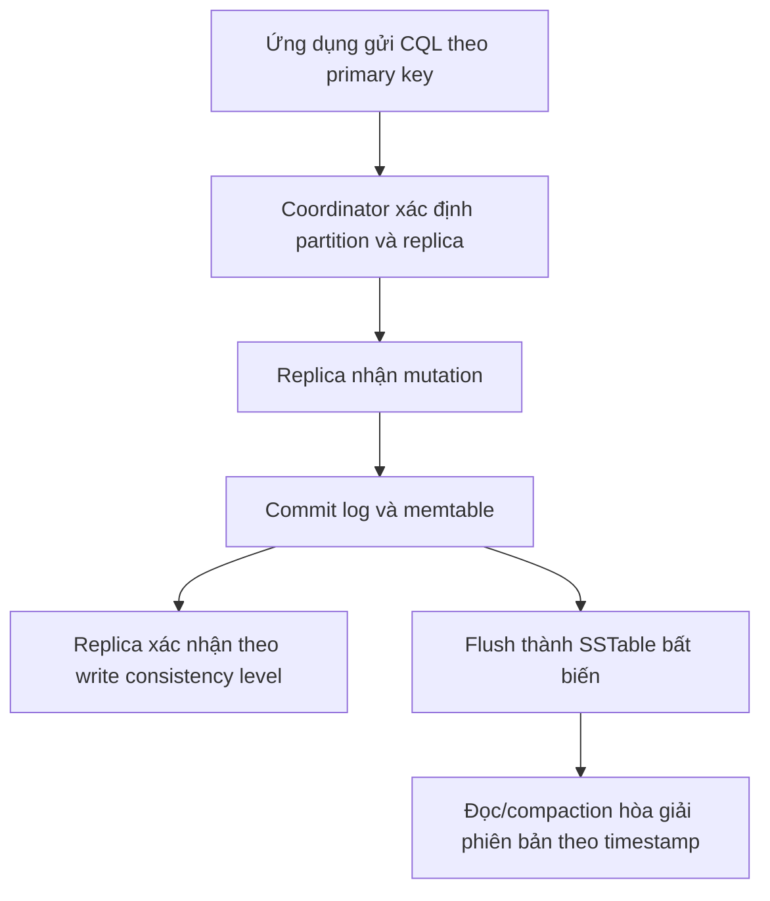

# Ghi dữ liệu không cần đọc trước và giới hạn với thao tác đặc biệt trong Cassandra

Ở nhiều hệ quản trị quan hệ, người lập trình thường hình dung cập nhật theo quy trình: đọc hàng hiện tại, kiểm tra hàng có tồn tại không, thay đổi giá trị rồi ghi kết quả mới. **Apache Cassandra được tối ưu để nhiều thao tác ghi CQL thông thường không cần đọc giá trị cũ trước khi chấp nhận mutation.** Đây là một đặc điểm quan trọng của kiến trúc wide-column phân tán và mô hình lưu trữ kiểu LSM tree, nhưng **không** có nghĩa mọi câu lệnh ghi đều không đọc dữ liệu hoặc mọi phép biến đổi đều an toàn khi chạy đồng thời.

Bài học thuộc chương **Ghi và xóa bằng CQL** của module **DATABASE_ENGINE_WIDE_COLUMN_CASSANDRA**. Nó kết nối cách chọn **partition key**, cơ chế replica và **consistency level** với semantics thực tế của `INSERT`, `UPDATE`, `DELETE`. Trọng tâm là hiểu vì sao **ghi thường không cần read-before-write**, những ngoại lệ như **lightweight transaction (LWT)**, **một số thao tác trên list**, **counter**, và cách ứng dụng Java lựa chọn lệnh ghi cùng chính sách retry phù hợp.

## 1. “Không cần đọc trước” có nghĩa chính xác là gì?

Với một mutation thông thường, Cassandra **không phải truy vấn giá trị cũ của hàng để quyết định có được ghi hay không**. Client cung cấp khóa và giá trị cần ghi; coordinator xác định các replica phụ trách partition key rồi gửi mutation. Replica có thể nhận mutation vào commit log và memtable, sau đó flush thành SSTable mà không cần tìm và sửa trực tiếp phiên bản cũ trên đĩa.

Ví dụ:

```sql
UPDATE demo.customer_settings_by_id
SET locale = 'vi-VN'
WHERE customer_id = 11111111-1111-4111-8111-111111111111;
```

Nếu bảng tồn tại và schema/khóa hợp lệ, `UPDATE` không điều kiện không cần xác định trước hàng này có tồn tại hay chưa:

- **Hàng chưa tồn tại:** mutation có thể tạo một hàng mới chỉ có `locale`.
- **Hàng đã tồn tại:** mutation ghi lại `locale`; các cột thường khác không nằm trong `SET` không bị thao tác này ghi lại.
- **Một replica đang có giá trị khác:** phiên bản nào được nhìn thấy khi đọc phụ thuộc quy tắc hòa giải timestamp và trạng thái các replica.

Đây là **upsert** (insert-or-update) trong CQL, không phải cam kết “chỉ update nếu hàng đã tồn tại”.

### Không phải “Cassandra không bao giờ đọc”

Cụm từ *write without read-before-write* chỉ mô tả **đường ghi phổ biến cho mutation thông thường**, chứ không phủ nhận:

1. Cassandra vẫn phải **đọc** khi phục vụ `SELECT`, xử lý read repair/đối chiếu dữ liệu hoặc những tình huống đặc biệt.
2. Cần có **ghi metadata, xử lý bộ nhớ và dữ liệu lưu trữ** theo thiết kế; chi tiết nội bộ khác nhau theo phiên bản Cassandra.
3. Một số tính năng cần biết trạng thái trước khi thay đổi hoặc cần phối hợp đồng thuận, chẳng hạn **LWT** và các phép sửa **list theo vị trí/giá trị**.
4. Ứng dụng có thể tự đọc trước để xác thực nghiệp vụ; điều đó không biến thao tác `SELECT` rồi `UPDATE` thường thành một giao dịch nguyên tử.

Vì thế, kết luận đúng là: **nhiều mutation CQL được xử lý mà không đọc giá trị cũ**, không phải “mọi câu lệnh Cassandra đều là blind write” hay “không cần xử lý tranh chấp”.

## 2. Một bảng thử nghiệm cho INSERT, UPDATE và DELETE

Giả sử dịch vụ hồ sơ truy vấn cấu hình khách theo `customer_id`. Tất cả câu lệnh trong bài được minh họa trên keyspace `demo`, giả định đã được tạo trước trên môi trường thử nghiệm:

```sql
CREATE TABLE demo.customer_settings_by_id (
    customer_id uuid PRIMARY KEY,
    display_name text,
    locale text,
    phone text,
    marketing_opt_in boolean,
    revision int,
    modified_at timestamp
);
```

`customer_id` là **full primary key** và **partition key**. Với bảng này, một mutation định vị hàng bằng UUID; không phải tìm toàn bảng theo các cột `display_name` hoặc `locale`. Khi schema có clustering key, muốn ghi regular column vào một hàng cần cung cấp các thành phần khóa định danh hàng theo quy tắc CQL.

Tạo hàng ban đầu:

```sql
INSERT INTO demo.customer_settings_by_id (
    customer_id, display_name, locale, phone, marketing_opt_in, revision
)
VALUES (
    11111111-1111-4111-8111-111111111111,
    'Ngọc',
    'vi-VN',
    '0900000001',
    false,
    1
);

SELECT customer_id, display_name, locale, phone,
       marketing_opt_in, revision
FROM demo.customer_settings_by_id
WHERE customer_id = 11111111-1111-4111-8111-111111111111;
```

Các ví dụ sau giả định không có writer khác, không có TTL mặc định hoặc timestamp tùy chỉnh khiến một mutation mới thua phiên bản cũ. Nếu chạy độc lập từng ví dụ, hãy khởi tạo lại dữ liệu thử nghiệm khi cần.

## 3. Các mutation thông thường không cần đọc giá trị cũ

### 3.1. INSERT không điều kiện là upsert

Chạy lại `INSERT` với **cùng primary key**:

```sql
INSERT INTO demo.customer_settings_by_id (
    customer_id, locale
)
VALUES (
    11111111-1111-4111-8111-111111111111,
    'en-US'
);
```

Điều xảy ra:

- Cassandra không cần thực hiện `SELECT` trước để phát hiện “khóa bị trùng”.
- `locale` được ghi với giá trị mới `'en-US'`.
- `display_name`, `phone`, `marketing_opt_in` và `revision` không bị mutation này xóa chỉ vì chúng vắng mặt trong danh sách cột.
- Không tạo hai hàng riêng biệt cho cùng một full primary key.

Không nên diễn giải `INSERT` thành “chỉ được tạo mới”. Nếu nghiệp vụ phải phát hiện trùng khóa, cần `IF NOT EXISTS` (xem phần 5).

### 3.2. UPDATE vào khóa chưa từng có

```sql
UPDATE demo.customer_settings_by_id
SET locale = 'ja-JP'
WHERE customer_id = 22222222-2222-4222-8222-222222222222;

SELECT customer_id, display_name, locale, phone
FROM demo.customer_settings_by_id
WHERE customer_id = 22222222-2222-4222-8222-222222222222;
```

Khi mutation được áp dụng, Cassandra có thể trả một hàng với `locale = 'ja-JP'` và các regular column chưa được ghi đọc là `null`. Không có điều kiện ngầm “hàng phải tồn tại” chỉ vì dùng từ khóa `UPDATE`.

### 3.3. Cập nhật một phần cột

```sql
UPDATE demo.customer_settings_by_id
SET phone = '0900000099'
WHERE customer_id = 11111111-1111-4111-8111-111111111111;
```

Lệnh này không phải tải cả hàng về, thay trường `phone` trong bộ nhớ Java rồi ghi lại **toàn bộ** hàng. Cassandra nhận mutation cho `phone` và xử lý nó độc lập với các cột thường không được gửi. Nhờ vậy, một bản cập nhật nhỏ không phải chạm vào mọi trường của hồ sơ.

Đừng nhầm **cột không xuất hiện trong CQL** với **cột được gửi bằng NULL**:

```sql
-- Không ghi lại phone:
UPDATE demo.customer_settings_by_id
SET locale = 'fr-FR'
WHERE customer_id = 11111111-1111-4111-8111-111111111111;

-- Yêu cầu xóa phone:
UPDATE demo.customer_settings_by_id
SET phone = NULL
WHERE customer_id = 11111111-1111-4111-8111-111111111111;
```

`NULL` trong mutation của cột thường tạo thông tin xóa (*tombstone*); trường bị bỏ qua hoặc marker `UNSET` trong prepared statement **không** tạo mutation cho cột đó.

### 3.4. DELETE cũng không cần kiểm tra trước cột có tồn tại

```sql
DELETE phone
FROM demo.customer_settings_by_id
WHERE customer_id = 11111111-1111-4111-8111-111111111111;
```

DELETE thông thường không bắt buộc đọc giá trị `phone` rồi mới xóa. Nó tạo dấu xóa cho phạm vi cột được chỉ định. Vì các SSTable bất biến và các replica có thể tạm lệch nhau, tombstone cho phép Cassandra che phiên bản cũ hơn trong các lần đọc/hòa giải.

Tương tự, xóa một khóa chưa có dữ liệu **không phải** một thao tác trả số hàng đã xóa như SQL quan hệ. Cassandra không mặc định đảm bảo “hàng đã tồn tại trước DELETE” hoặc “đã xóa đúng một hàng”.

### Bảng tóm tắt

| Mutation CQL không điều kiện | Có phải đọc giá trị cũ trước khi nhận mutation thông thường? | Hệ quả |
| --- | --- | --- |
| `INSERT ... VALUES (...)` | Không | Upsert theo khóa, không tự báo trùng |
| `UPDATE ... SET col = value` | Không | Có thể tạo hàng mới, không chỉ sửa hàng đã có |
| `UPDATE ... SET col = NULL` | Không | Ghi dấu xóa cho cột |
| `DELETE col ... WHERE full_key` | Không | Ghi dấu xóa cột |
| `DELETE FROM ... WHERE full_key` | Không | Ghi dấu xóa hàng/phân vùng tùy khóa |
| `INSERT ... IF NOT EXISTS` | **Có điều kiện/đồng thuận** | Không còn là blind upsert thông thường |
| `UPDATE ... IF ...` | **Có điều kiện/đồng thuận** | Phải kiểm tra trạng thái trước khi áp dụng |

## 4. Vì sao Cassandra có thể làm vậy? Nhìn vào write path

Một hệ thống LSM như Cassandra không cần “mở bản ghi cũ, sửa tại chỗ, ghi lại trên cùng trang đĩa” cho mỗi cập nhật. Thay vào đó, mutation mới được ghi vào đường lưu trữ và được đối chiếu với các phiên bản khác khi đọc hoặc khi các cấu trúc lưu trữ được hợp nhất.



Sơ đồ tóm tắt các vai trò logic, không phải lời khẳng định mỗi thao tác flush hoặc compaction phải hoàn thành trước khi trả lời client. Trình tự xử lý thực tế và các đường đi đặc biệt phụ thuộc phiên bản/configuration.

### Các thành phần cốt lõi

1. **Partition key** được dùng để xác định token, từ đó coordinator liên hệ các replica lưu phân vùng theo chiến lược replication của keyspace.
2. **Commit log** ghi thông tin phục vụ phục hồi sau sự cố; **memtable** tiếp nhận mutation trong bộ nhớ.
3. **SSTable** là cấu trúc lưu trữ bất biến được tạo khi flush. Cập nhật mới không phải chỉnh sửa trực tiếp SSTable cũ.
4. **Write timestamp** được dùng để hòa giải giá trị cạnh tranh. Với các regular cell, phiên bản mang timestamp lớn hơn thường được ưu tiên (*last-write-wins*).
5. **Compaction, repair và đọc** xử lý các phiên bản khác nhau ở SSTable và replica theo cơ chế tương ứng; tombstone giữ thông tin xóa cho các phiên bản cũ.

### Không read-before-write đem lại những lợi ích nào?

- **Đường ghi phổ biến ngắn hơn:** không phải thực hiện một lần truy vấn hàng cũ trước mỗi mutation.
- **Ghi một vài cột độc lập:** không cần tải toàn bộ hàng rồi viết lại các cột không đổi.
- **Phù hợp nhiều replica:** coordinator gửi mutation theo khóa đến các replica phụ trách; không cần khóa toàn cục cho mỗi ghi thông thường.
- **Tăng thông lượng ghi tuần tự:** commit log/memtable và mô hình SSTable bất biến phù hợp tải ghi lớn.

Nhưng đổi lại, hệ thống **không tự bảo vệ bất biến nghiệp vụ** như “email phải duy nhất”, “tài khoản phải tồn tại trước khi sửa”, “chỉ trừ tiền nếu số dư đủ” hoặc “thứ tự thao tác client A rồi B luôn quyết định phiên bản cuối”. Các yêu cầu này cần mô hình dữ liệu và cơ chế điều kiện riêng.

### Timestamp không đồng nghĩa thứ tự request

```text
Client A ghi locale = 'en-US' với timestamp = 2000000
Client B ghi locale = 'vi-VN' với timestamp = 1000000

Sau khi replica hội tụ, giá trị của A thắng theo timestamp,
ngay cả khi B được gửi sau ở thời gian thực.
```

Đơn vị timestamp ghi của Cassandra là **microsecond tính từ Unix epoch**. Các số trên chỉ để so sánh thứ tự. Đồng hồ lệch hoặc timestamp do ứng dụng tự gán có thể khiến mutation tưởng là “mới” không thắng mutation cũ. Khi các timestamp bằng nhau, Cassandra có quy tắc hòa giải bổ sung; không nên dựa vào trường hợp đó để điều khiển nghiệp vụ.

## 5. Ngoại lệ thứ nhất: Lightweight Transaction phải xét trạng thái cũ

Khi nghiệp vụ yêu cầu **“chỉ ghi nếu ...”**, Cassandra không thể quyết định bằng một blind upsert đơn giản. CQL cung cấp cơ chế **lightweight transaction (LWT)** cho các mutation có điều kiện, sử dụng giao thức đồng thuận kiểu Paxos giữa các replica liên quan.

### 5.1. INSERT chỉ khi khóa chưa tồn tại

```sql
INSERT INTO demo.customer_settings_by_id (
    customer_id, display_name, locale, revision
)
VALUES (
    33333333-3333-4333-8333-333333333333,
    'Minh',
    'vi-VN',
    1
)
IF NOT EXISTS;
```

Nếu chưa có hàng tại khóa đó, lệnh có thể được áp dụng. Nếu đã tồn tại, điều kiện thất bại và **không được ghi đè** hàng cũ. Kết quả có cột `[applied]` để client kiểm tra:

| `[applied]` | Cách hiểu |
| --- | --- |
| `true` | Điều kiện tạo mới được thỏa; mutation được áp dụng |
| `false` | Khóa đã có dữ liệu khiến điều kiện không thỏa; xử lý theo hợp đồng nghiệp vụ |

Đây là khác biệt cốt lõi giữa `INSERT` thường (upsert) và `INSERT ... IF NOT EXISTS` (tạo mới có kiểm tra tồn tại). LWT không tương đương với việc client `SELECT` trước rồi `INSERT` thường: quy trình hai bước có khoảng trống tranh chấp giữa lần đọc và lần ghi.

### 5.2. UPDATE chỉ khi hàng đang tồn tại

```sql
UPDATE demo.customer_settings_by_id
SET phone = '0911111111'
WHERE customer_id = 33333333-3333-4333-8333-333333333333
IF EXISTS;
```

Nếu khóa chưa tồn tại, câu lệnh **không tạo hàng thưa** như `UPDATE` không điều kiện. Đây là lựa chọn khi API có ý nghĩa “chỉ sửa tài nguyên đã có”, nhưng cần chấp nhận độ trễ/chi phí đồng thuận cao hơn.

### 5.3. Compare-and-set với revision

Một ứng dụng có thể dùng cột `revision` để phát hiện yêu cầu cập nhật dựa trên phiên bản cũ:

```sql
UPDATE demo.customer_settings_by_id
SET locale = 'en-US',
    revision = 2
WHERE customer_id = 11111111-1111-4111-8111-111111111111
IF revision = 1;
```

Nếu `revision` còn là `1` khi LWT xét điều kiện, thao tác có thể thành công. Yêu cầu khác vẫn đòi `revision = 1` sẽ nhận `[applied] = false` sau khi phiên bản thành `2`. Ứng dụng nên coi đó là **xung đột trạng thái** và yêu cầu client tải lại dữ liệu hoặc xử lý lại tác vụ, thay vì lặp lại vô hạn.

**Cẩn thận:** riêng việc thêm cột `revision` không làm CQL thường trở thành compare-and-set. Chỉ một lệnh có `IF` phù hợp mới kiểm tra được điều kiện này; một client khác ghi thường vào cùng dữ liệu vẫn có thể gây tranh chấp nếu hệ thống trộn các giao thức ghi mà không có quy ước nhất quán.

### 5.4. LWT không phải đọc toàn bảng

LWT vẫn được định vị bằng **partition key**, không phải tìm kiếm tùy ý theo mọi regular column. CQL điều kiện cho phép so sánh dữ liệu liên quan đến hàng/partition đã xác định và yêu cầu điều phối giữa các replica; nó không biến Cassandra thành hệ quản trị hỗ trợ mọi giao dịch SQL tùy ý.

| Loại thao tác | Đặc tính |
| --- | --- |
| `UPDATE ... SET locale = 'en-US'` | Mutation thông thường, không kiểm tra giá trị cũ |
| `UPDATE ... IF EXISTS` | Kiểm tra điều kiện tồn tại qua cơ chế LWT |
| `UPDATE ... IF revision = 1` | Compare-and-set có điều kiện trên trạng thái cũ |
| `INSERT ... IF NOT EXISTS` | Tạo mới có điều kiện, tránh ghi đè trùng khóa |

LWT có **serial consistency level** như `SERIAL` hoặc `LOCAL_SERIAL` bên cạnh consistency level thông thường của thao tác. Chọn chúng theo mô hình replication, topology và yêu cầu nhất quán; `ONE` hay `QUORUM` của ghi thường **không thay thế** điều kiện của LWT.

## 6. Ngoại lệ thứ hai: một số thao tác LIST cần read-before-write

Collection `map`, `set`, `list` cho phép nhiều cách cập nhật khác nhau. Không phải mọi thao tác trên collection đều cần đọc giá trị cũ. Với map và set không `frozen`, thay đổi một khóa/phần tử có thể thực hiện bằng mutation tương ứng. Với **list**, đặc biệt các thao tác dựa vào **vị trí** hoặc **giá trị hiện có**, Cassandra có thể phải đọc danh sách hiện tại để xác định phần tử thực sự cần thay đổi.

### 6.1. Bảng list thử nghiệm

```sql
CREATE TABLE demo.steps_by_task (
    task_id uuid PRIMARY KEY,
    steps list<text>,
    flags set<text>,
    metadata map<text, text>
);

INSERT INTO demo.steps_by_task (task_id, steps, flags, metadata)
VALUES (
    aaaaaaaa-aaaa-4aaa-8aaa-aaaaaaaaaaaa,
    ['open', 'validate', 'submit'],
    {'started'},
    {'source': 'web'}
);
```

### 6.2. Append list và sự khác biệt với cập nhật theo chỉ số

Nối phần tử vào cuối list:

```sql
UPDATE demo.steps_by_task
SET steps = steps + ['notify']
WHERE task_id = aaaaaaaa-aaaa-4aaa-8aaa-aaaaaaaaaaaa;
```

Thao tác thêm list theo cách này không cần ứng dụng đọc toàn bộ giá trị cũ rồi gửi lại một list mới. Tuy nhiên, **append không phải một phép ghi idempotent theo nghĩa “retry bao nhiêu lần cũng chỉ thêm một phần tử”**. Nếu gửi lại sau timeout, danh sách có thể chứa `'notify'` hai lần.

Sửa phần tử ở chỉ số 1:

```sql
UPDATE demo.steps_by_task
SET steps[1] = 'verify'
WHERE task_id = aaaaaaaa-aaaa-4aaa-8aaa-aaaaaaaaaaaa;
```

Xóa phần tử tại chỉ số 0:

```sql
DELETE steps[0]
FROM demo.steps_by_task
WHERE task_id = aaaaaaaa-aaaa-4aaa-8aaa-aaaaaaaaaaaa;
```

Các phép sửa/xóa **theo index** đòi biết phần tử nào hiện nằm ở vị trí đó; Cassandra cần tra cứu trạng thái list phù hợp để xác định phần tử. Điều này khác với cập nhật cell scalar ở full primary key đã biết sẵn.

### 6.3. Xóa list theo giá trị

```sql
UPDATE demo.steps_by_task
SET steps = steps - ['validate']
WHERE task_id = aaaaaaaa-aaaa-4aaa-8aaa-aaaaaaaaaaaa;
```

Khi cần loại một giá trị khỏi list, Cassandra phải xác định phần tử hiện có phù hợp với giá trị đó. Đây là loại thao tác có **read-before-write** nội bộ trong Cassandra, không phải blind mutation đơn giản theo một khóa phần tử đã biết.

### 6.4. Prepend và chi phí/khả năng retry

```sql
UPDATE demo.steps_by_task
SET steps = ['created'] + steps
WHERE task_id = aaaaaaaa-aaaa-4aaa-8aaa-aaaaaaaaaaaa;
```

Thêm vào **đầu list** được hỗ trợ nhưng có chi phí quản lý thứ tự và đặc tính retry/concurrency khác với scalar upsert. Không nên kết luận mọi phép thao tác list đều có cùng chi phí nội bộ, hoặc tự động đánh dấu chúng idempotent chỉ vì dùng `UPDATE`. Trong tải nhiều writer, một list tăng liên tục thường là lựa chọn kém so với bảng sự kiện có clustering key riêng.

### 6.5. So sánh với MAP và SET

```sql
-- Ghi một entry của map không frozen:
UPDATE demo.steps_by_task
SET metadata['source'] = 'mobile'
WHERE task_id = aaaaaaaa-aaaa-4aaa-8aaa-aaaaaaaaaaaa;

-- Thêm một phần tử vào set không frozen:
UPDATE demo.steps_by_task
SET flags = flags + {'verified'}
WHERE task_id = aaaaaaaa-aaaa-4aaa-8aaa-aaaaaaaaaaaa;
```

Với map, khóa `'source'` xác định entry; với set, giá trị `'verified'` xác định phần tử. Cassandra có thể biểu diễn các mutation này mà không phải tải toàn bộ collection hiện có để tính kết quả. **Không đồng nhất việc “có biểu thức `col = col + ...`” với một phép đọc toàn bộ cột rồi ghi lại**; cơ chế phụ thuộc loại collection và phép toán.

| CQL điển hình | Cần phụ thuộc trạng thái list đang có? | Điểm cần lưu ý |
| --- | --- | --- |
| `SET metadata['source'] = 'mobile'` | Không phải thao tác list | Cập nhật entry map |
| `SET flags = flags + {'verified'}` | Không phải thao tác list | Thêm phần tử set, không tạo phần tử trùng |
| `SET steps = steps + ['notify']` | Không cần truy xuất theo index | Append có thể bị lặp khi retry |
| `SET steps[1] = 'verify'` | **Có** | Cần xác định phần tử ở index 1 |
| `DELETE steps[0]` | **Có** | Cần xác định phần tử ở index 0 |
| `SET steps = steps - ['validate']` | **Có** | Cần tìm các phần tử theo giá trị |

**Race condition quan trọng:** giả sử client A định sửa `steps[1]`, client B đồng thời xóa `steps[0]`. Tùy thứ tự thực thi/đọc trạng thái, chỉ số `1` có thể trỏ tới phần tử khác với dự kiến của A. Nếu yêu cầu nghiệp vụ cần cập nhật sự kiện theo một ID bền vững, **đừng dùng chỉ số list làm định danh**; thiết kế một bảng có full primary key cho sự kiện.

## 7. Ngoại lệ thứ ba: COUNTER là loại dữ liệu và đường ghi đặc biệt

Một yêu cầu phổ biến là “tăng số lượt truy cập thêm 1”. Với một cột scalar thông thường như `revision int`, Cassandra không cung cấp phép SQL-style `SET revision = revision + 1` như một mutation blind write thông thường. `Counter` là một kiểu dữ liệu đặc biệt dành cho phép cộng dồn.

Tạo bảng counter **riêng biệt**:

```sql
CREATE TABLE demo.api_invocations_by_service_day (
    service_id text,
    event_day date,
    total counter,
    PRIMARY KEY (service_id, event_day)
);
```

Tăng bộ đếm:

```sql
UPDATE demo.api_invocations_by_service_day
SET total = total + 1
WHERE service_id = 'billing'
  AND event_day = '2026-11-21';

SELECT total
FROM demo.api_invocations_by_service_day
WHERE service_id = 'billing'
  AND event_day = '2026-11-21';
```

Thực hiện lại cùng câu `UPDATE` sẽ **tăng thêm một lần nữa** nếu cả hai mutation đều được áp dụng. Đây là điểm khác với việc đặt `locale = 'en-US'`: cùng một giá trị được ghi lại không mang ý định cộng dồn.

### Counter không phải scalar last-write-wins thông thường

Counter có đường ghi và cơ chế hòa giải chuyên biệt để hỗ trợ cộng/trừ; không thể mô tả nó đơn giản là “đặt một giá trị scalar mới với timestamp cao hơn”. Việc xử lý counter có thể cần phối hợp/truy cập trạng thái nội bộ của Cassandra tùy phiên bản và bộ nhớ đệm counter; **không suy rộng tối ưu hóa no-read-before-write của scalar thường cho counter**.

Các giới hạn quan trọng:

- Bảng counter có những ràng buộc schema riêng: các cột không thuộc primary key trong bảng counter phải là counter; không trộn tùy ý `text` hoặc `int` regular column vào cùng bảng counter.
- Không dùng `INSERT ... VALUES` để đặt trực tiếp một giá trị counter như với cột thường; thay đổi bằng `UPDATE ... SET counter = counter + n` hoặc phép trừ phù hợp.
- Counter không hỗ trợ TTL hay timestamp ghi tự chỉ định như cột scalar thường, và không dùng LWT `IF` cho mutation counter theo cách áp dụng với cột thường.
- **Ghi counter không idempotent**: timeout không chứng minh mutation không đến replica; tự động retry có thể làm đếm thêm lần nữa.
- Counter phù hợp khi số liệu có thể chịu semantics cộng dồn và chính sách xử lý lỗi đã được thiết kế; nó không phù hợp khi cần bảo đảm “đúng một lần” cho giao dịch tài chính hoặc một sự kiện cần đếm chính xác tuyệt đối.

### Thiết kế thay thế nếu phải bảo đảm mỗi sự kiện chỉ được tính một lần

Thay vì chỉ tăng counter theo số lần request tới API, có thể lưu mỗi sự kiện với **event ID ổn định** trong một bảng theo truy vấn, rồi xây dựng bước tổng hợp có kiểm soát. Ví dụ một sự kiện thanh toán được định danh bởi `payment_id`; gửi lại cùng request không nên tạo sự kiện thứ hai. Nếu hệ thống yêu cầu bất biến mạnh trên mỗi event, dùng một cơ chế ghi duy nhất/đồng thuận hoặc quy trình idempotency được thiết kế từ đầu.

Đó là yêu cầu **nghiệp vụ**, không phải một tính năng tự có chỉ vì Cassandra hỗ trợ counter.

## 8. Đâu là giới hạn của blind write?

Không đọc trước giúp ghi hiệu quả, nhưng cũng buộc nhà phát triển làm rõ **ý định mutation**. Các lỗi dưới đây không được Cassandra tự ngăn bởi một `INSERT`/`UPDATE` thường.

| Mong muốn của lập trình viên | Điều thực sự xảy ra với mutation thường | Cách xử lý |
| --- | --- | --- |
| `INSERT` phải báo lỗi nếu UUID đã tồn tại | `INSERT` mặc định upsert cùng khóa | `IF NOT EXISTS` khi phải kiểm tra |
| `UPDATE` không được tạo hàng mới | `UPDATE` có thể tạo hàng thưa | `IF EXISTS` nếu cần ràng buộc |
| Gửi một trường là thay toàn bộ object | Chỉ cột được nhắc tới bị ghi | Định nghĩa rõ PATCH/PUT và các trường thiếu |
| `NULL` nghĩa là “không sửa” | `NULL` đối với cột thường là dấu xóa | Dùng `UNSET`/bỏ cột nếu muốn no-op |
| Đọc revision rồi ghi theo revision cũ là an toàn | Client khác có thể ghi giữa SELECT và UPDATE | `UPDATE ... IF revision = old` |
| Có thể tăng `int` bằng `SET x = x + 1` giống SQL | Regular scalar không có semantics increment này | Counter hoặc mô hình dữ liệu/quy trình khác |
| Retry một lần append list là vô hại | Có thể thêm phần tử lặp | Tách mỗi sự kiện thành hàng có ID ổn định |
| Counter tăng đúng một lần khi retry | Counter có thể được cộng lại | Thiết kế idempotency hoặc không retry mù quáng |
| `QUORUM` bảo đảm điều kiện ứng dụng | QUORUM kiểm soát xác nhận replica, không tự so sánh giá trị cũ | LWT và mô hình nghiệp vụ phù hợp |

### Không cần đọc trước không có nghĩa thao tác nhiều cột là giao dịch tùy ý

Một mutation cập nhật nhiều cột của cùng hàng có đặc tính nguyên tử ở phạm vi dữ liệu Cassandra hỗ trợ, nhưng **không** vì thế mà một luồng gồm `SELECT`, tính toán Java, rồi nhiều `UPDATE` trên nhiều partition trở thành giao dịch phân tán có isolation kiểu SQL. Trạng thái ở các replica cũng có thể được quan sát khác nhau trước khi hội tụ tùy consistency.

`BATCH` là một công cụ CQL riêng giúp nhóm nhiều mutation theo các semantics được hỗ trợ (ví dụ logged batch đảm bảo các mutation được gửi đi theo tính chất atomicity của batch), nhưng **không phải nút tăng tốc ghi hàng loạt** hay giải pháp tổng quát cho read-modify-write/isolated transaction trên nhiều partition. Đặc biệt, một batch lớn trải trên nhiều partition có thể làm tăng chi phí phối hợp.

### Sự khác nhau giữa idempotency ở tầng nghiệp vụ và tầng câu lệnh

Một lệnh `SET locale = 'en-US'` được chạy hai lần có thể cho **cùng trạng thái logic mong muốn** nếu không có writer khác. Nhưng hai lần ghi có thể dùng timestamp khác nhau và gây tác động khác khi xảy ra cạnh tranh. Một lệnh có TTL cũng có thể thay đổi thời hạn hết hạn nếu thực hiện lại vào thời điểm khác.

Vì vậy, nên phân biệt:

- **Idempotent về kết quả mong muốn:** lặp lại thao tác không tạo thêm hiệu ứng nghiệp vụ, ví dụ đặt một cờ thành `true`.
- **Idempotent với concurrent writes/TTL/timestamp:** cần xét thứ tự phiên bản, TTL, điều kiện và dữ liệu từ client khác; không phải tự động được bảo đảm cho mọi phép `SET`.
- **Không idempotent:** cộng counter, append vào list, hoặc tạo sự kiện bằng UUID mới ở mỗi retry.

Khi một ứng dụng cần **exactly-once business effect**, phải thiết kế idempotency key, định danh tài nguyên ổn định và cơ chế xử lý trạng thái phù hợp; không thể chỉ đặt consistency level cao rồi bỏ qua khả năng retry.

## 9. Consistency level không biến upsert thành compare-and-set

Giả sử keyspace có **replication factor 3**:

- Một mutation thường ở `ONE` có thể được xác nhận sau ít replica hơn, thuận lợi cho độ trễ/sẵn sàng nhưng đặt ra yêu cầu đọc/hội tụ phù hợp.
- Một mutation thường ở `QUORUM` yêu cầu đủ số replica của quorum (với RF=3, thông thường là 2). Mức xác nhận cao hơn không thay đổi ý nghĩa của câu `UPDATE`.
- Đọc và ghi ở các mức thích hợp, như quorum trong mô hình replication phù hợp, có thể tăng khả năng quan sát phiên bản mới nhất đã được xác nhận; vẫn phải xem xét ghi đồng thời, lỗi mạng và timestamp.
- Một câu `INSERT ... IF NOT EXISTS` hay `UPDATE ... IF ...` dùng **LWT**, tức cần thêm pha đồng thuận/kiểm tra điều kiện. Nó không tương đương với upsert thường ở `QUORUM`.

Trong `cqlsh`, có thể đặt consistency level của phiên làm việc:

```sql
CONSISTENCY QUORUM;

UPDATE demo.customer_settings_by_id
SET locale = 'vi-VN'
WHERE customer_id = 11111111-1111-4111-8111-111111111111;
```

Lệnh ở trên vẫn là **UPDATE không điều kiện**. Nếu muốn cập nhật chỉ khi `revision = 2`, phải viết điều kiện `IF revision = 2` trong CQL và kiểm tra `[applied]`. Không có mức xác nhận replica nào tự suy ra điều kiện nghiệp vụ từ các cột thường.

### Timeout không chứng minh mutation thất bại hoàn toàn

Trong hệ thống phân tán, coordinator có thể không nhận đủ xác nhận trước timeout dù một số replica đã ghi mutation. Ứng dụng Java cần xử lý **kết quả không chắc chắn**:

1. Không chuyển ngay mọi timeout thành “ghi thất bại chắc chắn”.
2. Xem thao tác có thể được gửi lại an toàn không (counter/list append thường **không**).
3. Với LWT hoặc mutation mang bất biến nghiệp vụ, kiểm tra trạng thái hiện tại và idempotency key trước khi quyết định lại.
4. Dùng retry policy của driver theo loại statement và lỗi thực tế; tránh “bất cứ lỗi nào cũng retry ba lần” khi semantics không cho phép.

## 10. Java Driver: biểu diễn đúng ý định ghi và khả năng retry

Đoạn mã sau minh họa **Apache Cassandra Java Driver 4.x**, giả định đã có `CqlSession session` được cấu hình phù hợp với keyspace `demo` và `UUID customerId` hợp lệ. Các import của driver, `java.util.UUID` và kiểm tra input được lược bỏ để tập trung vào semantics.

### 10.1. Mutation thông thường: đặt một giá trị xác định

```java
PreparedStatement updateLocale = session.prepare(
    "UPDATE demo.customer_settings_by_id " +
    "SET locale = :locale " +
    "WHERE customer_id = :customer_id"
);

BoundStatement setLocale = updateLocale.boundStatementBuilder()
    .setUuid("customer_id", customerId)
    .setString("locale", "en-US")
    .setIdempotent(true)
    .build();

session.execute(setLocale);
```

`setIdempotent(true)` là **khai báo của ứng dụng với driver** về việc có thể xem statement là idempotent cho mục đích xử lý retry; nó không thay đổi CQL, không kích hoạt LWT và không tạo cam kết nghiệp vụ “không bao giờ ghi đè mutation của client khác”. Trong môi trường có TTL hoặc nhiều writer cùng cột, đánh giá kỹ trước khi đánh dấu idempotent.

Lệnh trên chỉ ghi `locale`, không đọc toàn bộ hàng từ Java rồi ghi lại các trường khác. Nếu API là PATCH, các trường không xuất hiện trong request phải được bỏ qua hoặc bind `UNSET`, không tự động chuyển thành `NULL`.

### 10.2. LWT: ứng dụng phải đọc kết quả điều kiện

```java
PreparedStatement createOnly = session.prepare(
    "INSERT INTO demo.customer_settings_by_id " +
    "(customer_id, display_name, locale, revision) " +
    "VALUES (?, ?, ?, ?) IF NOT EXISTS"
);

ResultSet created = session.execute(createOnly.bind(
    customerId, "Minh", "vi-VN", 1
));

if (created.wasApplied()) {
    // Tao moi thanh cong.
} else {
    // Tai nguyen da ton tai: xu ly trung khoa (vi du HTTP 409).
}
```

Không lấy `execute(...)` trả về không có exception làm bằng chứng rằng điều kiện đã thành công. Với LWT, một lần gọi CQL hoàn thành bình thường vẫn có thể trả `[applied] = false`; đó là **kết quả hợp lệ** của thao tác có điều kiện.

### 10.3. Append vào list: không mặc định cho retry

```java
PreparedStatement appendStep = session.prepare(
    "UPDATE demo.steps_by_task " +
    "SET steps = steps + :new_steps " +
    "WHERE task_id = :task_id"
);

BoundStatement append = appendStep.boundStatementBuilder()
    .setUuid("task_id", taskId)
    .setList("new_steps", java.util.List.of("notify"), String.class)
    .setIdempotent(false)
    .build();

session.execute(append);
```

Nếu driver/ứng dụng tự gửi lại thao tác sau timeout, cùng phần tử có thể được thêm lần hai. Chỉ định `setIdempotent(false)` giúp diễn đạt rằng câu lệnh **không nên được retry như một phép đặt giá trị idempotent**. Điều này không tự giải quyết mọi lỗi mạng; ứng dụng vẫn cần chọn cách trả lời client và cơ chế chống trùng khi nghiệp vụ yêu cầu.

### 10.4. Counter: một lần cộng là một hiệu ứng

```java
PreparedStatement increment = session.prepare(
    "UPDATE demo.api_invocations_by_service_day " +
    "SET total = total + 1 " +
    "WHERE service_id = ? AND event_day = ?"
);

BoundStatement countRequest = increment.boundStatementBuilder()
    .setString(0, "billing")
    .setLocalDate(1, java.time.LocalDate.of(2026, 11, 21))
    .setIdempotent(false)
    .build();

session.execute(countRequest);
```

Ở đây thao tác **cộng 1** không tương đương “đặt total bằng một giá trị xác định”. Nếu thành công rồi bị timeout khi trả phản hồi, việc gửi lại có thể cộng thêm. Đừng dùng counter CQL để thay thế cơ chế chống xử lý trùng cho những giao dịch bắt buộc chính xác một lần.

### 10.5. Khi cần tăng một cột int thông thường

Giả sử `revision` là một cột `int` trong bảng `customer_settings_by_id`. Không thể đơn giản viết:

```sql
-- SAI với cột int thường: counter increment không áp dụng cho int.
UPDATE demo.customer_settings_by_id
SET revision = revision + 1
WHERE customer_id = 11111111-1111-4111-8111-111111111111;
```

Nếu `revision` dùng làm số phiên bản chống ghi đè, ứng dụng có thể đọc phiên bản hiện tại rồi gửi **giá trị kế tiếp kèm LWT**:

```sql
-- Giả sử ứng dụng đã biết revision hiện tại là 2.
UPDATE demo.customer_settings_by_id
SET revision = 3,
    locale = 'de-DE'
WHERE customer_id = 11111111-1111-4111-8111-111111111111
IF revision = 2;
```

Nếu có client khác đã đổi revision, `[applied] = false`. Việc **đọc trước ở tầng ứng dụng** không tự ngăn race condition; chính `IF` là phần quyết định có chấp nhận mutation hay không trong một lần kiểm tra có đồng thuận.

## 11. Bài thực hành: dự đoán hành vi trước khi chạy

Chạy trên môi trường thử nghiệm, chỉ với các bảng đã tạo ở các phần trước. Mỗi bước dùng UUID hoặc khóa riêng để không làm thay đổi dữ liệu mẫu chính. Trước khi chạy, hãy dự đoán liệu Cassandra có cần đọc giá trị cũ hay không, và việc retry có làm thay đổi ý nghĩa nghiệp vụ không.

### Bước 1 — UPDATE chưa có hàng

```sql
UPDATE demo.customer_settings_by_id
SET locale = 'ko-KR'
WHERE customer_id = 44444444-4444-4444-8444-444444444444;

SELECT customer_id, display_name, locale, phone, revision
FROM demo.customer_settings_by_id
WHERE customer_id = 44444444-4444-4444-8444-444444444444;
```

**Dự đoán:** một hàng có `locale = 'ko-KR'` xuất hiện, các regular column khác chưa ghi đọc là `null`. Không cần `SELECT` trước để xác định hàng có tồn tại.

### Bước 2 — INSERT ở cùng khóa

```sql
INSERT INTO demo.customer_settings_by_id (
    customer_id, display_name
)
VALUES (
    44444444-4444-4444-8444-444444444444,
    'Phương'
);

SELECT display_name, locale, phone
FROM demo.customer_settings_by_id
WHERE customer_id = 44444444-4444-4444-8444-444444444444;
```

**Dự đoán:** `display_name = 'Phương'`, `locale = 'ko-KR'` và `phone = null`. `INSERT` không xóa locale cũ chỉ vì không ghi lại nó.

### Bước 3 — Thử tạo trùng với IF NOT EXISTS

```sql
INSERT INTO demo.customer_settings_by_id (
    customer_id, display_name, locale
)
VALUES (
    44444444-4444-4444-8444-444444444444,
    'Tên không được ghi',
    'en-US'
)
IF NOT EXISTS;
```

**Dự đoán:** `[applied] = false` và dữ liệu của `4444...` giữ nguyên. Đây không phải hành vi của `INSERT` thường ở bước 2.

### Bước 4 — LWT với revision

```sql
UPDATE demo.customer_settings_by_id
SET revision = 1
WHERE customer_id = 44444444-4444-4444-8444-444444444444;

UPDATE demo.customer_settings_by_id
SET locale = 'en-US', revision = 2
WHERE customer_id = 44444444-4444-4444-8444-444444444444
IF revision = 1;

-- Gửi lại điều kiện cũ:
UPDATE demo.customer_settings_by_id
SET locale = 'fr-FR', revision = 2
WHERE customer_id = 44444444-4444-4444-8444-444444444444
IF revision = 1;
```

**Dự đoán:** câu điều kiện đầu tiên thành công với `[applied] = true`, câu thứ hai bị từ chối với `[applied] = false`, nên locale không bị lệnh cuối đổi thành `fr-FR`. Điều kiện giúp phát hiện trạng thái cũ đã thay đổi.

### Bước 5 — Append list có thể lặp khi chạy lại

```sql
INSERT INTO demo.steps_by_task (task_id, steps, flags, metadata)
VALUES (
    bbbbbbbb-bbbb-4bbb-8bbb-bbbbbbbbbbbb,
    ['open'],
    {'started'},
    {'source': 'mobile'}
);

UPDATE demo.steps_by_task
SET steps = steps + ['submit']
WHERE task_id = bbbbbbbb-bbbb-4bbb-8bbb-bbbbbbbbbbbb;

-- Mô phỏng cùng câu append được thực hiện một lần nữa:
UPDATE demo.steps_by_task
SET steps = steps + ['submit']
WHERE task_id = bbbbbbbb-bbbb-4bbb-8bbb-bbbbbbbbbbbb;

SELECT steps
FROM demo.steps_by_task
WHERE task_id = bbbbbbbb-bbbb-4bbb-8bbb-bbbbbbbbbbbb;
```

**Dự đoán:** list có thể trở thành `['open','submit','submit']`. Trạng thái này giải thích vì sao không thể coi append là phép ghi idempotent khi retry.

### Bước 6 — Sửa một vị trí list

```sql
UPDATE demo.steps_by_task
SET steps[1] = 'validate'
WHERE task_id = bbbbbbbb-bbbb-4bbb-8bbb-bbbbbbbbbbbb;

SELECT steps
FROM demo.steps_by_task
WHERE task_id = bbbbbbbb-bbbb-4bbb-8bbb-bbbbbbbbbbbb;
```

**Dự đoán:** nếu list trước bước này là `['open','submit','submit']`, kết quả sẽ là `['open','validate','submit']`. Cassandra phải xác định phần tử hiện ở index 1 để áp dụng phép sửa, khác với blind write vào một cell scalar đã được định vị bằng primary key.

### Bước 7 — Map và set không cần đọc toàn collection để ghi phần tử

```sql
UPDATE demo.steps_by_task
SET metadata['source'] = 'web'
WHERE task_id = bbbbbbbb-bbbb-4bbb-8bbb-bbbbbbbbbbbb;

UPDATE demo.steps_by_task
SET flags = flags + {'processed'}
WHERE task_id = bbbbbbbb-bbbb-4bbb-8bbb-bbbbbbbbbbbb;

SELECT metadata, flags, steps
FROM demo.steps_by_task
WHERE task_id = bbbbbbbb-bbbb-4bbb-8bbb-bbbbbbbbbbbb;
```

**Dự đoán:** `metadata` giữ khóa `source` với giá trị mới; `flags` có cả `started` và `processed`; `steps` không bị hai mutation này sửa.

### Bước 8 — Counter tăng theo số lần thực thi

```sql
UPDATE demo.api_invocations_by_service_day
SET total = total + 1
WHERE service_id = 'test-lab'
  AND event_day = '2026-11-21';

UPDATE demo.api_invocations_by_service_day
SET total = total + 1
WHERE service_id = 'test-lab'
  AND event_day = '2026-11-21';

SELECT total
FROM demo.api_invocations_by_service_day
WHERE service_id = 'test-lab'
  AND event_day = '2026-11-21';
```

**Dự đoán:** nếu bộ đếm chưa từng được ghi và không có writer khác, hai phép cộng thành công khiến total bằng `2`. Nếu đã chạy bài trước với cùng khóa, giá trị là **giá trị trước đó cộng 2**. Kết quả minh họa này làm rõ vì sao retry counter không an toàn với yêu cầu “một request chỉ được đếm một lần”.

## 12. Tổng kết, câu hỏi tự kiểm tra và checklist

### Bảng phân loại nhanh

| Nhu cầu | CQL/kiểu dữ liệu thường dùng | Có cần trạng thái cũ hoặc xử lý đặc biệt? | Retry |
| --- | --- | --- | --- |
| Đặt một cột về giá trị xác định | `UPDATE ... SET col = value` | Ghi thường không cần đọc cũ | Tương đối dễ kiểm soát, nhưng xét timestamp/TTL/concurrency |
| Upsert một số cột | `INSERT` hoặc `UPDATE` không `IF` | Không kiểm tra tồn tại | Không tạo hàng trùng nếu giữ nguyên primary key |
| Xóa một cột/hàng | `DELETE` hoặc `SET col = NULL` | Không bắt buộc đọc cũ; ghi tombstone | Kiểm tra tác động timestamp và ghi đè cạnh tranh |
| Chỉ tạo nếu chưa có | `INSERT ... IF NOT EXISTS` | LWT kiểm tra tồn tại và đồng thuận | Cần xem `[applied]` và xử lý kết quả timeout |
| Chỉ sửa khi phiên bản khớp | `UPDATE ... IF revision = old` | LWT so sánh trạng thái cũ | Không retry mù quáng sau xung đột |
| Cập nhật phần tử list theo index | `SET list_col[i] = value` | Cần xác định phần tử hiện tại | Cẩn thận vị trí biến đổi khi cạnh tranh |
| Xóa phần tử list theo giá trị | `SET list_col = list_col - [value]` | Read-before-write nội bộ | Phụ thuộc danh sách hiện tại và cạnh tranh |
| Thêm phần tử vào cuối list | `SET list_col = list_col + [value]` | Không phải phép đọc theo index, nhưng có semantics đặc biệt | Không tự động retry; có thể thêm trùng |
| Thêm phần tử vào set | `SET set_col = set_col + {value}` | Mutation theo phần tử set | Không sinh phần tử trùng; vẫn xét timestamp |
| Cộng dồn bộ đếm | `UPDATE ... SET total = total + 1` trên counter | Đường ghi counter đặc biệt | **Không idempotent**, có thể cộng trùng |

### Câu hỏi tự kiểm tra

1. **Vì sao Cassandra có thể chạy `UPDATE` khi hàng chưa tồn tại?** Vì `UPDATE` không điều kiện là mutation upsert theo khóa; Cassandra không bắt buộc đọc hàng trước khi ghi.
2. **Vì sao `INSERT` thường không báo trùng primary key?** Vì nó không phải câu lệnh “insert-only” có kiểm tra tồn tại; muốn kiểm tra dùng `IF NOT EXISTS`.
3. **Viết `SELECT` rồi `UPDATE` thường có bảo vệ được điều kiện `revision = 1` không?** Không; một client khác có thể cập nhật giữa hai lệnh. Dùng `UPDATE ... IF revision = 1`.
4. **Thao tác `steps[1] = 'verify'` khác `locale = 'en-US'` ở điểm nào?** Nó cần xác định phần tử hiện đang ở index 1 của list và dễ bị ảnh hưởng bởi thay đổi vị trí đồng thời.
5. **Append list chạy hai lần có giống đặt cùng một scalar value hai lần không?** Không. Append có thể tạo thêm hai phần tử, kể cả hai giá trị giống hệt nhau.
6. **Counter tăng 1 hai lần cho kết quả gì?** Nếu cả hai lần được áp dụng, số đếm tăng 2; timeout ở một lần không chứng minh không có hiệu ứng.
7. **Tại sao `QUORUM` không thay thế LWT?** Quorum quy định xác nhận replica; LWT kiểm tra điều kiện cũ với đồng thuận, phục vụ mục đích khác.
8. **Gán `NULL` thay vì UNSET có cần đọc trước không?** Không nhất thiết, nhưng `NULL` là mutation xóa dữ liệu bằng tombstone; UNSET là bỏ qua cột.
9. **Nếu retry `SET locale = 'en-US'` có chắc không ảnh hưởng ghi của client khác không?** Không chắc. Retry có thể mang timestamp mới và cạnh tranh với giá trị vừa được client khác ghi.
10. **Khi nào cần mô hình bảng thay cho list?** Khi có nhiều writer, dữ liệu tăng liên tục, cần cập nhật theo event ID hoặc yêu cầu idempotency/retention rõ ràng.

### Checklist đưa vào ứng dụng Java

1. **Xác định full primary key và truy vấn chính.** Ghi đúng partition/hàng, không tạo UUID mới cho cùng một sự kiện khi retry nếu nghiệp vụ đòi chống trùng.
2. **Phân biệt upsert và điều kiện.** `INSERT`/`UPDATE` không `IF` không tự kiểm tra tồn tại; dùng LWT khi cần điều kiện nghiệp vụ.
3. **Xác định phạm vi cột.** Trường không gửi phải được bỏ qua hoặc UNSET; NULL là xóa và sinh tombstone.
4. **Rà soát collection.** Map/set thao tác theo phần tử khác với list theo chỉ số/giá trị; không đọc–sửa–ghi cả collection nếu một phép mutation phần tử đã đủ.
5. **Xác định idempotency.** Không tự động retry counter, list append hoặc lệnh sinh khóa mới khi có lỗi mạng.
6. **Tính đến ghi đồng thời và timestamp.** Sử dụng LWT có chọn lọc để ngăn mất cập nhật do điều kiện cũ thay đổi.
7. **Chọn consistency level theo topology và yêu cầu đọc–ghi.** Phân biệt xác nhận replica với điều kiện nghiệp vụ.
8. **Theo dõi hoạt động vận hành.** Độ trễ LWT, retry/timeouts, tải ghi counter/list, tombstone, compaction và repair đều có thể là tín hiệu thiết kế mutation chưa phù hợp.
9. **Kiểm tra với lỗi mạng mô phỏng.** Bài test không chỉ kiểm tra kết quả khi mọi thứ thành công; cần mô phỏng request đã được chấp nhận nhưng client mất phản hồi.

**Ghi nhớ:** Cassandra tối ưu nhiều lệnh ghi thông thường theo kiểu **ghi mutation mà không cần đọc hàng hiện tại**, nhờ primary key, memtable, commit log và SSTable bất biến. Nhưng một khi yêu cầu phụ thuộc **trạng thái cũ** (LWT), **vị trí/giá trị phần tử list**, hoặc **phép cộng dồn counter**, semantics và chi phí thay đổi. Hiểu ranh giới đó giúp ứng dụng Java dùng Cassandra đúng thế mạnh ghi phân tán mà vẫn kiểm soát được cạnh tranh, retry và tính đúng đắn nghiệp vụ.
