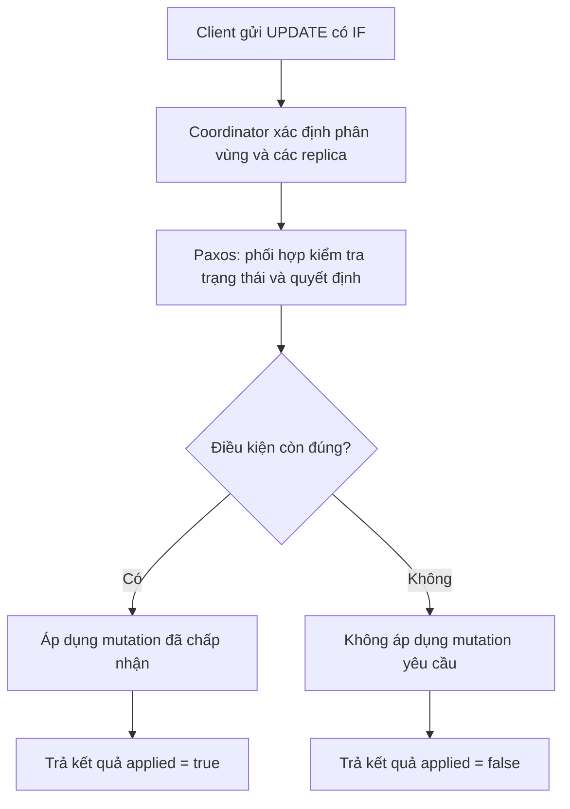

# IF NOT EXISTS/IF EXISTS và việc chuyển sang cập nhật có điều kiện trong Cassandra

Trong Apache Cassandra, `INSERT` và `UPDATE` thông thường có semantics **upsert**: ghi theo primary key, không bắt buộc phải đọc trước để xác nhận hàng đã tồn tại hay chưa. Điều đó rất phù hợp với đường ghi phân tán có thông lượng cao, nhưng dễ gây sai lệch nếu nghiệp vụ đòi hỏi **chỉ được tạo mới**, **chỉ được cập nhật tài nguyên đã có** hoặc **chỉ được sửa khi dữ liệu vẫn giống lần đọc trước**.

Các điều kiện `IF NOT EXISTS`, `IF EXISTS` và `IF <biểu thức>` chuyển một mutation thành **lightweight transaction (LWT)**. Cassandra sử dụng cơ chế đồng thuận kiểu **Paxos** để quyết định điều kiện và áp dụng ghi, thay vì dựa vào một lần `SELECT` rồi `UPDATE` riêng lẻ ở phía ứng dụng.

Bài này thuộc chương **Ghi và xóa bằng CQL** của module **DATABASE_ENGINE_WIDE_COLUMN_CASSANDRA**. Nội dung đặt LWT trong bối cảnh partition key, thiết kế bảng theo truy vấn, replication, consistency level, xử lý lỗi/timeout và tích hợp Java Driver.

Sau bài học, bạn sẽ có thể:

- Phân biệt upsert thường và **ghi có điều kiện** theo tồn tại hoặc giá trị cũ.
- Viết đúng `INSERT ... IF NOT EXISTS`, `UPDATE ... IF EXISTS`, `DELETE ... IF EXISTS` và `UPDATE/DELETE ... IF condition`.
- Hiểu `[applied] = true/false`, tình huống tranh chấp và chi phí đồng thuận.
- Tách **regular consistency** khỏi **serial consistency** (`SERIAL`/`LOCAL_SERIAL`).
- Thiết kế retry và idempotency khi ứng dụng Java nhận timeout hoặc điều kiện không thỏa.
- Quyết định khi nào dùng LWT và khi nào giữ upsert thường để tránh lãng phí độ trễ.

## 1. Bảng ví dụ và primary key

Giả sử hệ thống quản lý tài khoản cần tra cứu hồ sơ theo `account_id`. Keyspace `demo` được giả định đã tồn tại trong môi trường thực hành:

```sql
CREATE TABLE demo.accounts_by_id (
    account_id uuid PRIMARY KEY,
    email text,
    display_name text,
    account_state text,
    revision int,
    verification_code text,
    updated_at timestamp
);
```

Trong bảng này:

| Thành phần | Cột | Ý nghĩa |
| --- | --- | --- |
| Partition key | `account_id` | Xác định phân vùng và các replica lưu dữ liệu |
| Full primary key | `account_id` | Định danh duy nhất một hàng logic |
| Cột thường | `email`, `display_name`, `account_state`, `revision` | Các giá trị có thể cập nhật theo hàng |
| Dữ liệu tạm | `verification_code` | Có thể được ghi với TTL |
| Metadata nghiệp vụ | `updated_at` | Ứng dụng phải tự cập nhật, không phải write timestamp nội bộ |

Tạo một hàng ban đầu:

```sql
INSERT INTO demo.accounts_by_id (
    account_id, email, display_name, account_state, revision
)
VALUES (
    11111111-1111-4111-8111-111111111111,
    'mai@example.test',
    'Mai',
    'ACTIVE',
    1
);

SELECT account_id, email, display_name, account_state, revision
FROM demo.accounts_by_id
WHERE account_id = 11111111-1111-4111-8111-111111111111;
```

Ở các ví dụ chính, UUID `1111...` biểu thị **hàng đã có**. Các UUID khác sẽ được dùng riêng cho thao tác tạo mới, để tránh vô tình phụ thuộc thứ tự thực hành.

> **Phạm vi của điều kiện:** LWT trên bảng này dựa vào primary key của hàng. Điều kiện không cho phép Cassandra tự tìm kiếm toàn bảng theo `email` hoặc đảm bảo email duy nhất trong mọi phân vùng. Muốn bảo đảm duy nhất theo email, cần thiết kế dữ liệu và quy trình riêng (xem phần 9).

## 2. Từ upsert thông thường sang ghi có điều kiện

Hãy nhìn bốn nhu cầu thường gặp:

| Yêu cầu nghiệp vụ | Lệnh thông thường | Lệnh có điều kiện phù hợp |
| --- | --- | --- |
| Ghi trạng thái mới, có thể tạo hàng nếu chưa có | `UPDATE ... SET ...` | Không cần LWT nếu upsert là chủ ý |
| Đăng ký tài khoản, không được ghi đè cùng `account_id` | `INSERT` không kiểm tra tồn tại | `INSERT ... IF NOT EXISTS` |
| Chỉ sửa một tài khoản đang tồn tại | `UPDATE` có thể tạo hàng thưa | `UPDATE ... IF EXISTS` |
| Sửa tên chỉ khi `revision` còn bằng 1 | `UPDATE` không kiểm tra phiên bản | `UPDATE ... IF revision = 1` |
| Chỉ xóa hàng đang tồn tại | `DELETE` có thể ghi tombstone cho khóa vắng | `DELETE ... IF EXISTS` |

### Lệnh thường: không bảo vệ điều kiện tồn tại

```sql
UPDATE demo.accounts_by_id
SET display_name = 'Một tài khoản mới'
WHERE account_id = 22222222-2222-4222-8222-222222222222;
```

Nếu UUID `2222...` chưa có hàng, `UPDATE` không điều kiện có thể tạo **hàng thưa** chỉ có `display_name`, còn các cột thường khác đọc ra `null`. Cassandra không hỏi “bạn đang INSERT hay UPDATE?” theo nghĩa ràng buộc tồn tại của hệ quan hệ.

`INSERT` thông thường tương tự:

```sql
INSERT INTO demo.accounts_by_id (account_id, display_name)
VALUES (
    11111111-1111-4111-8111-111111111111,
    'Tên bị ghi đè'
);
```

Câu này ghi lại `display_name` của hàng đã tồn tại, không báo lỗi khóa trùng. Vì ví dụ sẽ ảnh hưởng dữ liệu gốc, **chỉ chạy nó trên môi trường lab nếu muốn quan sát hành vi upsert**.

### Lệnh có IF: kiểm tra rồi quyết định trong LWT

```text
Mutation thông thường:
  full primary key + giá trị mới
  -> gửi mutation, không cần điều kiện trạng thái cũ

Mutation có điều kiện:
  full primary key + điều kiện trạng thái cũ + giá trị mới
  -> các replica phối hợp kiểm tra điều kiện
  -> [applied] = true: áp dụng mutation
  -> [applied] = false: không áp dụng mutation được yêu cầu
```

Điều kiện làm thay đổi **semantics và đường thực thi**, không chỉ thay đổi kết quả trả về. LWT thường có nhiều vòng trao đổi mạng hơn ghi thường nên phải dùng có chọn lọc.

## 3. INSERT IF NOT EXISTS: tạo mới mà không ghi đè

Cú pháp cơ bản:

```sql
INSERT INTO demo.accounts_by_id (
    account_id, email, display_name, account_state, revision
)
VALUES (
    33333333-3333-4333-8333-333333333333,
    'an@example.test',
    'An',
    'PENDING',
    1
)
IF NOT EXISTS;
```

Lần đầu với khóa chưa có dữ liệu, điều kiện có thể thỏa và kết quả chứa:

```text
 [applied]
-----------
      True
```

Chạy lại cùng lệnh với `account_id` đó, nếu hàng đang tồn tại:

```text
 [applied] | ...các giá trị cũ có thể được trả về...
-----------
     False
```

Khi `[applied] = false`, **mutation INSERT mới không được áp dụng**. Ứng dụng nên xử lý như trùng tài nguyên hoặc xung đột theo hợp đồng API. Các cột hiện có có thể xuất hiện trong kết quả điều kiện thất bại, nhưng **không nên giả định driver luôn cung cấp mọi cột cần cho giao diện**; nếu cần trạng thái mới nhất để hiển thị, hãy đọc lại có chủ đích.

### IF NOT EXISTS kiểm tra điều gì?

Điều kiện kiểm tra **sự tồn tại của hàng tại full primary key** theo cơ chế LWT của Cassandra, không kiểm tra giá trị `email` có trùng với hàng ở UUID khác.

Ví dụ:

```sql
INSERT INTO demo.accounts_by_id (
    account_id, email, account_state
)
VALUES (
    44444444-4444-4444-8444-444444444444,
    'an@example.test',
    'PENDING'
)
IF NOT EXISTS;
```

Hai UUID `3333...` và `4444...` khác nhau: điều kiện tạo hàng `4444...` **không tự kiểm tra** email `an@example.test` đã xuất hiện ở `3333...`. Muốn uniqueness theo email phải dùng một đường ghi khác, không thể chỉ gắn `IF NOT EXISTS` vào bảng tra cứu theo UUID.

### IF NOT EXISTS và TTL

Với `INSERT`, có thể thêm TTL cho giá trị tạm:

```sql
INSERT INTO demo.accounts_by_id (
    account_id, verification_code
)
VALUES (
    55555555-5555-4555-8555-555555555555,
    '492813'
)
IF NOT EXISTS
USING TTL 300;
```

Đây là cú pháp `INSERT ... IF NOT EXISTS USING TTL ...`. Nếu điều kiện thỏa, dữ liệu được ghi với thời gian sống được chỉ định. Một hàng chỉ chứa dữ liệu có TTL **không phải** cơ chế đáng tin cậy để giữ khóa đăng ký vĩnh viễn: khi dữ liệu sống hết hạn, điều kiện tồn tại có thể thay đổi. Hãy dùng trường bền vững hoặc mô hình riêng cho ràng buộc lâu dài.

**Không** ghép `USING TIMESTAMP <giá trị tự chọn>` với LWT. Hệ thống đồng thuận quản lý timestamp cho mutation có điều kiện.

## 4. UPDATE IF EXISTS: chỉ sửa hàng đang tồn tại

Khi API có ý nghĩa “sửa tài khoản theo ID”, nhiều hệ thống không muốn `UPDATE` vô tình tạo ra hàng mới. Dùng `IF EXISTS`:

```sql
UPDATE demo.accounts_by_id
SET display_name = 'Mai Anh'
WHERE account_id = 11111111-1111-4111-8111-111111111111
IF EXISTS;
```

Hàng `1111...` đã được tạo ở phần 1, nên với điều kiện không có ghi cạnh tranh, kết quả `[applied] = true` và tên được cập nhật.

Nếu dùng khóa chưa tồn tại:

```sql
UPDATE demo.accounts_by_id
SET display_name = 'Không nên được tạo'
WHERE account_id = 66666666-6666-4666-8666-666666666666
IF EXISTS;

SELECT *
FROM demo.accounts_by_id
WHERE account_id = 66666666-6666-4666-8666-666666666666;
```

Kỳ vọng: `[applied] = false`; không có hàng mới do lệnh điều kiện tạo ra. **Không dùng việc không có exception làm dấu hiệu thành công**: điều kiện sai là một kết quả hợp lệ của CQL, không phải lỗi cú pháp hay lỗi kết nối.

### UPDATE IF EXISTS khác UPDATE thường thế nào?

| Tình huống | `UPDATE` thường | `UPDATE ... IF EXISTS` |
| --- | --- | --- |
| Khóa có hàng sống | Ghi cột được chỉ định | Có thể ghi sau khi LWT xác nhận tồn tại |
| Khóa không có hàng sống | Có thể tạo hàng thưa | Không áp dụng mutation |
| Client cần phát hiện không tìm thấy | Không được bảo đảm bằng kết quả ghi | Kiểm tra `[applied] = false` |
| Chi phí giao tiếp giữa replica | Đường ghi thường | Có thêm phối hợp/đồng thuận |
| Bảo vệ giá trị cũ của một cột khỏi bị ghi đè | Không | **Không**, chỉ bảo vệ điều kiện tồn tại |

Điểm cuối cùng rất quan trọng. `IF EXISTS` **không** ngăn hai người cùng sửa `display_name` nếu cả hai cùng thấy hàng đang tồn tại. Cả hai mutation có thể lần lượt thành công và giá trị cuối chịu quy tắc ghi/hòa giải. Muốn phát hiện thay đổi giữa lúc đọc và lúc ghi, cần so sánh một giá trị cũ hoặc revision (phần 6).

### UPDATE IF EXISTS cùng TTL

```sql
UPDATE demo.accounts_by_id
USING TTL 120
SET verification_code = '852741'
WHERE account_id = 11111111-1111-4111-8111-111111111111
IF EXISTS;
```

Nếu điều kiện thỏa, `verification_code` được ghi với TTL 120 giây. `IF EXISTS` không đồng nghĩa làm mới TTL hoặc ghi lại tất cả cột của hàng. Nó chỉ quyết định **có chấp nhận mutation được yêu cầu không**.

## 5. DELETE IF EXISTS: chỉ xóa khi hàng có tồn tại

Một DELETE thông thường gửi tombstone theo khóa, không cần xác nhận hàng đang có. Khi hợp đồng API yêu cầu phân biệt “đã xóa tài nguyên đang tồn tại” với “ID không tìm thấy”, có thể dùng:

```sql
DELETE FROM demo.accounts_by_id
WHERE account_id = 33333333-3333-4333-8333-333333333333
IF EXISTS;
```

Với hàng `3333...` vừa tạo ở phần 3, `[applied] = true` có nghĩa điều kiện tồn tại thỏa và lệnh xóa được chấp nhận. Nếu gửi lại khi hàng đã không còn sống, điều kiện có thể thất bại và `[applied] = false`.

### Xóa cột có điều kiện

Nếu chỉ muốn xóa một thông tin khi trạng thái trước còn đúng kỳ vọng, có thể kết hợp phạm vi cột với điều kiện trên cột của cùng hàng:

```sql
DELETE email
FROM demo.accounts_by_id
WHERE account_id = 11111111-1111-4111-8111-111111111111
IF account_state = 'ACTIVE';
```

Trong ví dụ này, nếu điều kiện thành công thì **chỉ email bị xóa** bởi mutation, còn các cột như `display_name` và `revision` không bị chính lệnh này xóa. Việc ghi tombstone cho email chỉ được thực hiện khi điều kiện `account_state = 'ACTIVE'` được chấp nhận.

**Lưu ý:** Nếu API có mục tiêu “vô hiệu hóa tài khoản”, xóa email không tương đương thay `account_state` thành `DISABLED`. Hãy diễn đạt thay đổi trạng thái nghiệp vụ bằng mutation và điều kiện tương ứng.

### Khi nào không cần IF EXISTS?

Nhiều API xóa được thiết kế **idempotent về hiệu quả nghiệp vụ**: xóa tài nguyên một lần hay xóa lại cùng ID vẫn có đích đến là tài nguyên không còn. Khi đó, DELETE không điều kiện thường đơn giản và rẻ hơn LWT.

Ngược lại, nếu cần thông báo “tài nguyên không tồn tại” một cách nhất quán với kiểm tra tồn tại khi ghi, `IF EXISTS` có giá trị — nhưng phải chấp nhận chi phí đồng thuận và vẫn phải xử lý timeout. Một lần DELETE thường thành công **không** trả số hàng từng tồn tại như `rowsAffected` trong một số cơ sở dữ liệu quan hệ.

### Không áp dụng bừa IF EXISTS cho xóa nhiều hàng

Ví dụ xóa cả partition hoặc khoảng clustering có phạm vi khác với xóa một hàng. LWT có ràng buộc về khóa, phạm vi và loại câu lệnh; không nên viết một câu `DELETE` phạm vi rộng rồi kỳ vọng `IF EXISTS` kiểm tra riêng từng hàng và trả về một mảng kết quả `[applied]`.

Nếu cần xử lý nhiều tài nguyên theo điều kiện riêng, hãy thiết kế một quy trình theo full primary key (hoặc mô hình dữ liệu theo truy vấn tương ứng) và cân nhắc mức độ nguyên tử cần thiết. Không dùng `ALLOW FILTERING` để biến LWT thành tìm kiếm toàn bảng theo cột thường.

## 6. IF với giá trị cũ: optimistic concurrency và compare-and-set

`IF EXISTS` chỉ hỏi hàng còn sống hay không. Để tránh **lost update**, có thể kiểm tra giá trị mà client đã quan sát trước đó.

### Ví dụ hai người cùng sửa tài khoản

Giả sử `revision = 1`. Client A và B cùng đọc revision đó:

```text
Thời điểm t0: account 1111... có revision = 1

Client A đọc revision 1, muốn đổi tên thành 'Mai A'.
Client B đọc revision 1, muốn đổi tên thành 'Mai B'.

Nếu cả hai UPDATE thường:
  Cả hai có thể được chấp nhận; kết quả cuối tùy timestamp.

Nếu cả hai UPDATE ... IF revision = 1:
  Một cập nhật được áp dụng trước sẽ đổi revision thành 2.
  Cập nhật tiếp theo với điều kiện revision = 1 sẽ bị từ chối.
```

Lệnh của client A:

```sql
UPDATE demo.accounts_by_id
SET display_name = 'Mai A',
    revision = 2
WHERE account_id = 11111111-1111-4111-8111-111111111111
IF revision = 1;
```

Nếu điều kiện đúng, `[applied] = true`. Client B gửi:

```sql
UPDATE demo.accounts_by_id
SET display_name = 'Mai B',
    revision = 2
WHERE account_id = 11111111-1111-4111-8111-111111111111
IF revision = 1;
```

Sau khi A được áp dụng và revision thành 2, lệnh của B sẽ có `[applied] = false`. B có thể đọc lại dữ liệu, quyết định merge hoặc thông báo xung đột cho người dùng.

### Vì sao gọi là optimistic concurrency?

Ứng dụng cho phép nhiều client đọc cùng lúc mà không khóa trước. Khi ghi, client gửi **giá trị dự kiến** trong `IF` và chỉ chấp nhận thay đổi nếu trạng thái chưa lệch khỏi kỳ vọng. Đây là mẫu *compare-and-set (CAS)*:

```text
CAS(key, expected_revision=1, new_revision=2, new_name='Mai A')

if actual_revision == expected_revision:
    apply mutation
    return [applied] = true
else:
    do not apply mutation
    return [applied] = false
```

**Không** dùng `revision = revision + 1` theo kiểu SQL với cột `int` thường của Cassandra. Ứng dụng nên tính `newRevision = oldRevision + 1` và gửi nó cùng điều kiện `IF revision = oldRevision`. Với counter, cú pháp và semantics cộng dồn là một tính năng riêng, không tương thích với LWT thông thường.

### Có thể kiểm tra trực tiếp giá trị nghiệp vụ

Nếu không muốn dùng revision, có thể chỉ đổi trạng thái khi đang ở trạng thái mong đợi:

```sql
UPDATE demo.accounts_by_id
SET account_state = 'LOCKED'
WHERE account_id = 11111111-1111-4111-8111-111111111111
IF account_state = 'ACTIVE';
```

Điều kiện này bảo vệ chuyển đổi **ACTIVE → LOCKED**. Nếu trạng thái đã bị đổi thành `DISABLED` hoặc `LOCKED` trước đó, LWT không được áp dụng. Không cần đọc toàn bộ hàng trong ứng dụng chỉ để quyết định transition.

Có thể đặt nhiều điều kiện khi cú pháp CQL hỗ trợ:

```sql
UPDATE demo.accounts_by_id
SET account_state = 'LOCKED',
    revision = 3
WHERE account_id = 11111111-1111-4111-8111-111111111111
IF account_state = 'ACTIVE' AND revision = 2;
```

Điều kiện chỉ được đánh giá tại **hàng/phân vùng mà primary key định vị**; chúng không phải bộ lọc toàn bảng trên các regular column. Đừng trộn ví dụ này với dữ liệu revision=1 ban đầu mà kỳ vọng nó luôn thành công: đây là minh họa cú pháp khi trạng thái hiện tại thực sự là revision 2.

### IF không tự cập nhật tất cả thuộc tính liên quan

Mutation chỉ ghi các cột trong `SET`. Ví dụ `IF revision = 1` nhưng chỉ `SET display_name = 'Mai A'` mà **không** tăng revision sẽ khiến điều kiện revision=1 vẫn đúng cho request tiếp theo. Muốn kiểm soát cạnh tranh bằng revision, **đọc phiên bản cũ, tăng phiên bản trong cùng LWT, rồi kiểm tra `[applied]`**.

## 7. Điều gì xảy ra bên trong LWT?

Mutation không điều kiện thường có thể được gửi thẳng đến các replica phụ trách partition key. LWT phải giải quyết câu hỏi khó hơn: **nhiều client cùng kiểm tra một điều kiện và cùng muốn ghi, chỉ thao tác nào thỏa điều kiện tại thời điểm được quyết định mới được áp dụng**.

Cassandra dùng giao thức đồng thuận **Paxos** cho các thao tác CAS; việc thực thi đòi hỏi nhiều vòng trao đổi giữa coordinator và các replica so với một upsert thông thường.



Sơ đồ trên là **mô hình khái niệm**. Số pha Paxos, tối ưu hóa và chi tiết xử lý giao thức có thể thay đổi theo phiên bản Cassandra và cấu hình, không nên xem đây là mô tả từng gói tin trên mạng.

### CAS làm việc theo khóa/phân vùng

Điểm mạnh của Cassandra là phân phối dữ liệu theo **partition key**. LWT dùng các replica chịu trách nhiệm phân vùng liên quan để phối hợp quyết định. Nó **không tự xây dựng một giao dịch toàn cục** bao phủ tất cả partition và bảng của hệ thống.

Ví dụ hai người cùng sửa hồ sơ `account_id = 1111...` qua điều kiện `revision = 1`: các thao tác tranh chấp trên cùng partition nên LWT có thể phối hợp để quyết định chỉ mutation thỏa điều kiện mới được áp dụng.

Nhưng nếu nghiệp vụ cần đồng thời:

1. Ghi tài khoản `accounts_by_id` theo UUID, và
2. Đăng ký email ở bảng `email_claim_by_email` theo email,

hai ghi này có thể thuộc **hai partition khác nhau**. Một `IF NOT EXISTS` ở từng bảng không tự biến cả quy trình thành một giao dịch xuyên partition. Cần thêm mô hình điều phối và xử lý lỗi giữa các bước.

### Tại sao LWT thường chậm hơn upsert?

- LWT có nhiều trao đổi mạng và cần đủ các replica tham gia theo giao thức đồng thuận.
- Khi có nhiều yêu cầu cùng tranh chấp một partition, coordinator có thể phải thử lại hoặc xử lý xung đột đề xuất.
- Độ trễ/khả năng thành công phụ thuộc replica, network, topology, serial consistency và tình trạng tải.
- Một vòng đọc–ghi thường ở client có thể dùng ít cơ chế đồng thuận hơn, **nhưng không cung cấp cùng đảm bảo điều kiện**.

**Nguyên tắc hiệu năng:** chỉ dùng LWT cho những **bất biến nghiệp vụ** cần nó, không bật `IF EXISTS` trên mọi upsert vì nghĩ điều kiện sẽ miễn phí.

## 8. Consistency level thường và serial consistency level

Với ghi không điều kiện, Cassandra có các mức nhất quán như `ONE`, `LOCAL_QUORUM`, `QUORUM`, v.v. Chúng chi phối số replica cần xác nhận để client xem mutation được đáp ứng ở mức đã chọn.

LWT có **thêm một khái niệm**: *serial consistency*, dùng cho pha đồng thuận của thao tác điều kiện.

| Khái niệm | Một số giá trị | Vai trò |
| --- | --- | --- |
| Regular consistency level | `ONE`, `LOCAL_QUORUM`, `QUORUM` | Xác nhận/quan sát thao tác ở các replica theo mức được chọn |
| Serial consistency level | `SERIAL`, `LOCAL_SERIAL` | Phạm vi phối hợp của các pha đồng thuận CAS |

### SERIAL

`SERIAL` cho phép đồng thuận ở phạm vi áp dụng trên các replica liên quan mà không bị giới hạn theo một datacenter cục bộ. Đây là lựa chọn khi yêu cầu nhất quán điều kiện cần phù hợp với topology nhiều datacenter và mô hình traffic của hệ thống.

### LOCAL_SERIAL

`LOCAL_SERIAL` giới hạn phạm vi serial consistency vào **datacenter cục bộ**. Có thể phù hợp khi ứng dụng và thiết kế dữ liệu tập trung thao tác CAS trong một datacenter, với chính sách rõ ràng về cách các datacenter khác truy cập. Không tự động coi `LOCAL_SERIAL` là tương đương `SERIAL` cho một dịch vụ nhận ghi cạnh tranh từ nhiều vùng địa lý.

**Điểm quan trọng:** không nên trộn tùy tiện những cơ chế serial consistency khác nhau cho các CAS cạnh tranh trên cùng dữ liệu nếu hệ thống không có một chính sách topology/consistency nhất quán.

### QUORUM không thay thế IF

Giả sử replication factor là 3, và client chọn `QUORUM` cho một `UPDATE` không điều kiện. Khi đủ replica xác nhận, điều đó **không chứng minh** giá trị `revision` từng là 1. Nó cũng không ngăn hai client tạo hai mutation cùng một cột.

Muốn so sánh revision, phải **viết điều kiện `IF revision = 1`**. `QUORUM` và `SERIAL` giải quyết những khía cạnh khác nhau: xác nhận/quan sát dữ liệu và đồng thuận có điều kiện.

### LWT không cho phép bỏ qua phân tích consistency

Không có một tổ hợp duy nhất phù hợp cho tất cả cụm Cassandra. Khi chọn cấu hình LWT, cần hiểu:

- Replication factor và chiến lược replication của keyspace.
- Các datacenter nơi ứng dụng gửi request.
- Mục tiêu tính nhất quán, latency và độ sẵn sàng.
- Chính sách cho request CAS từ nhiều client ở nhiều datacenter.
- Cách đọc lại trạng thái sau một kết quả không chắc chắn.

Trong Java Driver, có thể cấu hình cả regular và serial consistency trên **BoundStatement** của một câu LWT (xem phần 11). Không dùng mức `SERIAL` như một phép thay thế cú pháp `IF` ở câu `UPDATE` thường.

## 9. IF NOT EXISTS không tự giải quyết mọi bài toán uniqueness

Một ví dụ thực tế: ứng dụng yêu cầu **mỗi email chỉ thuộc một tài khoản**, trong khi bảng `accounts_by_id` được phân vùng theo `account_id`.

### Cách làm sai

```sql
-- Tài khoản thứ nhất:
INSERT INTO demo.accounts_by_id (
    account_id, email, account_state
)
VALUES (
    aaaaaaaa-aaaa-4aaa-8aaa-aaaaaaaaaaaa,
    'duplicate@example.test',
    'ACTIVE'
)
IF NOT EXISTS;

-- Tài khoản thứ hai, ID khác:
INSERT INTO demo.accounts_by_id (
    account_id, email, account_state
)
VALUES (
    bbbbbbbb-bbbb-4bbb-8bbb-bbbbbbbbbbbb,
    'duplicate@example.test',
    'ACTIVE'
)
IF NOT EXISTS;
```

Hai câu có **partition key khác nhau**, nên đều có thể thành công. Cassandra không có unique constraint tự động trên `email` chỉ nhờ cột này xuất hiện trong một hàng.

### Mô hình đặt khóa duy nhất theo chính giá trị cần bảo vệ

Tạo bảng giữ quyền sở hữu email:

```sql
CREATE TABLE demo.email_claim_by_email (
    normalized_email text PRIMARY KEY,
    account_id uuid,
    claimed_at timestamp
);
```

Khi đăng ký, normalize email theo quy tắc nghiệp vụ nhất quán rồi:

```sql
INSERT INTO demo.email_claim_by_email (
    normalized_email, account_id
)
VALUES (
    'duplicate@example.test',
    aaaaaaaa-aaaa-4aaa-8aaa-aaaaaaaaaaaa
)
IF NOT EXISTS;
```

Vì **email đã chuẩn hóa trở thành partition key**, các yêu cầu cùng email cùng tranh chấp trên **một khóa logic**. `IF NOT EXISTS` là cơ chế phù hợp để chỉ một yêu cầu có thể chiếm quyền tại khóa email đó theo semantics LWT.

Tuy nhiên, **vẫn chưa có giao dịch tự động giữa `email_claim_by_email` và `accounts_by_id`**. Nếu claim email thành công nhưng ghi hồ sơ theo UUID thất bại hoặc timeout, dữ liệu có thể tạm thời chỉ tồn tại ở bảng claim.

Một quy trình an toàn hơn cần:

1. Sử dụng **request ID/idempotency key** và UUID tài khoản ổn định qua các lần retry.
2. Claim email bằng `IF NOT EXISTS`.
3. Ghi hồ sơ tài khoản theo UUID đã xác định.
4. Khi bước 3 lỗi hoặc không rõ kết quả, **đọc đối chiếu trạng thái** và áp dụng cơ chế hoàn tất/compensation theo quy tắc nghiệp vụ; không xóa claim một cách mù quáng nếu có request khác liên quan.
5. Xem xét trạng thái `PENDING`/`ACTIVE` và cơ chế reconcile để xử lý các quy trình dở dang.

Với đổi email, cần thiết kế cả bước cấp quyền email mới và giải phóng email cũ sao cho tránh mất quyền sở hữu khi có lỗi giữa các thao tác. Đây là **bài toán workflow nhiều partition**, không phải thứ tự `INSERT IF NOT EXISTS` tự xử lý.

### Khi nào giải pháp này chưa đủ?

Nếu yêu cầu là invariant mạnh trên nhiều thực thể và dữ liệu không thể cho phép trạng thái trung gian/compensation, hãy đánh giá một cơ chế giao dịch có mô hình phù hợp thay vì cố ép nhiều LWT rời rạc thành giao dịch ACID đa partition. Cassandra phù hợp nhất khi thiết kế bảng và phạm vi bất biến gắn được với partition key.

## 10. Cú pháp được phép, tổ hợp cần tránh và tác động của TTL

Không phải mọi câu lệnh CQL đều chấp nhận mọi loại điều kiện. Bảng dưới giúp phân biệt phạm vi hỗ trợ:

| Câu lệnh | Cách viết đúng | Cách hiểu |
| --- | --- | --- |
| `INSERT` không điều kiện | `INSERT ... VALUES (...)` | Upsert thông thường |
| `INSERT` chỉ tạo mới | `INSERT ... VALUES (...) IF NOT EXISTS` | LWT kiểm tra tồn tại |
| `UPDATE` chỉ sửa hàng đang có | `UPDATE ... SET ... WHERE ... IF EXISTS` | LWT theo tồn tại |
| `UPDATE` so sánh giá trị cũ | `UPDATE ... SET ... WHERE ... IF revision = 1` | LWT theo điều kiện |
| `DELETE` chỉ khi có hàng | `DELETE FROM ... WHERE ... IF EXISTS` | LWT khi xóa |
| `DELETE` khi giá trị cũ còn đúng | `DELETE col FROM ... WHERE ... IF col = value` | LWT theo cột |

### Những tổ hợp không nên viết

Các ví dụ dưới đây **cố ý sai**, không chạy như bài thực hành:

```sql
-- SAI: IF NOT EXISTS là điều kiện của INSERT, không phải UPDATE.
UPDATE demo.accounts_by_id
SET display_name = 'An'
WHERE account_id = 99999999-9999-4999-8999-999999999999
IF NOT EXISTS;

-- SAI: INSERT không dùng IF EXISTS để biểu thị update-only.
INSERT INTO demo.accounts_by_id (account_id, display_name)
VALUES (99999999-9999-4999-8999-999999999999, 'An')
IF EXISTS;

-- SAI: không thể tự đặt USING TIMESTAMP trong mutation LWT.
UPDATE demo.accounts_by_id
USING TIMESTAMP 1700000000000000
SET display_name = 'Mai'
WHERE account_id = 11111111-1111-4111-8111-111111111111
IF EXISTS;

-- SAI: không phải cú pháp DELETE có điều kiện hợp lệ.
DELETE FROM demo.accounts_by_id
WHERE account_id = 11111111-1111-4111-8111-111111111111
IF NOT EXISTS;
```

### TTL có thể đi cùng điều kiện

Đối với regular column phù hợp, `USING TTL` có thể xuất hiện trong `INSERT IF NOT EXISTS` và `UPDATE IF EXISTS`/`UPDATE IF condition`:

```sql
-- INSERT: IF NOT EXISTS trước USING.
INSERT INTO demo.accounts_by_id (
    account_id, verification_code
)
VALUES (
    77777777-7777-4777-8777-777777777777,
    '583920'
)
IF NOT EXISTS
USING TTL 180;

-- UPDATE: USING trước SET, IF sau WHERE.
UPDATE demo.accounts_by_id
USING TTL 180
SET verification_code = '381925'
WHERE account_id = 11111111-1111-4111-8111-111111111111
IF account_state = 'ACTIVE';
```

Trong lệnh thứ hai, chỉ `verification_code` được ghi với TTL nếu điều kiện thỏa. Nếu `[applied] = false`, mutation **không được áp dụng**, nên không có TTL mới được gắn vào code bởi lần ghi thất bại điều kiện đó.

**Không** ghép `USING TIMESTAMP` do client tự cấp với các câu LWT trên. LWT dùng timestamp do cơ chế đồng thuận xử lý. `DELETE` có thể dùng timestamp với lệnh **không có IF**, nhưng bản thân DELETE không hỗ trợ `USING TTL`, vì nó ghi dấu xóa thay vì đặt thời gian sống cho giá trị mới.

### LWT không thay thế chính sách TTL của tài khoản

Nếu chỉ lưu dữ liệu tạm như `verification_code` cùng `IF NOT EXISTS`, khi giá trị/marker sống hết hạn, điều kiện “hàng có tồn tại không” có thể đổi kết quả. **Không dùng TTL của một OTP như ràng buộc duy nhất ngăn tạo trùng tài khoản.** Hàng tài khoản nên có một dữ liệu tồn tại bền vững, hoặc có khóa claim riêng với chính sách sở hữu rõ ràng.

### Conditional batch cần thiết kế riêng

Cassandra có tính năng `BATCH`, kể cả những hình thức ghi điều kiện trong phạm vi được hỗ trợ. Tuy nhiên, **không nên suy ra mọi câu lệnh có IF đều có thể gom tùy ý vào một batch xuyên partition** để có giao dịch ACID đầy đủ. Kiểm tra ràng buộc phiên bản, cùng partition và semantics conditional batch trước khi dùng. `BATCH` cũng không phải cách tự động tăng tốc mọi ghi hàng loạt.

## 11. Java Driver 4.x: thực thi CAS và xử lý kết quả

Giả sử ứng dụng đã có `CqlSession session` kết nối Cassandra và `UUID accountId` hợp lệ. Các ví dụ dùng API Java Driver 4.x; các import được lược bỏ hoặc nêu theo tên đầy đủ để tập trung vào cách bind và xử lý LWT.

### 11.1. Tạo tài khoản bằng IF NOT EXISTS

```java
PreparedStatement createAccount = session.prepare(
    "INSERT INTO demo.accounts_by_id " +
    "(account_id, email, display_name, account_state, revision) " +
    "VALUES (:id, :email, :name, :state, :revision) " +
    "IF NOT EXISTS"
);

BoundStatement creation = createAccount.boundStatementBuilder()
    .setUuid("id", accountId)
    .setString("email", "new@example.test")
    .setString("name", "New Account")
    .setString("state", "PENDING")
    .setInt("revision", 1)
    .build();

ResultSet createResult = session.execute(creation);
if (createResult.wasApplied()) {
    // Tai khoan da duoc tao theo dieu kien IF NOT EXISTS.
} else {
    // accountId da ton tai: xu ly trung tai nguyen/xung dot.
}
```

**Không** chỉ kiểm tra `execute(...)` có ném exception hay không: `[applied] = false` vẫn là một câu CQL hoàn tất bình thường.

### 11.2. Chỉ sửa tài khoản có tồn tại

```java
PreparedStatement updateExisting = session.prepare(
    "UPDATE demo.accounts_by_id " +
    "SET display_name = :name " +
    "WHERE account_id = :id " +
    "IF EXISTS"
);

BoundStatement edit = updateExisting.boundStatementBuilder()
    .setUuid("id", accountId)
    .setString("name", "Updated Name")
    .build();

ResultSet editResult = session.execute(edit);
if (!editResult.wasApplied()) {
    // Khong co hang thoa IF EXISTS; tra 404 hoac xu ly phu hop.
}
```

Trong một HTTP API, `[applied] = false` của `IF EXISTS` có thể được ánh xạ thành **404 Not Found** theo hợp đồng API. Với `IF revision = old`, `[applied] = false` thường phản ánh **xung đột cập nhật** và có thể ánh xạ thành 409 Conflict hoặc 412 Precondition Failed, tùy API.

### 11.3. CAS theo revision

```java
PreparedStatement casName = session.prepare(
    "UPDATE demo.accounts_by_id " +
    "SET display_name = :new_name, revision = :new_revision " +
    "WHERE account_id = :id " +
    "IF revision = :expected_revision"
);

int currentRevision = 4; // Revision client dang su dung.
int nextRevision = Math.addExact(currentRevision, 1);

BoundStatement cas = casName.boundStatementBuilder()
    .setUuid("id", accountId)
    .setString("new_name", "Mai Updated")
    .setInt("new_revision", nextRevision)
    .setInt("expected_revision", currentRevision)
    .build();

ResultSet casResult = session.execute(cas);
if (casResult.wasApplied()) {
    // Cap nhat thanh cong, revision nay la 5.
} else {
    // Revision khong khop; tai lai du lieu hoac bao xung dot.
}
```

Giá trị `currentRevision = 4` trong ví dụ chỉ có tính minh họa: nếu tài khoản thực tế đang ở revision khác thì `[applied] = false` là kết quả đúng. Không tự động phát lại câu lệnh với một revision mới mà không xem xét dữ liệu mà client muốn thay đổi.

### 11.4. Cấu hình regular và serial consistency

Java Driver 4.x cho phép đặt regular consistency và serial consistency trên statement điều kiện:

```java
BoundStatement casWithConsistency = cas.setConsistencyLevel(
    com.datastax.oss.driver.api.core.DefaultConsistencyLevel.LOCAL_QUORUM
).setSerialConsistencyLevel(
    com.datastax.oss.driver.api.core.DefaultConsistencyLevel.LOCAL_SERIAL
);

ResultSet result = session.execute(casWithConsistency);
boolean applied = result.wasApplied();
```

`LOCAL_QUORUM` và `LOCAL_SERIAL` được dùng **chỉ để minh họa một cấu hình nhiều datacenter** có chủ đích dùng phạm vi local. Cần đối chiếu replication factor từng datacenter, topology và policy nơi các client thực hiện CAS. Nếu hệ thống có ghi CAS cạnh tranh xuyên datacenter, không tự động chọn `LOCAL_SERIAL` vì nghĩ nó luôn tương đương `SERIAL`.

**Lưu ý:** đối tượng `BoundStatement` của driver là dạng bất biến khi dùng các phương thức `set...` (trả lại đối tượng mới). Đoạn mã trên giữ giá trị trả về để không bỏ sót cấu hình khi thực thi.

### 11.5. Điều kiện sai không phải lỗi mạng

Nên phân biệt ít nhất ba kết quả ở tầng API:

| Kết quả driver | Ý nghĩa | Cách xử lý gợi ý |
| --- | --- | --- |
| `wasApplied() == true` | Điều kiện thỏa, mutation được áp dụng | Trả thành công |
| `wasApplied() == false` | Điều kiện không thỏa, không áp dụng mutation yêu cầu | Trả trùng/xung đột/không tồn tại theo hợp đồng |
| Driver báo timeout/failure | **Không chắc chắn** mutation đã được áp dụng hay chưa, tùy điểm lỗi | Kiểm tra trạng thái, idempotency và chính sách retry |

Đừng biến một timeout thành `[applied] = false` giả tạo. Điều kiện thật sự không thỏa và không nhận được kết quả vì mạng có semantics hoàn toàn khác nhau.

## 12. Timeout, retry và kết quả không chắc chắn

LWT giải quyết bài toán kiểm tra điều kiện và quyết định mutation trên dữ liệu liên quan, **không** làm biến mất mọi lỗi mạng giữa client và cluster. Cùng một request có thể được chấp nhận ở replica nhưng phản hồi bị mất trên đường về client.

### Tình huống tạo mới bị mất phản hồi

```text
Client gửi:
  INSERT account_id=X ... IF NOT EXISTS

Cluster:
  Điều kiện đúng, mutation được áp dụng.

Mạng:
  Phản hồi [applied]=true bị mất.

Client thấy timeout rồi gửi lại cùng request:
  Điều kiện IF NOT EXISTS bây giờ sai.
  Client có thể nhận [applied]=false.
```

Nếu client chỉ hiểu `false` là “người khác đã tạo tài khoản”, nó sẽ báo lỗi không đúng: **chính yêu cầu trước đó của client có thể đã tạo hàng thành công**. Vì vậy, cần dùng **định danh tài nguyên và request ID ổn định**.

Quy trình gợi ý:

1. Tạo hoặc nhận `account_id` một lần, giữ nguyên qua retry của cùng logical request.
2. Gửi `INSERT ... IF NOT EXISTS`.
3. Nếu nhận `[applied] = true`, đánh dấu thành công.
4. Nếu nhận `[applied] = false`, kiểm tra trạng thái/định danh nghiệp vụ khi cần phân biệt **lệnh cũ của mình** với **yêu cầu khác**.
5. Nếu timeout, không khẳng định ghi thất bại; đọc/đối chiếu hoặc retry theo một quy trình idempotent đã thiết kế, không chỉ lặp mù quáng.

### Tình huống CAS revision bị mất phản hồi

Giả sử client gửi `IF revision = 4 SET revision = 5` và timeout:

- **Khả năng A:** mutation đã được áp dụng; đọc lại thấy revision 5.
- **Khả năng B:** mutation chưa được áp dụng; đọc lại vẫn thấy revision 4.
- **Khả năng C:** client khác đã ghi xen giữa; đọc lại có revision khác.

Không thể chỉ nhìn revision 5 mà **chứng minh chắc chắn request của mình đã thành công** nếu nhiều request có thể đặt cùng revision hoặc cập nhật các trường khác. Muốn xác nhận chính xác, cần gắn request ID hoặc dấu vết nghiệp vụ ổn định, hoặc ràng buộc toàn bộ luồng ghi cùng chính sách.

### Khi nào retry không an toàn?

| Mutation | Vấn đề khi retry |
| --- | --- |
| `INSERT ... IF NOT EXISTS` | Retry sau thành công nhưng mất phản hồi có thể trả `false` |
| `UPDATE ... IF revision = 4` | Sau thành công, revision đã đổi; retry có thể trả `false` |
| `UPDATE ... SET col = value` thường | Timestamp mới có thể ghi đè mutation cạnh tranh |
| `UPDATE ... USING TTL 60` | Ghi lại có thể làm mới thời gian hết hạn |
| `SET list_col = list_col + [...]` | Có thể thêm phần tử trùng |
| `counter = counter + 1` | Có thể cộng thêm lần nữa |

Đối với tài khoản, phiên xác minh hoặc thao tác thanh toán, xác định rõ **một logical request có thể được gửi bao nhiêu lần** và cách phát hiện lặp; không trông chờ chỉ vào driver retry policy.

### Không trộn bừa ghi điều kiện với ghi thường

LWT cho phép các thao tác điều kiện cạnh tranh phối hợp qua Paxos. Nhưng nếu một phần ứng dụng sử dụng `UPDATE ... IF revision = ...`, phần khác lại dùng `UPDATE` thường để ghi trực tiếp `revision` hoặc `account_state` mà bỏ qua hợp đồng điều kiện, bất biến mà bạn kỳ vọng có thể bị phá vỡ.

**Quy tắc:** mọi đường ghi có thể thay đổi cùng trạng thái cần được thiết kế nhất quán. Khi triển khai compare-and-set bằng revision, đừng cho phép endpoint khác sửa revision hay các cột được bảo vệ bằng blind upsert mà không có lý do nghiệp vụ được kiểm soát.

## 13. Thực hành từng bước: khi nào điều kiện được áp dụng?

Chạy trên keyspace `demo` của môi trường học tập. Sử dụng UUID riêng `88888888-8888-4888-8888-888888888888` để không phụ thuộc dữ liệu mẫu ở các phần trước. Các bước nên chạy tuần tự; đừng có client khác cùng ghi nếu muốn kiểm chứng đúng kỳ vọng.

### Bước 1 — Tạo hàng lần đầu

```sql
INSERT INTO demo.accounts_by_id (
    account_id, email, display_name, account_state, revision
)
VALUES (
    88888888-8888-4888-8888-888888888888,
    'lab@example.test',
    'Lab Account',
    'PENDING',
    1
)
IF NOT EXISTS;

SELECT email, display_name, account_state, revision
FROM demo.accounts_by_id
WHERE account_id = 88888888-8888-4888-8888-888888888888;
```

**Dự đoán:** lần đầu `[applied] = true`; hàng có `revision = 1` và `account_state = 'PENDING'`.

### Bước 2 — Gửi lại INSERT với cùng khóa

```sql
INSERT INTO demo.accounts_by_id (
    account_id, email, display_name, account_state, revision
)
VALUES (
    88888888-8888-4888-8888-888888888888,
    'other@example.test',
    'Should Not Overwrite',
    'ACTIVE',
    99
)
IF NOT EXISTS;
```

**Dự đoán:** `[applied] = false`. Email, tên, trạng thái và revision ban đầu không bị mutation này ghi đè.

### Bước 3 — UPDATE IF EXISTS

```sql
UPDATE demo.accounts_by_id
SET account_state = 'ACTIVE'
WHERE account_id = 88888888-8888-4888-8888-888888888888
IF EXISTS;
```

**Dự đoán:** `[applied] = true`, tài khoản chuyển thành `ACTIVE`. Revision vẫn là 1, vì lần ghi này không thêm `SET revision = ...`.

### Bước 4 — Điều kiện theo revision thành công

```sql
UPDATE demo.accounts_by_id
SET display_name = 'Lab Updated',
    revision = 2
WHERE account_id = 88888888-8888-4888-8888-888888888888
IF revision = 1;
```

**Dự đoán:** `[applied] = true` và revision thành 2.

### Bước 5 — Điều kiện revision cũ bị từ chối

```sql
UPDATE demo.accounts_by_id
SET display_name = 'Stale Writer',
    revision = 2
WHERE account_id = 88888888-8888-4888-8888-888888888888
IF revision = 1;

SELECT display_name, account_state, revision
FROM demo.accounts_by_id
WHERE account_id = 88888888-8888-4888-8888-888888888888;
```

**Dự đoán:** `[applied] = false`; `display_name = 'Lab Updated'` và revision vẫn là 2. Kết quả cho thấy CAS chống việc ghi từ bản revision cũ.

### Bước 6 — LWT với hai điều kiện

```sql
UPDATE demo.accounts_by_id
SET account_state = 'LOCKED',
    revision = 3
WHERE account_id = 88888888-8888-4888-8888-888888888888
IF account_state = 'ACTIVE' AND revision = 2;
```

**Dự đoán:** `[applied] = true`, trạng thái thành `LOCKED` và revision thành 3.

Nếu đổi điều kiện thành `IF account_state = 'ACTIVE' AND revision = 3` sau đó, kết quả là `false` vì trạng thái hiện đã là `LOCKED`.

### Bước 7 — IF EXISTS trên khóa chưa có

```sql
UPDATE demo.accounts_by_id
SET display_name = 'Should Not Create'
WHERE account_id = 99999999-9999-4999-8999-999999999999
IF EXISTS;

SELECT *
FROM demo.accounts_by_id
WHERE account_id = 99999999-9999-4999-8999-999999999999;
```

**Dự đoán:** `[applied] = false` và không có hàng được tạo bởi yêu cầu đó.

### Bước 8 — DELETE IF EXISTS

```sql
DELETE FROM demo.accounts_by_id
WHERE account_id = 88888888-8888-4888-8888-888888888888
IF EXISTS;

-- Gửi lại cùng lệnh xóa:
DELETE FROM demo.accounts_by_id
WHERE account_id = 88888888-8888-4888-8888-888888888888
IF EXISTS;
```

**Dự đoán:** lần thứ nhất `[applied] = true`, lần thứ hai `[applied] = false` vì hàng đã bị xóa. Cả hai lệnh đều là conditional mutation; không nên coi lần xóa thứ hai là exception của CQL.

### Bảng tổng kết thực hành

| Bước | Điều kiện | `[applied]` dự kiến | Trạng thái chính sau bước |
| --- | --- | --- | --- |
| 1 | Chưa có hàng | true | PENDING, revision 1 |
| 2 | IF NOT EXISTS trên hàng đã có | false | Không đổi |
| 3 | IF EXISTS trên hàng đã có | true | ACTIVE, revision 1 |
| 4 | IF revision = 1 | true | Tên mới, revision 2 |
| 5 | IF revision = 1 lần nữa | false | Tên không bị writer cũ ghi đè |
| 6 | IF ACTIVE và revision = 2 | true | LOCKED, revision 3 |
| 7 | IF EXISTS trên khóa vắng | false | Không tạo hàng |
| 8 | DELETE IF EXISTS hai lần | true, rồi false | Hàng không còn sống |

Các dự đoán giả định không có writer cạnh tranh, TTL hết hạn hoặc timestamp được tự chọn gây bất thường. Bài lab chỉ kiểm tra cú pháp/ngữ nghĩa, không thay thế thử nghiệm tải và lỗi mạng của một cụm Cassandra production.

## 14. Lỗi thường gặp, câu hỏi tự kiểm tra và checklist

### Bảng lỗi và cách sửa

| Lỗi | Hậu quả | Cách xử lý đúng |
| --- | --- | --- |
| Coi `INSERT` thường là insert-only | Ghi đè cột đã có ở cùng primary key | Dùng `IF NOT EXISTS` khi cần từ chối tạo trùng |
| Coi `UPDATE` thường là update-only | Có thể tạo hàng thưa | Dùng `IF EXISTS` nếu phải bảo đảm hàng có trước |
| Dùng `IF EXISTS` để tránh lost update | Hai client vẫn có thể lần lượt sửa cùng giá trị | Dùng `IF revision = old` hoặc điều kiện cột cũ |
| Chỉ kiểm tra CQL không ném exception | Có thể bỏ qua `[applied] = false` | Kiểm tra `ResultSet.wasApplied()` |
| Biến timeout thành `[applied] = false` | Báo sai khi mutation đã áp dụng nhưng mất phản hồi | Xem timeout là trạng thái không chắc chắn; đối chiếu/idempotency |
| Retry `IF NOT EXISTS` rồi coi false là “người khác tạo” | Lần trước của chính client có thể đã thành công | Dùng khóa/request ID ổn định và xác minh dữ liệu |
| Đọc rồi UPDATE thường để kiểm tra revision | Có khoảng trống race condition | Dùng CAS `UPDATE ... IF revision = ...` |
| Gắn `IF NOT EXISTS` trên bảng keyed by UUID để đảm bảo email duy nhất | Hai UUID khác nhau vẫn dùng cùng email | Tạo khóa claim theo email và quy trình liên bảng |
| Thêm `USING TIMESTAMP` thủ công vào mutation có IF | Tổ hợp CQL không hợp lệ | Để LWT quản lý timestamp |
| Dùng `USING TTL` cho nhiều cột nhưng chỉ muốn một cột hết hạn | Các giá trị được ghi cùng mutation có thể nhận TTL | Tách phạm vi mutation và chính sách TTL cho phù hợp |
| Dùng `LOCAL_SERIAL` khi có CAS cạnh tranh xuyên nhiều DC mà không xem topology | Có thể không đáp ứng phạm vi bảo đảm mong muốn | Thiết kế consistency phù hợp toàn hệ thống |
| Trộn blind upsert vào cùng trạng thái được CAS bảo vệ | Làm suy yếu invariant của revision/trạng thái | Chuẩn hóa mọi đường ghi ảnh hưởng cùng invariant |
| Dùng LWT cho mọi cập nhật bất kể nhu cầu | Tăng độ trễ, tải Paxos và tranh chấp | Chỉ dùng với bất biến nghiệp vụ thực sự cần kiểm tra |

### Câu hỏi tự kiểm tra

1. **`INSERT` thường có thất bại nếu cùng primary key đã có hàng không?** Không. Nó là upsert và có thể ghi lại những cột được nêu.
2. **`INSERT ... IF NOT EXISTS` bảo vệ uniqueness của trường email bất kỳ không?** Không. Nó kiểm tra tồn tại ở full primary key của hàng được ghi.
3. **`UPDATE ... IF EXISTS` có bảo đảm giá trị revision không đổi từ lúc client đọc không?** Không. Nó chỉ kiểm tra hàng đang tồn tại tại thời điểm điều kiện được xét.
4. **Nếu muốn cập nhật tên khi revision đang là 4, làm thế nào?** Gửi `SET display_name = ..., revision = 5 ... IF revision = 4` và kiểm tra `[applied]`.
5. **`[applied] = false` có phải lỗi mạng không?** Không; đó là kết quả bình thường khi điều kiện không thỏa.
6. **Sau timeout từ LWT, có chắc mutation chưa áp dụng không?** Không. Kết quả có thể không xác định từ góc nhìn client; cần kiểm tra trạng thái và idempotency.
7. **Hai client cùng gửi `IF revision = 1` có cùng tự động thành công không?** Nếu mutation thành công đầu tiên chuyển revision sang 2 thì lần tiếp theo với điều kiện 1 không thỏa.
8. **`SERIAL` và `QUORUM` có cùng vai trò không?** Không. Serial consistency phục vụ pha đồng thuận LWT; regular consistency chi phối xác nhận/quan sát ở replica.
9. **Có thể dùng TTL cùng `UPDATE ... IF EXISTS` không?** Có với cột phù hợp, chẳng hạn ghi mã tạm trong hàng đã tồn tại.
10. **Có thể tự chỉ định `USING TIMESTAMP` cùng `IF` không?** Không. LWT không cho phép timestamp do client tùy chọn.
11. **Xóa không điều kiện và xóa `IF EXISTS` khác nhau gì?** Xóa thường gửi dấu xóa theo khóa; xóa có điều kiện kiểm tra sự tồn tại qua LWT và trả `[applied]`.
12. **Đã claim email thành công bằng LWT, có chắc hồ sơ ở bảng khác cũng đã tạo không?** Không. Hai bước thuộc những partition khác nhau cần workflow xử lý lỗi riêng.

### Checklist thiết kế cho ứng dụng Java

1. **Xác định invariant cần bảo vệ.** Chỉ dùng LWT khi phải kiểm tra tồn tại, revision hoặc trạng thái cũ; upsert thường vẫn phù hợp cho nhiều thao tác ghi.
2. **Chọn khóa truy cập đúng.** `IF NOT EXISTS` chỉ bảo vệ hàng theo full primary key; uniqueness của một thuộc tính khác cần mô hình keyed by thuộc tính đó.
3. **Viết CQL đúng loại điều kiện.** `INSERT ... IF NOT EXISTS`, `UPDATE/DELETE ... IF EXISTS` hoặc `UPDATE/DELETE ... IF condition`.
4. **Tăng revision trong cùng CAS.** Không chỉ kiểm tra revision cũ rồi quên cập nhật revision mới.
5. **Luôn đọc `[applied]`.** Điều kiện sai không phải exception; ánh xạ thành kết quả API phù hợp.
6. **Xử lý timeout riêng.** Không giả định thành công hay thất bại; dùng ID ổn định và quy trình đối chiếu.
7. **Thống nhất consistency.** Chọn regular và serial consistency theo topology, RF, datacenter và yêu cầu nghiệp vụ.
8. **Không dùng timestamp thủ công với IF.** Dùng TTL khi phù hợp, nhưng không gắn TTL cho dữ liệu bền vững như revision chỉ để tiện cú pháp.
9. **Giữ tất cả writer tuân thủ cùng quy ước.** Một đường ghi thường có thể phá vỡ invariant của CAS nếu nó sửa trực tiếp dữ liệu được bảo vệ.
10. **Quan sát tải và lỗi.** Theo dõi tỉ lệ `[applied] = false`, latency LWT, timeout, thất bại replica và tải trên hot partition.

**Ghi nhớ:** `IF NOT EXISTS` chuyển `INSERT` từ upsert sang **tạo mới có kiểm tra**; `IF EXISTS` chuyển `UPDATE`/`DELETE` sang **chỉ thao tác khi hàng tồn tại**; `IF column = expected` cho phép **compare-and-set** để phát hiện trạng thái cũ đã đổi. Chúng đều thuộc LWT/Paxos, cần xử lý `[applied]`, serial consistency, timeout và idempotency đúng cách. Dùng điều kiện để bảo vệ một invariant cụ thể, không coi LWT là giao dịch xuyên mọi phân vùng hoặc thay thế thiết kế bảng theo truy vấn của Cassandra.
