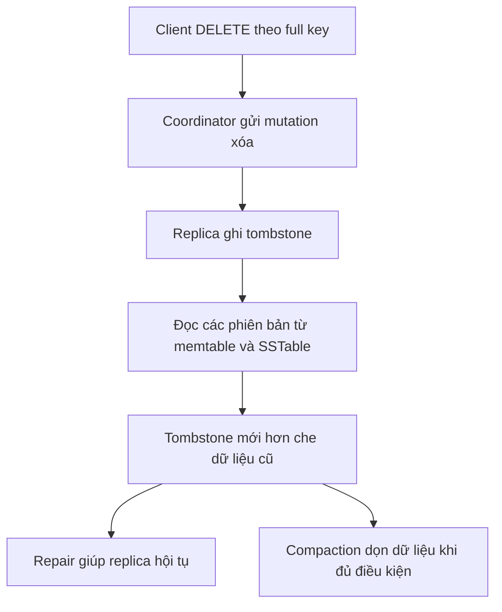
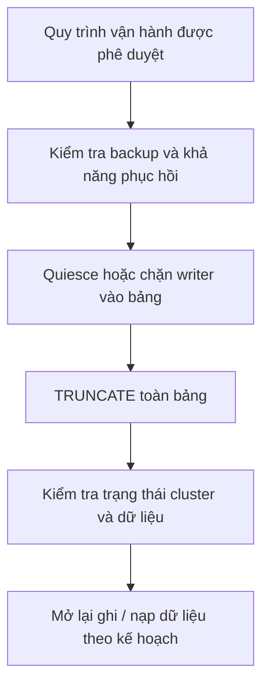

# TRUNCATE so với DELETE và kế hoạch bảo vệ dữ liệu trong Apache Cassandra

Trong Apache Cassandra, **`DELETE`** và **`TRUNCATE`** đều có thể khiến dữ liệu không còn xuất hiện khi truy vấn, nhưng chúng không phải hai cách viết tương đương. `DELETE` tạo mutation xóa cho **cột, hàng, khoảng clustering hoặc phân vùng** được xác định bằng khóa; `TRUNCATE` là thao tác quản trị làm rỗng **toàn bộ một bảng**. Khác biệt về phạm vi, tombstone, khả năng khôi phục và ảnh hưởng đến replica lớn đến mức chọn nhầm một lệnh có thể trở thành sự cố mất dữ liệu.

Bài thuộc chương **Ghi và xóa bằng CQL** của module **DATABASE_ENGINE_WIDE_COLUMN_CASSANDRA**. Ta sẽ nối ngữ nghĩa lệnh CQL với kiến trúc wide-column phân tán, partition key, replication, consistency level, compaction, repair và cách ứng dụng Java nên xử lý thao tác phá hủy dữ liệu.

**Mục tiêu học tập**

1. Phân biệt chính xác phạm vi, cơ chế và chi phí của `DELETE` so với `TRUNCATE`.
2. Viết câu lệnh xóa đúng theo primary key, không nhầm xóa một phân vùng với xóa cả bảng.
3. Giải thích tombstone, thời gian lưu dấu xóa, replica bỏ lỡ mutation và giới hạn của việc “đã xóa”.
4. Lập kế hoạch sao lưu, snapshot, khôi phục, xác nhận quyền và dừng ghi trước thao tác phá hủy.
5. Chọn cơ chế xóa cho retention, dữ liệu thử nghiệm, quyền riêng tư và thao tác vận hành.
6. Nhận diện trường hợp cần người vận hành thay vì đưa `TRUNCATE` vào một API Java thông thường.

## 1. Hiểu phạm vi trước khi chọn câu lệnh

Giả sử hệ thống ghi sự kiện theo khách hàng và ngày. Keyspace `demo` đã có trong môi trường thực hành; tạo bảng:

```sql
CREATE TABLE demo.events_by_tenant_day (
    tenant_id    uuid,
    event_day    date,
    event_time   timestamp,
    event_id     uuid,
    kind         text,
    details      text,
    PRIMARY KEY ((tenant_id, event_day), event_time, event_id)
) WITH CLUSTERING ORDER BY (event_time DESC, event_id ASC);
```

Một partition key của bảng này là **cặp** `(tenant_id, event_day)`; các hàng trong phân vùng được phân biệt bằng clustering key `(event_time, event_id)`.

```text
Bảng: demo.events_by_tenant_day
|
+-- Partition (tenant A, 2026-11-21)
|   +-- Row (09:00, event X): kind=LOGIN, details=...
|   +-- Row (09:30, event Y): kind=ERROR, details=...
|
+-- Partition (tenant A, 2026-11-22)
|   +-- Row (10:00, event Z): kind=LOGIN, details=...
|
+-- Partition (tenant B, 2026-11-21)
    +-- Row (11:00, event W): kind=PAYMENT, details=...
```

Với mô hình này:

| Mục tiêu | Phạm vi cần xóa | Hướng xử lý |
| --- | --- | --- |
| Bỏ nội dung `details` của sự kiện Y | Một cột của một hàng | `DELETE details FROM ... WHERE <full primary key>` |
| Xóa hẳn sự kiện Y | Một hàng clustering | `DELETE FROM ... WHERE <full primary key>` |
| Xóa sự kiện trong khung giờ của tenant A ngày 21 | Khoảng clustering trong **một phân vùng** | `DELETE FROM ... WHERE <full partition key> AND event_time ...` |
| Xóa toàn bộ sự kiện tenant A ngày 21 | Một phân vùng | `DELETE FROM ... WHERE <full partition key>` |
| Xóa **mọi tenant, mọi ngày** trong bảng | Toàn bảng | `TRUNCATE TABLE demo.events_by_tenant_day` |

Một lỗi đặc biệt nguy hiểm là chuyển từ:

```sql
DELETE FROM demo.events_by_tenant_day
WHERE tenant_id = 11111111-1111-4111-8111-111111111111
  AND event_day = '2026-11-21';
```

sang:

```sql
TRUNCATE TABLE demo.events_by_tenant_day;
```

Hai câu khác nhau **hoàn toàn về quy mô**: câu đầu xóa dữ liệu của **một tenant trong một ngày**, câu sau làm rỗng dữ liệu của **toàn bảng trên cluster**. Không có điều kiện `WHERE` trong `TRUNCATE` để giới hạn phạm vi.

## 2. So sánh DELETE và TRUNCATE trong một bảng

| Thuộc tính | `DELETE` | `TRUNCATE` |
| --- | --- | --- |
| Phạm vi | Cột, hàng, khoảng clustering hoặc partition theo khóa | **Toàn bộ một bảng** |
| Cú pháp định vị | `WHERE` với primary key / clustering restriction hợp lệ | Tên bảng; **không có WHERE** |
| Đường xử lý | Mutation xóa có timestamp | Thao tác quản trị truncate dữ liệu bảng |
| Tombstone | Tạo cell/row/range/partition tombstone tùy phạm vi | Không giả lập việc xóa mọi hàng bằng từng row tombstone |
| Ảnh hưởng dữ liệu còn lại | Có thể giữ các hàng/phân vùng khác | Không giữ hàng nào trong bảng nếu truncate thành công |
| Giữ schema bảng | Có | Có: `TRUNCATE` không phải `DROP TABLE` |
| Điều kiện `IF EXISTS` ở hàng | Có thể dùng LWT trong phạm vi hỗ trợ | Không phải cú pháp của `TRUNCATE` |
| TTL | Không dùng `USING TTL` cho DELETE | Không dùng `USING TTL` cho TRUNCATE |
| Khôi phục từ CQL | Không có `UNDO` tự động | Không có `ROLLBACK TRUNCATE` tự động |
| Điểm khôi phục thực tế | Backup/snapshot/PITR đã chuẩn bị; khả năng phục hồi phụ thuộc lịch sử và thời điểm | Phụ thuộc snapshot/backup **có thực và kiểm chứng được trước thao tác** |
| Mức độ rủi ro | Tùy phạm vi WHERE, có thể rất lớn | **Phá hủy toàn bộ dữ liệu bảng** |
| Trường hợp phổ biến | Xóa một bản ghi, retention theo bucket, quyền xóa dữ liệu | Dọn bảng lab, nạp lại bảng dùng để rebuild có quy trình, reset dữ liệu thử nghiệm |

**Tóm lược:** `DELETE` là một **mutation có phạm vi theo khóa**; `TRUNCATE` là một **quyết định vận hành có phạm vi cả bảng**. Không nên chọn `TRUNCATE` chỉ vì nghe “nhanh hơn DELETE” mà chưa hiểu mục tiêu khôi phục và phụ thuộc dữ liệu.

## 3. DELETE: xóa đúng cột, hàng, khoảng hoặc partition

Các ví dụ sau sử dụng tenant A `11111111-1111-4111-8111-111111111111` và ngày `2026-11-21`. Chúng minh họa các phạm vi **độc lập**; không nên chạy tất cả tuần tự trên dữ liệu cần giữ.

### 3.1. Xóa một cột

```sql
DELETE details FROM demo.events_by_tenant_day
WHERE tenant_id = 11111111-1111-4111-8111-111111111111
  AND event_day = '2026-11-21'
  AND event_time = '2026-11-21 09:30:00+0700'
  AND event_id = bbbbbbbb-bbbb-4bbb-8bbb-bbbbbbbbbbbb;
```

`details` của một sự kiện bị xóa. `kind` vẫn có thể tồn tại, và hàng chưa bị xóa hoàn toàn. Với regular column, việc xóa riêng cột cần xác định **full primary key**.

### 3.2. Xóa một hàng

```sql
DELETE FROM demo.events_by_tenant_day
WHERE tenant_id = 11111111-1111-4111-8111-111111111111
  AND event_day = '2026-11-21'
  AND event_time = '2026-11-21 09:30:00+0700'
  AND event_id = bbbbbbbb-bbbb-4bbb-8bbb-bbbbbbbbbbbb;
```

Không nêu danh sách cột sau `DELETE` và cung cấp đầy đủ clustering key sẽ xóa **một hàng**. Những sự kiện khác cùng partition không tự bị xóa bởi mutation này.

### 3.3. Xóa một khoảng clustering

```sql
DELETE FROM demo.events_by_tenant_day
WHERE tenant_id = 11111111-1111-4111-8111-111111111111
  AND event_day = '2026-11-21'
  AND event_time >= '2026-11-21 09:00:00+0700'
  AND event_time <  '2026-11-21 10:00:00+0700';
```

Khoảng `[09:00, 10:00)` xóa các hàng có thời điểm nằm trong khoảng của **một phân vùng** đã định; ranh giới cuối dùng `<` để **không** xóa sự kiện đúng 10:00. Cassandra có thể biểu diễn kết quả bằng **range tombstone**, thay vì client phải liệt kê từng event ID.

### 3.4. Xóa cả phân vùng

```sql
DELETE FROM demo.events_by_tenant_day
WHERE tenant_id = 11111111-1111-4111-8111-111111111111
  AND event_day = '2026-11-21';
```

Lệnh này xóa mọi clustering row của **tenant A trong ngày 21**. Các phân vùng ngày khác và tenant khác không thuộc phạm vi mutation.

**Chú ý partition key ghép:** chỉ có `tenant_id` mà thiếu `event_day` không mô tả đúng một partition key. Một lệnh `DELETE FROM table WHERE tenant_id = ...` kiểu SQL quan hệ không tự động quét và xóa mọi ngày của tenant.

### 3.5. DELETE không phải một lần đọc trước

DELETE thông thường không cần đọc hàng cũ rồi mới tạo mutation xóa. Xóa một khóa không tồn tại vẫn có thể ghi dấu xóa; nó không phải công cụ trả về số hàng từng tồn tại trước khi xóa. Nếu nghiệp vụ yêu cầu “chỉ xóa hàng khi đang tồn tại”, một `DELETE ... IF EXISTS` (LWT) có thể phù hợp với **một hàng được định vị đúng khóa**, song phải chấp nhận chi phí đồng thuận và xử lý kết quả `[applied]`.

Với yêu cầu lớn hơn như retention nhiều ngày, ứng dụng phải xác định các partition key hoặc thiết kế mô hình lưu giữ phù hợp. Không dùng `DELETE FROM table` không có `WHERE` để thay `TRUNCATE`.

## 4. TRUNCATE: làm rỗng toàn bộ bảng

Cú pháp CQL:

```sql
TRUNCATE TABLE demo.events_by_tenant_day;

-- Từ khóa TABLE có thể lược bỏ trong cú pháp CQL hỗ trợ.
TRUNCATE demo.events_by_tenant_day;
```

**Chỉ chọn một trong hai cách viết trên**, không chạy cả hai nếu không có lý do. Không có bộ lọc:

```sql
-- SAI: TRUNCATE không nhận điều kiện WHERE.
TRUNCATE TABLE demo.events_by_tenant_day
WHERE tenant_id = 11111111-1111-4111-8111-111111111111;
```

Điều quan trọng về kết quả:

- Mọi phân vùng của bảng đều thuộc phạm vi xóa; sau một `TRUNCATE` thành công, dữ liệu của bảng không còn được trả về như trước.
- **Định nghĩa bảng vẫn còn**: tên bảng, cột và primary key không bị xóa theo nghĩa `DROP TABLE`. Ứng dụng có thể ghi dữ liệu mới vào bảng sau đó.
- Đây không phải câu lệnh CQL có `IF EXISTS` để kiểm tra từng hàng, không có `USING TTL` và không có `WHERE`.
- Cassandra xử lý truncate ở **mức toàn bảng** trong hệ thống phân tán. Node không sẵn sàng hoặc sự cố trong quá trình phối hợp có thể khiến thao tác thất bại/không có kết quả chắc chắn đối với client; cần quy trình kiểm tra và phục hồi theo phiên bản đang chạy.
- Truncation không phải một vòng lặp phát hàng triệu `DELETE` theo từng full primary key; vì thế không tạo ra hàng triệu row tombstone **theo cách đó**.

**Không suy ra từ “không tạo hàng triệu row tombstone” rằng dữ liệu đã bị hủy an toàn trên mọi bản sao lưu, snapshot, ổ đĩa và hệ thống phụ trợ.** Đó là câu chuyện khác của bảo mật, retention và lifecycle dữ liệu.

### TRUNCATE khác DROP TABLE

```sql
-- TRUNCATE: giữ schema của bảng, xóa dữ liệu bảng.
TRUNCATE TABLE demo.events_by_tenant_day;

-- DROP TABLE: xóa định nghĩa bảng cùng dữ liệu liên quan.
-- KHÔNG chạy nếu vẫn cần schema!
DROP TABLE demo.events_by_tenant_day;
```

Đừng dùng `DROP TABLE` như phương án “truncate rồi tạo lại” khi bảng đang có các phụ thuộc và cấu hình vận hành. Trình tự này có thể ảnh hưởng permissions, schema, index, materialized view, ứng dụng và quản lý thay đổi; đó không phải một phép tối ưu tương đương có thể thay thế tùy ý.

## 5. Vì sao DELETE sinh tombstone, còn TRUNCATE có cơ chế riêng?

Cassandra lưu dữ liệu theo mô hình **LSM tree**: mutation được ghi vào commit log và memtable, sau đó flush thành các tệp **SSTable** bất biến. Một giá trị cũ có thể còn trong SSTable này, trong khi dữ liệu mới hoặc dấu xóa nằm ở memtable/SSTable khác.

Với **DELETE**, Cassandra không thể xóa ngay mọi byte của bản ghi cũ trên mọi node. Nó cần **tombstone** mang timestamp để khi đọc/hòa giải, phiên bản cũ hơn không sống lại.



Với **TRUNCATE**, mục đích không phải che phiên bản của một số hàng theo khóa, mà là **loại bỏ tập dữ liệu của cả bảng** bằng quy trình truncate ở cấp bảng/replica. Cassandra có cơ chế ghi nhận thời điểm truncate và xử lý dữ liệu lưu trữ tương ứng nhằm tránh phục hồi dữ liệu trước truncate qua replay không phù hợp; chi tiết thực thi phụ thuộc phiên bản.



**Không dùng sơ đồ TRUNCATE để suy ra có transaction xuyên các bảng.** Trong Cassandra, thao tác toàn bảng này không phải một giao dịch nghiệp vụ tự động bao gồm thêm các bảng liên quan, cache, search index ngoài cluster hoặc hệ thống downstream.

### Các loại tombstone thường gặp khi DELETE

| Phạm vi xóa | CQL ví dụ | Dấu xóa logic điển hình |
| --- | --- | --- |
| Một regular column | `DELETE details ... WHERE <full primary key>` | Cell tombstone |
| Một hàng | `DELETE FROM ... WHERE <full primary key>` | Row tombstone |
| Một đoạn clustering | `DELETE FROM ... WHERE <full partition key> AND event_time ...` | Range tombstone |
| Cả partition | `DELETE FROM ... WHERE <full partition key>` | Partition tombstone |

Khi ghi nhiều xóa lớn, tombstone có thể làm đọc tốn công đối chiếu các phiên bản và tăng tải compaction. `TRUNCATE` tránh kiểu công việc xóa từng hàng đó, nhưng đánh đổi bằng **mất toàn bộ dữ liệu bảng**.

### `gc_grace_seconds` không phải thời hạn hoàn tác

Tham số `gc_grace_seconds` liên quan đến điều kiện tuổi của tombstone trước khi nó đủ điều kiện thu gom an toàn. Nó không phải nút “giữ dữ liệu đã xóa để khôi phục trong N giây”, và cũng không cam kết tombstone sẽ biến mất chính xác khi hết N giây.

Vì hệ thống có nhiều replica, một node tạm ngắt kết nối có thể bỏ lỡ dấu xóa. Nếu dấu xóa bị thu gom trước khi node đó được repair/đồng bộ, **dữ liệu cũ có nguy cơ xuất hiện lại** (*zombie data*). Không giảm `gc_grace_seconds` tùy tiện để chữa latency đọc; phải hiểu lịch repair, cấu hình compaction và topology của phiên bản Cassandra đang chạy.

**Khôi phục từ tombstone không phải backup strategy.** Cả DELETE lẫn TRUNCATE đều cần kế hoạch backup/restore chủ động nếu dữ liệu có giá trị.

## 6. Replication, consistency và lỗi mạng

Giả sử keyspace có replication factor 3, tức một phân vùng có thể được lưu trên ba replica theo chiến lược replication. Khi DELETE theo khóa, coordinator gửi mutation đến các replica thích hợp; consistency level quyết định mức xác nhận cần đạt trước khi client nhận thành công.

| Tình huống | Điều có thể xảy ra | Bài học vận hành |
| --- | --- | --- |
| `DELETE` ở mức `ONE` | Một replica xác nhận sớm; replica khác có thể chưa theo kịp | Đừng xem phản hồi thành công là mọi replica đã biết dấu xóa |
| `DELETE` ở mức `QUORUM` với RF=3 | Thông thường cần 2 replica trong phạm vi quorum xác nhận | Có bảo đảm xác nhận mạnh hơn, nhưng không thay repair |
| Một replica mất kết nối khi DELETE | Dữ liệu cũ có thể còn tại replica đó | Repair/hội tụ phải được vận hành đúng |
| Client timeout sau DELETE | Một phần replica vẫn có thể đã ghi mutation | Không đồng nhất timeout với “xóa thất bại chắc chắn” |
| Client timeout sau TRUNCATE | Kết quả từ góc nhìn client có thể không chắc chắn | Kiểm tra trạng thái cụm, không bấm chạy lại mù quáng |
| Writer ghi trong khi TRUNCATE | Có thể tạo dữ liệu mới quanh thời điểm thực hiện | Quiesce writer và xác định ranh giới dữ liệu cần bỏ |

### Vì sao TRUNCATE cần phối hợp cẩn thận hơn?

TRUNCATE không chỉ nhắm một partition, nên ảnh hưởng trên **toàn bộ các node/replica lưu bảng**. Tùy phiên bản Cassandra và tình trạng node, sự cố kết nối hoặc node không khả dụng có thể cản trở việc hoàn tất truncate; không thiết kế quy trình với giả định “câu lệnh này chỉ gửi đến một node là xong”.

Trước khi thực hiện, người vận hành cần kiểm tra các node, topology, các phiên bản schema và trạng thái lưu trữ theo công cụ của cụm. Sau khi thực hiện, cần kiểm tra trên **nhiều đường đọc/replica khi phù hợp**, không chỉ một câu `SELECT` ở consistency level thấp.

### TRUNCATE không phải chốt chặn vĩnh viễn việc ghi mới

Sau khi truncate xong, schema vẫn tồn tại. Một ứng dụng đang chạy có thể **ghi sự kiện mới** vào bảng ngay sau đó.

```text
08:59:59  Ingestion vẫn chạy, tiếp tục gửi mutation.
09:00:00  Operator phát TRUNCATE.
09:00:01  Application gửi dữ liệu mới vào bảng.
09:00:02  Operator SELECT, thấy dữ liệu xuất hiện.
```

Kết quả này không nhất thiết chứng minh TRUNCATE “không hoạt động”; có thể bảng đã rỗng rồi được ghi mới. Vì vậy cần định nghĩa **điểm cắt nghiệp vụ**, tạm dừng producer/consumer và quy tắc replay trước khi truncate.

Nếu mục tiêu là **ngăn dữ liệu cũ được nạp lại**, phải xử lý cả replay queue, retry từ client, CDC/downstream, batch import hoặc job backfill. Một câu `TRUNCATE` chỉ tác động dữ liệu Cassandra của bảng, không xóa các nguồn bên ngoài vốn có thể ghi dữ liệu trở lại.

## 7. Hiệu năng: vì sao không dùng hàng triệu DELETE để làm rỗng một bảng?

Giả sử bảng có hàng trăm triệu sự kiện thuộc nhiều tenant và nhiều ngày. Một script quét mọi hàng rồi phát `DELETE` riêng:

- Cần đọc hoặc tìm khóa từng hàng, thường không phù hợp với thiết kế truy vấn Cassandra.
- Tạo nhiều mutation và tombstone, làm tăng tải mạng, ghi và compaction.
- Có thể tạo **hot partition** hoặc đẩy tải cao lên một số replica.
- Dễ thất bại giữa chừng; khó chứng minh đã xóa đủ các hàng.
- Có thể ảnh hưởng latency đọc còn lại trong quá trình xử lý tombstone.

Nếu **mục tiêu thật sự là dọn sạch toàn bảng để nạp lại từ đầu**, một quy trình `TRUNCATE` quản trị có chuẩn bị thường phù hợp hơn loop DELETE.

Nhưng nếu cần **giữ dữ liệu của tenant B** trong ví dụ, `TRUNCATE` là lựa chọn **sai về nghiệp vụ** dù nó nhanh: hãy xóa theo partition/range đã định hoặc thay đổi mô hình lưu giữ.

### Đừng kiểm tra bảng lớn bằng SELECT COUNT(*) một cách ngây thơ

```sql
-- Có thể gây quét bảng rất tốn kém trên dữ liệu lớn:
SELECT COUNT(*) FROM demo.events_by_tenant_day;
```

Cassandra không lưu một “row count” toàn bảng rẻ và luôn chính xác kiểu metadata đơn giản cho mọi trường hợp. `COUNT(*)` trên bảng lớn có thể phải quét khối lượng dữ liệu đáng kể. Không chạy nó như bước xác minh production sau TRUNCATE nếu chưa đánh giá chi phí.

Trong kế hoạch vận hành, dùng các biện pháp có phạm vi và chi phí xác định:

1. Kiểm tra trạng thái node/schema bằng công cụ vận hành phù hợp phiên bản.
2. Đọc mẫu các partition key đã biết sau khi đã chặn writer.
3. Xem chỉ số dung lượng/ước tính hàng, sstable và trạng thái compaction từ monitoring.
4. Đối chiếu số liệu nạp lại với nguồn dữ liệu độc lập nếu có.

Một vài lần `SELECT` trả rỗng là **tín hiệu kiểm tra**, không thay cho xác nhận đầy đủ trạng thái trên toàn hệ thống.

### Khi nào TTL tốt hơn DELETE và TRUNCATE?

Với dữ liệu sự kiện cần giữ đúng một thời hạn, thiết kế bảng theo **bucket thời gian** kết hợp `default_time_to_live` hoặc `USING TTL` phù hợp có thể tự động hết hạn dữ liệu.

```sql
-- Minh họa một giá trị sự kiện có TTL 7 ngày.
INSERT INTO demo.events_by_tenant_day (
    tenant_id, event_day, event_time, event_id, kind, details
)
VALUES (
    11111111-1111-4111-8111-111111111111,
    '2026-11-21',
    '2026-11-21 12:00:00+0700',
    aaaaaaaa-aaaa-4aaa-8aaa-aaaaaaaaaaaa,
    'HEARTBEAT',
    'lab-event'
)
USING TTL 604800;
```

TTL giúp dữ liệu không còn sống sau thời gian định trước, nhưng vẫn liên quan tombstone và compaction. TTL **không phải giải pháp xóa tức thì mọi dữ liệu cũ** hoặc thay thế backup.

Nếu một tenant yêu cầu xóa ngay một nhóm dữ liệu có khóa rõ ràng, DELETE vẫn phù hợp hơn chờ TTL. Nếu cần dọn toàn bộ bảng lab sau đợt thử nghiệm, TRUNCATE có thể phù hợp hơn chờ hết TTL của từng cell.

## 8. Vì sao snapshot, backup và restore là ba khái niệm khác nhau?

Không có câu lệnh CQL kiểu `ROLLBACK TRUNCATE` để lập tức hoàn tác dữ liệu vừa bị truncate. Có **kế hoạch bảo vệ dữ liệu** nghĩa là đã biết chính xác có thể phục hồi từ đâu, phục hồi đến trạng thái nào và trong bao lâu.

### 8.1. Snapshot: ảnh chụp dữ liệu SSTable tại một mốc

Cassandra cung cấp khả năng tạo **snapshot của dữ liệu SSTable**, thường thông qua công cụ `nodetool snapshot`. Snapshot ở từng node có thể sử dụng hard link hoặc cơ chế hệ tệp tương đương đối với SSTable hiện có; nó **không** phải một bản sao off-site độc lập chỉ vì có tên snapshot.

Trong nhiều bản triển khai, cấu hình `auto_snapshot` có thể cho phép tự tạo snapshot trước các thao tác phá hủy như truncate/drop. Tuy nhiên:

- Không giả định `auto_snapshot` luôn bật hoặc có hành vi giống nhau ở mọi phiên bản.
- Không giả định snapshot nằm trên đĩa cùng node sẽ sống sót khi ổ đĩa hoặc node đó hỏng.
- Không giả định một snapshot được lấy khi writer vẫn chạy là điểm cắt logic đồng nhất cho nhiều bảng nghiệp vụ.
- Không giả định snapshot tự đủ cho phục hồi đúng thời điểm từng request; còn phụ thuộc commit log, schema, backup và chính sách hệ thống.

**Trước TRUNCATE**, cần tạo hoặc kiểm tra một **điểm khôi phục thực sự tồn tại**, có tag, thời gian, vị trí, node liên quan, tình trạng sao lưu ra nơi độc lập và hướng dẫn restore đã được thử nghiệm.

### 8.2. Backup: bản sao được giữ an toàn ngoài nguồn chính

Một chương trình backup tốt phải bao gồm **dữ liệu** và **thông tin cần để sử dụng lại dữ liệu**:

| Thành phần | Vì sao cần |
| --- | --- |
| Snapshot/SSTable từ các replica/node phù hợp | Nguồn dữ liệu đã lưu cần phục hồi |
| Định nghĩa bảng/keyspace và schema version | Tránh phục hồi vào bảng có cấu trúc không khớp |
| Cấu hình replication và topology | Biết cần phân bố lại dữ liệu như thế nào |
| Metadata backup | Tag, thời gian, checksum hoặc kiểm tra tính toàn vẹn, vị trí |
| Bản sao ngoài node/ngoài vùng phù hợp | Chống mất đĩa, mất node hoặc mất toàn cụm |
| Chính sách giữ và kiểm soát quyền truy cập | Đảm bảo dữ liệu vừa có thể khôi phục vừa được bảo vệ |
| Kết quả thử restore | Chứng minh bản backup **dùng được**, không chỉ “job chạy thành công” |

Cần phân biệt **backup vật lý** với **nguồn dữ liệu nghiệp vụ có thể tái tạo**. Nếu bảng là một bảng denormalized được xây dựng từ nguồn khác có thể nạp lại, kế hoạch có thể chọn **rebuild từ nguồn chuẩn** thay vì phục hồi SSTable. Nhưng phải xác nhận nguồn chuẩn thực sự còn dữ liệu, công cụ rebuild hoạt động và khả năng đáp ứng RTO trước khi truncate.

### 8.3. Restore: quy trình đem dữ liệu trở lại

Khôi phục không phải chỉ là một câu `INSERT`. Tùy phiên bản Cassandra và phương pháp sao lưu, nó có thể cần:

1. Đảm bảo cluster đích ở trạng thái phù hợp; dừng/kiểm soát các writer có thể cạnh tranh.
2. Kiểm tra phiên bản Cassandra, schema và table ID/schema metadata tương thích.
3. Chọn đúng tập snapshot/SSTable từ các node/replica, không chỉ một file ngẫu nhiên.
4. Sử dụng công cụ restore/import SSTable được hỗ trợ cho phiên bản (ví dụ quy trình nạp SSTable, thay vì sao chép tay vào đường dẫn tùy ý).
5. Kiểm tra phân bố replica, trạng thái streaming/repair và các dữ liệu mới cần hòa giải.
6. Đối chiếu dữ liệu với manifest backup và những partition key mẫu đã xác định.
7. Mở lại ứng dụng theo kế hoạch đã phê duyệt.

**Không đưa lệnh phục hồi SSTable chưa được thử lên production.** Phương pháp restore khác nhau tùy dòng phiên bản, công cụ quản trị, topology và việc cụm đang chạy hay đã dừng; quy trình phải được kiểm nghiệm trong môi trường tương đương trước sự cố.

### 8.4. RPO, RTO và điểm cắt dữ liệu

Hai chỉ số của kế hoạch:

- **RPO (Recovery Point Objective):** tối đa bao nhiêu dữ liệu có thể mất giữa điểm backup và thời điểm xảy ra sự cố?
- **RTO (Recovery Time Objective):** thời gian tối đa để hệ thống phục hồi chức năng cần thiết?

Ví dụ: snapshot được chụp lúc 01:00, bảng bị truncate nhầm lúc 10:00. Chỉ có snapshot lúc 01:00 thì phần ghi từ 01:00 đến 10:00 **không tự động có trong ảnh chụp**. Muốn phục hồi gần 10:00, hệ thống phải có nguồn thay đổi khác (như log, backup gia tăng, nguồn sự kiện) **đã được cấu hình và kiểm chứng**, không phải chỉ nói “Cassandra có commit log”.

Commit log phục vụ phục hồi hoạt động của Cassandra, **không tự động là hệ thống point-in-time recovery đầy đủ** cho mọi nhu cầu. Muốn dùng commit log archiving/PITR phải thiết kế, lưu trữ, bảo vệ và diễn tập từ trước, đồng thời hiểu cách xử lý truncation records khi phục hồi.

## 9. Runbook bảo vệ dữ liệu trước TRUNCATE

Với một bảng production, nên coi TRUNCATE là **thay đổi phá hủy** theo quy trình vận hành có phê duyệt. Dưới đây là runbook có thể dùng làm cơ sở, cần điều chỉnh theo tổ chức và phiên bản Cassandra.

**Bước 1 — Xác định phạm vi chính xác.** Ghi nhận **cluster**, môi trường, keyspace, tên bảng đầy đủ, chủ sở hữu dữ liệu và mục đích. Có chắc người yêu cầu muốn xóa **mọi tenant/ngày**, không phải chỉ một partition? Nếu chỉ cần xóa một tenant, dừng kế hoạch TRUNCATE và thiết kế DELETE theo khóa.

**Bước 2 — Xác định phụ thuộc.** Kiểm tra ứng dụng đọc/ghi, bảng denormalized cùng nguồn, materialized view, index, cache, hệ thống tìm kiếm, CDC, ingestion queue, batch import và job backfill có liên quan. Không mặc định một TRUNCATE trên bảng A sẽ làm sạch mọi bản sao ở hệ thống B.

**Bước 3 — Kiểm tra quyền và phê duyệt.** Sử dụng role vận hành được cấp quyền đúng phạm vi; tách quyền truncate khỏi role ứng dụng nếu có thể. Với dữ liệu quan trọng nên áp dụng phê duyệt hai người, ticket thay đổi, cửa sổ bảo trì và kịch bản dừng.

**Bước 4 — Chọn điểm khôi phục.** Ghi RPO/RTO mong muốn. Xác minh snapshot/backup hoặc nguồn rebuild có thể dùng để phục hồi, vị trí lưu ngoài node, manifest và dữ liệu mẫu để đối chiếu. Không dựa chỉ vào giả định `auto_snapshot` đã bật.

**Bước 5 — Diễn tập/phê duyệt phương án phục hồi.** Trước khi xóa production, xác nhận đã có cách restore được thử nghiệm trong môi trường tương đương. Xác định người chịu trách nhiệm, điều kiện bắt đầu restore và những ghi mới sẽ được xử lý ra sao.

**Bước 6 — Đặt hệ thống ở trạng thái yên ghi.** Tạm dừng hoặc kiểm soát producers, consumers, scheduler, CDC loopback, request retry và job backfill. Lưu checkpoint/offset phù hợp để khi mở lại không vô tình nạp lại toàn bộ dữ liệu đã chủ ý xóa.

**Bước 7 — Kiểm tra sức khỏe cluster.** Xác minh node, replica, disk, schema agreement, trạng thái backup và khả năng liên lạc; hoãn nếu node lỗi. Ghi lại những chỉ số nền trước thao tác.

**Bước 8 — Xác nhận lần cuối đúng đối tượng.** Đối chiếu tên đầy đủ `keyspace.table` với ticket và bảng kiểm. Không dùng tên bảng động lấy trực tiếp từ người dùng không đáng tin cậy. Quy trình có thể yêu cầu gõ lại tên bảng và một câu xác nhận độc lập.

**Bước 9 — Thực thi một lần theo runbook.** Người có quyền vận hành thực hiện `TRUNCATE TABLE keyspace.table` tại cửa sổ đã duyệt. Ghi nhận thời điểm, người thực hiện, statement, thông báo kết quả và tình trạng cluster; không tự động phát lại nếu client timeout.

**Bước 10 — Xác minh và mở lại dịch vụ.** Kiểm tra lỗi node/replica, các partition key mẫu đã biết, metric của bảng và khả năng ghi dữ liệu mới. Nếu cần rebuild, nạp lại theo checkpoint rõ ràng; chỉ mở lại các writer khi trạng thái phù hợp với mục tiêu thay đổi.

**Bước 11 — Lưu hồ sơ và hậu kiểm.** Lưu ticket, manifest backup, kết quả xác minh, thời gian thực tế, lỗi gặp phải, quyết định tiếp tục/restore và cập nhật runbook. Nếu thao tác tác động dữ liệu nhạy cảm, kiểm tra cả chính sách retention cho snapshot/backup.

### Go / no-go trước khi chạy

| Câu hỏi | Nếu câu trả lời là “Không” |
| --- | --- |
| Đã xác minh đúng cluster/keyspace/table? | **Không chạy** |
| Mọi người liên quan đã chấp nhận xóa toàn bộ bảng? | **Không chạy** |
| Backup hoặc nguồn rebuild đã được kiểm chứng? | **Không chạy** nếu dữ liệu cần phục hồi |
| Có chiến lược kiểm soát các writer/queue/replay? | **Không chạy** |
| Trạng thái node và schema phù hợp? | Hoãn, xử lý cluster trước |
| Có người chịu trách nhiệm xác minh và kích hoạt restore? | Hoãn, hoàn thiện runbook |
| Đã xác định RPO/RTO và mức mất dữ liệu chấp nhận được? | Hoãn, chốt yêu cầu |

Đối với bảng lab có thể tái tạo, mức yêu cầu có thể nhẹ hơn, nhưng **phạm vi và môi trường** vẫn phải được xác nhận: sai cluster production là rủi ro không được giải quyết bằng việc “bảng lab không quan trọng”.

## 10. Khi TRUNCATE hoặc DELETE xảy ra nhầm: kế hoạch ứng phó

Hãy giả sử người vận hành dự định xóa một partition, nhưng lại thực hiện `TRUNCATE` lên bảng sự kiện. Điều quan trọng nhất lúc này là **không phát thêm lệnh phá hủy** và không vội coi mọi byte đã biến mất hoặc đã khôi phục được.

### 10.1. Phản ứng trong những phút đầu

1. **Kích hoạt quy trình sự cố** và ghi lại thời điểm phát lệnh, cluster, keyspace, bảng, user/role, kết quả driver/cqlsh và trạng thái node.
2. **Tạm dừng writers** vào bảng bị ảnh hưởng nếu có thể, gồm luồng ingestion, consumer, backfill và retry. Điều này giữ cho điểm khôi phục không bị pha trộn với ghi mới không kiểm soát.
3. **Bảo vệ các snapshot/backup hiện có** khỏi tác vụ dọn dẹp định kỳ cho tới khi xác định điểm phục hồi.
4. **Kiểm tra có snapshot trước truncate hay không** và vị trí trên từng node; không giả định `auto_snapshot` đã bật.
5. **Khoanh vùng dữ liệu bị ảnh hưởng**, gồm các bảng denormalized cùng nguồn và hệ thống downstream.
6. **Chỉ định người điều phối khôi phục** và tách thao tác phục hồi khỏi client/API bình thường.

### 10.2. Phân loại nguồn khôi phục

| Nguồn | Có thể giúp gì? | Giới hạn |
| --- | --- | --- |
| Snapshot được chụp trước truncate | Khôi phục trạng thái bảng gần thời điểm snapshot | Thiếu dữ liệu ghi sau snapshot; cần có đúng SSTable, schema, topology |
| Backup vật lý off-site | Phục hồi cả khi node/đĩa nguồn không còn | Thời gian tải dữ liệu, kiểm tra tính toàn vẹn, độ mới |
| Nguồn sự kiện upstream | Rebuild bảng theo các event đã lưu | Phải đảm bảo nguồn còn đủ event và tiến trình rebuild idempotent |
| Snapshot + cơ chế log/archiving đã cấu hình | Có thể hỗ trợ phục hồi gần hơn điểm sự cố | Cần công cụ, lưu trữ, thực nghiệm và chính sách replay phù hợp |
| Replica chưa đồng bộ | Không phải nguồn backup đáng tin cậy | Không nên dựa vào node bị lỗi như đường khôi phục chính thức |

**Không tự ý sao chép SSTable cũ vào thư mục bảng đang chạy** để “làm dữ liệu sống lại”. Với DELETE, tombstone mới hơn có thể tiếp tục che dữ liệu cũ, còn với TRUNCATE cần xét truncation metadata và cơ chế nhập lại dữ liệu của phiên bản Cassandra. Phục hồi đúng cách phải theo quy trình restore được hỗ trợ, thường nên thử nghiệm trong môi trường tách biệt trước khi đưa vào production.

### 10.3. Quy trình restore khuyến nghị

1. **Chọn điểm phục hồi** dựa trên backup/snapshot có thật và RPO được chấp nhận.
2. **Dựng môi trường kiểm tra** (nếu điều kiện cho phép) với schema, phiên bản, replication và dữ liệu nguồn tương thích.
3. **Thực hiện restore thử** bằng công cụ/phiên bản được hỗ trợ; đối chiếu những partition key và số lượng bản ghi từ manifest hoặc nguồn đáng tin cậy.
4. **Lập kế hoạch xử lý dữ liệu mới** đã được ghi sau snapshot nhưng trước/hoặc sau truncate: bỏ, nạp lại hay hòa giải theo event ID?
5. **Thực hiện restore production** theo cửa sổ và checklist đã phê duyệt, với quyền truy cập phù hợp.
6. **Xác minh tính đúng đắn của dữ liệu và ứng dụng**, không chỉ việc truy vấn có trả dòng.
7. **Mở writer theo checkpoint**, theo dõi lỗi, read latency, compaction/streaming/repair và kết quả nghiệp vụ.

Một lần restore không thành công không nên dẫn đến việc phát lệnh TRUNCATE khác để “làm sạch trước” theo thói quen. Hãy bảo vệ các bằng chứng hiện có và đánh giá phương án tiếp theo.

### 10.4. Nếu là DELETE nhầm một partition

Với DELETE, một replica còn giữ SSTable cũ **không** có nghĩa client có thể bỏ tombstone và đọc an toàn dữ liệu đã xóa. Khôi phục có thể cần nạp lại dữ liệu có **phiên bản hợp lệ mới hơn dấu xóa** từ một nguồn được kiểm chứng, nhưng tự cấp timestamp quá cao có thể tạo vấn đề ghi đè về sau.

Trước khi khôi phục:

- Xác định khóa và phạm vi bị xóa; kiểm tra timestamp/mutation liên quan bằng telemetry nếu có.
- Chọn nguồn dữ liệu tin cậy và xác nhận quyền phục hồi.
- Xác định liệu việc khôi phục có vi phạm yêu cầu xóa hợp pháp/retention không.
- Kiểm soát ghi đồng thời để dữ liệu không bị trộn sai thứ tự nghiệp vụ.
- Dùng quy trình import/rebuild được thử nghiệm, không chỉnh `gc_grace_seconds` hoặc can thiệp thủ công vào tombstone để hy vọng dữ liệu trở lại.

## 11. Kế hoạch bảo vệ dữ liệu cho ba loại tình huống

### Tình huống A — Xóa dữ liệu một tenant theo yêu cầu

**Mục tiêu:** xóa dữ liệu của một tenant nhưng giữ mọi tenant khác.

Lựa chọn đúng thường là **DELETE theo các partition key có liên quan**, hoặc chính sách retention theo bảng/bucket đã thiết kế. Không dùng `TRUNCATE` nếu bảng chứa nhiều tenant.

Kế hoạch:

1. Liệt kê những bảng và keyspace lưu dữ liệu tenant, bao gồm các bảng denormalized theo những truy vấn khác nhau.
2. Xác định các partition key/bucket cần xóa; tránh quét toàn bảng nếu schema không hỗ trợ đường truy cập.
3. Định nghĩa tiêu chí hoàn thành: dữ liệu không còn được trả về qua các đường đọc, và các bản sao ở cache, search, export, backup được xử lý theo chính sách.
4. Chạy DELETE theo khóa với giới hạn tải và theo dõi tombstone/compaction/repair.
5. Kiểm tra dữ liệu của **tenant khác vẫn nguyên** bằng mẫu kiểm chứng.

**Lưu ý quyền riêng tư:** “CQL SELECT không còn trả về dữ liệu” khác “dữ liệu đã bị xóa khỏi mọi snapshot/backup”. Nếu có yêu cầu xóa theo quy định, cần chính sách retention, kiểm soát truy cập backup và xử lý bản sao ngoài Cassandra; không tuyên bố xóa vật lý ngay khi DELETE thành công.

### Tình huống B — Dọn bảng thử nghiệm hoặc bảng có thể rebuild

**Mục tiêu:** bảng chỉ chứa dữ liệu dùng thử, hoặc có nguồn chuẩn đủ để nạp lại toàn bộ.

TRUNCATE có thể phù hợp khi:

- Bảng thật sự dùng riêng cho thử nghiệm/rebuild;
- Tất cả dữ liệu trong bảng có thể mất theo mục tiêu được duyệt;
- Đã xác nhận đúng cluster và keyspace;
- Nguồn rebuild và thời gian thực thi đáp ứng RTO;
- Writer có thể dừng hoặc phát lại theo checkpoint kiểm soát.

Không nên thực hiện TRUNCATE nếu **một phần dữ liệu bảng là nguồn duy nhất** hoặc nhiều dịch vụ đang dùng bảng cho những mục đích khác.

### Tình huống C — Retention cho sự kiện số lượng lớn

**Mục tiêu:** tự xóa dữ liệu cũ hơn thời hạn, không ảnh hưởng dữ liệu mới.

Hướng thiết kế:

- Partition theo **tenant + bucket thời gian**, tránh một partition vô hạn.
- Chọn TTL hoặc `default_time_to_live` phù hợp vòng đời nghiệp vụ.
- Cân nhắc chiến lược compaction cho dữ liệu có TTL/time-series theo phiên bản Cassandra và phân bố timestamp/TTL thực tế.
- Theo dõi lượng tombstone, read latency, disk usage và nhịp compaction.
- Dùng DELETE range/partition cho các yêu cầu xóa bất thường, không phải cứ mỗi ngày lại TRUNCATE bảng dùng chung.

Không có một cấu hình TTL/compaction phù hợp mọi workload. Việc lựa chọn phụ thuộc kích thước partition, tần suất ghi, tuổi dữ liệu và truy vấn cần hỗ trợ.

## 12. Java Driver: tại sao nên tách quyền DELETE và TRUNCATE?

Trong ứng dụng Java, **DELETE theo khóa** là một thao tác nghiệp vụ thường gặp. **TRUNCATE toàn bảng** nên thuộc đường vận hành/quản trị riêng, có bảo vệ môi trường, xác nhận và audit.

### 12.1. Prepared DELETE theo full primary key

Ví dụ Java Driver 4.x, giả sử có `CqlSession session`, `UUID tenantId`, `UUID eventId` và các import tương ứng:

```java
PreparedStatement deleteOneEvent = session.prepare(
    "DELETE FROM demo.events_by_tenant_day " +
    "WHERE tenant_id = :tenant_id " +
    "AND event_day = :event_day " +
    "AND event_time = :event_time " +
    "AND event_id = :event_id"
);

BoundStatement bound = deleteOneEvent.boundStatementBuilder()
    .setUuid("tenant_id", tenantId)
    .setLocalDate("event_day", java.time.LocalDate.of(2026, 11, 21))
    .setInstant("event_time",
        java.time.Instant.parse("2026-11-21T02:30:00Z"))
    .setUuid("event_id", eventId)
    .build();

session.execute(bound);
```

`2026-11-21T02:30:00Z` tương ứng **09:30 tại múi giờ +07:00**. Khi partition key có `event_day`, ứng dụng cần thống nhất cách bucket ngày; không tự đổi ngày theo múi giờ máy chủ khi tạo khóa.

**Prepared statement bind giá trị khóa**, không bind được tên bảng như một value. Điều này quan trọng nếu hệ thống hỗ trợ nhiều tenant: đừng nối tên bảng tùy ý từ HTTP request.

### 12.2. TRUNCATE phải được khóa vào lệnh quản trị có tên bảng cố định

Đoạn sau **chỉ dùng để minh họa ở một cụm thử nghiệm có thể bỏ dữ liệu**. Nó cố tình không nhận tên bảng từ người dùng:

```java
import com.datastax.oss.driver.api.core.cql.SimpleStatement;

// Môi trường phải được lấy từ cấu hình tin cậy, không phải input HTTP.
String environment = appConfig.getEnvironment();
if (!"ISOLATED_LAB".equals(environment)) {
    throw new IllegalStateException("TRUNCATE chi duoc phep trong lab");
}

// labSession dùng credential riêng, KHÔNG dùng credential của web API.
labSession.execute(SimpleStatement.newInstance(
    "TRUNCATE TABLE demo.truncate_delete_lab"
));
```

Đây chỉ là **một lớp guardrail minh họa**, không đủ để biến TRUNCATE production thành an toàn. Trong production, nên có công cụ/runbook riêng, RBAC, phê duyệt, xác minh backup và một cơ chế kiểm soát ghi. Không expose endpoint kiểu `POST /admin/truncate?table=<name>` mà bất cứ client nào có thể điều khiển tên bảng.

### 12.3. Cách xử lý timeout trong Java

Một lỗi timeout sau DELETE hoặc TRUNCATE không tự chứng minh mutation bị từ chối trước khi tới replica.

Với DELETE theo khóa, ứng dụng phải quyết định rõ:

- API cần **xóa idempotent về trạng thái** hay cần phát hiện tài nguyên tồn tại?
- Có mutation cạnh tranh làm dữ liệu được ghi trở lại hay không?
- Có phải một `DELETE ... IF EXISTS` cần kiểm tra `ResultSet.wasApplied()` không?

Với TRUNCATE, **không để retry policy của client tự phát lại** như một câu `SET scalar = value` bình thường. Thực hiện theo quy trình vận hành: dừng luồng ghi, xác minh trạng thái cluster, đối chiếu dữ liệu/backup và quyết định tiếp tục hay khôi phục.

### 12.4. Thiết kế quyền hạn theo nguyên tắc tối thiểu

| Tài khoản/role | Quyền và đường thao tác nên có | Không nên có |
| --- | --- | --- |
| Application API | Đọc/ghi đúng các bảng và khóa cần thiết, kiểm tra quyền tenant ở tầng ứng dụng | Lệnh TRUNCATE tùy ý trên bảng dùng chung |
| Job retention | Xóa theo bucket được duyệt, giới hạn tải, log tác động | Truncate cả bảng chỉ vì hết hạn một số bản ghi |
| Operator dữ liệu | Thao tác phá hủy theo runbook, được phê duyệt, có khả năng đối chiếu backup | Dùng credential operator trong endpoint công khai |
| Backup/restore service | Truy cập backup theo chính sách an toàn, phục hồi được kiểm chứng | Quyền không giới hạn không có audit |

Quyền Cassandra cụ thể cần được cấu hình theo cơ chế RBAC/authorization của phiên bản đang chạy; bảng này mô tả **nguyên tắc phân tách trách nhiệm**, không thay thế cấu hình quyền thực tế.

## 13. Bài thực hành an toàn: DELETE một phần rồi TRUNCATE cả bảng lab

**Cảnh báo:** chỉ thực hiện trên **cluster thử nghiệm biệt lập** và bảng **được tạo riêng cho bài lab**, không dùng bảng ứng dụng có dữ liệu thật. `TRUNCATE` là lệnh phá hủy toàn bộ dữ liệu bảng, không có `ROLLBACK`. Nếu không chắc mình đang kết nối đúng môi trường, **không thực hiện bước TRUNCATE**.

### Bước 1 — Tạo bảng disposable riêng

```sql
CREATE TABLE demo.truncate_delete_lab (
    tenant_id uuid,
    bucket_day date,
    event_id uuid,
    payload text,
    PRIMARY KEY ((tenant_id, bucket_day), event_id)
);
```

Điều kiện để chạy: bạn có quyền tạo bảng ở keyspace thử nghiệm `demo`, tên `truncate_delete_lab` chưa được sử dụng và không có ứng dụng nào đang dựa vào bảng này. Nếu bảng đã tồn tại, **không dùng `CREATE TABLE IF NOT EXISTS` rồi tùy tiện truncate dữ liệu cũ**; cần xác minh lại quyền sở hữu và mục đích.

### Bước 2 — Tạo dữ liệu của hai tenant và hai ngày

```sql
-- Tenant A, ngày 21: hai hàng.
INSERT INTO demo.truncate_delete_lab
    (tenant_id, bucket_day, event_id, payload)
VALUES (
    11111111-1111-4111-8111-111111111111,
    '2026-11-21',
    aaaaaaaa-aaaa-4aaa-8aaa-aaaaaaaaaaaa,
    'A-day21-first'
);

INSERT INTO demo.truncate_delete_lab
    (tenant_id, bucket_day, event_id, payload)
VALUES (
    11111111-1111-4111-8111-111111111111,
    '2026-11-21',
    bbbbbbbb-bbbb-4bbb-8bbb-bbbbbbbbbbbb,
    'A-day21-second'
);

-- Tenant A, ngày 22: một hàng.
INSERT INTO demo.truncate_delete_lab
    (tenant_id, bucket_day, event_id, payload)
VALUES (
    11111111-1111-4111-8111-111111111111,
    '2026-11-22',
    cccccccc-cccc-4ccc-8ccc-cccccccccccc,
    'A-day22'
);

-- Tenant B, ngày 21: một hàng.
INSERT INTO demo.truncate_delete_lab
    (tenant_id, bucket_day, event_id, payload)
VALUES (
    22222222-2222-4222-8222-222222222222,
    '2026-11-21',
    dddddddd-dddd-4ddd-8ddd-dddddddddddd,
    'B-day21'
);
```

Có **4 hàng** thuộc **3 phân vùng**:

| Tenant | Ngày bucket | Event ID rút gọn | Payload |
| --- | --- | --- | --- |
| A | 21/11 | `aaaa...` | A-day21-first |
| A | 21/11 | `bbbb...` | A-day21-second |
| A | 22/11 | `cccc...` | A-day22 |
| B | 21/11 | `dddd...` | B-day21 |

### Bước 3 — Xóa một hàng, kiểm tra phân vùng còn lại

```sql
DELETE FROM demo.truncate_delete_lab
WHERE tenant_id = 11111111-1111-4111-8111-111111111111
  AND bucket_day = '2026-11-21'
  AND event_id = aaaaaaaa-aaaa-4aaa-8aaa-aaaaaaaaaaaa;

SELECT event_id, payload
FROM demo.truncate_delete_lab
WHERE tenant_id = 11111111-1111-4111-8111-111111111111
  AND bucket_day = '2026-11-21';
```

**Dự đoán:** trong phân vùng tenant A ngày 21 chỉ còn `event_id = bbbb...`. Tenant A ngày 22 và tenant B ngày 21 không bị tác động.

### Bước 4 — Xóa toàn bộ một phân vùng, giữ tenant khác

```sql
DELETE FROM demo.truncate_delete_lab
WHERE tenant_id = 11111111-1111-4111-8111-111111111111
  AND bucket_day = '2026-11-21';

SELECT event_id, payload
FROM demo.truncate_delete_lab
WHERE tenant_id = 11111111-1111-4111-8111-111111111111
  AND bucket_day = '2026-11-22';

SELECT event_id, payload
FROM demo.truncate_delete_lab
WHERE tenant_id = 22222222-2222-4222-8222-222222222222
  AND bucket_day = '2026-11-21';
```

**Dự đoán:** phân vùng A ngày 21 trống; **hai hàng** còn sống là A ngày 22 và B ngày 21. Đây là bằng chứng trực quan rằng DELETE theo full partition key **không xóa toàn bảng**.

### Bước 5 — Luyện tập khâu bảo vệ trước lệnh phá hủy

Trước TRUNCATE, hãy trả lời và ghi lại:

- Cluster đang dùng có đúng là **lab biệt lập** không?
- `demo.truncate_delete_lab` có phải bảng vừa tạo, có thể hủy dữ liệu không?
- Có job nào đang ghi vào bảng không? Đã dừng chưa?
- Nếu muốn giữ lại các hàng A ngày 22 và B ngày 21, bạn có snapshot/backup hoặc script nạp dữ liệu ở bước 2 để tái tạo được không?
- Người học có hiểu rằng TRUNCATE sẽ **xóa cả A ngày 22 lẫn B ngày 21** không?

Nếu muốn thực hành backup, dùng phương thức snapshot thích hợp với phiên bản Cassandra. Chẳng hạn một số bản Cassandra hỗ trợ cú pháp `nodetool snapshot` có tag và chọn bảng/keyspace; **xác nhận lệnh/flags theo tài liệu của phiên bản trước khi chạy**. Snapshot thông thường là dữ liệu cục bộ của node; với phục hồi cụm, cần biết dữ liệu trên các node và cách sao lưu ra nơi bền vững.

### Bước 6 — Chỉ trong lab: chạy TRUNCATE

```sql
-- PHÁ HỦY TOÀN BỘ DỮ LIỆU bảng disposable này.
-- KHÔNG thay tên bảng bằng tên production khi sao chép.
TRUNCATE TABLE demo.truncate_delete_lab;
```

**Dự đoán:** bảng không còn hàng sống từ dữ liệu trước truncate. Hai tenant và mọi bucket đều thuộc phạm vi bị xóa.

### Bước 7 — Xác minh bằng khóa đã biết, không quét toàn bảng

```sql
SELECT event_id, payload
FROM demo.truncate_delete_lab
WHERE tenant_id = 11111111-1111-4111-8111-111111111111
  AND bucket_day = '2026-11-22';

SELECT event_id, payload
FROM demo.truncate_delete_lab
WHERE tenant_id = 22222222-2222-4222-8222-222222222222
  AND bucket_day = '2026-11-21';
```

**Dự đoán:** cả hai truy vấn không trả hàng nếu không có writer khác. Kiểm tra này là **mẫu minh họa** ở lab, không phải chứng nhận mọi node/replica production đã được kiểm tra đầy đủ.

### Bước 8 — Chứng minh schema vẫn còn

```sql
INSERT INTO demo.truncate_delete_lab
    (tenant_id, bucket_day, event_id, payload)
VALUES (
    33333333-3333-4333-8333-333333333333,
    '2026-11-23',
    eeeeeeee-eeee-4eee-8eee-eeeeeeeeeeee,
    'written-after-truncate'
);

SELECT event_id, payload
FROM demo.truncate_delete_lab
WHERE tenant_id = 33333333-3333-4333-8333-333333333333
  AND bucket_day = '2026-11-23';
```

**Dự đoán:** hàng mới xuất hiện bình thường. `TRUNCATE` đã xóa dữ liệu cũ nhưng không xóa schema hoặc cấm ghi mới.

### Bảng kết quả dự kiến

| Mốc | Các hàng còn sống |
| --- | --- |
| Sau bước 2 | A21-aaaa, A21-bbbb, A22-cccc, B21-dddd |
| Sau bước 3 | A21-bbbb, A22-cccc, B21-dddd |
| Sau bước 4 | A22-cccc, B21-dddd |
| Sau bước 6 | Không còn dữ liệu cũ của bảng |
| Sau bước 8 | Chỉ hàng mới của tenant C ngày 23, nếu không có writer khác |

**Bài học trọng tâm:** xóa **một hàng** giữ các hàng khác, xóa **một phân vùng** giữ các phân vùng khác, còn `TRUNCATE` làm rỗng **tất cả phân vùng** của bảng và không phải một phép `DELETE` có `WHERE` rộng hơn.

## 14. Những lỗi nguy hiểm cần tránh

| Nhầm lẫn | Hậu quả | Cách phòng tránh |
| --- | --- | --- |
| Dùng TRUNCATE để xóa một tenant | Mất dữ liệu tenant khác cùng bảng | DELETE theo các partition key liên quan |
| Nghĩ TRUNCATE giống DELETE theo mọi hàng | Đánh giá sai tombstone, chi phí và khả năng phục hồi | Xem đây là thao tác toàn bảng với cơ chế riêng |
| Cho rằng TRUNCATE sẽ có `WHERE` | Có thể sửa câu lệnh và vô tình chạy trên toàn bảng | Dừng, chọn DELETE theo khóa |
| Cho rằng TRUNCATE tự rollback | Không có `ROLLBACK TRUNCATE` CQL | Snapshot/backup/restore đã thử nghiệm |
| Dựa hoàn toàn vào `auto_snapshot` | Snapshot có thể tắt, thiếu hoặc không đủ điều kiện restore | Kiểm tra backup thật và khả năng sử dụng |
| Giữ backup trên cùng đĩa/node duy nhất | Mất cả dữ liệu lẫn backup khi phần cứng hỏng | Có bản sao ngoài node/theo chính sách |
| Không dừng writer trước TRUNCATE | Dữ liệu xuất hiện lại ngay sau khi dọn | Quiesce ingestion, quản lý replay/offset |
| Thấy SELECT rỗng và kết luận xóa khỏi mọi hệ thống | Backup/cache/downstream vẫn có thể giữ dữ liệu | Kiểm tra toàn bộ vòng đời dữ liệu |
| Xóa nhầm rồi sửa `gc_grace_seconds` | Không khôi phục được dữ liệu; có thể tăng rủi ro zombie | Dùng quy trình restore được kiểm chứng |
| Loop DELETE hàng triệu khóa để làm rỗng lab | Tạo nhiều tombstone và tải không cần thiết | TRUNCATE cho đúng bảng disposable |
| Dùng `COUNT(*)` trên bảng cực lớn để xác nhận | Có thể tạo quét nặng | Dựa vào kiểm tra khóa mẫu, metrics và runbook |
| Đưa quyền TRUNCATE vào web API thông thường | Tăng bề mặt lỗi và lạm dụng quyền | Role quản trị tách biệt, approve và audit |
| Giả định TRUNCATE xóa mọi bản backup | Không đáp ứng yêu cầu xóa toàn vòng đời dữ liệu | Chính sách retention/backups và xử lý bản sao |

## 15. Câu hỏi tự kiểm tra và checklist cuối bài

### Câu hỏi

1. **Khác biệt quan trọng nhất giữa DELETE và TRUNCATE là gì?** DELETE xóa theo cột/hàng/khoảng/partition được định vị; TRUNCATE làm rỗng toàn bộ bảng.
2. **`DELETE FROM table WHERE full_partition_key` có xóa tất cả tenant không?** Không, chỉ phân vùng có đúng giá trị partition key đó.
3. **Vì sao DELETE tạo tombstone?** Vì các SSTable bất biến và replica có thể giữ phiên bản cũ; dấu xóa giúp che dữ liệu cũ khi hòa giải.
4. **TRUNCATE có tạo một row tombstone cho mỗi hàng không?** Không nên hiểu như vậy; nó sử dụng cơ chế truncate ở cấp bảng.
5. **TRUNCATE có xóa định nghĩa bảng không?** Không. Sau TRUNCATE, có thể ghi dữ liệu mới vào bảng còn tồn tại.
6. **Có thể viết `TRUNCATE ... WHERE tenant_id = ...` không?** Không. Nếu cần chọn tenant, dùng DELETE hoặc mô hình retention khác.
7. **Snapshot trước truncate đã chắc là backup off-site chưa?** Chưa. Snapshot cục bộ cần được bảo vệ, sao lưu và thử restore.
8. **`gc_grace_seconds` có phải thời gian cho phép undo DELETE không?** Không. Đó là tham số liên quan tuổi tombstone và thu gom an toàn.
9. **Sau TRUNCATE thấy có bản ghi mới, nhất thiết TRUNCATE thất bại?** Không. Writer có thể đã ghi dữ liệu mới sau thao tác.
10. **Vì sao phải dừng queue/backfill?** Để không nạp lại dữ liệu cũ hoặc trộn dữ liệu mới vào điểm khôi phục.
11. **Nếu dữ liệu cần RPO 5 phút nhưng snapshot cuối cách 8 giờ, có đạt yêu cầu không?** Không, trừ khi có nguồn bổ sung đã kiểm chứng đủ để phục hồi gần điểm sự cố.
12. **Khi xóa theo yêu cầu riêng tư, vì sao SELECT rỗng chưa đủ?** Vì còn bản sao trong backup, snapshot, cache và downstream, cùng yêu cầu retention riêng.

### Checklist quyết định trong 30 giây

1. **Chỉ xóa dữ liệu theo khóa hoặc một tenant?** Chọn DELETE và thiết kế đúng phạm vi theo primary key.
2. **Dữ liệu có thời hạn sống đều đặn?** Ưu tiên thiết kế TTL/bucketing/compaction trước khi dùng xóa hàng loạt.
3. **Thật sự muốn xóa toàn bộ bảng?** Chỉ cân nhắc TRUNCATE khi được phép và đã xác nhận không cần giữ phân vùng nào.
4. **Có phương án backup/rebuild đã thử?** Nếu không, dừng thao tác phá hủy trên dữ liệu quan trọng.
5. **Writer, queue, retry và backfill đã được kiểm soát?** Nếu không, chưa có điểm cắt dữ liệu rõ ràng.
6. **Có thể quan sát và khôi phục sau lỗi?** Nếu không, hoàn thiện runbook, phân quyền và kịch bản ứng cứu.

**Ghi nhớ:** `DELETE` và `TRUNCATE` cùng làm dữ liệu biến mất khỏi truy vấn nhưng khác nhau ở **phạm vi, cơ chế xóa và rủi ro vận hành**. Với Cassandra phân tán, một lệnh xóa an toàn không chỉ là CQL đúng cú pháp: còn phải biết partition key, sự hội tụ giữa các replica, tombstone/repair/compaction, tác động của writer đang chạy và nguồn backup có thể phục hồi. Dùng `TRUNCATE` chỉ khi **toàn bảng** thật sự là đích xóa và đã có kế hoạch bảo vệ dữ liệu tương xứng.
