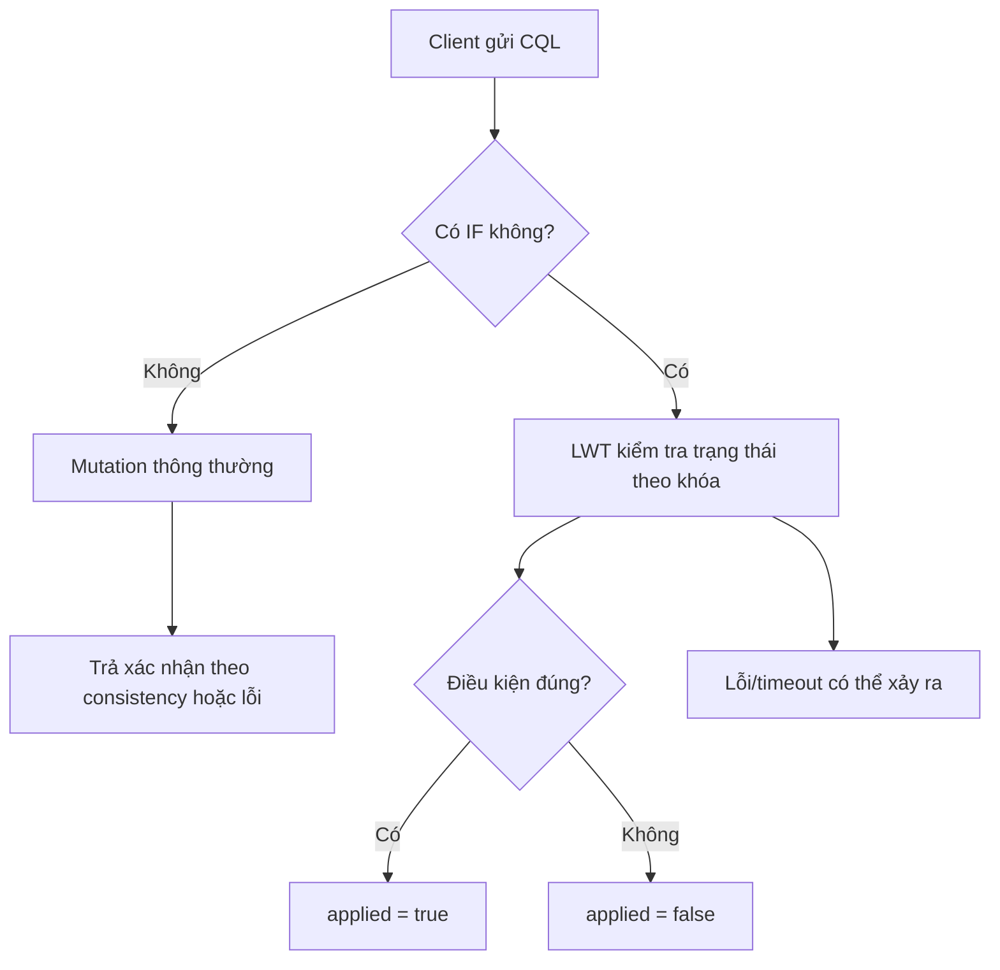

# Kết quả ghi thông thường, applied của lệnh IF và giới hạn thông tin phản hồi trong Cassandra

Khi chạy một câu `INSERT`, `UPDATE` hoặc `DELETE` trong Apache Cassandra, lập trình viên rất dễ hỏi: **“Có bao nhiêu hàng đã được cập nhật?”**, **“Hàng này vừa được tạo hay đã tồn tại?”** hoặc **“Lệnh xóa có thực sự xóa dữ liệu không?”**. Nếu quen JDBC với một hệ cơ sở dữ liệu quan hệ, bạn có thể chờ một con số `rowsAffected`. Nhưng CQL thông thường **không trả về số hàng bị tác động**, vì Cassandra có mô hình *upsert* và mutation phân tán theo primary key.

Ngược lại, khi thêm điều kiện `IF NOT EXISTS`, `IF EXISTS` hoặc `IF column = value`, Cassandra chuyển sang **lightweight transaction (LWT)** và trả về cột **`[applied]`**. Đây là thông tin trả lời câu hỏi **“Điều kiện có thỏa để áp dụng mutation không?”**, hoàn toàn khác với câu hỏi **“Có bao nhiêu hàng đã được sửa?”**.

Bài thuộc chương **Ghi và xóa bằng CQL** của module **DATABASE_ENGINE_WIDE_COLUMN_CASSANDRA**. Nội dung nối semantics của CQL với kiến trúc wide-column phân tán, partition key, replication, consistency level, lỗi mạng, repair và cách dùng Apache Cassandra Java Driver.

**Sau bài này, bạn có thể:**

1. Phân biệt **kết quả hoàn tất lệnh ghi thường**, **`[applied]` của LWT** và **timeout/unknown outcome**.
2. Giải thích vì sao `INSERT`/`UPDATE`/`DELETE` thường không có `rowsAffected` hay phân biệt *inserted vs updated*.
3. Đọc đúng kết quả `true`/`false` của `IF NOT EXISTS`, `IF EXISTS` và CAS theo giá trị cũ.
4. Không nhầm `[applied] = false` với một exception, hoặc nhầm timeout với kết quả false.
5. Viết Java Driver code kiểm tra `ResultSet.wasApplied()`, chuẩn hóa phản hồi API và xử lý retry an toàn.
6. Thiết kế kiểm chứng ghi và quan sát hệ thống khi kết quả CQL không chứa dữ liệu đã ghi.

## 1. Ba câu hỏi phải tách biệt

Trước khi xem cú pháp, hãy phân biệt ba mức thông tin:

| Câu hỏi | CQL thông thường | CQL có `IF` |
| --- | --- | --- |
| Coordinator có hoàn thành thao tác theo consistency level đã chọn? | Phản hồi thành công, hoặc lỗi/timeout | Cũng có phản hồi thành công, hoặc lỗi/timeout |
| Có điều kiện nào được kiểm tra và chấp nhận? | **Không có điều kiện nghiệp vụ** | Có, thông qua **`[applied]`** |
| Bao nhiêu hàng đã tồn tại trước đó và được thay đổi? | **Không được trả về** | `[applied]` **cũng không phải row count** |
| Toàn bộ replica đã hội tụ và không có ghi cạnh tranh sau đó? | Không thể suy ra chỉ từ phản hồi | Không thể suy ra chỉ từ `[applied]` |
| Giá trị hiện tại của toàn bộ hàng là gì? | Cần truy vấn `SELECT` riêng nếu thực sự cần | Có thể cần `SELECT` riêng; kết quả false có thể có thông tin cũ nhưng không nên coi là snapshot đầy đủ |

Ví dụ, cùng một câu:

```sql
UPDATE demo.accounts_by_id
SET display_name = 'Mai'
WHERE account_id = 11111111-1111-4111-8111-111111111111;
```

Khi driver nhận phản hồi hoàn tất bình thường, điều được biết là **mutation không điều kiện đã được coordinator xử lý với mức xác nhận được yêu cầu**. Bạn không biết từ phản hồi đó liệu tài khoản vốn tồn tại, có từng mang cùng tên, hay liệu một client khác đã sửa tên ngay sau đó.

Ngược lại:

```sql
UPDATE demo.accounts_by_id
SET display_name = 'Mai'
WHERE account_id = 11111111-1111-4111-8111-111111111111
IF revision = 1;
```

Mutation này chỉ được áp dụng nếu điều kiện đúng khi LWT quyết định. Kết quả `[applied]` thể hiện quyết định đó. Nó **không** hứa sẽ trả toàn bộ hàng sau cập nhật, và một yêu cầu ghi khác vẫn có thể sửa dữ liệu **sau** khi LWT hoàn thành.

## 2. Bảng mẫu, khóa và dữ liệu nền

Giả sử keyspace `demo` đã tồn tại trong môi trường thử nghiệm. Tạo bảng tra cứu tài khoản theo UUID:

```sql
CREATE TABLE demo.accounts_by_id (
    account_id    uuid PRIMARY KEY,
    email         text,
    display_name  text,
    account_state text,
    revision      int,
    last_seen_at  timestamp
);
```

Với schema này:

- `account_id` là **partition key** và đồng thời là **full primary key**.
- `email`, `display_name`, `account_state`, `revision`, `last_seen_at` là regular column.
- Mutation theo `account_id` được định tuyến tới các replica chịu trách nhiệm cho phân vùng.
- Tên cột `revision` là metadata ứng dụng tự duy trì; nó **không** được Cassandra tự tăng mỗi lần ghi.

Khởi tạo một tài khoản:

```sql
INSERT INTO demo.accounts_by_id (
    account_id, email, display_name, account_state, revision
)
VALUES (
    11111111-1111-4111-8111-111111111111,
    'mai@example.test',
    'Mai',
    'ACTIVE',
    1
);

SELECT account_id, email, display_name,
       account_state, revision
FROM demo.accounts_by_id
WHERE account_id = 11111111-1111-4111-8111-111111111111;
```

Câu `SELECT` ở đây chỉ để **kiểm tra dữ liệu của lab**. Nó là một request khác, **không phải dữ liệu được trả về bởi `INSERT`**. Các ví dụ sau giả định không có writer cạnh tranh, TTL hết hạn hoặc timestamp thủ công làm thay đổi kết quả dự kiến, trừ khi được nêu rõ.

## 3. INSERT thường: không có “đã tạo mới” trong phản hồi

### 3.1. INSERT theo khóa chưa tồn tại

```sql
INSERT INTO demo.accounts_by_id (
    account_id, email, display_name, revision
)
VALUES (
    22222222-2222-4222-8222-222222222222,
    'an@example.test',
    'An',
    1
);
```

Nếu `2222...` chưa có dữ liệu, thao tác tạo hàng logic mới. Tuy vậy, **bản thân phản hồi của `INSERT` thường không mang nhãn `created = true` hay `affected_rows = 1`**.

### 3.2. INSERT theo khóa đã tồn tại

```sql
INSERT INTO demo.accounts_by_id (
    account_id, display_name
)
VALUES (
    22222222-2222-4222-8222-222222222222,
    'An Updated'
);
```

Đây cũng là một `INSERT` hợp lệ. Nó có semantics **upsert**, nên ghi lại `display_name` ở cùng primary key. `email` và `revision` không được nhắc tới thì không bị mutation này xóa.

**Hai lệnh INSERT ở trên có cùng kiểu phản hồi ghi thường**; không thể dùng số dòng của kết quả hoặc việc driver không ném exception để phân biệt lệnh nào tạo mới, lệnh nào sửa giá trị cũ.

### 3.3. “Không có lỗi” không phải “đã tạo đúng một hàng”

Với CQL, `INSERT` không có unique constraint ngầm ngoài cấu trúc primary key, cũng không tự báo trùng full primary key như một số `INSERT` quan hệ. Muốn **chỉ tạo nếu chưa tồn tại**, phải viết `IF NOT EXISTS` — lúc đó semantics và định dạng kết quả thay đổi, như phần 6.

## 4. UPDATE thường: không có “row count” và không tự kiểm tra tồn tại

### 4.1. UPDATE hàng đã tồn tại

```sql
UPDATE demo.accounts_by_id
SET display_name = 'Mai Anh'
WHERE account_id = 11111111-1111-4111-8111-111111111111;
```

Mutation chỉ ghi cột `display_name`. Nó không trả số cột thay đổi hoặc số hàng từng tồn tại, và không so sánh giá trị mới với tên cũ để trả `changed = true/false`.

### 4.2. UPDATE khóa chưa có hàng

```sql
UPDATE demo.accounts_by_id
SET display_name = 'New Sparse Account'
WHERE account_id = 33333333-3333-4333-8333-333333333333;
```

Với upsert không điều kiện, Cassandra có thể tạo một hàng mới với `display_name` và các regular column khác chưa được ghi. **Phản hồi thường của hai câu UPDATE vẫn giống nhau.**

### 4.3. UPDATE cùng giá trị vẫn là một mutation

```sql
UPDATE demo.accounts_by_id
SET display_name = 'Mai Anh'
WHERE account_id = 11111111-1111-4111-8111-111111111111;
```

Nếu `display_name` đã bằng `'Mai Anh'`, câu lệnh vẫn có thể ghi một phiên bản mới với timestamp mới. Cassandra không trả `rowsChanged = 0` chỉ vì giá trị nhìn thấy trước và sau bằng nhau.

**Hệ quả thực tế:** trong API Java, đừng viết:

```java
// Sai về mô hình kết quả Cassandra:
// int affected = session.execute(cql).getUpdateCount();
// if (affected == 0) return NOT_FOUND;
```

Java Driver cho CQL không cung cấp ngữ nghĩa JDBC `getUpdateCount()` theo cách này. Nếu cần phân biệt tài khoản không tồn tại, hãy dùng `UPDATE ... IF EXISTS` hoặc một quy trình nghiệp vụ có điều kiện phù hợp.

## 5. DELETE thường: không có “đã xóa bao nhiêu hàng”

### 5.1. DELETE một cột

```sql
DELETE email FROM demo.accounts_by_id
WHERE account_id = 11111111-1111-4111-8111-111111111111;
```

DELETE này ghi thông tin xóa đối với `email` tại khóa đã định. Nó không trả `affected_rows = 1` hoặc xác nhận giá trị email **đã từng tồn tại**. Sau khi mutation được quan sát, truy vấn có thể đọc `email` là `null` trong khi các cột khác vẫn còn.

### 5.2. DELETE một hàng

```sql
DELETE FROM demo.accounts_by_id
WHERE account_id = 22222222-2222-4222-8222-222222222222;
```

Đây là xóa hàng tại full primary key. Nếu tài khoản `2222...` chưa tồn tại ở thời điểm xóa, Cassandra vẫn có thể tiếp nhận mutation/dấu xóa. Không có số hàng bị xóa trong phản hồi cho phép ứng dụng suy ra “không tìm thấy”.

### 5.3. Thành công không có nghĩa xóa vật lý ngay

Cassandra dùng tombstone để che dữ liệu cũ trong memtable/SSTable và ở các replica chưa đồng bộ. `DELETE` trả thành công theo consistency level không đồng nghĩa mọi bản sao dữ liệu vật lý và backup đã bị loại bỏ ngay. Repair và compaction góp phần giúp dữ liệu hội tụ và thu gom khi an toàn.

Nếu API cần trả `404 Not Found` khi tài nguyên không tồn tại, **không được suy luận điều đó từ phản hồi DELETE thường**. Có thể dùng `DELETE ... IF EXISTS` khi điều kiện tồn tại thực sự quan trọng, đổi lại có chi phí LWT.

## 6. Lệnh IF trả gì? Ý nghĩa chính xác của [applied]

Khi ghi có điều kiện, Cassandra không chỉ gửi một mutation upsert thông thường. Nó dùng **lightweight transaction (LWT)** để kiểm tra trạng thái hiện tại và quyết định liệu thao tác có được áp dụng không. Phản hồi của các lệnh này chứa cột đặc biệt `[applied]`.

| Giá trị `[applied]` | Ý nghĩa chính xác |
| --- | --- |
| `true` | Điều kiện LWT đã thỏa và mutation được áp dụng |
| `false` | Điều kiện LWT **không** thỏa, mutation được yêu cầu **không** được áp dụng |

Đừng dịch `[applied] = true` thành “một hàng đã thay đổi giá trị”, vì ghi cùng giá trị cũ vẫn có thể được chấp nhận. Đừng dịch `[applied] = false` thành “có lỗi thực thi”: điều kiện không thỏa là **kết quả hợp lệ**, không phải exception.



Sơ đồ chỉ minh họa các kết quả logic. Khi lỗi mạng xảy ra, client có thể **không nhận được kết quả `[applied]` dù mutation đã được quyết định tại cluster**; xem phần 10.

## 7. INSERT IF NOT EXISTS: tạo mới có điều kiện

Khi nghiệp vụ yêu cầu “chỉ tạo tài khoản nếu chưa có ID này”, hãy dùng:

```sql
INSERT INTO demo.accounts_by_id (
    account_id, email, display_name, account_state, revision
)
VALUES (
    44444444-4444-4444-8444-444444444444,
    'binh@example.test',
    'Bình',
    'PENDING',
    1
)
IF NOT EXISTS;
```

### Khi hàng chưa có

Điều kiện thỏa, Cassandra áp dụng mutation và trả về một kết quả chứa:

```text
 [applied]
-----------
      True
```

Ứng dụng biết rằng điều kiện **“chưa tồn tại”** đã thỏa tại thời điểm LWT quyết định. Nhưng `true` **không phải** một cột `created_count = 1`; đây là một boolean cho thao tác có điều kiện.

### Khi hàng đã có

Nếu chạy lại lệnh trên với cùng `account_id` và hàng vẫn sống, điều kiện không thỏa:

```text
 [applied] | account_id | email | ...
-----------+------------+-------+----
     False | ...        | ...   | ...
```

CQL có thể trả **một số giá trị hiện có** trong hàng kết quả thất bại điều kiện, tùy loại câu lệnh và phiên bản. Điều quan trọng là:

- Không ghi đè email/tên/trạng thái bởi mutation vừa bị từ chối.
- **Không suy ra từ `false` rằng có lỗi kết nối hoặc syntax.**
- Không dựa vào số lượng cột phụ trong kết quả để đưa ra một giao thức API cố định cho mọi loại `IF`.
- Nếu ứng dụng cần trả toàn bộ hồ sơ mới nhất, nên có đường `SELECT` có chủ đích và consistency phù hợp.
- Nếu chứa dữ liệu nhạy cảm, cẩn thận trước khi đưa giá trị hiện có trong phản hồi LWT ra HTTP API.

### IF NOT EXISTS không kiểm tra unique của một cột bất kỳ

Vì bảng được đánh khóa theo `account_id`, hai hàng UUID khác nhau vẫn có thể có cùng `email` và cả hai lần `INSERT ... IF NOT EXISTS` đều có thể thành công.

Muốn bảo vệ tính duy nhất của email, phải thiết kế một bảng claim có **normalized email là primary key**, thực hiện `INSERT ... IF NOT EXISTS` trên khóa đó và có quy trình xử lý khi ghi hồ sơ ở bảng khác bị lỗi. Một `[applied] = true` trong `accounts_by_id` không phải lời bảo đảm toàn bộ dữ liệu nghiệp vụ ở các partition khác đã nhất quán.

## 8. UPDATE IF EXISTS và DELETE IF EXISTS: xác nhận điều kiện tồn tại

### 8.1. UPDATE chỉ khi tài khoản tồn tại

```sql
UPDATE demo.accounts_by_id
SET display_name = 'Mai Updated'
WHERE account_id = 11111111-1111-4111-8111-111111111111
IF EXISTS;
```

Nếu hàng `1111...` tồn tại tại thời điểm LWT quyết định, `[applied] = true`. Nếu hàng không tồn tại, `[applied] = false` và mutation **không tự tạo hàng mới** như `UPDATE` thông thường.

Điều kiện tồn tại bảo vệ một yêu cầu cụ thể: **chỉ sửa tài nguyên có sẵn**. Nó không đảm bảo `display_name` chưa bị client khác sửa kể từ khi bạn đọc lần trước.

### 8.2. DELETE chỉ khi hàng tồn tại

```sql
DELETE FROM demo.accounts_by_id
WHERE account_id = 44444444-4444-4444-8444-444444444444
IF EXISTS;
```

Nếu hàng còn sống, `[applied] = true`. Gửi lại sau khi đã xóa thành công và không có ghi mới xen giữa sẽ thường trả `[applied] = false`. Điều này **khác** với DELETE thường vốn không có kết quả xác nhận sự tồn tại trước lệnh.

### 8.3. Kết quả false nên hiểu ra sao trong HTTP API?

| Lệnh LWT | `[applied] = false` cho biết | Cách ánh xạ API có thể chọn |
| --- | --- | --- |
| `INSERT ... IF NOT EXISTS` | Khóa đã có hàng khi điều kiện được kiểm tra | `409 Conflict` khi yêu cầu tạo mới |
| `UPDATE ... IF EXISTS` | Không có hàng sống thỏa điều kiện tồn tại | `404 Not Found` nếu API là update-only |
| `DELETE ... IF EXISTS` | Không có hàng sống thỏa điều kiện tồn tại | `404 Not Found`, hoặc xử lý như đã xóa theo hợp đồng idempotent |
| `UPDATE ... IF revision = n` | Revision hiện tại khác giá trị kỳ vọng | `409 Conflict` hoặc `412 Precondition Failed` |

Đây là **gợi ý ánh xạ theo nghiệp vụ**, không phải HTTP status do Cassandra tự trả. Ứng dụng cần nhất quán với hợp đồng API, đặc biệt khi cùng thao tác có thể bị retry.

### 8.4. IF EXISTS không đồng nghĩa “giá trị đã thay đổi”

Giả sử tài khoản có `display_name = 'Mai Updated'`, chạy lại `UPDATE ... SET display_name = 'Mai Updated' ... IF EXISTS` có thể vẫn trả `[applied] = true`. Điều kiện chỉ hỏi **hàng có tồn tại không**; nó không so sánh tên cũ và mới.

Vì vậy, `true` không thể dùng làm tín hiệu gửi email “người dùng thật sự đã thay đổi tên” nếu yêu cầu nghiệp vụ cần phát hiện giá trị chuyển đổi. Bạn phải định nghĩa một điều kiện phù hợp hoặc lưu sự kiện nghiệp vụ với ID riêng.

## 9. IF giá trị cũ: phản hồi của compare-and-set

Với cập nhật lạc quan (*optimistic concurrency control*), ứng dụng có thể lưu một `revision` và chỉ ghi nếu giá trị tại cluster vẫn khớp với phiên bản mà client đã đọc.

```sql
UPDATE demo.accounts_by_id
SET display_name = 'Mai Version 2',
    revision = 2
WHERE account_id = 11111111-1111-4111-8111-111111111111
IF revision = 1;
```

Nếu revision còn là 1, `[applied] = true` và mutation ghi revision 2. Nếu một client khác đã đổi revision thành 2 hoặc 3 trước khi điều kiện được kiểm tra, `[applied] = false`.

### So sánh hai writer

```text
Ban đầu: account_id=A, revision=1, display_name='Mai'

Client X đọc revision=1.
Client Y đọc revision=1.

X: UPDATE ... SET name='Tên X', revision=2 IF revision=1
Y: UPDATE ... SET name='Tên Y', revision=2 IF revision=1

Một CAS có thể thành công trước và chuyển revision thành 2.
CAS còn lại không được áp dụng với điều kiện revision=1.
```

Nếu bỏ `IF revision = 1`, cả hai lệnh trở thành mutation không điều kiện và có thể được xác nhận, rồi giá trị được hòa giải theo timestamp. **Một cột revision chỉ bảo vệ được concurrency khi mọi đường ghi liên quan thật sự tuân thủ quy tắc điều kiện**, không phải chỉ vì cột này có mặt trong schema.

### False có chứa “phiên bản hiện tại” không?

Trong nhiều trường hợp thất bại điều kiện, Cassandra trả thêm những giá trị hiện có liên quan đến điều kiện hoặc hàng. Ví dụ bạn có thể thấy `[applied] = false` cùng `revision = 2`. Nhưng:

1. Tập cột phụ **phụ thuộc hình thức CQL**; `INSERT IF NOT EXISTS` không nhất thiết có cùng danh sách cột với `UPDATE IF revision = ...`.
2. Những giá trị đó phục vụ thông tin về **điều kiện bị từ chối**, không phải hợp đồng trả toàn bộ object trong mọi trường hợp.
3. Ngay sau khi LWT trả về, client khác có thể tiếp tục cập nhật; dữ liệu phụ **không bảo đảm vẫn là trạng thái mới nhất tại thời điểm API gửi phản hồi**.
4. Việc tự động trả nguyên các cột từ LWT về client có thể làm lộ email hoặc thuộc tính người dùng khác, nếu không lọc theo quyền.

Nếu thật sự cần trả object hiện tại, ứng dụng có thể thực hiện `SELECT` riêng, kiểm tra authorization và chọn consistency phù hợp. Đừng đồng nhất kết quả đọc sau đó với một snapshot bất biến của thời điểm LWT thất bại.

### Một lệnh LWT có thể cập nhật nhiều cột của hàng

```sql
UPDATE demo.accounts_by_id
SET account_state = 'LOCKED',
    revision = 3
WHERE account_id = 11111111-1111-4111-8111-111111111111
IF account_state = 'ACTIVE' AND revision = 2;
```

Lệnh minh họa điều kiện kết hợp. Chỉ khi **cả hai điều kiện** thỏa, mutation được áp dụng. Một `[applied] = true` không mang nghĩa “đã tác động hai hàng”; nó vẫn là boolean cho **một quyết định LWT**.

### Các giới hạn cú pháp quan trọng

- `INSERT ... IF NOT EXISTS` dùng cho *insert-only* có điều kiện; không phải cú pháp `UPDATE ... IF NOT EXISTS`.
- `UPDATE/DELETE ... IF EXISTS` hoặc `IF column = value` không biến Cassandra thành công cụ truy vấn tùy ý theo regular column trên toàn bảng; vẫn cần khóa định vị hợp lệ.
- LWT dùng cơ chế quản lý timestamp của đồng thuận; không tự chỉ định `USING TIMESTAMP` cùng `IF`.
- Khi phù hợp, `USING TTL` có thể kết hợp với `INSERT IF NOT EXISTS`/`UPDATE IF`, nhưng TTL chỉ gắn với các giá trị được mutation thực sự ghi khi điều kiện thỏa.
- Counter có ngữ nghĩa riêng và không dùng LWT điều kiện như regular column.

## 10. Thành công, điều kiện sai, timeout: ba kết quả không được gộp

Đối với một thao tác ghi, hãy xây dựng luồng xử lý theo **ba nhánh**:

| Nhánh kết quả | Thông tin client nhận được | Kết luận được phép |
| --- | --- | --- |
| **Ghi thường trả thành công** | Response hoàn tất, không có `[applied]` | Mức xác nhận của thao tác thường đã được đáp ứng |
| **LWT trả `[applied] = true`** | Response điều kiện thành công | Điều kiện đã thỏa và mutation được áp dụng |
| **LWT trả `[applied] = false`** | Response điều kiện không thỏa | Mutation yêu cầu **không được áp dụng bởi lần LWT đó** |
| **Timeout / lỗi không xác định kết quả** | Không nhận được phản hồi quyết định tin cậy | **Chưa thể biết chắc** lần ghi được áp dụng hay chưa |

Nhánh cuối **không phải** giá trị `[applied] = false`. Một mutation có thể đã đến đủ replica nhưng phản hồi bị mất, hoặc có thể chưa được áp dụng. Phân tích chính xác tùy thời điểm sự cố, loại timeout và tình trạng cluster.

### 10.1. Mất phản hồi của INSERT IF NOT EXISTS

Giả sử client phát một yêu cầu đăng ký:

```text
Client: INSERT account_id=X ... IF NOT EXISTS
Cluster: điều kiện đúng, hàng X được tạo.
Mạng: phản hồi [applied]=true bị mất.
Client: timeout và thử lại cùng lệnh.
Cluster: hàng X đã tồn tại -> [applied]=false.
```

Nếu ứng dụng ánh xạ lần retry false thành “người khác đã lấy ID này”, nó có thể báo sai cho chính request đã tạo hàng. Vì vậy:

- Giữ **UUID và idempotency key ổn định** qua các lần retry của cùng một logical request.
- Cân nhắc lưu dấu vết `request_id`/người tạo đủ để đối chiếu sau timeout.
- Khi nhận false sau retry, có thể đọc dữ liệu và so sánh với dấu vết request đã phát, thay vì mặc định báo trùng từ client khác.
- Đừng tự sinh UUID mới mỗi khi retry nếu mục tiêu là một tài khoản duy nhất.

### 10.2. Mất phản hồi của UPDATE IF revision

Giả sử client gửi `IF revision = 4 SET revision = 5`, rồi timeout:

1. Có thể LWT đã thành công và revision hiện là 5.
2. Có thể LWT không được áp dụng; revision vẫn là 4.
3. Có thể client khác đã đổi revision sau đó; giá trị đọc lại không chứng minh request nào đã thắng.

Ngay cả khi `SELECT` đọc revision 5, chưa chắc đó là **kết quả của chính yêu cầu vừa timeout** nếu các client khác cũng có thể đặt revision 5. Với giao dịch đòi xác định tác động chính xác, cần ID thao tác hoặc dấu vết nghiệp vụ riêng.

### 10.3. Timeout của ghi thường

`UPDATE` thường ở consistency level `QUORUM` có thể đã được ghi ở một số replica nhưng coordinator không nhận đủ xác nhận trước thời hạn. Đây không phải lệnh có điều kiện nên **không tồn tại `[applied]`** để hỏi lại theo cách của LWT.

Retry một `SET display_name = 'Mai'` có vẻ an toàn về trạng thái cuối nếu không có ghi cạnh tranh. Nhưng retry có thể mang timestamp mới và **che một giá trị được client khác ghi trong khoảng thời gian giữa hai lần gọi**. Với `USING TTL`, retry cũng có thể làm thay đổi thời điểm hết hạn của giá trị. Vì vậy phải xem xét idempotency **theo nghiệp vụ và cạnh tranh**, không chỉ theo chuỗi CQL.

### 10.4. Không phải lỗi nào cũng là “không biết đã áp dụng chưa”

Một lỗi validation cú pháp xảy ra trước khi có mutation hợp lệ có semantics khác lỗi mạng/timeout trong quá trình ghi. Driver còn có thể báo rằng không có replica sẵn sàng, quá tải, hoặc lỗi server có mã cụ thể.

Ứng dụng nên phân loại lỗi theo **loại exception và giai đoạn thực thi được driver công bố**, nhưng chỉ khẳng định “không có ghi nào được áp dụng” khi có cơ sở chắc chắn. Không gom mọi exception vào cùng một nhóm `404`, `false` hoặc “retry được”.

## 11. Consistency level xác nhận điều gì — và không xác nhận điều gì?

Cassandra lưu partition trên nhiều replica theo chiến lược replication của keyspace. Với replication factor 3:

- **`ONE`** thường yêu cầu xác nhận từ một replica thích hợp.
- **`QUORUM`** thường cần hai replica trong nhóm ba replica theo phạm vi quorum.
- **`LOCAL_QUORUM`** dựa trên quorum của datacenter địa phương, thích hợp hay không tùy topology.

Các mức này chi phối **mức xác nhận/quan sát dữ liệu**, không phải số hàng cập nhật. Một `UPDATE` hoàn tất ở `QUORUM` **không** trả `affected = 2` vì hai replica xác nhận; đó là hai bản sao của một partition/hàng logic, không phải hai hàng nghiệp vụ.

### 11.1. “Acknowledged” không đồng nghĩa “mọi replica đã hội tụ”

Ngay cả khi ghi thường trả thành công theo mức đã chọn, một số replica có thể chưa thấy mutation ngay lúc đó. Cơ chế đọc/đồng bộ, hinted handoff khi phù hợp và repair giúp hệ thống xử lý dữ liệu chưa hội tụ. Cần theo dõi trạng thái node và chiến lược repair; không suy ra từ một response rằng mọi SSTable/backup đã được đồng bộ.

### 11.2. “Acknowledged” không đồng nghĩa “giá trị vẫn như vậy mãi”

Một client khác có thể ghi cùng cột ngay sau khi thao tác của bạn hoàn tất, với timestamp thắng theo quy tắc hòa giải. Một cell có TTL cũng có thể hết hạn sau thời gian sống đã định. Vì vậy, một response thành công không hứa lần `SELECT` sau sẽ luôn trả chính giá trị vừa ghi.

### 11.3. LWT còn có serial consistency

LWT dùng **serial consistency** trong giai đoạn đồng thuận, thường là `SERIAL` hoặc `LOCAL_SERIAL`, bên cạnh regular consistency của request. Hai khái niệm khác nhau:

| Loại consistency | Ví dụ | Vai trò |
| --- | --- | --- |
| Regular consistency | `ONE`, `QUORUM`, `LOCAL_QUORUM` | Yêu cầu xác nhận dữ liệu giữa replica |
| Serial consistency | `SERIAL`, `LOCAL_SERIAL` | Phạm vi đồng thuận khi kiểm tra/áp dụng CAS |

Không thể thay `IF revision = 1` bằng cách dùng `CONSISTENCY QUORUM` trên một `UPDATE` thường. `QUORUM` không biết điều kiện nghiệp vụ mà client chưa truyền vào CQL.

Trong mô hình nhiều datacenter, chọn `LOCAL_SERIAL` hay `SERIAL` cần xem cách các client phân bố và có ghi CAS tranh chấp xuyên vùng hay không. Đừng trộn các chính sách khác nhau mà chưa chứng minh phù hợp với phạm vi tính nhất quán cần bảo vệ.

### 11.4. Một phép SELECT sau ghi không phải phần của kết quả ghi

```sql
UPDATE demo.accounts_by_id
SET display_name = 'Mai Verified'
WHERE account_id = 11111111-1111-4111-8111-111111111111;

SELECT display_name, revision
FROM demo.accounts_by_id
WHERE account_id = 11111111-1111-4111-8111-111111111111;
```

Đây là **hai request**. Lệnh thứ hai được điều phối theo consistency của lần đọc và có thể nhìn thấy thay đổi khác xảy ra giữa hai thời điểm. Không xây dựng API dựa trên giả định “UPDATE luôn trả row mới” hoặc “SELECT tiếp theo là snapshot nguyên tử của UPDATE”.

## 12. Java Driver 4.x: tách đúng ba nhánh kết quả

Các ví dụ dùng **Apache Cassandra Java Driver 4.x**, giả định đã có `CqlSession session` và UUID hợp lệ. Các import của `com.datastax.oss.driver.api.core.cql`, `java.util.UUID` và logic authorization/validation được lược bỏ để tập trung vào cách dùng kết quả.

### 12.1. Ghi thông thường: execute không trả row count

```java
PreparedStatement updateName = session.prepare(
    "UPDATE demo.accounts_by_id " +
    "SET display_name = :new_name " +
    "WHERE account_id = :account_id"
);

UUID accountId = UUID.fromString(
    "11111111-1111-4111-8111-111111111111");

BoundStatement statement = updateName.boundStatementBuilder()
    .setUuid("account_id", accountId)
    .setString("new_name", "Mai")
    .build();

ResultSet result = session.execute(statement);

// Ghi thuong: khong duoc suy luan mot rowsAffected tu ResultSet.
// Khong dung result.one() == null de ket luan accountId khong ton tai.
```

Với `UPDATE` thường, không có kết quả hàng `SELECT` để ánh xạ trực tiếp sang object mới. `result.one() == null` là điều bình thường đối với phản hồi ghi không điều kiện; nó **không** có nghĩa update không tìm thấy hàng.

### 12.2. INSERT IF NOT EXISTS: dùng wasApplied()

```java
PreparedStatement createAccount = session.prepare(
    "INSERT INTO demo.accounts_by_id " +
    "(account_id, email, display_name, account_state, revision) " +
    "VALUES (:id, :email, :name, :state, :revision) " +
    "IF NOT EXISTS"
);

BoundStatement create = createAccount.boundStatementBuilder()
    .setUuid("id", accountId)
    .setString("email", "new@example.test")
    .setString("name", "New User")
    .setString("state", "PENDING")
    .setInt("revision", 1)
    .build();

ResultSet created = session.execute(create);
if (created.wasApplied()) {
    // IF NOT EXISTS thoa: tao moi thanh cong.
} else {
    // Khoa da co du lieu: can xu ly xung dot/idempotency.
}
```

`wasApplied()` trả boolean tương ứng với `[applied]` của conditional statement. **Chỉ dùng cách suy luận này cho câu LWT có IF**, không sử dụng `wasApplied()` như cách hỏi “UPDATE thường đã ảnh hưởng một hàng chưa?”.

### 12.3. UPDATE IF EXISTS

```java
PreparedStatement updateExisting = session.prepare(
    "UPDATE demo.accounts_by_id " +
    "SET display_name = :new_name " +
    "WHERE account_id = :account_id " +
    "IF EXISTS"
);

ResultSet updated = session.execute(
    updateExisting.boundStatementBuilder()
        .setUuid("account_id", accountId)
        .setString("new_name", "Mai Updated")
        .build()
);

if (!updated.wasApplied()) {
    // Hang khong ton tai theo dieu kien IF EXISTS.
    // API co the tra Not Found theo hop dong cua minh.
}
```

Đoạn mã trên không cần đọc hàng trước để kiểm tra tồn tại. Một `SELECT` rồi `UPDATE` thường không đem lại cùng bảo đảm khi có nhiều writer, vì hàng có thể bị xóa hoặc tạo lại giữa hai request.

### 12.4. Compare-and-set theo revision

```java
PreparedStatement changeState = session.prepare(
    "UPDATE demo.accounts_by_id " +
    "SET account_state = :new_state, revision = :new_revision " +
    "WHERE account_id = :account_id " +
    "IF revision = :expected_revision"
);

int expectedRevision = 1;
int nextRevision = Math.addExact(expectedRevision, 1);

BoundStatement cas = changeState.boundStatementBuilder()
    .setUuid("account_id", accountId)
    .setString("new_state", "LOCKED")
    .setInt("new_revision", nextRevision)
    .setInt("expected_revision", expectedRevision)
    .build();

ResultSet changed = session.execute(cas);
if (changed.wasApplied()) {
    // Dieu kien revision cu thoa, mutation da duoc ap dung.
} else {
    // Conflict: can doc lai/trinh bay trang thai moi neu can.
}
```

Khi client cần trả chi tiết trạng thái cũ, có thể xem xét các cột phụ trong kết quả `[applied] = false`, nhưng chỉ truy cập cột khi **định dạng kết quả của statement cụ thể thực sự có cột đó**. Đừng giả định mọi LWT false đều trả đủ mọi thuộc tính tài khoản.

### 12.5. Consistency của conditional statement

Nếu hệ thống được thiết kế cho một datacenter cục bộ và đã đánh giá chính sách replica, Java Driver có thể đặt **regular** và **serial consistency**:

```java
BoundStatement localCas = cas
    .setConsistencyLevel(
        com.datastax.oss.driver.api.core.DefaultConsistencyLevel.LOCAL_QUORUM)
    .setSerialConsistencyLevel(
        com.datastax.oss.driver.api.core.DefaultConsistencyLevel.LOCAL_SERIAL);

ResultSet localResult = session.execute(localCas);
boolean applied = localResult.wasApplied();
```

Đây là **ví dụ cấu hình**, không phải khuyến nghị mặc định cho mọi cụm. Các giá trị phải phù hợp với replication factor từng datacenter, nơi client gửi request và yêu cầu CAS khi có ghi cạnh tranh xuyên vùng. `LOCAL_SERIAL` không đương nhiên tương đương `SERIAL` trong mọi topology.

### 12.6. Đừng biến exception thành applied = false

Một cách viết lỗi thường gặp:

```java
// MAU SAI: khong bao gio lam the nay.
// try {
//     return session.execute(cas).wasApplied();
// } catch (Exception e) {
//     return false; // Mang loi se bi hieu sai thanh xung dot.
// }
```

Khi driver báo timeout hoặc một lỗi không chắc chắn, ứng dụng cần **để nhánh lỗi riêng tồn tại**. Ví dụ mẫu xử lý:

```java
try {
    ResultSet response = session.execute(cas);
    if (response.wasApplied()) {
        // Outcome: APPLIED
    } else {
        // Outcome: CONDITION_NOT_MET
    }
} catch (com.datastax.oss.driver.api.core.DriverException e) {
    // Outcome: DRIVER_FAILURE
    // Phan loai loai loi va do chac chan cua ket qua.
    // Khong danh dong moi loi voi CONDITION_NOT_MET.
    throw e;
}
```

Trong triển khai thật, phân loại exception cụ thể như timeout, unavailable hoặc lỗi validate/cấu hình theo tài liệu Java Driver và kết quả phía server; lưu telemetry, kiểm soát retry và trả trạng thái HTTP có ý nghĩa. `DriverException` là nhóm lỗi minh họa, không phải bằng chứng mọi exception đều có kết quả không xác định.

### 12.7. ResultSet có thể có dữ liệu khác nhưng không phải bản ghi sau UPDATE

Java Driver cho phép truy cập thông tin thực thi để quan sát coordinator, warning, tracing khi được bật theo cách phù hợp. Nhưng **metadata thực thi khác dữ liệu nghiệp vụ**. Ví dụ, biết coordinator nào xử lý request không cho biết tài khoản đã tồn tại hay có bao nhiêu cột thực sự thay đổi.

Nếu API cần trả representation của tài khoản sau cập nhật:

1. Thực hiện mutation và nhận phản hồi theo semantics của nó.
2. Nếu là LWT, kiểm tra `wasApplied()`.
3. Thực hiện `SELECT` riêng khi cần dữ liệu hiện tại.
4. Chọn consistency, quyền truy cập và chính sách đọc phù hợp.
5. Chấp nhận rằng một writer khác có thể cập nhật giữa hai bước; nếu cần snapshot/transition mạnh hơn, phải thiết kế invariant và phạm vi LWT tương ứng.

Không nên gọi `SELECT` vô điều kiện sau **mọi** mutation chỉ để lấp khoảng trống `rowsAffected` tưởng tượng; việc đọc thêm có chi phí, và đôi khi API chỉ cần xác nhận request đã được xử lý.

## 13. Thiết kế phản hồi API: đừng hứa điều Cassandra không trả

Một API hướng đến người dùng thường cần ý nghĩa lớn hơn response của CQL. Hãy thiết kế **hợp đồng API** trước khi chọn loại câu lệnh.

### 13.1. Ví dụ create-only

API: `POST /accounts` với `accountId`/`requestId` ổn định.

| Trạng thái thực thi | Diễn giải API có thể dùng |
| --- | --- |
| `INSERT ... IF NOT EXISTS` → `[applied] = true` | Tạo thành công; có thể trả `201 Created` |
| Cùng lệnh → `[applied] = false` | ID đã có; có thể trả `409 Conflict` sau khi xem xét idempotency |
| Timeout, không nhận applied | Chưa thể kết luận; dùng quy trình đối chiếu, không mặc định trả 409 |

Nếu request được retry và ID đã có đúng dữ liệu do **chính** request trước tạo, dịch vụ có thể trả lại kết quả thành công theo thiết kế idempotency, thay vì báo xung đột. Điều đó cần thông tin để đối chiếu, không tự phát sinh từ cột `[applied]`.

### 13.2. Ví dụ update-only

API: `PATCH /accounts/{id}`, chỉ cho phép sửa tài khoản đang tồn tại.

- `UPDATE ... IF EXISTS`, `true`: có thể trả `204 No Content` nếu không cần gửi lại object.
- `UPDATE ... IF EXISTS`, `false`: có thể trả `404 Not Found`.
- Timeout: áp dụng chính sách lỗi/retry/phục hồi đã định; không tự gán `404`.

Nếu API cho phép tạo tài khoản thưa khi chưa tồn tại, dùng `UPDATE` thường cũng là một lựa chọn hợp lệ, nhưng cần công khai semantics **upsert**; không dùng câu lệnh thường rồi tự trả `404` khi `ResultSet.one()` rỗng.

### 13.3. Ví dụ cập nhật có điều kiện theo ETag/revision

API: `PATCH /accounts/{id}` với phiên bản người dùng nhìn thấy.

```text
Client gửi:
  expectedRevision = 7
  desiredState = LOCKED

Server gửi CQL:
  UPDATE ... SET state = 'LOCKED', revision = 8
  WHERE account_id = ?
  IF revision = 7
```

- `[applied] = true`: mutation hợp điều kiện; trả thành công.
- `[applied] = false`: không chấp nhận vì phiên bản cũ không khớp hoặc điều kiện không thỏa; tùy hợp đồng có thể trả `409`/`412`.
- Timeout: chưa rõ mutation đã commit hay chưa; không trả `412` như thể điều kiện đã bị từ chối.

**Chú ý:** với `IF revision = 7`, một hàng không tồn tại cũng có thể dẫn đến `false`; nếu API phải phân biệt “không tồn tại” với “revision khác”, cần dữ liệu/quy trình phân loại bổ sung. Không suy diễn rằng mọi `false` của compare-and-set đều chứng minh tài nguyên tồn tại.

### 13.4. Ví dụ DELETE idempotent

API: `DELETE /accounts/{id}`.

Một hợp đồng phổ biến coi xóa tài nguyên đã vắng mặt là **thành công về trạng thái cuối**. Khi đó DELETE thường có thể phù hợp và trả `204` khi hoàn tất, vì mục tiêu là “sau yêu cầu tài nguyên không còn được xem là tồn tại”.

Nếu hợp đồng bắt buộc báo `404` khi ID trước đó không tồn tại, cân nhắc `DELETE ... IF EXISTS` và `[applied]`. Đổi lại, LWT có chi phí cao hơn và tình huống timeout/retry vẫn cần chính sách riêng.

**Không** đánh đồng “API trả 204” với lời khẳng định dữ liệu đã bị loại bỏ vật lý khỏi mọi SSTable, replica, snapshot và backup. Những yêu cầu xóa riêng tư/retention cần quy trình vòng đời dữ liệu khác.

## 14. Bài thực hành: quan sát response thay vì chỉ nhìn dữ liệu

Phần này yêu cầu chú ý **chính kết quả CQL trả về**, không chỉ đọc trạng thái sau mỗi lệnh. Chạy tuần tự trên môi trường thử nghiệm và bảng `demo.accounts_by_id` đã tạo ở phần 2, dùng UUID riêng để tránh ảnh hưởng các ví dụ trước.

### Bước 1 — INSERT thường trên khóa mới

```sql
INSERT INTO demo.accounts_by_id (
    account_id, email, display_name, account_state, revision
)
VALUES (
    88888888-8888-4888-8888-888888888888,
    'lab@example.test',
    'Lab User',
    'PENDING',
    1
);
```

**Quan sát:** statement ghi thường hoàn tất; **không có `[applied]`** hoặc số hàng tạo mới trong kết quả. Chưa thể phân biệt tạo mới và upsert **chỉ bằng phản hồi này**.

### Bước 2 — INSERT thường lần nữa vào cùng khóa

```sql
INSERT INTO demo.accounts_by_id (
    account_id, display_name
)
VALUES (
    88888888-8888-4888-8888-888888888888,
    'Lab Updated'
);
```

**Quan sát:** kết quả ghi thường có cùng tính chất như bước 1. Chỉ khi chạy `SELECT` riêng:

```sql
SELECT email, display_name, account_state, revision
FROM demo.accounts_by_id
WHERE account_id = 88888888-8888-4888-8888-888888888888;
```

bạn mới thấy `display_name = 'Lab Updated'` và email/trạng thái/revision từ bước 1 vẫn còn.

### Bước 3 — UPDATE thường với khóa chưa tồn tại

```sql
UPDATE demo.accounts_by_id
SET display_name = 'Sparse Row'
WHERE account_id = 99999999-9999-4999-8999-999999999999;
```

**Quan sát:** phản hồi không cung cấp số hàng; dù đây là khóa mới, `UPDATE` vẫn có thể tạo hàng thưa. Không thể dùng response để tự suy ra 404.

### Bước 4 — UPDATE IF EXISTS trên khóa chưa tồn tại

```sql
UPDATE demo.accounts_by_id
SET display_name = 'Must Not Create'
WHERE account_id = aaaaaaaa-aaaa-4aaa-8aaa-aaaaaaaaaaaa
IF EXISTS;
```

**Kỳ vọng:** `[applied] = false`; mutation không tạo hàng mới. Chạy `SELECT` trên khóa `aaaa...` nếu muốn xác minh.

### Bước 5 — INSERT IF NOT EXISTS vào khóa đã có

```sql
INSERT INTO demo.accounts_by_id (
    account_id, email, revision
)
VALUES (
    88888888-8888-4888-8888-888888888888,
    'must-not-overwrite@example.test',
    99
)
IF NOT EXISTS;
```

**Kỳ vọng:** `[applied] = false`. Cột `email` và `revision` không bị mutation bị từ chối này ghi đè. Nếu thấy các cột hiện có được trả kèm kết quả false, ghi nhớ đó **không** phải một row count.

### Bước 6 — UPDATE IF EXISTS trên hàng đã có

```sql
UPDATE demo.accounts_by_id
SET account_state = 'ACTIVE'
WHERE account_id = 88888888-8888-4888-8888-888888888888
IF EXISTS;
```

**Kỳ vọng:** `[applied] = true`. `revision` vẫn là 1, vì lệnh không ghi lại revision.

### Bước 7 — CAS theo revision và writer cũ

```sql
UPDATE demo.accounts_by_id
SET display_name = 'Version 2',
    revision = 2
WHERE account_id = 88888888-8888-4888-8888-888888888888
IF revision = 1;

UPDATE demo.accounts_by_id
SET display_name = 'Stale Request',
    revision = 2
WHERE account_id = 88888888-8888-4888-8888-888888888888
IF revision = 1;
```

**Kỳ vọng:** lần đầu `[applied] = true`, lần hai `[applied] = false`, và `display_name` vẫn là `'Version 2'`. Chỉ kết quả `[applied]` cho biết mutation nào bị từ chối do điều kiện, còn phản hồi ghi thường không có thông tin đó.

### Bước 8 — DELETE thường trên khóa chưa có

```sql
DELETE FROM demo.accounts_by_id
WHERE account_id = bbbbbbbb-bbbb-4bbb-8bbb-bbbbbbbbbbbb;
```

**Quan sát:** câu DELETE có thể hoàn tất mà không trả số hàng đã tồn tại. Điều đó không có nghĩa nó vừa xóa một tài khoản đang có.

### Bước 9 — DELETE IF EXISTS hai lần

```sql
DELETE FROM demo.accounts_by_id
WHERE account_id = 88888888-8888-4888-8888-888888888888
IF EXISTS;

DELETE FROM demo.accounts_by_id
WHERE account_id = 88888888-8888-4888-8888-888888888888
IF EXISTS;
```

**Kỳ vọng:** lần đầu `[applied] = true`, lần hai `[applied] = false` nếu không có writer khác tạo lại hàng. Kết quả false của lần hai không phải lỗi mạng và không phải số hàng bị xóa bằng 0 theo giao thức `rowsAffected`.

### Bảng đối chiếu kết quả của lab

| Bước | Statement | Phản hồi đặc trưng | Kết luận có thể đưa ra |
| --- | --- | --- | --- |
| 1 | INSERT thường | Không có `[applied]` | Ghi thường hoàn tất |
| 2 | INSERT thường cùng khóa | Không có `[applied]` | Không tự biết created hay updated |
| 3 | UPDATE thường khóa mới | Không có `[applied]` | Có thể tạo hàng thưa |
| 4 | UPDATE IF EXISTS khóa vắng | `false` | Mutation không áp dụng |
| 5 | INSERT IF NOT EXISTS khóa có | `false` | Không ghi đè hàng |
| 6 | UPDATE IF EXISTS khóa có | `true` | Điều kiện tồn tại thỏa |
| 7 | Hai UPDATE IF revision=1 | `true` rồi `false` | Phát hiện yêu cầu dùng revision cũ |
| 8 | DELETE thường khóa vắng | Không có `[applied]` | Không trả số hàng đã xóa |
| 9 | DELETE IF EXISTS hai lần | `true` rồi `false` | Tồn tại và không tồn tại được kiểm tra bằng LWT |

Kết quả trong bảng giả định các lệnh lab thành công, không có ghi cạnh tranh và không có TTL/timestamp bất thường. Để thực nghiệm sự cố mạng, cần môi trường kiểm thử cho phép mô phỏng timeout an toàn; **không cố tình ngắt node production** chỉ để xem phản hồi.

## 15. Những giới hạn phản hồi khác dễ bị hiểu nhầm

### 15.1. Không có `RETURNING *` như một phản hồi UPDATE quan hệ

Với các câu `INSERT`/`UPDATE`/`DELETE` thông thường trong CQL, bạn không nên kỳ vọng cú pháp `RETURNING *` của một số hệ SQL quan hệ sẽ tự trả hàng vừa ghi. Nếu cần dữ liệu sau cập nhật, thiết kế `SELECT` riêng hoặc trả về dữ liệu đã validate của request khi điều đó đủ và chính xác với hợp đồng API.

Không được biến dữ liệu request thành “trạng thái chắc chắn đang lưu” nếu mutation vừa timeout hoặc có thể bị ghi cạnh tranh. Chỉ trả object từ input khi bạn hiểu ý nghĩa của việc xác nhận ghi và nguy cơ giá trị hiện tại đã đổi.

### 15.2. BATCH không trả số hàng bị tác động

`BATCH` nhóm các mutation CQL theo những quy tắc riêng của Cassandra. Một batch thường không nên được hiểu là “tổng các row counts của từng lệnh bên trong”, vì các mutation không điều kiện vốn không có response row count. Batch cũng **không phải cách làm transaction SQL với isolation bất kỳ trên nhiều partition**.

Với conditional batch được hỗ trợ ở phạm vi và cú pháp tương ứng, kết quả có điều kiện vẫn phải được hiểu theo quyết định LWT và `[applied]`, **không phải số bản ghi**. Không gộp tùy ý hàng nghìn statement từ nhiều partition vào một batch chỉ để “lấy về một kết quả thành công duy nhất”.

### 15.3. Counter trả gì?

`counter` có cú pháp cập nhật riêng:

```sql
CREATE TABLE demo.profile_view_counts_by_day (
    profile_id uuid,
    view_day date,
    total counter,
    PRIMARY KEY (profile_id, view_day)
);

UPDATE demo.profile_view_counts_by_day
SET total = total + 1
WHERE profile_id = 11111111-1111-4111-8111-111111111111
  AND view_day = '2026-11-21';
```

Câu `UPDATE` counter thông thường **không trả counter mới hoặc số lần tăng đã được áp dụng** như một trường `total_after`. Muốn đọc giá trị, cần `SELECT total` riêng. Counter có đặc tính retry khác với scalar upsert: nếu timeout rồi retry, yêu cầu có thể tăng nhiều lần. Không dùng một response CQL thành công để suy ra “mỗi request nghiệp vụ đã được tính đúng một lần”.

### 15.4. IF EXISTS đánh giá liveness, không kiểm tra mọi cột đều khác NULL

Một hàng Cassandra có thể chỉ chứa một số regular column, hoặc từng có dữ liệu nhưng đã bị xóa/hết TTL. Điều kiện `IF EXISTS` dựa trên trạng thái tồn tại của hàng theo mô hình dữ liệu Cassandra, không phải phép kiểm tra “mọi cột khác null”.

Ví dụ hàng `3333...` ở phần 4 chỉ có `display_name` vẫn có thể thỏa `IF EXISTS`. Nếu toàn bộ dữ liệu sống của một tài nguyên đã hết hạn/bị xóa, kết quả điều kiện có thể khác, dù một vài byte lịch sử vẫn còn trong SSTable. Vì thế, với API có khái niệm trạng thái “đã tạo tài khoản vĩnh viễn”, hãy dùng một thuộc tính bền vững hoặc mô hình riêng, không dựa vào cột TTL ngắn để xác định tồn tại.

### 15.5. `[applied] = true` không đảm bảo invariant nhiều partition

Nếu tạo một tài khoản và đăng ký email trong **hai bảng keyed by hai khóa khác nhau**, một LWT thành công ở bảng email claim không tự đảm bảo ghi hồ sơ tài khoản ở bảng UUID cũng đã thành công.

Mỗi phản hồi trả về chỉ liên quan đến statement/quy trình mà nó thực hiện. Khi có nhiều bước, cần transaction workflow/idempotency/compensation theo giới hạn hệ thống, không tự gắn một giá trị `[applied]` của bước A cho cả workflow A+B.

### 15.6. Query tracing và metric không thay thế hợp đồng kết quả

Để quan sát vận hành, driver và Cassandra có thể cung cấp metadata thực thi, tracing, số retry, cảnh báo của server, độ trễ và thông tin coordinator. Những số liệu này **không** tự biến thành số hàng đã đổi.

Các metric hữu ích gồm:

- **Tỉ lệ lỗi/timeout theo loại mutation**: ghi thường, conditional write, counter.
- **Tỉ lệ `[applied] = false`** theo loại điều kiện và endpoint; tăng đột ngột có thể là contention hoặc client dùng revision cũ.
- **Latency LWT** so với latency upsert thường, phân theo partition/khóa nóng khi có thể.
- **Số retry và kết quả đối chiếu idempotency**.
- **Consistency level và topology** dùng trên đường đọc/ghi.
- **Tombstone/compaction/repair** khi tải DELETE và TTL lớn.

Hạn chế đưa dữ liệu khách hàng hoặc giá trị của các cột cũ trong kết quả LWT vào log. Thông tin điều kiện thất bại cũng có thể là dữ liệu nhạy cảm.

## 16. FAQ và checklist triển khai

### Các câu hỏi tự kiểm tra

1. **`INSERT` thường trả về `created = true` khi khóa mới không?** Không. Nó hoàn tất như mutation upsert thông thường, không trả cờ tạo mới.
2. **`UPDATE` thường trên khóa chưa tồn tại có chắc thất bại không?** Không; nó có thể tạo hàng thưa.
3. **`DELETE` thường trên khóa không tồn tại có trả `rowsAffected = 0` không?** Không; CQL không cung cấp row count theo cách đó.
4. **`[applied] = true` nghĩa là dữ liệu vừa ghi khác trước đúng không?** Không. Nó nghĩa là điều kiện LWT đã thỏa và mutation được áp dụng, không so sánh mọi giá trị có thay đổi hay không.
5. **`[applied] = false` có phải exception không?** Không. Đó là kết quả bình thường khi điều kiện LWT không thỏa.
6. **Có nên gọi `wasApplied()` để biết UPDATE thường có sửa hàng không?** Không. Dùng nó để đọc kết quả của statement có `IF`.
7. **`IF EXISTS` có bảo vệ khỏi lost update giữa hai writer không?** Không; nó chỉ kiểm tra tồn tại, không kiểm tra giá trị cũ. Dùng `IF revision = expected` khi cần.
8. **`IF NOT EXISTS` theo `account_id` có bảo vệ email duy nhất trong mọi hàng không?** Không. Điều kiện gắn với primary key của hàng đó.
9. **Kết quả false có luôn chứa đủ mọi cột cũ không?** Không được giả định. Cột phụ tùy hình thức statement/phiên bản, có thể cần SELECT riêng.
10. **Timeout có tương đương `[applied] = false` không?** Không. Lần ghi có thể đã thành công mà client chưa nhận được phản hồi.
11. **Tại sao retry `INSERT IF NOT EXISTS` sau timeout có thể trả false?** Vì lần đầu có thể đã tạo hàng, nên lần thứ hai kiểm tra thấy khóa tồn tại.
12. **Ghi `QUORUM` với RF=3 có cập nhật hai hàng không?** Không. Hai replica xác nhận có thể lưu hai bản sao của cùng dữ liệu logic.
13. **Sau LWT true, SELECT có chắc trả mãi giá trị vừa ghi không?** Không; writer khác có thể thay đổi, TTL có thể hết hạn và consistency đọc có thể ảnh hưởng quan sát.
14. **Có thể dùng `SELECT COUNT(*)` để thay row count của mỗi UPDATE không?** Không phù hợp; đó là một truy vấn khác, thường tốn kém và không chứng minh số hàng đã thay đổi bởi mutation.
15. **Counter update trả tổng mới không?** Không; nếu cần đọc tổng phải SELECT riêng, và cần cân nhắc semantics retry cộng dồn.

### Những lỗi thường gặp

| Cách hiểu sai | Hệ quả | Sửa theo hướng nào? |
| --- | --- | --- |
| “Driver không ném lỗi nên INSERT chắc chắn tạo mới” | Trùng khóa bị upsert mà không báo | `IF NOT EXISTS` |
| “UPDATE thường có kết quả rỗng, vậy không tìm thấy hàng” | Trả 404 sai | `IF EXISTS` nếu update-only |
| “DELETE thường không có rows nên đã xóa 0 hàng” | Không biết đối tượng có tồn tại hay không | `DELETE IF EXISTS` khi cần |
| “`wasApplied()` dùng cho mọi UPDATE” | Nhầm kết quả điều kiện với số hàng | Chỉ dùng semantics `[applied]` cho LWT |
| “False là lỗi mạng” | Retry sai và che mất conflict thật | Phân biệt conditional false với exception |
| “Timeout nghĩa là ghi thất bại” | Retry tạo trùng/ghi đè | Đối chiếu trạng thái và idempotency |
| “False khi retry IF NOT EXISTS chứng minh người khác tạo” | Có thể báo trùng đối với chính request của mình | ID cố định và dấu vết request |
| “IF EXISTS tránh mọi ghi đè” | Vẫn có lost update | CAS theo revision/giá trị cũ |
| “False luôn trả đủ object cũ” | Lỗi parse, rò rỉ dữ liệu, response không ổn định | Kiểm tra schema kết quả và SELECT khi cần |
| “QUORUM là CAS” | Không kiểm tra điều kiện nghiệp vụ | Dùng IF và serial consistency phù hợp |
| “SELECT ngay sau UPDATE là cùng transaction” | Bỏ qua ghi cạnh tranh giữa hai request | Thiết kế invariant và phạm vi LWT |
| “Truy vấn COUNT(*) rẻ để kiểm tra tác động” | Tăng tải không cần thiết | Thiết kế xác minh theo khóa, metric và audit |

### Checklist cho ứng dụng Java

1. **Xác định ý nghĩa endpoint:** upsert, create-only, update-only, delete-idempotent hay compare-and-set?
2. **Dùng CQL tương ứng:** mutation thường nếu không cần điều kiện; thêm `IF` khi phải kiểm tra tồn tại/giá trị cũ.
3. **Không mong đợi row count:** Java Driver `ResultSet` của ghi thường không phải kết quả `JDBC update count`.
4. **Kiểm tra `wasApplied()` với LWT:** true = được áp dụng, false = điều kiện không thỏa.
5. **Tách nhánh lỗi:** đừng chuyển timeout/driver exception thành `[applied] = false`.
6. **Giữ khóa và request ID ổn định khi retry:** xác minh yêu cầu trước có thể đã thành công.
7. **Chọn regular và serial consistency theo topology:** không coi `QUORUM` là điều kiện.
8. **Bảo vệ revision trong mọi đường ghi:** đừng dùng blind upsert phá vỡ invariant mà CAS đang bảo vệ.
9. **Không lộ dữ liệu cũ từ kết quả false:** lọc authorization và tránh đưa thẳng hàng cũ vào log/API.
10. **Chỉ SELECT khi cần:** nếu API cần representation hiện tại, đọc riêng nhưng hiểu giới hạn do ghi cạnh tranh.
11. **Quan sát đúng metric:** rate false, timeout, retry, latency LWT, replica và tombstone; không tự sáng chế `rowsAffected`.
12. **Kiểm thử với timeout và writer đồng thời:** những trường hợp bất định mới là nơi dễ phát sinh lỗi khi áp dụng CQL vào production.

**Ghi nhớ:** Phản hồi thành công của `INSERT`/`UPDATE`/`DELETE` thường cho biết mutation đã được chấp nhận theo semantics và consistency yêu cầu, **không** cho biết số hàng, giá trị có đổi hay tài nguyên trước đó có tồn tại. Với `IF`, cột `[applied]` cho biết **quyết định điều kiện**, không phải row count hay ảnh chụp toàn bộ hàng. Khi lỗi mạng khiến kết quả không xác định, hãy giữ nhánh lỗi riêng, đối chiếu bằng ID ổn định và thiết kế idempotency trước khi retry. Nắm vững ba nhóm kết quả này giúp ứng dụng Java sử dụng Cassandra đúng đắn trong hệ thống phân tán.
