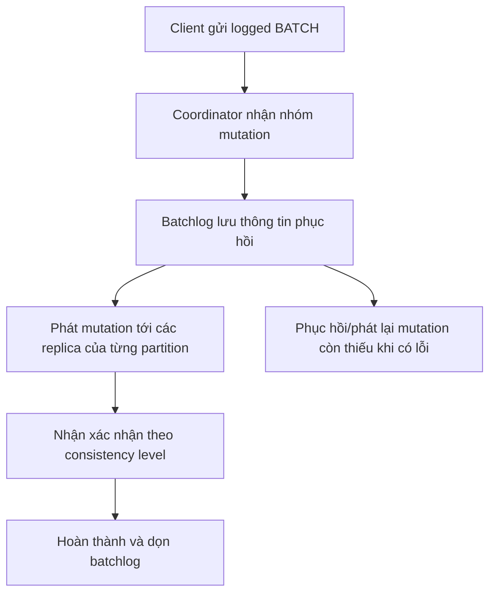
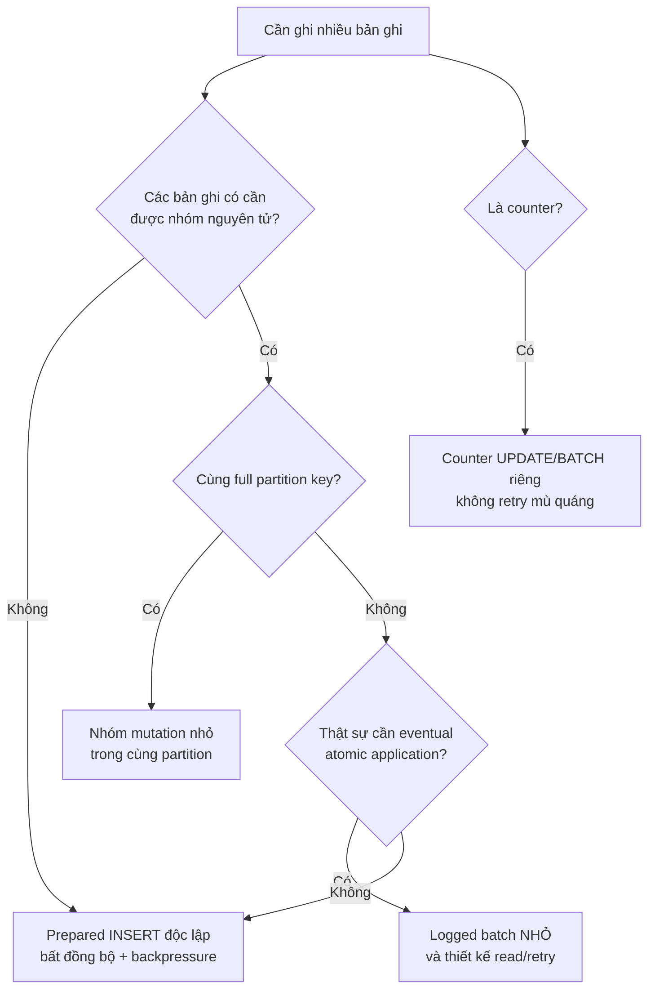

# Nạp nhiều bản ghi bằng yêu cầu độc lập hoặc BATCH phù hợp trong Cassandra

Khi ứng dụng Java cần ghi một nghìn sự kiện vào Apache Cassandra, lựa chọn đầu tiên thường là “gom tất cả vào một câu `BATCH` để tiết kiệm lượt gọi”. Với Cassandra, trực giác đó dễ dẫn đến thiết kế sai: **BATCH không phải công cụ tăng tốc nạp dữ liệu tổng quát**, đặc biệt khi các bản ghi thuộc nhiều partition key khác nhau. Trong nhiều trường hợp, **nhiều câu `INSERT` độc lập được gửi bất đồng bộ với số yêu cầu đang chờ có giới hạn** lại đúng với cách Cassandra phân tán công việc hơn.

Ngược lại, một batch **nhỏ, có chủ đích** có thể hữu ích khi cần gom các thay đổi liên quan vào **cùng một partition**, hoặc khi nghiệp vụ thực sự cần đặc tính *atomic eventual application* của **logged batch** trên nhiều partition. Điều quan trọng là phân biệt **tối ưu hóa thông lượng**, **phạm vi khóa phân vùng**, **đặc tính nguyên tử** và **tính độc lập khi đọc**; chúng không phải một khái niệm.

Bài thuộc chương **Ghi và xóa bằng CQL**, module **DATABASE_ENGINE_WIDE_COLUMN_CASSANDRA**: hiểu wide-column, partition key, replication, consistency level, CQL, compaction/repair và kết nối Java. Mục tiêu là quyết định được **khi nào dùng nhiều yêu cầu riêng**, **khi nào dùng BATCH**, cách giới hạn tải và cách xử lý lỗi khi chỉ một phần công việc được xác nhận.

Sau bài học, bạn có thể:

1. Giải thích vì sao ghi nhiều bản ghi **không tự động tương đương** một giao dịch SQL.
2. Phân loại **logged**, **unlogged** và **counter batch**, cũng như giới hạn với conditional batch.
3. Viết CQL cho nhiều hàng trong **cùng partition** và cho các mutation thật sự cần nhóm.
4. Thiết kế ingestion bất đồng bộ có **bounded concurrency/backpressure** trong Java Driver 4.x.
5. Hiểu batchlog, replica, timeout, retry, idempotency, tombstone và tác động của hot partition.
6. Chọn chiến lược thích hợp cho sự kiện, import, cập nhật dữ liệu denormalized và counter.

## 1. Vì sao phải nhìn partition key trước khi gom bản ghi?

Giả sử dịch vụ nhận sự kiện từ nhiều thiết bị, cần đọc theo **thiết bị và ngày**. Keyspace `demo` được giả định đã tồn tại trên cluster học tập:

```sql
CREATE TABLE demo.events_by_device_day (
    device_id  uuid,
    event_day  date,
    event_time timestamp,
    event_id   uuid,
    event_type text,
    payload    text,
    PRIMARY KEY ((device_id, event_day), event_time, event_id)
) WITH CLUSTERING ORDER BY (event_time DESC, event_id ASC);
```

**Partition key** là `(device_id, event_day)`, còn **clustering key** là `(event_time, event_id)`. Hai sự kiện cùng device/day thuộc một partition; hai device hoặc hai ngày khác nhau có thể nằm trên các replica và token range khác nhau.

```text
Batch sự kiện đầu vào
|
+-- Thiết bị A, ngày 2026-11-21
|   +-- 09:00, event X
|   +-- 09:05, event Y
|
+-- Thiết bị A, ngày 2026-11-22
|   +-- 10:00, event Z
|
+-- Thiết bị B, ngày 2026-11-21
    +-- 11:00, event W

Ba partition key -> có thể thuộc các replica/coordinator khác nhau.
```

**Cùng bảng** không đồng nghĩa **cùng partition**. **Cùng device_id** cũng chưa đủ: `event_day` là thành phần thứ hai của partition key ghép. Nếu gom bốn sự kiện trên vào một batch, bạn đang buộc một coordinator điều phối công việc vượt qua nhiều partition chỉ để giảm số lượt gọi từ ứng dụng; đó thường không phải cách tăng thông lượng tối ưu.

### Cách đọc một yêu cầu ghi

| Thông tin | Câu hỏi thiết kế |
| --- | --- |
| `device_id` và `event_day` | Bản ghi đi vào partition nào, có gây hot partition không? |
| `event_time` và `event_id` | Đây là hàng mới hay ghi lại cùng full primary key? |
| Số partition trong một nhóm | Có lý do nghiệp vụ để gom chúng không? |
| Kích thước `payload` | Batch có quá lớn theo **byte** dù chỉ có ít statement không? |
| Số producer và mức concurrency | Cluster có đủ khả năng tiếp nhận các mutation đang bay không? |
| Retry sau timeout | Cùng sự kiện có bị nhân bản do sinh ID mới không? |

Trong các ví dụ, mọi UUID sự kiện được định trước để việc retry của một *logical event* dùng lại cùng khóa. `event_time` được biểu diễn bằng timestamp có múi giờ +07:00 và `event_day` phải được tính theo quy tắc bucket nhất quán.

## 2. Cách mặc định: các câu INSERT độc lập

Với các sự kiện không cần điều kiện nguyên tử chung, ứng dụng có thể gửi **mỗi sự kiện là một mutation riêng**:

```sql
INSERT INTO demo.events_by_device_day (
    device_id, event_day, event_time, event_id,
    event_type, payload
) VALUES (
    11111111-1111-4111-8111-111111111111,
    '2026-11-21', '2026-11-21 09:00:00+0700',
    aaaaaaaa-aaaa-4aaa-8aaa-aaaaaaaaaaaa,
    'BOOT', 'device started'
);

INSERT INTO demo.events_by_device_day (
    device_id, event_day, event_time, event_id,
    event_type, payload
) VALUES (
    22222222-2222-4222-8222-222222222222,
    '2026-11-21', '2026-11-21 11:00:00+0700',
    bbbbbbbb-bbbb-4bbb-8bbb-bbbbbbbbbbbb,
    'INFO', 'sensor online'
);
```

Hai câu lệnh có thể được gửi gần như đồng thời từ Java Driver. Mỗi request mang full primary key; driver/coordinator định tuyến theo partition/token và replication của cụm. Không cần bắt một coordinator xử lý một batch nhiều partition nếu **không có quan hệ nguyên tử giữa hai sự kiện**.

### Vì sao không nhất thiết phải gửi tuần tự?

Gửi một nghìn lệnh theo vòng lặp `session.execute(...)` đồng bộ có thể khiến ứng dụng chờ phản hồi của từng lệnh trước khi phát lệnh tiếp, làm giảm mức song song. Đường ghi Cassandra phù hợp hơn với **prepared statements + executeAsync + giới hạn số request đồng thời**:

```text
Producer -> Hàng đợi có giới hạn -> N request INSERT đang chờ
                                     |       |       |
                                     v       v       v
                                  partition A   B    C
                                     |       |       |
                                     +--- completion/error -> giải phóng slot
```

**Bounded concurrency** khác với phát hàng triệu future không giới hạn. Nếu không có backpressure, ứng dụng có thể làm cạn bộ nhớ, connection pool, hàng đợi phía driver hoặc gây quá tải coordinator.

### Mỗi request có thể thành công/thất bại độc lập

Khi gửi 100 `INSERT` độc lập:

- 95 lệnh có thể đã được xác nhận, 3 lệnh timeout, 2 lệnh báo lỗi khác.
- Không có transaction chung tự động rollback 95 lệnh đã thành công.
- Sau timeout, một số mutation có thể đã tới replica; **không thể mặc định retry là không gây hiệu ứng**.
- Cần giữ khóa sự kiện ổn định, theo dõi kết quả từng request và có cơ chế đối chiếu/retry.

Đây thường là **đặc tính mong muốn** cho luồng sự kiện độc lập: một sự kiện lỗi không nhất thiết kéo theo thất bại nguyên tử của mọi sự kiện khác.

## 3. BATCH trong CQL thực sự là gì?

Một CQL batch là nhóm các mutation `INSERT`/`UPDATE`/`DELETE` để Cassandra xử lý theo semantics batch. Có ba dạng thường gặp:

```sql
BEGIN BATCH
    -- Mặc định là logged batch.
    INSERT INTO ...;
    UPDATE ...;
APPLY BATCH;

BEGIN UNLOGGED BATCH
    INSERT INTO ...;
    INSERT INTO ...;
APPLY BATCH;

BEGIN COUNTER BATCH
    UPDATE ... SET counter_col = counter_col + 1 WHERE ...;
    UPDATE ... SET counter_col = counter_col + 1 WHERE ...;
APPLY BATCH;
```

Ba khối trên chỉ minh họa **khuôn dạng**; dấu `...` không phải CQL thực thi. Các ví dụ chạy được sẽ xuất hiện ở phần 4, 5 và 7.

### Ma trận lựa chọn

| Kiểu | Mục đích | Đặc tính quan trọng | Không nên hiểu là |
| --- | --- | --- | --- |
| **Logged batch** `BEGIN BATCH` | Nhóm mutation cần bảo đảm *atomic eventual application* kể cả nhiều partition | Có **batchlog** và chi phí điều phối | Một giao dịch SQL đa partition có isolation đầy đủ |
| **Unlogged batch** | Nhóm mutation mà không cần batchlog, phù hợp nhất khi cùng partition | Không có bảo đảm atomicity xuyên partition như logged batch | Cách miễn phí để tăng tốc mọi INSERT rải rác |
| **Counter batch** | Nhóm mutation trên cột `counter` | Semantics counter riêng; không trộn cùng regular mutation | Cơ chế exactly-once hoặc idempotent |

**Atomicity** của logged batch cần hiểu cẩn thận: Cassandra có cơ chế để các mutation của batch được **áp dụng về sau khi có sự cố phù hợp**, không có nghĩa mọi client luôn quan sát tất cả partition thay đổi **đúng cùng một thời điểm**, và không đồng nghĩa với isolation/rollback của một transaction quan hệ.

### Batch không có SELECT bên trong

CQL batch là nhóm **mutation**, không phải một khối chương trình SQL cho phép `SELECT` để đọc trạng thái cũ, tính toán, kiểm tra điều kiện tùy ý rồi commit. Nếu phải so sánh trạng thái cũ, cần dùng LWT trong phạm vi conditional batch được hỗ trợ hoặc thiết kế workflow nghiệp vụ khác.

### Một batch không tạo row count

Giống các mutation thường, batch không điều kiện không trả số hàng “inserted/updated” theo kiểu JDBC `rowsAffected`. Một phản hồi thành công cho batch không giải thích có bao nhiêu hàng đã tồn tại trước khi ghi.

## 4. BATCH nhỏ trong cùng partition: trường hợp phù hợp

Giả sử cần ghi hai sự kiện của **cùng thiết bị, cùng ngày** và muốn gửi cùng một request. Một `UNLOGGED BATCH` nhỏ có thể diễn đạt nhóm mutation đó:

```sql
BEGIN UNLOGGED BATCH
    INSERT INTO demo.events_by_device_day (
        device_id, event_day, event_time, event_id,
        event_type, payload
    ) VALUES (
        11111111-1111-4111-8111-111111111111,
        '2026-11-21', '2026-11-21 09:00:00+0700',
        aaaaaaaa-aaaa-4aaa-8aaa-aaaaaaaaaaaa,
        'BOOT', 'device started'
    );

    INSERT INTO demo.events_by_device_day (
        device_id, event_day, event_time, event_id,
        event_type, payload
    ) VALUES (
        11111111-1111-4111-8111-111111111111,
        '2026-11-21', '2026-11-21 09:05:00+0700',
        cccccccc-cccc-4ccc-8ccc-cccccccccccc,
        'READY', 'device warmed up'
    );
APPLY BATCH;
```

Hai statement cùng full partition key `(device_id, event_day)` nhưng khác clustering key. Cassandra có thể xử lý các mutation của partition này cùng nhau, tránh overhead batchlog xuyên partition không cần thiết. **Không phải cứ cùng partition là buộc phải batch**: hai lệnh độc lập cũng có thể đáp ứng yêu cầu nếu ứng dụng không cần nhóm kết quả.

### Khi nào single-partition batch đáng cân nhắc?

- Một thay đổi nghiệp vụ gồm vài hàng/cột trong **cùng partition**, có lý do để gửi như một đơn vị.
- Một nhóm dữ liệu được tạo đồng thời theo cùng partition key, kích thước nhỏ.
- Tránh việc ứng dụng gửi nhiều request tuần tự khi đã biết các mutation có phạm vi liên quan chặt chẽ.

### Khi nào không nên?

- Một partition nhận hàng trăm nghìn event liên tục: gom batch lớn không sửa được vấn đề **hot partition**.
- Một payload lớn khiến batch vài statement vẫn chiếm quá nhiều bộ nhớ.
- Nhiều mutation cùng full primary key được ghép không cần thiết, làm khó xác định thứ tự/timestamp thắng.
- Một luồng có thể dùng asynchronous writes độc lập mà không cần bất biến nguyên tử chung.

**Nguyên tắc:** chọn partition key theo truy vấn trước, chọn batch theo **nhu cầu nhóm mutation**, không dùng batch để che một schema tạo phân vùng quá lớn.

## 5. LOGGED BATCH trên nhiều partition: atomicity khác isolation

Một hệ thống Cassandra thường lưu dữ liệu theo **truy vấn**. Cùng một event có thể được biểu diễn trong hai bảng để phục vụ hai truy vấn khác nhau:

```sql
CREATE TABLE demo.event_details_by_id (
    event_id   uuid PRIMARY KEY,
    device_id  uuid,
    event_day  date,
    event_time timestamp,
    event_type text,
    payload    text
);
```

Khi một event mới được tạo, ứng dụng cần lưu vào:

1. `events_by_device_day` để đọc các event của một thiết bị/ngày.
2. `event_details_by_id` để tìm chi tiết event bằng `event_id`.

Hai bảng có **partition key khác nhau**. Nếu thực sự cần Cassandra giúp đảm bảo eventual application cho **hai mutation này như một nhóm**, có thể cân nhắc **logged batch nhỏ**:

```sql
BEGIN BATCH
    INSERT INTO demo.events_by_device_day (
        device_id, event_day, event_time, event_id,
        event_type, payload
    ) VALUES (
        11111111-1111-4111-8111-111111111111,
        '2026-11-21', '2026-11-21 09:20:00+0700',
        dddddddd-dddd-4ddd-8ddd-dddddddddddd,
        'WARN', 'temperature high'
    );

    INSERT INTO demo.event_details_by_id (
        event_id, device_id, event_day, event_time,
        event_type, payload
    ) VALUES (
        dddddddd-dddd-4ddd-8ddd-dddddddddddd,
        11111111-1111-4111-8111-111111111111,
        '2026-11-21', '2026-11-21 09:20:00+0700',
        'WARN', 'temperature high'
    );
APPLY BATCH;
```

### Vai trò của batchlog

Ở mức khái niệm, Cassandra ghi thông tin về **logged batch** vào cơ chế **batchlog** để có thể phát lại các mutation chưa hoàn tất nếu coordinator gặp sự cố vào thời điểm phù hợp:



Batchlog có chi phí lưu trữ, replication và điều phối. Vì vậy một batch trải trên hàng trăm/hàng nghìn partition có thể tạo thêm công việc ở coordinator và các node giữ batchlog, thay vì phân tán đều tải ghi ngay từ Java Driver.

### “Atomic” không có nghĩa đọc tất cả bảng cùng lúc sẽ thấy toàn bộ

Hãy phân biệt ba yêu cầu:

| Tính chất | Logged batch nhiều partition có đáp ứng như SQL transaction không? |
| --- | --- |
| **Atomic eventual application** | Có cơ chế phục hồi để các mutation trong batch được áp dụng theo bảo đảm của logged batch |
| **Isolation / snapshot đa partition** | **Không** cung cấp mức isolation SQL cho mọi truy vấn đồng thời |
| **Rollback khi người dùng đổi ý** | **Không** có `ROLLBACK BATCH` để hoàn tác dữ liệu đã áp dụng |

Trong khi một logged batch đang được áp dụng hoặc hồi phục sau sự cố, một reader có thể thấy thông tin cập nhật ở bảng thứ nhất trước khi nhìn thấy thông tin tương ứng ở bảng thứ hai. Không nên xây dựng quy tắc “không bao giờ đọc thấy trạng thái trung gian” chỉ vì hai bảng được ghi trong cùng logged batch.

Nếu cần một invariant nghiệp vụ mạnh như **chuyển tiền giữa hai tài khoản mà không thể có trạng thái trung gian**, không tự động xem logged batch là giao dịch ACID đa partition. Cần thiết kế mô hình giao dịch, khóa/bất biến, idempotency và quy trình điều phối phù hợp.

### Batchlog không chứng minh dữ liệu đã đến mọi replica

Batch vẫn chịu các quy tắc **replication và consistency**. Phản hồi thành công theo `LOCAL_QUORUM` hoặc `QUORUM` không có nghĩa tất cả replica đã nhận mutation ngay lập tức. Repair và các cơ chế hội tụ vẫn quan trọng. Batchlog giải quyết một kiểu rủi ro thất bại của nhóm mutation, không thay thế chính sách repair toàn cluster.

## 6. UNLOGGED BATCH nhiều partition: vì sao dễ gây hiểu nhầm?

`UNLOGGED BATCH` có thể được viết với các partition khác nhau nhưng **không có bảo đảm atomicity xuyên partition từ batchlog**:

```sql
BEGIN UNLOGGED BATCH
    INSERT INTO demo.events_by_device_day (
        device_id, event_day, event_time, event_id,
        event_type
    ) VALUES (
        11111111-1111-4111-8111-111111111111,
        '2026-11-21', '2026-11-21 09:40:00+0700',
        eeeeeeee-eeee-4eee-8eee-eeeeeeeeeeee,
        'INFO'
    );

    INSERT INTO demo.events_by_device_day (
        device_id, event_day, event_time, event_id,
        event_type
    ) VALUES (
        22222222-2222-4222-8222-222222222222,
        '2026-11-21', '2026-11-21 11:40:00+0700',
        ffffffff-ffff-4fff-8fff-ffffffffffff,
        'INFO'
    );
APPLY BATCH;
```

Vì hai mutation thuộc hai partition key, khi có lỗi hoặc timeout không thể suy ra “hoặc cả hai được ghi, hoặc không cái nào” từ một unlogged batch. Một mutation có thể đã được áp dụng, mutation còn lại không nhận đủ xác nhận hoặc chưa hoàn thành.

**Không dùng `UNLOGGED` như một công tắc để bỏ chi phí batchlog nhưng vẫn giữ nguyên bảo đảm của logged batch.** Nếu các event độc lập về nghiệp vụ, tốt hơn là gửi hai `INSERT` độc lập bất đồng bộ, để mỗi request có routing, quan sát và chính sách retry riêng.

### Batch warning và coordinator overload

Cluster có thể cảnh báo batch lớn hoặc batch tác động nhiều partition. Những giới hạn/cảnh báo về kích thước thay đổi theo phiên bản và cấu hình, nên không nên lấy một con số ngưỡng cố định làm chuẩn cho mọi cluster.

Giảm số **statement** thôi chưa đủ: một batch 10 statement với mỗi `payload` vài MB có thể tốn nhiều tài nguyên hơn batch 50 statement rất nhỏ. Cần kiểm soát **số partition**, **tổng byte được serialize**, **số mutation** và **tần suất gửi**.

### Tại sao “một round trip” chưa chắc nhanh hơn?

Một batch nhiều partition có thể giảm số request từ client nhưng buộc một coordinator phân phối công việc cho nhiều vị trí token, tạo điểm tập trung CPU/memory/network. Nhiều write request độc lập cho phép driver phân tán công việc tới các coordinator thích hợp và tận dụng khả năng xử lý song song của cluster.

Đừng chỉ đo **latency của một lời gọi API** khi quyết định: hãy đo **throughput sự kiện/giây, p95/p99 latency, timeout, CPU, network, coordinator saturation, compaction và số lỗi** dưới tải thật.

## 7. COUNTER BATCH: phép cộng dồn không phải upsert idempotent

Counter là loại dữ liệu đặc biệt, dùng một bảng riêng:

```sql
CREATE TABLE demo.event_counts_by_device_day (
    device_id uuid,
    event_day date,
    total counter,
    errors counter,
    PRIMARY KEY (device_id, event_day)
);
```

Khi cần nhóm những phép cộng counter, dùng `BEGIN COUNTER BATCH`:

```sql
BEGIN COUNTER BATCH
    UPDATE demo.event_counts_by_device_day
    SET total = total + 1
    WHERE device_id = 11111111-1111-4111-8111-111111111111
      AND event_day = '2026-11-21';

    UPDATE demo.event_counts_by_device_day
    SET errors = errors + 1
    WHERE device_id = 11111111-1111-4111-8111-111111111111
      AND event_day = '2026-11-21';
APPLY BATCH;
```

**Không trộn regular mutations với counter mutations trong cùng batch.** Counter còn có các hạn chế riêng về `TTL`, write timestamp tự chọn và conditional LWT; không sử dụng `IF` trên counter như với regular column.

### Retry counter có thể gây đếm trùng

Nếu client nhận timeout sau counter batch, một phần hoặc toàn bộ hiệu ứng cộng dồn có thể đã được áp dụng. Gửi lại cùng batch có thể làm `total` và `errors` tăng thêm. Không xem counter batch là cơ chế **exactly-once**.

Nếu cần đếm chính xác một lần cho mỗi event, có thể:

1. Lưu event với `event_id` ổn định.
2. Dùng quy trình chống xử lý trùng ở tầng ứng dụng/stream processing.
3. Tạo số liệu tổng hợp từ các event đã xác nhận bằng pipeline có idempotency/checkpoint.

Counter vẫn hữu ích cho các chỉ số có semantics cộng dồn phù hợp, nhưng không nên dùng để quyết định những invariant tài chính mà việc cộng trùng là không chấp nhận được.

## 8. Conditional BATCH và LWT: chỉ dùng trong phạm vi được hỗ trợ

Một số mutation có điều kiện như `INSERT ... IF NOT EXISTS`, `UPDATE ... IF EXISTS` hoặc `UPDATE ... IF col = expected` cần **lightweight transaction (LWT)**. Conditional batch có các giới hạn chặt về việc nhóm các mutation cùng **partition**, cú pháp và điều kiện mà Cassandra cho phép; không thể lấy một logged batch nhiều partition rồi thêm `IF` tùy ý để có giao dịch ACID xuyên bảng.

### Một ví dụ CAS đơn lẻ làm nền

```sql
CREATE TABLE demo.ingest_job_by_id (
    job_id uuid PRIMARY KEY,
    job_state text,
    revision int,
    last_error text
);

INSERT INTO demo.ingest_job_by_id (
    job_id, job_state, revision
)
VALUES (
    99999999-9999-4999-8999-999999999999,
    'PENDING', 1
)
IF NOT EXISTS;

UPDATE demo.ingest_job_by_id
SET job_state = 'RUNNING', revision = 2
WHERE job_id = 99999999-9999-4999-8999-999999999999
IF job_state = 'PENDING' AND revision = 1;
```

Lệnh thứ hai chỉ chuyển trạng thái khi điều kiện còn đúng; kết quả có cột `[applied]`. Nếu một client khác đã chuyển job sang `CANCELLED`, mutation không được áp dụng.

### Khi muốn nhóm mutation có IF

Trước khi chọn conditional batch, phải kiểm tra:

- Các statement được gom có nằm trong **cùng partition key** không?
- Điều kiện `IF` trên những hàng/cột có hợp lệ theo cú pháp của phiên bản Cassandra không?
- Các statement có phụ thuộc lẫn nhau về revision/trạng thái cũ không?
- Một lần thay đổi có thực sự cần semantics nguyên tử tại partition đó, hay một CAS trên hàng trạng thái đã đủ?
- Nếu timeout, ứng dụng sẽ xác định request nào đã áp dụng bằng ID ổn định như thế nào?

Không ghi `BEGIN BATCH ... IF EXISTS` ở cấp batch như thể đó là cú pháp SQL thông thường. Điều kiện `IF` thuộc những mutation mà CQL hỗ trợ và phải được kiểm tra theo quy tắc conditional batch.

### Kết quả `[applied]` không phải số hàng trong batch

Khi một conditional batch hợp lệ trả `[applied] = true`, đó là **kết quả của điều kiện** theo ngữ nghĩa LWT, không phải “batch đã sửa N hàng”. Khi false, không được suy luận từ đó rằng “một vài statement đã sửa 0 hàng” theo JDBC; cần hiểu phạm vi điều kiện và các bảo đảm mà CQL cung cấp.

**Nguyên tắc ứng dụng:** nếu bài toán chỉ là “bắt đầu job nếu trạng thái còn PENDING”, một `UPDATE ... IF job_state = 'PENDING'` đơn lẻ thường rõ ràng hơn việc cố xây một batch nhiều partition để bảo vệ job.

## 9. Kích thước BATCH, hot partition và hiệu năng ingestion

Một lỗi vận hành phổ biến là gom dữ liệu thành batch **theo số lượng cố định, không nhìn partition key và kích thước**. “1.000 hàng” không phải thông số đủ để quyết định batch an toàn.

### Những giới hạn cần đo

| Yếu tố | Khi vượt mức phù hợp, hệ quả có thể là |
| --- | --- |
| Số partition trong batch | Coordinator phải phân phối nhiều mutation, batchlog có thể quá tải |
| Tổng byte đã serialize | Chiếm memory/network/CPU, gây warning hoặc reject theo cấu hình |
| Số statement | Tăng chi phí parse/chuẩn bị/phân phối và quản lý kết quả |
| Kích thước mỗi `payload` | Ít mutation vẫn có thể thành batch quá lớn |
| Tần suất batch/giây | Dồn tải lên coordinator và replica, kể cả batch nhỏ |
| Tỉ lệ retry | Có thể nhân tải đúng khi cluster đang quá tải |
| Số bản ghi vào một partition | Hot partition, partition quá lớn, latency đọc/compaction tăng |

Cassandra có cơ chế cảnh báo/thất bại khi batch quá lớn, với các tham số và ngưỡng phụ thuộc phiên bản, cấu hình. **Đừng viện dẫn một ngưỡng số lượng bản ghi cố định** để cho rằng batch sẽ luôn an toàn. Phải đo với schema, payload và topology thực tế.

### Nạp nhiều dữ liệu không sửa được hot partition

Giả sử mọi sự kiện của một thiết bị được đưa vào `(device_id, event_day)`:

```text
Một thiết bị cực nóng -> 500.000 event/ngày
                      -> cùng partition của ngày đó
                      -> cùng nhóm replica chịu phần lớn ghi/đọc
```

Tăng kích thước batch sẽ **không thay đổi** token/replica chịu trách nhiệm phân vùng. Nếu partition tăng quá lớn, cần xem xét bucket theo giờ hoặc shard có kiểm soát, với trade-off là truy vấn phải biết các bucket cần đọc. Việc quyết định số bucket phải dựa trên kích thước, tần suất ghi và truy vấn thật, không chọn ngẫu nhiên để “phân tán cho đều”.

### Khi nào cần giới hạn số request đang chờ?

Một producer có tốc độ đầu vào lớn hơn tốc độ ghi bền vững của cluster cần:

1. Hàng đợi/bộ đệm **có giới hạn**, tránh tăng memory vô hạn.
2. Giới hạn request **đang bay** (in-flight), điều chỉnh theo latency và cluster capacity.
3. Backpressure về phía producer, cơ chế tạm dừng/persist nguồn.
4. Retry có điều kiện, backoff và jitter phù hợp lỗi.
5. Trạng thái checkpoint để không mất/sinh trùng logical event.

**Không coi một batch 10.000 mutation là backpressure.** Nó chỉ đổi hình thức dồn tải; nhu cầu giới hạn dòng sự kiện vẫn tồn tại.

## 10. Java Driver 4.x: nạp bằng prepared statement bất đồng bộ

Với Apache Cassandra Java Driver 4.x, nên **prepare một lần** rồi bind cho từng event. Không tạo `session`/TCP connection mới cho mỗi bản ghi và không nối CQL từ giá trị payload nhận từ client.

### 10.1. Mẫu dữ liệu sự kiện có khóa ổn định

Giả sử ứng dụng Java 17 có mô hình:

```java
record Event(
    java.util.UUID deviceId,
    java.time.LocalDate eventDay,
    java.time.Instant eventTime,
    java.util.UUID eventId,
    String eventType,
    String payload
) {}
```

`eventId` phải là ID **ổn định của cùng logical event**, không sinh mới mỗi khi retry. `eventDay` được tính theo quy tắc ngày/bucket thống nhất với query; `Instant` biểu diễn thời điểm tuyệt đối.

### 10.2. Prepare và bind đúng kiểu

```java
PreparedStatement insertEvent = session.prepare(
    "INSERT INTO demo.events_by_device_day " +
    "(device_id, event_day, event_time, event_id, " +
    "event_type, payload) " +
    "VALUES (:device_id, :event_day, :event_time, :event_id, " +
    ":event_type, :payload)"
);

Event event = events.get(0);
BoundStatement bound = insertEvent.boundStatementBuilder()
    .setUuid("device_id", event.deviceId())
    .setLocalDate("event_day", event.eventDay())
    .setInstant("event_time", event.eventTime())
    .setUuid("event_id", event.eventId())
    .setString("event_type", event.eventType())
    .setString("payload", event.payload())
    .build();

session.execute(bound); // Dong bo, minh hoa mot event.
```

Ví dụ này giữ cho Java Driver hiểu loại dữ liệu CQL, tránh lỗi múi giờ và nguy cơ injection khi nối chuỗi SQL/CQL.

### 10.3. Cửa sổ bất đồng bộ có giới hạn

Dưới đây là mẫu **windowed asynchronous writes**: tối đa `MAX_IN_FLIGHT` request trong một cửa sổ; kết thúc cửa sổ trước khi phát cửa sổ kế tiếp. Mẫu dễ hiểu, dễ giới hạn bộ nhớ; một implementation streaming có thể dùng semaphore/backpressure tinh vi hơn để luôn giữ đủ tải.

```java
import com.datastax.oss.driver.api.core.cql.AsyncResultSet;
import com.datastax.oss.driver.api.core.cql.BoundStatement;
import com.datastax.oss.driver.api.core.cql.PreparedStatement;
import java.util.ArrayList;
import java.util.List;
import java.util.concurrent.CompletableFuture;
import java.util.concurrent.CompletionStage;

final int MAX_IN_FLIGHT = 32;  // Gia tri demo, phai benchmark.
List<CompletableFuture<AsyncResultSet>> window = new ArrayList<>();

for (Event e : events) {
    BoundStatement write = insertEvent.boundStatementBuilder()
        .setUuid("device_id", e.deviceId())
        .setLocalDate("event_day", e.eventDay())
        .setInstant("event_time", e.eventTime())
        .setUuid("event_id", e.eventId())
        .setString("event_type", e.eventType())
        .setString("payload", e.payload())
        .build();

    CompletionStage<AsyncResultSet> stage = session.executeAsync(write);
    window.add(stage.toCompletableFuture());

    if (window.size() == MAX_IN_FLIGHT) {
        CompletableFuture.allOf(
            window.toArray(new CompletableFuture[0])
        ).join();
        window.clear();
    }
}

if (!window.isEmpty()) {
    CompletableFuture.allOf(
        window.toArray(new CompletableFuture[0])
    ).join();
}
```

Đoạn trên minh họa **giới hạn concurrency**, không phải một ingestion framework production:

- `join()` có thể ném `CompletionException` nếu một hoặc nhiều request lỗi.
- Các request trong cùng cửa sổ có thể đã **thành công một phần** trước lỗi; không rollback cả cửa sổ.
- Để retry chính xác, lưu kết quả **theo từng event ID**, ghi trạng thái success/failure và có cơ chế xử lý lỗi độc lập.
- Không giữ toàn bộ `events` khổng lồ trong memory; producer có thể đọc theo trang/stream có checkpoint và giữ bộ đệm giới hạn.
- Giá trị 32 **chỉ là ví dụ**, không phải mặc định tối ưu cho mọi cụm.

### 10.4. Quan sát lỗi theo từng request

Trong production, gắn metadata của logical event cho completion:

```java
CompletionStage<Void> one = session.executeAsync(bound)
    .thenAccept(rs -> {
        // Success cho request nay.
        // Cap nhat checkpoint theo eventId khi phu hop.
    })
    .exceptionally(error -> {
        // Ghi nhan eventId, loai loi, retry decision.
        // Khong coi timeout la 'chac chan chua ghi'.
        reportFailure(event.eventId(), error);
        return null;
    });
```

`reportFailure` là hàm nghiệp vụ cần tự triển khai. Mẫu này **không nên âm thầm nuốt lỗi** rồi báo cả job thành công; nếu dùng `exceptionally` để ghi log, phải tổng hợp trạng thái lỗi và phản ánh vào kết quả cuối của job.

**Không** gọi `session.executeAsync` một triệu lần liên tục rồi mới chờ `allOf`: làm như vậy bỏ mất giới hạn số request đồng thời, có thể gây áp lực bộ nhớ và hàng đợi của driver.

### 10.5. Idempotency: cùng full primary key mới là bước đầu

Một `INSERT` thường vào cùng full primary key có upsert semantics, nên gửi lại một event ID cố định **không tự tạo hai hàng**. Nhưng:

- Nếu mỗi retry sinh `event_id` mới, sẽ tạo **hai hàng**.
- Nếu cùng key nhưng `payload` thay đổi và timestamp mới, có thể ghi đè sự kiện cũ.
- Nếu có `USING TTL`, retry có thể gia hạn thời hạn lưu dữ liệu.
- Nếu có writer khác cùng full key, kết quả phụ thuộc timestamp.
- Nếu payload cần side effect khác như gửi email hay tăng counter, upsert cùng khóa **không tự chống trùng side effect ngoài bảng**.

Chỉ đánh dấu statement idempotent cho retry policy khi đã xét **toàn bộ semantics ứng dụng**; không coi mọi `INSERT` của Cassandra tự động exactly-once.

## 11. Java Driver 4.x: tạo BATCH nhỏ và có chủ đích

Khi cần nhóm các mutation, driver cho phép tạo `BatchStatement` với kiểu batch rõ ràng. Mẫu sau dùng **hai sự kiện trong cùng partition**:

```java
import com.datastax.oss.driver.api.core.cql.BatchStatement;
import com.datastax.oss.driver.api.core.cql.DefaultBatchType;

BoundStatement first = insertEvent.boundStatementBuilder()
    .setUuid("device_id", deviceId)
    .setLocalDate("event_day", java.time.LocalDate.of(2026, 11, 21))
    .setInstant("event_time",
        java.time.Instant.parse("2026-11-21T02:00:00Z"))
    .setUuid("event_id", eventId1)
    .setString("event_type", "BOOT")
    .setString("payload", "device started")
    .build();

BoundStatement second = insertEvent.boundStatementBuilder()
    .setUuid("device_id", deviceId)
    .setLocalDate("event_day", java.time.LocalDate.of(2026, 11, 21))
    .setInstant("event_time",
        java.time.Instant.parse("2026-11-21T02:05:00Z"))
    .setUuid("event_id", eventId2)
    .setString("event_type", "READY")
    .setString("payload", "device warmed up")
    .build();

BatchStatement smallBatch = BatchStatement.builder(DefaultBatchType.UNLOGGED)
    .addStatement(first)
    .addStatement(second)
    .build();

session.execute(smallBatch);
```

Hai `Instant` tương ứng 09:00 và 09:05 ở múi giờ +07:00; `eventDay` cần khớp quy tắc bucket. Driver giúp bind giá trị nhưng **không tự bảo đảm hai event có cùng partition key** nếu bạn bind sai `deviceId` hoặc `eventDay`. Chính ứng dụng phải kiểm tra group key trước khi tạo single-partition batch.

### Logged batch bằng driver

Với hai mutation trên **hai bảng** của phần 5, tạo `BatchStatement.builder(DefaultBatchType.LOGGED)` và thêm hai `BoundStatement` đã chuẩn bị cho hai bảng. Chỉ dùng khi có yêu cầu nghiệp vụ về eventual application của nhóm và batch nhỏ. Đừng đổi tất cả unlogged batch sang logged để “an toàn hơn” mà không đánh giá chi phí batchlog.

### Không gom mọi bảng/mọi partition vào một batch khổng lồ

Batch builder không phải một API streaming, cũng không tự áp giới hạn số partition hoặc kích thước phù hợp workload. Ứng dụng phải đặt policy:

- Tập hợp theo full partition key khi cần single-partition batch.
- Giới hạn byte và số mutation dựa trên benchmark/cấu hình cluster.
- Tách logged batch đa partition thành các nhóm nghiệp vụ **thật sự liên quan**, không gom theo thời gian nhận request.
- Quan sát latency, warning, timeout và tỉ lệ retry của từng loại batch.

**Kết luận cho Java:** chuẩn bị statement một lần, gửi async độc lập có backpressure làm đường mặc định; dùng `BatchStatement` cho một nhu cầu nhóm mutation được mô tả rõ, không như bộ đệm “flush 500 event” chung.

## 12. Chọn công cụ nạp dữ liệu theo quy mô

Một luồng ghi vài nghìn sự kiện/giây từ API, một job di chuyển hàng trăm triệu hàng, và một bài học nhập 100 dòng CSV **không nên mặc định dùng cùng một giải pháp**.

| Trường hợp | Hướng tiếp cận | Điều cần kiểm soát |
| --- | --- | --- |
| Ghi online từ ứng dụng Java | Prepared statement + `executeAsync` có bounded concurrency | Partition key, latency, retry, memory, backpressure |
| Ghi một nhóm sự kiện nhỏ trong một partition | Small single-partition batch khi có lý do, hoặc yêu cầu độc lập | Kích thước, số clustering rows, contention |
| Đồng bộ một event vào hai bảng truy vấn | Logged batch nhỏ **nếu thực sự cần eventual atomicity** | Batchlog, isolation khi đọc, retry/idempotency |
| Tăng counter | `UPDATE counter = counter + n` hoặc counter batch phù hợp | Không idempotent, timeout, không trộn regular mutation |
| Import CSV nhỏ trong lab | Công cụ như `cqlsh COPY FROM` nếu phiên bản hỗ trợ | Không dùng mặc định cho ingestion production tải lớn |
| Backfill/ETL rất lớn | Pipeline nạp phân tán, Spark connector hoặc cơ chế nhập SSTable được hỗ trợ theo phiên bản | Schema, data model, token distribution, rate limit, checkpoint, repair |
| Ghi lịch sử có thời hạn | Partition theo bucket + TTL/compaction phù hợp workload | Tombstone, retention, dữ liệu hết hạn, backup |

### Vì sao không dùng BATCH thay công cụ bulk load?

Một batch 100.000 statement:

- Không biến tất cả statement thành một “file load” có tối ưu đường SSTable.
- Không đảm bảo mọi client đọc cùng thời điểm thấy toàn bộ 100.000 hàng.
- Đưa lượng lớn dữ liệu vào coordinator và có thể tạo batch warning/failure.
- Khi timeout, việc đối chiếu mutation nào đã được áp dụng rất khó, kể cả khi có batchlog.
- Không tự thiết kế partition key tốt hoặc chia tải đều trên token ring.

Đối với backfill, cần pipeline có **checkpoint**, **retry theo record**, **giới hạn tốc độ**, **gắn event ID ổn định** và **đo khả năng tiếp nhận của cluster**. Nếu nạp SSTable trực tiếp bằng công cụ phù hợp, cần xác minh phiên bản, định dạng SSTable, schema và cơ chế phân phối replica; đây là quy trình riêng, không phải một câu CQL BATCH.

### cqlsh COPY FROM phù hợp đến đâu?

Với dữ liệu demo có quy mô nhỏ, một số bản Cassandra cho phép `COPY table FROM 'file.csv'` thông qua `cqlsh`, nhưng định dạng, kiểu cột, dấu phân cách và các option phụ thuộc phiên bản/công cụ. Đây là tiện ích client giúp nhập dữ liệu qua nhiều request; **không nên suy ra nó tạo một giao dịch lớn hay là đường nạp tốt nhất cho production**.

Nếu bài tập chỉ cần 4–10 hàng, viết `INSERT` minh họa rõ partition key và expected result thường dễ hiểu hơn tìm cách tối ưu import.

## 13. Timeout, retry và tính đúng đắn khi ghi nhiều bản ghi

Trong hệ thống phân tán, một phản hồi timeout không chứng minh mutation chưa tới replica. Khi nạp hàng loạt, cần phân biệt **không có transaction chung**, **batchlog đảm bảo eventual application theo phạm vi**, và **thông tin client thực sự nhận được**.

### 13.1. Nhiều INSERT độc lập

Giả sử producer phát năm request:

| Event | Phản hồi quan sát | Kết luận client được phép |
| --- | --- | --- |
| E1 | Thành công | Mutation đáp ứng consistency level yêu cầu |
| E2 | Thành công | Mutation đáp ứng consistency level yêu cầu |
| E3 | Timeout | Chưa chắc đã áp dụng hay chưa |
| E4 | Lỗi validation rõ ràng | Dữ liệu/statement cần được sửa trước khi gửi lại |
| E5 | Thành công | Mutation đáp ứng consistency level yêu cầu |

**Không được rollback E1, E2, E5 chỉ vì E3 timeout** trừ khi bạn tự thiết kế một workflow bù trừ. Chỉ nên retry hoặc đối chiếu E3 dựa trên `event_id` ổn định và trạng thái dữ liệu, đồng thời xử lý riêng E4 theo nguyên nhân lỗi.

### 13.2. UNLOGGED BATCH nhiều partition

Một request unlogged batch chứa E1 ở partition A và E2 ở partition B có thể xảy ra tình huống E1 đã được ghi, còn E2 chưa; không có batchlog để đảm bảo atomicity xuyên partition. Khi client chỉ biết “batch timeout”, việc phát lại tất cả mutation cần xét từng hiệu ứng, timestamp, TTL và ghi đồng thời.

Nếu E1 và E2 vốn độc lập, hai request async riêng thường dễ theo dõi, retry và giới hạn tác động hơn.

### 13.3. LOGGED BATCH nhiều partition

Logged batch có cơ chế batchlog hỗ trợ hoàn tất eventual application của các mutation khi coordinator gặp sự cố, nhưng **phản hồi timeout vẫn không cho client một chứng minh chắc chắn về kết quả ở thời điểm đó**. Một số mutation có thể đã xuất hiện trong bảng đích, trong khi mutation khác chưa được reader quan sát.

Không phát lại logged batch một cách mù quáng nếu bên trong có thao tác **không idempotent** hoặc dữ liệu có TTL. Ví dụ một logged batch có mutation ghi phiên bản mới bằng timestamp mới sau retry có thể che bản ghi được writer khác cập nhật giữa hai lần gọi.

### 13.4. Retry theo loại mutation

| Kiểu mutation | Nguy cơ khi retry |
| --- | --- |
| `INSERT` cùng full primary key và cùng giá trị | Không tạo hai hàng cùng khóa, nhưng timestamp/TTL/concurrency vẫn cần xét |
| `INSERT` dùng UUID mới ở mỗi retry | Tạo bản ghi trùng về nghiệp vụ |
| `UPDATE ... SET col = fixed_value` | Có thể ghi đè mutation cạnh tranh nếu timestamp retry mới hơn |
| `UPDATE ... USING TTL ...` | Có thể gia hạn thời gian sống |
| `SET list_col = list_col + [...]` | Có thể append phần tử trùng |
| `counter_col = counter_col + 1` | Có thể cộng thêm lần nữa |
| `INSERT ... IF NOT EXISTS` | Retry sau thành công nhưng mất phản hồi có thể trả `[applied] = false` |
| Logged batch nhiều partition | Batchlog có thể đang phát lại; client phải phân biệt trạng thái chưa chắc chắn và hiệu ứng không idempotent |

### 13.5. Idempotency key không phải chỉ là request header

Một pipeline an toàn nên gắn **logical event ID** và bảo toàn nó qua mọi lần gửi lại. Có thể thiết kế:

```text
Source event = (source_partition, source_offset) hoặc event_id được cung cấp
                 |
                 v
Stable eventId + deterministic partition key + payload đã validate
                 |
                 v
INSERT Cassandra
                 |
                 +--> thành công: ghi checkpoint
                 |
                 +--> timeout: đối chiếu/retry đúng eventId
                 |
                 +--> lỗi vĩnh viễn: dead-letter/quarantine theo chính sách
```

Nếu nguồn có offset/checkpoint, chỉ đánh dấu offset hoàn tất theo quy tắc **đã xác nhận và có thể phục hồi**. Không đánh dấu một lô gồm nhiều request là thành công chỉ vì 95% request trả về thành công.

Idempotency ở bảng event giúp tránh **hai hàng cùng sự kiện**, nhưng nếu mỗi event còn phải cập nhật search index, gửi thông báo, tăng counter hoặc ghi hai bảng, phải thiết kế idempotency cho **cả các tác động phụ**.

## 14. Replication, write consistency, tombstone và repair

### 14.1. Nhiều replica không có nghĩa nhiều hàng

Với keyspace có replication factor 3, cùng một event có thể được lưu tại ba replica. Ghi ở `QUORUM` thường yêu cầu ít nhất hai replica xác nhận trong nhóm ba replica tương ứng. Đó là **hai bản sao của một hàng logic**, không phải hai hàng nghiệp vụ, và response không trả “2 rows inserted”.

Một `BEGIN BATCH` có 10 statement cũng không trả “10 rows affected”. Việc Cassandra xác nhận request không thay đổi ngữ nghĩa upsert của từng full primary key.

### 14.2. Repair vẫn cần thiết

Một số replica có thể tạm bỏ lỡ mutation do lỗi mạng/node không sẵn sàng. Các cơ chế đồng bộ/repair giúp các replica hội tụ; logged batch không biến mọi replica thành đồng bộ tức thì. Với ingestion liên tục, giám sát repair backlog, disk, compaction và hệ thống hint khi phù hợp vẫn quan trọng.

### 14.3. BATCH và DELETE/TTL

Batch có thể chứa `DELETE` hoặc mutation ghi với `TTL` trong phạm vi CQL hỗ trợ. Nhưng:

- `DELETE` tạo tombstone theo khóa/cột/hàng/partition; gom nhiều DELETE không loại bỏ nhu cầu compaction.
- Dùng batch lớn để xóa hàng loạt có thể tạo nhiều tombstone và gây áp lực đọc.
- TTL khiến dữ liệu hết hạn về sau; retry mutation có TTL có thể thay đổi thời gian sống.
- Các cột bị bỏ qua khỏi `INSERT`/`UPDATE` vẫn không bị ghi lại chỉ vì chúng nằm trong batch.
- Timestamp quyết định hòa giải khi có mutation cạnh tranh, không chỉ thứ tự statement được viết trong batch.

Một batch không phải công cụ bảo đảm “các DELETE đều đã thu gom vật lý khỏi mọi SSTable”. Những cơ chế lưu trữ bất biến, compaction và `gc_grace_seconds` vẫn vận hành theo chính sách của bảng.

### 14.4. Theo dõi cluster sau khi thay đổi chiến lược nạp

Khi chuyển từ request độc lập sang batch hoặc ngược lại, đo:

- Throughput **sự kiện/giây** và kích thước byte/giây.
- p50/p95/p99 latency của request.
- Tỉ lệ timeout, unavailable, overloaded, retry.
- Kích thước batch và cảnh báo batch lớn/multi-partition.
- CPU, heap, network, disk/commitlog trên coordinator và replica.
- Hot partition, kích thước partition, tombstone, compaction.
- Khả năng khôi phục sau khi dừng producer hoặc mất node.

Một chiến lược chỉ “nhanh hơn” trong bài benchmark 10 giây khi mọi node ổn định nhưng tạo retry storm lúc có lỗi chưa chắc phù hợp cho production.

## 15. Thực hành từng bước: request độc lập, unlogged và logged batch

Thực hành trên **keyspace thử nghiệm** với các bảng đã tạo ở phần 1, 5, 7 và 8. Dữ liệu dùng UUID riêng, không cần chạy các ví dụ trước. Hãy viết dự đoán về **số partition**, **mức đảm bảo**, **cách xử lý lỗi** trước khi thực hiện.

**Lưu ý:** các bài tập dưới đây được thiết kế để minh họa semantics, không yêu cầu tắt node, phá mạng hoặc gây lỗi trên cluster dùng chung. Không dùng batch lab để thử ngưỡng batch lớn.

### Bước 1 — Gửi hai INSERT độc lập vào hai partition

```sql
INSERT INTO demo.events_by_device_day (
    device_id, event_day, event_time, event_id,
    event_type, payload
) VALUES (
    77777777-7777-4777-8777-777777777777,
    '2026-11-21', '2026-11-21 08:00:00+0700',
    aaaaaaaa-aaaa-4aaa-8aaa-aaaaaaaaaaa1,
    'START', 'device 7 started'
);

INSERT INTO demo.events_by_device_day (
    device_id, event_day, event_time, event_id,
    event_type, payload
) VALUES (
    88888888-8888-4888-8888-888888888888,
    '2026-11-21', '2026-11-21 08:00:00+0700',
    bbbbbbbb-bbbb-4bbb-8bbb-bbbbbbbbbbb2,
    'START', 'device 8 started'
);
```

**Dự đoán:** hai mutation thuộc **hai partition**. Mỗi câu INSERT có phản hồi riêng và không phụ thuộc nhau về atomicity. Nếu request đầu thành công, request thứ hai timeout, không có rollback tự động của request đầu.

### Bước 2 — UNLOGGED BATCH nhỏ trong một partition

```sql
BEGIN UNLOGGED BATCH
    INSERT INTO demo.events_by_device_day (
        device_id, event_day, event_time, event_id,
        event_type, payload
    ) VALUES (
        77777777-7777-4777-8777-777777777777,
        '2026-11-21', '2026-11-21 08:10:00+0700',
        cccccccc-cccc-4ccc-8ccc-ccccccccccc3,
        'READY', 'device 7 ready'
    );

    INSERT INTO demo.events_by_device_day (
        device_id, event_day, event_time, event_id,
        event_type, payload
    ) VALUES (
        77777777-7777-4777-8777-777777777777,
        '2026-11-21', '2026-11-21 08:20:00+0700',
        dddddddd-dddd-4ddd-8ddd-ddddddddddd4,
        'INFO', 'device 7 stable'
    );
APPLY BATCH;
```

**Dự đoán:** cả hai hàng mới thuộc partition `(7777..., '2026-11-21')` và được gửi trong một batch nhỏ. Không có nhu cầu batchlog nhiều partition. Kết quả thành công **không trả số hàng được thêm**.

Đọc lại:

```sql
SELECT event_time, event_id, event_type, payload
FROM demo.events_by_device_day
WHERE device_id = 77777777-7777-4777-8777-777777777777
  AND event_day = '2026-11-21';
```

**Kỳ vọng:** có ba hàng `START` 08:00, `READY` 08:10 và `INFO` 08:20; kết quả sắp theo `event_time DESC`, tức từ 08:20 về 08:00 nếu không có ghi cạnh tranh khác.

### Bước 3 — UNLOGGED BATCH với nhiều partition: xác định rủi ro

```sql
BEGIN UNLOGGED BATCH
    INSERT INTO demo.events_by_device_day (
        device_id, event_day, event_time, event_id,
        event_type
    ) VALUES (
        77777777-7777-4777-8777-777777777777,
        '2026-11-22', '2026-11-22 09:00:00+0700',
        eeeeeeee-eeee-4eee-8eee-eeeeeeeeeee5,
        'START'
    );

    INSERT INTO demo.events_by_device_day (
        device_id, event_day, event_time, event_id,
        event_type
    ) VALUES (
        88888888-8888-4888-8888-888888888888,
        '2026-11-22', '2026-11-22 09:00:00+0700',
        ffffffff-ffff-4fff-8fff-fffffffffff6,
        'START'
    );
APPLY BATCH;
```

**Dự đoán trong điều kiện bình thường:** hai hàng được ghi. Nhưng nếu phát sinh lỗi, unlogged batch trên **hai partition** không có bảo đảm atomicity xuyên partition từ batchlog.

**Câu hỏi:** Nếu đây là hai sự kiện độc lập, dùng hai request async riêng có lợi gì? Trả lời: theo dõi kết quả và retry theo từng event, giảm coordinator fan-out và cho driver chủ động phân tán tải.

### Bước 4 — Logged batch nhỏ trên hai bảng

```sql
BEGIN BATCH
    INSERT INTO demo.events_by_device_day (
        device_id, event_day, event_time, event_id,
        event_type, payload
    ) VALUES (
        77777777-7777-4777-8777-777777777777,
        '2026-11-21', '2026-11-21 08:30:00+0700',
        11111111-1111-4111-8111-111111111111,
        'WARN', 'temperature warning'
    );

    INSERT INTO demo.event_details_by_id (
        event_id, device_id, event_day, event_time,
        event_type, payload
    ) VALUES (
        11111111-1111-4111-8111-111111111111,
        77777777-7777-4777-8777-777777777777,
        '2026-11-21', '2026-11-21 08:30:00+0700',
        'WARN', 'temperature warning'
    );
APPLY BATCH;
```

**Dự đoán:** batch dùng **hai partition khác nhau**, ở hai bảng. Đây là trường hợp có thể cân nhắc batchlog khi ứng dụng thật sự cần eventual application cho cả hai biểu diễn của cùng event. **Không** suy ra hai truy vấn khác bảng luôn thấy event đồng thời khi hệ thống đang áp dụng hoặc phục hồi batch.

Đọc hai đường truy cập:

```sql
SELECT event_time, event_type, payload
FROM demo.events_by_device_day
WHERE device_id = 77777777-7777-4777-8777-777777777777
  AND event_day = '2026-11-21';

SELECT event_id, device_id, event_type, payload
FROM demo.event_details_by_id
WHERE event_id = 11111111-1111-4111-8111-111111111111;
```

### Bước 5 — Counter batch và việc gửi lại

```sql
BEGIN COUNTER BATCH
    UPDATE demo.event_counts_by_device_day
    SET total = total + 1
    WHERE device_id = 77777777-7777-4777-8777-777777777777
      AND event_day = '2026-11-21';

    UPDATE demo.event_counts_by_device_day
    SET errors = errors + 1
    WHERE device_id = 77777777-7777-4777-8777-777777777777
      AND event_day = '2026-11-21';
APPLY BATCH;

SELECT total, errors
FROM demo.event_counts_by_device_day
WHERE device_id = 77777777-7777-4777-8777-777777777777
  AND event_day = '2026-11-21';
```

**Dự đoán:** nếu khóa counter chưa từng được ghi và không có writer khác, mỗi counter tăng 1. **Không chạy lại chỉ để “xác minh batch vẫn thành công”** nếu muốn giữ số đếm chính xác: một lần gửi thêm có thể cộng thêm một lần.

### Bước 6 — LWT riêng trên trạng thái job

```sql
INSERT INTO demo.ingest_job_by_id (
    job_id, job_state, revision
)
VALUES (
    55555555-5555-4555-8555-555555555555,
    'PENDING', 1
)
IF NOT EXISTS;

UPDATE demo.ingest_job_by_id
SET job_state = 'RUNNING', revision = 2
WHERE job_id = 55555555-5555-4555-8555-555555555555
IF job_state = 'PENDING' AND revision = 1;

-- Gui lai dieu kien cu:
UPDATE demo.ingest_job_by_id
SET job_state = 'RUNNING', revision = 2
WHERE job_id = 55555555-5555-4555-8555-555555555555
IF job_state = 'PENDING' AND revision = 1;
```

**Dự đoán:** lệnh đầu tạo job có thể có `[applied] = true`; CAS đầu tiên có thể true và chuyển revision 2; CAS cuối false vì điều kiện cũ không còn đúng. Đây là phương án đơn giản để bảo vệ trạng thái job mà không cố gom các event khác partition vào một conditional batch.

### Bước 7 — Phân loại kết quả mà driver quan sát

Giả sử 10 async INSERT có kết quả mô phỏng:

```text
E01  OK
E02  OK
E03  TIMEOUT
E04  OK
E05  INVALID_DATA
E06  OK
E07  OK
E08  OK
E09  OK
E10  OK
```

Hãy xác định:

1. Event nào có thể checkpoint thành công? **Các event OK** theo chính sách đã định.
2. Event nào cần phân tích timeout và đối chiếu? **E03**; không kết luận chắc chưa ghi.
3. Event nào cần đưa vào luồng sửa dữ liệu/dead-letter? **E05** nếu validation thực sự vĩnh viễn.
4. Có được báo “toàn bộ lô thành công” không? **Không**, vì E03/E05 chưa được giải quyết.
5. Có nên gửi lại cả mười với UUID mới không? **Không**, vì sẽ có nguy cơ nhân bản logical event.

### Bước 8 — Tự chọn chiến lược cho ba yêu cầu

| Nhu cầu | Chiến lược hợp lý | Lý do |
| --- | --- | --- |
| 50.000 sự kiện độc lập từ nhiều thiết bị/ngày | Async independent INSERT có bounded concurrency | Phân tán coordinator/replica; theo dõi retry từng event |
| 3 mutation cùng một partition, cần cập nhật cùng nhóm | Small single-partition batch có thể phù hợp | Cùng phạm vi khóa; tránh batchlog đa partition không cần thiết |
| 2 biểu diễn của cùng một event ở hai bảng, cần eventual atomic application | Logged batch nhỏ sau khi đánh giá kỹ | Batchlog hỗ trợ hoàn tất nhóm mutation; không có isolation đa partition |

### Bước 9 — Quan sát hiện tượng không có “rows affected”

Chạy lại `INSERT` sự kiện `READY` ở bước 2 với cùng full primary key và cùng giá trị, rồi đọc:

```sql
INSERT INTO demo.events_by_device_day (
    device_id, event_day, event_time, event_id,
    event_type, payload
) VALUES (
    77777777-7777-4777-8777-777777777777,
    '2026-11-21', '2026-11-21 08:10:00+0700',
    cccccccc-cccc-4ccc-8ccc-ccccccccccc3,
    'READY', 'device 7 ready'
);

SELECT event_id, event_type, payload
FROM demo.events_by_device_day
WHERE device_id = 77777777-7777-4777-8777-777777777777
  AND event_day = '2026-11-21'
  AND event_time = '2026-11-21 08:10:00+0700'
  AND event_id = cccccccc-cccc-4ccc-8ccc-ccccccccccc3;
```

Một `INSERT` thường theo cùng full primary key không tạo hàng thứ hai chỉ vì được gửi lại. **Nhưng** câu lệnh thường không trả `created`/`updated` hoặc số hàng thay đổi; `SELECT` ở trên là một yêu cầu đọc độc lập.

## 16. Những sai lầm thường gặp và cách quyết định

### Lỗi thiết kế BATCH

| Cách làm sai | Hậu quả hoặc hiểu nhầm | Hướng sửa |
| --- | --- | --- |
| “Nhiều hàng thì phải dùng BATCH” | Batch nhiều partition có thể chậm hơn writes độc lập | Chuẩn bị statement, gửi async có bounded concurrency |
| Gom cùng `device_id` nhưng khác `event_day` rồi coi là một partition | Phân vùng theo khóa ghép, vẫn có nhiều partition | Nhóm theo **full partition key** |
| Đổi mọi batch sang logged để tăng độ an toàn | Batchlog phát sinh chi phí không cần thiết | Chỉ logged cho nhóm cần eventual atomicity |
| Dùng unlogged batch nhiều partition mà kỳ vọng all-or-none | Một số mutation có thể được áp dụng khi lỗi | Dùng independent writes hoặc logged batch khi thật cần |
| Coi logged batch là giao dịch SQL có isolation | Reader có thể quan sát trạng thái trung gian | Thiết kế read path và invariant nghiệp vụ phù hợp |
| Batch 10.000 event trong một partition nóng | Gây áp lực replica, không chữa hot partition | Xem lại bucketing/sharding và giới hạn tải |
| Dựa vào số statement, bỏ qua payload size | Batch có thể quá lớn theo byte | Giới hạn serialized size và benchmark |
| Gom counter với regular INSERT | Cú pháp/semantics counter khác regular mutation | Dùng counter batch riêng khi phù hợp |
| Retry counter/list append khi timeout | Có thể tăng/nối thêm lần nữa | Chính sách không idempotent và event ID ổn định |
| Sinh event UUID mới ở mọi lần retry | Nhân bản dữ liệu logic | Giữ full primary key ổn định |
| Chạy `executeAsync` vô hạn rồi `allOf` một lần | Hàng đợi/memory phình to, overload | Bounded concurrency/backpressure |
| Coi `allOf` lỗi nghĩa là mọi write đều thất bại | Một số future có thể đã thành công | Ghi trạng thái từng request |
| Coi batch success là mọi replica đã hội tụ | Quorum không đồng nghĩa tất cả replica | Theo dõi consistency, repair và trạng thái node |
| Dùng BATCH để xóa khối lượng lớn không giới hạn | Nhiều tombstone, compaction/đọc nặng | Retention/TTL/bucket hoặc quy trình kiểm soát tải |

### Sơ đồ quyết định nhanh



Sơ đồ là **điểm khởi đầu**, không thay thế đánh giá logic nghiệp vụ và benchmark. Với batch có điều kiện, kiểm tra thêm giới hạn LWT và partition; không chọn logged batch nhiều partition để mô phỏng giao dịch ACID.

### Những câu hỏi tự kiểm tra

1. **Cùng bảng có nghĩa cùng partition không?** Không. Phải so sánh toàn bộ partition key.
2. **Cùng `device_id` nhưng khác `event_day` có cùng partition không?** Không; partition key ở bảng ví dụ là cặp `(device_id, event_day)`.
3. **Có nên gộp 100.000 sự kiện từ nhiều device vào một logged batch?** Không phải phương án nạp mặc định; sẽ tạo fan-out/chi phí lớn tại coordinator.
4. **Logged batch có snapshot isolation đa partition không?** Không. Reader có thể quan sát trạng thái trung gian.
5. **Logged batch dùng batchlog để làm gì?** Hỗ trợ phục hồi/hoàn tất nhóm mutation khi xảy ra lỗi phù hợp, nhằm cung cấp eventual atomicity.
6. **Unlogged batch có bảo đảm atomicity xuyên hai partition khác nhau như logged batch không?** Không.
7. **Một single-partition unlogged batch có phù hợp không?** Có thể, nếu nhóm nhỏ và có lý do gửi mutation cùng partition như một đơn vị.
8. **Counter batch có được retry vô hạn sau timeout không?** Không; phép cộng không idempotent và có thể tăng trùng.
9. **Batch có tự trả số hàng inserted/updated không?** Không theo semantics `rowsAffected` của JDBC.
10. **Vì sao async writes với limit tốt hơn loop đồng bộ cho nhiều event độc lập?** Cho phép song song, phân tán tải và kiểm soát số request đang chờ.
11. **Có phải `executeAsync` luôn tự bảo vệ ứng dụng khỏi quá tải?** Không. Phải thiết lập concurrency limit, queue, backpressure và timeout phù hợp.
12. **Một request timeout có chắc chưa được ghi không?** Không. Một số replica có thể đã nhận mutation.
13. **Gửi lại `INSERT` với UUID giống nhau có luôn exactly-once toàn hệ thống không?** Không; chỉ tránh hai hàng cùng full key, còn timestamp, TTL và side effect khác cần xét.
14. **Có thể gom `SELECT` vào CQL BATCH để kiểm tra trước rồi UPDATE không?** Không theo kiểu khối transaction SQL tùy ý.
15. **Conditional batch có dùng để CAS nhiều partition tùy ý không?** Không; phải tuân theo giới hạn về partition và cú pháp LWT.
16. **Tại sao batch không sửa được hot partition?** Vì token/replica vẫn được quyết định bởi partition key; gom statement không thay đổi nơi dữ liệu thuộc về.
17. **Tại sao không dùng BATCH thay công cụ bulk import?** Batch chỉ nhóm mutation, không tự chia token, kiểm soát memory, checkpoint hay tối ưu nhập SSTable.
18. **Đọc được dữ liệu của một bảng sau logged batch có chứng minh bảng thứ hai cũng đã quan sát mutation không?** Không nhất thiết ở cùng thời điểm đọc.

### Checklist trước khi deploy ingestion Java

1. **Đọc schema và full primary key:** xác định partition/clustering cho mọi loại event.
2. **Xác định nhu cầu atomicity thật sự:** event độc lập dùng independent writes; chỉ gom khi có invariant rõ.
3. **Chọn loại batch đúng:** `LOGGED`, `UNLOGGED` hay `COUNTER` theo semantics, không theo cảm giác nhanh/chậm.
4. **Giữ batch nhỏ:** quản lý tổng byte, số mutation và số partition; kiểm tra warning/limit của phiên bản Cassandra.
5. **Dùng prepared statements:** prepare một lần, bind kiểu dữ liệu, tránh nối chuỗi payload.
6. **Giới hạn request đồng thời:** chọn số in-flight qua thử tải, có backpressure và queue có giới hạn.
7. **Giữ event ID ổn định:** tính toán partition key nhất quán, không tái sinh ID trên retry.
8. **Lưu kết quả từng request:** success, timeout, permanent error, retry count và checkpoint.
9. **Phân loại mutation không idempotent:** counter, list append, TTL/time-sensitive writes, side effect ngoài bảng.
10. **Xem xét ghi cạnh tranh:** timestamp/LWT và tính đúng đắn của dữ liệu ở cùng full key.
11. **Chọn consistency phù hợp:** replication factor, datacenter, yêu cầu read-after-write và khả năng chịu lỗi.
12. **Đo hiệu năng hệ thống:** throughput, latency, warning batch, hot partition, compaction, repair, disk và memory.
13. **Diễn tập phục hồi:** thử mất node/timeout trong môi trường kiểm thử, không suy luận từ happy path.
14. **Chọn đường bulk import khác khi cần:** Spark/connector/streaming/SSTable tool phù hợp phiên bản nếu dữ liệu vượt quy mô API writes.
15. **Phân biệt hoàn thành job với một response thành công:** chỉ công bố job hoàn tất khi tất cả các logical record được ghi nhận/đối chiếu theo chính sách.

**Ghi nhớ:** Với Cassandra, **nạp nhiều bản ghi độc lập bằng prepared INSERT bất đồng bộ có giới hạn** thường là điểm khởi đầu tốt hơn một BATCH nhiều partition. **Small single-partition batch** phù hợp khi cần nhóm mutation cùng khóa phân vùng; **logged batch** chỉ nên dùng khi cần bảo đảm eventual atomic application cho nhóm mutation nhỏ, và **không** cung cấp isolation SQL đa partition. **Counter batch** có semantics cộng dồn riêng, không an toàn cho retry mù quáng. Thiết kế tốt phải kết hợp partition key theo truy vấn, giới hạn tải, event ID ổn định, consistency/replication và cách quan sát kết quả từng request trong ứng dụng Java.
