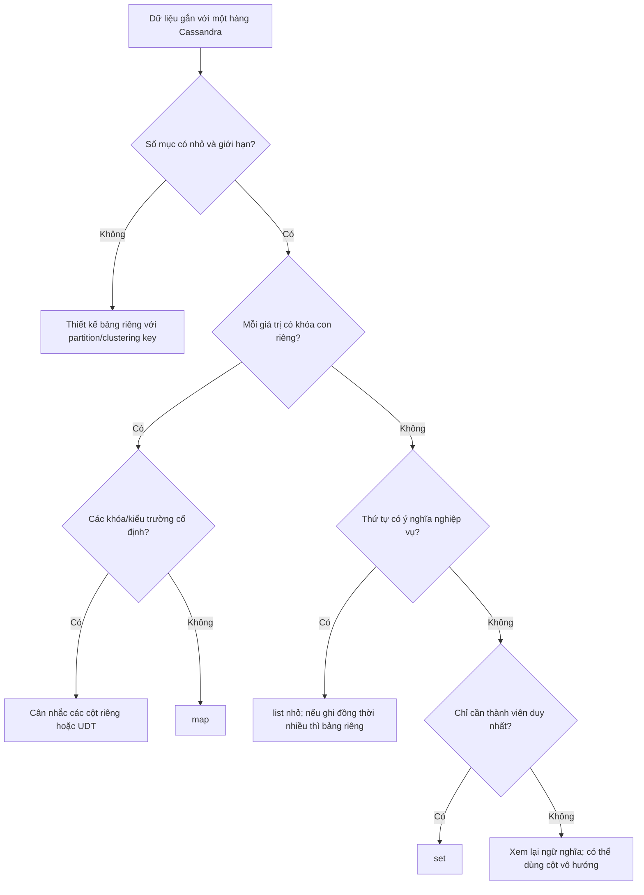

# `list`, `set`, `map` và lựa chọn theo ngữ nghĩa dữ liệu trong Cassandra

> **Chương:** Collection và UDT  
> **Phạm vi:** Apache Cassandra — cơ sở dữ liệu wide-column phân tán, nơi thiết kế bảng đi từ truy vấn, khóa phân vùng và yêu cầu nhất quán đọc/ghi.

## 1. Vì sao phải chọn collection theo ngữ nghĩa?

Trong Cassandra, một cột có thể chứa nhiều giá trị nhờ ba kiểu collection chính: `list<T>`, `set<T>` và `map<K,V>`. Cả ba đều phù hợp khi **một hàng đã được xác định bằng khóa chính** và ứng dụng cần đọc hoặc cập nhật **một tập thông tin nhỏ, có giới hạn** gắn với hàng đó. Chúng không thay thế thiết kế bảng theo truy vấn, khóa phân vùng, hay quan hệ một-nhiều có số lượng bản ghi tăng mãi.

Ví dụ, với hồ sơ người học:

- Các bước hướng dẫn ghim theo **thứ tự** → `list<text>`.
- Các kỹ năng người học đã chọn, **không trùng lặp** → `set<text>`.
- Cấu hình giao diện có **tên thuộc tính và giá trị** → `map<text,text>`.

Quyết định đúng bắt đầu từ câu hỏi: **Thứ tự có ý nghĩa không? Cho phép trùng lặp không? Có cần tra cứu theo khóa con không? Số phần tử có tăng không giới hạn không?**

### Bảng so sánh nhanh

| Đặc điểm | `list<T>` | `set<T>` | `map<K,V>` |
| --- | --- | --- | --- |
| Ý nghĩa | Dãy giá trị có thứ tự | Tập phần tử duy nhất | Từ điển khóa → giá trị |
| Trùng lặp | Có thể có | Không | Khóa duy nhất, giá trị có thể trùng |
| Thứ tự | Có ý nghĩa đối với ứng dụng | Không có thứ tự chèn; không dùng để biểu diễn thứ hạng | Không có thứ tự chèn; không dùng để biểu diễn thứ hạng |
| Truy cập / cập nhật thường gặp | Nối vào cuối, nối đầu, thay cả dãy | Thêm / loại phần tử | Gán / xóa giá trị theo khóa |
| Tình huống phù hợp | Danh sách ngắn người dùng sắp xếp | Nhãn, quyền hay tùy chọn ít phần tử | Thuộc tính động có số khóa hữu hạn |
| Tín hiệu nên đổi mô hình | Dãy rất dài, nhiều ghi đồng thời, cập nhật theo chỉ số | Tập tăng mãi, cần truy vấn người sở hữu theo từng phần tử | Nhiều khóa, cần tìm kiếm / sắp xếp theo các giá trị |

**Lưu ý về thứ tự:** Cassandra lưu và trình bày phần tử của `set` theo thứ tự so sánh kiểu dữ liệu và của `map` theo khóa, không theo thứ tự thêm phần tử. Điều này **không biến `set`/`map` thành cấu trúc có thứ tự nghiệp vụ**. Nếu thứ tự do người dùng quyết định, dùng `list` nhỏ hoặc một bảng riêng có cột thứ tự.

## 2. Tạo bảng và đọc dữ liệu mẫu

Giả sử keyspace `app` đã tồn tại. Bảng sau dùng partition key `user_id`: mọi collection thuộc cùng một hàng người dùng, phù hợp với truy vấn **“lấy các tùy chọn của người dùng X”**.

```sql
CREATE TABLE app.user_workspace (
    user_id uuid PRIMARY KEY,
    pinned_lessons list<text>,
    skills set<text>,
    preferences map<text, text>
);

INSERT INTO app.user_workspace
    (user_id, pinned_lessons, skills, preferences)
VALUES (
    11111111-1111-4111-8111-111111111111,
    ['partition-key', 'cql-basics'],
    {'java', 'cassandra'},
    {'language': 'vi', 'theme': 'dark'}
);

SELECT pinned_lessons, skills, preferences
FROM app.user_workspace
WHERE user_id = 11111111-1111-4111-8111-111111111111;
```

Trong cú pháp CQL, `[...]` là literal cho `list`; `{...}` không có dấu `:` là `set`; `{key: value}` là `map`. Các phần tử và khóa/giá trị phải tương thích với kiểu đã khai báo; không đưa `null` làm phần tử collection. CQL có thể hiển thị `set` và `map` theo thứ tự so sánh, còn thứ tự của `pinned_lessons` do danh sách quyết định.

## 3. `list<T>`: thứ tự và phần tử trùng lặp đều có ý nghĩa

`list` phù hợp với dãy hữu hạn như một số bài học được ghim, các bước hướng dẫn theo thứ tự hoặc lựa chọn sắp xếp của người dùng. Hai phần tử bằng nhau vẫn được phép xuất hiện nhiều lần: `['intro', 'intro', 'practice']` là một list hợp lệ.

```sql
-- Thêm một mục vào cuối list.
UPDATE app.user_workspace
SET pinned_lessons = pinned_lessons + ['repair']
WHERE user_id = 11111111-1111-4111-8111-111111111111;

-- Thêm vào đầu list (phải đặc biệt cẩn thận khi retry).
UPDATE app.user_workspace
SET pinned_lessons = ['welcome'] + pinned_lessons
WHERE user_id = 11111111-1111-4111-8111-111111111111;

-- Thay toàn bộ danh sách khi ứng dụng đã xác định thứ tự mong muốn.
UPDATE app.user_workspace
SET pinned_lessons = ['partition-key', 'repair', 'compaction']
WHERE user_id = 11111111-1111-4111-8111-111111111111;
```

Các thao tác qua **chỉ số** như `SET pinned_lessons[0] = 'intro'` hoặc xóa phần tử ở chỉ số cần xác định vị trí hiện tại của list. Chúng có thể liên quan đến bước đọc trước khi ghi và dễ gặp xung đột nếu nhiều client cùng sửa danh sách. Trong hệ phân tán, chỉ số mà client nhìn thấy có thể thay đổi giữa lúc đọc và lúc cập nhật.

**Cạm bẫy retry:** Một câu lệnh nối thêm giá trị vào list có thể tạo thêm một bản sao nếu ứng dụng gửi lại sau timeout trong khi lần ghi đầu thực ra đã thành công. Vì vậy, không mặc định list append/prepend là thao tác idempotent. Nếu hệ thống cần ghi sự kiện đáng tin cậy, loại bỏ trùng lặp, hoặc cho phép nhiều writer đồng thời, hãy dùng **mỗi sự kiện là một hàng** với khóa định danh phù hợp, thay vì đẩy tất cả sự kiện vào một list.

**Khi không chọn list:** nhật ký hoạt động, chuỗi bình luận, các đơn hàng theo thời gian, hàng đợi công việc, hay bảng xếp hạng thường có dung lượng tăng liên tục hoặc cần phân trang. Hãy mô hình chúng thành các hàng riêng với clustering columns để truy vấn/sắp thứ tự hiệu quả.

## 4. `set<T>`: thành viên duy nhất, thứ tự không quan trọng

`set` mô tả quan hệ **có/không thuộc tập**, chẳng hạn các nhãn đã chọn hay nhóm tính năng được bật. Thêm một phần tử đã tồn tại không tạo phần tử thứ hai.

```sql
-- Thêm một hoặc nhiều phần tử.
UPDATE app.user_workspace
SET skills = skills + {'distributed-systems', 'java'}
WHERE user_id = 11111111-1111-4111-8111-111111111111;

-- Xóa một phần tử khỏi tập.
UPDATE app.user_workspace
SET skills = skills - {'java'}
WHERE user_id = 11111111-1111-4111-8111-111111111111;

-- Gán hẳn tập mới khi đó là trạng thái mong muốn.
UPDATE app.user_workspace
SET skills = {'cassandra', 'cql'}
WHERE user_id = 11111111-1111-4111-8111-111111111111;
```

Phép thêm cùng một phần tử nhiều lần thể hiện ngữ nghĩa idempotent ở mức **thành viên của tập**. Tuy nhiên, khi có nhiều client ghi cùng lúc, các cập nhật thêm/xóa cạnh tranh vẫn chịu quy tắc timestamp và giải quyết xung đột của Cassandra. Đừng suy diễn rằng `set` cung cấp giao dịch toàn cục hoặc quy tắc nghiệp vụ “lần thao tác cuối theo thời gian thực luôn thắng”.

`set` không đáp ứng tốt câu hỏi **“người dùng nào có kỹ năng X?”** nếu khóa chính của bảng là `user_id`. Câu truy vấn đó cần thiết kế một bảng đọc riêng, chẳng hạn các hàng được phân vùng theo `skill` (và có cơ chế chia bucket nếu một kỹ năng có quá nhiều người dùng). Đừng giả định có thể lọc một collection tùy ý mà không cần index hoặc thiết kế dữ liệu tương ứng.

## 5. `map<K,V>`: giá trị được gọi tên bởi khóa con

`map` dành cho các cặp key–value ngắn, ví dụ `language → vi`, `theme → dark`, hoặc các thông số cấu hình có **tên khóa động**. Hai khóa giống nhau không tồn tại song song: ghi cùng khóa là cập nhật giá trị của khóa đó.

```sql
-- Thêm/sửa đúng một khóa trong map.
UPDATE app.user_workspace
SET preferences['language'] = 'en'
WHERE user_id = 11111111-1111-4111-8111-111111111111;

-- Thêm nhiều cặp; khóa trùng được cập nhật.
UPDATE app.user_workspace
SET preferences = preferences + {'timezone': 'Asia/Ho_Chi_Minh', 'theme': 'light'}
WHERE user_id = 11111111-1111-4111-8111-111111111111;

-- Xóa một khóa trong map.
DELETE preferences['theme']
FROM app.user_workspace
WHERE user_id = 11111111-1111-4111-8111-111111111111;

-- Cũng có thể xóa nhiều khóa bằng phép trừ với một set khóa.
UPDATE app.user_workspace
SET preferences = preferences - {'timezone'}
WHERE user_id = 11111111-1111-4111-8111-111111111111;
```

Với `map`, **khóa là định danh**, còn giá trị là thuộc tính. Nếu mọi bản ghi đều có đúng ba trường cố định (`language`, `theme`, `timezone`) và thường xuyên lọc hoặc cập nhật chúng độc lập, ba cột vô hướng — hoặc một UDT khi cần gom một cấu trúc cố định — thường dễ ràng buộc kiểu và bảo trì hơn `map<text,text>`. `map` thích hợp hơn khi danh sách khóa linh hoạt nhưng **nhỏ và có giới hạn**.

Đừng dùng `map` như một bảng con vô hạn (`order_id → order_json`, `device_id → last_seen`, `timestamp → event`). Khi cần truy vấn theo khóa con, phân trang, sắp xếp, có vòng đời/TTL riêng, hoặc cập nhật liên tục rất nhiều mục, mô hình nhiều hàng sẽ phù hợp hơn.

## 6. Collection nằm trong hàng, không thay cho mô hình truy vấn

Cassandra được tối ưu theo đường truy cập dữ liệu đã biết. **Partition key** định tuyến truy vấn đến các replica; **clustering columns** giúp sắp xếp và đọc các hàng trong một partition. Ba kiểu collection chỉ tổ chức các giá trị nằm **bên trong một hàng**; chúng không tạo một khóa phân vùng mới cho từng phần tử, không tự cung cấp phân trang từng phần tử và cũng không cho phép truy vấn ngược tùy ý.

Giả sử cần hiển thị nhật ký của người dùng theo ngày, mới nhất trước, có phân trang. Tránh mô hình:

```sql
-- Phản ví dụ: list có thể phình lớn và mỗi cập nhật cùng chạm một hàng.
CREATE TABLE app.user_events_bad (
    user_id uuid PRIMARY KEY,
    events list<text>
);
```

Thay bằng một bảng đọc theo `user_id + event_day` và clustering theo thời điểm sự kiện:

```sql
CREATE TABLE app.events_by_user_day (
    user_id uuid,
    event_day date,
    event_time timeuuid,
    event_type text,
    PRIMARY KEY ((user_id, event_day), event_time)
) WITH CLUSTERING ORDER BY (event_time DESC);

-- Lấy các sự kiện gần nhất trong một ngày của một người dùng.
SELECT event_time, event_type
FROM app.events_by_user_day
WHERE user_id = 11111111-1111-4111-8111-111111111111
  AND event_day = '2026-11-21'
LIMIT 20;
```

Mô hình này cho phép dùng paging của driver cho các hàng thay vì đọc một collection lớn; bucket theo ngày giúp giới hạn kích thước partition. Nếu lượng sự kiện trong ngày vẫn quá nhiều, có thể chia bucket nhỏ hơn sau khi ước lượng tải và kích thước partition. Muốn đọc qua nhiều ngày, ứng dụng cần tổ chức nhiều truy vấn/bucket; không thể bỏ `event_day` rồi kỳ vọng bảng trên phục vụ mọi truy vấn hiệu quả.

## 7. `frozen` và non-frozen: độ hạt cập nhật

Collection thông thường (không `frozen`) cho phép cập nhật phần tử hoặc khóa của `set`/`map` mà không phải gửi lại toàn bộ collection; Cassandra biểu diễn các phần tử dưới dạng các cell riêng. Với **`frozen<...>`**, collection được xử lý như **một giá trị duy nhất** ở mức cập nhật: muốn thay đổi một phần tử, ứng dụng phải ghi lại toàn bộ giá trị.

```sql
CREATE TABLE app.user_collection_snapshot (
    user_id uuid PRIMARY KEY,
    fixed_topics frozen<set<text>>
);

-- Ghi toàn bộ snapshot frozen.
UPDATE app.user_collection_snapshot
SET fixed_topics = {'java', 'cassandra'}
WHERE user_id = 11111111-1111-4111-8111-111111111111;
```

| Câu hỏi | Collection non-frozen | Collection frozen |
| --- | --- | --- |
| Có cập nhật một phần tử/khóa trực tiếp? | Có với các thao tác CQL hỗ trợ | Không; thay toàn bộ giá trị |
| Độ hạt ghi | Theo các cell/phần tử liên quan | Cả collection là một cell |
| Hợp với | Collection nhỏ có cập nhật từng mục | Snapshot nhỏ, bất biến hoặc chủ yếu thay thế nguyên khối |
| Cần chú ý | Tombstone/phân mảnh khi thêm-xóa liên tục | Chi phí đọc/ghi cả giá trị khi chỉ đổi một phần |

Khi đặt collection vào collection khác, các giá trị phức hợp bên trong thường phải được khai báo `frozen`, ví dụ `map<text, frozen<list<int>>>`. Tuy nhiên, lồng nhiều tầng làm mô hình khó cập nhật và khó kiểm soát kích thước. `frozen` **không** phải một biện pháp biến collection khổng lồ thành cấu trúc hiệu quả.

## 8. Tác động phân tán: retry, tombstone, replication và repair

### 8.1. Retry và ghi đồng thời

`set` phù hợp với yêu cầu thành viên duy nhất; `map` phù hợp với phép gán theo khóa; cả hai thường dễ xây dựng thao tác có thể retry hơn nối list. Nhưng Cassandra sử dụng timestamp để phân giải ghi cạnh tranh, và hai thao tác không có giao dịch đa hàng chỉ nhờ nằm trong collection. Khi có nhiều writer, ứng dụng cần xác định kết quả mong muốn và chọn thao tác phù hợp, nhất là nếu vừa thêm vừa xóa cùng phần tử.

Trong Java Driver, khai báo tính **idempotent** của statement theo đúng ngữ nghĩa thực tế. Không đánh dấu lệnh nối `list` là idempotent chỉ để driver tự retry; timeout không chứng minh lần ghi đầu thất bại. Nếu yêu cầu đúng-một-lần (exactly once), cần thiết kế khóa sự kiện/deduplication hoặc cơ chế nghiệp vụ bổ sung.

### 8.2. Xóa và tombstone

Thao tác loại phần tử khỏi `set`/`map`, thay toàn bộ collection, hoặc xóa một cột có thể tạo **tombstone**. Tombstone cần tồn tại đủ lâu để các replica biết dữ liệu đã bị xóa; compaction có thể dọn sau khi thỏa điều kiện an toàn và thời hạn cấu hình. Một collection bị thêm/xóa liên tục tạo gánh nặng đọc và compaction, đặc biệt khi kích thước tăng nhanh. Repair giúp đồng bộ dữ liệu giữa replica; không nên suy ra rằng chỉ chạy compaction là giải quyết được mọi vấn đề của các replica chậm nhận xóa.

### 8.3. Consistency level

Lệnh CQL cập nhật collection vẫn là ghi Cassandra thông thường: mức nhất quán `ONE`, `QUORUM`, `LOCAL_QUORUM`... quyết định mức xác nhận của các replica tùy cấu hình replication và phạm vi datacenter. Collection **không tự tăng** mức nhất quán. Chọn consistency level theo yêu cầu độ trễ, tính sẵn sàng và độ mới dữ liệu; cân nhắc cả cấu hình replication, repair và hành vi retry của client.

## 9. Ví dụ kết nối từ Java

Với DataStax/Apache Cassandra Java Driver dòng 4.x và `CqlSession` đã được cấu hình contact points, local datacenter, keyspace hoặc tên keyspace trong câu lệnh, ứng dụng có thể dùng prepared statement cho cập nhật `set`:

```java
import com.datastax.oss.driver.api.core.CqlSession;
import com.datastax.oss.driver.api.core.cql.PreparedStatement;
import java.util.Set;
import java.util.UUID;

// session được tạo và quản lý trong vòng đời ứng dụng.
void addSkills(CqlSession session, UUID userId, Set<String> newSkills) {
    PreparedStatement statement = session.prepare(
        "UPDATE app.user_workspace " +
        "SET skills = skills + ? WHERE user_id = ?"
    );
    session.execute(statement.bind(newSkills, userId));
}
```

Trong ứng dụng thực tế, nên cache/tái sử dụng `PreparedStatement` (hoặc chuẩn bị một lần khi khởi động), truyền đúng kiểu Java cho codec của driver, và quản lý vòng đời `CqlSession` tập trung. Phân biệt **thao tác thêm tập phần tử** với **ghi đè toàn bộ tập**; nếu muốn xóa mọi phần tử, hãy thiết kế thao tác xóa/thay toàn bộ cột một cách có chủ đích.

## 10. Quy trình chọn kiểu theo tình huống



### Checklist trước khi chốt schema

1. **Đọc bằng khóa gì?** Truy vấn có xác định partition key của hàng hay không? Nếu cần lọc/phân trang từng phần tử, cân nhắc bảng riêng theo truy vấn.
2. **Kích thước tối đa?** Có giới hạn số mục và kích thước dữ liệu, hay collection sẽ tăng mãi?
3. **Điều gì làm hai mục khác nhau?** Vị trí và lần xuất hiện (`list`), giá trị (`set`), hay khóa con (`map`)?
4. **Mô hình cập nhật?** Có nhiều ghi đồng thời, thao tác phải retry, hoặc cần tránh read-before-write theo chỉ số list không?
5. **Vòng đời dữ liệu?** Có xóa/thay thế thường xuyên khiến tombstone dày đặc không? Có cần TTL hoặc truy vấn theo từng mục không?
6. **Schema cố định hay động?** Thuộc tính có tên và kiểu xác định trước có thể phù hợp cột vô hướng hoặc UDT hơn map.

## 11. Bài tập tình huống và gợi ý đáp án

**Tình huống A:** Mỗi người học có nhiều nhất 12 chủ đề yêu thích, chỉ cần hiển thị toàn bộ và thêm/bỏ theo tên. → Dùng `set<text>`; thứ tự thêm không có nghĩa và một chủ đề chỉ xuất hiện một lần.

**Tình huống B:** Một giao diện có tối đa 8 mục menu ghim, người dùng kéo thả để đổi thứ tự. → `list<text>` có thể phù hợp nếu ít writer và ứng dụng thường ghi lại toàn bộ thứ tự sau khi kéo thả. Nếu nhiều thiết bị cùng sửa, phải xử lý tranh chấp; danh sách dài cần bảng riêng chứa `position`.

**Tình huống C:** Một người dùng có vài cài đặt tùy chỉnh như `theme`, `language`, `timezone`. → `map<text,text>` nếu tên khóa có thể thay đổi và cùng kiểu giá trị; các cột tường minh hoặc UDT nếu schema ổn định và cần kiểm soát kiểu riêng cho từng trường.

**Tình huống D:** Cần ghi hàng triệu sự kiện, lấy 50 sự kiện gần nhất của một người dùng và phân trang. → Không dùng `list<event>` hoặc `map<timestamp,event>` trên một hàng. Dùng bảng sự kiện riêng, định nghĩa partition theo người dùng + bucket thời gian và clustering theo thời gian.

**Tình huống E:** Cần tìm tất cả người dùng thuộc một nhóm kỹ năng. → Dù hồ sơ có `skills set<text>`, hãy thiết kế thêm bảng `users_by_skill` cho chiều truy vấn ngược, có phân vùng/bucket phù hợp với độ phổ biến của kỹ năng và chiến lược đồng bộ dữ liệu.

## 12. Ghi nhớ

- `list` = **thứ tự và lần xuất hiện**; cân nhắc kỹ concurrency và retry.
- `set` = **thành viên duy nhất**; không biểu diễn thứ hạng.
- `map` = **khóa con ánh xạ đến giá trị**; không phải bảng con tùy ý.
- `frozen` = **một giá trị cập nhật nguyên khối**; non-frozen hỗ trợ thao tác chi tiết theo kiểu collection.
- Collection chỉ nên **nhỏ, có giới hạn và đọc qua khóa hàng đã biết**. Với dữ liệu tăng không giới hạn, phân trang, truy vấn ngược hoặc cập nhật cường độ cao, hãy thiết kế bảng Cassandra riêng dựa trên partition key, clustering key và kiểu truy vấn thực tế.
