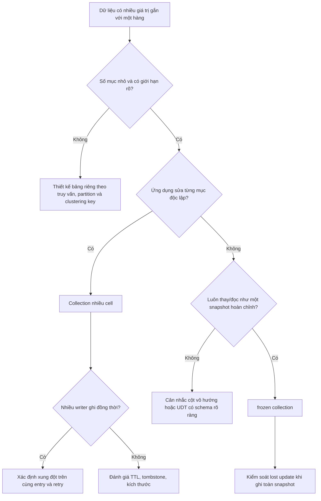

# Collection nhiều cell so với `frozen` collection trong Apache Cassandra

> **Chương:** Collection và UDT  
> **Phạm vi:** Cách Cassandra lưu và cập nhật `list`, `set`, `map` ở mức cell; tác động đến thiết kế bảng theo truy vấn, ghi đồng thời, TTL, tombstone, compaction, repair và ứng dụng Java.

## 1. Cùng là collection, vì sao cách lưu quan trọng?

Trong Apache Cassandra, một cột có thể chứa `list<T>`, `set<T>` hoặc `map<K,V>`. Tuy nhiên, **cùng một kiểu collection có thể có hai cách biểu diễn**:

- **Collection nhiều cell** (*multi-cell*, thường gọi *non-frozen*): các phần tử/entry được quản lý ở độ hạt riêng bên trong một hàng. Cassandra có thể ghi hoặc xóa một phần tử/khóa con mà không cần gửi lại toàn bộ collection.
- **Collection `frozen`**: toàn bộ collection được xem là **một giá trị CQL**, lưu thành **một cell**. Mỗi lần cập nhật phải cung cấp giá trị collection mới đầy đủ; không chỉnh riêng một entry của nó bằng cú pháp CQL.

Chọn cách nào ảnh hưởng trực tiếp đến **đơn vị cập nhật**, **cách giải quyết các ghi cạnh tranh**, **TTL/tombstone** và **chi phí ghi**. Việc chọn `frozen` không đổi ngữ nghĩa căn bản của kiểu dữ liệu: `list` vẫn có thứ tự, `set` vẫn chỉ có phần tử duy nhất, `map` vẫn ánh xạ khóa tới giá trị.

Một cách hình dung:

```text
Trong cùng một hàng có PRIMARY KEY (user_id):

map<text,text> preferences        frozen<map<text,text>> snapshot
┌─────────────────────────────┐  ┌───────────────────────────────────┐
│ Cell: key='lang'  -> 'vi'   │  │ Một cell duy nhất:                │
│ Cell: key='theme' -> 'dark' │  │ {'lang':'vi','theme':'dark'}       │
│ Cell: key='zone'  -> 'UTC'  │  │                                   │
└─────────────────────────────┘  └───────────────────────────────────┘
  Ghi được từng map entry.          Thay đổi phải ghi toàn bộ map.
```

**Cần phân biệt:** “Nhiều cell” không có nghĩa là mỗi phần tử trở thành một hàng Cassandra độc lập. Những cell này vẫn thuộc **cùng hàng**, được định tuyến theo cùng **partition key**; việc thêm collection không tạo partition key hoặc clustering key mới.

## 2. Cơ chế lưu trữ ở mức khái niệm

Một *cell* là đơn vị giá trị gắn với metadata liên quan như thời điểm ghi và, khi áp dụng, TTL. Với collection nhiều cell:

| Kiểu | Đơn vị được quản lý bên trong collection | Thao tác thường dùng |
| --- | --- | --- |
| `set<text>` | Mỗi giá trị thành viên | Thêm hoặc xóa một giá trị |
| `map<text,text>` | Mỗi entry được nhận diện bằng khóa của map | Gán hoặc xóa một khóa |
| `list<text>` | Các phần tử danh sách với định danh/vị trí nội bộ phục vụ thứ tự | Nối đầu/cuối; một số thao tác theo chỉ số có thể cần đọc trước |
| `frozen<set<text>>` | Toàn bộ set | Gán lại toàn bộ set |
| `frozen<map<text,text>>` | Toàn bộ map | Gán lại toàn bộ map |
| `frozen<list<text>>` | Toàn bộ list | Gán lại toàn bộ list |

Đối với `map`, mỗi entry có khóa con của riêng nó; đối với `set`, thành viên đóng vai trò định danh. Với `list`, cơ chế định danh nội bộ phức tạp hơn chỉ số `0, 1, 2`: chỉ số là cách ứng dụng truy cập danh sách tại một thời điểm, không phải khóa ổn định trong môi trường nhiều writer.

Ở collection nhiều cell, hai ghi vào **hai entry khác nhau** có thể cùng tồn tại khi các replica hòa giải dữ liệu. Ở collection `frozen`, các ghi cạnh tranh vào cùng cột tranh chấp trên **cả giá trị**. Cassandra dùng timestamp và cơ chế hòa giải ghi cho các cell; `frozen` không biến một collection thành giao dịch nhiều bước hoặc khóa chống ghi đồng thời.

## 3. Khai báo schema: một bảng, hai dạng lưu

Giả sử keyspace `app` đã được tạo với cấu hình replication phù hợp môi trường. Để so sánh trong cùng hàng, tạo một bảng thử nghiệm:

```sql
CREATE TABLE app.user_collection_lab (
    user_id uuid PRIMARY KEY,
    preferences map<text, text>,
    preferences_snapshot frozen<map<text, text>>,
    selected_topics set<text>,
    selected_topics_snapshot frozen<set<text>>,
    pinned_steps list<text>,
    pinned_steps_snapshot frozen<list<text>>
);

INSERT INTO app.user_collection_lab (
    user_id,
    preferences, preferences_snapshot,
    selected_topics, selected_topics_snapshot,
    pinned_steps, pinned_steps_snapshot
) VALUES (
    11111111-1111-4111-8111-111111111111,
    {'lang':'vi', 'theme':'dark'},
    {'lang':'vi', 'theme':'dark'},
    {'cql', 'java'},
    {'cql', 'java'},
    ['schema', 'partition'],
    ['schema', 'partition']
);

SELECT preferences, preferences_snapshot,
       selected_topics, selected_topics_snapshot,
       pinned_steps, pinned_steps_snapshot
FROM app.user_collection_lab
WHERE user_id = 11111111-1111-4111-8111-111111111111;
```

Các cặp cột có cùng ý nghĩa dữ liệu lúc khởi tạo. Khác biệt xuất hiện khi ứng dụng **cập nhật** hoặc khi **hai client ghi cùng lúc**.

## 4. Cập nhật collection nhiều cell

### 4.1. `map`: sửa đúng một khóa con

```sql
-- Chỉ cập nhật entry có khóa 'theme'.
UPDATE app.user_collection_lab
SET preferences['theme'] = 'light'
WHERE user_id = 11111111-1111-4111-8111-111111111111;

-- Thêm một số entry, giữ các khóa khác.
UPDATE app.user_collection_lab
SET preferences = preferences + {'timezone':'Asia/Ho_Chi_Minh'}
WHERE user_id = 11111111-1111-4111-8111-111111111111;

-- Xóa một entry mà không xóa toàn bộ map.
DELETE preferences['timezone']
FROM app.user_collection_lab
WHERE user_id = 11111111-1111-4111-8111-111111111111;
```

Các câu lệnh này diễn đạt ý định rất rõ: **thay một entry**, **thêm entry**, **xóa entry**. Client không cần tải tất cả giá trị rồi tự dựng lại map cho thao tác thông thường trên một khóa.

### 4.2. `set`: thêm và loại phần tử

```sql
UPDATE app.user_collection_lab
SET selected_topics = selected_topics + {'repair', 'compaction'}
WHERE user_id = 11111111-1111-4111-8111-111111111111;

UPDATE app.user_collection_lab
SET selected_topics = selected_topics - {'java'}
WHERE user_id = 11111111-1111-4111-8111-111111111111;
```

`set` không lưu thứ tự thêm phần tử; thành viên trùng lặp không được nhân đôi. Với nhu cầu “người dùng đã chọn chủ đề nào?”, `set` nhỏ thường có ngữ nghĩa tự nhiên hơn `list`.

### 4.3. `list`: thêm phần tử, nhưng phải hiểu rủi ro

```sql
UPDATE app.user_collection_lab
SET pinned_steps = pinned_steps + ['repair']
WHERE user_id = 11111111-1111-4111-8111-111111111111;

-- Gán lại toàn bộ thứ tự theo quyết định mới của người dùng.
UPDATE app.user_collection_lab
SET pinned_steps = ['partition', 'schema', 'repair']
WHERE user_id = 11111111-1111-4111-8111-111111111111;
```

Các phép nối `list` không nên mặc định là **idempotent**: nếu client retry sau timeout mà lần ghi đầu đã thành công, phần tử có thể bị nối thêm lần nữa. Các thao tác theo chỉ số dễ bị ảnh hưởng bởi sự thay đổi thứ tự giữa hai client và có thể cần read-before-write. Với dòng sự kiện, hàng đợi hoặc lịch sử dài, dùng bảng riêng có khóa hàng riêng sẽ phù hợp hơn.

## 5. `frozen`: thay nguyên giá trị, không cập nhật entry

Với `frozen<map<text,text>>`, mọi thay đổi phải ghi toàn bộ giá trị mới:

```sql
-- Hợp lệ: snapshot mới chứa đầy đủ những entry cần giữ lại.
UPDATE app.user_collection_lab
SET preferences_snapshot = {'lang':'vi', 'theme':'light'}
WHERE user_id = 11111111-1111-4111-8111-111111111111;

-- Hợp lệ: thay cả frozen set và frozen list.
UPDATE app.user_collection_lab
SET selected_topics_snapshot = {'cql', 'repair'},
    pinned_steps_snapshot = ['partition', 'repair']
WHERE user_id = 11111111-1111-4111-8111-111111111111;
```

**Các ví dụ sau là CQL không hợp lệ cho cột `frozen`; không thực thi:**

```sql
-- Không được gán một entry của frozen map.
UPDATE app.user_collection_lab
SET preferences_snapshot['theme'] = 'light'
WHERE user_id = 11111111-1111-4111-8111-111111111111;

-- Không được cộng/trừ một phần tử của frozen set.
UPDATE app.user_collection_lab
SET selected_topics_snapshot = selected_topics_snapshot + {'repair'}
WHERE user_id = 11111111-1111-4111-8111-111111111111;
```

Muốn đổi một khóa của frozen map, client cần biết **giá trị hoàn chỉnh muốn lưu** và gán lại giá trị đó. Nếu ứng dụng làm bước “đọc → sửa trong bộ nhớ → ghi toàn bộ” từ nhiều client, phải tính đến khả năng ghi đè cập nhật của nhau; câu lệnh `UPDATE` thông thường không tự có điều kiện so sánh phiên bản.

**`frozen` là cách lưu và cập nhật, không phải `final` hay `immutable` của Java.** Cột vẫn được thay bằng giá trị khác; chỉ là không thể cập nhật từng mục bằng CQL.

## 6. Ví dụ hai client: ghi độc lập hay mất cập nhật?

Giả sử trạng thái ban đầu của cả `preferences` và `preferences_snapshot` là:

```text
{'lang':'vi'}
```

Hai client đọc cùng lúc: A muốn thêm `theme=dark`, B muốn thêm `timezone=UTC`.

### 6.1. Map nhiều cell: cập nhật đúng entry

```sql
-- Client A
UPDATE app.user_collection_lab
SET preferences['theme'] = 'dark'
WHERE user_id = 11111111-1111-4111-8111-111111111111;

-- Client B
UPDATE app.user_collection_lab
SET preferences['timezone'] = 'UTC'
WHERE user_id = 11111111-1111-4111-8111-111111111111;
```

Vì A và B ghi **hai khóa con khác nhau**, hệ thống có thể giữ được cả hai cập nhật sau khi các replica hội tụ: `{'lang':'vi','theme':'dark','timezone':'UTC'}`. Nếu cùng ghi `preferences['theme']` với hai giá trị khác nhau, vẫn xảy ra tranh chấp tại **entry đó**, và luật timestamp của Cassandra quyết định giá trị thắng.

### 6.2. Frozen map: hai snapshot có thể ghi đè nhau

```sql
-- Client A đã đọc giá trị cũ và tạo snapshot mới:
UPDATE app.user_collection_lab
SET preferences_snapshot = {'lang':'vi', 'theme':'dark'}
WHERE user_id = 11111111-1111-4111-8111-111111111111;

-- Client B cũng dựa trên snapshot cũ:
UPDATE app.user_collection_lab
SET preferences_snapshot = {'lang':'vi', 'timezone':'UTC'}
WHERE user_id = 11111111-1111-4111-8111-111111111111;
```

Sau khi hệ thống hòa giải, **một snapshot nguyên vẹn thắng** theo luật giải quyết ghi; không có phép gộp tự động hai khóa mới. Nếu B thắng, `theme` của A không còn trong snapshot. Kết quả không nhất thiết phản ánh “client gửi sau cùng” theo đồng hồ tường; Cassandra dùng timestamp của cell, và timestamp có thể phụ thuộc đồng hồ/client/cấu hình ghi.

| Tình huống đồng thời | Map nhiều cell | Frozen map |
| --- | --- | --- |
| A sửa `theme`, B sửa `timezone` | Hai cập nhật entry độc lập có thể cùng tồn tại | Hai phép gán nguyên snapshot cạnh tranh; có thể mất một thay đổi |
| A, B sửa cùng `theme` | Cạnh tranh ở cell của `theme` | Cạnh tranh trên cả map |
| A thay toàn bộ map, B sửa một entry | Có rủi ro xung đột với dấu xóa của phép thay cả collection | Cạnh tranh giữa hai giá trị toàn phần |
| Cần kiểm soát ghi điều kiện | Thiết kế cơ chế kiểm soát phiên bản phù hợp | Cũng cần cơ chế kiểm soát phiên bản phù hợp |

Muốn tránh *lost update* cho snapshot, cân nhắc quy trình ghi theo một nguồn sở hữu, điều phối ở ứng dụng, hoặc cơ chế điều kiện/CAS khi thật sự cần và đã đo chi phí. Không suy luận rằng consistency level `QUORUM` tự biến thao tác “đọc rồi ghi snapshot” thành một giao dịch có kiểm soát phiên bản.

## 7. TTL, timestamp và tombstone khác nhau ở đâu?

### 7.1. TTL có độ hạt theo cell

Với collection nhiều cell, TTL có thể áp dụng cho entry được ghi trong một thao tác cập nhật. Ví dụ:

```sql
-- Entry 'trial_banner' được ghi với TTL 600 giây.
UPDATE app.user_collection_lab USING TTL 600
SET preferences['trial_banner'] = 'enabled'
WHERE user_id = 11111111-1111-4111-8111-111111111111;
```

Các entry khác của `preferences` không tự nhận TTL 600 giây chỉ vì lệnh này. Ngược lại, khi gán một giá trị `frozen` với TTL, TTL áp dụng cho **cell chứa toàn bộ collection**:

```sql
-- Toàn bộ giá trị frozen mới được ghi với TTL 600 giây.
UPDATE app.user_collection_lab USING TTL 600
SET preferences_snapshot = {'trial_banner':'enabled', 'lang':'vi'}
WHERE user_id = 11111111-1111-4111-8111-111111111111;
```

Điều này không phù hợp nếu chỉ muốn `trial_banner` hết hạn nhưng `lang` còn nguyên. Với dữ liệu có vòng đời khác nhau cho từng mục, non-frozen hoặc **hàng riêng** có thể thuận tiện hơn.

### 7.2. Xóa entry tạo thông tin xóa

Khi xóa một entry của non-frozen map/set, Cassandra cần ghi dấu xóa (*tombstone*) để các replica khác biết rằng entry đã bị xóa, kể cả replica đang tạm thời không phản hồi. Thay **toàn bộ** collection nhiều cell cũng có thể tạo thông tin xóa cho nội dung cũ; đây không phải phép cập nhật vài phần tử rẻ tương đương `map['key'] = value`.

`frozen` có một cell cho cả giá trị. Xóa cột `frozen` hoặc dữ liệu hết TTL vẫn phải được quản lý theo cơ chế xóa/TTL của Cassandra. **Một cell không đồng nghĩa với không có tombstone.**

Tombstone ảnh hưởng quá trình đọc và compaction; việc dọn tombstone phụ thuộc điều kiện an toàn, cấu hình như `gc_grace_seconds` và trạng thái đồng bộ replica. Repair giúp dữ liệu/đánh dấu xóa được đồng bộ giữa các replica theo quy trình vận hành. Không tùy tiện hạ thời gian grace hoặc chỉ chạy compaction để “xóa cho nhanh”: replica vắng mặt quá lâu có thể dẫn tới rủi ro dữ liệu đã xóa xuất hiện lại nếu quy trình repair không đúng.

### 7.3. Timestamp và consistency

Với collection nhiều cell, mỗi entry tham gia hòa giải theo metadata ghi của nó. Với `frozen`, ghi lại snapshot là thay giá trị của cell tổng thể. `ONE`, `LOCAL_QUORUM`, `QUORUM`... điều chỉnh số replica phải xác nhận đọc/ghi trong bối cảnh replication và datacenter; chúng **không thay đổi** việc một collection được lưu thành nhiều cell hay một cell.

Vì Cassandra xử lý cạnh tranh chủ yếu bằng timestamp, các client có đồng hồ lệch hoặc tự gán `USING TIMESTAMP` cần có chiến lược rõ ràng; cập nhật mới theo thời gian thực chưa chắc thắng nếu timestamp của nó thấp hơn giá trị đã tồn tại.

## 8. Chi phí đọc, ghi và giới hạn kích thước

| Tiêu chí | Nhiều cell | `frozen` |
| --- | --- | --- |
| Cập nhật một map entry / set member | Có, độ hạt entry | Phải ghi toàn bộ giá trị |
| Ghi đồng thời khác khóa map | Có thể gộp các thay đổi độc lập | Ghi nguyên snapshot cạnh tranh |
| Dữ liệu/metadata lưu trữ | Nhiều cell, metadata cho từng mục | Một cell chứa giá trị đã tuần tự hóa |
| Đọc cả collection | Trả về collection trong một cột của hàng | Trả về collection trong một cột của hàng |
| Đọc/phân trang từng mục như hàng | Không tự hỗ trợ phân trang theo từng entry | Không tự hỗ trợ phân trang theo từng entry |
| Xóa/TTL | Có thể theo entry, nhưng tạo metadata/tombstone | Theo toàn giá trị; vẫn có tombstone/TTL |
| Trường hợp phù hợp | Bộ cài đặt nhỏ, các mục thay đổi độc lập | Snapshot nhỏ, thay cả khối, hiếm khi sửa từng mục |

**Không có quy tắc “`frozen` luôn nhanh hơn”.** Nếu một map có 100 cặp nhưng chỉ đổi một cặp, non-frozen thường tiết kiệm lượng dữ liệu cập nhật. Nếu một cấu trúc nhỏ luôn được thay đồng loạt, `frozen` có thể đơn giản hơn về ngữ nghĩa và metadata. Cả hai đều không phù hợp với collection khổng lồ hoặc không có giới hạn kích thước.

Một collection quá lớn vẫn thuộc một hàng và một partition. Truy vấn `SELECT preferences ... WHERE user_id = ...` thường trả về **cả giá trị collection**, khiến tăng tải đọc, bộ nhớ, thời gian tuần tự hóa và truyền mạng. Nếu cần truy vấn theo từng mục, lọc, sắp xếp hoặc phân trang, nên dùng **nhiều hàng với khóa chính phục vụ truy vấn**.

Ví dụ, nếu một người dùng có hàng triệu sự kiện thì không nên đưa chúng vào `frozen<list<text>>` hay `list<text>` trong một hàng:

```sql
CREATE TABLE app.events_by_user_day (
    user_id uuid,
    event_day date,
    event_time timeuuid,
    event_type text,
    PRIMARY KEY ((user_id, event_day), event_time)
) WITH CLUSTERING ORDER BY (event_time DESC);

SELECT event_time, event_type
FROM app.events_by_user_day
WHERE user_id = 11111111-1111-4111-8111-111111111111
  AND event_day = '2026-11-21'
LIMIT 50;
```

Partition key `(user_id, event_day)` cho phép phân bucket theo ngày; `event_time` là clustering key để truy cập theo thời gian. Driver có thể phân trang **các hàng**, và bạn có thể chia bucket nhỏ hơn nếu một ngày quá nhiều sự kiện. Cách tổ chức này không phụ thuộc vào `frozen`.

## 9. Collection lồng nhau, UDT và ranh giới `frozen`

`frozen` đặc biệt có ích khi đặt một **kiểu phức hợp** vào một collection khác. Trong các cách khai báo lồng nhau được Cassandra hỗ trợ, giá trị collection/UDT bên trong thường cần `frozen` để trở thành một giá trị duy nhất ở vị trí đó.

```sql
-- Map bên ngoài nhiều cell; list bên trong là giá trị frozen.
CREATE TABLE app.study_progress (
    user_id uuid PRIMARY KEY,
    scores_by_topic map<text, frozen<list<int>>>
);

-- Gán lại toàn bộ list tại một khóa con của map.
UPDATE app.study_progress
SET scores_by_topic['cql'] = [8, 9, 10]
WHERE user_id = 11111111-1111-4111-8111-111111111111;
```

Ở đây, `scores_by_topic` là map **nhiều cell**, có thể cập nhật độc lập theo khóa `'cql'`. Nhưng mỗi `list<int>` trong map là **frozen**: không thể nối trực tiếp một số vào list bên trong mà không thay toàn bộ giá trị list của khóa đó. Nếu khai báo cả map bên ngoài là `frozen`, mọi sửa đổi tiếp tục có độ hạt **toàn map**.

Đối với UDT (*user-defined type*), nguyên tắc tương tự giúp hiểu sự khác biệt giữa **đối tượng lưu như một giá trị nguyên khối** và **cấu trúc có thể cập nhật từng trường**; khả năng thao tác cụ thể tùy khai báo/schema và phiên bản Cassandra. Không nên mặc định Java object có các trường độc lập thì CQL cũng cho phép cập nhật từng trường khi cột/giá trị đã khai báo `frozen`.

Lồng nhiều tầng collection/UDT tạo độ phức tạp cao và có thể khiến các thao tác cập nhật phải thay giá trị lớn. Nếu cấu trúc có số lượng thực thể tăng không giới hạn, bảng riêng vẫn là mô hình chủ đạo trong Cassandra.

## 10. Gửi cập nhật từ Java Driver

Với Java Driver 4.x, `CqlSession` có thể sử dụng `PreparedStatement` để diễn đạt đúng hai kiểu thao tác. Ví dụ dưới đây giả định session đã kết nối hợp lệ và `userId` là UUID của một người dùng:

```java
import com.datastax.oss.driver.api.core.CqlSession;
import com.datastax.oss.driver.api.core.cql.PreparedStatement;
import java.util.Map;
import java.util.UUID;

void updateSettings(CqlSession session, UUID userId) {
    // Non-frozen map: gửi đúng entry cần thêm/sửa.
    PreparedStatement patch = session.prepare(
        "UPDATE app.user_collection_lab " +
        "SET preferences = preferences + ? WHERE user_id = ?"
    );
    session.execute(patch.bind(Map.of("theme", "light"), userId));

    // Frozen map: gửi trọn giá trị mới; các khóa cũ không gửi sẽ mất.
    PreparedStatement replace = session.prepare(
        "UPDATE app.user_collection_lab " +
        "SET preferences_snapshot = ? WHERE user_id = ?"
    );
    session.execute(replace.bind(
        Map.of("lang", "vi", "theme", "light"), userId
    ));
}
```

Trong dự án thực tế, hãy **tái sử dụng prepared statements** và quản lý vòng đời `CqlSession` thay vì `prepare` lại mỗi request. Với phương thức `replace`, dữ liệu phải đến từ nguồn trạng thái đáng tin cậy; nếu chỉ lấy một snapshot cũ từ cache rồi ghi lại, client có thể vô tình xóa thay đổi gần nhất của client khác.

Xử lý timeout cũng cần phân biệt: thao tác gán một map entry với cùng giá trị thường phù hợp retry hơn phép append list, nhưng kết quả cuối còn phụ thuộc ghi cạnh tranh, timestamp và dữ liệu bị thay đổi ở nơi khác. Chỉ đánh dấu statement **idempotent** theo ngữ nghĩa thao tác thực tế và quy tắc retry của ứng dụng.

## 11. Chọn loại nào trong thiết kế dữ liệu?



Các quyết định mẫu:

| Nhu cầu thực tế | Phương án thường phù hợp | Vì sao |
| --- | --- | --- |
| Mỗi người dùng có tối đa 20 cài đặt, mỗi lần thay một khóa | `map<text,text>` non-frozen | Ghi theo entry, ít đụng các khóa khác |
| Bộ cấu hình 5 trường được tạo từ một phiên bản duy nhất, thay cùng lúc | `frozen<map<text,text>>` hoặc UDT/cột rõ kiểu | Snapshot nguyên khối phù hợp ngữ nghĩa |
| Tập nhãn ngắn, thường xuyên thêm/bỏ từng nhãn | `set<text>` non-frozen | Có thể sửa từng thành viên |
| Danh sách 4 bước cố định, thay nguyên danh sách sau khi người dùng lưu | `frozen<list<text>>` là một lựa chọn | Mỗi lần ghi là snapshot có thứ tự |
| Danh sách yêu cầu đồng thời nhiều thiết bị sửa vị trí | Bảng riêng hoặc quy trình đồng bộ rõ ràng | Tránh tranh chấp chỉ số/list và lost update |
| Lịch sử giao dịch, sự kiện, thiết bị không giới hạn | Bảng riêng có primary key phù hợp | Phân trang, giới hạn partition, dễ vận hành |

## 12. Những hiểu lầm thường gặp

1. **“`frozen` làm dữ liệu không sửa được.”** Sai. Có thể thay toàn bộ giá trị; chỉ không được cập nhật riêng phần tử qua CQL.
2. **“Non-frozen map luôn tự gộp mọi ghi.”** Sai. Hai client sửa **cùng khóa**, hoặc một client ghi đè toàn map, vẫn có thể xung đột.
3. **“`frozen` luôn tiết kiệm và nhanh hơn.”** Không có kết luận chung. Ghi thay toàn bộ giá trị lớn có thể tốn hơn cập nhật một cell; cần đo theo workload.
4. **“Collection nhiều cell nghĩa là có thể phân trang từng phần tử.”** Sai. Collection vẫn là một cột của một hàng; cần bảng riêng khi muốn phân trang/thống kê theo từng mục.
5. **“Chuyển sang `frozen` là hết tombstone.”** Sai. Xóa/TTL vẫn tạo thông tin xóa; thao tác lặp lại và repair/compaction vẫn cần được quản lý.
6. **“Ghi `QUORUM` loại bỏ lost update của frozen map.”** Sai. `QUORUM` không thay thế kiểm soát phiên bản khi hai client cùng đọc snapshot cũ rồi ghi lại.
7. **“Muốn đổi cách lưu chỉ cần thay type tùy ý trên cột đang có dữ liệu.”** Không nên giả định `ALTER TABLE` hỗ trợ chuyển đổi trực tiếp giữa dạng frozen/non-frozen. Lập kế hoạch migration: tạo cột/bảng mới theo phiên bản Cassandra đang dùng, chuyển dữ liệu, điều chỉnh luồng ghi/đọc và xác minh trước khi bỏ schema cũ.

## 13. Bài tập tự kiểm tra

**Bài 1.** Một ứng dụng lưu `map<text,text>` gồm 8 cờ tính năng. Client A và B thường sửa hai cờ khác nhau. Có nên dùng `frozen`?  
**Gợi ý:** Không cần thiết nếu mục tiêu là cập nhật từng khóa độc lập. Map nhiều cell cho phép ghi theo khóa con, giảm rủi ro ghi đè snapshot khác khóa.

**Bài 2.** Một mô hình học máy lưu 6 trọng số nguyên trong `frozen<list<int>>`; chỉ cập nhật khi nạp toàn bộ phiên bản mới. Chọn dạng này có hợp lý không?  
**Gợi ý:** Có thể hợp lý nếu toàn bộ danh sách được quản lý như một snapshot duy nhất, kích thước nhỏ và quá trình phát hành có một nguồn ghi đáng tin cậy.

**Bài 3.** Cột `map<text, frozen<list<int>>>` có khóa `cql` và `java`. Người dùng đổi danh sách điểm của `cql` nhưng không đụng `java`. Độ hạt cập nhật ở đâu?  
**Gợi ý:** Map ngoài nhiều cell cho phép gán lại **giá trị list tại khóa `cql`**. List bên trong `frozen` nên được thay như một giá trị nguyên khối.

**Bài 4.** Một client xóa một khóa map, sau đó replica đã ngắt kết nối từ lâu quay lại. Có nên giảm `gc_grace_seconds` để dọn tombstone ngay không?  
**Gợi ý:** Không tùy tiện. Cần hiểu chiến lược repair và đảm bảo các replica nhận được dấu xóa trước khi tombstone có thể bị loại bỏ an toàn.

## 14. Ghi nhớ khi triển khai

- **Nhiều cell** = độ hạt cập nhật ở mức phần tử/entry; **`frozen`** = độ hạt cập nhật của **toàn collection**.
- Cách lưu ảnh hưởng đến **ghi đồng thời, khả năng retry, TTL và tombstone**, nhưng không thay đổi cách Cassandra định tuyến dữ liệu bằng partition key hay giải quyết ghi bằng timestamp.
- Chọn non-frozen khi collection **nhỏ, có giới hạn** và các mục được sửa độc lập; chọn frozen khi toàn bộ giá trị **nhỏ** và được quản lý như snapshot.
- Khi cần phân trang, tìm kiếm theo từng phần tử, tách vòng đời dữ liệu hoặc lưu số mục tăng liên tục, hãy thiết kế **bảng riêng theo truy vấn**; collection không thay thế mô hình wide-column.
- Kiểm thử với workload thật, tính đến **replication, consistency level, compaction, repair và retry của Java Driver** trước khi chốt schema trong môi trường phân tán.
