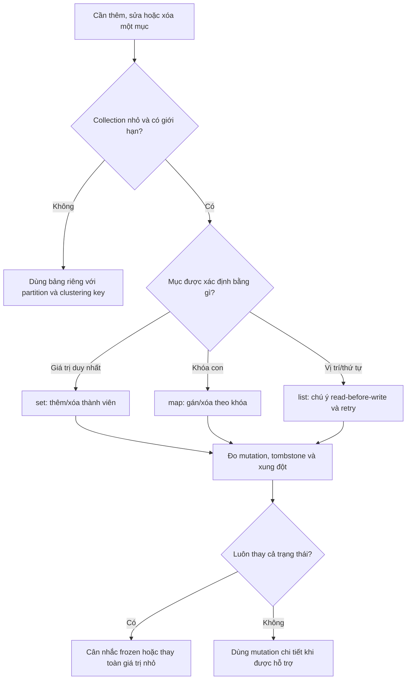

# Thêm, sửa, xóa phần tử collection trong Cassandra và chi phí tương ứng

> **Chương:** Collection và UDT  
> **Phạm vi:** Thao tác CQL với `list`, `set`, `map`; chi phí ghi và đọc, `read-before-write`, tombstone, TTL, compaction, retry và ứng dụng Java trong Apache Cassandra.

## 1. Một câu lệnh `UPDATE` có thể kéo theo những công việc gì?

Apache Cassandra là cơ sở dữ liệu **wide-column phân tán**. Dữ liệu được định tuyến đến các replica theo **partition key**; các thao tác CQL được ghi vào commit log và memtable, sau đó dữ liệu được flush thành SSTable và dần được hợp nhất qua compaction. Việc “sửa một phần tử” vì vậy không nên hiểu đơn giản như sửa một ô trong một mảng trên bộ nhớ.

Với collection, chi phí thao tác phụ thuộc vào **đơn vị cập nhật**:

- `set<T>`: phần tử được nhận diện bằng **chính giá trị**; thêm/xóa thành viên có thể tác động tới phần tử tương ứng.
- `map<K,V>`: mỗi entry được nhận diện bằng **khóa `K`**; sửa/xóa một khóa có thể là một cập nhật riêng.
- `list<T>`: thứ tự và các vị trí có ý nghĩa; phép nối thường khác đáng kể với sửa/xóa **theo chỉ số hoặc giá trị**. Một số thao tác buộc Cassandra phải biết trạng thái danh sách hiện tại trước khi thực hiện.
- `frozen<collection>`: toàn bộ collection là **một giá trị**, nên không cập nhật trực tiếp một phần tử bằng CQL; phải thay cả collection.

Chi phí không chỉ là dung lượng dữ liệu gửi qua mạng. Khi đánh giá thao tác, cần xét thêm **số vòng trao đổi với replica**, nguy cơ **đọc trước khi ghi**, **tombstone do xóa**, số cell và SSTable phải hòa giải lúc đọc, **xung đột giữa các writer**, cũng như kích thước partition.

## 2. Chuẩn bị bảng thực hành

Ví dụ sau giả định keyspace `app` đã tồn tại và được cấu hình replication phù hợp. Bảng giữ một số collection **nhỏ, có giới hạn** của từng người dùng; truy vấn đều xác định hàng bằng `user_id`.

```sql
CREATE TABLE app.collection_operations_demo (
    user_id uuid PRIMARY KEY,
    tags set<text>,
    settings map<text, text>,
    pinned_lessons list<text>
);

INSERT INTO app.collection_operations_demo
    (user_id, tags, settings, pinned_lessons)
VALUES (
    11111111-1111-4111-8111-111111111111,
    {'java', 'cql'},
    {'language': 'vi', 'theme': 'dark'},
    ['partition-key', 'replication', 'repair']
);

SELECT tags, settings, pinned_lessons
FROM app.collection_operations_demo
WHERE user_id = 11111111-1111-4111-8111-111111111111;
```

Ngữ nghĩa: `tags` là tập không trùng lặp; `settings` là từ điển cấu hình; `pinned_lessons` là danh sách có thứ tự. Đây là bài toán “đọc tùy chọn của **một** người dùng”, không phải “tìm tất cả người dùng có tag X”. Trường hợp truy vấn ngược cần bảng đọc hoặc chiến lược index riêng được thiết kế theo tải thực tế.

> **Lưu ý khi thực hành:** Các câu lệnh tiếp theo thao tác tuần tự trên cùng hàng. Muốn thử độc lập từng ví dụ, hãy xóa và chèn lại hàng mẫu. Ví dụ chỉ minh họa hành vi CQL, không đưa ra số mili giây hay I/O cố định: chi phí thực tế còn phụ thuộc phiên bản Cassandra, replication, kích thước collection, phần cứng và tải hệ thống.

## 3. Thêm phần tử: ba kiểu, ba cách diễn đạt

### 3.1. Thêm thành viên vào `set`

```sql
UPDATE app.collection_operations_demo
SET tags = tags + {'distributed-systems', 'cql'}
WHERE user_id = 11111111-1111-4111-8111-111111111111;
```

`cql` đã tồn tại nhưng `set` không tạo bản sao. Về mặt CQL, đây là phép thêm các **thành viên được định danh bằng giá trị**, không phải thay toàn bộ tập. Vì vậy, thêm một thành viên vào `set` không đòi ứng dụng đọc mọi phần tử trước rồi ghi lại tất cả.

Trong hệ phân tán, thêm cùng một thành viên nhiều lần có ngữ nghĩa **không tạo trùng lặp**, nhưng không nên suy diễn rằng mọi retry đều tương đương một giao dịch chính xác-một-lần. Nếu đồng thời có lệnh xóa cùng thành viên, kết quả phụ thuộc timestamp/hòa giải ghi.

### 3.2. Thêm hoặc cập nhật entry của `map`

```sql
-- Thêm hoặc ghi đè đúng một khóa con.
UPDATE app.collection_operations_demo
SET settings['timezone'] = 'Asia/Ho_Chi_Minh'
WHERE user_id = 11111111-1111-4111-8111-111111111111;

-- Thêm nhiều cặp key-value vào map hiện có.
UPDATE app.collection_operations_demo
SET settings = settings + {'font': 'large', 'theme': 'light'}
WHERE user_id = 11111111-1111-4111-8111-111111111111;
```

Trong `map`, khóa là định danh của entry. Ghi lại `settings['theme']` cập nhật entry đó; các entry khác vẫn được giữ nguyên, nếu không có thao tác cạnh tranh hoặc xóa toàn collection. Cách ghi theo khóa thường tiết kiệm dữ liệu thay đổi hơn đọc rồi thay **cả map**.

### 3.3. Nối phần tử vào `list`

```sql
-- Nối vào cuối; thứ tự có ý nghĩa nghiệp vụ.
UPDATE app.collection_operations_demo
SET pinned_lessons = pinned_lessons + ['compaction']
WHERE user_id = 11111111-1111-4111-8111-111111111111;

-- Thêm vào đầu danh sách.
UPDATE app.collection_operations_demo
SET pinned_lessons = ['overview'] + pinned_lessons
WHERE user_id = 11111111-1111-4111-8111-111111111111;
```

Nối list có thể được diễn đạt thành mutation bổ sung phần tử mà không buộc client tải cả list; nhưng nó **không idempotent theo ngữ nghĩa**. Nếu câu lệnh thêm `['compaction']` được gửi hai lần sau một timeout, list có thể chứa hai phần tử `compaction`. `set` không có vấn đề trùng lặp tương tự vì một giá trị chỉ xuất hiện một lần.

**Kết luận khi thêm:** `set` dành cho thành viên duy nhất, `map` cho khóa con, `list` cho một lần xuất hiện có thứ tự. Không chọn `list` chỉ vì cú pháp nối ngắn nếu hệ thống yêu cầu chống trùng lặp khi retry.

## 4. Sửa phần tử: “sửa” có ý nghĩa khác nhau ở mỗi kiểu

### 4.1. `map`: cập nhật giá trị bằng khóa

```sql
UPDATE app.collection_operations_demo
SET settings['language'] = 'en'
WHERE user_id = 11111111-1111-4111-8111-111111111111;
```

Đây là đường cập nhật tự nhiên của map: biết khóa `'language'`, gửi giá trị mới. Nếu hai client sửa **hai khóa khác nhau**, các mutation có thể cùng được giữ sau hòa giải. Nếu sửa **cùng khóa**, chúng cạnh tranh trên cùng entry theo timestamp của Cassandra. Không có quy tắc chung rằng ghi có thời điểm gửi HTTP muộn hơn chắc chắn thắng.

### 4.2. `set`: muốn “đổi tên” phải thay thành viên

Không có cú pháp gán `tags['java'] = 'jvm'` cho một `set`: `set` không sở hữu cặp khóa–giá trị và không có vị trí lập chỉ mục theo nghĩa nghiệp vụ. Muốn đổi nhãn `java` thành `jvm`, cần loại thành viên cũ rồi thêm thành viên mới:

```sql
-- Hai lệnh minh họa một ý định nghiệp vụ; các writer khác có thể xen vào.
UPDATE app.collection_operations_demo
SET tags = tags - {'java'}
WHERE user_id = 11111111-1111-4111-8111-111111111111;

UPDATE app.collection_operations_demo
SET tags = tags + {'jvm'}
WHERE user_id = 11111111-1111-4111-8111-111111111111;
```

Hai câu lệnh **không tự trở thành một giao dịch nghiệp vụ**. Nếu yêu cầu mọi người đọc luôn thấy tên cũ hoặc tên mới đúng một lần, ứng dụng phải thiết kế quy tắc đồng bộ/cập nhật thích hợp. Với tập rất nhỏ do một nguồn sở hữu, thay toàn bộ trạng thái có thể đơn giản về nghiệp vụ, nhưng tạo chi phí khác như phần sau.

### 4.3. `list`: cập nhật theo vị trí có thể cần đọc trước

```sql
-- Sau khi xác định trạng thái hiện tại, thay phần tử ở chỉ số 1.
UPDATE app.collection_operations_demo
SET pinned_lessons[1] = 'consistency'
WHERE user_id = 11111111-1111-4111-8111-111111111111;
```

Với list, chỉ số `1` nghĩa là **vị trí hiện tại** khi Cassandra xử lý thao tác, không phải khóa bền vững của mục học. Cassandra có thể phải **đọc danh sách hiện tại để tìm phần tử tại chỉ số** (*read-before-write*). Điều này làm phát sinh đọc trên đường đi của ghi; chi phí có thể tăng theo kích thước và tình trạng phân mảnh của list. Nếu cùng lúc client khác thêm/xóa ở đầu list, vị trí có thể bị dịch, dẫn đến sửa nhầm mục mà người dùng mong đợi.

Do đó, ứng dụng kéo-thả sắp xếp một list ngắn có thể chọn ghi lại **toàn bộ thứ tự** sau khi người dùng bấm lưu; ứng dụng có hàng nghìn mục được nhiều thiết bị chỉnh sửa nên thiết kế mỗi mục là một hàng với khóa/thuộc tính thứ tự phù hợp, thay vì lặp lại cập nhật `list[index]`.

## 5. Xóa phần tử: chi phí tombstone là điểm cần chú ý

### 5.1. Xóa một thành viên của `set`

```sql
UPDATE app.collection_operations_demo
SET tags = tags - {'cql'}
WHERE user_id = 11111111-1111-4111-8111-111111111111;
```

Cassandra ghi thông tin xóa để những replica chưa nhìn thấy thao tác này không làm phần tử cũ xuất hiện lại. Đó là **tombstone**; nó có thể tồn tại qua một số vòng đọc và compaction. Xóa một thành viên ít dữ liệu hơn thay cả collection nhưng vẫn có chi phí ghi và duy trì dấu xóa.

### 5.2. Xóa một khóa của `map`

```sql
DELETE settings['theme']
FROM app.collection_operations_demo
WHERE user_id = 11111111-1111-4111-8111-111111111111;
```

Lệnh này nhắm vào một entry cụ thể. So với thao tác đọc map, loại `'theme'` ra khỏi bản sao trong Java rồi ghi lại map nguyên vẹn, xóa theo khóa diễn đạt ý định rõ ràng và giảm phạm vi mutation.

### 5.3. Xóa khỏi `list`: theo giá trị và theo chỉ số

```sql
-- Loại các mục có giá trị 'repair' khỏi list.
UPDATE app.collection_operations_demo
SET pinned_lessons = pinned_lessons - ['repair']
WHERE user_id = 11111111-1111-4111-8111-111111111111;

-- Loại phần tử ở chỉ số 0 của list hiện tại.
DELETE pinned_lessons[0]
FROM app.collection_operations_demo
WHERE user_id = 11111111-1111-4111-8111-111111111111;
```

Khác với xóa khóa map hoặc thành viên set, Cassandra cần biết phần tử nào trong **list hiện có** tương ứng với giá trị hoặc vị trí yêu cầu. Xóa list theo giá trị và theo chỉ số có thể thực hiện **read-before-write**. Khi list dài, có nhiều phần tử bằng nhau hoặc nhiều client cập nhật đồng thời, cả chi phí lẫn rủi ro logic đều tăng. Phép trừ theo giá trị xử lý các lần xuất hiện phù hợp; nếu nghiệp vụ định xóa **đúng một lần xuất hiện có ID**, nên dùng một định danh bản ghi ổn định trong bảng riêng.

### 5.4. Xóa cả cột collection

```sql
DELETE settings
FROM app.collection_operations_demo
WHERE user_id = 11111111-1111-4111-8111-111111111111;
```

Xóa cả collection khác với xóa một entry. Nó tạo thông tin xóa cho **toàn giá trị collection**, có thể che các entry cũ được ghi trước đó. Hãy phân biệt rõ “xóa cấu hình `theme`” với “xóa toàn bộ cài đặt người dùng” khi thiết kế API.

## 6. Ghi đè toàn collection: đơn giản về ngữ nghĩa, có chi phí riêng

```sql
-- Ghi lại toàn bộ map: chỉ những khóa hiện diện trong giá trị mới được giữ.
UPDATE app.collection_operations_demo
SET settings = {'language': 'vi', 'theme': 'light'}
WHERE user_id = 11111111-1111-4111-8111-111111111111;

-- Ghi lại toàn bộ list theo thứ tự người dùng chọn.
UPDATE app.collection_operations_demo
SET pinned_lessons = ['partition-key', 'repair', 'compaction']
WHERE user_id = 11111111-1111-4111-8111-111111111111;
```

Với collection nhiều cell, gán toàn bộ giá trị có ý nghĩa **thay trạng thái**, khác với `settings = settings + {...}`. Cassandra phải bảo đảm các entry cũ không còn trong kết quả: phép thay toàn bộ collection có thể tạo **tombstone ở phạm vi collection** rồi ghi các phần tử mới. Nếu liên tục thay một collection lớn, chi phí ghi, kích thước SSTable, tombstone và compaction có thể cao hơn đáng kể so với cập nhật entry cần thay.

Nguy cơ khác là **lost update**. Giả sử client A và B cùng đọc map `{'language':'vi'}`. A muốn thêm `'theme':'dark'`; B muốn thêm `'timezone':'UTC'`. Nếu mỗi client ghi lại một bản map hoàn chỉnh dựa trên dữ liệu cũ, một bản cập nhật có thể che mất khóa mới của client kia. Dùng mutation theo khóa con giúp hai thay đổi **khác khóa** có thể cùng tồn tại. Nhưng ngay cả khi cập nhật theo khóa con, hai writer ghi **cùng khóa** vẫn có xung đột theo timestamp.

## 7. `frozen` collection: sửa/xóa một mục bằng cách thay snapshot

Với cột `frozen<map<text,text>>`, Cassandra lưu cả map thành một giá trị CQL. Các phép truy cập sửa `frozen_map['key'] = ...` hoặc `frozen_set = frozen_set + {...}` không được phép theo cú pháp cập nhật từng phần tử.

```sql
CREATE TABLE app.user_settings_snapshot (
    user_id uuid PRIMARY KEY,
    settings frozen<map<text, text>>
);

INSERT INTO app.user_settings_snapshot (user_id, settings)
VALUES (
    11111111-1111-4111-8111-111111111111,
    {'language': 'vi', 'theme': 'dark'}
);

-- Muốn xóa riêng theme về mặt nghiệp vụ,
-- ứng dụng phải cung cấp snapshot mới không chứa theme.
UPDATE app.user_settings_snapshot
SET settings = {'language': 'vi'}
WHERE user_id = 11111111-1111-4111-8111-111111111111;
```

Chi phí ghi phụ thuộc kích thước **cả giá trị `frozen`**; TTL áp dụng theo **cell toàn collection**. Nếu hai client cùng đọc rồi ghi lại snapshot, Cassandra hòa giải theo phiên bản/timestamp của **cả cell**; các khóa khác nhau không tự được gộp. `frozen` phù hợp với snapshot **nhỏ, thường thay nguyên khối, có nguồn cập nhật rõ ràng**. Nó không phải lựa chọn để biến collection rất lớn thành cấu trúc cập nhật hiệu quả.

## 8. Bảng chi phí tương đối theo thao tác

| Thao tác trên collection non-frozen | Phạm vi thay đổi | Cần đọc trước khi ghi? | Rủi ro/chi phí chính |
| --- | --- | --- | --- |
| `set = set + {x}` | Thành viên `x` | Thường không | Ghi một thành viên; tranh chấp nếu có xóa cùng giá trị |
| `set = set - {x}` | Thành viên `x` | Thường không | Tombstone cho phần tử bị loại |
| `map['k'] = v` | Entry `k` | Thường không | Ghi đè entry nếu nhiều writer sửa cùng khóa |
| `DELETE map['k']` | Entry `k` | Thường không | Tombstone cho entry |
| `list = list + [x]` | Thêm phần tử ở cuối | Thường không | Có thể bị thêm trùng khi retry; thứ tự và concurrency |
| `list = [x] + list` | Thêm phần tử ở đầu | Thường không | Không idempotent; nhiều ghi đồng thời khó đoán thứ tự |
| `list[i] = x` | Phần tử tại chỉ số `i` | **Có thể có/điển hình** | Read-before-write, chỉ số có thể đổi |
| `list = list - [x]` | Các phần tử có giá trị `x` | **Có thể có/điển hình** | Đọc để xác định phần tử; tạo tombstone |
| `DELETE list[i]` | Phần tử tại chỉ số `i` | **Có thể có/điển hình** | Read-before-write, rủi ro xóa sai vị trí |
| `collection = {giá trị mới}` | Toàn collection | Không nhất thiết đọc trước để ghi | Ghi toàn giá trị mới, tombstone che giá trị cũ, lost update |
| `DELETE collection` | Toàn collection | Thường không | Tombstone cho toàn collection |

“Thường không” trong bảng nói về **đọc dữ liệu hiện tại trước khi ghi ở coordinator** đối với thao tác CQL thông thường, chứ không có nghĩa Cassandra hoàn toàn không đọc gì trong cả vòng đời dữ liệu. Khi truy vấn sau đó, replica có thể phải hợp nhất các cell, phiên bản và tombstone từ nhiều SSTable. Cũng không nên chuyển bảng trên thành công thức độ phức tạp cố định như `O(1)`: tải thực tế phụ thuộc số lượng phần tử, số SSTable, replica, cache, consistency level và tình trạng compaction.

## 9. TTL, tombstone, compaction và repair tác động thế nào?

### 9.1. TTL khi thêm/sửa phần tử

```sql
-- TTL 600 giây áp dụng cho entry 'banner' được ghi ở đây.
UPDATE app.collection_operations_demo USING TTL 600
SET settings['banner'] = 'trial'
WHERE user_id = 11111111-1111-4111-8111-111111111111;
```

Với collection nhiều cell, TTL của mutation này gắn với entry được ghi, không tự áp lên toàn bộ các entry cũ. Khi hết hạn, Cassandra xử lý dữ liệu hết TTL theo cơ chế tombstone. Với `frozen`, TTL của một lần ghi gắn với **toàn bộ cell snapshot**, không có TTL độc lập cho từng khóa con.

### 9.2. Tombstone không đồng nghĩa với dữ liệu biến mất ngay khỏi SSTable

Xóa entry hoặc thay collection có thể tạo tombstone. Khi đọc, Cassandra cần xét tombstone để không trả về giá trị cũ còn nằm ở SSTable hay replica khác. Compaction có thể loại bỏ dữ liệu cũ và tombstone **khi đủ điều kiện an toàn**; cấu hình `gc_grace_seconds`, quan hệ giữa các SSTable và tình trạng đồng bộ replica đều ảnh hưởng việc dọn dẹp.

Repair đồng bộ dữ liệu giữa các replica, đặc biệt có ý nghĩa khi một replica bỏ lỡ các lệnh xóa. Nếu tombstone bị dọn trong khi replica cũ chưa được đồng bộ, dữ liệu từng xóa có nguy cơ xuất hiện lại (*zombie data*). Vì vậy, không “chữa” collection nhiều tombstone bằng cách tự ý giảm `gc_grace_seconds` mà không có kế hoạch repair, bảo đảm vận hành và đo tải.

### 9.3. Thêm/xóa liên tục thường đắt hơn giữ trạng thái ổn định

Một tập nhãn có vài chục phần tử và chỉ thỉnh thoảng thay đổi thường phù hợp với collection. Một set/map bị thêm-xóa liên tục, hàng trăm nghìn phần tử, hoặc một list sự kiện tăng mãi có thể tạo tải ghi, tombstone, hợp nhất SSTable và đọc không cân xứng. **Giải pháp là thay mô hình dữ liệu** khi số mục hoặc tần suất cập nhật vượt phạm vi collection nhỏ, không chỉ thay compaction strategy.

## 10. Retry, consistency level và ghi đồng thời

Consistency level như `ONE`, `LOCAL_QUORUM` hay `QUORUM` quyết định mức xác nhận đọc/ghi đối với replica theo cấu hình replication. Mức nhất quán cao hơn có thể đổi đánh đổi giữa độ trễ, tính sẵn sàng và khả năng quan sát dữ liệu, nhưng **không tự bảo đảm** thao tác list append được thực hiện đúng một lần hoặc phép đọc-sửa-ghi nguyên collection không mất cập nhật.

Một số điểm thực hành:

1. **Timeout không chứng minh ghi thất bại.** Có thể replica đã nhận ghi nhưng client chưa nhận phản hồi. Retry append list có thể thêm phần tử lần thứ hai.
2. **Cập nhật map theo khóa** và thêm set theo giá trị thường dễ thiết kế retry hơn, nhưng ghi đồng thời cùng entry vẫn chịu hòa giải theo timestamp.
3. **Đọc rồi sửa rồi ghi cả collection** là một chuỗi nhiều bước. Nếu cần chống lost update, ứng dụng phải có chiến lược điều phối/điều kiện thích hợp, và phải tính chi phí của cơ chế đó.
4. **Batch không phải cách làm cho nhiều mutation bất kỳ trở thành transaction cách ly hoàn toàn.** Chỉ dùng batch với mục tiêu và phạm vi partition rõ ràng; cần hiểu giới hạn và chi phí batch trên Cassandra.
5. Với dữ liệu cần định danh lần ghi và deduplication (sự kiện, lệnh thanh toán, công việc), nên tạo **mỗi sự kiện là hàng có ID ổn định** thay vì append list để đạt hiệu ứng nghiệp vụ đúng-một-lần bằng kỳ vọng vào retry.

## 11. Java Driver: phân biệt mutation theo entry và thay toàn bộ collection

Ví dụ sử dụng Java Driver 4.x với `CqlSession` đã được khởi tạo và cấu hình local datacenter, contact points cùng thông tin kết nối. **Tái sử dụng prepared statement** trong ứng dụng thật, thay vì gọi `prepare` cho mỗi request như ví dụ ngắn dưới đây.

```java
import com.datastax.oss.driver.api.core.CqlSession;
import com.datastax.oss.driver.api.core.cql.PreparedStatement;
import java.util.Map;
import java.util.Set;
import java.util.UUID;

void updateCollections(CqlSession session, UUID userId) {
    // Thêm vào set: các giá trị trùng nhau không bị nhân đôi.
    PreparedStatement addTags = session.prepare(
        "UPDATE app.collection_operations_demo " +
        "SET tags = tags + ? WHERE user_id = ?"
    );
    session.execute(addTags.bind(Set.of("java", "repair"), userId));

    // Cập nhật đúng các entry của map; không thay các khóa còn lại.
    PreparedStatement patchSettings = session.prepare(
        "UPDATE app.collection_operations_demo " +
        "SET settings = settings + ? WHERE user_id = ?"
    );
    session.execute(patchSettings.bind(Map.of("theme", "light"), userId));

    // Thay toàn bộ map: những khóa không có trong map mới sẽ mất.
    PreparedStatement replaceSettings = session.prepare(
        "UPDATE app.collection_operations_demo " +
        "SET settings = ? WHERE user_id = ?"
    );
    session.execute(replaceSettings.bind(
        Map.of("language", "vi", "theme", "light"), userId
    ));
}
```

Chính API nên làm rõ khác biệt giữa `patchSettings(...)` và `replaceSettings(...)`: một hàm nhận thay đổi theo khóa, một hàm nhận **trạng thái cuối cùng**. Điều đó giúp tránh việc vô tình xóa các entry khác khi client chỉ muốn đổi một thuộc tính.

Nếu ứng dụng bật retry tự động, hãy đánh giá tính **idempotent của từng statement** theo ngữ nghĩa thực tế. Không đánh dấu append list là idempotent chỉ để vượt qua lỗi timeout. Với operations có thể ghi cùng mục từ nhiều nơi, thiết kế khóa định danh, phiên bản, quy tắc timestamp và hành vi tranh chấp trước khi tăng mức retry.

## 12. Khi nào chuyển collection thành các hàng riêng?

Giả sử hệ thống lưu các bài học ghim và muốn thêm/xóa riêng từng bài, bảo đảm mỗi bài có ID, sắp xếp theo thời điểm ghim và phân trang. Dù có thể dùng `list<text>` cho **vài mục nhỏ**, số lượng không giới hạn và thao tác nhiều client khiến nó không còn phù hợp.

Một bảng được thiết kế cho truy vấn **“các bài học ghim của người dùng X theo thời gian”** có thể là:

```sql
CREATE TABLE app.pinned_lessons_by_user (
    user_id uuid,
    pinned_at timeuuid,
    lesson_id text,
    PRIMARY KEY ((user_id), pinned_at)
) WITH CLUSTERING ORDER BY (pinned_at DESC);

SELECT pinned_at, lesson_id
FROM app.pinned_lessons_by_user
WHERE user_id = 11111111-1111-4111-8111-111111111111
LIMIT 20;
```

Với bảng này, mỗi lần ghim là một hàng riêng, có thể đọc các hàng theo thứ tự clustering và phân trang qua driver. Để bảo đảm **một** hàng cho mỗi `lesson_id`, mô hình trên chưa đủ: cần khóa/thiết kế hoặc quy trình deduplication phù hợp yêu cầu nghiệp vụ. Nếu một người dùng có lượng ghim cực lớn, cân nhắc thêm bucket để giới hạn kích thước partition. Đừng thêm bucket tùy ý mà chưa xác định các truy vấn sẽ đi qua bucket nào.



## 13. Đo lường chi phí thay vì đoán

Để đánh giá với dữ liệu thực, hãy so sánh các phiên bản thao tác trên cùng workload và replication/consistency level:

| Cần đo | Dấu hiệu cần quan sát | Hàm ý |
| --- | --- | --- |
| Latency ghi p95/p99 | Sửa list theo chỉ số chậm hơn update map theo khóa | Có thể liên quan read-before-write, kích thước list, tải replica |
| Latency đọc p95/p99 | Đọc một hàng với collection lớn ngày càng chậm | Số cell, kích thước dữ liệu và hợp nhất SSTable tăng |
| Tombstone khi đọc | Cảnh báo tombstone hoặc đọc nhiều tombstone | Tần suất xóa/TTL/thay toàn collection cần xem lại |
| Kích thước partition/hàng | Một số partition bất thường lớn | Cần thiết kế thêm bucket hoặc bảng riêng |
| Compaction và disk I/O | Compaction backlog, disk I/O cao sau thay/xóa nhiều | Dữ liệu phiên bản cũ và tombstone gây chi phí nền |
| Timeout và retry | Nhiều retry ngay sau spike độ trễ | Cần kiểm tra replica, consistency và tính idempotent |

Trong môi trường thử nghiệm, `cqlsh` có thể bật `TRACING ON;` trước các câu truy vấn mẫu để khảo sát hoạt động của coordinator/replica; tắt bằng `TRACING OFF;` sau khi đo. Tracing tạo overhead, nên không bật đại trà trong hệ thống đang tải nặng. `nodetool tablestats` và `nodetool tablehistograms` (nếu được phiên bản Cassandra hỗ trợ) có thể hỗ trợ quan sát thống kê bảng/latency. Với ứng dụng Java, theo dõi metric của driver, số timeout, retry, latency và kích thước request/response.

Không gán một độ phức tạp hay thời gian cố định cho mọi `UPDATE`. Hãy dùng số đo từ workload thực và xem trace nhằm xác định có thực sự xảy ra **đọc trước khi ghi** hay không ở phiên bản đang vận hành.

## 14. Bài tập tình huống

**Tình huống A — sửa một khóa trong map.** Người dùng có 15 cài đặt và chỉ đổi `theme`. Nên dùng `settings['theme'] = 'light'` hay đọc rồi `SET settings = {...}`?  
**Gợi ý:** Ưu tiên cập nhật theo khóa để giữ nguyên entry khác và tránh chi phí/đụng độ do thay toàn collection.

**Tình huống B — danh sách ghim đồng bộ nhiều thiết bị.** Hai thiết bị đều nối `'repair'` vào list sau khi không nhận được phản hồi ghi. Điều gì có thể xảy ra?  
**Gợi ý:** `list` cho phép trùng giá trị; retry append có thể tạo thêm một lần xuất hiện. Cần ID nghiệp vụ/deduplication hoặc bảng riêng nếu trùng lặp là lỗi.

**Tình huống C — xóa theo chỉ số.** Client hiển thị list `['a','b','c']`, sau đó một client khác chèn `'x'` vào đầu. Client đầu gọi `DELETE list[1]` để xóa `'b'`. Vì sao không an toàn?  
**Gợi ý:** Chỉ số 1 giờ có thể chỉ vào `'a'`; dùng định danh ổn định nếu muốn xóa một thực thể cụ thể.

**Tình huống D — map có TTL khác nhau.** Chỉ `banner` là thuộc tính tạm thời 10 phút, còn `language` phải lưu lâu dài. Nên chọn non-frozen hay frozen?  
**Gợi ý:** Non-frozen cho phép đặt TTL ở entry được ghi; `frozen` đặt TTL lên cả snapshot.

**Tình huống E — collection tăng liên tục.** Mỗi user có hàng trăm nghìn bản ghi hoạt động, cần truy vấn 50 mục mới nhất và phân trang. Có nên dùng `set`/`list` cho thuận tiện?  
**Gợi ý:** Không. Thiết kế các hàng sự kiện riêng theo partition key và clustering key phục vụ truy vấn; cân nhắc bucket để tránh partition quá lớn.

## 15. Ghi nhớ khi triển khai

- **Thêm/sửa/xóa `set` theo giá trị, `map` theo khóa** thường có phạm vi mutation hẹp, không cần tải toàn collection để ứng dụng tự thay.
- **Sửa/xóa `list` theo chỉ số hoặc xóa theo giá trị** có thể cần đọc trước khi ghi; vị trí danh sách dễ thay đổi giữa các writer.
- **Nối `list` không idempotent về nghiệp vụ**: timeout rồi retry có thể tạo phần tử trùng lặp.
- **Xóa và thay toàn collection** cần tính đến tombstone, compaction, repair và khả năng mất cập nhật khi nhiều client ghi snapshot.
- **`frozen`** chỉ cho phép thay toàn giá trị; dùng cho snapshot nhỏ được quản lý như một đơn vị.
- **Consistency level không tự cung cấp transaction hoặc exactly-once.** Đánh giá replay, timestamp, ghi đồng thời và retry trong Java Driver.
- Khi số phần tử lớn hoặc cần phân trang/tìm kiếm/sắp xếp theo từng mục, hãy **thiết kế bảng Cassandra theo truy vấn** và kiểm soát kích thước partition, thay vì tiếp tục mở rộng collection.
