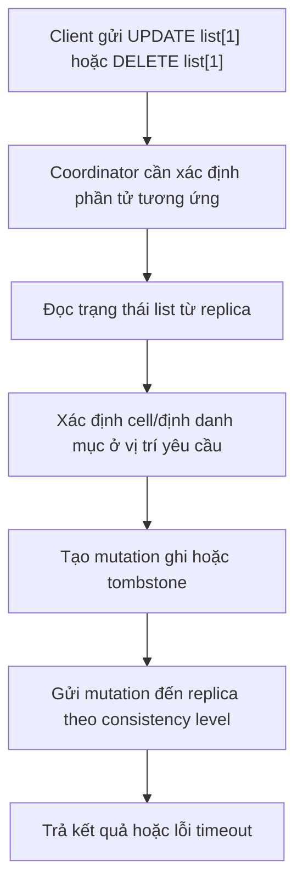

# List có thứ tự và những thao tác cần đọc trước hoặc không lũy đẳng trong Cassandra

> **Chương:** Collection và UDT  
> **Mô-đun:** `DATABASE_ENGINE_WIDE_COLUMN_CASSANDRA` — Apache Cassandra, cơ sở dữ liệu wide-column phân tán. Bài học tập trung vào `list<T>` trong CQL, gắn với thiết kế bảng theo truy vấn, khóa phân vùng, mức nhất quán đọc/ghi, replication, compaction, repair và Java Driver.

## 1. Bài toán: một danh sách nhỏ nhưng không đơn giản khi có nhiều writer

Giả sử mỗi người học có một danh sách tối đa mười bài muốn xem tiếp, theo **thứ tự do chính họ lựa chọn**:

```text
['partition-key', 'consistency', 'repair']
  vị trí 0        vị trí 1      vị trí 2
```

Ứng dụng cần giữ nguyên thứ tự, đôi khi cho phép hai bài giống nhau, hỗ trợ thêm vào đầu/cuối, sửa một vị trí hoặc xóa bài. CQL cung cấp kiểu `list<text>` cho bài toán đó. Tuy nhiên, một câu lệnh “sửa phần tử thứ hai” trong Cassandra có thể khác hẳn về chi phí với “thêm vào cuối”, và một câu lệnh thêm phần tử có thể **thực hiện hai lần** nếu client retry sau timeout.

Đó là lý do phải phân biệt ba nhóm thao tác:

1. **Nối vào đầu/cuối**: thêm một lần xuất hiện mới theo thứ tự, thường không cần đọc list hiện tại trước khi ghi, nhưng **không lũy đẳng** (*non-idempotent*) về ngữ nghĩa.
2. **Truy cập và thay đổi theo chỉ số**: cần biết phần tử đang nằm tại vị trí nào; dễ liên quan **read-before-write** và tranh chấp khi client khác đồng thời sửa list.
3. **Xóa theo giá trị hoặc vị trí**: cần xác định các phần tử đích trong list hiện tại, có thể kéo theo đọc trước khi ghi và tạo **tombstone**.

List phù hợp khi danh sách **nhỏ, có giới hạn, đọc nguyên cùng hàng và ít ghi đồng thời**. Nếu cần lịch sử không giới hạn, phân trang phần tử, định danh mỗi mục, hoặc nhiều writer sửa liên tục, nên thiết kế các **hàng riêng** theo truy vấn Cassandra.

## 2. Ngữ nghĩa của `list<T>`

`list<T>` là một collection **có thứ tự**. Khác với `set<T>`, nó **cho phép các giá trị trùng nhau**:

```text
['intro', 'lab', 'intro']
```

Hai chuỗi `'intro'` là hai **lần xuất hiện** khác nhau; muốn xóa đúng một lần xuất hiện thì chỉ riêng giá trị `'intro'` không đủ để nhận diện. Với `map<K,V>`, mỗi entry có khóa `K`; với `set<T>`, phần tử được nhận diện bằng giá trị. Còn với `list<T>`, **chỉ số thể hiện vị trí tạm thời**, không phải định danh nghiệp vụ ổn định.

Trong collection nhiều cell (*non-frozen*), Cassandra lưu các phần tử list với thông tin định danh/thứ tự nội bộ và metadata ghi; chỉ số CQL được suy ra từ **thứ tự danh sách hiện tại**. Một client khác thêm phần tử ở đầu hoặc xóa mục trước vị trí đó sẽ làm các chỉ số thay đổi. Ngữ nghĩa thứ tự của list cũng **không phải khóa clustering** để ứng dụng phân trang từng phần tử như các hàng độc lập.

### So sánh nhanh với các collection khác

| Câu hỏi | `list<T>` | `set<T>` | `map<K,V>` |
| --- | --- | --- | --- |
| Thứ tự có ý nghĩa nghiệp vụ? | Có | Không | Không biểu diễn thứ tự chèn |
| Cho phép giá trị lặp? | Có | Không | Giá trị có thể lặp, khóa không |
| Định danh mục để sửa | Chỉ số tại thời điểm thao tác | Giá trị | Khóa con |
| Thao tác thêm thường dùng | Nối đầu hoặc cuối | Thêm thành viên | Gán entry theo khóa |
| Nguy cơ nổi bật | Retry tạo bản sao, chỉ số dịch chuyển | Xung đột thêm/xóa cùng thành viên | Xung đột khi ghi cùng khóa |

## 3. Tạo bảng và dữ liệu minh họa

Giả sử keyspace `app` đã tồn tại. Bảng sau trả lời truy vấn **“lấy danh sách bài ghim của người dùng X”**; `user_id` là partition key và cũng là primary key của hàng:

```sql
CREATE TABLE app.user_study_queue (
    user_id uuid PRIMARY KEY,
    pinned_lessons list<text>
);

INSERT INTO app.user_study_queue (user_id, pinned_lessons)
VALUES (
    11111111-1111-4111-8111-111111111111,
    ['partition-key', 'consistency', 'repair']
);

SELECT pinned_lessons
FROM app.user_study_queue
WHERE user_id = 11111111-1111-4111-8111-111111111111;
```

CQL dùng dấu `[...]` cho list. `list<text>` quy định tất cả phần tử là text; giá trị `null` không phải phần tử hợp lệ. Các ví dụ sau **thay đổi cùng một hàng**; muốn so sánh độc lập, hãy khởi tạo lại hàng mẫu trước mỗi phép thử. Các thao tác được thảo luận trên collection thông thường (**non-frozen**), trừ khi ghi rõ khác.

## 4. Nối vào cuối: thao tác ngắn nhưng không lũy đẳng

```sql
UPDATE app.user_study_queue
SET pinned_lessons = pinned_lessons + ['compaction']
WHERE user_id = 11111111-1111-4111-8111-111111111111;
```

Về mặt ngữ nghĩa, đây là yêu cầu **thêm một lần xuất hiện mới ở cuối list**. Cassandra có thể tạo mutation cho phần tử mới mà không cần coordinator đọc toàn bộ list hiện có trước đó. Đây là ưu điểm khi danh sách còn nhỏ và ứng dụng chỉ thỉnh thoảng thêm bài.

Nhưng phép nối **không lũy đẳng**. Một thao tác được gọi là lũy đẳng khi thực hiện lại cùng thao tác nhiều lần vẫn cho kết quả như thực hiện một lần. Ví dụ, trong trạng thái ban đầu:

```text
Trước:        ['a', 'b']
Append 1 lần: ['a', 'b', 'c']
Append 2 lần: ['a', 'b', 'c', 'c']
```

Nếu client gửi lệnh append và gặp **write timeout**, kết quả có thể đã được một số replica hoặc đủ replica ghi nhận nhưng phản hồi chưa đến client. Retry cùng câu lệnh có thể bổ sung **một phần tử khác** với cùng giá trị, tạo bản sao. Client không thể kết luận “timeout = chắc chắn chưa ghi”.

Trong ứng dụng thật, việc gắn `isIdempotent=true` vào statement append chỉ để driver retry tự động là lựa chọn nguy hiểm. Nếu **không cho phép trùng bài ghim**, cần một thiết kế có **ID duy nhất cho mục**, kiểm tra/dedup theo nghiệp vụ, hoặc một cấu trúc dữ liệu khác; chỉ tăng consistency level không giải quyết được nguy cơ retry lặp phép nối.

## 5. Nối vào đầu: cũng không lũy đẳng và cần hiểu thứ tự cạnh tranh

```sql
UPDATE app.user_study_queue
SET pinned_lessons = ['overview'] + pinned_lessons
WHERE user_id = 11111111-1111-4111-8111-111111111111;
```

Trong CQL, thứ tự hai vế có ý nghĩa: `list + [x]` là **nối vào cuối**, `[x] + list` là **thêm vào đầu**. Đừng hoán đổi vế chỉ để trông giống cú pháp toán học.

Nối đầu cũng tạo thêm một lần xuất hiện mới; nếu retry hai lần, `['overview', 'overview', ...]` là kết quả hoàn toàn có thể xảy ra. Với nhiều client cùng prepend, **thứ tự cuối cùng của những phần tử mới** có thể chịu ảnh hưởng của cách Cassandra sắp xếp các mutation và timestamp nội bộ. Không nên dùng list prepend để xây dựng hàng đợi toàn cục cần thứ tự tuyệt đối theo thời điểm bấm nút trên nhiều thiết bị.

Nếu thứ tự là quyết định nghiệp vụ của người dùng sau thao tác kéo-thả, ứng dụng nên lưu **toàn bộ thứ tự được chấp nhận** qua một nguồn ghi có điều phối, hoặc thiết kế mỗi mục thành hàng với trường sắp xếp khi có nhiều editor.

## 6. Sửa theo chỉ số: tại sao Cassandra có thể phải đọc trước?

Giả sử ứng dụng muốn thay bài ở vị trí `1` bằng `'replication'`:

```sql
UPDATE app.user_study_queue
SET pinned_lessons[1] = 'replication'
WHERE user_id = 11111111-1111-4111-8111-111111111111;
```

Câu lệnh nhìn giống cập nhật mảng `arr[1]` của Java. Nhưng Cassandra phải tìm **phần tử đang đứng ở chỉ số 1** trong trạng thái list mà nó nhìn thấy rồi mới xác định được cell cần cập nhật. Với non-frozen list, điều này có thể kích hoạt một lượt **read-before-write** tại coordinator, làm tăng latency và số công việc so với mutation một `map` entry đã biết khóa.

Các hệ quả quan trọng:

- **Chỉ số bắt đầu từ `0`**, và chỉ số phải hợp lệ đối với list hiện tại khi câu lệnh được xử lý; không giả định cập nhật một vị trí không tồn tại sẽ tự động tạo các ô rỗng.
- Một truy vấn tưởng chỉ là ghi có thể phải đọc dữ liệu từ replica, nên chịu thêm độ trễ hoặc lỗi đọc tùy trạng thái cluster, consistency level và kích thước list.
- Nếu list được chỉnh sửa giữa lúc ứng dụng hiển thị thứ tự và lúc cập nhật, chỉ số của cùng một **mục nghiệp vụ** có thể thay đổi. Việc câu lệnh thành công không có nghĩa nó sửa **đúng mục** mà người dùng đã chọn trên màn hình cũ.

### Ví dụ race condition theo chỉ số

```text
T0: Server có list                   ['a', 'b', 'c']
T1: Client A đọc và hiển thị          0:a, 1:b, 2:c
T2: Client B prepend 'x'              ['x', 'a', 'b', 'c']
T3: Client A ghi list[1] = 'B-new'   ['x', 'B-new', 'b', 'c']
```

Client A định sửa `'b'`, nhưng chỉ số `1` giờ trỏ tới `'a'`. Đây là lỗi ở **mô hình định danh bằng vị trí**. Chỉ chuyển từ `ONE` sang `QUORUM` không làm chỉ số cũ tự trở nên ổn định. Muốn sửa đúng mục, nên sử dụng một **ID ổn định** và thiết kế bảng hoặc giao thức đồng bộ phù hợp.

## 7. Xóa theo chỉ số hoặc giá trị: cả đọc trước và tombstone

### 7.1. Xóa một phần tử theo vị trí

```sql
DELETE pinned_lessons[0]
FROM app.user_study_queue
WHERE user_id = 11111111-1111-4111-8111-111111111111;
```

Để xóa phần tử ở chỉ số `0`, Cassandra phải xác định phần tử tương ứng với chỉ số này trong list hiện tại. Phép xóa theo chỉ số vì vậy có thể kích hoạt **read-before-write**. Nó cũng ghi **dấu xóa (tombstone)** để replica khác không hồi sinh dữ liệu đã xóa.

Khi nhiều client sửa list đồng thời, xóa chỉ số đặc biệt dễ xóa nhầm một mục: mục hiển thị ở vị trí `0` trong giao diện có thể không còn ở vị trí đó lúc CQL chạy.

### 7.2. Xóa theo giá trị

```sql
UPDATE app.user_study_queue
SET pinned_lessons = pinned_lessons - ['repair']
WHERE user_id = 11111111-1111-4111-8111-111111111111;
```

Phép trừ list theo giá trị loại **các lần xuất hiện phù hợp** của `'repair'` trong list, không nhất thiết chỉ một bản sao. Để biết cell nào chứa giá trị cần xóa, Cassandra có thể phải đọc list hiện tại trước khi tạo mutation xóa. Khi một giá trị lặp nhiều lần, các bản sao phù hợp đều là đối tượng của thao tác.

Ví dụ:

```text
Trước:          ['cql', 'java', 'cql', 'repair']
Trừ ['cql']:    ['java', 'repair']
```

Vì thế, nếu nghiệp vụ là **“xóa đúng lần đăng ký có ID 827”** thì `list - ['cql']` không phải biểu thức đúng. Cần cấu trúc chứa khóa định danh riêng cho mỗi mục thay vì suy luận danh tính từ giá trị trùng nhau.

### 7.3. Xóa cả list không giống xóa một mục

```sql
-- Xóa cả cột collection của một hàng.
DELETE pinned_lessons
FROM app.user_study_queue
WHERE user_id = 11111111-1111-4111-8111-111111111111;
```

Đây là phép xóa phạm vi **toàn collection**. Cassandra cần giữ thông tin xóa để che những phần tử cũ đã lưu tại replica/SSTable khác. Phân biệt rõ thao tác API `removePinnedItem` với `clearAllPinnedItems` để không vô tình tạo một mutation có phạm vi lớn hơn mong muốn.

## 8. Thay toàn bộ thứ tự: phù hợp lúc bấm “Lưu sắp xếp”, nhưng chú ý lost update

Khi ứng dụng luôn có **snapshot đầy đủ** sau kéo-thả, có thể thay nguyên list:

```sql
UPDATE app.user_study_queue
SET pinned_lessons = ['repair', 'partition-key', 'consistency']
WHERE user_id = 11111111-1111-4111-8111-111111111111;
```

Ghi toàn bộ list diễn đạt một trạng thái cuối cùng rõ ràng, nhưng có các đánh đổi:

- **Khối lượng mutation** phụ thuộc danh sách mới; không còn là ghi đúng một phần tử.
- Với list nhiều cell, phép thay toàn bộ có thể tạo thông tin **xóa các cell cũ** rồi ghi giá trị mới, tăng tombstone và áp lực compaction nếu làm liên tục.
- Hai client đọc cùng snapshot rồi ghi hai thứ tự khác nhau sẽ tạo **cạnh tranh giữa hai bản list**; Cassandra không tự hợp nhất ý đồ sắp xếp của hai người dùng.

Ví dụ:

```text
T0: Cả client A và B đọc       ['a', 'b', 'c']
T1: Client A muốn thứ tự       ['c', 'a', 'b']
T2: Client B muốn thứ tự       ['b', 'c', 'a']
T3: Mỗi client ghi toàn list   -> Một trạng thái có thể che trạng thái kia
```

Nếu sản phẩm cần xử lý chỉnh sửa đồng thời, hãy định nghĩa quy tắc: một thiết bị sở hữu phiên chỉnh sửa, ghi theo số phiên bản, chỉ cho phép một writer, hoặc dùng giao thức đồng bộ có kiểm soát. `UPDATE` thông thường không tự bảo đảm “chỉ ghi nếu list vẫn giống lúc đọc”.

## 9. Bảng tổng hợp: thao tác nào read-before-write và thao tác nào không lũy đẳng?

| Thao tác CQL trên non-frozen `list` | Đọc list trước khi ghi ở coordinator? | Lũy đẳng về ngữ nghĩa? | Chi phí hoặc rủi ro chính |
| --- | --- | --- | --- |
| `list = list + [x]` | Thường **không** | **Không** | Retry có thể nối thêm phần tử trùng |
| `list = [x] + list` | Thường **không** | **Không** | Retry có thể prepend trùng; thứ tự nhiều writer |
| `list[i] = x` | **Có thể cần/điển hình** | Không nên mặc định | Tìm cell theo vị trí hiện tại; chỉ số có thể dịch |
| `DELETE list[i]` | **Có thể cần/điển hình** | Không nên mặc định | Xác định mục theo vị trí; tombstone và race condition |
| `list = list - [x]` | **Có thể cần/điển hình** | Tùy ngữ cảnh ghi cạnh tranh | Tìm mọi lần xuất hiện của `x`, tạo tombstone |
| `list = [a, b, c]` | Không nhất thiết | Có thể coi là gán trạng thái cố định khi không có ghi cạnh tranh | Ghi cả list, che cell cũ, lost update |
| `DELETE list` | Thường **không** | Có thể coi là yêu cầu xóa trạng thái | Xóa toàn collection, tombstone |

**Cách đọc bảng:** “Đọc trước” nói đến thao tác nội bộ phục vụ **ghi**, không khẳng định mỗi query bắt buộc phát sinh đúng một lần đọc mạng trong mọi phiên bản/cấu hình. “Lũy đẳng” cũng không có nghĩa “không bao giờ xung đột”: một lệnh gán giá trị cố định có thể dễ retry hơn append, nhưng giữa các writer vẫn có luật timestamp, và một retry muộn có thể ảnh hưởng kết quả khi timestamp/ghi cạnh tranh thay đổi.

Không quy các thao tác trên thành một số thời gian cố định như `O(1)` hoặc “mỗi update đúng một đĩa ghi”. Cassandra sử dụng memtable, commit log, SSTable, replica và compaction; độ trễ thực phụ thuộc kích thước dữ liệu, số phiên bản/tombstone, consistency level, số replica và tải cluster.

## 10. Tại sao read-before-write làm tăng độ trễ và nguy cơ lỗi?

Một phép `UPDATE` bình thường trên Cassandra thường gửi mutation đến replica mà không cần đọc giá trị hiện tại. Với thao tác list theo chỉ số hoặc xóa theo giá trị, coordinator cần biết **cell nào** phải thay/xóa; nó có thể phải đọc list trước rồi mới tạo mutation tương ứng.



Quy trình khái niệm trên cho thấy vì sao một lời gọi update có thể **chậm hơn** khi list dài, replica tải nặng hoặc số SSTable/tombstone cần hòa giải lớn. Một số tình huống còn có thể gặp lỗi ở **pha đọc** dù câu lệnh được trình bày là `UPDATE`.

Ứng dụng cần phân biệt:

- **Write timeout:** không biết chắc mutation đã được bao nhiêu replica ghi, có thể đã thành công về mặt dữ liệu.
- **Read timeout/unavailable trong thao tác ghi cần đọc trước:** coordinator không lấy đủ trạng thái cần thiết để xác định mục. Không suy diễn mọi thao tác có thể retry một cách vô điều kiện.
- **Concurrent modification:** lệnh thành công nhưng cập nhật phần tử khác với ý định khi client dựa trên chỉ số cũ.

Khi điều tra, kết hợp latency ở driver, tracing có kiểm soát, thống kê bảng và thông tin replication/repair thay vì chỉ nhìn số câu lệnh CQL.

## 11. Phần tử có TTL, tombstone và compaction

List nhiều cell có metadata ở mức phần tử. CQL có thể đặt TTL cho phần tử được thêm trong một thao tác:

```sql
-- Phần tử vừa nối được ghi với TTL 600 giây.
UPDATE app.user_study_queue USING TTL 600
SET pinned_lessons = pinned_lessons + ['temporary-lab']
WHERE user_id = 11111111-1111-4111-8111-111111111111;
```

Điều đó không tự đặt TTL lên mọi phần tử cũ. Khi phần tử hết TTL, Cassandra cần xử lý việc hết hạn theo cơ chế xóa/tombstone. Nếu ứng dụng thêm rất nhiều phần tử TTL ngắn rồi xóa thường xuyên, **lượng tombstone** có thể tăng nhanh và làm đọc list tốn kém hơn.

Tombstone cần được giữ đủ lâu để replica từng tạm ngắt có cơ hội biết một phần tử đã bị xóa. Compaction chỉ có thể dọn tombstone an toàn khi các điều kiện liên quan được thỏa mãn; các chính sách như `gc_grace_seconds` và quy trình **repair** đều liên quan. Không nên tự ý rút ngắn grace để tăng tốc dọn list khi chưa có bảo đảm replica được repair kịp: dữ liệu cũ có thể xuất hiện lại nếu dấu xóa bị loại bỏ quá sớm.

Với **`frozen<list<T>>`**, toàn bộ list trở thành một cell: ứng dụng chỉ có thể thay nguyên giá trị list, TTL áp dụng ở mức cell, không dùng `list[i]` hoặc append để cập nhật một mục. `frozen` phù hợp với snapshot nhỏ, hiếm khi sửa từng phần tử, nhưng không giải quyết khả năng mất cập nhật giữa các client cùng ghi snapshot cũ.

## 12. Java Driver 4.x: xây dựng retry theo đúng ngữ nghĩa

Ví dụ Java dưới đây minh họa prepared statement nối phần tử vào `list`. Giả định `CqlSession` đã được cấu hình cho contact points, local datacenter và vòng đời ứng dụng.

```java
import com.datastax.oss.driver.api.core.CqlSession;
import com.datastax.oss.driver.api.core.cql.BoundStatement;
import com.datastax.oss.driver.api.core.cql.PreparedStatement;
import java.util.List;
import java.util.UUID;

class StudyQueueRepository {
    private final CqlSession session;
    private final PreparedStatement appendLesson;
    private final PreparedStatement replaceQueue;

    StudyQueueRepository(CqlSession session) {
        this.session = session;
        this.appendLesson = session.prepare(
            "UPDATE app.user_study_queue " +
            "SET pinned_lessons = pinned_lessons + ? WHERE user_id = ?"
        );
        this.replaceQueue = session.prepare(
            "UPDATE app.user_study_queue " +
            "SET pinned_lessons = ? WHERE user_id = ?"
        );
    }

    void append(UUID userId, String lessonId) {
        // Trùng giá trị là hợp lệ đối với list.
        // Không cho driver tự coi phép append là idempotent.
        BoundStatement stmt = appendLesson.bind(
            List.of(lessonId), userId
        ).setIdempotent(false);
        session.execute(stmt);
    }

    void replaceOrder(UUID userId, List<String> desiredOrder) {
        // Gửi một snapshot hoàn chỉnh; cần chiến lược chống lost update
        // nếu nhiều thiết bị có thể thay thứ tự cùng lúc.
        BoundStatement stmt = replaceQueue.bind(desiredOrder, userId);
        session.execute(stmt);
    }
}
```

**Phân biệt hai API:** `append` có ý nghĩa **tạo thêm một lần xuất hiện**, không tự an toàn khi retry sau timeout. `replaceOrder` truyền **trạng thái cuối cùng** nhưng cần kiểm soát concurrent edits. `setIdempotent(false)` giúp các cơ chế retry/speculative execution dựa trên cờ idempotence của driver tránh tự phát lại câu lệnh append; nó **không ngăn** ứng dụng hoặc proxy gửi lại yêu cầu theo logic riêng.

Đối với các thao tác update/delete theo chỉ số, không nên cho người dùng gửi chỉ số từ giao diện cũ mà không có cơ chế kiểm tra trạng thái/version ở tầng ứng dụng. Tên phương thức như `deleteByIndex` cần được xem xét kỹ; `deleteByLessonId` trên bảng có ID ổn định thường rõ ý nghĩa hơn.

## 13. Khi nào thay `list` bằng bảng riêng?

Xét một **activity feed** hàng triệu sự kiện cho mỗi người dùng: ứng dụng cần 20 sự kiện mới nhất, phân trang và xóa một sự kiện theo ID. Đưa toàn bộ feed vào `list<text>` ở một hàng sẽ tạo collection tăng không giới hạn, không thể phân trang từng phần tử như hàng riêng và khiến append/retry khó kiểm soát trùng lặp.

Thiết kế phù hợp hơn là các **hàng riêng được sắp theo clustering key**, có bucket để giới hạn partition:

```sql
CREATE TABLE app.activities_by_user_day (
    user_id uuid,
    event_day date,
    occurred_at timeuuid,
    activity_type text,
    lesson_id text,
    PRIMARY KEY ((user_id, event_day), occurred_at)
) WITH CLUSTERING ORDER BY (occurred_at DESC);

-- Tạo event với occurred_at đã được cấp một lần cho event này.
INSERT INTO app.activities_by_user_day (
    user_id, event_day, occurred_at, activity_type, lesson_id
) VALUES (
    11111111-1111-4111-8111-111111111111,
    '2026-11-21',
    8cbe0000-e581-11f1-8e9a-0242ac120002,
    'PINNED',
    'repair'
);

SELECT occurred_at, activity_type, lesson_id
FROM app.activities_by_user_day
WHERE user_id = 11111111-1111-4111-8111-111111111111
  AND event_day = '2026-11-21'
LIMIT 20;
```

Ở đây, `occurred_at` là một **timeuuid** đại diện cho ID có thứ tự thời gian của sự kiện. Trong ứng dụng thật, tạo timeuuid phù hợp đúng thời điểm sự kiện và **giữ nguyên cùng ID khi retry**, thay vì tạo một timeuuid mới cho mỗi lần gửi lại. `event_day` phải tương ứng với bucket thời gian mà ứng dụng dùng để định tuyến truy vấn; truy vấn qua nhiều ngày cần ứng dụng đọc nhiều bucket. Nếu một ngày vẫn có quá nhiều sự kiện, cân nhắc bucket nhỏ hơn theo tải.

**Lưu ý:** bảng này nhận diện **một sự kiện ghi** bằng `(user_id, event_day, occurred_at)`, không tự bảo đảm một `lesson_id` chỉ được ghim một lần. Nếu yêu cầu “mỗi user chỉ ghim một bài duy nhất”, cần schema/quy trình dedup theo cặp `(user_id, lesson_id)` hoặc thiết kế các bảng đọc đồng bộ, có thể kèm ghi điều kiện khi cần. Như vậy, chính **khóa hàng ổn định** giải quyết được việc định danh, thay vì phụ thuộc vào chỉ số hoặc giá trị trùng trong list.

### Tình huống nào vẫn nên dùng list?

`list<text>` có thể hợp lý cho một giao diện có tối đa 5 bước onboarding mà **mỗi lần lưu đều ghi toàn bộ thứ tự**; một nguồn sở hữu trạng thái, hiếm khi nhiều client cùng sửa. Với danh sách như vậy, khả năng đọc cả list từ hàng người dùng đơn giản hơn tạo bảng phụ.

## 14. Kiểm chứng trong môi trường Cassandra

Bạn có thể thực hiện quy trình đo nhỏ để hiểu chênh lệch giữa các loại mutation:

1. Tạo bảng mẫu và dữ liệu, giữ **cùng replication/consistency level** cho các lượt thử.
2. Đo append list ngắn và list dài, thay theo chỉ số đầu/cuối, xóa theo chỉ số, xóa theo giá trị; lặp đủ lần để xem latency phân vị, không chỉ một lần chạy.
3. Trong môi trường thử nghiệm, dùng `TRACING ON;` của `cqlsh` cho một số truy vấn để quan sát các bước đọc/ghi qua coordinator và replica; dùng `TRACING OFF;` sau đó.
4. Theo dõi p95/p99 latency, số timeout/retry, tombstone khi đọc, compaction backlog và độ lớn partition bằng các công cụ thống kê tương ứng phiên bản Cassandra.
5. Thử một lần timeout có kiểm soát với append và chính sách retry ứng dụng; quan sát xem kết quả có trùng hay không. Không làm thử nghiệm gây lỗi trên dữ liệu sản xuất.

Những khác biệt cần đánh giá:

| Tín hiệu | Câu hỏi cần trả lời |
| --- | --- |
| Latency sửa `list[i]` tăng | Có phải đọc trước? List có nhiều phiên bản/tombstone? |
| Retry sau write timeout | Có phát sinh mục trùng? Ai là nơi quyết định retry? |
| Xóa `list - [x]` trên list dài | Có đọc lại nhiều phần tử và ghi nhiều tombstone? |
| Compaction tăng sau thay toàn list | Có thường xuyên ghi snapshot mới của collection lớn? |
| Lỗi “sửa sai vị trí” | Client có dựa trên chỉ số từ snapshot cũ? |

Kết quả đo phải phản ánh phiên bản Cassandra đang dùng, workload, trạng thái SSTable, replication, consistency và cách driver retry. Một phép `UPDATE` có cú pháp ngắn không đồng nghĩa rẻ hoặc an toàn về nghiệp vụ.

## 15. Bài tập suy luận

**Bài 1 — retry:** List đang là `['a','b']`. Client append `'c'` rồi timeout và retry thành công. Có thể thu được kết quả nào?  
**Gợi ý:** Có thể là `['a','b','c']` hoặc `['a','b','c','c']`, tùy lần ghi đầu có được áp dụng hay không và cách hòa giải. Không thể suy ra kết quả chỉ từ lỗi timeout.

**Bài 2 — xóa theo giá trị:** List là `['java','cql','java']`. `SET list = list - ['java']` có ý nghĩa xóa bao nhiêu mục?  
**Gợi ý:** Xóa các lần xuất hiện phù hợp của `'java'`, không có khái niệm “xóa đúng mục `java` thứ hai” khi chỉ định bằng giá trị.

**Bài 3 — chỉ số cũ:** Người dùng chọn sửa bài ở chỉ số `2`, nhưng thiết bị khác prepend hai bài trước khi lệnh cập nhật chạy. Có cách nào tăng `QUORUM` để tự sửa đúng ID bài không?  
**Gợi ý:** Không. Vấn đề là **định danh mục dựa trên vị trí**. Cần dùng ID ổn định, phối hợp trạng thái/version hoặc thiết kế bảng riêng.

**Bài 4 — danh sách hữu hạn:** Màn hình cấu hình có đúng 4 bước sắp xếp và chỉ một người chỉnh sửa. Có cần luôn thay list bằng bảng phụ không?  
**Gợi ý:** Không. Một list nhỏ và ghi nguyên snapshot có thể đơn giản hơn nếu tần suất cập nhật thấp và ít tranh chấp.

**Bài 5 — hoạt động liên tục:** Hệ thống ghi vài triệu lần thao tác mỗi ngày và phải phân trang theo thời gian. `list<event>` có phù hợp không?  
**Gợi ý:** Không. Dùng hàng riêng với partition bucket thời gian và clustering key; xác định ID sự kiện ổn định để retry đúng hàng.

## 16. Ghi nhớ

- `list<T>` **có thứ tự và cho phép trùng lặp**; chỉ số là vị trí hiện thời, không phải ID của phần tử.
- **Append/prepend thường không cần read-before-write**, nhưng **không lũy đẳng**: retry có thể tạo bản sao.
- **Thay/xóa theo chỉ số** và **xóa theo giá trị** có thể cần **read-before-write**, tăng độ trễ và dễ gặp race condition.
- Xóa phần tử hoặc thay toàn list có thể tạo **tombstone**; vận hành cần theo dõi compaction, TTL, repair và trạng thái replica.
- `QUORUM` và các consistency level khác giúp chọn đánh đổi đọc/ghi phân tán, nhưng **không tạo exactly-once** cho list append và không ổn định hóa chỉ số cũ.
- Trong Java Driver, đánh dấu đúng **idempotence**, giữ prepared statements và quản lý retry ở cả driver lẫn tầng ứng dụng.
- Với dữ liệu tăng không giới hạn, yêu cầu phân trang hoặc định danh từng mục và nhiều writer, hãy thiết kế **bảng theo truy vấn với partition/clustering key** thay cho list dài.
