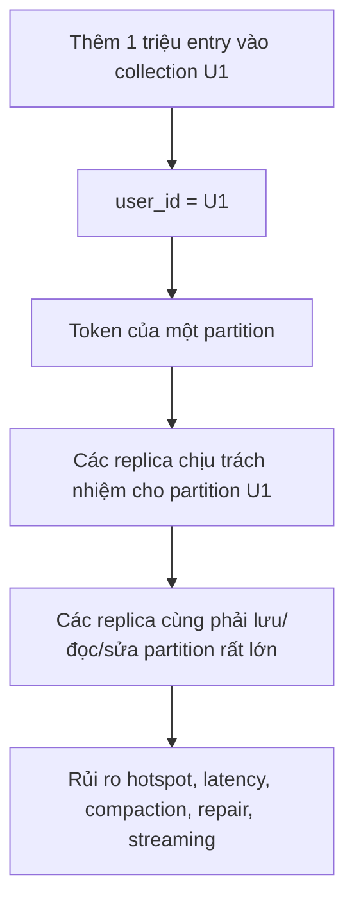
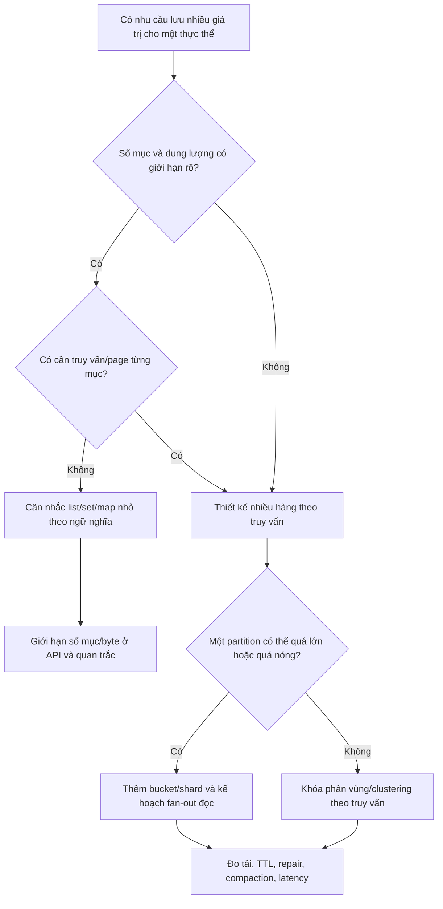

# Collection không giới hạn và ảnh hưởng đến kích thước hàng/phân vùng trong Cassandra

> **Chương:** Collection và UDT  
> **Mô-đun:** `DATABASE_ENGINE_WIDE_COLUMN_CASSANDRA` — kiến trúc wide-column phân tán của Apache Cassandra. Trọng tâm bài học là hệ quả của collection tăng không giới hạn đối với mô hình dữ liệu theo truy vấn, partition key, replication, consistency, compaction, repair, lỗi vận hành và ứng dụng Java.

## 1. Vấn đề cốt lõi: dữ liệu nhỏ hôm nay có thể trở thành một hàng rất lớn

Giả sử ứng dụng theo dõi lịch sử thao tác của từng người học. Ban đầu, mỗi người chỉ có vài sự kiện, nên ta muốn giữ ngay trong một hàng:

```sql
-- PHẢN VÍ DỤ nếu lượng sự kiện có thể tăng không giới hạn.
CREATE TABLE app.user_history_bad (
    user_id uuid PRIMARY KEY,
    activities list<text>
);

UPDATE app.user_history_bad
SET activities = activities + ['opened:partition-key']
WHERE user_id = 11111111-1111-4111-8111-111111111111;
```

Đây là câu lệnh hợp lệ, nhưng `activities` lớn dần theo thời gian. Câu hỏi cần giải quyết không phải “Cassandra có cho phép thêm phần tử không?”, mà là **“Có giới hạn kích thước collection, hàng và partition được vận hành an toàn không?”** Nếu một người học tạo hàng triệu sự kiện, toàn bộ list vẫn nằm trong **một hàng** có partition key `user_id`.

Đọc cả list, compaction, repair hay truyền partition giữa các node có thể trở nên rất tốn kém. Bản thân việc biết chính xác partition key **không giải quyết** vấn đề một partition chứa quá nhiều dữ liệu.

> **Nguyên tắc:** Collection Cassandra phù hợp cho **nhóm giá trị nhỏ, có giới hạn rõ ràng, cùng vòng đời và thường được đọc theo hàng**. Collection tăng vô hạn không nên được dùng như bảng con, nhật ký, hàng đợi hoặc kho lịch sử.

## 2. Phân biệt phần tử collection, cell, hàng và partition

Một mô hình đúng cần phân biệt bốn mức:

| Mức | Vai trò | Ảnh hưởng khi số lượng tăng |
| --- | --- | --- |
| **Phần tử collection** | Một giá trị của `list`/`set`, hoặc một entry của `map` | Tăng dữ liệu cần mã hóa, đọc, ghi và truyền |
| **Cell** | Đơn vị giá trị và metadata ghi/TTL/tombstone; non-frozen collection có thể có nhiều cell | Tăng metadata, chi phí hòa giải phiên bản và tombstone |
| **Hàng (row)** | Dữ liệu nhận diện bởi primary key của hàng, gồm các cột/collection | Một collection lớn có thể khiến **một hàng** rất lớn |
| **Partition** | Dữ liệu cùng partition key, được đặt trên một tập replica | Một hàng khổng lồ hoặc nhiều hàng cùng key đều khiến **partition** lớn |

Ví dụ bảng `user_history_bad` chỉ có `user_id` là primary key, nên **mỗi user là một partition với một hàng**. Nếu list có nhiều phần tử, kích thước hàng và partition cùng tăng. Với bảng có clustering columns, một partition có thể chứa nhiều hàng; lúc đó partition lớn có thể do **số hàng**, **kích thước từng hàng** hoặc cả hai.

```text
Partition key: user_id = U1
┌─────────────────────────────────────────────────────────┐
│ Một hàng: PRIMARY KEY (U1)                              │
│   activities = [event1, event2, event3, ... eventN]      │
│              ↑ Khi N tăng, một hàng phình lớn            │
└─────────────────────────────────────────────────────────┘

Partition key: (user_id = U1, event_day = D1)
┌─────────────────────────────────────────────────────────┐
│ Hàng event_time=T3  -> event3                           │
│ Hàng event_time=T2  -> event2                           │
│ Hàng event_time=T1  -> event1                           │
│ ...                                                     │
└─────────────────────────────────────────────────────────┘
```

Trong mô hình thứ hai, mỗi sự kiện là **một hàng** có clustering key. Ta có thể đọc theo phạm vi và phân trang hàng, nhưng vẫn phải bảo đảm **số hàng trong một partition được giới hạn hợp lý**, ví dụ bằng bucket thời gian.

## 3. `list`, `set`, `map`: ba cách tăng trưởng, chung một giới hạn thiết kế

### 3.1. `list<T>` — nhật ký nối tiếp không có giới hạn

`list` giữ thứ tự và cho phép giá trị lặp. Nối thêm sự kiện liên tục bằng `activities = activities + [...]` có vẻ tiện nhưng gây ba hệ quả:

1. List dài có thể khiến đọc toàn cột chậm, tốn bộ nhớ và băng thông.
2. Append **không lũy đẳng**; retry sau write timeout có thể tạo thêm cùng sự kiện lần nữa.
3. Sửa/xóa theo chỉ số hoặc xóa theo giá trị có thể cần **read-before-write**, làm chi phí thao tác tăng khi list lớn.

List nhỏ cho thứ tự tùy chỉnh của người dùng là một trường hợp khác với luồng sự kiện tăng vô hạn. Không nên lấy một thiết kế hợp lý cho 10 mục để suy rộng cho 10 triệu mục.

### 3.2. `set<T>` — tập thành viên phình lớn

```sql
-- PHẢN VÍ DỤ khi một nhóm có thể có hàng triệu thành viên.
CREATE TABLE app.group_members_bad (
    group_id uuid PRIMARY KEY,
    member_ids set<uuid>
);
```

`set` ngăn phần tử trùng lặp và cho phép thêm/xóa theo giá trị, nhưng hàng `group_id` vẫn chứa ngày càng nhiều cell khi số thành viên tăng. Nếu cần **phân trang thành viên**, đọc **thông tin từng thành viên**, hoặc truy vấn “người dùng U thuộc những nhóm nào?”, bảng riêng theo từng chiều truy vấn thường phù hợp hơn. `set` không tự biến mỗi thành viên thành một hàng có thể page độc lập.

### 3.3. `map<K,V>` — từ điển động thành bảng con không kiểm soát

```sql
-- PHẢN VÍ DỤ: không dùng map như kho một triệu bản ghi theo event ID.
CREATE TABLE app.event_payloads_bad (
    user_id uuid PRIMARY KEY,
    payload_by_event map<timeuuid, text>
);
```

`map` tiện khi có vài chục thuộc tính linh hoạt và cần `settings['theme'] = 'dark'`. Nhưng nếu key là ID của hàng triệu sự kiện thì nó trở thành **bảng con ẩn trong một cột**: thiếu phân trang từng entry như hàng, khó quản lý vòng đời độc lập, và mỗi lần đọc cả map sẽ chuyển rất nhiều dữ liệu không liên quan.

| Nhu cầu | Collection có giới hạn | Collection tăng không giới hạn |
| --- | --- | --- |
| Cài đặt giao diện 10–30 key | `map<text,text>` có thể phù hợp | Không dùng map để chứa log theo ID |
| Một số chủ đề yêu thích | `set<text>` có thể phù hợp | Không dùng set chứa mọi người dùng của một cộng đồng lớn |
| 5 bài được ghim theo thứ tự | `list<text>` có thể phù hợp | Không dùng list chứa mọi hoạt động đã xảy ra |
| Đọc mục có ID và phân trang | Cân nhắc cột/collection nếu rất nhỏ | Thiết kế bảng riêng có primary key phục vụ truy vấn |

Các con số trên chỉ minh họa **ngữ nghĩa và mức giới hạn do sản phẩm quyết định**; chúng không phải giới hạn cứng do Cassandra công bố cho mọi cluster.

## 4. Vì sao kích thước partition ảnh hưởng cả cluster?

### 4.1. Khóa phân vùng chỉ quyết định vị trí, không chia nhỏ một partition

Partitioner dựa trên partition key để xác định token và nhóm replica lưu dữ liệu. Với `PRIMARY KEY (user_id)`, một người dùng tạo nhiều sự kiện **không trải đều sự kiện đó sang các token khác nhau**; chúng vẫn thuộc partition của `user_id`.



Thêm replica làm tăng độ bền và lựa chọn consistency, nhưng **không cắt một partition thành các mảnh đọc độc lập**; replica của cùng partition đều phải quản lý dữ liệu partition đó. Ví dụ RF=3 có thể khiến một tập dữ liệu logic được lưu trên ba replica; đó là một yếu tố khuếch đại dung lượng và công việc nền, không phải ba phần nhỏ của cùng một list.

### 4.2. Hot partition và mất cân bằng tải

Nếu 90% request ghi dồn vào một khóa người dùng hoặc một nhóm cực lớn, vài replica chịu trách nhiệm cho partition đó có thể thành điểm nóng (**hot partition**), ngay cả khi cluster có nhiều node khác đang rảnh. Cả **kích thước** lẫn **tần suất truy cập** đều quan trọng: một partition 100 MB ít dùng có rủi ro khác partition 10 MB bị cập nhật hàng nghìn lần/giây.

Thêm node không tự động giải quyết một hot partition nếu partition key của workload vẫn không đổi. Cần xem lại **đơn vị phân vùng dữ liệu** và **cách truy vấn**.

### 4.3. Đọc và truyền dữ liệu

Khi truy vấn cột chứa một collection lớn, coordinator/replica phải xử lý giá trị collection và trả dữ liệu qua giao thức CQL. Lượng dữ liệu lớn có thể kéo theo:

- Độ trễ đọc cao và số byte truyền qua mạng lớn.
- Bộ nhớ lớn hơn cho việc giải mã/tuần tự hóa ở server và client Java.
- Nhiều cell, phiên bản cũ, TTL và tombstone phải được hòa giải khi đọc.
- Rủi ro gặp giới hạn kích thước giá trị/thông điệp hay timeout tùy phiên bản, driver và cấu hình.

**Không tự đặt một ngưỡng byte tuyệt đối dùng chung cho mọi môi trường.** Hãy đặt ngân sách kích thước dựa trên workload, SLO, kích thước payload, độ phổ biến khóa và số đo trên phiên bản Cassandra đang vận hành.

## 5. `LIMIT`, paging và `frozen` không cứu được một collection khổng lồ

### 5.1. `LIMIT 10` giới hạn hàng, không cắt 10 phần tử của list

```sql
-- Vẫn có thể trả về cả collection activities trong một hàng.
SELECT activities
FROM app.user_history_bad
WHERE user_id = 11111111-1111-4111-8111-111111111111
LIMIT 10;
```

Trong bảng chỉ có một hàng cho mỗi `user_id`, `LIMIT 10` không có nghĩa “lấy 10 sự kiện mới nhất trong `activities`”. Nó giới hạn số **hàng kết quả**, không biến các phần tử của list thành hàng. Page size của Java Driver cũng áp dụng cho các hàng kết quả; một hàng chứa collection lớn vẫn có thể tạo response lớn.

Muốn lấy 10 sự kiện gần nhất và page tiếp, phải làm cho **mỗi sự kiện là hàng có clustering key sắp theo thời gian**.

### 5.2. `frozen<list<T>>` không giảm kích thước logic

```sql
-- Cũng là phản ví dụ nếu muốn lưu lịch sử không giới hạn.
CREATE TABLE app.user_history_frozen_bad (
    user_id uuid PRIMARY KEY,
    activities frozen<list<text>>
);
```

`frozen` lưu collection thành **một cell**, nghĩa là phải ghi lại **toàn bộ giá trị** khi đổi một phần tử. Nó có thể giảm metadata ở mức phần tử nhưng không làm list lớn biến mất, không cung cấp paging phần tử, và thường khiến thao tác ghi một thay đổi nhỏ phải truyền lại một snapshot lớn.

So sánh:

| Tiêu chí | Non-frozen collection | Frozen collection |
| --- | --- | --- |
| Đơn vị cập nhật | Có thể theo entry/phần tử tùy kiểu | Toàn bộ giá trị |
| Dung lượng logic nhiều mục | Vẫn tăng theo số mục | Vẫn tăng theo số mục |
| Phân trang từng entry thành hàng | Không | Không |
| Xử lý xóa/TTL | Có thể có tombstone từng phần tử | Xóa/TTL theo giá trị; vẫn có tombstone |
| Phù hợp với collection vô hạn | Không | Không |

## 6. Ví dụ ước lượng kích thước để phát hiện thiết kế rủi ro

Giả sử một người dùng phát sinh **2.000 sự kiện/ngày**, mỗi payload trung bình **200 byte**. Sau **365 ngày**, chỉ riêng payload của các sự kiện là:

\[
2.000\ \text{sự kiện/ngày}\times365\ \text{ngày}\times200\ \text{byte}
=146.000.000\ \text{byte}\approx146\ \text{MB (thập phân)}.
\]

Đây là **ước lượng minh họa**, chưa tính key/metadata collection, timestamp, index, tombstone, chi phí SSTable, nén, replication hoặc thông tin có thể thay đổi theo từng record. Nếu dùng `list<text>` trong một hàng, một truy vấn đọc collection có thể phải xử lý một lượng dữ liệu logic tương đương hàng trăm MB dù giao diện chỉ muốn 20 mục gần nhất.

| Biến tăng trưởng | Công thức gần đúng | Dùng để quyết định |
| --- | --- | --- |
| Số phần tử mỗi partition | `tốc độ ghi × thời gian giữ lại` | Có cần bucket và TTL hay không |
| Payload logic mỗi partition | `số phần tử × kích thước trung bình` | Ngân sách row/partition, request/response |
| Số lần ghi vào partition | `số client × tần suất cập nhật` | Rủi ro hotspot, timeout và tranh chấp |
| Dữ liệu lưu trên nhiều replica | Phụ thuộc replication factor, compaction, nén | Dung lượng disk/repair/streaming của cluster |

Nếu TTL giữ lại dữ liệu 30 ngày và tốc độ đều đặn 2.000 sự kiện/ngày thì khoảng 60.000 sự kiện vẫn còn sống ở một thời điểm, nhưng **việc TTL hết hạn không loại bỏ ngay mọi byte cũ** khỏi SSTable. Tombstone và compaction vẫn quyết định công việc tồn đọng. Ngân sách nên xét cả **dữ liệu đang sống** và **dữ liệu đã hết hạn/chưa được dọn**.

## 7. Thiết kế lại: sự kiện thành hàng, partition theo người dùng và bucket ngày

Truy vấn nghiệp vụ giả định là:

> “Cho user U, liệt kê các sự kiện trong ngày D, mới nhất trước; lấy 50 hàng, sau đó phân trang.”

Ta đưa từng sự kiện thành hàng và dùng clustering column để sắp xếp:

```sql
CREATE TABLE app.events_by_user_day (
    user_id uuid,
    event_day date,
    event_time timeuuid,
    event_type text,
    details text,
    PRIMARY KEY ((user_id, event_day), event_time)
) WITH CLUSTERING ORDER BY (event_time DESC);

-- Một sự kiện có ID ổn định; ví dụ timeuuid tương ứng ngày 2026-11-21.
INSERT INTO app.events_by_user_day (
    user_id, event_day, event_time, event_type, details
) VALUES (
    11111111-1111-4111-8111-111111111111,
    '2026-11-21',
    8cbe0000-e581-11f1-8e9a-0242ac120002,
    'OPEN_LESSON',
    'partition-key'
);

-- Lấy 50 hàng trong partition của ngày đã biết.
SELECT event_time, event_type, details
FROM app.events_by_user_day
WHERE user_id = 11111111-1111-4111-8111-111111111111
  AND event_day = '2026-11-21'
LIMIT 50;
```

Trong khóa chính `PRIMARY KEY ((user_id, event_day), event_time)`:

- `(user_id, event_day)` là **composite partition key**. Mỗi ngày của một user là một partition riêng.
- `event_time` là **clustering column**, tổ chức các hàng theo thời điểm; `DESC` phục vụ truy vấn sự kiện mới nhất trước.
- Mỗi `INSERT` ghi một hàng có **định danh ổn định**. Nếu xảy ra timeout và ứng dụng retry với **cùng `event_time`**, câu lệnh nhắm lại cùng khóa hàng; nếu gọi hàm sinh UUID mới cho mỗi retry thì vẫn có thể tạo trùng sự kiện ở góc nhìn nghiệp vụ.
- `LIMIT 50` giờ giới hạn **50 hàng sự kiện**, và driver có thể tiếp tục phân trang các hàng.

### Điều gì đã được giải quyết, điều gì chưa?

Mô hình mới cho phép phân trang hàng và giới hạn lượng dữ liệu trong một partition bằng bucket thời gian. Tuy nhiên:

1. Đọc **qua nhiều ngày** cần ứng dụng truy vấn nhiều bucket và ghép kết quả theo thứ tự; không thể bỏ `event_day` trong `WHERE` rồi kỳ vọng truy vấn đọc xuyên bucket hiệu quả.
2. Nếu một user tạo **hàng triệu sự kiện trong một ngày**, bucket ngày vẫn quá lớn: cân nhắc bucket giờ hoặc shard phù hợp lưu lượng.
3. Nếu chọn shard theo hash để chia tải ghi, truy vấn lấy 50 sự kiện mới nhất phải đọc/ghép kết quả từ các shard có liên quan; thêm shard kéo theo **fan-out** đọc.
4. Dữ liệu có `event_time` trùng hoặc không ổn định giữa retry cần quy tắc tạo **ID duy nhất** rõ ràng. `timeuuid` không tự bảo đảm đúng-một-lần nếu ứng dụng cấp ID mới sau mỗi lần thử.

Một thiết kế tốt cân bằng **kích thước partition**, **phân bố ghi** và **số truy vấn fan-out khi đọc**. Không có cách chia bucket đúng cho mọi lưu lượng.

## 8. Map/set lớn: tách thành hàng theo khóa phần tử

Nếu bài toán là tập người dùng trong nhóm lớn, thay vì `member_ids set<uuid>` trong một hàng, có thể dùng:

```sql
CREATE TABLE app.members_by_group (
    group_id uuid,
    member_id uuid,
    joined_at timestamp,
    PRIMARY KEY ((group_id), member_id)
);

INSERT INTO app.members_by_group (group_id, member_id, joined_at)
VALUES (
    22222222-2222-4222-8222-222222222222,
    11111111-1111-4111-8111-111111111111,
    '2026-11-21T08:00:00Z'
);

SELECT member_id, joined_at
FROM app.members_by_group
WHERE group_id = 22222222-2222-4222-8222-222222222222
LIMIT 50;
```

Mỗi member giờ là **một hàng** và có thể phân trang theo `member_id`. Nhưng partition key chỉ là `group_id`, nên một nhóm cực lớn vẫn có thể tạo **partition khổng lồ**. Cần đo quy mô từng nhóm; nếu một nhóm có hàng chục triệu thành viên, có thể thêm bucket/shard vào partition key và chấp nhận việc đọc phải quét nhiều bucket khi cần toàn bộ thành viên.

Nếu ứng dụng hỏi **“user U thuộc nhóm nào?”**, bảng `members_by_group` không phục vụ trực tiếp. Cần bảng bổ sung `groups_by_member` được phân vùng theo `member_id` hoặc một mô hình đọc khác; đồng bộ nhiều bảng là trách nhiệm thiết kế ở tầng ứng dụng. Đây là đặc trưng **thiết kế bảng theo truy vấn** trong Cassandra.

Với `map` rất lớn, có thể tạo bảng có `PRIMARY KEY ((owner_id, bucket), item_key)` và cột `item_value`, hoặc partition key phù hợp với truy vấn cụ thể. Việc chọn bucket phải làm rõ cách tìm một `item_key`, quét các mục, đặt TTL và giới hạn partition. Chỉ chuyển `map` thành một bảng có `PRIMARY KEY ((owner_id), item_key)` mà bỏ qua cardinality của owner chưa chắc đã giải quyết vấn đề partition lớn.

## 9. TTL và xóa dữ liệu: đừng nhầm hết hạn với được thu hồi ngay

Collection nhiều cell có thể có TTL riêng cho một số entry được ghi, ví dụ:

```sql
CREATE TABLE app.session_features (
    session_id uuid PRIMARY KEY,
    flags map<text, text>
);

UPDATE app.session_features USING TTL 600
SET flags['trial_notice'] = 'enabled'
WHERE session_id = 33333333-3333-4333-8333-333333333333;
```

Entry được ghi với TTL 600 giây; những entry khác không tự nhận TTL chỉ vì lệnh này. Khi TTL hết hạn, Cassandra phải duy trì thông tin hết hạn/xóa cho đến khi việc dọn dẹp an toàn. Với `frozen<map<...>>`, TTL gắn với cả cell snapshot, không theo từng entry.

Ở bảng sự kiện riêng, có thể đặt TTL theo từng hàng khi ghi các cột không phải primary key:

```sql
-- Ví dụ: giữ payload của sự kiện 7 ngày (604800 giây).
INSERT INTO app.events_by_user_day (
    user_id, event_day, event_time, event_type, details
) VALUES (
    11111111-1111-4111-8111-111111111111,
    '2026-11-21',
    8cbe0000-e581-11f1-8e9a-0242ac120002,
    'OPEN_LESSON',
    'partition-key'
) USING TTL 604800;
```

TTL là một công cụ **giới hạn thời gian giữ dữ liệu**, nhưng không tự bảo đảm partition luôn gọn ngay khi TTL hết hạn: compaction và chính sách dọn tombstone vẫn tác động đến dung lượng đĩa và độ trễ đọc.

Một số workload dữ liệu dạng chuỗi thời gian có thể được lợi từ cách tổ chức bảng/bucket và compaction phù hợp với thời hạn lưu (ví dụ TimeWindowCompactionStrategy trong tình huống thích hợp), nhưng lựa chọn phải được kiểm chứng theo phiên bản Cassandra và quy trình ghi/xóa. **Compaction strategy không sửa được mô hình một collection vô hạn** và không thay thế giới hạn cardinality.

## 10. Tombstone, compaction, repair và streaming khi partition lớn

Một collection lớn bị thêm/xóa liên tục gây thêm chi phí ngoài phần tử đang sống:

| Hoạt động | Ảnh hưởng của collection/partition quá lớn |
| --- | --- |
| **Đọc** | Hợp nhất nhiều cell, phiên bản cũ, TTL và tombstone; dễ tăng p95/p99 latency |
| **Ghi** | Hot partition tập trung ghi vào ít replica; retry tăng tải khi timeout |
| **Compaction** | Nhiều phiên bản/tombstone và SSTable cần được xem xét, I/O nền tăng |
| **Repair** | Phải so sánh/đồng bộ dữ liệu giữa replica; partition lớn gây tải và tăng thời gian xử lý |
| **Streaming / bootstrap / decommission** | Dữ liệu của partition lớn làm các luồng truyền và cân bằng dữ liệu nặng hơn |
| **Backup / restore** | Dung lượng và thời gian xử lý có thể tăng do payload lớn và bản ghi cũ |

Xóa phần tử không có nghĩa giá trị cũ biến mất ngay khỏi mọi SSTable. Cassandra ghi **tombstone** để replica chưa nhận lệnh xóa biết dữ liệu đã bị xóa. Nếu tombstone bị loại bỏ trước khi replica từng offline được đồng bộ, dữ liệu cũ có thể **tái xuất hiện** (*zombie data*). Cần lập lịch repair và hiểu các điều kiện an toàn của `gc_grace_seconds`; không tự giảm grace chỉ để xử lý cảnh báo tombstone trong một bảng thiết kế sai.

Với consistency level như `ONE`, `LOCAL_QUORUM`, `QUORUM`, replica được xác nhận ở các mức khác nhau tùy replication. Tăng consistency có thể ảnh hưởng độ trễ/tính sẵn sàng nhưng **không tự làm partition nhỏ lại**, không giới hạn collection và không giải quyết hot partition gây nghẽn tập trung.

## 11. Giới hạn ở tầng ứng dụng: thiết kế không đủ nếu không cưỡng chế

Nếu lựa chọn vẫn là collection, phải có **giới hạn có thể kiểm tra**. Ví dụ, sản phẩm định nghĩa mỗi user chỉ được có tối đa 12 mục ghim:

- Giới hạn số mục trong UI **và ở API server**, tránh client bỏ qua giao diện rồi ghi trực tiếp hàng nghìn phần tử.
- Giới hạn kích thước từng payload và kích thước toàn collection, không chỉ số lượng phần tử.
- Tính toán tần suất cập nhật và số thiết bị có thể ghi đồng thời; danh sách ngắn vẫn có thể là hot row nếu bị sửa hàng nghìn lần/giây.
- Khi quá giới hạn, chọn chính sách nghiệp vụ **từ chối, bỏ mục cũ, lưu trữ riêng** hoặc chuyển sang bảng nhiều hàng. Nêu rõ chính sách trong API.
- Quan trắc độ dài/kích thước collection ở ứng dụng; không giả định CQL tự áp hạn mức “tối đa 12 phần tử” cho một cột list.

**Lưu ý concurrency:** Giải pháp “client đọc độ dài = 11, rồi append một mục” không bảo đảm giới hạn 12 nếu hai client cùng làm. Nếu giới hạn là bất biến cần đảm bảo nghiêm ngặt, phải có một giao thức ghi phối hợp/điều kiện phù hợp hoặc mô hình dữ liệu khác. Đừng suy diễn rằng chỉ dùng `QUORUM` đã tạo atomic read-modify-write.

## 12. Java Driver: phân trang **hàng** và dùng ID ổn định khi retry

Ví dụ Java Driver 4.x dưới đây sử dụng `CqlSession` đã cấu hình contact points, local datacenter, authentication. Prepared statements được tạo một lần trong repository để dùng lại:

```java
import com.datastax.oss.driver.api.core.CqlSession;
import com.datastax.oss.driver.api.core.cql.BoundStatement;
import com.datastax.oss.driver.api.core.cql.PreparedStatement;
import com.datastax.oss.driver.api.core.cql.ResultSet;
import com.datastax.oss.driver.api.core.cql.Row;
import java.time.LocalDate;
import java.util.UUID;

class EventRepository {
    private final CqlSession session;
    private final PreparedStatement insert;
    private final PreparedStatement selectByDay;

    EventRepository(CqlSession session) {
        this.session = session;
        insert = session.prepare(
            "INSERT INTO app.events_by_user_day " +
            "(user_id, event_day, event_time, event_type, details) " +
            "VALUES (?, ?, ?, ?, ?)"
        );
        selectByDay = session.prepare(
            "SELECT event_time, event_type, details " +
            "FROM app.events_by_user_day " +
            "WHERE user_id = ? AND event_day = ?"
        );
    }

    void saveEvent(
        UUID userId, LocalDate day, UUID stableTimeUuid,
        String type, String details
    ) {
        // stableTimeUuid là UUID v1 đã cấp MỘT LẦN cho sự kiện.
        // Khi retry, giữ nguyên userId, day và stableTimeUuid.
        session.execute(insert.bind(userId, day, stableTimeUuid, type, details));
    }

    void printEvents(UUID userId, LocalDate day) {
        BoundStatement stmt = selectByDay.bind(userId, day)
            .setPageSize(50);
        ResultSet rows = session.execute(stmt);
        for (Row row : rows) {
            // Java Driver đồng bộ có thể tải các trang kế tiếp khi lặp.
            System.out.println(row.getUuid("event_time") + " "
                + row.getString("event_type"));
        }
    }
}
```

`setPageSize(50)` là **gợi ý số hàng mỗi trang** cho truy vấn, không phải giới hạn tổng số hàng được lặp và không cắt một collection thành 50 phần tử. Khi viết API HTTP, cần dừng sau trang mong muốn và quản lý **paging state** theo quy tắc của driver, thay vì duyệt hết `ResultSet` nếu chỉ cần một trang. Nếu muốn lấy tối đa 50 hàng trong một truy vấn, có thể thêm `LIMIT 50`, nhưng phải định nghĩa cách lấy trang tiếp dựa trên truy vấn và paging state thích hợp.

Với `saveEvent`, cần bảo đảm `stableTimeUuid` thực sự là **timeuuid/UUID version 1** mà schema chấp nhận; `UUID.randomUUID()` mặc định tạo UUID version 4 nên **không phù hợp** với cột `timeuuid`. Tạo ID một lần trước khi gửi, nhất quán với bucket ngày, rồi tái sử dụng ID đó cho mọi retry. Nếu yêu cầu chính xác-một-lần còn liên quan nhiều bảng hoặc side effect khác, cần thêm xử lý deduplication/nghiệp vụ chứ không chỉ dựa vào khóa hàng.

## 13. Quy trình đo và phát hiện collection/partition có nguy cơ

Không chỉ dựa vào câu lệnh CREATE TABLE để quyết định một thiết kế là an toàn. Cần quan trắc dữ liệu và đường truy cập thực:

1. **Đo cardinality và payload**: bao nhiêu phần tử/partition ở p50, p95, p99, cực đại? Tốc độ tăng theo ngày và tuổi dữ liệu giữ lại là bao nhiêu?
2. **Đo kích thước partition**: kiểm tra thống kê bảng và phân bố kích thước trên các replica, chú ý partition ngoại lệ lớn hoặc nóng.
3. **Đo truy vấn**: p95/p99 latency, read timeout, write timeout, kích thước response, số retry và số SSTable/tombstone phải hòa giải.
4. **Đo nền vận hành**: compaction backlog, disk I/O, tombstone warnings, tiến độ repair và streaming; so sánh lúc tải bình thường với lúc bootstrap/repair.
5. **Thử migration**: đối chiếu latency/throughput giữa collection và bảng hàng riêng với cùng dữ liệu/replication/consistency, kể cả truy vấn phải fan-out theo bucket.

Trong môi trường thử nghiệm, có thể dùng `TRACING ON;` của `cqlsh` cho một số truy vấn mục tiêu rồi `TRACING OFF;`. Trên phiên bản hỗ trợ, `nodetool tablestats` và `nodetool tablehistograms` giúp xem các thống kê liên quan; cú pháp/thống kê cụ thể phụ thuộc phiên bản Cassandra. Tracing có overhead, không bật đại trà trong cluster sản xuất.

### Các tín hiệu thường gặp và hành động tương ứng

| Tín hiệu | Diễn giải khả dĩ | Hướng xử lý |
| --- | --- | --- |
| Một user có collection tăng đều mỗi ngày | Không có chính sách giới hạn cardinality | Tách thành hàng riêng, thêm bucket, giới hạn retention |
| `SELECT ... LIMIT 20` vẫn trả về payload lớn | 20 giới hạn **hàng**, collection nằm trong một hàng | Tạo clustering rows cho các mục cần page |
| Tombstone warning xuất hiện sau xóa/TTL hàng loạt | Nhiều entry đã bị xóa/hết hạn cần hòa giải | Xem workload xóa và schema; bảo đảm repair/compaction phù hợp |
| Vài replica nóng dù cluster còn node rảnh | Một hoặc ít partition key bị truy cập tập trung | Thiết kế bucket/shard với kế hoạch đọc fan-out |
| Repair/streaming kéo dài bất thường | Partition rất lớn hoặc dữ liệu phân bố lệch | Đo theo token/partition và xem lại khóa phân vùng |
| Java client gặp timeout/bộ nhớ cao khi đọc collection | Response chứa một giá trị lớn | Hạn chế collection; page **hàng** qua schema mới |

## 14. Bài tập tình huống

**Tình huống A — `LIMIT` không giải quyết được:** Bảng `user_history_bad` chứa 500.000 hoạt động trong list của một user. Truy vấn `SELECT activities ... LIMIT 20` có trả về 20 hoạt động đầu tiên không?  
**Gợi ý:** Không. Nó giới hạn hàng; với khóa chính chỉ có `user_id`, hàng được trả về vẫn chứa **cả collection**.

**Tình huống B — bucket theo ngày vẫn quá lớn:** Một user tạo 3 triệu sự kiện/ngày. Bảng `(user_id, event_day)` có đủ giới hạn kích thước partition không?  
**Gợi ý:** Chưa chắc. Cần ước lượng byte/ngày và tốc độ ghi; cân nhắc bucket theo giờ hoặc shard, sau đó thiết kế cách đọc qua nhiều bucket.

**Tình huống C — số member không giới hạn:** Một `set<uuid>` của nhóm có thể chứa 2 triệu member. Chỉ cần chuyển thành bảng `PRIMARY KEY ((group_id), member_id)` là đủ chưa?  
**Gợi ý:** Tách thành hàng giúp paging, nhưng tất cả member của một nhóm vẫn ở **cùng partition**; có thể phải bucket/shard theo nhóm nếu quá lớn.

**Tình huống D — frozen:** Có thể đổi `list<text>` rất lớn thành `frozen<list<text>>` để cập nhật một mục nhanh hơn không?  
**Gợi ý:** Không. Frozen yêu cầu thay nguyên giá trị và không cho sửa từng phần tử; kích thước logic vẫn lớn.

**Tình huống E — TTL:** Đặt TTL 30 ngày cho sự kiện có bảo đảm ngay sau 30 ngày kích thước disk giảm tương ứng không?  
**Gợi ý:** Không. TTL hết hạn dẫn tới xử lý tombstone; compaction và điều kiện dọn an toàn quyết định khi nào byte cũ thực sự được giải phóng.

**Tình huống F — retry:** Ứng dụng tạo timeuuid mới sau mỗi lần timeout và ghi lại sự kiện. Vấn đề gì xảy ra?  
**Gợi ý:** Hai lần ghi có khóa hàng khác nhau, có thể tạo sự kiện trùng nghiệp vụ. Cấp ID một lần và giữ nguyên trên mọi retry.

## 15. Tổng kết thiết kế



- **Collection tăng không giới hạn** có thể làm **một hàng** lớn và khiến **partition** lớn theo; partition key không tự chia nhỏ những phần tử cùng hàng.
- `list`, `set`, `map` và `frozen` khác nhau về cách cập nhật nhưng **đều không phù hợp để lưu dữ liệu vô hạn trong một cột**.
- `LIMIT` và paging của Java Driver giới hạn/điều hướng **hàng kết quả**, không phân trang các phần tử của một collection khổng lồ.
- Partition quá lớn hoặc quá nóng ảnh hưởng đến **latency, bộ nhớ, I/O, compaction, tombstone, repair và streaming** trên các replica.
- Mô hình đúng thường là **nhiều hàng có clustering key**, đi kèm **bucket trong partition key** khi số hàng hoặc tốc độ ghi tăng; cần dự tính chi phí đọc qua nhiều bucket.
- Thực thi **giới hạn cardinality, kích thước và retention** tại ứng dụng, đồng thời đo tải với replication và consistency level thực tế.
- Đối với sự kiện có thể retry, dùng **định danh hàng ổn định**; với nhiều bảng/side effect, bổ sung chính sách chống trùng lặp và nhất quán ở tầng nghiệp vụ.
