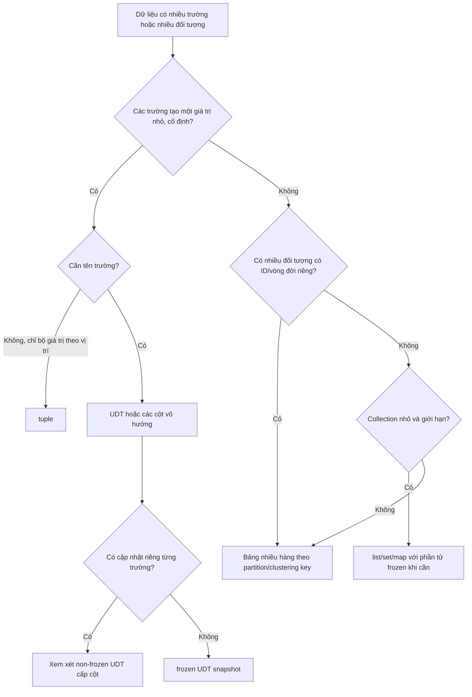

# `tuple`, UDT và mô hình hóa cấu trúc lồng nhau trong Apache Cassandra

> **Chương:** Collection và UDT  
> **Mô-đun:** `DATABASE_ENGINE_WIDE_COLUMN_CASSANDRA` — kiến trúc phân tán và mô hình wide-column của Apache Cassandra. Bài học giải thích cách nhóm dữ liệu có cấu trúc bằng CQL, cách chọn bảng theo truy vấn và các ảnh hưởng đối với khóa phân vùng, consistency, replication, compaction, repair và Java Driver.

## 1. Đặt vấn đề: khi một cột chứa nhiều thông tin có cấu trúc

Một hồ sơ người học có thể có địa chỉ gồm `line1`, `city`, `country` và tọa độ; một kết quả đánh giá có `score`, `grade`; danh sách địa chỉ gần đây có nhiều mục với cấu trúc giống nhau. Nếu biểu diễn mọi thứ bằng một chuỗi JSON, ứng dụng sẽ phải tự kiểm tra kiểu và mất nhiều lợi ích của schema CQL. Nếu tạo một cột cho từng chi tiết, schema dễ dài và khó nhóm các giá trị thuộc cùng một khái niệm.

Cassandra cung cấp hai loại giá trị có cấu trúc:

- **`tuple<T1, T2, ...>`**: nhóm các giá trị theo **vị trí**, với kiểu của từng vị trí được khai báo trước; ví dụ `(95, 'PASS')`. Tuple phù hợp với nhóm nhỏ có ngữ nghĩa vị trí rõ ràng, thường được đọc/ghi như một giá trị.
- **UDT (*user-defined type*)**: nhóm các trường có **tên và kiểu**, chẳng hạn `{city: 'Hà Nội', country: 'VN'}`. UDT giúp biểu diễn một giá trị nghiệp vụ có hình dạng xác định và có thể dùng lại ở nhiều cột/bảng trong keyspace.

Cả tuple lẫn UDT đều **không tạo bảng con**, không tự cho phép truy vấn tìm mọi hàng theo trường lồng nhau, và không thay đổi việc định tuyến dữ liệu bằng **partition key**. Cassandra vẫn ưu tiên **thiết kế bảng theo truy vấn**, kể cả khi dữ liệu trông giống một tài liệu JSON lồng nhau.

### Mục tiêu sau bài học

Sau khi học, bạn có thể đọc/viết tuple và UDT bằng CQL; hiểu khi nào cần `frozen`, khi nào có thể cập nhật một trường UDT; thiết kế một hoặc nhiều lớp dữ liệu lồng nhau vừa phải; nhận biết rủi ro ghi nguyên snapshot từ nhiều writer; và chọn **bảng với partition/clustering key** thay cho collection/UDT quá lớn.

## 2. Chọn tuple, UDT, collection, cột thường hay bảng riêng?

| Cấu trúc | Cách xác định thành phần | Trường hợp phù hợp | Hạn chế chính |
| --- | --- | --- | --- |
| `tuple<int,text>` | Vị trí `0`, `1` | Bộ đôi ngắn như `(score, grade)` | Khó đọc nếu nhiều vị trí; phải thống nhất thứ tự |
| UDT `address` | Tên trường `city`, `country`, ... | Một giá trị nghiệp vụ có schema cố định | Không tự tạo chiều truy vấn mới; thay đổi type phải quản lý schema |
| `list<T>` | Thứ tự và lần xuất hiện | Một số mục có thứ tự, số lượng nhỏ | Không phù hợp lịch sử tăng liên tục; retry append |
| `set<T>` | Thành viên duy nhất | Các tag/chủ đề ít phần tử | Không có thứ tự nghiệp vụ; khó phân trang thành viên |
| `map<K,V>` | Khóa con ánh xạ sang giá trị | Tùy chọn linh hoạt có số key nhỏ | Không biến key con thành primary key |
| Các cột vô hướng | Tên cột độc lập | Trường cố định, thường lọc/cập nhật riêng | Nhiều trường có thể làm schema dài |
| Bảng các hàng riêng | Primary key, clustering key | Danh sách lớn, phân trang, truy vấn ngược, TTL độc lập | Cần thiết kế các bảng đọc theo yêu cầu |

**Quy tắc chọn nhanh:** Nếu các thành phần **có tên mang ý nghĩa nghiệp vụ**, ưu tiên UDT hoặc cột thường. Nếu chúng chỉ là một **bộ giá trị ngắn, có thứ tự vị trí ổn định**, tuple có thể hợp lý. Nếu cấu trúc có **số phần tử tăng không giới hạn** hoặc phải phân trang/truy vấn từng phần tử, hãy dùng bảng riêng.

## 3. `tuple`: một bộ giá trị định kiểu theo vị trí

Một tuple được khai báo trực tiếp trong kiểu cột, không cần `CREATE TYPE`:

```sql
-- Giả định keyspace app đã tồn tại.
USE app;

CREATE TABLE assessment_summary (
    session_id uuid PRIMARY KEY,
    result tuple<int, text>
);

INSERT INTO assessment_summary (session_id, result)
VALUES (
    11111111-1111-4111-8111-111111111111,
    (95, 'PASS')
);

SELECT result
FROM assessment_summary
WHERE session_id = 11111111-1111-4111-8111-111111111111;

-- Thay cả tuple bằng một bộ giá trị mới.
UPDATE assessment_summary
SET result = (87, 'PASS')
WHERE session_id = 11111111-1111-4111-8111-111111111111;
```

`tuple<int,text>` có nghĩa vị trí đầu là `int`, vị trí thứ hai là `text`. Ứng dụng phải thống nhất hợp đồng vị trí: nếu một client hiểu vị trí `0` là `score` nhưng client khác hiểu là `duration`, dữ liệu vẫn có thể đúng kiểu nhưng **sai nghĩa**.

**Tuple trong Cassandra mang ngữ nghĩa `frozen`**: toàn bộ bộ giá trị được quản lý như một giá trị nguyên khối. Không có đường cập nhật CQL “`result[0] = 90`” tương đương một cell độc lập trong tuple; cập nhật bộ kết quả bằng cách **gán lại toàn bộ** tuple.

Nếu nhóm dữ liệu có nhiều trường, cần tên rõ ràng, hoặc sẽ tiến hóa schema thường xuyên, UDT dễ bảo trì hơn tuple. Việc thêm thành phần giữa một tuple đã được nhiều client sử dụng dễ làm thay đổi hợp đồng vị trí; nên cân nhắc version mới hoặc migration có kế hoạch.

## 4. Khai báo UDT và đọc/ghi bằng CQL

Giả sử một địa chỉ có tọa độ. Hãy tạo UDT lớp trong trước, sau đó UDT địa chỉ tham chiếu đến nó:

```sql
-- Tiếp tục trong keyspace app (USE app;).
CREATE TYPE geo_point (
    latitude double,
    longitude double
);

CREATE TYPE mailing_address (
    line1 text,
    city text,
    country text,
    coordinates frozen<geo_point>
);

CREATE TABLE profile_snapshots (
    user_id uuid PRIMARY KEY,
    display_name text,
    home_address frozen<mailing_address>,
    latest_assessment tuple<int, text>
);

INSERT INTO profile_snapshots (
    user_id, display_name, home_address, latest_assessment
) VALUES (
    11111111-1111-4111-8111-111111111111,
    'Nguyen An',
    {
        line1: '12 Duong So 1',
        city: 'Ho Chi Minh City',
        country: 'VN',
        coordinates: {latitude: 10.78, longitude: 106.69}
    },
    (95, 'PASS')
);

SELECT display_name, home_address, latest_assessment
FROM profile_snapshots
WHERE user_id = 11111111-1111-4111-8111-111111111111;
```

Một **UDT literal** dùng dạng `{field_name: value}` với **tên trường** do `CREATE TYPE` quy định. Nó không phải literal `map<text,text>`: trong map, key là một **giá trị dữ liệu** (ví dụ `'theme'`), còn trong UDT, `city` là **tên trường của schema**.

Trường `coordinates frozen<geo_point>` là một **giá trị UDT lồng trong UDT**. Việc khai báo `frozen` rõ ràng cho dữ liệu lồng giúp giới hạn cập nhật ở ranh giới giá trị bên trong; khả năng lồng và sửa từng trường cũng cần đối chiếu với phiên bản Cassandra cụ thể khi triển khai.

### UDT giải quyết vấn đề gì?

UDT giúp thống nhất schema cho `mailing_address`: mỗi hàng cùng sử dụng các trường `line1`, `city`, `country`, `coordinates`, có kiểu rõ ràng. Một thay đổi nghiệp vụ như thêm `postal_code` có thể được quản lý ở **định nghĩa type** thay vì sửa một chuỗi JSON không kiểm soát. Dù vậy, UDT chỉ mô hình hóa **hình dạng một giá trị**; chính primary key và bảng mới quyết định cách truy vấn/phân vùng dữ liệu.

## 5. `frozen` và non-frozen UDT: độ hạt cập nhật

### 5.1. `frozen<mailing_address>`: thay nguyên snapshot

Trong `profile_snapshots`, cột `home_address` được khai báo `frozen<mailing_address>`. Khi cần đổi `city`, client phải gửi **toàn bộ địa chỉ mới**:

```sql
UPDATE profile_snapshots
SET home_address = {
    line1: '12 Duong So 1',
    city: 'Da Nang',
    country: 'VN',
    coordinates: {latitude: 16.05, longitude: 108.20}
}
WHERE user_id = 11111111-1111-4111-8111-111111111111;
```

Với frozen UDT, Cassandra quản lý **cả địa chỉ như một cell**. Cú pháp cập nhật một trường như `SET home_address.city = 'Da Nang'` **không áp dụng** cho cột `frozen`; app cần tạo snapshot đầy đủ sau khi quyết định trạng thái mong muốn. Hai client cùng dựa trên địa chỉ cũ mà ghi lại toàn bộ giá trị có nguy cơ **ghi đè thay đổi của nhau**.

`frozen` không làm dữ liệu bất biến vĩnh viễn: bạn vẫn được **thay nguyên giá trị** hoặc xóa cột, chỉ không cập nhật từng trường độc lập qua CQL.

### 5.2. Non-frozen UDT: cập nhật trường độc lập khi phiên bản hỗ trợ

Các phiên bản Cassandra hiện đại hỗ trợ UDT **không frozen** khi dùng làm cột ở vị trí phù hợp. Với UDT ở cấp cột, Cassandra có thể lưu và cập nhật từng trường:

```sql
CREATE TYPE contact_details (
    email text,
    phone text
);

CREATE TABLE profile_contacts (
    user_id uuid PRIMARY KEY,
    contact contact_details
);

INSERT INTO profile_contacts (user_id, contact)
VALUES (
    11111111-1111-4111-8111-111111111111,
    {email: 'an@example.org', phone: '0900000000'}
);

-- Chỉ cập nhật một trường của UDT không frozen.
UPDATE profile_contacts
SET contact.email = 'an.new@example.org'
WHERE user_id = 11111111-1111-4111-8111-111111111111;
```

Ở đây, thao tác sửa email không yêu cầu client thay `phone`. Tuy nhiên, các ghi cạnh tranh **cùng trường** vẫn cần giải quyết xung đột theo timestamp. Không suy diễn rằng mọi loại UDT có thể cập nhật từng trường ở **mọi vị trí lồng nhau**, đặc biệt trong collection hoặc khi trường/cột được khai báo `frozen`.

| Đặc tính | UDT non-frozen ở cấp cột | `frozen<UDT>` | `tuple<...>` |
| --- | --- | --- | --- |
| Có thể sửa trực tiếp một trường/position? | Có, với trường UDT và cú pháp hỗ trợ | Không, thay toàn giá trị | Không, thay toàn bộ tuple |
| Độ hạt lưu/ghi | Theo trường UDT | Một cell cho UDT | Một giá trị nguyên khối |
| Ghi song song vào hai thành phần khác nhau | Có thể giữ được cả hai thay đổi độc lập | Hai snapshot cùng tranh chấp | Hai tuple cùng tranh chấp |
| Dùng trong collection lồng nhau | Thường cần `frozen` ở vị trí phần tử | Phù hợp khi được hỗ trợ | Tuple đã mang ngữ nghĩa frozen |
| Trường hợp điển hình | Hồ sơ nhỏ, sửa từng thuộc tính | Snapshot địa chỉ/cấu hình nhỏ | Bộ giá trị nhỏ, ngắn, theo vị trí |

Nếu cụm Cassandra đang dùng có hạn chế khác về kiểu dữ liệu/UDT, cần kiểm tra khả năng của **phiên bản đang triển khai** và test DDL/CQL ở môi trường phù hợp. Bài này dùng những khái niệm CQL phổ biến; không mặc định mọi bản phân phối tương thích tuyệt đối.

## 6. Collection chứa UDT và cấu trúc lồng nhau

Một người dùng có thể có **một số địa chỉ** với tên như `home` và `work`, hoặc vài địa điểm vừa ghé. Khi số mục **nhỏ và giới hạn**, có thể kết hợp collection với UDT:

```sql
CREATE TABLE user_locations (
    user_id uuid PRIMARY KEY,
    addresses map<text, frozen<mailing_address>>,
    recent_points list<frozen<geo_point>>
);

INSERT INTO user_locations (user_id, addresses, recent_points)
VALUES (
    11111111-1111-4111-8111-111111111111,
    {
        'home': {
            line1: '12 Duong So 1',
            city: 'Ho Chi Minh City',
            country: 'VN',
            coordinates: {latitude: 10.78, longitude: 106.69}
        },
        'work': {
            line1: '8 Duong So 2',
            city: 'Ho Chi Minh City',
            country: 'VN',
            coordinates: {latitude: 10.80, longitude: 106.68}
        }
    },
    [
        {latitude: 10.78, longitude: 106.69},
        {latitude: 10.80, longitude: 106.68}
    ]
);
```

Trong `map<text, frozen<mailing_address>>`:

- **Map bên ngoài** là collection nhiều cell: mỗi key `'home'` hoặc `'work'` có thể được cập nhật độc lập.
- **UDT bên trong** được `frozen`: giá trị của key `'home'` là **một snapshot địa chỉ**; khi sửa `city`, phải ghi lại **toàn bộ địa chỉ** ở key đó.
- Cả map vẫn là **một cột của một hàng**, không trở thành bảng có thể phân trang từng địa chỉ.

```sql
-- Hợp lệ: thay toàn bộ UDT ở riêng entry 'work'.
UPDATE user_locations
SET addresses['work'] = {
    line1: '8 Duong So 2',
    city: 'Ha Noi',
    country: 'VN',
    coordinates: {latitude: 21.03, longitude: 105.85}
}
WHERE user_id = 11111111-1111-4111-8111-111111111111;
```

**Không thể suy ra** rằng vì `addresses` có thể sửa theo key, ứng dụng sẽ cập nhật được trực tiếp `addresses['work'].city` qua CQL: phần tử map là **frozen UDT**. Tương tự, list `recent_points` có thể được nối thêm một **đối tượng tọa độ hoàn chỉnh**, nhưng không nên dùng nó để lưu lịch sử vị trí không giới hạn.

### Collection lồng collection

Cassandra còn cho phép một số cấu trúc như `map<text, frozen<list<int>>>`: map ngoài có các key riêng, mỗi list trong map là một giá trị frozen. Tuy nhiên, lồng nhiều tầng làm việc cập nhật theo trường con khó hơn và khiến payload lớn. Một mô hình như `map<customer_id, frozen<list<event>>>` thường là dấu hiệu nên chuyển sang **bảng sự kiện riêng** nếu số khách/sự kiện tăng liên tục.

## 7. Vì sao không nên coi UDT như một tài liệu JSON tùy ý?

Hãy so sánh hai yêu cầu:

**Yêu cầu A:** “Với `user_id`, đọc **địa chỉ giao hàng hiện tại** (tối đa một đối tượng).” Một cột `frozen<mailing_address>` là lựa chọn hợp lý: địa chỉ nhỏ, có schema, thường được hiển thị nguyên khối.

**Yêu cầu B:** “Tìm **mọi đơn hàng tại thành phố X** trong tháng này và phân trang theo thời gian.” Đưa `shipping_address.city` vào UDT của bảng theo `order_id` không làm truy vấn đó tự chạy hiệu quả. Cần thiết kế một **bảng đọc theo thành phố và khoảng thời gian/bucket**, hoặc đánh giá index phù hợp đúng workload và phiên bản Cassandra.

Ví dụ bảng phân vùng theo `city` và bucket tháng:

```sql
CREATE TABLE orders_by_city_month (
    city text,
    order_month text,
    ordered_at timeuuid,
    order_id uuid,
    total_amount decimal,
    PRIMARY KEY ((city, order_month), ordered_at, order_id)
) WITH CLUSTERING ORDER BY (ordered_at DESC, order_id ASC);

SELECT ordered_at, order_id, total_amount
FROM orders_by_city_month
WHERE city = 'Da Nang'
  AND order_month = '2026-11'
LIMIT 30;
```

Ở bảng này, `(city, order_month)` là **partition key**, còn `(ordered_at, order_id)` là **clustering key**. Truy vấn đã biết trước phục vụ thiết kế khóa. Nếu một thành phố trong một tháng có quá nhiều đơn, cần chia bucket nhỏ hơn hoặc shard; khi đó ứng dụng phải có kế hoạch đọc qua các bucket liên quan.

Trong ứng dụng thực tế, cùng một đơn hàng có thể tồn tại trong bảng `orders_by_id` và `orders_by_city_month`. Đồng bộ các bảng denormalized, tránh duplicate/lost update và xử lý lỗi ghi là trách nhiệm của kiến trúc ứng dụng; UDT không thay thế quy trình đó.

## 8. Sự khác nhau giữa lồng giá trị và lồng quan hệ

Một **giá trị lồng** là nhóm thuộc tính cùng mô tả một thực thể nhỏ, ví dụ `home_address.coordinates`. Một **quan hệ một-nhiều** là tập các thực thể có danh tính/vòng đời riêng, ví dụ user có hàng triệu đơn hàng. Hai loại này không nên bị gộp thành một chiến lược lưu trữ.



| Dữ liệu | Giá trị lồng / quan hệ | Mô hình gợi ý |
| --- | --- | --- |
| Tọa độ `latitude, longitude` | Giá trị nhỏ gồm hai trường | `tuple<double,double>` khi vị trí thật rõ; UDT khi muốn tên trường |
| Địa chỉ giao hàng hiện tại | Giá trị có tên trường, dùng cùng nhau | `frozen<mailing_address>` hoặc cột thường |
| 3 địa chỉ đặt tên `home/work/...` | Collection nhỏ các giá trị | `map<text,frozen<mailing_address>>` nếu giới hạn rõ |
| Mọi địa chỉ từng sử dụng trong nhiều năm | Các bản ghi có ngày/ID riêng | Bảng lịch sử địa chỉ theo user và thời gian |
| Hàng triệu đơn hàng của người dùng | Quan hệ một-nhiều, cần paging | Bảng đơn hàng với clustering theo thời gian và bucket |
| Danh sách hàng triệu điểm GPS | Chuỗi sự kiện lớn | Bảng theo thiết bị + bucket thời gian, không dùng list UDT vô hạn |

## 9. Schema evolution: thay đổi UDT không giống thay đổi class Java

UDT là **một phần của schema Cassandra**, được khai báo trong keyspace và được driver biết qua metadata. Khi nghiệp vụ cần thêm thuộc tính, có thể mở rộng UDT bằng DDL phù hợp:

```sql
-- Minh họa thêm một trường (giả định type đang tồn tại).
ALTER TYPE mailing_address ADD postal_code text;
```

Sau thay đổi, các giá trị cũ không tự có dữ liệu cho trường mới: ứng dụng phải xử lý trường vắng/`null` theo quy tắc mặc định. Trong quá trình triển khai nhiều phiên bản ứng dụng, client cũ và client mới có thể cùng hoạt động; cần xem xét cách driver ánh xạ UDT và khi nào tất cả node đã nhận schema mới.

### Các quy tắc thực tế

1. **Ưu tiên thay đổi cộng thêm** và tương thích khi có thể. Không tùy ý thay kiểu của trường đang dùng chỉ vì đổi kiểu của một property Java.
2. **Không đổi ý nghĩa của tuple theo vị trí** sau khi dữ liệu và client đã triển khai. Với hợp đồng mới, cân nhắc cột/type mới và migration.
3. **Không đổi tên/xóa trường UDT không kiểm soát**. Khả năng `ALTER TYPE` (thêm, đổi tên, đổi kiểu...) phụ thuộc phiên bản Cassandra và ràng buộc type đang được tham chiếu; hãy thử DDL trên phiên bản đích trước khi rollout.
4. **Quản lý schema agreement** giữa các node. Ứng dụng/driver dùng metadata về UDT cần được cập nhật sau khi schema thay đổi.
5. **Lập kế hoạch backfill** khi dữ liệu cũ cần trường mới bắt buộc về nghiệp vụ. CQL cho phép giá trị thiếu trong một UDT nhưng quy tắc nghiệp vụ có thể đòi điền đầy đủ.

Với type sâu nhiều tầng và được dùng trong nhiều bảng, một sửa đổi nhỏ của UDT có thể ảnh hưởng lớn đến serialization/deserialize của client. Tránh dùng một type chung khổng lồ chỉ để gom mọi thuộc tính của nhiều domain khác nhau.

## 10. Ghi đồng thời: frozen snapshot và lost update

Giả sử hai thiết bị cùng đọc `home_address = {city: 'Da Nang', country: 'VN', ...}`:

- Client A cập nhật `line1` nhưng giữ `city` cũ.
- Client B cập nhật `city` nhưng giữ `line1` cũ.

Nếu cả hai đọc cùng snapshot cũ và ghi nguyên **`frozen<mailing_address>`**, Cassandra sẽ hòa giải **cả cell** dựa trên metadata ghi (timestamp/tie-breaker). Kết quả có thể **chỉ giữ snapshot của một client**, khiến thay đổi của client kia bị mất. Đây là vấn đề **lost update** của read-modify-write, dù hai người muốn sửa hai trường khác nhau.

Với UDT non-frozen cấp cột, sửa `contact.email` và `contact.phone` độc lập thường giảm tranh chấp giữa hai trường khác nhau. Nhưng hai writer sửa **cùng một trường** vẫn cạnh tranh, và nhiều mutation không trở thành một giao dịch ACID đầy đủ chỉ vì cùng nằm trong UDT.

Nếu nghiệp vụ yêu cầu kiểm soát phiên bản, cần thiết kế cơ chế phù hợp như một nguồn sở hữu ghi, revision và **lightweight transaction (LWT)** khi cần điều kiện, hoặc mô hình các trường/thực thể thành hàng riêng. **Consistency level `QUORUM` không tự biến thao tác đọc rồi ghi snapshot thành một transaction có chống lost update**.

Khi dùng LWT, phải xử lý `[applied]`, serial consistency và xung đột/retry theo đúng hợp đồng. LWT có thêm chi phí đồng thuận, nên không mặc định dùng cho mọi cập nhật UDT chỉ để đổi một trường hiếm khi xảy ra tranh chấp.

## 11. TTL, tombstone và tác động đến compaction/repair

Chọn ranh giới `frozen` ảnh hưởng đến độ hạt lưu và vòng đời dữ liệu:

- Với **frozen UDT/tuple**, toàn bộ giá trị là một cell. TTL ghi cho cell áp dụng lên **toàn bộ snapshot**; không thể dùng TTL riêng cho `city` trong cùng một frozen UDT bằng thao tác phần tử.
- Với **non-frozen UDT ở cấp cột**, các trường có thể là các cell riêng. Thao tác cập nhật một trường là mutation ở độ hạt trường; vòng đời metadata/TTL cũng phụ thuộc mutation trên trường được ghi.
- Với **collection chứa frozen UDT**, ví dụ `map<text,frozen<mailing_address>>`, TTL có thể gắn với entry map được cập nhật; bên trong một entry thì toàn UDT là một giá trị frozen.

Khi xóa cột, thay toàn giá trị hoặc một phần tử hết TTL, Cassandra cần quản lý thông tin xóa (**tombstone**) để các replica không đọc ra giá trị cũ còn ở SSTable. Tombstone có thể ảnh hưởng chi phí đọc và compaction, đặc biệt với cấu trúc lồng lớn bị ghi lại thường xuyên.

Quy trình **repair** giúp các replica đồng bộ dữ liệu và dấu xóa. Không giảm tùy tiện `gc_grace_seconds` chỉ để dọn nhanh tombstone: replica bị ngắt quá lâu có thể giữ phiên bản cũ, gây nguy cơ dữ liệu đã xóa xuất hiện lại nếu quá trình dọn tombstone không an toàn. Chiến lược compaction, retention và lịch repair cần đi cùng mô hình dữ liệu thực tế.

## 12. Giới hạn cấu trúc lồng nhau: một UDT không phải kho quan hệ vô hạn

Mô hình này có vấn đề nếu số sự kiện theo người dùng tăng liên tục:

```sql
-- PHẢN VÍ DỤ: không dùng list UDT để chứa hàng triệu sự kiện.
CREATE TYPE activity_info (
    activity_time timestamp,
    activity_name text,
    details text
);

CREATE TABLE activities_bad (
    user_id uuid PRIMARY KEY,
    history list<frozen<activity_info>>
);
```

Một `list` có hàng triệu UDT khiến **một hàng/partition** phình lớn. `SELECT ... LIMIT 10` vẫn có thể trả về **toàn bộ list trong một hàng** vì `LIMIT` giới hạn **hàng kết quả**, không phải mười phần tử bên trong collection. Java Driver paging cũng phân trang **hàng**, không phân trang từng UDT trong cột.

Khi cần lấy hoạt động mới nhất và phân trang, dùng bảng theo thời gian:

```sql
CREATE TABLE activities_by_user_day (
    user_id uuid,
    activity_day date,
    activity_time timeuuid,
    activity_name text,
    details text,
    PRIMARY KEY ((user_id, activity_day), activity_time)
) WITH CLUSTERING ORDER BY (activity_time DESC);

SELECT activity_time, activity_name, details
FROM activities_by_user_day
WHERE user_id = 11111111-1111-4111-8111-111111111111
  AND activity_day = '2026-11-21'
LIMIT 20;
```

Partition `(user_id, activity_day)` giới hạn dữ liệu theo ngày; `activity_time` là clustering key phục vụ thứ tự. Nếu lượng sự kiện/ngày rất lớn, bucket nhỏ hơn hoặc shard có thể cần thiết; đánh đổi là ứng dụng phải fan-out/ghép các truy vấn khi đọc qua nhiều bucket. **Không có ngưỡng cardinality chung** phù hợp với mọi cluster, cần đo theo số byte, tốc độ ghi, tần suất đọc và SLO.

## 13. Java Driver 4.x: tạo `UdtValue` và `TupleValue`

Java Driver 4.x cung cấp các kiểu dữ liệu riêng để encode UDT và tuple, thay vì gửi JSON string. Ví dụ sau giả định session đã cấu hình contact points, local datacenter và authentication phù hợp; các type đã được tạo trong keyspace `app` như các ví dụ trước.

```java
import com.datastax.oss.driver.api.core.CqlIdentifier;
import com.datastax.oss.driver.api.core.CqlSession;
import com.datastax.oss.driver.api.core.cql.PreparedStatement;
import com.datastax.oss.driver.api.core.data.TupleValue;
import com.datastax.oss.driver.api.core.data.UdtValue;
import com.datastax.oss.driver.api.core.type.DataTypes;
import com.datastax.oss.driver.api.core.type.UserDefinedType;
import java.util.UUID;

class ProfileRepository {
    private final CqlSession session;
    private final PreparedStatement update;

    ProfileRepository(CqlSession session) {
        this.session = session;
        this.update = session.prepare(
            "UPDATE app.profile_snapshots SET home_address = ?, " +
            "latest_assessment = ? WHERE user_id = ?"
        );
    }

    void save(UUID userId) {
        // Type UDT lấy từ schema metadata của keyspace.
        var keyspace = session.getMetadata()
            .getKeyspace(CqlIdentifier.fromCql("app"))
            .orElseThrow();
        UserDefinedType geoType = keyspace
            .getUserDefinedType(CqlIdentifier.fromCql("geo_point"))
            .orElseThrow();
        UserDefinedType addressType = keyspace
            .getUserDefinedType(CqlIdentifier.fromCql("mailing_address"))
            .orElseThrow();

        UdtValue geo = geoType.newValue()
            .setDouble("latitude", 10.78)
            .setDouble("longitude", 106.69);

        UdtValue address = addressType.newValue()
            .setString("line1", "12 Duong So 1")
            .setString("city", "Ho Chi Minh City")
            .setString("country", "VN")
            .setUdtValue("coordinates", geo);

        TupleValue assessment = DataTypes
            .tupleOf(DataTypes.INT, DataTypes.TEXT)
            .newValue()
            .setInt(0, 95)
            .setString(1, "PASS");

        // Cả frozen UDT và tuple được gửi như các giá trị hoàn chỉnh.
        session.execute(update.bind(address, assessment, userId));
    }
}
```

Khi đọc dữ liệu, `Row.getUdtValue("home_address")` trả về UDT value (hoặc `null` nếu cột không có giá trị) và `Row.getTupleValue("latest_assessment")` trả về tuple value; ứng dụng có thể truy cập trường bằng tên đối với UDT và chỉ số đối với tuple. Những giá trị này cần được ánh xạ sang domain object/DTO theo hợp đồng rõ ràng.

**Lưu ý vận hành:**

- Tạo và **tái sử dụng prepared statements**, quản lý `CqlSession` theo vòng đời ứng dụng, tránh lặp lại `prepare` mỗi request.
- Metadata UDT phụ thuộc keyspace và schema đang được cluster công bố. Sau `ALTER TYPE`, hãy kiểm tra sự đồng thuận schema và khả năng driver thấy metadata mới.
- `.setUdtValue("coordinates", geo)` truyền đúng kiểu `geo_point` đã khai báo; không dùng `Map<String,Object>` tùy ý để thay UDT mà chưa có codec/kiểu rõ ràng.
- Trước retry ghi snapshot frozen, đánh giá **timestamp và ghi đồng thời**. Việc gửi lại một snapshot cũ sau khi client khác cập nhật có thể ghi đè dữ liệu hợp lệ trong một số tình huống.

## 14. Các lỗi mô hình hóa thường gặp

| Dấu hiệu | Vấn đề | Lựa chọn phù hợp hơn |
| --- | --- | --- |
| Tuple 10–15 vị trí không có tài liệu vị trí | Client dễ đảo nhầm thứ tự/ý nghĩa | UDT với tên trường rõ ràng |
| Mọi trường profile đều nhét trong một frozen UDT lớn | Đổi một trường cần thay cả snapshot | Cột thường hoặc UDT non-frozen ở cấp cột |
| `map<text,frozen<UDT>>` có hàng triệu entry | Một hàng/partition rất lớn, khó paging | Bảng nhiều hàng theo khóa truy vấn |
| Dựa vào `address.city` trong UDT để lọc mọi user | UDT không tự tạo partition/index phục vụ truy vấn | Bảng đọc theo city/bucket hoặc index đã đánh giá |
| Hai client đọc UDT frozen rồi ghi nguyên giá trị | Nguy cơ lost update | Điều phối writer, revision/LWT hoặc mô hình cập nhật phù hợp |
| Ghi `tuple`/UDT với schema tiến hóa không kế hoạch | Client cũ/mới hiểu khác nhau | Versioning và migration, schema agreement |
| Đặt TTL cho toàn frozen UDT trong khi chỉ một trường được phép hết hạn | Mất cả snapshot khi TTL hết hạn | Tách cột hoặc hàng có vòng đời độc lập |

Các rủi ro trên cũng liên quan đến replication, mức nhất quán và quy trình xử lý lỗi. Không có một cấu hình `QUORUM`, repair hoặc compaction nào làm cho cấu trúc dữ liệu chọn sai đường truy vấn trở nên tự động hiệu quả.

## 15. Bài tập tình huống

**Bài 1 — tuple hay UDT?** Ứng dụng lưu kết quả đo gồm `temperature`, `humidity`, `sampled_at`, tất cả đều cần tên rõ và có thể thêm trường sau này. Bạn chọn `tuple` hay UDT?  
**Gợi ý:** UDT có tên trường giúp hợp đồng dữ liệu rõ ràng và dễ phát triển hơn; tuple hợp với bộ rất nhỏ có ý nghĩa vị trí bất biến.

**Bài 2 — nested frozen:** Cột `addresses map<text, frozen<mailing_address>>` có key `'work'`. Muốn đổi `city` của địa chỉ `'work'` mà giữ `'home'`, thao tác cần làm là gì?  
**Gợi ý:** Gán lại **toàn UDT** tại `addresses['work']`; map ngoài cập nhật theo key nên entry `'home'` không bị ghi đè bởi mutation này.

**Bài 3 — concurrency:** Hai client cùng đọc `home_address` frozen, một sửa `line1`, một sửa `city`, rồi cả hai ghi toàn địa chỉ. Liệu Cassandra tự gộp hai trường mới không?  
**Gợi ý:** Không. Các snapshot cạnh tranh trên cell của cả UDT; cần cơ chế tránh lost update nếu nghiệp vụ yêu cầu giữ cả hai thay đổi.

**Bài 4 — danh sách vô hạn:** Mỗi user có hàng triệu tọa độ GPS theo thời gian và cần phân trang. Có nên dùng `list<frozen<geo_point>>` không?  
**Gợi ý:** Không. Dùng bảng vị trí với khóa phân vùng theo thiết bị/user + bucket thời gian và clustering theo thời điểm; giới hạn kích thước partition.

**Bài 5 — truy vấn theo city:** Hệ thống lưu địa chỉ frozen trong bảng `profile_snapshots` theo `user_id`, nhưng nay cần liệt kê tất cả đơn theo `city` mỗi tháng. Có cần thay UDT không?  
**Gợi ý:** Vấn đề chính là **chiều truy vấn**. Cần bảng đọc được phân vùng theo thành phố và thời gian/bucket (hoặc giải pháp index thích hợp), không chỉ đổi kiểu UDT.

**Bài 6 — thay schema:** Thêm `postal_code` vào UDT. Dữ liệu cũ và Java Driver có tự điền mã bưu chính không?  
**Gợi ý:** Không. Trường mới của giá trị cũ không có dữ liệu nếu chưa backfill; ứng dụng phải xử lý mặc định và kiểm tra metadata/schema agreement trong quá trình rollout.

## 16. Checklist trước khi chọn kiểu lồng nhau

1. **Truy vấn từ đâu?** Có luôn biết primary key của hàng không, hay cần tìm theo thuộc tính bên trong UDT?
2. **Cấu trúc có ý nghĩa vị trí hay tên trường?** Vị trí thật sự bất biến (`tuple`) hay tên trường rõ ràng và có tiến hóa (`UDT`)?
3. **Độ hạt cập nhật?** Luôn thay nguyên snapshot (`frozen`) hay cần sửa một trường (`non-frozen UDT` cấp cột)?
4. **Có nhiều writer không?** Ghi cùng field/snapshot có nguy cơ xung đột? Có cần revision, LWT hay điều phối phiên chỉnh sửa?
5. **Số phần tử lồng có giới hạn?** Một collection chỉ có ít UDT hay sẽ tăng theo từng sự kiện/ngày?
6. **TTL và lifecycle?** Toàn cấu trúc có cùng thời hạn lưu hay mỗi mục có TTL/xóa/lịch sử độc lập?
7. **Schema có phát triển không?** Ai quản lý `ALTER TYPE`, backfill, codec Java, schema agreement và tương thích client?
8. **Chi phí vận hành?** Có quan trắc row/partition size, tombstone, compaction, repair, latency và retry theo workload thật?

## 17. Ghi nhớ

- **`tuple<T...>`** là bộ giá trị **theo vị trí**, có ngữ nghĩa frozen; dùng cho nhóm nhỏ với hợp đồng thứ tự ổn định.
- **UDT** có **tên trường và kiểu dữ liệu**, dùng cho giá trị nghiệp vụ có schema; nó không tự cung cấp chiều truy vấn hoặc quan hệ nhiều hàng.
- **`frozen<UDT>`** được cập nhật như **một cell/snapshot**; **UDT non-frozen ở cấp cột** có thể cho phép sửa từng trường khi phiên bản CQL hỗ trợ.
- **Collection chứa UDT** thường cần `frozen` tại vị trí phần tử lồng; ví dụ `map<text,frozen<mailing_address>>` cập nhật riêng **entry map** nhưng phải thay cả UDT của entry đó.
- **UDT/tuple/collection lồng nhau chỉ phù hợp với dữ liệu nhỏ, có giới hạn**. Truy vấn ngược, sự kiện vô hạn, phân trang hay lifecycle riêng cần **bảng theo partition/clustering key**.
- Cần tính đến **ghi đồng thời, lost update, TTL/tombstone, compaction, repair, replication và consistency level**, đồng thời quản lý **schema evolution** cùng Java Driver.
