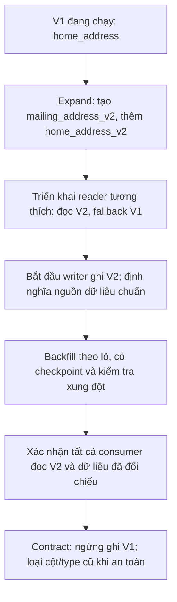

# `CREATE TYPE`, `ALTER TYPE` và khả năng tiến hóa schema trong Apache Cassandra

> **Chương:** Collection và UDT  
> **Mô-đun:** `DATABASE_ENGINE_WIDE_COLUMN_CASSANDRA` — tìm hiểu mô hình wide-column phân tán, partition key, thiết kế bảng theo truy vấn, consistency, replication, compaction, repair, xử lý lỗi và Java Driver. Bài này tập trung vào **vòng đời schema của user-defined type (UDT)**.

## 1. Vì sao tiến hóa UDT khó hơn thêm một field trong Java?

Giả sử dịch vụ người dùng lưu địa chỉ trong một UDT gồm `street`, `city`, `country_code`. Sau vài tháng, sản phẩm cần thêm `postal_code`, rồi chuẩn hóa `city` thành một mã địa giới. Ở Java, việc thêm một property vào DTO tương đối đơn giản. Trong Cassandra, UDT là **kiểu dữ liệu thuộc schema của keyspace**, được nhiều bảng/cột và nhiều phiên bản ứng dụng cùng tham chiếu.

Cần trả lời ít nhất năm câu hỏi trước khi thay đổi:

1. **Có thể sửa schema bằng `ALTER TYPE` không**, hay cần type/cột/bảng mới?
2. **Dữ liệu đã lưu** sẽ được đọc như thế nào sau khi thêm field?
3. **Client cũ** có tiếp tục đọc/ghi được khi node và ứng dụng đang rolling deploy không?
4. UDT được lưu dưới dạng **`frozen` hay non-frozen**; thao tác thay một field có thể làm mất cập nhật của người khác không?
5. Thay đổi đó có tác động gì đến **metadata của Java Driver, schema agreement, backfill, TTL, tombstone, compaction và repair**?

**Nguyên tắc chính:** DDL thành công chỉ xác nhận schema đã được thay đổi theo cơ chế Cassandra; nó **không tự backfill dữ liệu cũ, không bảo đảm mọi client đã cập nhật metadata và không thay thế kế hoạch migration**.

## 2. UDT là kiểu dữ liệu có tên, nằm trong keyspace

UDT (*user-defined type*) gom các trường có **tên và kiểu CQL**, ví dụ `street text`, `city text`. Khác với `tuple<text,text>` (truy cập theo vị trí), UDT diễn tả hợp đồng dữ liệu qua tên trường. Khác với `map<text,text>` (số khóa linh hoạt), tập trường UDT được xác định trước trong schema.

| Kiểu dữ liệu | Hợp đồng cấu trúc | Điển hình | Cách tiến hóa |
| --- | --- | --- | --- |
| `tuple<int,text>` | Kiểu theo **vị trí** | Bộ `(score, grade)` nhỏ | Khó đổi hợp đồng vị trí; thường dùng cột/type mới khi thay lớn |
| `map<text,text>` | Khóa động, cùng kiểu giá trị | Một số cài đặt tùy chọn | Không cần DDL cho từng khóa; phải giới hạn kích thước |
| UDT `mailing_address` | **Tên trường và kiểu** trong keyspace | Địa chỉ có schema rõ ràng | `ALTER TYPE` cho các thay đổi được hỗ trợ; thay đổi lớn cần migration |
| Bảng hàng riêng | Primary key/clustering key | Lịch sử địa chỉ, hàng triệu thực thể | Thiết kế schema theo đường đọc, phân trang và lifecycle |

Một UDT **không tự tạo partition hoặc bảng con**. Nếu cột chứa `frozen<mailing_address>` trong hàng có `PRIMARY KEY (user_id)`, Cassandra vẫn phân bố dữ liệu theo `user_id`. Việc bổ sung trường `city` trong UDT không cho phép lọc hiệu quả mọi người dùng ở thành phố đó nếu schema truy vấn chưa được thiết kế phù hợp.

## 3. `CREATE TYPE`: tạo UDT trước khi tạo bảng tham chiếu

Giả sử keyspace `app` đã tồn tại và có replication phù hợp với môi trường. Trong `cqlsh`, có thể chuyển vào keyspace rồi tạo type:

```sql
USE app;

CREATE TYPE geo_point (
    latitude double,
    longitude double
);

CREATE TYPE mailing_address (
    street text,
    city text,
    country_code text,
    location frozen<geo_point>
);

CREATE TABLE user_address_snapshots (
    user_id uuid PRIMARY KEY,
    display_name text,
    home_address frozen<mailing_address>,
    address_revision int
);
```

**Thứ tự phụ thuộc:** `geo_point` phải tồn tại trước khi `mailing_address` tham chiếu đến nó; `mailing_address` phải tồn tại trước khi bảng dùng type đó. `location frozen<geo_point>` là một UDT được lồng vào một UDT khác với ranh giới giá trị nguyên khối.

Trong lệnh `CREATE TYPE`, mỗi trường có **tên duy nhất** và kiểu CQL hợp lệ. Không coi type như class Java có inheritance, method hoặc constructor: UDT chỉ định nghĩa **hình dạng dữ liệu được Cassandra mã hóa/lưu trữ**.

### `IF NOT EXISTS` hữu ích nhưng không kiểm chứng đúng phiên bản type

```sql
CREATE TYPE IF NOT EXISTS address_label (
    label text,
    description text
);
```

Nếu type đã tồn tại, `IF NOT EXISTS` giúp tránh lỗi “đã có type”. Tuy nhiên, nó **không so sánh từng field** để xác nhận type hiện hữu giống kỳ vọng của bản migration. Một cluster có `address_label` với schema khác vẫn có thể bỏ qua việc tạo. Vì vậy:

- Dùng `IF NOT EXISTS` khi phù hợp với **khởi tạo có thể chạy lại**, không xem nó như cơ chế đối chiếu schema.
- Theo dõi **migration version và schema thực tế** ở quy trình triển khai.
- Không chạy nhiều luồng DDL không điều phối từ từng instance ứng dụng khi scale-out.

## 4. Ghi và đọc một giá trị UDT

UDT literal dùng cú pháp `{field_name: value}`. Tên trường thuộc schema, không phải key động của map:

```sql
INSERT INTO user_address_snapshots (
    user_id, display_name, home_address, address_revision
) VALUES (
    11111111-1111-4111-8111-111111111111,
    'Nguyen An',
    {
        street: '12 Duong So 1',
        city: 'Ho Chi Minh City',
        country_code: 'VN',
        location: {latitude: 10.78, longitude: 106.69}
    },
    1
);

SELECT home_address, address_revision
FROM user_address_snapshots
WHERE user_id = 11111111-1111-4111-8111-111111111111;
```

Tên trường trong literal **không đặt trong nháy đơn như key của `map<text,text>`**. Nếu không cung cấp một trường hợp lệ khi ghi UDT, trường đó có thể được diễn giải là **không có giá trị (`null`)**, tùy thao tác và độ hạt ghi. UDT không tự áp các constraint nghiệp vụ như “`country_code` bắt buộc có đúng hai ký tự”; những ràng buộc như vậy thuộc kiểm tra của ứng dụng và quy trình migration.

### `frozen` và non-frozen quyết định đơn vị cập nhật

- `frozen<mailing_address>` lưu cả địa chỉ thành **một cell**. Muốn đổi `street`, ứng dụng phải gửi **giá trị địa chỉ hoàn chỉnh**.
- UDT **non-frozen** ở cấp cột (khi phiên bản Cassandra hỗ trợ) có thể lưu/cập nhật từng field riêng biệt bằng cú pháp `SET contact.email = ...`.
- UDT dùng làm phần tử của collection hoặc lồng trong kiểu phức hợp thường cần **`frozen` ở ranh giới lồng**; không suy luận rằng có thể cập nhật mọi field xuyên nhiều tầng.

Chi tiết này đặc biệt quan trọng khi rolling deploy: một client cũ ghi lại cả frozen UDT có thể vô tình **bỏ mất trường vừa được client mới cập nhật**, nếu nó ghi từ snapshot cũ mà không biết trường mới.

## 5. `ALTER TYPE ... ADD`: mở rộng type bằng trường mới

Yêu cầu mới là thêm `postal_code` dạng `text` vào `mailing_address`:

```sql
USE app;

ALTER TYPE mailing_address ADD postal_code text;

-- Lệnh này chạy trong cqlsh; không phải câu SELECT/CQL của Java Driver.
DESCRIBE TYPE mailing_address;
```

Lệnh `ADD` là hướng thay đổi có thể **ít phá vỡ tương thích hơn** vì các tên trường cũ vẫn còn và giữ nguyên ý nghĩa. Đối với giá trị đã được lưu trước khi schema có `postal_code`, khi đọc bằng schema mới, trường mới **không tự có dữ liệu**: ứng dụng phải xử lý `null` hoặc dùng một giá trị mặc định **ở tầng nghiệp vụ**.

Ví dụ quy tắc sau migration:

```text
Giá trị trước migration:
{street:'12 Duong So 1', city:'Ho Chi Minh City', country_code:'VN', location:{...}}

Schema sau ALTER TYPE:
{street:text, city:text, country_code:text, location:geo_point, postal_code:text}

Khi đọc bản ghi cũ:
postal_code = null   (chưa được backfill)
```

**`ALTER TYPE ADD` không phải một job duyệt và ghi lại tất cả các row.** Do đó, không dự kiến dữ liệu cũ được tự điền postal code chỉ vì CQL DDL chạy thành công. Backfill là một công việc riêng, cần tính đến tải đọc/ghi, đồng thời và chính sách retry.

### Một field mới phải có ngữ nghĩa rõ ràng

Trước khi chọn type, xác định: `postal_code` được phép thiếu hay bắt buộc? Ứng dụng cũ hiểu việc thiếu field như thế nào? Nên lưu `text` để giữ số 0 đầu và hỗ trợ mã gồm chữ/số, thay vì vội dùng `int`.

Nếu thêm trường dạng `list`, `map`, hoặc UDT lồng, vẫn phải nghĩ tới **kích thước collection**, **frozen/non-frozen**, TTL và cách cập nhật. Không dùng một field UDT mới để âm thầm chứa lịch sử vô hạn trong một hàng.

## 6. Có thể `RENAME`, `DROP` hoặc đổi kiểu trường UDT tùy ý không?

**Không.** Khả năng của `ALTER TYPE` khác nhau giữa các phiên bản Cassandra/bản phân phối; các thao tác được phép và hạn chế khi type đang được tham chiếu phải được kiểm tra trên **phiên bản đích**. Không nên dùng cách nghĩ “đổi tên property trong Java thì đổi tên cột/UDT là xong”.

| Thay đổi mong muốn | Đánh giá an toàn | Chiến lược ưu tiên |
| --- | --- | --- |
| Thêm trường tùy chọn ở cuối type | Thường là đường mở rộng dễ nhất | `ALTER TYPE ... ADD`, cho phép `null`, rollout tương thích |
| Đổi tên trường UDT | Có hạn chế/syntax phụ thuộc phiên bản và chỗ type được sử dụng | Ưu tiên trường mới + chuyển dữ liệu nếu cần tương thích client cũ |
| Thay `text` thành `int` hoặc kiểu không tương thích | Không giả định hỗ trợ đổi trực tiếp | Type/cột mới và chuyển đổi dữ liệu có kiểm tra |
| Xóa một trường đang tồn tại | Không giả định có `DROP field` an toàn | Ngừng sử dụng, giữ schema cũ tạm thời, rồi migrate type nếu cần |
| Đổi thứ tự các field | Có thể phá hợp đồng mã hóa và client | Tạo type/version mới |
| Xóa toàn bộ UDT | Không được nếu còn bảng/type tham chiếu | Loại các tham chiếu theo migration có kiểm soát trước |

**Ví dụ lệnh không nên tự áp dụng:**

```text
ALTER TYPE mailing_address DROP city;
ALTER TYPE mailing_address ALTER postal_code TYPE int;
```

Hai dòng trên chỉ mô tả **ý định thay đổi gây rủi ro**, không phải công thức CQL có thể chạy trên mọi phiên bản. Nếu không chắc phiên bản Cassandra hỗ trợ gì, không thử thao tác phá hủy trên hệ thống sản xuất. Các hạn chế tồn tại để giữ khả năng đọc dữ liệu đã mã hóa và sự tương thích giữa các consumer của UDT.

### Về thứ tự field

Khác với việc đọc field UDT trong Java bằng tên, việc mã hóa UDT trong giao thức/lưu trữ phụ thuộc **schema các field và thứ tự khai báo**. Không tái sử dụng một tên type cho cấu trúc field đã bị sắp xếp lại một cách tùy tiện. Khi cần hợp đồng mới khác căn bản, hãy chọn type có tên mới, ví dụ `mailing_address_v2`, thay vì “sửa mọi thứ tại chỗ”.

## 7. Dùng type phiên bản mới khi thay đổi không còn tương thích

Giả sử doanh nghiệp muốn thay `city` dạng tên tự do thành `city_code` chuẩn hóa, đồng thời lưu cả `district_code`. Thay vì cố đổi kiểu/ý nghĩa field cũ, tạo UDT mới:

```sql
USE app;

CREATE TYPE mailing_address_v2 (
    street text,
    city_code text,
    district_code text,
    country_code text,
    postal_code text,
    location frozen<geo_point>
);

ALTER TABLE user_address_snapshots
ADD home_address_v2 frozen<mailing_address_v2>;
```

Với hai cột cùng tồn tại, có thể triển khai quá trình **expand → migrate/backfill → contract**:



Không bắt buộc phải giữ hai cột mãi mãi. Mục đích của giai đoạn **hai schema cùng tồn tại** là tránh một thời điểm mà ứng dụng cũ không hiểu dữ liệu mới hoặc ứng dụng mới không còn truy cập được dữ liệu cũ. Thứ tự rollout cụ thể phụ thuộc việc có thể dual-write không, source of truth ở đâu, và thời gian tồn tại của client cũ.

### Khi nào cần tạo bảng mới thay vì chỉ thêm cột?

Nếu thay đổi không chỉ là hình dạng địa chỉ mà còn là **đường truy vấn**, ví dụ cần “tìm các đơn hàng theo `city_code` trong một tháng”, `ALTER TYPE` không tạo chiều truy vấn đó. Phải thiết kế **bảng đọc theo `city_code` và bucket thời gian**, hoặc đánh giá index thích hợp với workload. UDT là **giá trị**, không phải cơ chế tự động xây dựng partition/clustering key từ các field bên trong.

## 8. `frozen` khiến backfill và ghi đồng thời cần được điều phối

Với cột `home_address frozen<mailing_address>`, muốn điền `postal_code` sau `ALTER TYPE ADD`, phải cung cấp **toàn giá trị UDT mới**. Ví dụ sau giả định bản ghi đã được đọc/xác minh và `address_revision` hiện là `1`:

```sql
UPDATE user_address_snapshots
SET home_address = {
        street: '12 Duong So 1',
        city: 'Ho Chi Minh City',
        country_code: 'VN',
        location: {latitude: 10.78, longitude: 106.69},
        postal_code: '700000'
    },
    address_revision = 2
WHERE user_id = 11111111-1111-4111-8111-111111111111
IF address_revision = 1;
```

Đây là **lightweight transaction (LWT)** có điều kiện trên **hàng**. Client phải kiểm tra cột `[applied]`. Nếu một writer khác đã đổi revision, backfill không nên ép ghi snapshot cũ và ghi đè dữ liệu mới; thay vào đó, cần đọc lại và áp chính sách xung đột.

Điểm quan trọng: **CAS theo `address_revision` chỉ bảo vệ đầy đủ khi mọi writer cập nhật địa chỉ đều tuân thủ cùng quy trình versioning**. Một writer bỏ qua revision và `UPDATE home_address = ...` không điều kiện có thể phá bảo đảm ở tầng nghiệp vụ.

`QUORUM` đọc/ghi thông thường **không thay thế** việc kiểm tra version trong chuỗi “đọc → sửa DTO → ghi lại frozen UDT”. Consistency level điều chỉnh mức xác nhận giữa replica; nó không tự biến snapshot cũ thành dữ liệu mới hợp nhất nhiều writer. LWT có chi phí đồng thuận/Paxos và serial consistency, nên chỉ dùng khi điều kiện là một yêu cầu thực sự.

### Một phương án giảm phạm vi ghi: UDT non-frozen ở cấp cột

Nếu schema có UDT không frozen ở cấp cột và phiên bản đang dùng hỗ trợ cập nhật field, ứng dụng có thể ghi đúng phần cần đổi. Ví dụ tự chứa sau tạo **type trước bảng**, rồi mở rộng type và cập nhật một trường:

```sql
CREATE TYPE contact_info (
    email text,
    phone text
);

CREATE TABLE user_contacts (
    user_id uuid PRIMARY KEY,
    contact contact_info
);

ALTER TYPE contact_info ADD preferred_channel text;

UPDATE user_contacts
SET contact.preferred_channel = 'email'
WHERE user_id = 11111111-1111-4111-8111-111111111111;
```

Ở non-frozen UDT, mutation theo field giúp không phải đọc và ghi lại mọi field cũ chỉ để cập nhật `preferred_channel`. Đây vẫn là thao tác ghi phân tán: cần xem xét timestamp, TTL, tranh chấp trên cùng field và đặc tính phiên bản Cassandra. **Đừng tự động chuyển một UDT frozen đang có dữ liệu sang non-frozen bằng `ALTER TABLE` mà chưa xác minh khả năng migration.**

## 9. Quy trình rollout an toàn: expand, tương thích, backfill, contract

Một kế hoạch triển khai UDT thực tế thường cần nhiều bước hơn một file CQL:

| Giai đoạn | Công việc | Điều kiện để đi tiếp |
| --- | --- | --- |
| **Khảo sát** | Kiểm kê bảng/type tham chiếu, các Java service, job, consumer và yêu cầu truy vấn | Có danh sách reader/writer, phiên bản Cassandra và lộ trình tương thích |
| **Expand schema** | `ALTER TYPE ADD` hoặc tạo `type_v2` + cột mới | DDL thành công, schema agreement/metadata ổn định |
| **Expand reader** | Cho phép field mới `null`; với V2, đọc V2 và fallback V1 khi cần | Client cũ và mới cùng đọc được dữ liệu hiện hữu |
| **Chuyển writer** | Writer mới cung cấp trường mới; xác định nguồn ghi chuẩn và versioning | Không có writer cũ âm thầm ghi đè trường mới |
| **Backfill** | Quét theo cách có kiểm soát, cập nhật theo lô, checkpoint và retry an toàn | Dữ liệu được đối chiếu; không phát sinh lost update |
| **Quan trắc** | So sánh latency, lỗi decode, timeout, tombstone/compaction và độ lệch dữ liệu | SLO chấp nhận được và có đường rollback |
| **Contract** | Ngừng dùng cột/type cũ; chỉ xóa khi không còn tham chiếu và đã dự phòng | Tất cả consumer đã chuyển, có kế hoạch phục hồi |

Không áp dụng `DROP TYPE` ngay sau khi tạo V2. UDT cũ có thể vẫn được tham chiếu bởi bảng khác, type lồng khác, bản ghi cũ, dữ liệu xuất/nhập hoặc code client. `DROP TYPE IF EXISTS` chỉ giảm lỗi khi object không có, **không biến việc xóa một type đang được sử dụng thành an toàn**.

### Cách backfill tránh quá tải cluster

- Chia công việc thành **đợt nhỏ**, dùng tốc độ ghi có giới hạn và checkpoint để có thể tiếp tục khi job thất bại.
- Không dựa vào một `SELECT *` toàn cluster với `ALLOW FILTERING` để đọc hàng triệu hàng mà không có kế hoạch scan. Dùng danh sách khóa nghiệp vụ hoặc cơ chế quét token ranges phù hợp với quy mô dữ liệu.
- Xác định **idempotence** của từng mutation. Ghi lại cùng một snapshot khác với nối list hoặc tạo event ID mới; CAS thất bại cần đọc lại chứ không tự ép retry vô hạn.
- Theo dõi **replica latency, p95/p99, số timeout, disk I/O, compaction backlog** khi backfill. Nếu dữ liệu phân vùng lệch, job scan còn có thể làm nóng các partition vốn đã lớn.
- Đối chiếu số lượng bản ghi và các trường quan trọng giữa V1/V2; không đánh giá thành công chỉ bằng số request báo HTTP/CQL 200.

## 10. Schema agreement: DDL phải đến mọi node trước khi client sử dụng

Cassandra quản lý schema theo cơ chế phân tán. Khi `CREATE TYPE` hoặc `ALTER TYPE` được thực thi, thông tin schema cần được truyền đến các node; có thể có khoảng thời gian **schema chưa thống nhất**. Client gửi dữ liệu với cấu trúc mới trước khi các node/driver nắm schema có thể gặp lỗi chuẩn bị query, không tìm thấy field hoặc lỗi serialization.

Trong `cqlsh`, có thể kiểm tra type đang công bố:

```sql
DESCRIBE TYPE app.mailing_address;

-- Truy vấn metadata schema (trong các phiên bản có system_schema.types).
SELECT keyspace_name, type_name, field_names, field_types
FROM system_schema.types
WHERE keyspace_name = 'app';
```

`DESCRIBE TYPE` là **lệnh tiện ích của `cqlsh`**, không phải CQL có thể gửi nguyên văn từ prepared statement trong Java. Thông tin `system_schema` và cách kiểm tra schema agreement cần đối chiếu theo bản Cassandra/bản phân phối đang dùng; chỉ thấy schema đúng từ **một** coordinator chưa đủ chứng minh mọi node đã hội tụ.

Checklist vận hành sau DDL:

1. Chỉ có **một quy trình migration được điều phối** chạy DDL; hạn chế DDL cạnh tranh trong lúc rolling deploy.
2. Xác minh **schema agreement** và absence của lỗi schema từ các node liên quan trước khi bật tính năng ghi field mới.
3. Bảo đảm Java Driver đã **refresh schema metadata** và prepared statements/codec dùng đúng định nghĩa type; nếu cần, kiểm tra cơ chế refresh metadata theo phiên bản driver.
4. Không dùng `IF NOT EXISTS` như tín hiệu rằng field đã được thêm thành công hoặc type có đúng các field kỳ vọng.
5. Có kế hoạch tạm ngừng rollout và rollback ở **tầng ứng dụng** khi phát hiện schema drift; rollback DDL phá hủy có thể không đơn giản.

## 11. Java Driver 4.x: ánh xạ UDT trước và sau khi thêm field

Java Driver 4.x sử dụng `UserDefinedType` và `UdtValue` cho dữ liệu UDT. Ví dụ bên dưới giả định `ALTER TYPE mailing_address ADD postal_code text` đã chạy, schema agreement đã xác nhận, và session có metadata cập nhật:

```java
import com.datastax.oss.driver.api.core.CqlIdentifier;
import com.datastax.oss.driver.api.core.CqlSession;
import com.datastax.oss.driver.api.core.cql.PreparedStatement;
import com.datastax.oss.driver.api.core.cql.Row;
import com.datastax.oss.driver.api.core.data.UdtValue;
import com.datastax.oss.driver.api.core.type.UserDefinedType;
import java.util.UUID;

class AddressRepository {
    private final CqlSession session;
    private final PreparedStatement read;
    private final PreparedStatement write;

    AddressRepository(CqlSession session) {
        this.session = session;
        this.read = session.prepare(
            "SELECT home_address FROM app.user_address_snapshots " +
            "WHERE user_id = ?"
        );
        this.write = session.prepare(
            "UPDATE app.user_address_snapshots " +
            "SET home_address = ? WHERE user_id = ?"
        );
    }

    void saveAddress(UUID userId, String postalCode) {
        var keyspace = session.getMetadata()
            .getKeyspace(CqlIdentifier.fromCql("app"))
            .orElseThrow();

        UserDefinedType addressType = keyspace
            .getUserDefinedType(CqlIdentifier.fromCql("mailing_address"))
            .orElseThrow();
        UserDefinedType geoType = keyspace
            .getUserDefinedType(CqlIdentifier.fromCql("geo_point"))
            .orElseThrow();

        UdtValue geo = geoType.newValue()
            .setDouble("latitude", 10.78)
            .setDouble("longitude", 106.69);

        UdtValue address = addressType.newValue()
            .setString("street", "12 Duong So 1")
            .setString("city", "Ho Chi Minh City")
            .setString("country_code", "VN")
            .setUdtValue("location", geo)
            .setString("postal_code", postalCode);

        // Cột frozen: ghi toàn snapshot, không phải patch một field.
        session.execute(write.bind(address, userId));
    }

    String readPostalCode(UUID userId) {
        Row row = session.execute(read.bind(userId)).one();
        if (row == null) return null;  // Không có hàng.

        UdtValue address = row.getUdtValue("home_address");
        if (address == null) return null;  // Hàng có nhưng cột null.

        // Giá trị cũ chưa backfill có thể trả về null.
        return address.getString("postal_code");
    }
}
```

Đây là ví dụ **ghi một giá trị hoàn chỉnh** để minh họa serialization, không phải cách an toàn để cập nhật *chỉ* postal code trên snapshot đang bị nhiều writer sửa. Trong nghiệp vụ thật, không nên dựng UDT mới từ các hằng số cũ rồi ghi đè toàn bộ địa chỉ. Muốn patch trên `frozen`, cần đọc/đối chiếu trạng thái hiện tại, xác định nguồn dữ liệu chuẩn và có cơ chế version/CAS hoặc điều phối writer khi cần chống lost update.

### Tương thích dữ liệu cũ và client cũ

- **Giá trị UDT cũ:** field mới có thể đọc thành `null`; method Java cần xử lý thiếu dữ liệu thay vì ném lỗi hoặc giả định luôn có string.
- **Client mới nhưng metadata cũ:** `.setString("postal_code", ...)` trên một type chưa nhận field mới có thể lỗi tại client. Chỉ bật writer mới sau khi xác minh metadata.
- **Client cũ ghi frozen UDT:** khi cập nhật snapshot từ schema cũ, nó có thể làm mất giá trị field mới do writer mới vừa ghi; cần kiểm soát cửa sổ rolling deploy.
- **Client cũ đọc giá trị mới:** kiểm tra codec/mapper và tính tương thích trên đúng phiên bản driver. Không mặc định mọi DTO/annotation mapper bỏ qua field mới giống nhau.
- **Prepared statements:** chuẩn bị và tái sử dụng theo vòng đời ứng dụng, đồng thời có quy trình kiểm tra/reprepare khi metadata schema thay đổi.

## 12. UDT lồng trong collection: schema evolution còn phức tạp hơn

Ví dụ địa chỉ được lưu theo các nhãn `home`, `work`:

```sql
CREATE TABLE user_address_book (
    user_id uuid PRIMARY KEY,
    addresses map<text, frozen<mailing_address>>
);

UPDATE user_address_book
SET addresses['home'] = {
    street: '12 Duong So 1',
    city: 'Ho Chi Minh City',
    country_code: 'VN',
    location: {latitude: 10.78, longitude: 106.69},
    postal_code: '700000'
}
WHERE user_id = 11111111-1111-4111-8111-111111111111;
```

Ở đây **map ngoài** là nhiều cell, nhưng **mỗi giá trị `mailing_address` trong map là frozen**. Khi thêm field vào UDT, schema của type cần được hiểu bởi cả các vị trí tham chiếu và client đọc chúng. Cập nhật `postal_code` cho key `'home'` đòi **ghi lại cả địa chỉ tại key đó**, dù các key `'work'` và khác không bị tác động bởi mutation theo entry.

Không giả định có cú pháp CQL cập nhật xuyên ranh giới `addresses['home'].postal_code`. Mô hình này phù hợp khi số địa chỉ nhỏ và giới hạn; nếu người dùng có lịch sử địa chỉ không giới hạn hoặc cần truy vấn riêng từng địa chỉ, hãy dùng bảng riêng có khóa định danh địa chỉ.

Đối với **type được nhiều UDT/collection/table tham chiếu**, cần kiểm kê **toàn bộ phạm vi ảnh hưởng** trước khi `ALTER TYPE`. Các giới hạn thay đổi type lồng nhau hoặc khi type nằm trong primary key phụ thuộc phiên bản; đừng phát biểu rằng một câu `ALTER` đều an toàn ở mọi vị trí schema.

## 13. Schema evolution không thay thế thiết kế bảng theo truy vấn

Ví dụ ban đầu bảng địa chỉ có primary key `user_id`, nên hỗ trợ hiệu quả đường đọc **“địa chỉ của user X”**. Sản phẩm sau đó muốn truy vấn **“các đơn hàng tại thành phố Y, sắp xếp theo thời gian trong tháng Z”**. Chỉ thêm `postal_code` hoặc `city_code` vào UDT **không tạo index/partition key mới**.

Một bảng theo truy vấn có thể có dạng:

```sql
CREATE TABLE app.orders_by_city_month (
    city_code text,
    order_month text,
    ordered_at timeuuid,
    order_id uuid,
    total_amount decimal,
    PRIMARY KEY ((city_code, order_month), ordered_at, order_id)
) WITH CLUSTERING ORDER BY (ordered_at DESC, order_id ASC);

SELECT order_id, ordered_at, total_amount
FROM app.orders_by_city_month
WHERE city_code = 'VN-SG'
  AND order_month = '2026-11'
LIMIT 30;
```

Trong schema mới, `(city_code, order_month)` là **partition key**, còn `(ordered_at, order_id)` là **clustering key**. Dữ liệu được sắp theo truy vấn cụ thể và có thể phân trang các **hàng**. Nếu một thành phố/tháng quá lớn, phải tính bucket nhỏ hơn hoặc shard và cách đọc nhiều bucket.

Việc duy trì dữ liệu ở bảng đọc theo thành phố và bảng gốc theo order ID là vấn đề **denormalization và đồng bộ nhiều bảng**. UDT không tự đồng bộ các bản sao đó; Java service cần chiến lược ghi, retry, xử lý lỗi và reconciliation phù hợp với yêu cầu nhất quán nghiệp vụ.

## 14. TTL, tombstone, compaction và repair trong migration

`ALTER TYPE ADD` thay đổi **metadata schema**, không tự ghi lại tất cả cell cũ. Nhưng **backfill** và **đổi cột/type** có thể gây tải đáng kể:

| Hoạt động | Chi phí/rủi ro cần tính |
| --- | --- |
| Ghi lại `frozen<UDT>` sau `ADD` | Ghi **cả giá trị**, có thể che snapshot cũ; nguy cơ lost update |
| Cập nhật field UDT non-frozen | Mutation theo field, có thể tiết kiệm dữ liệu nhưng vẫn phải hòa giải ghi cạnh tranh |
| Xóa cột/type cũ sau migration | Dấu xóa/tombstone ở dữ liệu tương ứng, điều kiện dọn an toàn |
| Backfill hàng triệu bản ghi | Ghi/đọc trên replica, SSTable mới, I/O và compaction backlog |
| Đọc khi dữ liệu V1/V2 cùng tồn tại | Có thêm logic fallback, chi phí và nguy cơ trả dữ liệu cũ |
| Repair/streaming trong giai đoạn chuyển đổi | Tăng tải mạng/disk, cần quan sát tiến độ và lỗi replica |

TTL của cột `frozen<UDT>` áp dụng cho **cả cell snapshot**; không thể đặt TTL riêng cho `postal_code` bên trong frozen UDT bằng CQL. Nếu một trường phải hết hạn nhanh nhưng địa chỉ còn tồn tại lâu dài, cân nhắc đưa nó sang **cột/hàng có vòng đời độc lập** thay vì dồn vào frozen UDT.

Khi xóa dữ liệu, Cassandra quản lý tombstone để replica chưa nhận ghi xóa biết trạng thái đúng. Việc dọn tombstone phụ thuộc compaction và điều kiện an toàn, có liên quan đến `gc_grace_seconds` và quy trình **repair**. Không hạ thời gian grace chỉ để giảm disk usage của migration chưa có kế hoạch; replica vắng mặt quá lâu có thể khiến dữ liệu xóa xuất hiện lại nếu dấu xóa bị dọn không an toàn.

Mức nhất quán `ONE`, `LOCAL_QUORUM`, `QUORUM` ảnh hưởng số replica cần phản hồi đọc/ghi, nhưng không giúp schema cũ tự tương thích, không xử lý lost update và không tự làm cho backfill an toàn với retry.

## 15. Giám sát và xử lý lỗi khi triển khai type mới

Một migration thành công nên có **điều kiện quan sát được** thay vì chỉ dựa vào việc DDL không báo lỗi:

| Tín hiệu | Cách nhận biết | Hành động ưu tiên |
| --- | --- | --- |
| Schema disagreement | Node/driver thấy định nghĩa UDT khác nhau | Tạm dừng writer dùng field mới; kiểm tra hội tụ schema |
| `Unknown field` / lỗi codec UDT | Driver chưa refresh type hoặc client không tương thích | Kiểm tra metadata, mapping, phiên bản driver và thứ tự rollout |
| `[applied] = false` khi backfill có điều kiện | Revision đã thay đổi | Đọc lại và xử lý xung đột; không ép ghi snapshot cũ |
| Write timeout | Không biết chắc ghi đã áp dụng hay chưa | Retry chỉ khi thao tác an toàn; đối chiếu trạng thái mới |
| p99 latency, compaction backlog tăng | Backfill quá nhanh hoặc hot partition | Giảm tốc, chia lô, kiểm tra replica và partition |
| `postal_code` còn null ở dữ liệu cũ | Chưa backfill hoặc nguồn dữ liệu thiếu | Xác định trạng thái hợp lệ và kế hoạch bổ sung, không bịa giá trị |
| V1/V2 không đồng nhất | Dual-write/fallback chưa ổn hoặc writer cũ vẫn hoạt động | Xác định source of truth, reconciliation, tạm hoãn contract |

Các bước thực hành hữu ích trong staging: tạo V1, ghi dữ liệu, `ALTER TYPE ADD`, kiểm tra readback, chạy đồng thời client cũ/mới, thử timeout có kiểm soát, xác minh `[applied]` và đo latency của backfill. Không chạy thử nghiệm tạo lỗi có chủ đích trên dữ liệu sản xuất.

## 16. Các anti-pattern khi tiến hóa schema

1. **`ALTER TYPE ADD` xong là cho mọi client ghi ngay.** Sai: cần schema agreement, refresh metadata và bảo đảm client cũ tương thích.
2. **Coi `IF NOT EXISTS` là schema validator.** Sai: nó không chứng minh type hiện hữu có cấu trúc đúng kỳ vọng.
3. **Đổi ý nghĩa `city` từ tên sang mã nhưng giữ cùng field.** Sai về hợp đồng dữ liệu; client cũ có thể diễn giải dữ liệu mới sai. Nên dùng field/type version mới.
4. **Thay toàn frozen UDT để sửa một field trong khi nhiều writer cùng ghi.** Có thể mất cập nhật; cần điều phối/versioning hoặc schema khác.
5. **Xóa UDT cũ ngay khi một service đã triển khai V2.** Các consumer khác, job nền hoặc bảng tham chiếu vẫn có thể cần V1.
6. **Dùng UDT chứa list/map không giới hạn.** UDT không giải quyết row/partition lớn; cần bảng riêng theo truy vấn.
7. **Backfill toàn cluster bằng một truy vấn quét bừa và ghi không giới hạn tốc độ.** Có thể gây timeout, hotspot và compaction backlog; phải quét/chia lô có kế hoạch.
8. **Tưởng `QUORUM` đồng nghĩa CAS.** Mức nhất quán thông thường không thay kiểm tra `IF` khi có nhiều writer.

## 17. Bài tập tình huống

**Bài 1 — thêm field:** Một UDT địa chỉ đã được dùng hai năm, giờ cần `postal_code`. Dữ liệu cũ sẽ có gì trong trường đó ngay sau `ALTER TYPE ADD`?  
**Gợi ý:** Thường là `null`/chưa có dữ liệu cho field mới. Schema thay đổi không tự backfill; Java reader cần xử lý thiếu field.

**Bài 2 — tương thích rolling deploy:** Một instance Java cũ đọc và ghi `frozen<mailing_address>` không biết `postal_code`, trong khi instance mới đã cập nhật postal code. Điều gì có thể xảy ra?  
**Gợi ý:** Instance cũ có thể ghi lại toàn frozen snapshot và làm mất trường mới. Cần xác định nguồn ghi, tương thích client và điều phối rollout.

**Bài 3 — đổi kiểu:** Product muốn đổi `postal_code text` thành `int` cho nhanh. Tại sao không nên đổi tùy tiện?  
**Gợi ý:** Postal code có thể có số 0 đầu hoặc ký tự; đổi kiểu có thể không được hỗ trợ tại chỗ và phá hợp đồng. Cân nhắc giữ text hoặc type/cột mới với backfill có kiểm tra.

**Bài 4 — nested:** `addresses map<text,frozen<mailing_address>>` có key `home`. Muốn cập nhật riêng postal code của `home` thì có thể viết `addresses['home'].postal_code = ...` không?  
**Gợi ý:** Không dựa vào cú pháp xuyên nested frozen. Gán lại **toàn giá trị UDT tại key `home`**; giữ các field khác và xử lý concurrent writes.

**Bài 5 — thay query:** Dịch vụ cần tìm mọi đơn hàng theo thành phố và tháng, trong khi `home_address.city` nằm trong frozen UDT của hàng theo `user_id`. `ALTER TYPE` có đủ không?  
**Gợi ý:** Không. Cần thiết kế bảng đọc theo `city/bucket thời gian` hoặc giải pháp index thích hợp; UDT không tạo partition key truy vấn tự động.

**Bài 6 — CAS thất bại:** Job backfill nhận `[applied] = false` khi muốn cập nhật địa chỉ từ revision 3 lên 4. Có nên đổi sang `UPDATE` không điều kiện để nhanh hơn?  
**Gợi ý:** Không. Trạng thái đã đổi; phải đọc lại, xử lý xung đột và chỉ cập nhật khi thỏa điều kiện nghiệp vụ.

## 18. Checklist trước khi merge migration

- [ ] Đã biết chính xác các **bảng, UDT lồng nhau, collection, service và job** tham chiếu type cần thay.
- [ ] Đã thử DDL trên **đúng phiên bản Cassandra/bản phân phối** ở staging; không dựa vào cú pháp suy đoán.
- [ ] Đã định nghĩa **hợp đồng tương thích V1/V2**, gồm giá trị `null`, codec Java, reader/writer cũ và mới.
- [ ] Đã xác minh schema agreement và cách **refresh schema metadata/prepared statements** của driver.
- [ ] Đã xác định **nguồn dữ liệu chuẩn, chiến lược CAS/versioning và retry** khi ghi frozen UDT.
- [ ] Đã có **kế hoạch backfill có giới hạn tốc độ, checkpoint, đối chiếu dữ liệu và rollback**.
- [ ] Đã đánh giá **TTL, tombstone, compaction, repair, latency, replication và partition hotspots**.
- [ ] Đã kiểm chứng yêu cầu truy vấn mới có cần **bảng với partition/clustering key khác** thay vì chỉ thêm field UDT.
- [ ] Chỉ thực hiện **contract/drop** sau khi tất cả consumer ngừng dùng schema cũ và dữ liệu đã được xác nhận.

## 19. Ghi nhớ

- **`CREATE TYPE`** định nghĩa UDT trong một keyspace, rồi các bảng/UDT khác có thể tham chiếu; tạo các type phụ thuộc **theo đúng thứ tự**.
- **`ALTER TYPE ... ADD`** mở rộng schema nhưng **không backfill** những giá trị đã có; Java phải xử lý `null` và rollout tương thích.
- Không giả định có thể đổi tên, đổi kiểu, xóa hay sắp xếp lại field tùy ý; thay đổi lớn nên dùng **`type_v2` và migration**.
- **`frozen<UDT>`** cập nhật theo **toàn snapshot**, dễ lost update khi client cũ/mới cùng ghi; non-frozen UDT cấp cột có thể cập nhật từng field khi phiên bản hỗ trợ.
- Schema là tài nguyên **phân tán**: cần schema agreement, metadata phù hợp và một quy trình điều phối DDL trước khi kích hoạt writer mới.
- Quy trình an toàn thường gồm **expand → reader/writer tương thích → backfill → đối chiếu → contract**, với checkpoint, retry và quan trắc.
- Dù type tiến hóa thế nào, **thiết kế theo truy vấn và partition key** vẫn quyết định khả năng đọc/ghi hiệu quả; UDT không thay thế bảng hàng riêng cho dữ liệu tăng không giới hạn.
