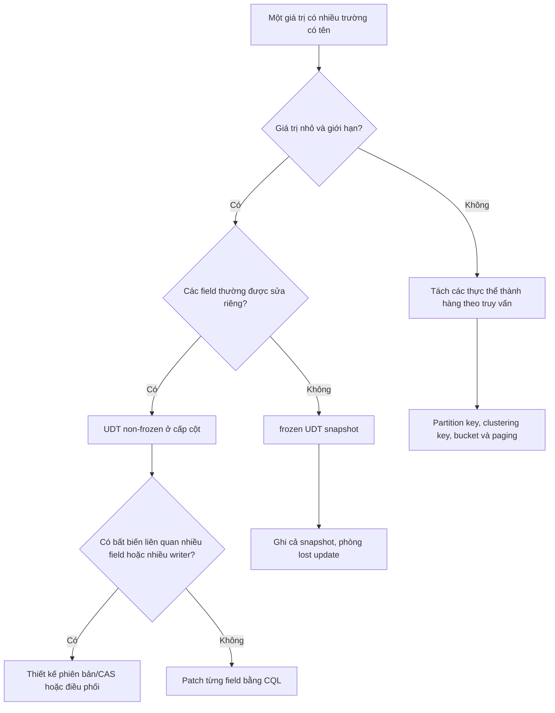

# UDT dạng `frozen`/non-frozen và cập nhật từng trường trong Apache Cassandra

> **Chương:** Collection và UDT  
> **Mô-đun:** `DATABASE_ENGINE_WIDE_COLUMN_CASSANDRA` — tìm hiểu kiến trúc phân tán, mô hình wide-column, partition key, thiết kế bảng theo truy vấn, mức nhất quán đọc/ghi, replication, compaction, repair và kết nối Java. Bài này tập trung vào **độ hạt cập nhật của user-defined type (UDT)**.

## 1. Hai cột cùng kiểu UDT, nhưng cách cập nhật khác nhau

Giả sử hồ sơ người dùng có một địa chỉ gồm `street`, `city`, `country_code` và `postal_code`. Hai bảng dưới đây có thể biểu diễn **cùng một địa chỉ**, nhưng hành vi ghi khác nhau:

```sql
-- Bảng A: UDT không frozen, cho phép cập nhật trường riêng.
address postal_address

-- Bảng B: UDT frozen, cả địa chỉ được xem là một giá trị.
address frozen<postal_address>
```

Ở **UDT non-frozen**, Cassandra lưu các trường như những cell có thể được quản lý riêng bên trong một hàng; một câu lệnh thay `city` không nhất thiết phải truyền lại `street`, `country_code` và `postal_code`. Ở **UDT frozen**, toàn bộ cấu trúc là **một cell**: muốn thay `city`, ứng dụng cần ghi **giá trị địa chỉ mới hoàn chỉnh**.

Sự khác nhau này quyết định cả **chi phí ghi**, **TTL/tombstone**, **xung đột giữa hai writer**, **cách retry** và **vòng đời schema**. `frozen` không phải là cách đánh dấu đối tượng Java bất biến; dữ liệu trong cột vẫn có thể được thay nguyên giá trị.

**Điều không thay đổi:** Dù dùng dạng nào, Cassandra vẫn định tuyến hàng theo **partition key**. Thêm trường vào UDT không tự tạo một bảng con, khóa tìm kiếm hoặc khả năng phân trang các trường bên trong một UDT.

## 2. Khởi tạo dữ liệu thực hành

Giả định keyspace `app` đã tồn tại, có replication factor và cấu hình datacenter phù hợp môi trường. Chạy các ví dụ sau trong `cqlsh`:

```sql
USE app;

CREATE TYPE postal_address (
    street text,
    city text,
    country_code text,
    postal_code text
);

CREATE TABLE profile_fieldwise (
    user_id uuid PRIMARY KEY,
    address postal_address,
    profile_revision int
);

CREATE TABLE profile_snapshot (
    user_id uuid PRIMARY KEY,
    address frozen<postal_address>,
    profile_revision int
);

INSERT INTO profile_fieldwise (user_id, address, profile_revision)
VALUES (
    11111111-1111-4111-8111-111111111111,
    {
        street: '12 Duong So 1',
        city: 'Ho Chi Minh City',
        country_code: 'VN',
        postal_code: '700000'
    },
    1
);

INSERT INTO profile_snapshot (user_id, address, profile_revision)
VALUES (
    11111111-1111-4111-8111-111111111111,
    {
        street: '12 Duong So 1',
        city: 'Ho Chi Minh City',
        country_code: 'VN',
        postal_code: '700000'
    },
    1
);
```

Hai bảng chỉ khác khai báo cột `address`. Literal UDT dùng `{field_name: value}` với **tên trường của schema**, khác với `map<text,text>` dùng key văn bản động như `{'theme':'dark'}`. `profile_revision` là một số nguyên do ứng dụng quản lý, dùng về sau để minh họa cập nhật có điều kiện; nó **không phải counter CQL**.

### Kiểm tra kết quả

```sql
SELECT address, profile_revision
FROM profile_fieldwise
WHERE user_id = 11111111-1111-4111-8111-111111111111;

SELECT address, profile_revision
FROM profile_snapshot
WHERE user_id = 11111111-1111-4111-8111-111111111111;
```

Giá trị CQL hiển thị có thể trông giống nhau, nhưng **không thể suy luận cách lưu và tính hợp lệ của thao tác cập nhật** chỉ từ kết quả `SELECT`.

## 3. Mô hình cell: trường riêng hay một snapshot?

```text
Hàng user_id = U1

UDT non-frozen: address postal_address
┌───────────────────────────────────────┐
│ Cell: address.street       = '12 ...' │
│ Cell: address.city         = 'HCMC'   │
│ Cell: address.country_code = 'VN'     │
│ Cell: address.postal_code  = '700000' │
└───────────────────────────────────────┘
  Có thể ghi/xóa trường cụ thể.

UDT frozen: address frozen<postal_address>
┌───────────────────────────────────────┐
│ Một cell chứa toàn bộ địa chỉ         │
│ {street:..., city:..., country_code:  │
│  ..., postal_code:...}                │
└───────────────────────────────────────┘
  Mỗi lần thay đổi là một giá trị mới.
```

Mô hình khái niệm trên giúp hiểu tại sao một thao tác thay `address.city` của non-frozen UDT là mutation có **phạm vi hẹp**, còn ghi lại frozen UDT là mutation có **phạm vi toàn giá trị**. Ở cấp lưu trữ, mỗi cell có metadata liên quan như timestamp và, nếu áp dụng, TTL; Cassandra hòa giải các phiên bản cell khi các replica đọc và đồng bộ dữ liệu.

**Không nên đánh đồng nhiều cell với nhiều partition.** Các trường non-frozen vẫn thuộc **một cột UDT của một hàng**; chúng không phân bố sang các partition key khác nhau và không tự trở thành các hàng mà driver có thể page độc lập.

| Tiêu chí | `address postal_address` | `address frozen<postal_address>` |
| --- | --- | --- |
| Đơn vị ghi | Một hoặc nhiều trường | Toàn bộ UDT |
| Cập nhật `city` bằng `address.city = ...` | Có | Không |
| Thay nguyên UDT bằng `address = {...}` | Có, với ngữ nghĩa thay toàn giá trị | Có, đây là đường cập nhật chính |
| TTL của mutation một trường | Có thể gắn với trường được ghi | Không có mutation riêng của trường |
| Xung đột hai trường khác nhau | Có thể hòa giải độc lập | Hai snapshot tranh chấp trên cùng cell |
| Dùng như phần tử collection lồng | Thường phải `frozen` giá trị UDT | Phù hợp ở vị trí phần tử được hỗ trợ |
| Phù hợp nhất | Giá trị nhỏ, thay các trường độc lập | Giá trị nhỏ, được quản lý như một snapshot |

## 4. Non-frozen UDT: cập nhật trực tiếp một trường

Giả sử người dùng chỉ đổi `city`, còn tất cả thông tin địa chỉ khác phải giữ nguyên:

```sql
UPDATE profile_fieldwise
SET address.city = 'Da Nang'
WHERE user_id = 11111111-1111-4111-8111-111111111111;
```

Vì `address` là non-frozen UDT, Cassandra có thể ghi cell tương ứng với **trường `city`**, thay vì buộc client gửi lại tất cả các trường. Không cần ứng dụng thực hiện chuỗi “đọc toàn địa chỉ → thay city → ghi toàn địa chỉ” cho thao tác đơn giản này.

Bạn cũng có thể thay một số trường trong cùng câu `UPDATE`:

```sql
UPDATE profile_fieldwise
SET address.street = '30 Nguyen Van Linh',
    address.postal_code = '550000'
WHERE user_id = 11111111-1111-4111-8111-111111111111;

SELECT address
FROM profile_fieldwise
WHERE user_id = 11111111-1111-4111-8111-111111111111;
```

Ở đây, `country_code` không bị đặt lại bởi câu lệnh cập nhật từng trường. Nếu các client ghi **những trường khác nhau** bằng các mutation riêng, Cassandra có thể giữ được cả hai thay đổi sau khi replica hội tụ. Nếu hai client cùng sửa `address.city`, giá trị thắng vẫn phụ thuộc hòa giải ghi/timestamp.

### Cập nhật trường trên một hàng chưa tồn tại

`UPDATE` CQL thông thường có ngữ nghĩa **upsert**. Nếu đủ primary key, câu lệnh cập nhật một trường của non-frozen UDT có thể tạo dữ liệu cho hàng chưa tồn tại; các trường khác của UDT khi đọc sẽ thiếu giá trị. Không mặc định rằng `UPDATE address.city = ...` chỉ thành công khi toàn bộ địa chỉ đã được khởi tạo.

Nếu nghiệp vụ **không cho tạo hồ sơ mới**, cần quy trình kiểm tra sự tồn tại của **hàng** hoặc dùng thao tác có điều kiện phù hợp. Chú ý `IF EXISTS` kiểm tra hàng theo primary key; nó không có nghĩa “UDT field `city` đã có giá trị”.

## 5. Xóa trường non-frozen và phân biệt `null`

Với non-frozen UDT, có thể xóa một trường thay vì xóa toàn giá trị:

```sql
-- Bỏ postal code; giữ các trường khác của địa chỉ.
DELETE address.postal_code
FROM profile_fieldwise
WHERE user_id = 11111111-1111-4111-8111-111111111111;

-- Phạm vi lớn hơn: xóa cả giá trị cột address.
DELETE address
FROM profile_fieldwise
WHERE user_id = 11111111-1111-4111-8111-111111111111;
```

**Không thực thi liên tiếp hai câu này** nếu muốn tiếp tục thực hành với địa chỉ: câu thứ hai cố ý xóa toàn cột. Lệnh `DELETE address.postal_code` chỉ nhắm đến một trường, còn `DELETE address` nhắm tới **toàn UDT** và các trường đang có.

Cassandra dùng **tombstone** để ghi nhận việc xóa. Ngay cả nếu trường đang thiếu giá trị, một mutation xóa vẫn có thể tạo thông tin xóa nhằm che các phiên bản cũ trên replica/SSTable. Xóa không đồng nghĩa với giải phóng toàn bộ byte dữ liệu ngay lập tức.

Khi một trường không có dữ liệu, Java Driver có thể trả về `null` cho trường đó. Hãy phân biệt:

- Không có **hàng** theo `user_id`: truy vấn trả về **không có `Row`**.
- Có hàng nhưng **cột UDT `address` là null**: kết quả có thể có `Row`, nhưng `getUdtValue("address")` trả `null`.
- Có địa chỉ non-frozen nhưng **`postal_code` thiếu**: UDT value hiện hữu, field `postal_code` đọc thành `null`.

Nếu sản phẩm cần biết “chưa từng nhập” khác với “đã xóa”, chỉ một giá trị `null` không đủ để diễn tả trạng thái. Hãy thiết kế field trạng thái/phiên bản hoặc lịch sử nghiệp vụ rõ ràng.

## 6. Frozen UDT: muốn sửa một trường phải thay cả giá trị

Với bảng `profile_snapshot`, lệnh sau **hợp lệ** vì gán một UDT hoàn chỉnh:

```sql
UPDATE profile_snapshot
SET address = {
    street: '12 Duong So 1',
    city: 'Da Nang',
    country_code: 'VN',
    postal_code: '550000'
}
WHERE user_id = 11111111-1111-4111-8111-111111111111;
```

Ngược lại, lệnh sau là **ví dụ không hợp lệ đối với cột frozen, không thực thi**:

```sql
-- KHÔNG HỢP LỆ: không thể sửa field bên trong frozen UDT bằng dấu chấm.
UPDATE profile_snapshot
SET address.city = 'Da Nang'
WHERE user_id = 11111111-1111-4111-8111-111111111111;
```

Lý do là `address` frozen được Cassandra coi là **một cell duy nhất**. Không có cell riêng của `city` để CQL sửa độc lập. Để **giữ lại** `street`, `country_code`, `postal_code` khi chỉ đổi `city`, client phải biết trạng thái đầy đủ mong muốn — thông qua một nguồn dữ liệu chuẩn hoặc thao tác đọc, chỉnh sửa rồi ghi lại **toàn snapshot**.

Điểm khác biệt về chi phí:

- **Non-frozen:** cập nhật một trường không nhất thiết đọc giá trị cũ trước; mutation nhắm vào field đã biết.
- **Frozen:** bản thân `UPDATE address = {...}` không đòi coordinator đọc trước khi ghi; **nhưng ứng dụng** có thể cần đọc snapshot để giữ nguyên các field không sửa. Đây là *read-modify-write tại ứng dụng*, khác với cơ chế đọc trước bắt buộc của một số thao tác `list[index]`.
- Nếu địa chỉ rất lớn hoặc nhiều writer cùng sửa, đọc/ghi nguyên UDT tạo tải và nguy cơ xung đột cao hơn. Nhưng với snapshot nhỏ, thay nguyên khối có thể đơn giản và dễ bảo đảm nhất quán theo nghiệp vụ hơn.

## 7. Non-frozen UDT vẫn có thao tác thay toàn giá trị

Việc cột không frozen **không bắt buộc** bạn phải luôn dùng cú pháp dấu chấm. Có thể gán lại toàn UDT:

```sql
-- Phép gán toàn bộ giá trị UDT non-frozen.
UPDATE profile_fieldwise
SET address = {
    street: '8 Tran Phu',
    city: 'Ha Noi',
    country_code: 'VN',
    postal_code: '100000'
}
WHERE user_id = 11111111-1111-4111-8111-111111111111;
```

Đây **không** phải phép “gộp thêm các trường đã gửi với những trường cũ”. Khi gán lại toàn giá trị, ứng dụng cần xem đó là hành động **thay trạng thái của UDT**, có thể tạo thông tin xóa che các field cũ trước khi ghi giá trị mới. Nếu literal thiếu trường, không mặc định dữ liệu của trường đó được giữ nguyên. Muốn chỉ patch một field của non-frozen UDT, **hãy dùng `address.field = ...`**, không gán nguyên UDT.

Một API Java nên làm rõ sự khác biệt bằng tên phương thức:

```text
updateAddressCity(userId, city)       -> patch một trường
replaceEntireAddress(userId, address) -> thay snapshot hoàn chỉnh
```

Đặt tên phương thức rõ ràng giúp tránh lỗi tinh vi: client mới chỉ biết `city` nhưng lại gọi API thay toàn địa chỉ và vô tình bỏ những trường khác.

## 8. Hai client ghi cùng lúc: khác biệt rõ nhất giữa hai dạng

Giả sử cả hai client đều đọc địa chỉ ban đầu:

```text
{street:'12 Duong So 1', city:'Ho Chi Minh City',
 country_code:'VN', postal_code:'700000'}
```

Client A muốn đổi `city` thành `'Da Nang'`; client B muốn đổi `street` thành `'30 Nguyen Van Linh'`.

### 8.1. Non-frozen: cập nhật hai field độc lập

```sql
-- Client A
UPDATE profile_fieldwise SET address.city = 'Da Nang'
WHERE user_id = 11111111-1111-4111-8111-111111111111;

-- Client B
UPDATE profile_fieldwise SET address.street = '30 Nguyen Van Linh'
WHERE user_id = 11111111-1111-4111-8111-111111111111;
```

Hai mutation nhắm tới **hai cell khác nhau**, nên khi replica hội tụ có thể quan sát cả `city` mới lẫn `street` mới. Nếu A và B cùng sửa `address.city`, chúng vẫn tranh chấp tại **cùng field** theo timestamp; non-frozen **không cung cấp giao dịch đa trường** tự động.

### 8.2. Frozen: hai snapshot có thể làm mất một thay đổi

```sql
-- Client A dựa trên bản đọc cũ:
UPDATE profile_snapshot SET address = {
    street: '12 Duong So 1', city: 'Da Nang',
    country_code: 'VN', postal_code: '700000'
}
WHERE user_id = 11111111-1111-4111-8111-111111111111;

-- Client B cũng dựa trên bản đọc cũ:
UPDATE profile_snapshot SET address = {
    street: '30 Nguyen Van Linh', city: 'Ho Chi Minh City',
    country_code: 'VN', postal_code: '700000'
}
WHERE user_id = 11111111-1111-4111-8111-111111111111;
```

Mỗi mutation thay **cả cell `address`**. Cassandra hòa giải các giá trị cạnh tranh theo timestamp và quy tắc liên quan; hệ thống **không tự gộp** `city` của A và `street` của B. Nếu snapshot B thắng, cập nhật `city` của A bị mất (*lost update*); trường hợp ngược lại thì thay đổi `street` bị mất.

**“Client gửi sau cùng” không phải lúc nào cũng là “timestamp thắng”.** Đồng hồ lệch, retry, timestamp do client cung cấp hoặc ghi đến replica ở các thời điểm khác nhau đều có thể ảnh hưởng kết quả. Đọc/ghi với `QUORUM` thông thường không tự biến chuỗi “đọc snapshot → sửa → ghi” thành một transaction có kiểm soát phiên bản.

## 9. Khi phải chống lost update: quản lý phiên bản và LWT

Nếu ứng dụng cần mọi thay đổi địa chỉ được quyết định trên một phiên bản cụ thể, có thể dùng `profile_revision` để thực hiện cập nhật có điều kiện cho bảng frozen.

```sql
-- Bước 1: đọc snapshot và revision hiện tại.
SELECT address, profile_revision
FROM profile_snapshot
WHERE user_id = 11111111-1111-4111-8111-111111111111;

-- Bước 2: ví dụ chỉ ghi nếu revision hiện tại bằng 1.
UPDATE profile_snapshot
SET address = {
        street: '12 Duong So 1', city: 'Da Nang',
        country_code: 'VN', postal_code: '550000'
    },
    profile_revision = 2
WHERE user_id = 11111111-1111-4111-8111-111111111111
IF profile_revision = 1;
```

Câu lệnh có `IF` dùng **lightweight transaction (LWT)**, trả kết quả gồm `[applied]`:

- `[applied] = true`: điều kiện đúng và mutation được chấp nhận.
- `[applied] = false`: revision đã khác kỳ vọng; client cần **đọc lại** trước khi quyết định hợp nhất, thông báo xung đột hoặc retry có giới hạn.
- Khi timeout: **không** suy luận rằng ghi chắc chắn không xảy ra. Đọc/đối chiếu trạng thái để xác định hành động tiếp theo.

LWT có thêm chi phí điều phối đồng thuận (Paxos/serial consistency) so với `UPDATE` thông thường. Nó đáng cân nhắc khi **điều kiện là một bất biến nghiệp vụ**, không phải một cách mặc định để tăng tốc hay giảm lượng dữ liệu ghi.

**Cảnh báo:** Phiên bản chỉ bảo vệ đầy đủ khi **mọi writer sửa địa chỉ đều tham gia quy trình cập nhật `profile_revision`**. Một writer khác ghi frozen UDT không điều kiện và không tăng revision có thể phá vỡ hợp đồng chống lost update. Nếu chọn UDT non-frozen nhưng cần bất biến liên quan **nhiều field cùng lúc**, vẫn phải thiết kế cơ chế đồng bộ phù hợp.

## 10. TTL theo trường và TTL toàn snapshot

Với UDT non-frozen, TTL có thể áp dụng cho field vừa được ghi:

```sql
-- Chỉ trường postal_code được ghi trong mutation này nhận TTL 600 giây.
UPDATE profile_fieldwise USING TTL 600
SET address.postal_code = 'TEMP-123'
WHERE user_id = 11111111-1111-4111-8111-111111111111;
```

Nếu các trường khác có dữ liệu không hết hạn, chúng **không tự nhận TTL 600 giây** chỉ vì câu lệnh trên. Khi hết TTL, trường có thể đọc thành `null`, còn những field có thời hạn khác vẫn tồn tại theo trạng thái của chúng.

Với frozen UDT, TTL của mutation áp dụng cho **cell chứa toàn UDT**:

```sql
UPDATE profile_snapshot USING TTL 600
SET address = {
    street: '12 Duong So 1', city: 'Da Nang',
    country_code: 'VN', postal_code: 'TEMP-123'
}
WHERE user_id = 11111111-1111-4111-8111-111111111111;
```

Khi giá trị frozen hết TTL, **cả snapshot** bị coi là hết hạn, không chỉ `postal_code`. Nếu địa chỉ cần lưu dài hạn nhưng một mã xác minh chỉ tồn tại mười phút, đừng nhét mã xác minh vào cùng frozen UDT và gắn TTL lên toàn cột. Hãy dùng **cột/hàng riêng với vòng đời riêng**.

### Tombstone và chi phí vận hành

Xóa field non-frozen, thay cả UDT, xóa frozen UDT hoặc để TTL hết hạn đều có thể tạo thông tin xóa (*tombstone*). Tombstone giúp các replica nhận biết dữ liệu cũ đã bị xóa và ảnh hưởng đến quá trình đọc/hòa giải SSTable. Compaction chỉ loại bỏ tombstone khi thỏa điều kiện an toàn; lịch **repair**, trạng thái replica và cấu hình như `gc_grace_seconds` có liên quan.

Đừng tự ý hạ thời gian grace để “dọn nhanh” dữ liệu UDT cũ nếu các replica có thể bỏ lỡ xóa. Nếu dấu xóa biến mất trước khi một replica cũ được đồng bộ, dữ liệu đã xóa có thể xuất hiện lại. Đồng thời, không có quy tắc “non-frozen luôn tốn nhiều tombstone hơn frozen” cho mọi workload: còn tùy tần suất cập nhật từng field hay thay toàn snapshot.

## 11. UDT lồng nhau và ranh giới `frozen`

Giả sử một địa chỉ có tọa độ GPS:

```sql
USE app;

CREATE TYPE geo_point (
    latitude double,
    longitude double
);

CREATE TYPE extended_address (
    street text,
    city text,
    location frozen<geo_point>
);

CREATE TABLE location_profiles (
    user_id uuid PRIMARY KEY,
    home extended_address
);
```

Ở đây, `home` là UDT **non-frozen ở cấp cột**, nên có thể cập nhật một field cấp một:

```sql
UPDATE location_profiles
SET home.city = 'Da Nang'
WHERE user_id = 11111111-1111-4111-8111-111111111111;

-- Thay nguyên giá trị geo_point của field location.
UPDATE location_profiles
SET home.location = {latitude: 16.05, longitude: 108.20}
WHERE user_id = 11111111-1111-4111-8111-111111111111;
```

Field `home.location` chứa **`frozen<geo_point>`**, nên bạn không thể mặc định cập nhật riêng `latitude` bằng cú pháp xuyên nhiều tầng như `home.location.latitude = ...`. Muốn sửa tọa độ, ghi lại **giá trị `geo_point` nguyên khối** vào field `location`.

### UDT bên trong map hoặc list

```sql
CREATE TABLE address_book (
    user_id uuid PRIMARY KEY,
    labelled_addresses map<text, frozen<postal_address>>,
    recent_addresses list<frozen<postal_address>>
);

UPDATE address_book
SET labelled_addresses['work'] = {
    street: '8 Duong So 2', city: 'Da Nang',
    country_code: 'VN', postal_code: '550000'
}
WHERE user_id = 11111111-1111-4111-8111-111111111111;
```

Trong `map<text,frozen<postal_address>>`, map **bên ngoài** có thể sửa từng key `'work'` hoặc `'home'`. Nhưng **giá trị UDT của mỗi key là frozen**, nên đổi `city` của `'work'` đòi gán **toàn UDT tại key đó**. Việc map ngoài nhiều cell **không có nghĩa** một field bên trong frozen UDT được cập nhật độc lập.

**Không tạo collection khổng lồ chứa UDT.** `list<frozen<postal_address>>` thích hợp với một vài địa chỉ gần đây có giới hạn; không phải cách lưu lịch sử hàng triệu địa chỉ. Collection lớn vẫn thuộc **một hàng/partition**, không tự phân trang từng UDT như các hàng độc lập.

## 12. Tiến hóa schema: thêm trường mới có tác động khác nhau

Khi yêu cầu nghiệp vụ bổ sung `delivery_note`, type có thể được mở rộng theo những thao tác `ALTER TYPE` mà phiên bản Cassandra hỗ trợ:

```sql
ALTER TYPE postal_address ADD delivery_note text;
```

Trường mới **không được backfill tự động** vào mọi giá trị cũ; ứng dụng phải chấp nhận `null` hoặc xử lý mặc định. Đối với non-frozen UDT ở cấp cột, khi cần điền `delivery_note` cho một người dùng, ứng dụng có thể cập nhật riêng field đó:

```sql
UPDATE profile_fieldwise
SET address.delivery_note = 'Giao buoi sang'
WHERE user_id = 11111111-1111-4111-8111-111111111111;
```

Với **frozen UDT**, cập nhật field mới vẫn yêu cầu **thay toàn snapshot**. Đây là rủi ro trong rolling deploy: client cũ dùng schema/DTO chưa có `delivery_note` có thể ghi lại snapshot cũ rồi làm mất giá trị mới do client mới thêm.

Một số biện pháp:

1. Khảo sát mọi bảng/cột/type khác đang tham chiếu `postal_address`, kể cả các UDT nằm trong collection.
2. Chạy migration schema được điều phối, xác minh **schema agreement** giữa các node trước khi bật writer mới.
3. Bảo đảm Java Driver đã nhận **metadata schema mới**; prepared statements/mapper/codec cần tương thích.
4. Triển khai reader chấp nhận `null`, rồi writer mới; xác định cách client cũ tiếp tục hoạt động trong thời gian chuyển tiếp.
5. Backfill có giới hạn tốc độ và checkpoint nếu dữ liệu cũ phải có field mới; sử dụng cơ chế tránh ghi đè khi có writer đồng thời.
6. Với thay đổi phá vỡ tương thích, cân nhắc `postal_address_v2` và cột/bảng mới theo mô hình **expand → backfill → contract**, thay vì tự đổi kiểu/xóa field của type đang sử dụng.

`frozen` hay non-frozen là quyết định mô hình hóa có ảnh hưởng đến cách dữ liệu được lưu. **Không giả định** có thể chuyển một cột đang chứa dữ liệu từ `frozen<UDT>` thành UDT non-frozen chỉ bằng một `ALTER TABLE` đơn giản; cần kiểm tra khả năng của phiên bản đích và lập kế hoạch migration khi cần.

## 13. Khi nào UDT chưa đủ: thiết kế bảng theo truy vấn

UDT chỉ định nghĩa **hình dạng của một giá trị**, không phải chỉ mục truy vấn. Ví dụ `profile_fieldwise` với partition key `user_id` phục vụ đường đọc “địa chỉ của user U”. Nó **không tự phục vụ hiệu quả** đường đọc “liệt kê người dùng ở thành phố X theo thời điểm đăng ký”.

Nếu ứng dụng cần truy vấn theo `city`, có thể cần một bảng đọc riêng:

```sql
CREATE TABLE app.users_by_city_month (
    city text,
    joined_month text,
    joined_at timeuuid,
    user_id uuid,
    PRIMARY KEY ((city, joined_month), joined_at, user_id)
) WITH CLUSTERING ORDER BY (joined_at DESC, user_id ASC);

SELECT joined_at, user_id
FROM app.users_by_city_month
WHERE city = 'Da Nang'
  AND joined_month = '2026-11'
LIMIT 30;
```

Ở bảng này, `(city, joined_month)` là **partition key**, còn `(joined_at, user_id)` là **clustering key** để truy vấn theo thời gian. Nếu số user/tháng ở một thành phố quá lớn, cần điều chỉnh bucket hoặc shard theo workload, với chi phí đọc nhiều bucket. Ứng dụng chịu trách nhiệm đồng bộ bảng truy vấn ngược này với dữ liệu gốc; việc cập nhật `address.city` không tự cập nhật bảng `users_by_city_month`.

**Nếu mỗi địa chỉ có ID, TTL, owner hoặc lịch sử riêng**, có thể tạo bảng `addresses_by_user` với primary key gồm `(user_id, address_id)` và clustering phù hợp. Cách đó tốt hơn việc nhét hàng nghìn địa chỉ vào `list<frozen<postal_address>>` rồi cố xóa một địa chỉ theo chỉ số.

## 14. Java Driver 4.x: patch một field và ghi cả `UdtValue`

Java Driver 4.x hỗ trợ `UdtValue` để encode giá trị UDT theo metadata schema. Ví dụ sau giả định các bảng và type ban đầu đã được tạo trong keyspace `app`, session đã cấu hình contact points/local datacenter/authentication, và các prepared statement được **tái sử dụng**.

```java
import com.datastax.oss.driver.api.core.CqlIdentifier;
import com.datastax.oss.driver.api.core.CqlSession;
import com.datastax.oss.driver.api.core.cql.PreparedStatement;
import com.datastax.oss.driver.api.core.cql.Row;
import com.datastax.oss.driver.api.core.data.UdtValue;
import com.datastax.oss.driver.api.core.type.UserDefinedType;
import java.util.UUID;

class AddressRepository {
    private final CqlSession session;
    private final PreparedStatement updateCity;
    private final PreparedStatement replaceSnapshot;
    private final PreparedStatement selectFieldwise;

    AddressRepository(CqlSession session) {
        this.session = session;
        this.updateCity = session.prepare(
            "UPDATE app.profile_fieldwise " +
            "SET address.city = ? WHERE user_id = ?"
        );
        this.replaceSnapshot = session.prepare(
            "UPDATE app.profile_snapshot " +
            "SET address = ? WHERE user_id = ?"
        );
        this.selectFieldwise = session.prepare(
            "SELECT address FROM app.profile_fieldwise WHERE user_id = ?"
        );
    }

    void patchCity(UUID userId, String city) {
        // Non-frozen UDT: chỉ gửi một field; không cần tự dựng lại UDT.
        session.execute(updateCity.bind(city, userId));
    }

    void replaceAddress(UUID userId) {
        UserDefinedType type = session.getMetadata()
            .getKeyspace(CqlIdentifier.fromCql("app"))
            .orElseThrow()
            .getUserDefinedType(CqlIdentifier.fromCql("postal_address"))
            .orElseThrow();

        UdtValue address = type.newValue()
            .setString("street", "12 Duong So 1")
            .setString("city", "Da Nang")
            .setString("country_code", "VN")
            .setString("postal_code", "550000");

        // Frozen UDT: gửi snapshot đầy đủ; ví dụ chỉ minh họa serialization.
        session.execute(replaceSnapshot.bind(address, userId));
    }

    String readCity(UUID userId) {
        Row row = session.execute(selectFieldwise.bind(userId)).one();
        if (row == null) return null; // Không tìm thấy hàng.

        UdtValue address = row.getUdtValue("address");
        return address == null ? null : address.getString("city");
    }
}
```

Trong code trên, `patchCity` là **mutation theo field**; `replaceAddress` là **thay snapshot**. Đừng dựng một địa chỉ từ các hằng số như ví dụ rồi áp dụng để “sửa một field” trong hệ thống thật: điều đó có thể ghi đè dữ liệu mới của writer khác. Với frozen UDT, ứng dụng cần nguồn trạng thái đầy đủ đáng tin cậy và, khi có tranh chấp, cơ chế điều phối hoặc CAS theo phiên bản.

Nếu `postal_address` vừa được `ALTER TYPE ADD delivery_note`, metadata UDT ở client phải được làm mới trước khi dùng `.setString("delivery_note", ...)`. Đồng thời, `UdtValue` và DTO cũ có thể chưa biết trường mới; kiểm tra hành vi của driver/mapper trên đúng phiên bản trước khi rolling deploy.

## 15. Quyết định thiết kế theo yêu cầu thực tế



| Workload | Lựa chọn ban đầu | Lý do |
| --- | --- | --- |
| Hồ sơ nhỏ, email và phone thường sửa độc lập | UDT non-frozen hoặc các cột thường | Mutation theo field, tránh ghi đè thuộc tính không liên quan |
| Thông tin địa chỉ được xác nhận/phát hành theo một bản duy nhất | `frozen<UDT>` | Snapshot là đơn vị nghiệp vụ; dễ serialize và thay nguyên giá trị |
| Map có 3 địa chỉ `home`, `work`, `other` | `map<text,frozen<UDT>>` | Cập nhật theo key map; từng địa chỉ là snapshot |
| Lịch sử hàng triệu địa chỉ/điểm GPS | Bảng riêng có clustering key/bucket | Paging và kiểm soát partition, TTL độc lập |
| Cần tìm mọi user có `city = X` | Bảng đọc theo city hoặc index được đánh giá | Trường UDT không tự biến thành khóa truy vấn |
| Nhiều writer sửa frozen UDT đồng thời | Snapshot + revision/LWT hoặc đổi mô hình | Tránh lost update, đổi lại chi phí phối hợp |

Không có lựa chọn “frozen luôn nhanh hơn”. Với mỗi trường nhỏ sửa thường xuyên, non-frozen có thể giảm dữ liệu ghi. Với giá trị nhỏ luôn thay đồng loạt, frozen có thể đơn giản hơn. Hãy đo **độ trễ, tần suất ghi, kích thước giá trị, số tombstone và p95/p99** trên workload thật.

## 16. Bài tập tự kiểm tra

**Bài 1 — patch trường:** `address` là non-frozen UDT và hiện có `city='Ha Noi'`, `postal_code='100000'`. `SET address.city='Da Nang'` có phải gửi lại `postal_code` không?  
**Gợi ý:** Không. Mutation theo trường cho phép giữ field khác, trừ khi có ghi cạnh tranh hoặc thay toàn UDT từ writer khác.

**Bài 2 — syntax frozen:** `address` là `frozen<postal_address>`. Có dùng `SET address.city='Da Nang'` được không?  
**Gợi ý:** Không. Phải gán toàn UDT bằng `SET address = {...}`.

**Bài 3 — tranh chấp:** A và B đọc cùng snapshot frozen. A đổi `city`, B đổi `street`, rồi cùng ghi địa chỉ hoàn chỉnh. Kết quả có bảo đảm cả hai thay đổi không?  
**Gợi ý:** Không. Hai snapshot cạnh tranh trên cùng cell; cần kiểm soát phiên bản/điều phối nếu phải giữ cả hai thay đổi.

**Bài 4 — TTL:** Non-frozen UDT có `postal_code` cần hết hạn trong 10 phút, còn `city` cần giữ lâu dài. Đặt TTL lên thao tác `SET address.postal_code = ...` có hợp lý hơn ghi cả frozen UDT với TTL không?  
**Gợi ý:** Có, nếu nghiệp vụ cho phép vòng đời theo field. TTL toàn frozen UDT sẽ làm cả địa chỉ hết hạn.

**Bài 5 — nested:** Cột `labelled_addresses map<text,frozen<postal_address>>`. Có thể thay `city` của địa chỉ `'work'` mà không thay `'home'` không?  
**Gợi ý:** Có thể gán **toàn UDT** ở key `'work'`, không sửa xuyên vào field `city` của frozen value; key `'home'` không bị tác động bởi mutation theo key.

**Bài 6 — schema:** `ALTER TYPE postal_address ADD delivery_note text` vừa hoàn thành. Client cũ ghi snapshot frozen từ DTO chưa có field mới. Nguy cơ là gì?  
**Gợi ý:** Có thể làm mất dữ liệu `delivery_note` mới khi ghi đè nguyên snapshot. Cần chiến lược rollout, metadata/schema agreement và nguồn ghi phù hợp.

**Bài 7 — truy vấn:** Người dùng cần tìm 100 địa chỉ mới nhất trong một thành phố. Có thể chỉ thay non-frozen thành frozen để truy vấn tốt hơn không?  
**Gợi ý:** Không. Vấn đề nằm ở **partition/clustering key và đường truy vấn**; cần bảng đọc hoặc index được đánh giá đúng workload.

## 17. Checklist trước khi đưa vào production

- [ ] Đã xác định **UDT là giá trị nhỏ, có giới hạn**, không phải một collection lịch sử vô hạn.
- [ ] Đã hiểu **non-frozen patch field** khác **gán lại toàn UDT**, và **frozen luôn thay snapshot**.
- [ ] Đã kiểm thử `UPDATE address.field`, `DELETE address.field`, `UPDATE address = {...}` trên **phiên bản Cassandra đích**.
- [ ] Đã xác định cách xử lý **field null, hàng không tồn tại, dữ liệu chưa backfill** và các ràng buộc nghiệp vụ.
- [ ] Đã đánh giá **ghi đồng thời trên một field/toàn snapshot**, timestamp, retry và nhu cầu LWT/versioning.
- [ ] Đã kiểm tra **TTL, tombstone, compaction, repair, replication và consistency level** với workload dự kiến.
- [ ] Đã xác định ranh giới **`frozen` của UDT lồng nhau và phần tử collection**, tránh kỳ vọng update xuyên tầng.
- [ ] Đã có quy trình **schema evolution, schema agreement, Java Driver metadata và rolling deploy** nếu type thay đổi.
- [ ] Đã có bảng theo **partition/clustering key** nếu cần truy vấn ngược, phân trang hoặc quản lý các thực thể có ID riêng.

## 18. Ghi nhớ

- **Non-frozen UDT ở cấp cột** cho phép cập nhật/xóa **từng field** bằng CQL khi phiên bản hỗ trợ; các trường có thể được hòa giải như các cell riêng.
- **`frozen<UDT>`** là **một cell/snapshot**: cập nhật một field đòi thay toàn giá trị; `frozen` không có nghĩa không thể thay dữ liệu.
- Gán **toàn UDT non-frozen** không giống patch field; phải tính đến việc che/xóa các field cũ và khả năng ghi đè trạng thái từ client khác.
- Hai writer thay **hai field non-frozen khác nhau** có thể giữ được cả hai thay đổi; hai writer thay **frozen snapshot** dễ phát sinh **lost update**.
- TTL và xóa trên non-frozen có thể ở độ hạt field; frozen áp dụng ở **độ hạt cả giá trị**. Tombstone vẫn liên quan đến compaction và repair.
- UDT nằm trong collection/lớp lồng thường cần **`frozen` ở ranh giới giá trị bên trong**; không suy luận có thể cập nhật một field sâu bằng cú pháp dấu chấm.
- Mọi quyết định phải dựa trên **đường truy vấn, kích thước partition, replication, consistency và nhu cầu Java application**. Dù là frozen hay non-frozen, UDT không thay thế thiết kế bảng theo truy vấn.
