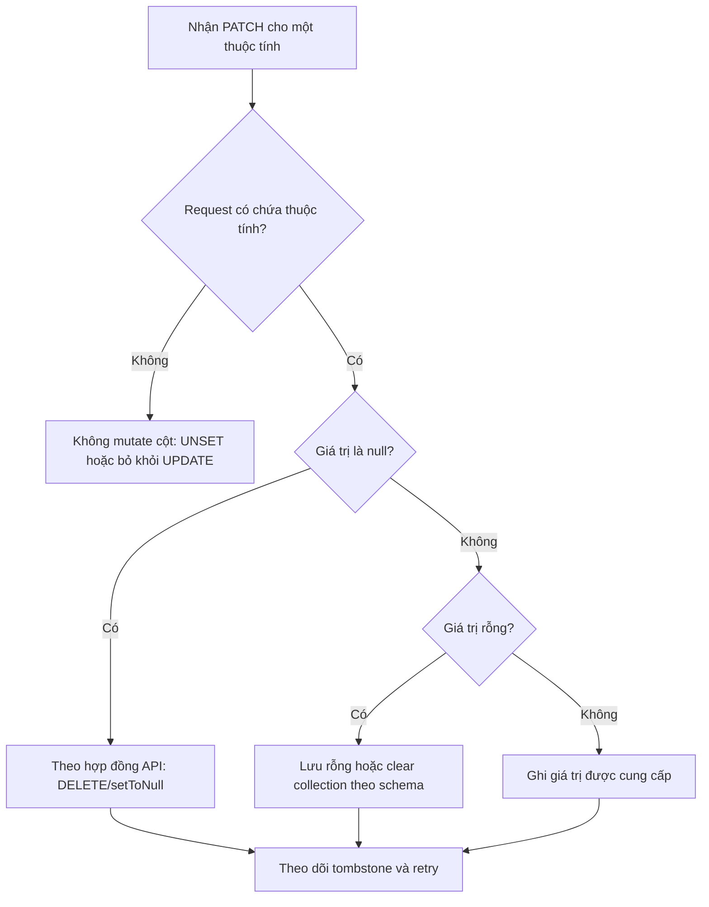

# `NULL`, giá trị trống và dấu xóa khi cập nhật cấu trúc trong Apache Cassandra

> **Chương:** Collection và UDT  
> **Mô-đun:** `DATABASE_ENGINE_WIDE_COLUMN_CASSANDRA` — hiểu mô hình wide-column phân tán, khóa phân vùng, thiết kế bảng theo truy vấn, mức nhất quán đọc/ghi, replication, compaction, repair, xử lý lỗi và kết nối từ Java. Bài học làm rõ ý nghĩa của `NULL`, giá trị rỗng, `UNSET` và **tombstone** khi làm việc với `list`, `set`, `map` và UDT.

## 1. Đặt vấn đề: “không có dữ liệu” không phải lúc nào cũng là một trạng thái

Một ứng dụng quản lý hồ sơ người dùng có thể gặp các tình huống:

- Người dùng **chưa có hàng** trong Cassandra.
- Hàng đã có, nhưng cột `nickname` **chưa được ghi** hoặc đã bị xóa.
- Người dùng **chủ động nhập chuỗi rỗng** `''` để xóa chữ trong ô nhập liệu.
- Danh sách `pinned_lessons` được yêu cầu **trở thành rỗng**.
- Map `preferences` thiếu khóa `'theme'`, nhưng các khóa khác vẫn tồn tại.
- UDT `address` có giá trị, nhưng trường `postal_code` chưa được nhập.
- Java Driver gửi một bind marker ở trạng thái **`UNSET`**, nghĩa là *không thực hiện mutation cho cột đó*.

Nếu gộp mọi trường hợp thành “`NULL`”, ứng dụng dễ vô tình xóa dữ liệu, tạo tombstone không cần thiết hoặc báo sai rằng một hồ sơ đã tồn tại. Trong Cassandra, `NULL` không đơn thuần là một giá trị được lưu giống chuỗi `'null'`: **ghi `null` vào một cột thường mang ngữ nghĩa xóa**. Thông tin xóa phải được duy trì để các replica và SSTable cũ không phục hồi giá trị đã xóa.

Điểm cần phân biệt trước khi viết code:

| Khái niệm | Ý nghĩa ở API/CQL | Có nhất thiết tạo dữ liệu hay tombstone không? |
| --- | --- | --- |
| **Không có hàng** | Không tìm được primary key đó | Không; đọc không có hàng không phải mutation |
| **Cột chưa được ghi** | Không có giá trị sống cho cột | Không nhất thiết; có thể chưa từng tồn tại |
| **`NULL` trong mutation** | Yêu cầu xóa cột/trường được chỉ định | Có thể tạo tombstone, kể cả khi đang trống |
| **`''` (empty text)** | Chuỗi dài 0 ký tự nhưng **có giá trị** | Ghi một giá trị, không tương đương `NULL` |
| **`[]`, `{}`** | Literal collection rỗng, cách lưu tùy loại/phiên bản | Không nên giả định giữ được “rỗng” khác “vắng mặt” |
| **`UNSET` bind marker** | Bỏ qua mutation cho marker đó | Không xóa cột; **không phải** trạng thái dữ liệu thứ ba |
| **Tombstone** | Thông tin xóa/che giá trị cũ | Có thể còn trong SSTable sau khi `SELECT` không thấy giá trị |

## 2. Tạo bảng thử nghiệm và dữ liệu mẫu

Giả sử keyspace `app` đã tồn tại, được cấu hình replication phù hợp. Bảng sau đủ nhỏ để quan sát các trạng thái của một hồ sơ; `user_id` là partition key của hàng:

```sql
USE app;

CREATE TYPE contact_info (
    email text,
    phone text,
    note text
);

CREATE TABLE user_structure_lab (
    user_id uuid PRIMARY KEY,
    display_name text,
    nickname text,
    tags set<text>,
    preferences map<text, text>,
    pinned_lessons list<text>,
    contact contact_info,
    contact_snapshot frozen<contact_info>,
    revision int
);

INSERT INTO user_structure_lab (
    user_id, display_name, nickname, tags, preferences,
    pinned_lessons, contact, contact_snapshot, revision
) VALUES (
    11111111-1111-4111-8111-111111111111,
    'Nguyen An', 'An', {'cql', 'java'},
    {'language':'vi', 'theme':'dark'},
    ['partition', 'repair'],
    {email:'an@example.org', phone:'0900000000', note:'sample'},
    {email:'an@example.org', phone:'0900000000', note:'sample'},
    1
);

SELECT * FROM user_structure_lab
WHERE user_id = 11111111-1111-4111-8111-111111111111;
```

Các ví dụ bên dưới thay đổi cùng một hàng. Nếu muốn chạy chúng độc lập, hãy **khởi tạo lại dữ liệu mẫu** giữa các thí nghiệm. Không chạy các ví dụ xóa cả hàng/collection một cách liên tiếp rồi suy luận dữ liệu sẽ vẫn giống trạng thái khởi đầu.

## 3. Không có hàng khác với hàng có cột `NULL`

```sql
-- Hàng mẫu: có user_id và display_name, có thể có cột null.
SELECT display_name, nickname
FROM user_structure_lab
WHERE user_id = 11111111-1111-4111-8111-111111111111;

-- UUID thứ hai chưa được ghi trong bài thực hành này.
SELECT display_name, nickname
FROM user_structure_lab
WHERE user_id = 22222222-2222-4222-8222-222222222222;
```

Truy vấn thứ hai thông thường trả về **không có hàng**. Truy vấn đầu có thể trả về một hàng mà `nickname` là `null` sau khi cột đó bị xóa. Cả hai đều có thể khiến phương thức Java trả `null` ở đâu đó, nhưng ý nghĩa nghiệp vụ rất khác nhau.

Một điểm tinh tế: nếu một hàng từng có dữ liệu nhưng đã xóa hết các cột thường, khả năng hàng còn xuất hiện phụ thuộc vào **row liveness marker**, TTL và các mutation đã được ghi. Không dùng “mọi cột SELECT đều null” như phép thử chắc chắn để suy ra hàng chưa từng tồn tại; trong nghiệp vụ cần định danh sự tồn tại, nên có **trạng thái/lifecycle rõ ràng**.

### Không được dùng `NULL` làm primary key

```sql
-- KHÔNG HỢP LỆ: primary key bắt buộc có giá trị.
-- INSERT INTO user_structure_lab (user_id, display_name)
-- VALUES (null, 'Someone');
```

Trong Cassandra, partition key xác định nơi dữ liệu được đặt trên các replica. Nó không thể `NULL`; clustering key dùng để định danh hàng cũng có các ràng buộc không cho `NULL`. Điều này khác với các cột dữ liệu thông thường và khác cơ chế “một cột nullable” trong nhiều bảng SQL quan hệ.

## 4. Chuỗi rỗng `''` là giá trị, không phải `NULL`

```sql
-- Giá trị nickname được ghi là chuỗi rỗng dài 0 ký tự.
UPDATE user_structure_lab
SET nickname = ''
WHERE user_id = 11111111-1111-4111-8111-111111111111;

SELECT nickname
FROM user_structure_lab
WHERE user_id = 11111111-1111-4111-8111-111111111111;
```

Một cột `text` có thể chứa chuỗi rỗng. Ứng dụng Java nên phân biệt `""` với `null`:

- `""`: giá trị **có mặt**, nhưng độ dài bằng `0`.
- `null`: không có giá trị sống cho cột, hoặc hàng/cột chưa tồn tại (cần kiểm tra riêng sự tồn tại của hàng).
- `"null"`: chuỗi gồm **bốn ký tự** `n`, `u`, `l`, `l`; không phải CQL `NULL`.
- `" "`: một dấu cách, cũng là giá trị, không phải chuỗi rỗng.

Nếu nghiệp vụ muốn phân biệt “người dùng chủ động xóa mọi ký tự” với “người dùng yêu cầu xóa thuộc tính”, API phải định nghĩa rõ: có thể lưu `''` cho trạng thái đầu và thực hiện mutation xóa cho trạng thái sau. Đừng tự động chuyển mọi empty string thành `null` trong serializer nếu chưa kiểm tra yêu cầu.

Với binary, một `blob` rỗng (literal `0x`) cũng là một giá trị được biểu diễn khác `NULL`; nhưng **không suy rộng quy tắc empty string sang mọi collection/UDT** vì các kiểu phức hợp có quy tắc lưu riêng.

## 5. Ghi `NULL` hay dùng `DELETE`: đều là yêu cầu xóa

### 5.1. Xóa cột bằng `UPDATE ... = null`

```sql
UPDATE user_structure_lab
SET nickname = null
WHERE user_id = 11111111-1111-4111-8111-111111111111;
```

Trong ngữ cảnh mutation của Cassandra, gán `null` cho cột thông thường có **ngữ nghĩa xóa giá trị cũ**. Dấu xóa cần thắng các phiên bản giá trị cũ khi replica hòa giải dữ liệu. Vì vậy, `UPDATE ... SET nickname = null` **không có nghĩa chỉ bỏ qua cột nickname**.

### 5.2. Xóa cột bằng `DELETE`

```sql
DELETE nickname
FROM user_structure_lab
WHERE user_id = 11111111-1111-4111-8111-111111111111;

-- Câu lệnh có phạm vi lớn hơn: xóa cả hàng theo khóa chính.
DELETE FROM user_structure_lab
WHERE user_id = 11111111-1111-4111-8111-111111111111;
```

Lệnh thứ nhất chỉ xóa một cột; lệnh thứ hai tạo mutation **xóa hàng**. Không nên chạy lệnh thứ hai nếu chỉ muốn thử xóa `nickname`. Với các loại mutation xóa khác nhau, phạm vi tombstone cũng khác nhau: **cell**, **collection**, **row** và một số thao tác có thể tạo **range tombstone**.

Khi đọc lại sau xóa, kết quả `null` (hoặc không còn hàng) không chứng minh byte cũ đã được xóa khỏi mọi SSTable. Cassandra vẫn có thể giữ thông tin xóa và phiên bản cũ cho đến các vòng compaction phù hợp.

### 5.3. Không tồn tại không có nghĩa xóa hoàn toàn miễn phí

Nếu `nickname` đã `null` mà client lại tiếp tục gửi `DELETE nickname` liên tục, lệnh có thể tạo tombstone mới và tiêu tốn tài nguyên. Cassandra **không cần đọc trước toàn bộ dữ liệu** để chứng minh cột có giá trị rồi mới quyết định ghi dấu xóa. Đặc biệt với workload ghi/xóa trên cùng khóa không giới hạn, đừng coi “xóa cột đang thiếu” là thao tác không có chi phí lưu trữ.

## 6. Collection rỗng: cẩn thận với `[]`, `{}` và `NULL`

Với `list`, `set` và `map`, CQL có literal rỗng:

| Kiểu cột | Literal rỗng | Literal có một phần tử |
| --- | --- | --- |
| `list<text>` | `[]` | `['cql']` |
| `set<text>` | `{}` | `{'cql'}` |
| `map<text,text>` | `{}` | `{'language':'vi'}` |

Tuy nhiên, ở **collection non-frozen**, Cassandra không nên được xem như một kho lưu trạng thái “rỗng nhưng khác `NULL`” đáng tin cậy trên mọi phiên bản/bản phân phối. Gán một collection rỗng thường có ngữ nghĩa **loại các phần tử hiện có**; sau thao tác, cột có thể được đọc/hiển thị như `null` thay vì một tập rỗng phân biệt rõ ràng. Nếu cần phân biệt ba trạng thái *chưa thiết lập*, *đã thiết lập nhưng rỗng*, *có phần tử*, hãy **lưu một trường trạng thái riêng**.

```sql
-- Thay toàn list bằng giá trị rỗng theo ngữ nghĩa CQL.
UPDATE user_structure_lab
SET pinned_lessons = []
WHERE user_id = 11111111-1111-4111-8111-111111111111;

-- Thay toàn set bằng set rỗng.
UPDATE user_structure_lab
SET tags = {}
WHERE user_id = 11111111-1111-4111-8111-111111111111;

-- Thay toàn map bằng map rỗng.
UPDATE user_structure_lab
SET preferences = {}
WHERE user_id = 11111111-1111-4111-8111-111111111111;
```

Các câu lệnh trên **không giống** “chỉ gửi một mutation rỗng và giữ nguyên dữ liệu cũ”. Chúng biểu đạt trạng thái collection **không còn phần tử**, vì vậy việc thay toàn giá trị có thể tạo **collection tombstone** để che phần tử cũ. Với giá trị `frozen<list<T>>` hoặc `frozen<map<K,V>>`, cả collection là **một cell**; có thể có khả năng lưu/đọc giá trị rỗng riêng theo biểu diễn và phiên bản. **Không mặc định frozen hay non-frozen giống nhau**; kiểm thử chính xác trên Cassandra và driver đang sử dụng nếu ý nghĩa của rỗng so với `null` là yêu cầu bắt buộc.

### Trường hợp quan trọng: không gửi tham số khác với gửi collection rỗng

Trong một API PATCH, nếu client **không gửi** `tags`, server thường cần **giữ nguyên** tập nhãn; nếu client gửi `tags: []`, server có thể hiểu là **xóa hết nhãn**. Hai yêu cầu này phải được ánh xạ thành **hai mutation khác nhau**, không thể phân biệt chỉ bằng một `List` mặc định khởi tạo rỗng ở Java.

## 7. Phần tử `NULL` trong collection không giống xóa entry

Collection không cho phép dùng `null` như một phần tử hợp lệ để biểu diễn “slot trống” hoặc “entry không có giá trị”. Ví dụ dưới đây là dữ liệu **không nên chèn**:

```sql
-- VÍ DỤ SAI: không dùng phần tử null trong list hoặc set.
-- UPDATE user_structure_lab SET pinned_lessons = ['cql', null] WHERE ...;
-- UPDATE user_structure_lab SET tags = {'cql', null} WHERE ...;

-- VÍ DỤ SAI: không tạo map entry chứa null bằng một literal.
-- UPDATE user_structure_lab SET preferences = {'theme':null} WHERE ...;
```

Nếu muốn biểu thị **không có `theme`**, hãy xóa key đó bằng CQL thay vì ghi một key với giá trị `null`:

```sql
DELETE preferences['theme']
FROM user_structure_lab
WHERE user_id = 11111111-1111-4111-8111-111111111111;

-- Thêm hoặc ghi đè một key khác, không xóa các key còn lại.
UPDATE user_structure_lab
SET preferences['language'] = 'en'
WHERE user_id = 11111111-1111-4111-8111-111111111111;
```

Ở **map non-frozen**, mỗi key là định danh entry. Xóa `preferences['theme']` tạo thông tin xóa ở phạm vi entry; `DELETE preferences` xóa **cả map**. Hai phạm vi xóa này không đồng nhất về lượng dữ liệu bị che và tác động khi các client sửa những key khác nhau.

### Khi key của map chưa tồn tại

```sql
DELETE preferences['never_seen']
FROM user_structure_lab
WHERE user_id = 11111111-1111-4111-8111-111111111111;
```

Sau lệnh này, ứng dụng vẫn đọc thấy key `'never_seen'` **không tồn tại** như trước. Nhưng coordinator có thể ghi tombstone cho key nhằm tránh phiên bản cũ được replica khác cung cấp sau đó. Kết luận “kết quả đọc không đổi nên DELETE là miễn phí” là sai.

## 8. UDT non-frozen: `null` ở một trường và xóa toàn UDT

`contact contact_info` là **UDT non-frozen** ở cấp cột. Cassandra có thể quản lý `contact.email`, `contact.phone`, `contact.note` như các cell riêng. Vì vậy, có thể cập nhật hoặc xóa một trường:

```sql
-- Chỉ thay email; các trường khác được giữ theo mutation này.
UPDATE user_structure_lab
SET contact.email = 'an.new@example.org'
WHERE user_id = 11111111-1111-4111-8111-111111111111;

-- Xóa riêng phone, không xóa cả UDT.
DELETE contact.phone
FROM user_structure_lab
WHERE user_id = 11111111-1111-4111-8111-111111111111;

-- Lệnh khác về phạm vi: xóa toàn bộ giá trị contact.
DELETE contact
FROM user_structure_lab
WHERE user_id = 11111111-1111-4111-8111-111111111111;
```

Ở non-frozen UDT, chỉ xóa `phone` không có nghĩa `email` và `note` cũng bị xóa. Tuy nhiên, thao tác `SET contact = {email: 'x'}` là **gán lại toàn UDT**, không phải patch field; các trường không có trong literal có thể bị loại đi do ngữ nghĩa **thay toàn cấu trúc**. Hãy dùng `contact.email = ...` khi mục tiêu thực sự là sửa đúng một field.

Nếu một trường UDT chưa có dữ liệu, nó thường được quan sát là `null`. Đó không phải một kiểu lưu “giá trị null vĩnh viễn”: một mutation ghi `null` hoặc `DELETE` vẫn cần dấu xóa để lấn át giá trị cũ khi có replica offline.

## 9. `frozen<UDT>`: `null` của trường và giá trị nguyên khối

`contact_snapshot frozen<contact_info>` là **một cell**. Ứng dụng không thể cập nhật xuyên vào một trường bằng `SET contact_snapshot.phone = ...` như với non-frozen UDT.

```sql
-- Hợp lệ: ghi toàn bộ UDT, trong đó phone chưa được cung cấp.
UPDATE user_structure_lab
SET contact_snapshot = {
    email: 'an.new@example.org',
    note: 'Chua co so dien thoai'
}
WHERE user_id = 11111111-1111-4111-8111-111111111111;

-- Hợp lệ: xóa toàn bộ giá trị frozen UDT.
DELETE contact_snapshot
FROM user_structure_lab
WHERE user_id = 11111111-1111-4111-8111-111111111111;
```

Khi một UDT literal **bỏ qua** trường `phone`, giá trị mới không mang phone cũ từ snapshot trước. Điều này **khác hẳn** với việc một bind marker cho cột `contact_snapshot` ở trạng thái `UNSET`, vốn có ý nghĩa **không thay đổi cột**. Các field của frozen UDT tồn tại bên trong cùng một giá trị đã mã hóa; trường thiếu không phải một cell độc lập để xóa theo cú pháp update field.

**Rủi ro lost update:** Client A và B cùng đọc snapshot cũ; A sửa `email`, B sửa `note`, rồi mỗi client ghi lại cả frozen UDT. Cassandra hòa giải **cả cell** theo timestamp, không tự gộp hai trường mới. Nếu nghiệp vụ phải giữ cả hai thay đổi, cần quy tắc sở hữu ghi hoặc CAS/versioning khi cần; consistency `QUORUM` thông thường không tự biến chuỗi read-modify-write thành giao dịch chống ghi đè.

## 10. Java Driver: `NULL` và `UNSET` không giống nhau

Trong Java Driver 4.x, một prepared statement có thể chứa bind marker mà ứng dụng cần quyết định **đặt giá trị**, **xóa bằng `null`**, hoặc **bỏ qua bằng `UNSET`**. Ví dụ tạo statement để cập nhật `display_name` và `nickname` của cùng user:

```java
import com.datastax.oss.driver.api.core.CqlSession;
import com.datastax.oss.driver.api.core.cql.BoundStatementBuilder;
import com.datastax.oss.driver.api.core.cql.PreparedStatement;
import java.util.UUID;

class UserPatchRepository {
    private final CqlSession session;
    private final PreparedStatement patch;

    UserPatchRepository(CqlSession session) {
        this.session = session;
        this.patch = session.prepare(
            "UPDATE app.user_structure_lab " +
            "SET display_name = ?, nickname = ? WHERE user_id = ?"
        );
    }

    void keepNickname(UUID userId, String newDisplayName) {
        BoundStatementBuilder b = patch.boundStatementBuilder();
        b.setString(0, newDisplayName);
        b.unset(1);              // Không thay nickname.
        b.setUuid(2, userId);
        session.execute(b.build());
    }

    void deleteNickname(UUID userId, String newDisplayName) {
        BoundStatementBuilder b = patch.boundStatementBuilder();
        b.setString(0, newDisplayName);
        b.setToNull(1);         // Ghi mutation xóa nickname.
        b.setUuid(2, userId);
        session.execute(b.build());
    }

    void setEmptyNickname(UUID userId, String newDisplayName) {
        BoundStatementBuilder b = patch.boundStatementBuilder();
        b.setString(0, newDisplayName);
        b.setString(1, "");    // Có giá trị: chuỗi rỗng.
        b.setUuid(2, userId);
        session.execute(b.build());
    }
}
```

`UNSET` là **trạng thái của tham số chưa bind để thực hiện mutation cho cột**, không phải một giá trị CQL được lưu trong Cassandra. Nó rất hữu ích cho API PATCH: trường bị **bỏ qua** phải giữ nguyên, trường được gửi là `null` có thể mang nghĩa **xóa**, còn `""` mang nghĩa **ghi chuỗi rỗng**.

**Giới hạn quan trọng:** Không dùng `UNSET` cho các thành phần primary key bắt buộc hoặc những vị trí CQL/driver không cho phép bỏ qua bind. Phải kiểm tra dữ liệu người dùng và khởi tạo đủ marker cần thiết. Java `null` được truyền theo cách nào phụ thuộc API bind; dùng `setToNull`/`unset` một cách tường minh giúp thể hiện ý định, tránh việc mapper tự chuyển thuộc tính Java `null` thành tombstone ngoài dự kiến.

### Một DTO PATCH nên biểu diễn ba ý định khác nhau

| JSON/API request | Hợp đồng ví dụ | Ánh xạ mutation |
| --- | --- | --- |
| Không có key `nickname` | Không thay nickname | `UNSET` hoặc bỏ cột khỏi câu `UPDATE` |
| `"nickname": null` | Xóa nickname | `setToNull` hoặc `DELETE nickname` |
| `"nickname": ""` | Đặt nickname thành chuỗi rỗng | `setString(..., "")` |
| `"nickname": "An"` | Ghi nickname mới | `setString(..., "An")` |

Hợp đồng trên là **một lựa chọn thiết kế API**, không phải bắt buộc mọi JSON PATCH phải diễn giải `null` như xóa. Điều quan trọng là ứng dụng phải phân biệt *property absent* với *property present but null* ngay từ lúc deserialize.

## 11. TTL: dữ liệu hết hạn cũng tạo công việc xóa

Khi thêm giá trị có TTL, Cassandra lưu metadata hết hạn cùng cell được ghi. Ví dụ:

```sql
-- Entry map mới nhận TTL 600 giây, các entry khác không tự nhận TTL.
UPDATE user_structure_lab USING TTL 600
SET preferences['trial_banner'] = 'enabled'
WHERE user_id = 11111111-1111-4111-8111-111111111111;

-- Field của UDT non-frozen mới nhận TTL 600 giây.
UPDATE user_structure_lab USING TTL 600
SET contact.note = 'temporary'
WHERE user_id = 11111111-1111-4111-8111-111111111111;
```

Với collection nhiều cell, TTL có thể gắn với các entry được ghi trong mutation. Với UDT non-frozen, TTL có thể gắn với field đang được cập nhật. Đối với `frozen<UDT>` hoặc `frozen<collection>`, TTL của một lần ghi áp dụng cho **cell chứa toàn giá trị**, không phải riêng một field nằm trong snapshot.

Sau khi TTL hết hạn, dữ liệu không còn là giá trị sống đối với truy vấn thông thường, nhưng Cassandra phải tiếp tục quản lý phiên bản hết hạn như **thông tin xóa** trước khi có thể dọn dẹp an toàn. Không nên suy luận “TTL 10 phút = byte sẽ được giải phóng khỏi mọi SSTable đúng phút thứ 10”.

Nếu cần `contact.email` lưu nhiều năm nhưng `verification_code` chỉ tồn tại 5 phút, hãy cân nhắc **cột hoặc hàng độc lập** có TTL riêng, thay vì đặt mã xác minh vào **frozen UDT** rồi TTL cả snapshot.

## 12. Vì sao tombstone là bắt buộc trong hệ phân tán?

Ví dụ một cụm có replication factor 3. Replica R1 và R2 nhận lệnh xóa `nickname`, còn R3 đang tạm thời mất kết nối và vẫn giữ giá trị cũ:

```text
Trước khi xóa:
  R1: nickname = 'An'
  R2: nickname = 'An'
  R3: nickname = 'An'

Sau khi DELETE trong lúc R3 offline:
  R1: tombstone cho nickname
  R2: tombstone cho nickname
  R3: nickname = 'An'     (chưa nhận xóa)

Khi R3 được đồng bộ đúng cách:
  Tombstone giúp xác nhận phiên bản cũ phải bị che/xóa.
```

Nếu R1/R2 chỉ **bỏ vật lý byte** mà không giữ thông tin xóa, giá trị cũ từ R3 có thể được hiểu là dữ liệu hợp lệ và xuất hiện lại. Cassandra cần **tombstone với timestamp/metadata** để hòa giải giá trị cũ và mutation xóa trên các replica.

### Những phạm vi tombstone thường gặp

| Phạm vi | Ví dụ CQL | Tác động logic |
| --- | --- | --- |
| **Cell tombstone** | `DELETE nickname ...` | Che giá trị cũ của cột |
| **Collection entry tombstone** | `DELETE preferences['theme'] ...` | Che một entry của map |
| **Collection tombstone** | `DELETE preferences ...` hoặc thay toàn collection | Che các entry cũ của collection |
| **UDT field tombstone** | `DELETE contact.phone ...` | Che một field của non-frozen UDT |
| **Row tombstone** | `DELETE FROM table WHERE user_id = ...` | Che dữ liệu hàng theo primary key |
| **Range tombstone** | Xóa một phạm vi clustering rows ở bảng thích hợp | Che nhiều hàng trong phạm vi đó |
| **TTL expiry** | `UPDATE ... USING TTL 600` rồi hết hạn | Giá trị hết hạn tham gia logic xóa khi đọc/dọn |

Các loại tombstone có thể được biểu diễn khác nhau ở tầng lưu trữ và chịu ảnh hưởng phiên bản Cassandra. Không cần thuộc định dạng byte nội bộ để nắm **phạm vi xóa** và **chi phí đọc/compaction/repair**.

## 13. Timestamp, consistency và vì sao xóa có thể bị “ghi đè”

Cassandra hòa giải các cell/phiên bản dựa trên timestamp và các quy tắc xử lý đồng hạng. Nếu một giá trị cũ có timestamp lớn bất thường (do clock skew hoặc client tự cung cấp `USING TIMESTAMP`), lệnh xóa sau đó với timestamp **thấp hơn** có thể không che được giá trị đó như người dùng mong đợi.

Đối với thao tác thường, cần tách ba khái niệm:

1. **Timestamp của mutation**: quyết định hòa giải giá trị và tombstone cạnh tranh.
2. **Consistency level** (`ONE`, `LOCAL_QUORUM`, `QUORUM`, ...): quyết định mức xác nhận đọc/ghi giữa các replica theo replication/datacenter.
3. **Lightweight transaction (LWT)**: dùng `IF` và serial consistency khi điều kiện nghiệp vụ cần được đánh giá đồng thuận.

Ví dụ nếu cần cập nhật `nickname` **chỉ khi phiên bản hàng chưa thay đổi**:

```sql
-- Điều kiện xét cột revision trong cùng hàng, không xét mọi replica độc lập.
UPDATE user_structure_lab
SET nickname = 'An New', revision = 2
WHERE user_id = 11111111-1111-4111-8111-111111111111
IF revision = 1;
```

Lệnh trả `[applied]`; khi `false`, ứng dụng cần đọc lại và xác định xung đột, thay vì ép ghi không điều kiện. **`IF EXISTS`** chỉ kiểm tra sự tồn tại của **hàng**, không có nghĩa một field UDT hay một key map đã có giá trị. `QUORUM` thông thường cũng không tự bảo đảm quy trình “đọc → kiểm tra null → ghi” là nguyên tử.

**Lưu ý:** CAS theo `revision` chỉ bảo vệ đầy đủ nếu **mọi writer liên quan** cùng tăng và kiểm tra revision; một writer khác bỏ qua versioning có thể phá vỡ bất biến.

## 14. Tombstone được dọn khi nào? Compaction và repair

SSTable trong Cassandra là bất biến; các mutation mới được ghi thành các phiên bản/cell/tombstone mới. Khi đọc, replica phải hòa giải thông tin trong memtable và những SSTable liên quan. **Compaction** có thể hợp nhất SSTable, loại bỏ phiên bản bị che và dọn tombstone khi đủ điều kiện.

Tuy nhiên, dọn tombstone quá sớm trong khi replica từng offline vẫn giữ giá trị cũ có thể khiến dữ liệu đã xóa **tái xuất hiện** (*zombie data*). Các điều kiện dọn an toàn phụ thuộc phiên bản/cơ chế repair, cấu hình như `gc_grace_seconds`, phạm vi SSTable và trạng thái đồng bộ replica.

Quy tắc vận hành:

- **Không giảm `gc_grace_seconds` tùy tiện** chỉ vì thấy nhiều tombstone; cần xem chiến lược repair và khả năng replica vắng mặt lâu hơn grace.
- **Repair** hỗ trợ đồng bộ dữ liệu và tombstone giữa các replica; cần lịch và kiểm tra kết quả, không dùng một lần chạy thành công làm bằng chứng cho mọi thời điểm.
- **Compaction** xử lý dữ liệu cũ nhưng không sửa được mô hình bảng có collection phình lớn hoặc workload xóa hàng triệu entry mỗi ngày.
- Nên theo dõi **p95/p99 read latency, tombstone warnings, SSTable count, compaction backlog, disk I/O và thời gian repair**.
- Khi thay schema/UDT hoặc backfill, số lượng mutation và tombstone có thể tăng đột biến; cần đo trên workload thực trước khi rollout.

### Một kịch bản gây quá tải phổ biến

Ứng dụng dùng `map<text,text>` như một bảng con chứa hàng trăm nghìn khóa trong một hàng. Mỗi ngày job xóa những key “không còn hoạt động”, rồi thêm lại nhiều key. Kết quả là **một partition lớn** có nhiều entry và tombstone cần hòa giải. Tăng số replica hoặc chỉnh compaction không tự giải quyết nguyên nhân; nên chuyển từng thực thể thành **một hàng có primary key ổn định** và bucket khi cần.

## 15. Khi nghiệp vụ cần phân biệt “chưa có” với “rỗng”

Giả sử sản phẩm có ba trạng thái của tập chủ đề yêu thích:

1. **Chưa thiết lập:** chưa hỏi người dùng về chủ đề yêu thích.
2. **Đã thiết lập nhưng rỗng:** người dùng chủ động chọn “không thích chủ đề nào”.
3. **Đã thiết lập và có dữ liệu:** có một hoặc nhiều chủ đề.

Nếu chỉ có `tags set<text>`, cách Cassandra biểu diễn non-frozen collection rỗng/không có giá trị có thể không đủ để phân biệt ba trạng thái nhất quán qua các phiên bản. Một mô hình rõ ràng hơn:

```sql
CREATE TABLE app.user_topic_preferences (
    user_id uuid PRIMARY KEY,
    preferences_initialized boolean,
    topics set<text>,
    revision int
);

-- Người dùng đã hoàn tất bước chọn, nhưng chọn không có mục nào.
UPDATE app.user_topic_preferences
SET preferences_initialized = true,
    topics = {},
    revision = 1
WHERE user_id = 11111111-1111-4111-8111-111111111111;
```

Khi đọc, `preferences_initialized = true` mang **ý nghĩa nghiệp vụ**, không phụ thuộc việc driver biểu diễn `topics` là `null` hay tập rỗng. Với trạng thái chưa thiết lập, ứng dụng có thể dựa vào `preferences_initialized = false` hoặc một quy tắc khởi tạo hàng rõ ràng. **Không dùng `null` của collection đơn lẻ** để lưu mọi khác biệt nghiệp vụ nếu cần tính chính xác.

Nếu giới hạn “tối đa 10 chủ đề” là bất biến nghiêm ngặt và nhiều client cùng ghi, chỉ kiểm tra độ dài ở Java rồi cập nhật không đủ; cần cơ chế ghi phối hợp/điều kiện hoặc mô hình khác. Nếu muốn phân trang/tra cứu từng chủ đề hoặc số mục tăng không giới hạn, dùng bảng nhiều hàng thay vì set lớn.

## 16. Mẫu cập nhật từ API: tránh vô tình sinh tombstone

Giả sử request PATCH có `display_name` và `nickname`. Một serializer/mapper thường tạo một DTO với `nickname == null` cho cả **field bị bỏ qua** lẫn **field được gửi là `null`**, nếu không lưu thông tin “property present?”. Khi code xây `UPDATE ... nickname = null` cho tất cả request, những request chỉ định đổi `display_name` có thể xóa `nickname` ngoài ý muốn.

Quy trình gợi ý:



Một số nguyên tắc thiết kế API thực tế:

- **Không gom `null`, empty string, empty collection và absent thành một trạng thái** nếu nghiệp vụ khác nhau.
- **Không gửi null cho mọi cột không xuất hiện trong request**; dùng `UNSET`/mutation riêng để giữ nguyên dữ liệu.
- **Không dùng delete-before-insert theo phản xạ** chỉ để “đặt giá trị”: mỗi lệnh xóa có thể tạo tombstone không cần thiết. Khi đổi một field UDT non-frozen hoặc map entry, ưu tiên mutation đúng độ hạt.
- **Không dựa vào `DELETE` để biết trước đó có giá trị hay không**: nó thường không trả cờ “đã xóa một giá trị thực sự tồn tại”.
- **Không dựa vào `SELECT col = null` như bộ lọc SQL quan hệ**: trong Cassandra, truy vấn phải dựa trên primary key/index phù hợp, không thể tùy ý lọc toàn cluster theo thuộc tính vắng mặt.
- Nếu có yêu cầu về **audit** “ai xóa, lúc nào, tại sao”, dùng bản ghi sự kiện/lifecycle riêng; tombstone là metadata lưu trữ, không phải audit log nghiệp vụ.

## 17. Đo lường và xử lý sự cố

| Triệu chứng | Khả năng cần kiểm tra | Cách xử lý |
| --- | --- | --- |
| Cột đột ngột thành `null` sau PATCH | Mapper biến field absent thành bind `null` | Phân biệt absent/null/empty; dùng `UNSET` đúng chỗ |
| Collection trở thành `null` sau khi set `{}`/`[]` | Biểu diễn collection rỗng/không có giá trị | Kiểm tra semantics phiên bản; thêm cột trạng thái nếu cần |
| Đọc thấy giá trị cũ sau thao tác xóa trong môi trường lỗi | Replica chưa hội tụ, timestamp/repair/consistency | Xem timestamp, CL, replica, repair và quy trình retry |
| Tombstone warnings tăng | Xóa nhiều key/field, TTL ngắn, thay toàn collection | Đánh giá workload, phạm vi mutation và mô hình dữ liệu |
| Java không biết `UNSET` ở đâu | Code bind tất cả marker, null mặc định | Dùng builder/mapper hỗ trợ trạng thái absent hoặc câu UPDATE chuyên biệt |
| Xóa map key không tồn tại nhưng I/O tăng | Nhiều tombstone trên cùng partition | Tránh delete không cần thiết; giới hạn cardinality, thiết kế hàng riêng |
| Compaction backlog sau job làm sạch | Nhiều mutation xóa, dữ liệu cũ còn trong SSTable | Điều tiết tốc độ, quan sát compaction/repair, không tùy ý giảm grace |

Trong môi trường thử nghiệm, có thể dùng `TRACING ON;` trong `cqlsh` để quan sát một số truy vấn CQL, rồi `TRACING OFF;`; tracing có chi phí, không bật đại trà trên production. Theo phiên bản Cassandra, `nodetool tablestats`/`tablehistograms` và metric của driver giúp xem kích thước bảng/partition, latency, timeout và một số chỉ số liên quan. So sánh **cùng workload, replication, consistency level** khi đánh giá thay đổi.

## 18. Bài tập tình huống

**Bài 1 — phân biệt hàng và cột:** `SELECT nickname ... WHERE user_id = U` trả về một hàng với `nickname = null`. Có thể khẳng định U chưa từng tồn tại không?  
**Gợi ý:** Không. Hàng có thể tồn tại trong khi nickname bị xóa/chưa ghi. Java phải kiểm tra có `Row` hay không và cân nhắc row liveness khi định nghĩa sự tồn tại nghiệp vụ.

**Bài 2 — patch bằng Java:** Request chỉ gửi `display_name`, còn DTO có `nickname == null` do serializer. Nên gửi `nickname = null` hay `UNSET`?  
**Gợi ý:** Nếu thuộc tính vắng mặt nghĩa là giữ nguyên, dùng `UNSET` hoặc bỏ nó khỏi mutation. Gửi `null` là xóa.

**Bài 3 — chuỗi rỗng:** Người dùng nhập nickname `''`. Có giống `null` trong Cassandra không?  
**Gợi ý:** Không. Chuỗi rỗng là giá trị text hợp lệ; `null` trong update thường mang nghĩa xóa.

**Bài 4 — map key thiếu:** Ứng dụng gửi `DELETE preferences['not_there']` hàng nghìn lần. Vì sao không nên coi đây là thao tác miễn phí?  
**Gợi ý:** Cassandra có thể ghi tombstone dù kết quả đọc vẫn không có key; nhiều mutation xóa tạo tải đọc và compaction.

**Bài 5 — UDT frozen:** Client muốn xóa `contact_snapshot.phone` nhưng giữ `email`. Có thể xóa trực tiếp field của frozen UDT không?  
**Gợi ý:** Không. Cần thay toàn snapshot có `phone` thiếu/không có giá trị, hoặc thay mô hình thành UDT non-frozen/cột riêng nếu thường xuyên sửa field.

**Bài 6 — TTL:** Chỉ một mã tạm thời được phép hết hạn, còn địa chỉ phải được giữ. Có nên gắn TTL vào toàn `frozen<UDT>` không?  
**Gợi ý:** Không. TTL của frozen UDT gắn với cả cell; tách mã tạm thành cột/hàng có lifecycle riêng.

**Bài 7 — rỗng nhưng có ý nghĩa:** Hệ thống muốn biết người dùng đã hoàn thành bước chọn chủ đề nhưng chọn set rỗng. Có nên suy ra từ `tags = {}`/`null` không?  
**Gợi ý:** Không nên phụ thuộc hoàn toàn vào biểu diễn collection rỗng; lưu `preferences_initialized` riêng.

**Bài 8 — repair:** Một replica đã offline bỏ lỡ lệnh xóa. Nhóm vận hành muốn giảm `gc_grace_seconds` về rất thấp để dọn tombstone. Rủi ro là gì?  
**Gợi ý:** Tombstone có thể bị dọn trước khi replica cũ nhận xóa, gây nguy cơ zombie data; cần quy trình repair và điều kiện an toàn.

## 19. Checklist trước khi đưa vào production

- [ ] API và mapper phân biệt **field absent, explicit null, empty string, empty collection**.
- [ ] Prepared statement dùng **`UNSET` để giữ nguyên**, `setToNull`/`DELETE` khi thật sự muốn xóa.
- [ ] Không gửi `null` cho **primary key**, phần tử `list`/`set` hay key/value `map` như một giá trị bình thường.
- [ ] Đã kiểm thử biểu diễn **non-frozen/frozen collection rỗng** trên đúng Cassandra và driver đang chạy.
- [ ] Đã phân biệt **xóa một entry map/field UDT** với **xóa cả collection/UDT/hàng**.
- [ ] Đã đánh giá xung đột giữa writer, timestamp, consistency và nhu cầu LWT/versioning.
- [ ] Đã xác định **TTL và lifecycle** ở cấp cell/entry/field hay toàn snapshot theo ranh giới `frozen`.
- [ ] Đã quan trắc **tombstone, p95/p99, compaction backlog, repair và partition size** khi dữ liệu bị xóa/hết hạn nhiều.
- [ ] Có trường trạng thái/audit riêng nếu nghiệp vụ phải phân biệt **chưa có, đã chọn rỗng, đã xóa**.
- [ ] Khi số entry lớn, thiết kế **bảng theo truy vấn với partition/clustering key**, không tiếp tục thêm dữ liệu vào một collection vô hạn.

## 20. Ghi nhớ

- **`NULL` trong mutation thường mang nghĩa xóa**; nó không đồng nghĩa với chuỗi rỗng `''`, collection rỗng hay bind marker `UNSET`.
- **Không có hàng** khác với **có hàng nhưng không có giá trị cột**. Ứng dụng phải kiểm tra `Row` và mô hình lifecycle thay vì chỉ suy ra từ một field `null`.
- **Non-frozen collection rỗng** không nên được dùng để biểu diễn trạng thái “đã chọn rỗng” tách biệt với “chưa có”; nếu cần, lưu **cờ trạng thái riêng**.
- **UDT non-frozen** có thể xóa từng field; **frozen UDT** phải thay/xóa **toàn giá trị**, dễ lost update nếu nhiều writer cùng ghi snapshot.
- **Tombstone là thông tin xóa cần thiết** để các replica hội tụ; xóa một field/key không tồn tại vẫn có thể tạo tombstone và chi phí nền.
- **TTL hết hạn không xóa vật lý ngay**. Compaction và repair phải bảo đảm việc dọn tombstone an toàn; không tùy ý giảm `gc_grace_seconds`.
- Trong Java Driver, dùng **`UNSET` cho trường không có trong PATCH**, `setToNull` cho hành vi xóa và giá trị hợp lệ (kể cả `''`) cho hành vi ghi.
- Tất cả các thao tác vẫn chịu **partition key, replication, consistency, timestamp và mô hình theo truy vấn** của Cassandra; việc chọn cấu trúc và phạm vi mutation đúng quan trọng hơn cú pháp ngắn.
