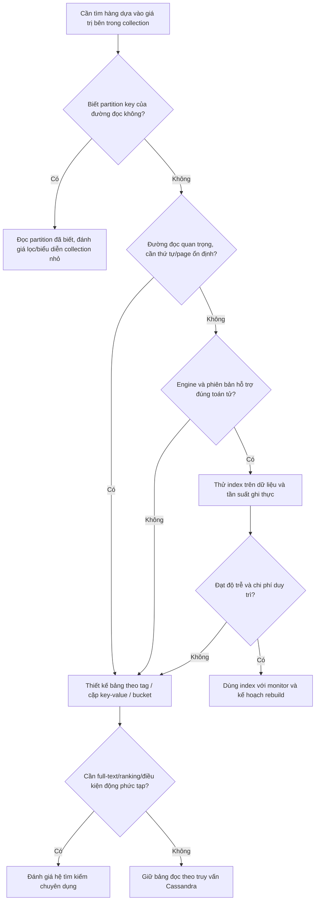

# Chỉ mục hoặc truy vấn collection theo khả năng phiên bản trong Apache Cassandra

> **Chương:** Collection và UDT  
> **Mô-đun:** `DATABASE_ENGINE_WIDE_COLUMN_CASSANDRA` — kiến trúc phân tán, mô hình wide-column, khóa phân vùng, thiết kế bảng theo truy vấn, consistency đọc/ghi, replication, compaction, repair, xử lý lỗi và Java Driver. Trọng tâm ở đây là **tìm kiếm trên `list`, `set`, `map` và giá trị `frozen` theo những khả năng CQL/index thực sự có trong phiên bản đang chạy**.

## 1. Vì sao có cú pháp `CONTAINS` chưa có nghĩa truy vấn sẽ chạy tốt?

Giả sử một cửa hàng lưu sản phẩm theo `item_id`. Mỗi sản phẩm có một số nhãn `tags`, các bí danh `aliases` và thuộc tính tùy biến `attributes`:

```text
item_id = A
tags = {'java', 'database'}
aliases = ['cql-guide', 'cassandra-guide']
attributes = {'language':'vi', 'level':'advanced'}
```

Truy vấn “cho sản phẩm A, lấy toàn bộ nhãn” khác hẳn “tìm tất cả sản phẩm có nhãn `java`”. Truy vấn đầu **biết partition key** và thường phù hợp với Cassandra. Truy vấn thứ hai bắt đầu từ **giá trị nằm bên trong collection**, nên cần một đường truy cập thứ cấp: index có khả năng tương ứng, bảng đọc được thiết kế theo nhãn, hoặc hệ thống tìm kiếm riêng.

Các phép toán CQL như `CONTAINS`, `CONTAINS KEY` hay biểu thức `map['key'] = value` mô tả **điều kiện**; chúng không tự hứa rằng hệ thống có cấu trúc truy cập tối ưu để tìm các partition thỏa điều kiện. Tùy **phiên bản Cassandra, loại secondary index và cấu hình**, một câu `SELECT` có thể:

1. Chạy được nhờ index được hỗ trợ.
2. Bị từ chối vì không có đường truy vấn phù hợp.
3. Chỉ chạy nếu dùng `ALLOW FILTERING`, có nguy cơ quét nhiều dữ liệu và không đạt SLO.
4. Dùng được về mặt cú pháp nhưng vẫn chậm vì nhiều partition cùng khớp hoặc index gây fan-out rộng.

**Thông điệp chính:** thiết kế bảng theo truy vấn và partition key vẫn là lựa chọn nền tảng. Chỉ mục là công cụ hỗ trợ **đúng loại truy vấn và đúng workload**, không phải cách biến một bảng wide-column thành tài liệu JSON có thể tìm kiếm tự do.

## 2. Chuẩn bị dữ liệu để phân biệt các dạng truy vấn

Ví dụ giả định keyspace `app` đã tồn tại và được cấu hình replication phù hợp. Các `item_id` dưới đây chỉ là UUID mẫu, không có ý nghĩa định tuyến đặc biệt ngoài vai trò khóa chính:

```sql
CREATE TABLE app.collection_search_lab (
    item_id uuid PRIMARY KEY,
    title text,
    category text,
    tags set<text>,
    aliases list<text>,
    attributes map<text, text>,
    specs_snapshot frozen<map<text, text>>
);

INSERT INTO app.collection_search_lab (
    item_id, title, category, tags, aliases, attributes, specs_snapshot
) VALUES (
    11111111-1111-4111-8111-111111111111,
    'Cassandra for Java', 'book',
    {'java', 'database'},
    ['cql-guide', 'cassandra-guide'],
    {'language':'vi', 'level':'advanced'},
    {'edition':'2', 'binding':'paper'}
);

INSERT INTO app.collection_search_lab (
    item_id, title, category, tags, aliases, attributes, specs_snapshot
) VALUES (
    22222222-2222-4222-8222-222222222222,
    'Distributed Data Lab', 'course',
    {'database', 'distributed'},
    ['data-systems'],
    {'language':'en', 'level':'beginner'},
    {'edition':'1', 'format':'video'}
);

-- Đường đọc trực tiếp, biết đầy đủ primary key.
SELECT title, tags, aliases, attributes, specs_snapshot
FROM app.collection_search_lab
WHERE item_id = 11111111-1111-4111-8111-111111111111;
```

Vì `item_id` là **partition key**, truy vấn cuối có đường định tuyến trực tiếp đến nhóm replica chịu trách nhiệm. Cassandra không cần khám phá `item_id` từ các nhãn. Trái lại, các truy vấn ngược ở phần sau cần cân nhắc **chỉ mục** hoặc **một bảng khác**.

> **Lưu ý thực hành:** Các ví dụ tạo index phía dưới minh họa các **phương án độc lập**. Với cùng một cột map, không tự chạy mọi lựa chọn `KEYS`, `VALUES`, `ENTRIES` cùng lúc; hãy chọn mục tiêu tìm kiếm, thử trên phiên bản đích và tạo lại hoặc bỏ index khi chuyển sang phương án khác. Cú pháp index có thể khác nhau giữa Cassandra thuần và bản phân phối/dịch vụ quản lý.

## 3. Bảng phân loại điều kiện trên collection

| Câu hỏi nghiệp vụ | Kiểu dữ liệu | Điều kiện CQL điển hình | Loại đường truy cập cần xem xét |
| --- | --- | --- | --- |
| Có tag `java`? | `set<text>` | `tags CONTAINS 'java'` | Index hỗ trợ **values của set** hoặc bảng theo tag |
| List có bí danh `cql-guide`? | `list<text>` | `aliases CONTAINS 'cql-guide'` | Index hỗ trợ **values của list** hoặc bảng theo alias |
| Map có key `language`? | `map<text,text>` | `attributes CONTAINS KEY 'language'` | Index **map keys** hoặc bảng theo key |
| Map có value `advanced` ở bất kỳ key? | `map<text,text>` | `attributes CONTAINS 'advanced'` | Index **map values** hoặc bảng phù hợp |
| Map có cặp `level=advanced`? | `map<text,text>` | `attributes['level'] = 'advanced'` | Index **map entries** hoặc bảng theo cặp key/value |
| Frozen map bằng chính xác snapshot S? | `frozen<map<...>>` | `specs_snapshot = {...}` | Index **toàn giá trị** nếu engine/phiên bản hỗ trợ |
| Tìm theo `address.city` bên trong UDT? | UDT | Không được suy ra từ các phép trên | Bảng theo city hoặc index riêng được kiểm chứng |

Các biểu thức trên không tương đương nhau. `CONTAINS KEY 'level'` chỉ hỏi **sự hiện diện của key**; `CONTAINS 'advanced'` hỏi **value xuất hiện ở đâu đó**; `attributes['level'] = 'advanced'` hỏi **đúng một cặp key/value**. Thiết kế index theo sai loại điều kiện sẽ dẫn đến query không hợp lệ hoặc trả quá nhiều kết quả.

## 4. Tra cứu `set` và `list` bằng `CONTAINS`

Giả sử cụm hỗ trợ **secondary index truyền thống (legacy 2i)** trên collection, như các nhánh Cassandra 3.x/4.x có tính năng tương ứng. Có thể tạo index theo **giá trị phần tử**:

```sql
-- Lập chỉ mục theo giá trị thành viên set.
CREATE INDEX idx_lab_tags_values
ON app.collection_search_lab (VALUES(tags));

-- Lập chỉ mục theo giá trị phần tử list.
CREATE INDEX idx_lab_aliases_values
ON app.collection_search_lab (VALUES(aliases));

-- Hai truy vấn ngược theo phần tử.
SELECT item_id, title
FROM app.collection_search_lab
WHERE tags CONTAINS 'java';

SELECT item_id, title
FROM app.collection_search_lab
WHERE aliases CONTAINS 'cql-guide';
```

Điểm cần nhớ:

- `set` không có phần tử trùng; `list` **có thể** có cùng giá trị nhiều lần. Nhưng index tra cứu `CONTAINS` chủ yếu giúp **tìm hàng có chứa giá trị**, không cung cấp số lần xuất hiện, vị trí hay thứ tự trong list.
- `CONTAINS 'java'` không biến `java` thành partition key; index vẫn phải tham gia xác định những hàng nào có phần tử đó.
- `list` chứa phần tử thay đổi nhanh hoặc nối/xóa liên tục có thể gây nhiều công việc cập nhật index cùng tombstone ở bảng gốc.
- Nếu giá trị `java` có trong phần lớn hàng, index không làm bộ kết quả nhỏ đi. Truy vấn vẫn có thể chậm hoặc phải truyền rất nhiều hàng.

Trong một số bản CQL, cú pháp tạo index cho collection có thể có dạng viết tắt hoặc quy tắc mặc định khác. Để bài học dễ đối chiếu, ví dụ này dùng **`VALUES(column)` rõ ràng**; khi làm thật hãy kiểm chứng DDL và khả năng truy vấn trên phiên bản đang chạy.

## 5. `map`: index theo key, value hay cả entry?

Một `map<text,text>` có **ba kiểu câu hỏi**, và chúng thường yêu cầu **ba cách lập chỉ mục khác nhau**. Không nên chọn `KEYS` chỉ vì tên index trông ngắn hơn: hãy xuất phát từ câu `SELECT` thực sự cần hỗ trợ.

### 5.1. Tìm hàng có một key: `KEYS(map)`

Ví dụ khi muốn tìm các sản phẩm có khai báo thuộc tính `'language'`, bất kể giá trị của thuộc tính:

```sql
-- Phương án A: index theo các key của map.
CREATE INDEX idx_lab_attributes_keys
ON app.collection_search_lab (KEYS(attributes));

SELECT item_id, title
FROM app.collection_search_lab
WHERE attributes CONTAINS KEY 'language';
```

Điều kiện trên có thể khớp cả sản phẩm `language=vi` lẫn `language=en`. Nó **không** phân biệt hai giá trị này.

### 5.2. Tìm theo một value bất kể key: `VALUES(map)`

Để thử phương án dưới đây trên **cùng cột map** trong bài thực hành, hãy **bỏ index thử nghiệm A** trước và đợi cụm xử lý thay đổi schema/index. Không mặc định một cột có thể đồng thời dùng mọi kiểu index trong mọi engine:

```sql
-- Chỉ chạy khi chuyển sang thử phương án B.
DROP INDEX IF EXISTS app.idx_lab_attributes_keys;

CREATE INDEX idx_lab_attributes_values
ON app.collection_search_lab (VALUES(attributes));

SELECT item_id, title
FROM app.collection_search_lab
WHERE attributes CONTAINS 'advanced';
```

`CONTAINS 'advanced'` kiểm tra **một value ở bất kỳ key nào** của map. Nếu ứng dụng cần `level=advanced` chứ không phải `language=advanced`, điều kiện chỉ theo value **chưa đủ chính xác**.

### 5.3. Tìm theo cặp key/value cụ thể: `ENTRIES(map)`

Nếu yêu cầu là sản phẩm có `attributes['level'] = 'advanced'`, hãy thử index **entry** phù hợp trên một cấu hình hỗ trợ:

```sql
-- Chỉ chạy khi chuyển sang thử phương án C.
DROP INDEX IF EXISTS app.idx_lab_attributes_values;

CREATE INDEX idx_lab_attributes_entries
ON app.collection_search_lab (ENTRIES(attributes));

SELECT item_id, title
FROM app.collection_search_lab
WHERE attributes['level'] = 'advanced';
```

`ENTRIES` nhắm vào **cặp key/value**, phù hợp điều kiện trên hơn chỉ mục `KEYS` hoặc `VALUES` riêng lẻ. Tuy nhiên, khả năng dùng biểu thức map-entry, các tổ hợp index và cách lập kế hoạch truy vấn còn tùy engine/phiên bản. Nếu có nhiều điều kiện lọc kết hợp, hãy thử **truy vấn hoàn chỉnh** trước khi coi index hoạt động đúng như mong muốn.

### So sánh phạm vi chính xác

| Trạng thái map | `CONTAINS KEY 'level'` | `CONTAINS 'advanced'` | `['level'] = 'advanced'` |
| --- | --- | --- | --- |
| `{'level':'advanced'}` | Đúng | Đúng | Đúng |
| `{'level':'beginner','mode':'advanced'}` | Đúng | Đúng | Sai |
| `{'mode':'advanced'}` | Sai | Đúng | Sai |
| `{'language':'vi'}` | Sai | Sai | Sai |

Đây là **bảng ngữ nghĩa điều kiện**; không có nghĩa cả ba phép có thể chạy đồng thời trên một schema/index bất kỳ. Chọn index hoặc bảng đọc theo **độ chính xác yêu cầu** chứ không chỉ theo tên toán tử.

## 6. Frozen collection và `FULL(...)`: index cả giá trị, không phải phần tử

`specs_snapshot frozen<map<text,text>>` là **một cell** chứa toàn bộ map. Trong các phiên bản/engine hỗ trợ index toàn giá trị frozen collection, một dạng DDL được sử dụng là `FULL(...)`:

```sql
-- Ví dụ legacy 2i: chỉ áp dụng khi engine/phiên bản hỗ trợ FULL(frozen).
CREATE INDEX idx_lab_specs_full
ON app.collection_search_lab (FULL(specs_snapshot));

SELECT item_id, title
FROM app.collection_search_lab
WHERE specs_snapshot = {'edition':'2', 'binding':'paper'};
```

Chỉ mục `FULL` nhắm tới **so sánh toàn giá trị collection**. Nó không tự cung cấp điều kiện như `specs_snapshot CONTAINS KEY 'edition'` hay `specs_snapshot['edition'] = '2'` với index key/entry. Nếu cần tra cứu từng thuộc tính thường xuyên, frozen map thường **không phải lựa chọn phù hợp** cho yêu cầu đó.

Ghi lại frozen map có nghĩa thay **toàn snapshot**; điều này khác với `attributes['level'] = 'advanced'` trên non-frozen map. Khi giá trị frozen lớn hoặc bị thay thường xuyên, dung lượng mutation, index maintenance và nguy cơ lost update đều cần đánh giá.

**Cẩn trọng về phiên bản:** Đừng coi `FULL`, `KEYS`, `VALUES`, `ENTRIES` là những tùy chọn luôn sẵn có cho **mọi** loại index hay mọi bản phân phối. `FULL` trong ví dụ là một khả năng lịch sử của một số hệ index trên Cassandra; cú pháp/khả năng thực tế phải được xác nhận trước khi chạy DDL.

## 7. Legacy secondary index (2i) và Storage-Attached Index (SAI)

**Apache Cassandra không có một câu trả lời duy nhất cho mọi phiên bản**. Khi chọn chỉ mục, phải biết rõ *server/version/engine* chứ không chỉ biết từ khóa `CREATE INDEX`.

| Nhóm hệ thống | Cần hiểu gì trước khi áp dụng ví dụ? | Cách làm an toàn |
| --- | --- | --- |
| Cassandra 2.x hoặc rất cũ | Hỗ trợ collection/index hạn chế hoặc khác bản hiện đại | Không sao chép DDL 3.x/4.x; kiểm tra tính năng bản đang chạy |
| Cassandra 3.x/4.x dùng **legacy 2i** | Có các cách index collection như `KEYS`, `VALUES`, `ENTRIES` và tùy trường hợp `FULL` | Chọn đúng mục tiêu điều kiện, thử DDL + `SELECT` trên chính bản đó |
| Apache Cassandra 5.x | Có **SAI** trong nhánh hiện đại bên cạnh những cơ chế index khác | Xác định provider/index engine được triển khai, xem ma trận kiểu dữ liệu/toán tử của phiên bản |
| Dịch vụ quản lý/bản phân phối khác | Có thể cung cấp SAI hay khả năng chỉ mục từ trước, sau hoặc khác Apache Cassandra OSS | Xác nhận tài liệu, CQL, giới hạn và cấu hình của **nhà cung cấp** |

### Legacy 2i là gì?

Secondary index truyền thống lưu cấu trúc phụ để ánh xạ giá trị được lập chỉ mục sang các hàng/khóa có giá trị đó. Nó không làm thay đổi partition key của bảng chính. Khi truy vấn không biết partition key, coordinator có thể phải **phối hợp tìm kiếm trên nhiều node/replica**; với giá trị phổ biến hay kết quả lớn, index có thể không đem lại tốc độ như mong muốn.

### SAI thay đổi điều gì?

**Storage-Attached Index (SAI)** là cách tổ chức index gắn với cấu trúc lưu trữ/SSTable trong những bản Cassandra hỗ trợ, giúp mở rộng các kiểu workload tìm kiếm thứ cấp và cải thiện cách quản lý index so với nhiều trường hợp legacy 2i. Tuy nhiên, đây **không** phải cam kết rằng mọi biểu thức collection, tổ hợp điều kiện, `frozen`, UDT hay map entry đều có thể truy vấn bằng một cú pháp chung.

Ví dụ nhận diện provider SAI trong những môi trường hỗ trợ cú pháp này (cột `category` là scalar để tránh suy đoán về khả năng collection của từng phiên bản):

```sql
-- VÍ DỤ PHỤ THUỘC PHIÊN BẢN/ENGINE, không chạy nếu không có SAI.
CREATE CUSTOM INDEX idx_lab_category_sai
ON app.collection_search_lab (category)
USING 'StorageAttachedIndex';

SELECT item_id, title
FROM app.collection_search_lab
WHERE category = 'book';
```

Ví dụ SAI trên **cột scalar** không chứng minh rằng cú pháp `KEYS(attributes)`/`ENTRIES(attributes)` của legacy 2i hoạt động giống hệt với SAI. Nếu muốn dùng SAI cho collection, phải kiểm tra **kiểu collection**, **đối tượng index**, **toán tử truy vấn**, **khả năng kết hợp predicate** và **phiên bản server/driver** cụ thể. Không tự động thay chữ `USING` vào một DDL legacy rồi giả định mọi điều kiện chạy được.

## 8. Cách kiểm tra năng lực index của một cluster mà không phỏng đoán

Một quy trình tối thiểu ở môi trường thử nghiệm:

1. Xác định **phiên bản và bản phân phối** Cassandra đang chạy; nếu cluster đang nâng cấp, cần tính đến các node khác phiên bản và tính năng chưa thể bật.
2. Xem schema bảng, index đang có và type của cột, tránh tạo chỉ mục trùng hoặc khác engine trên cùng cột mà không biết hệ quả.
3. Đối chiếu **ma trận hỗ trợ** cho `list`, `set`, map `KEYS`/`VALUES`/`ENTRIES`, frozen collection và loại index dự định sử dụng.
4. Chạy `CREATE INDEX` trên **bảng thử nghiệm nhỏ**, chờ quá trình xây dựng/cập nhật index hoàn tất theo cơ chế phiên bản; không đo latency ngay khi index chưa sẵn sàng.
5. Chạy **chính xác câu `SELECT` cần thiết**. Kiểm tra không chỉ “query trả kết quả”, mà cả số hàng, tính đúng của điều kiện, latency và fan-out.
6. Đo với dữ liệu có phân bố giống sản xuất: một tag phổ biến, một tag hiếm, nhiều mutation xóa/TTL và các partition kích thước khác nhau.
7. Chỉ triển khai lên production khi có kế hoạch **rollback index, monitoring, rebuild và giới hạn tải** phù hợp phiên bản.

Trong `cqlsh`, các lệnh sau hữu ích để quan sát metadata (cú pháp có thể thay đổi theo phiên bản):

```sql
DESCRIBE TABLE app.collection_search_lab;

-- Kiểm tra schema index được công bố trong system_schema (nếu hỗ trợ).
SELECT keyspace_name, table_name, index_name, kind, options
FROM system_schema.indexes
WHERE keyspace_name = 'app' AND table_name = 'collection_search_lab';
```

`DESCRIBE` là lệnh tiện ích của `cqlsh`, **không phải** CQL dùng nguyên văn trong Java prepared statement. `system_schema` giúp xem khai báo index, nhưng việc xác minh index **đã xây dựng xong và query sẵn sàng** cần quan trắc trạng thái/công cụ phù hợp với engine. Đừng biến một truy vấn schema metadata thành lời bảo đảm tuyệt đối rằng index đang khỏe ở mọi replica.

## 9. Khi nào index collection dễ trở thành nút thắt?

### 9.1. Giá trị ít chọn lọc

Nếu `tags CONTAINS 'database'` khớp 95% sản phẩm, index vẫn phải xử lý/thu thập một bộ kết quả khổng lồ. Dù có index, `LIMIT 20` không làm cho hệ thống biết ngay 20 hàng “tốt nhất” theo thứ tự nghiệp vụ tùy ý, nhất là khi cần thêm sắp xếp không được hỗ trợ bởi clustering key.

### 9.2. Tốc độ ghi/xóa và TTL cao

Mỗi lần thêm/xóa phần tử `set`, `list` hay map entry có thể yêu cầu cập nhật **cấu trúc chỉ mục phụ** cùng mutation bảng chính. TTL làm dữ liệu hết hạn; tombstone và compaction làm các phiên bản cũ tồn tại một thời gian trước khi được dọn an toàn. Index không miễn phí khi ghi: hãy đo **write latency, index disk usage, compaction backlog và read p95/p99**.

### 9.3. Collection lớn và hot partition

Một partition chứa `map` hàng trăm nghìn entry là vấn đề mô hình dữ liệu, ngay cả khi lập chỉ mục cho key/value của map. Các entry vẫn nằm trong **một hàng/partition**. Một vài replica chịu trách nhiệm cho partition đó có thể bị quá tải ghi/đọc, repair hoặc streaming. Index không tách collection thành các hàng độc lập để phân trang phần tử.

### 9.4. Nhiều điều kiện kết hợp và thứ tự kết quả

Ví dụ “tag `java`, `level=advanced`, tạo trong 30 ngày gần nhất, sắp xếp từ mới tới cũ” là **một truy vấn có nhiều điều kiện và ordering**. Không mặc định rằng có ba index riêng là Cassandra sẽ tự giao/ghép chúng hiệu quả như một hệ tìm kiếm quan hệ. Khả năng phối hợp predicate phụ thuộc index engine, và thứ tự kết quả hiệu quả thường cần **clustering key hoặc bảng được thiết kế riêng**.

Nếu truy vấn là đường đọc trọng yếu, có lưu lượng lớn và SLO chặt, **bảng theo truy vấn** thường đáng tin cậy hơn việc thêm index vào mọi cột.

## 10. `ALLOW FILTERING` không biến truy vấn quét thành truy vấn tối ưu

Khi không có đường truy cập thích hợp, bạn có thể gặp thông báo rằng truy vấn cần lọc dữ liệu mà Cassandra không thể thực hiện an toàn theo schema hiện tại. Một số truy vấn cho phép thêm `ALLOW FILTERING`:

```sql
-- CHỈ MINH HỌA; tránh dùng làm đường đọc production toàn cluster.
SELECT item_id, title
FROM app.collection_search_lab
WHERE tags CONTAINS 'java'
ALLOW FILTERING;
```

`ALLOW FILTERING` là **cho phép thực thi cách lọc tốn kém** khi truy vấn được CQL hỗ trợ; nó **không tạo index**, không thay đổi partition key và không bảo đảm độ trễ tốt. Trên một bảng rất lớn, lọc toàn cluster có thể đọc nhiều partition rồi bỏ hầu hết hàng không khớp.

Nếu query còn không được phiên bản CQL hỗ trợ về cú pháp/toán tử, thêm `ALLOW FILTERING` **không sửa được** vấn đề đó. Đừng dùng nó như mẹo chữa mọi lỗi `SELECT` trên collection.

## 11. Giải pháp theo truy vấn: bảng `items_by_tag_month`

Giả sử API chính của ứng dụng là **“lấy 20 sản phẩm mới nhất có tag `java` trong tháng 2026-11”**. Nếu truy vấn này xuất hiện liên tục, có thể tạo bảng chuyên cho chiều đọc đó:

```sql
CREATE TABLE app.items_by_tag_month (
    tag text,
    bucket_month text,
    created_at timeuuid,
    item_id uuid,
    title text,
    PRIMARY KEY ((tag, bucket_month), created_at, item_id)
) WITH CLUSTERING ORDER BY (created_at DESC, item_id ASC);

-- Một hàng cho một item tại một tag và bucket tháng.
INSERT INTO app.items_by_tag_month (
    tag, bucket_month, created_at, item_id, title
) VALUES (
    'java', '2026-11',
    8cbe0000-e581-11f1-8e9a-0242ac120002,
    11111111-1111-4111-8111-111111111111,
    'Cassandra for Java'
);

SELECT created_at, item_id, title
FROM app.items_by_tag_month
WHERE tag = 'java' AND bucket_month = '2026-11'
LIMIT 20;
```

Ở đây `(tag, bucket_month)` là **composite partition key**; `(created_at, item_id)` là **clustering key**. Query không cần `CONTAINS` vì chiều tìm kiếm đã được đưa vào khóa. `LIMIT 20` giới hạn **20 hàng**, và Java Driver có thể page các hàng đó.

Một item có nhiều tag sẽ được **ghi vào nhiều partition** (mỗi tag/bucket một hàng). Nếu item đổi tag hoặc bị xóa, ứng dụng cần cập nhật/xóa các hàng trong bảng đọc tương ứng; đó là chi phí **denormalization** phải được thiết kế với retry và reconciliation.

**Không có bucket phù hợp cho mọi hệ thống:** Nếu tag `java` có hàng triệu item/tháng, partition `(java, 2026-11)` vẫn quá lớn/nóng. Có thể dùng bucket ngày, giờ hoặc shard; bù lại phải truy vấn/ghép kết quả từ nhiều bucket. Nếu `created_at` dùng `timeuuid`, ứng dụng cần **giữ cùng ID ổn định khi retry**, không tạo timeuuid mới cho cùng một sự kiện ghi.

## 12. Cặp key/value truy vấn thường xuyên: bảng `items_by_attribute`

Nếu API cần **“những sản phẩm có `level = advanced` trong tháng này”**, thay vì dò khắp `attributes`, ta có thể mô hình hóa đúng cặp thuộc tính:

```sql
CREATE TABLE app.items_by_attribute_month (
    attribute_name text,
    attribute_value text,
    bucket_month text,
    created_at timeuuid,
    item_id uuid,
    title text,
    PRIMARY KEY (
        (attribute_name, attribute_value, bucket_month),
        created_at, item_id
    )
) WITH CLUSTERING ORDER BY (created_at DESC, item_id ASC);

INSERT INTO app.items_by_attribute_month (
    attribute_name, attribute_value, bucket_month,
    created_at, item_id, title
) VALUES (
    'level', 'advanced', '2026-11',
    8cbe0000-e581-11f1-8e9a-0242ac120002,
    11111111-1111-4111-8111-111111111111,
    'Cassandra for Java'
);

SELECT item_id, title, created_at
FROM app.items_by_attribute_month
WHERE attribute_name = 'level'
  AND attribute_value = 'advanced'
  AND bucket_month = '2026-11'
LIMIT 20;
```

Ưu điểm là **điều kiện key/value chính xác** nằm trong partition key và thứ tự thời gian nằm trong clustering key. Điều này thay thế đường truy vấn kiểu `attributes['level'] = 'advanced'` ở bảng theo item ID khi nó trở thành chức năng cốt lõi.

Đánh đổi: một item có nhiều thuộc tính sẽ có nhiều hàng trong bảng lookup; khi thay giá trị `level`, ứng dụng phải **xóa hàng thuộc giá trị cũ** và chèn hàng thuộc giá trị mới, xử lý lỗi giữa các bước và tránh để bảng đọc lệch mãi khỏi nguồn dữ liệu chính. Cassandra không tự xây và đồng bộ bảng thủ công này chỉ vì bảng gốc dùng map.

## 13. `map<text,frozen<UDT>>` và truy vấn theo field sâu

Một schema như sau thuận tiện khi muốn đọc **vài địa chỉ theo nhãn** của một người dùng:

```sql
CREATE TYPE app.location_address (
    city text,
    country_code text
);

CREATE TABLE app.user_address_book (
    user_id uuid PRIMARY KEY,
    addresses map<text, frozen<location_address>>
);
```

Ứng dụng biết `user_id` có thể đọc map, sau đó chọn entry `'home'` ở tầng Java. Nhưng đừng mặc định có thể tạo một index `ENTRIES(addresses)` rồi truy vấn **`addresses['home'].city = 'Da Nang'`** trên mọi phiên bản Cassandra. Index entry của map, nếu được hỗ trợ, thường xét **giá trị entry ở độ hạt phù hợp**; field sâu trong frozen UDT không tự trở thành một khóa tra cứu riêng.

Với yêu cầu “tìm tất cả người dùng có địa chỉ `home` ở Da Nang”, hãy cân nhắc:

- Bảng đọc được phân vùng theo **`city`** và bucket/shard phù hợp.
- Index chuyên biệt được **xác nhận rõ** là hỗ trợ kiểu UDT/field lồng trong phiên bản cụ thể.
- Hệ tìm kiếm ngoài Cassandra nếu cần nhiều trường, full-text, ranking và điều kiện động phức tạp.

Một cấu trúc `map` chứa hàng nghìn UDT cũng không nên được giữ chỉ vì tìm kiếm đã có index: giới hạn **số phần tử, kích thước row/partition và tần suất mutation** vẫn cần được đảm bảo.

## 14. Java Driver 4.x: gọi index query và bảng đọc theo tag

Java Driver không tự tạo chỉ mục cho một câu `SELECT`. Nó gửi CQL đến cluster, và **server** quyết định truy vấn có hợp lệ/được index hỗ trợ hay không. Ví dụ này giả định đã tạo `idx_lab_tags_values` và bảng `items_by_tag_month` ở phần trước.

```java
import com.datastax.oss.driver.api.core.CqlSession;
import com.datastax.oss.driver.api.core.cql.BoundStatement;
import com.datastax.oss.driver.api.core.cql.PreparedStatement;
import com.datastax.oss.driver.api.core.cql.ResultSet;
import com.datastax.oss.driver.api.core.cql.Row;
import java.util.UUID;

class CollectionLookupRepository {
    private final CqlSession session;
    private final PreparedStatement byIndexedTag;
    private final PreparedStatement byTagAndMonth;

    CollectionLookupRepository(CqlSession session) {
        this.session = session;
        this.byIndexedTag = session.prepare(
            "SELECT item_id, title FROM app.collection_search_lab " +
            "WHERE tags CONTAINS ?"
        );
        this.byTagAndMonth = session.prepare(
            "SELECT item_id, title, created_at " +
            "FROM app.items_by_tag_month " +
            "WHERE tag = ? AND bucket_month = ? LIMIT 20"
        );
    }

    void printByIndexedTag(String tag) {
        BoundStatement statement = byIndexedTag.bind(tag).setPageSize(50);
        ResultSet results = session.execute(statement);
        for (Row row : results) {
            UUID itemId = row.getUuid("item_id");
            System.out.println(itemId + " " + row.getString("title"));
        }
    }

    void printLatestForTag(String tag, String monthBucket) {
        BoundStatement statement = byTagAndMonth.bind(tag, monthBucket)
            .setPageSize(20);
        ResultSet results = session.execute(statement);
        for (Row row : results) {
            System.out.println(row.getUuid("item_id"));
        }
    }
}
```

`setPageSize(50)` là số hàng mục tiêu mỗi trang được driver yêu cầu, **không** có nghĩa tự động lấy đúng 50 phần tử collection và không phải giới hạn tổng số hàng mà vòng lặp trả về. Với `ResultSet` đồng bộ, việc lặp có thể **tải trang kế tiếp tự động**. Đối với API HTTP phân trang, cần quản lý paging state/giới hạn kết quả theo cơ chế driver, thay vì luôn duyệt hết kết quả chỉ vì có `setPageSize`.

Nếu truy vấn index `tags CONTAINS ?` không được hỗ trợ hoặc index chưa sẵn sàng, driver sẽ nhận lỗi từ server; **không** nên bắt ngoại lệ rồi tự động thêm `ALLOW FILTERING` trong production. Khi SLO đòi latency ổn định, ưu tiên đường đọc theo partition key của `items_by_tag_month`, đồng thời duy trì bảng theo tag nhất quán với bảng nguồn.

## 15. Đọc/ghi nhất quán và vận hành index trên cluster phân tán

Việc lập chỉ mục làm tăng **khối lượng công việc của các replica**. Trên một bảng có RF=3, mỗi mutation dữ liệu gốc phải được xử lý theo consistency level đã chọn và cấu trúc phụ tương ứng trên các node liên quan cũng cần được quản lý theo engine. Khi tạo index trên bảng đã có dữ liệu, quá trình xây dựng index ban đầu có thể tiêu thụ CPU/disk và cần thời gian; không nên cho rằng `CREATE INDEX` lập tức khiến mọi truy vấn sẵn sàng ở cùng một thời điểm trên mọi node.

| Yếu tố | Điều cần cân nhắc |
| --- | --- |
| **Consistency level** | `ONE`, `LOCAL_QUORUM`, `QUORUM` điều chỉnh mức đọc/ghi trên replica; **không tự tạo thêm đường truy vấn** cho collection |
| **Replication factor** | Bảng gốc và dữ liệu index có chi phí lưu/duy trì gắn với replica và engine |
| **TTL/tombstone** | Thêm/xóa phần tử, hết hạn dữ liệu ảnh hưởng index maintenance, read path và compaction |
| **Compaction** | Hợp nhất SSTable và dọn metadata cũ khi an toàn; việc quản lý index có thể có tác vụ riêng tùy engine |
| **Repair** | Giúp replica đồng bộ dữ liệu gốc/tombstone; kiểm tra quy trình index rebuild/consistency tương ứng engine |
| **Node failure/streaming** | Phải tính kế hoạch phục hồi, rebuild index và ảnh hưởng của tải index khi bootstrap/decommission |
| **Schema agreement** | DDL tạo/bỏ index cần được các node nhận; theo dõi trạng thái xây dựng trước khi bật đường đọc mới |

Đừng tự ý giảm `gc_grace_seconds` vì bảng có nhiều tombstone sau các thao tác xóa collection. Replica bỏ lỡ delete cần được repair trước khi tombstone biến mất an toàn; nếu không có thể xảy ra **zombie data**. Đối với index, ngoài metric latency của CQL còn cần metric/index diagnostics **riêng cho engine** nếu bản phân phối cung cấp.

### Đo latency và mức chọn lọc

Tạo workload gần thực tế, so sánh hai phương án **index collection** và **bảng query-driven** với cùng replication, consistency và tỷ lệ đọc/ghi. Theo dõi ít nhất:

1. p50/p95/p99 latency và tỷ lệ timeout cho truy vấn tag hiếm so với tag phổ biến.
2. Số partition/nút tham gia, dữ liệu đọc/trao đổi và kích thước result set.
3. Chi phí ghi thêm khi index tồn tại: throughput, I/O và compaction backlog.
4. Số lượng add/delete/TTL trên collection và tombstone warnings.
5. Dung lượng/index build hoặc rebuild, tải khi repair/streaming và khi thêm node.

`TRACING ON;` trong `cqlsh` giúp quan sát một số request ở staging và `TRACING OFF;` để tắt; tracing có overhead, không bật toàn cluster dưới tải lớn. `nodetool tablestats` và công cụ giám sát index của engine có thể cung cấp thông tin bổ sung, nhưng khả năng và tên metric phụ thuộc phiên bản.

## 16. Hướng quyết định: index, bảng khác hay hệ tìm kiếm?



**Một bảng chuyên cho đường đọc không phải lúc nào cũng tốt hơn mọi index.** Với một công cụ quản trị có dữ liệu nhỏ, truy vấn thưa và không yêu cầu thứ tự phức tạp, index phù hợp phiên bản có thể giúp triển khai nhanh. Ngược lại, API truy cập liên tục với phân trang, sắp xếp theo thời gian và số kết quả lớn thường đáng đầu tư bảng denormalized dựa trên partition/clustering key.

## 17. Những lỗi tư duy hay gặp

| Nhận định sai | Điều đúng cần nhớ |
| --- | --- |
| “`CONTAINS` viết được là chạy nhanh.” | Cú pháp điều kiện không bảo đảm có index, tính chọn lọc hay độ trễ tốt |
| “Index `KEYS(map)` hỗ trợ mọi truy vấn trên map.” | Nó nhắm vào **key**, không tự bảo đảm predicate theo value hoặc cặp key/value |
| “`VALUES(map)` tìm chính xác `level=advanced`.” | Chỉ kiểm tra **value tồn tại ở một key nào đó**; cần entry index/bảng khác nếu yêu cầu đúng cặp |
| “`FULL(frozen_map)` tìm từng entry.” | Index theo **toàn frozen value**, không phải key con |
| “Mọi bản Cassandra đều có cùng index và cú pháp.” | Cần kiểm tra **version, engine và bản phân phối** |
| “Chuyển sang SAI là mọi `CONTAINS`/UDT đều được hỗ trợ.” | Hỗ trợ loại kiểu và toán tử phụ thuộc phiên bản; phải chạy thử truy vấn thật |
| “`ALLOW FILTERING` là một loại index.” | Nó cho phép lọc có thể quét nhiều dữ liệu; không tạo đường truy cập mới |
| “`LIMIT 20` chỉ trả 20 phần tử list.” | `LIMIT` giới hạn **hàng** kết quả, không cắt collection của một hàng |
| “Có index thì collection có thể tăng vô hạn.” | Row/partition lớn, tombstone, ghi nóng vẫn là vấn đề mô hình dữ liệu |
| “Tăng `QUORUM` thay thế index.” | Consistency level không thiết kế đường đọc hoặc giải quyết indexing |

## 18. Bài tập tình huống

**Bài 1 — tag:** API thỉnh thoảng tìm sản phẩm chứa `java` trong `set<text> tags`. Cụm hỗ trợ legacy 2i trên set values. Điều kiện/index nào phù hợp để thử nghiệm?  
**Gợi ý:** `tags CONTAINS 'java'` cùng index `VALUES(tags)`. Cần đo tính chọn lọc và chi phí index trước khi chốt.

**Bài 2 — map key:** Hỏi “có thuộc tính `language` không”, bất kể value. Dùng `KEYS`, `VALUES` hay `ENTRIES`?  
**Gợi ý:** `KEYS(attributes)` phục vụ `attributes CONTAINS KEY 'language'` trên engine hỗ trợ.

**Bài 3 — map value:** Hỏi “có một thuộc tính bất kỳ bằng `advanced`”. `KEYS` index có đủ không?  
**Gợi ý:** Không. Cần đường tìm theo **value**, như `VALUES(attributes)` nếu phiên bản cho phép, hoặc bảng đọc tương ứng.

**Bài 4 — map entry:** Hỏi “`level` chính xác là `advanced`”, không chấp nhận một key khác có value `advanced`. Cần gì?  
**Gợi ý:** Điều kiện `attributes['level'] = 'advanced'` với entry index được hỗ trợ hoặc bảng theo `(attribute_name, attribute_value, bucket)`.

**Bài 5 — frozen map:** Có thể dùng index `FULL(specs_snapshot)` để tra cứu tất cả hàng có `edition='2'`, bất kể các key khác không?  
**Gợi ý:** Không. Index full so sánh **cả snapshot**; tìm entry riêng cần mô hình/index khác phù hợp.

**Bài 6 — version:** Tài liệu internet chỉ cách tạo index `ENTRIES`, nhưng cụm của bạn dùng Cassandra 5.x với SAI và một bản phân phối quản lý. Nên copy DDL rồi cho production traffic chạy ngay không?  
**Gợi ý:** Không. Kiểm tra engine, ma trận kiểu/toán tử, chạy DDL và SELECT trên staging, chờ index sẵn sàng rồi đo.

**Bài 7 — dữ liệu phổ biến:** 90% sản phẩm có tag `database`. Vì sao index có thể không đạt độ trễ dù cú pháp hợp lệ?  
**Gợi ý:** Kết quả rất lớn; index không làm giảm số hàng cần xử lý/di chuyển đáng kể. Thiết kế bảng có bucket/sắp xếp nếu đây là đường đọc chính.

**Bài 8 — truy vấn theo thời gian:** Sản phẩm cần 20 mục mới nhất theo tag `java` mỗi tháng. Dùng collection index hay bảng `items_by_tag_month`?  
**Gợi ý:** Bảng theo `(tag, bucket_month)` + clustering theo thời gian có đường đọc rõ và paging. Cần chấp nhận fan-out ghi/đồng bộ bảng phụ.

**Bài 9 — UDT sâu:** Muốn tìm mọi `addresses['home'].city = 'Da Nang'` trong `map<text,frozen<UDT>>`. Có thể mặc nhiên dùng `ENTRIES` không?  
**Gợi ý:** Không. Field sâu không tự được index; xem hỗ trợ đặc thù của phiên bản hoặc tạo bảng đọc theo city.

**Bài 10 — lỗi sau CREATE INDEX:** Migration đã chạy `CREATE INDEX`, nhưng truy vấn từ Java báo lỗi hoặc timeout ngay. Điều tra gì đầu tiên?  
**Gợi ý:** Schema/index build status, type/operator/engine phù hợp, node khỏe, độ chọn lọc, CL, lượng dữ liệu và cách driver thực thi; không tự bật `ALLOW FILTERING` làm phương án chữa cháy.

## 19. Checklist triển khai

- [ ] Đã xác định chính xác **server Cassandra, phiên bản, bản phân phối và index engine** (legacy 2i, SAI hoặc khác).
- [ ] Đã biết **câu `SELECT` cần phục vụ**, độ chọn lọc thực tế, thứ tự/paging mong muốn và SLO.
- [ ] Đã phân biệt `CONTAINS`, `CONTAINS KEY`, `map['key'] = value`, equality toàn frozen và kiểu dữ liệu được index.
- [ ] Đã kiểm tra khả năng **`KEYS`/`VALUES`/`ENTRIES`/`FULL` trên engine cụ thể**, không suy tính năng từ một bản khác.
- [ ] Đã thử **DDL lẫn truy vấn thật** trên staging, xác nhận index đã sẵn sàng trước khi đo và bật traffic.
- [ ] Đã kiểm thử **giá trị phổ biến/hiếm**, batch ghi/xóa/TTL, hotspot và hiệu ứng nhiều replica.
- [ ] Đã đo **read/write p95/p99, timeout, disk/index size, compaction, repair/streaming** và kế hoạch rebuild.
- [ ] Không dùng `ALLOW FILTERING` như giải pháp mặc định cho đường đọc production lớn.
- [ ] Đã xem xét **bảng theo truy vấn với partition/clustering key và bucket** khi cần phân trang, ordering hoặc hiệu suất ổn định.
- [ ] Với bảng denormalized, đã thiết kế **cập nhật/xóa nhiều bảng, retry, reconciliation và tránh event ID mới khi retry**.
- [ ] Với Java Driver, đã tách **paging của hàng** khỏi việc đọc phần tử collection; không tự sửa câu truy vấn thất bại bằng lọc toàn cluster.

## 20. Ghi nhớ

- **Collection là một giá trị/các cell trong hàng**, không phải bảng con có thể tự do tìm kiếm và phân trang từng mục.
- **`set`/`list`** có thể được tìm theo phần tử bằng `CONTAINS` khi có **index values được phiên bản hỗ trợ**; index không cung cấp vị trí list hay thứ tự nghiệp vụ.
- **`map`** có các câu hỏi khác nhau về **key**, **value** và **cặp key/value**; index `KEYS`, `VALUES`, `ENTRIES` không đồng nghĩa nhau.
- **Frozen collection** có thể được lập chỉ mục theo **toàn giá trị** với cơ chế `FULL` ở những phiên bản hỗ trợ; không nhầm với tra cứu entry.
- **Legacy 2i và SAI khác engine**, khả năng index collection khác theo Cassandra OSS 3.x/4.x/5.x và bản phân phối; luôn kiểm tra ma trận hỗ trợ và chạy thử.
- **Index không sửa được partition lớn, hot partition, collection tăng vô hạn, tombstone hoặc kết quả quá phổ biến**. Cần đo chi phí cả đọc lẫn ghi.
- **`ALLOW FILTERING` không tạo index** và `LIMIT` không cắt phần tử collection. Truy vấn chính có thứ tự/paging thường cần **bảng được thiết kế theo partition và clustering key**.
- Ứng dụng Java phải xử lý index readiness, lỗi từ server, consistency, retry và phân trang; không được giả định `CREATE INDEX` đồng nghĩa mọi truy vấn luôn nhanh và sẵn sàng.
