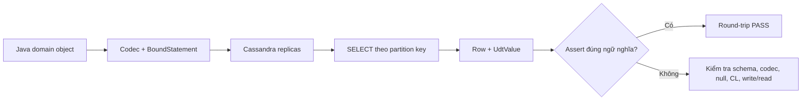

# Ánh xạ collection/UDT sang Java và kiểm thử vòng đọc–ghi với Apache Cassandra

> **Chương:** Collection và UDT  
> **Mô-đun:** `DATABASE_ENGINE_WIDE_COLUMN_CASSANDRA` — kiến trúc Cassandra phân tán, mô hình wide-column, partition key, thiết kế bảng theo truy vấn, replication, consistency đọc/ghi, compaction, repair, xử lý lỗi và kết nối từ Java. Bài học tập trung vào **Java Driver 4.x**, kiểu dữ liệu CQL `list`, `set`, `map`, UDT và kiểm thử *write → read → assert* trên cluster thật.

## 1. Mục tiêu: kiểm tra dữ liệu đọc lại, không chỉ kiểm tra `INSERT` không báo lỗi

Giả sử ứng dụng lưu tùy chọn của người học:

- Danh sách `pinned_lessons`: có **thứ tự**, cho phép hai bài trùng ID nếu nghiệp vụ chấp nhận.
- Tập `tags`: **không trùng lặp**, không có thứ tự hiển thị được bảo đảm.
- Map `preferences`: mỗi khóa cấu hình ánh xạ tới một giá trị.
- UDT `primary_address`: một địa chỉ nhỏ được lưu thành **snapshot frozen**.
- Map `saved_addresses`: vài địa chỉ theo nhãn, mỗi giá trị là một **frozen UDT**.
- UDT `contact`: các trường có thể cập nhật **riêng** nếu dùng non-frozen UDT ở cấp cột.

Một thao tác Java `session.execute(insert)` thành công **chưa đủ** để chứng minh kết quả ánh xạ đúng: có thể sai vị trí bind marker, nhầm `set` với `list`, quên field UDT, xem `null` như collection rỗng, hoặc tự động retry một phép nối list không lũy đẳng. Kiểm thử vòng đọc–ghi (*round-trip*) thực sự cần ghi dữ liệu, đọc theo primary key, rồi so sánh từng giá trị với **ngữ nghĩa của kiểu CQL**.



**Phạm vi kiểm thử:** Ví dụ dùng keyspace/bảng dành riêng cho môi trường lab, không phải schema sản xuất. Test tích hợp chạy với Cassandra thực sự; mock `CqlSession` có thể kiểm tra logic gọi method nhưng **không kiểm chứng** encoding, schema, metadata, replication hoặc hành vi lưu trữ.

## 2. Bảng ánh xạ CQL → Java Driver 4.x

| Kiểu CQL | Kiểu Java thường dùng | Ghi vào `BoundStatement` | Đọc từ `Row` |
| --- | --- | --- | --- |
| `text`, `varchar` | `String` | `setString(...)` | `getString(...)` |
| `uuid`, `timeuuid` | `UUID` | `setUuid(...)` | `getUuid(...)` |
| `int`, `bigint` | `int`/`Integer`, `long`/`Long` | `setInt(...)`, `setLong(...)` | `getInt(...)`, `getLong(...)` |
| `timestamp` | `Instant` | `setInstant(...)` | `getInstant(...)` |
| `date` | `LocalDate` | `setLocalDate(...)` | `getLocalDate(...)` |
| `decimal` | `BigDecimal` | `setBigDecimal(...)` | `getBigDecimal(...)` |
| `list<text>` | `List<String>` | `setList(..., String.class)` | `getList(..., String.class)` |
| `set<text>` | `Set<String>` | `setSet(..., String.class)` | `getSet(..., String.class)` |
| `map<text,text>` | `Map<String,String>` | `setMap(..., String.class, String.class)` | `getMap(..., String.class, String.class)` |
| UDT `address_type` | `UdtValue` | `setUdtValue(...)` | `getUdtValue(...)` |
| `map<text,frozen<address_type>>` | `Map<String,UdtValue>` | `setMap(..., String.class, UdtValue.class)` | `getMap(..., String.class, UdtValue.class)` |

`getList`, `getSet`, `getMap` là API typed của driver, không trả về chuỗi JSON. Các `Class<T>` giúp codec registry tìm cách giải mã đúng phần tử. **Không** mặc định `getString("tags")` là cách đọc `set<text>`, hoặc `Map<String,Object>` sẽ tự encode được bất kỳ đối tượng Java tùy ý.

Các kiểu scalar khác (`boolean`, `double`, `blob`, `varint`, `duration`...) có ánh xạ riêng. Chủ đề của bài này là collection và UDT; khi dùng type phức tạp không có codec mặc định, cần định nghĩa/đăng ký **codec** phù hợp phiên bản driver thay vì dựa vào `.toString()` hoặc JSON tự phát.

## 3. Chuẩn bị schema lab có thể chạy lại

Ví dụ dùng keyspace riêng `cassandra_java_lab`. Đoạn `SimpleStrategy` với replication factor `1` **chỉ phù hợp Cassandra một datacenter cục bộ để học**, không phải cấu hình production. Trong cluster thực cần cân nhắc `NetworkTopologyStrategy`, datacenter, RF và consistency theo yêu cầu.

```sql
-- Chạy một lần trong cqlsh dành cho môi trường lab.
CREATE KEYSPACE IF NOT EXISTS cassandra_java_lab
WITH replication = {
    'class': 'SimpleStrategy',
    'replication_factor': 1
};

CREATE TYPE IF NOT EXISTS cassandra_java_lab.address_type (
    street text,
    city text,
    country_code text,
    postal_code text
);

CREATE TYPE IF NOT EXISTS cassandra_java_lab.contact_type (
    email text,
    phone text
);

CREATE TABLE IF NOT EXISTS cassandra_java_lab.user_payload (
    user_id uuid PRIMARY KEY,
    pinned_lessons list<text>,
    tags set<text>,
    preferences map<text, text>,
    primary_address frozen<address_type>,
    saved_addresses map<text, frozen<address_type>>,
    contact contact_type,
    revision int
);
```

Sau khi tạo type và bảng, cần xác nhận **schema agreement** giữa các node trước khi Java Driver `prepare`/tạo `UdtValue`. Việc type tồn tại trên một node vừa nhận DDL không chứng minh metadata đã hội tụ trên toàn cluster. `IF NOT EXISTS` giúp tránh lỗi tạo trùng nhưng **không xác nhận** cấu trúc type/bảng hiện tại giống hệt schema mong muốn; nếu đã có tên này với field khác, cần đối chiếu thủ công hoặc qua hệ migration.

### Vì sao có cả frozen và non-frozen UDT?

`primary_address frozen<address_type>` lưu **toàn bộ địa chỉ trong một cell**. Với map `saved_addresses`, mỗi entry có khóa `'home'` hoặc `'work'`, nhưng giá trị UDT bên trong là **frozen**, nên muốn sửa một trường phải thay **cả UDT ở entry đó**. Cột `contact contact_type` là **non-frozen ở cấp cột**: có thể cập nhật `contact.email` mà không cần ghi lại `contact.phone` khi phiên bản Cassandra hỗ trợ thao tác field-level thông thường.

## 4. Tạo `CqlSession` và quản lý vòng đời kết nối

Trong Java Driver 4.x, ứng dụng thông thường duy trì **một `CqlSession` dùng chung** cho nhiều truy vấn. Không mở/đóng session cho từng request hay mỗi row. Ví dụ kết nối Cassandra cục bộ:

```java
import com.datastax.oss.driver.api.core.CqlSession;
import java.net.InetSocketAddress;

// datacenter1 chỉ là tên datacenter mẫu cho cụm local.
// Đối chiếu với cấu hình thật; không tự đoán khi kết nối production.
try (CqlSession session = CqlSession.builder()
        .addContactPoint(new InetSocketAddress("127.0.0.1", 9042))
        .withLocalDatacenter("datacenter1")
        .build()) {
    // Khởi tạo repository, prepare một lần, thực thi nhiều truy vấn.
}
```

Cụm production có thể dùng authentication, TLS, nhiều contact points hoặc cloud connection; các tham số đó thuộc cấu hình triển khai chứ không nên hard-code trong repository. Driver có connection pool, metadata schema, codec registry và retry/timeout configuration; tạo session mới liên tục làm tăng chi phí khởi tạo và có thể làm mất hiệu quả của prepared statement cache.

**Version note:** Bài này sử dụng API thuộc họ Java Driver 4.x, với package `com.datastax.oss.driver.api.*`. Khi triển khai cần khóa phiên bản dependency phù hợp với JDK/server Cassandra, kiểm tra thay đổi API của bản phân phối driver đang sử dụng. Không trộn ví dụ Driver 3.x (`com.datastax.driver.core.*`) vào source 4.x.

## 5. Ghi `list`, `set`, `map` bằng prepared statement

Tạo statement với **thứ tự bind marker rõ ràng**:

```sql
INSERT INTO cassandra_java_lab.user_payload (
    user_id, pinned_lessons, tags, preferences, revision
) VALUES (?, ?, ?, ?, ?);
```

Từ Java:

```java
import com.datastax.oss.driver.api.core.CqlSession;
import com.datastax.oss.driver.api.core.cql.PreparedStatement;
import java.util.List;
import java.util.Map;
import java.util.Set;
import java.util.UUID;

void saveCollections(CqlSession session, UUID userId) {
    PreparedStatement insert = session.prepare(
        "INSERT INTO cassandra_java_lab.user_payload " +
        "(user_id, pinned_lessons, tags, preferences, revision) " +
        "VALUES (?, ?, ?, ?, ?)"
    );

    List<String> lessons = List.of("partition", "repair", "partition");
    Set<String> tags = Set.of("java", "cassandra");
    Map<String, String> prefs = Map.of("language", "vi", "theme", "dark");

    // Các giá trị bind phải khớp chính xác vị trí và kiểu của dấu ?.
    session.execute(insert.bind(userId, lessons, tags, prefs, 1));
}
```

**Đọc đúng ngữ nghĩa:**

- `list<text>`: `['partition','repair','partition']` **giữ thứ tự** và có **hai lần xuất hiện** của `'partition'`.
- `set<text>`: `{'java','cassandra'}` không có phần tử trùng. **Không assert thứ tự iteration** của `Set` hoặc biểu diễn chữ trong `cqlsh`.
- `map<text,text>`: so sánh key/value, **không assert thứ tự duyệt** hoặc chuỗi `.toString()` của map.
- Cassandra không lưu đối tượng Java `ArrayList`, `HashSet`, `HashMap` theo class runtime; driver encode thành **kiểu dữ liệu CQL** đã khai báo.

Trong ứng dụng thật, prepared statement nên được **khởi tạo một lần và tái sử dụng** ở repository; `session.prepare` bên trong method ở ví dụ chỉ nhằm trình bày một đoạn độc lập, không phải mẫu dùng cho mỗi request.

## 6. Đọc collection trở lại từ `Row`

```java
import com.datastax.oss.driver.api.core.cql.Row;
import java.util.List;
import java.util.Map;
import java.util.Set;

Row row = session.execute(
    selectByUser.bind(userId)
).one();

if (row == null) {
    throw new IllegalStateException("No row for user");
}

List<String> lessons = row.getList("pinned_lessons", String.class);
Set<String> tags = row.getSet("tags", String.class);
Map<String, String> prefs = row.getMap(
    "preferences", String.class, String.class
);

// Dùng assert theo ngữ nghĩa, không so sánh chuỗi định dạng.
assert lessons.equals(List.of("partition", "repair", "partition"));
assert tags.equals(Set.of("java", "cassandra"));
assert "vi".equals(prefs.get("language"));
```

Ví dụ này giả định `selectByUser` là prepared statement `SELECT pinned_lessons, tags, preferences FROM cassandra_java_lab.user_payload WHERE user_id = ?` đã chuẩn bị trước, và các cột đều có giá trị. Trong code nghiệp vụ, đừng dùng `assert` Java thông thường để kiểm tra tính đúng của request vì JVM có thể vô hiệu hóa assertions; dùng validation rõ ràng hoặc JUnit `Assertions` trong test.

### Không có hàng và cột `null` là hai tình huống khác nhau

`ResultSet.one() == null` nghĩa là truy vấn không trả về hàng. Một `Row` vẫn có thể tồn tại nhưng một cột collection chưa được ghi/đã bị xóa, khi đó các getter object có thể trả `null` theo codec và trạng thái lưu trữ. Với collection **non-frozen**, không nên xây logic nghiệp vụ dựa hoàn toàn vào sự khác nhau giữa **collection rỗng** và **cột không có giá trị**; cách biểu diễn và xử lý rỗng có thể khác theo phiên bản. Nếu cần trạng thái “đã chọn rỗng” khác “chưa thiết lập”, hãy thêm một **cột trạng thái** thay vì suy ra từ collection.

### Một số lỗi mapping hay gặp

| Triệu chứng | Nguyên nhân khả dĩ | Cách xử lý |
| --- | --- | --- |
| `CodecNotFoundException` | Java class/type generic không khớp CQL, codec thiếu | Kiểm tra schema, dùng `getList/getSet/getMap` đúng kiểu hoặc đăng ký codec |
| `IllegalArgumentException` lúc bind | Sai thứ tự hoặc kiểu tham số | Đối chiếu từng `?` với cột trong prepared statement |
| Nhầm thứ tự `tags` | Dùng `set` như `list` | So sánh bằng `Set.equals`, nếu cần thứ tự dùng `list` hoặc clustering key |
| `NullPointerException` khi duyệt collection | Cột chưa có dữ liệu | Phân biệt `Row` null và column null, định nghĩa default nghiệp vụ |
| Payload lớn dù page size nhỏ | Một hàng chứa collection lớn | Phân trang **hàng** bằng schema có clustering key, không dùng collection vô hạn |

## 7. Tạo `UdtValue` từ metadata

UDT có **tên type** và các field trong keyspace. Java Driver dùng `UserDefinedType` làm mô tả schema và `UdtValue` làm giá trị mã hóa theo schema đó. Không gán một `Map<String,Object>` tùy ý vào cột UDT rồi kỳ vọng driver tự khớp mọi field:

```java
import com.datastax.oss.driver.api.core.CqlIdentifier;
import com.datastax.oss.driver.api.core.CqlSession;
import com.datastax.oss.driver.api.core.data.UdtValue;
import com.datastax.oss.driver.api.core.type.UserDefinedType;

UserDefinedType addressType = session.getMetadata()
    .getKeyspace(CqlIdentifier.fromCql("cassandra_java_lab"))
    .orElseThrow()
    .getUserDefinedType(CqlIdentifier.fromCql("address_type"))
    .orElseThrow();

UdtValue address = addressType.newValue()
    .setString("street", "12 Duong So 1")
    .setString("city", "Ho Chi Minh City")
    .setString("country_code", "VN")
    .setString("postal_code", "700000");

PreparedStatement writeAddress = session.prepare(
    "UPDATE cassandra_java_lab.user_payload " +
    "SET primary_address = ? WHERE user_id = ?"
);

session.execute(writeAddress.bind(address, userId));
```

Ở đây, `primary_address` là **`frozen<address_type>`**. Lệnh `SET primary_address = ?` ghi **toàn bộ snapshot địa chỉ**. Nếu ứng dụng muốn thay mỗi `city` nhưng snapshot hiện có chứa các field khác vừa được writer khác sửa, việc tạo `UdtValue` từ các hằng số cũ và ghi lại có thể gây **lost update**. Cần nguồn trạng thái đầy đủ, quy tắc writer hoặc CAS/versioning nếu nghiệp vụ cần chống ghi đè.

### Đọc lại `UdtValue` theo tên field

```java
Row result = session.execute(readAddress.bind(userId)).one();
if (result != null) {
    UdtValue saved = result.getUdtValue("primary_address");
    if (saved != null) {
        String city = saved.getString("city");
        String code = saved.getString("postal_code");
        // Map sang domain DTO với từng tên trường.
    }
}
```

Ví dụ giả định `readAddress` là prepared statement `SELECT primary_address FROM cassandra_java_lab.user_payload WHERE user_id = ?`. Đối với field mới được thêm bằng `ALTER TYPE ... ADD`, bản ghi cũ có thể đọc ra `null` ở field mới; không dùng `getString(...)` rồi mặc định kết quả luôn có nội dung.

## 8. Collection lồng UDT: `map<text,frozen<address_type>>`

Với map `saved_addresses`, ta muốn **mỗi nhãn** (`'home'`, `'work'`) trỏ tới **một giá trị UDT hoàn chỉnh**. Giá trị bên trong map phải có kiểu phù hợp với schema `frozen<address_type>`:

```java
UdtValue home = addressType.newValue()
    .setString("street", "12 Duong So 1")
    .setString("city", "Ho Chi Minh City")
    .setString("country_code", "VN")
    .setString("postal_code", "700000");

UdtValue work = addressType.newValue()
    .setString("street", "8 Tran Phu")
    .setString("city", "Da Nang")
    .setString("country_code", "VN")
    .setString("postal_code", "550000");

Map<String, UdtValue> addressMap = Map.of(
    "home", home,
    "work", work
);

PreparedStatement writeAddresses = session.prepare(
    "UPDATE cassandra_java_lab.user_payload " +
    "SET saved_addresses = ? WHERE user_id = ?"
);

session.execute(writeAddresses.bind(addressMap, userId));
```

Đọc dữ liệu:

```java
Row row = session.execute(readAddresses.bind(userId)).one();
Map<String, UdtValue> addresses = row == null
    ? null
    : row.getMap("saved_addresses", String.class, UdtValue.class);

if (addresses != null && addresses.containsKey("work")) {
    String workCity = addresses.get("work").getString("city");
}
```

`readAddresses` là statement `SELECT saved_addresses FROM ... WHERE user_id = ?`. Map ngoài có thể được cập nhật **theo key**, nhưng một `UdtValue` ở từng key vẫn là **frozen**: thay trường `city` của `'work'` bằng cách gán **toàn UDT tại key `'work'`**, không dùng cú pháp “`saved_addresses['work'].city = ...`”.

```sql
-- CQL tương ứng: thay riêng giá trị UDT của key 'work'.
UPDATE cassandra_java_lab.user_payload
SET saved_addresses['work'] = {
    street: '8 Tran Phu', city: 'Ha Noi',
    country_code: 'VN', postal_code: '100000'
}
WHERE user_id = 11111111-1111-4111-8111-111111111111;
```

Đừng để `saved_addresses` tăng thành hàng trăm nghìn UDT trong một hàng; collection vẫn có **giới hạn kích thước row/partition**, và driver paging phân trang **hàng**, không phân trang từng entry trong map.

## 9. Non-frozen UDT: cập nhật một field thay vì thay snapshot

Cột `contact contact_type` cho phép cập nhật một trường riêng ở cấp cột:

```sql
UPDATE cassandra_java_lab.user_payload
SET contact.email = 'an@example.org'
WHERE user_id = 11111111-1111-4111-8111-111111111111;

UPDATE cassandra_java_lab.user_payload
SET contact.phone = '0900000000'
WHERE user_id = 11111111-1111-4111-8111-111111111111;
```

Java tương ứng:

```java
PreparedStatement patchEmail = session.prepare(
    "UPDATE cassandra_java_lab.user_payload " +
    "SET contact.email = ? WHERE user_id = ?"
);
session.execute(patchEmail.bind("an@example.org", userId));

PreparedStatement readContact = session.prepare(
    "SELECT contact FROM cassandra_java_lab.user_payload " +
    "WHERE user_id = ?"
);
Row contactRow = session.execute(readContact.bind(userId)).one();
UdtValue contact = contactRow == null
    ? null
    : contactRow.getUdtValue("contact");
String email = contact == null ? null : contact.getString("email");
```

**Độ hạt ghi khác nhau:** Thao tác `SET contact.email = ?` không yêu cầu client đọc `phone` rồi ghi lại toàn bộ UDT. Hai writer sửa `email` và `phone` ở các cell khác nhau có thể giữ cả hai thay đổi sau hội tụ. Nếu hai writer sửa **cùng field**, chúng vẫn tranh chấp theo timestamp; non-frozen không tạo giao dịch đa field tự động.

Với UDT frozen, `SET primary_address.city = ...` **không hợp lệ**; phải thay cả UDT. Khi thiết kế repository, nên có method riêng `patchContactEmail` và `replacePrimaryAddress` để phản ánh khác biệt và tránh mất dữ liệu do vô tình thay toàn snapshot.

## 10. `NULL`, empty và `UNSET` khi bind Java

Một API PATCH cần phân biệt **field bị bỏ qua**, **field được gửi giá trị `null`** và **field có giá trị rỗng**. Đây là một trong những nơi phát sinh nhiều tombstone không chủ ý:

| Đầu vào API | Ý định nghiệp vụ ví dụ | Java Driver / CQL |
| --- | --- | --- |
| Không có field `preferences` | Không sửa map | `UNSET` marker hoặc không gửi mutation cột đó |
| `preferences: null` | Xóa cột map, nếu API quy ước như vậy | `setToNull(...)` hoặc `DELETE preferences` |
| `preferences: {}` | Yêu cầu collection trở thành rỗng | Gán giá trị rỗng; kiểm tra ngữ nghĩa non-frozen/frozen |
| `display_name: ""` | Ghi chuỗi rỗng | `setString(..., "")`, khác `null` |
| `tags: ["java"]` | Ghi toàn set theo hợp đồng DTO | `Set<String>` và mutation phù hợp |

Ví dụ dùng `BoundStatementBuilder` trong Java Driver 4.x:

```java
import com.datastax.oss.driver.api.core.cql.BoundStatementBuilder;

PreparedStatement patch = session.prepare(
    "UPDATE cassandra_java_lab.user_payload " +
    "SET tags = ?, preferences = ? WHERE user_id = ?"
);

BoundStatementBuilder b = patch.boundStatementBuilder();
b.unset(0); // tags không xuất hiện trong PATCH: giữ nguyên.
b.setToNull(1); // preferences xuất hiện với null: xóa map.
b.setUuid(2, userId);
session.execute(b.build());
```

**`UNSET` không phải dữ liệu được lưu**; nó báo cho server không tạo mutation tại marker đó (ở những vị trí CQL cho phép). `setToNull` mang **ngữ nghĩa xóa** một cột/giá trị, có thể tạo tombstone. Không dùng `UNSET` cho primary key hoặc vị trí bind bắt buộc. Không giả định `List.of()` tương đương “không có collection”: một list rỗng được gửi để thay trạng thái khác với marker `UNSET`.

Với non-frozen collection, việc biểu diễn collection rỗng và cột không có giá trị có thể khiến ứng dụng khó phân biệt trạng thái “chưa chọn” và “đã chọn rỗng”. Nếu phân biệt đó quan trọng, dùng **cột trạng thái** (ví dụ `preferences_initialized boolean`) thay vì phụ thuộc vào cách driver hiển thị collection rỗng.

## 11. Kiểm thử round-trip gồm những bước nào?

Một test đầy đủ nên kiểm chứng cả **giao thức encode/decode** lẫn **ý định cập nhật**:

1. **Arrange:** chuẩn bị keyspace, type, table, session và unique `user_id` cho từng test. Chờ schema sẵn sàng trước khi `prepare`.
2. **Act — write:** dùng bound statement ghi `list`, `set`, `map`, `UdtValue` và nested map; không tự chuyển thành chuỗi JSON.
3. **Act — read:** `SELECT ... WHERE user_id = ?` bằng primary key đầy đủ. Xác định `Row` có tồn tại không.
4. **Assert — semantic equality:** `List.equals` phải giữ thứ tự và bản sao, `Set.equals` bỏ qua thứ tự, `Map.equals` so sánh cặp key/value, UDT so sánh **field theo tên**.
5. **Act — update:** sửa một trường non-frozen UDT, một entry map hoặc một thành viên set; đọc lại và xác nhận các field/entry khác vẫn còn.
6. **Cleanup:** xóa đúng hàng test, không xóa table/keyspace dùng chung. Có thể chấp nhận tombstone trong lab; nếu chạy test rất nhiều, cần tính chính sách cleanup/TTL phù hợp.

Không nên kiểm thử “ghi xong rồi đọc ngay bằng `CL=ONE` lúc nào cũng thấy mới” như một bảo đảm phổ quát của mọi cluster nhiều replica. Với replication factor 1 trong lab đơn node, bài test cơ bản kiểm tra mapping. Với RF lớn hơn, phải thiết kế **read/write consistency level**, khả năng retry và đồng bộ replica theo hợp đồng kiểm thử.

### Ma trận assertion gợi ý

| Kiểu | Giá trị ghi | Khẳng định sau đọc | Sai lầm cần tránh |
| --- | --- | --- | --- |
| `list<text>` | `['a','b','a']` | Đúng thứ tự, đúng 3 phần tử | Dùng `Set` làm expected khiến mất bản sao |
| `set<text>` | `{'java','cql'}` | Chỉ tập thành viên bằng nhau | So sánh vị trí iterator |
| `map<text,text>` | `{'language':'vi'}` | Map có đúng key/value | So sánh `toString()` |
| Frozen UDT | `{street,city,...}` | Từng field bằng giá trị kỳ vọng | Chỉ kiểm tra object không null |
| `map<text,frozen<UDT>>` | `home`, `work` | Hai entry và field của từng UDT đúng | Nhầm giá trị map là `Map<String,String>` |
| Non-frozen UDT | `email`, `phone` | Patch email không xóa phone | Ghi lại toàn UDT từ snapshot cũ |
| `null` / `UNSET` | Delete hoặc giữ nguyên | Kiểm tra khác biệt hành vi | Xem hai marker là tương đương |

## 12. JUnit 5 integration test: ghi → đọc → assert

Ví dụ dưới đây chạy với **Cassandra lab thực sự** và schema ở mục 3. Test dùng một `CqlSession`, chuẩn bị statement một lần, tạo ID ngẫu nhiên để cách ly giữa các lượt chạy và cleanup đúng hàng đã tạo. Trong dự án Java, thêm dependency tương thích cho Java Driver 4.x và JUnit Jupiter; quản lý phiên bản qua Maven/Gradle của dự án, không dựa vào dependency transitively có sẵn.

```java
import com.datastax.oss.driver.api.core.CqlIdentifier;
import com.datastax.oss.driver.api.core.CqlSession;
import com.datastax.oss.driver.api.core.cql.PreparedStatement;
import com.datastax.oss.driver.api.core.cql.Row;
import com.datastax.oss.driver.api.core.data.UdtValue;
import com.datastax.oss.driver.api.core.type.UserDefinedType;
import org.junit.jupiter.api.AfterAll;
import org.junit.jupiter.api.BeforeAll;
import org.junit.jupiter.api.Test;

import java.net.InetSocketAddress;
import java.util.List;
import java.util.Map;
import java.util.Set;
import java.util.UUID;

import static org.junit.jupiter.api.Assertions.*;

class CassandraCollectionRoundTripTest {
    private static CqlSession session;
    private static PreparedStatement insert;
    private static PreparedStatement select;
    private static PreparedStatement patchContactEmail;
    private static PreparedStatement delete;
    private static UserDefinedType addressType;

    @BeforeAll
    static void connect() {
        // Schema cassandra_java_lab đã tồn tại và đã được đồng bộ.
        session = CqlSession.builder()
            .addContactPoint(new InetSocketAddress("127.0.0.1", 9042))
            .withLocalDatacenter("datacenter1")
            .build();

        addressType = session.getMetadata()
            .getKeyspace(CqlIdentifier.fromCql("cassandra_java_lab"))
            .orElseThrow()
            .getUserDefinedType(CqlIdentifier.fromCql("address_type"))
            .orElseThrow();

        insert = session.prepare(
            "INSERT INTO cassandra_java_lab.user_payload " +
            "(user_id, pinned_lessons, tags, preferences, " +
            "primary_address, saved_addresses, revision) " +
            "VALUES (?, ?, ?, ?, ?, ?, ?)"
        );
        select = session.prepare(
            "SELECT pinned_lessons, tags, preferences, " +
            "primary_address, saved_addresses, contact, revision " +
            "FROM cassandra_java_lab.user_payload WHERE user_id = ?"
        );
        patchContactEmail = session.prepare(
            "UPDATE cassandra_java_lab.user_payload " +
            "SET contact.email = ? WHERE user_id = ?"
        );
        delete = session.prepare(
            "DELETE FROM cassandra_java_lab.user_payload " +
            "WHERE user_id = ?"
        );
    }

    private static UdtValue address(String street, String city) {
        return addressType.newValue()
            .setString("street", street)
            .setString("city", city)
            .setString("country_code", "VN")
            .setString("postal_code", "700000");
    }

    @Test
    void shouldRoundTripCollectionsAndUdt() {
        UUID userId = UUID.randomUUID(); // ID hàng thử nghiệm, không phải timeuuid.
        List<String> lessons = List.of("partition", "repair", "partition");
        Set<String> tags = Set.of("java", "cql");
        Map<String, String> prefs = Map.of("language", "vi", "theme", "dark");
        UdtValue home = address("12 Duong So 1", "Ho Chi Minh City");
        UdtValue work = address("8 Tran Phu", "Da Nang");

        try {
            session.execute(insert.bind(
                userId, lessons, tags, prefs, home,
                Map.of("home", home, "work", work), 1
            ));

            Row row = session.execute(select.bind(userId)).one();
            assertNotNull(row);
            assertEquals(lessons, row.getList("pinned_lessons", String.class));
            assertEquals(tags, row.getSet("tags", String.class));
            assertEquals(prefs, row.getMap(
                "preferences", String.class, String.class
            ));
            assertEquals(1, row.getInt("revision"));

            UdtValue readHome = row.getUdtValue("primary_address");
            assertNotNull(readHome);
            assertEquals("Ho Chi Minh City", readHome.getString("city"));
            assertEquals("12 Duong So 1", readHome.getString("street"));

            Map<String, UdtValue> addresses = row.getMap(
                "saved_addresses", String.class, UdtValue.class
            );
            assertNotNull(addresses);
            assertEquals(Set.of("home", "work"), addresses.keySet());
            assertEquals("Da Nang", addresses.get("work").getString("city"));

            // Non-frozen UDT: patch một field, không thay primary_address.
            session.execute(patchContactEmail.bind("an@example.org", userId));
            Row updated = session.execute(select.bind(userId)).one();
            assertNotNull(updated);
            UdtValue contact = updated.getUdtValue("contact");
            assertNotNull(contact);
            assertEquals("an@example.org", contact.getString("email"));
            assertEquals("Ho Chi Minh City",
                updated.getUdtValue("primary_address").getString("city"));
        } finally {
            session.execute(delete.bind(userId));
        }
    }

    @AfterAll
    static void close() {
        if (session != null) session.close();
    }
}
```

### Vì sao test trên có ý nghĩa?

- `UUID.randomUUID()` hợp lệ cho cột `uuid`; không dùng giá trị đó cho cột `timeuuid` nếu schema yêu cầu UUID version 1.
- Hai lần `'partition'` trong list được kiểm tra cả **thứ tự lẫn số lần xuất hiện**.
- `Set.equals` và `Map.equals` không dựa vào **thứ tự trình bày** của collection.
- `UdtValue` được kiểm tra **theo tên field**; với nested map, test xác nhận đúng `'work'` thay vì chỉ đọc object không null.
- Phép patch `contact.email` không tác động cột frozen `primary_address`.
- `finally` dọn **đúng hàng của test**, hạn chế ảnh hưởng tới dữ liệu test khác. Nếu cleanup thất bại do cluster lỗi, cần công cụ dọn/TTL môi trường lab; không biến cleanup thành lệnh xóa toàn bảng.

Ví dụ này không thay thế test môi trường đa node với consistency/retry khác nhau. Muốn kiểm thử các đặc tính phân tán, dựng cấu hình RF phù hợp và mô phỏng lỗi replica một cách có kiểm soát **ngoài production**.

## 13. Kiểm thử update/delete/TTL và các giá trị vắng mặt

Kiểm thử round-trip ban đầu chưa đủ nếu API còn hỗ trợ cập nhật từng phần tử. Các trường hợp cần test riêng:

### 13.1. Mutation theo entry của map và theo thành viên set

```sql
-- Cập nhật đúng một entry của map.
UPDATE cassandra_java_lab.user_payload
SET preferences['theme'] = 'light'
WHERE user_id = 11111111-1111-4111-8111-111111111111;

-- Thêm thành viên mới vào set.
UPDATE cassandra_java_lab.user_payload
SET tags = tags + {'distributed'}
WHERE user_id = 11111111-1111-4111-8111-111111111111;

-- Xóa một entry của map (có thể tạo tombstone).
DELETE preferences['theme']
FROM cassandra_java_lab.user_payload
WHERE user_id = 11111111-1111-4111-8111-111111111111;
```

**Assertion:** Cập nhật `theme` không làm mất `language`; thêm `'distributed'` không tạo bản sao nếu giá trị đã có; xóa `theme` vẫn giữ `language`. Không so sánh với một snapshot cũ của map nếu các lệnh đang chạy trên cùng hàng và không reset trạng thái test.

### 13.2. Append list không idempotent

```sql
UPDATE cassandra_java_lab.user_payload
SET pinned_lessons = pinned_lessons + ['compaction']
WHERE user_id = 11111111-1111-4111-8111-111111111111;
```

Gửi cùng câu append **hai lần** có thể thêm **hai lần xuất hiện**. Khi test retry, phải giữ rõ giả định: nếu timeout, client không biết chắc mutation đầu đã được áp dụng chưa; đừng viết assertion rằng mọi retry đều chỉ thêm đúng một phần tử. Với driver, có thể gắn `.setIdempotent(false)` cho statement append để những cơ chế retry/speculative execution dựa trên flag idempotence không tự xem đó là thao tác an toàn khi lặp. Flag này không ngăn code ứng dụng tự gửi lại request.

### 13.3. TTL và thời gian kiểm thử

```sql
UPDATE cassandra_java_lab.user_payload USING TTL 60
SET preferences['temporary_banner'] = 'on'
WHERE user_id = 11111111-1111-4111-8111-111111111111;
```

Với map non-frozen, TTL áp dụng cho entry được ghi trong mutation này, không tự gắn TTL cho các entry cũ. Để kiểm thử hết hạn, không nên phụ thuộc vào `Thread.sleep(60000)` trong mọi build: test sẽ chậm và dễ flake vì scheduling/clock/cluster. Có thể tách thành bộ kiểm thử integration chạy riêng với TTL ngắn được chọn phù hợp, retry đọc có giới hạn thời gian, và xác nhận trạng thái qua API, không đoán thời điểm compaction đã xóa byte vật lý.

### 13.4. `null` và collection rỗng

Trường hợp `preferences` chưa được ghi hoặc đã bị xóa có thể trả `null`. Gán `{}` cho collection non-frozen có thể được biểu diễn khác `frozen` tùy phiên bản; nếu sản phẩm cần phân biệt “chưa cấu hình” với “đã cấu hình nhưng rỗng”, test phải kiểm tra **cột trạng thái nghiệp vụ** riêng, không chỉ `getMap(...) == null`.

### 13.5. Điều kiện và version

```sql
UPDATE cassandra_java_lab.user_payload
SET revision = 2
WHERE user_id = 11111111-1111-4111-8111-111111111111
IF revision = 1;
```

Lệnh có `IF` là lightweight transaction; test phải kiểm tra kết quả `[applied]`, không chỉ thấy `execute()` không ném exception. Khi `[applied] = false`, logic cần đọc lại trạng thái hoặc báo xung đột. Nếu mục tiêu là bảo vệ frozen UDT khỏi lost update, phải đặt **việc thay snapshot và tăng revision trong cùng câu lệnh có điều kiện**, và mọi writer phải tuân thủ protocol đó.

## 14. Test isolation: tránh test cạnh tranh và làm bẩn dữ liệu

Một bộ kiểm thử tích hợp chạy song song có thể tự tạo flaky test nếu nhiều test dùng **cùng partition key** rồi reset/xóa lẫn nhau. Thực hành tốt:

- Cấp **UUID mới cho mỗi test** và giữ đúng UUID đó trong các bước của test; các test không cùng sửa một hàng trừ khi **cố tình kiểm thử concurrency**.
- Chuẩn bị schema riêng, tránh `DROP KEYSPACE`/`TRUNCATE` khi nhiều test hoặc worker cùng dùng cluster.
- Đặt **dữ liệu mong đợi rõ ràng** trước mỗi test; không phụ thuộc thứ tự thực thi JUnit hay dữ liệu để lại từ test trước.
- Cleanup đúng các hàng đã tạo bằng primary key; nếu cleanup lỗi, ghi nhận để dọn môi trường theo chính sách, không âm thầm xóa dữ liệu của test khác.
- Nếu thay `CREATE TYPE` hoặc `ALTER TYPE`, phải chờ **schema agreement** và metadata của driver sẵn sàng; không chạy DDL cạnh tranh trong cùng suite.
- Test timeout, repair, node restart hoặc sự cố mạng nên đặt trong **suite riêng** có cluster cô lập, không ghép chung với smoke test ánh xạ nhanh.

Đối với integration test chạy trong CI, có thể dùng container Cassandra riêng (ví dụ Testcontainers) hoặc cluster test quản lý tập trung. Dù dùng cách nào, phải xác định **phiên bản Cassandra**, network/local datacenter, cổng CQL, schema bootstrap và vòng đời container để kết quả tái lập. Không cần giả lập hỏng replica để kiểm tra được codec của `list` hay UDT.

## 15. Khi cần domain DTO thay vì `UdtValue` trực tiếp

Trong tầng database, `UdtValue` giúp thao tác chính xác theo metadata Cassandra. Ở tầng nghiệp vụ, dùng class/record riêng để tránh lan truyền chi tiết Cassandra ra toàn codebase:

```java
record AddressDto(
    String street,
    String city,
    String countryCode,
    String postalCode
) {}

static AddressDto toDto(UdtValue value) {
    if (value == null) return null;
    return new AddressDto(
        value.getString("street"),
        value.getString("city"),
        value.getString("country_code"),
        value.getString("postal_code")
    );
}

static UdtValue toUdt(UserDefinedType type, AddressDto dto) {
    if (dto == null) return null;
    return type.newValue()
        .setString("street", dto.street())
        .setString("city", dto.city())
        .setString("country_code", dto.countryCode())
        .setString("postal_code", dto.postalCode());
}
```

Mapper thủ công cho phép kiểm soát field vắng mặt và migration. Driver 4.x còn có **Mapper** với annotation/DAO và hệ codec tùy biến; các tính năng đó có thể giảm boilerplate, nhưng cần cấu hình build và mapping đúng phiên bản. Bài học không giả định annotation mapper tự động hiểu mọi cấu trúc lồng nhiều tầng hoặc tự bảo vệ khỏi lost update.

**Phân biệt DTO và UDT schema:** Một `AddressDto` có thể có validation/giá trị mặc định/field không lưu trữ, còn `UdtValue` phản ánh field thực trong schema Cassandra. Khi thêm `postal_code` bằng `ALTER TYPE`, dữ liệu cũ có thể vẫn `null`; mapper phải giữ đúng trạng thái đó hoặc áp default theo **quy tắc nghiệp vụ đã định**, không tùy tiện tạo dữ liệu giả trong round-trip test.

## 16. Schema evolution: metadata và codec phải đồng bộ

Giả sử type được mở rộng:

```sql
ALTER TYPE cassandra_java_lab.address_type ADD delivery_note text;
```

`ALTER TYPE ADD` không tự backfill giá trị của từng hàng. Sau DDL, `UserDefinedType` lấy từ **metadata cũ** có thể chưa biết field `delivery_note`, khiến `.setString("delivery_note", ...)` không hợp lệ ở client. Quy trình triển khai phải xác nhận schema agreement giữa các node, cách driver refresh metadata và sự tương thích của prepared statement/mapper.

Test migration nên bao gồm:

1. Ghi UDT bằng schema V1 (chưa có `delivery_note`).
2. Mở rộng type ở môi trường cô lập và chờ schema/metadata hội tụ.
3. Đọc giá trị cũ bằng client V2; `delivery_note` có thể là `null` và phải được xử lý.
4. Ghi giá trị mới bằng client V2; đọc lại và kiểm chứng cả trường cũ lẫn mới.
5. Kiểm tra client cũ vẫn đọc/ghi được theo chiến lược rollout — **đặc biệt thận trọng với frozen UDT**, vì ghi lại snapshot từ client cũ có thể làm mất field mới.

Không mặc định có thể đổi kiểu `frozen<address_type>` thành non-frozen tại chỗ bằng một `ALTER TABLE` đơn giản. Với thay đổi phá vỡ tương thích, cân nhắc **type/cột V2** và quy trình expand → migrate/backfill → contract có checkpoint, đo tải, xử lý retry và rollback hợp lý.

## 17. Replication, consistency, timeout và độ tin cậy của round-trip

Trong Cassandra phân tán, một `INSERT` thành công theo consistency level đã chọn chỉ chứng minh **đủ replica đáp ứng yêu cầu ghi**; sau đó một `SELECT` có thể được thực hiện trên các replica khác theo consistency level đọc. Khi đánh giá read-after-write, cần biết **RF, CL ghi, CL đọc, datacenter và tình trạng replica**. Một công thức thường dùng để lập luận trong điều kiện nhất định là `R + W > RF` (trong cùng phạm vi replica thích hợp), nhưng phải hiểu các giả định về topologies, repair và lỗi; không áp dụng máy móc cho mọi consistency level/cluster.

```java
import com.datastax.oss.driver.api.core.DefaultConsistencyLevel;
import com.datastax.oss.driver.api.core.cql.BoundStatement;

BoundStatement write = insert.bind(
    userId, lessons, tags, prefs, home, addresses, 1
).setConsistencyLevel(DefaultConsistencyLevel.LOCAL_QUORUM);

BoundStatement read = select.bind(userId)
    .setConsistencyLevel(DefaultConsistencyLevel.LOCAL_QUORUM);

session.execute(write);
Row row = session.execute(read).one();
```

Đây là **ví dụ** về cách đặt CL trên statement, không phải cấu hình dùng được cho keyspace RF=1 hay mọi topology. Với lab RF1, nên dùng CL phù hợp cụm; khi test RF3/đa datacenter, đánh giá CL và serial consistency cho LWT theo yêu cầu nghiệp vụ. Ghi/đọc `LOCAL_QUORUM` ở DC có RF=1 có thể có số xác nhận tương ứng RF đó, nhưng **không biến RF1 thành cơ chế chịu lỗi replica**.

### Timeout không tương đương không ghi

Nếu driver nhận write timeout, mutation có thể đã được một số replica ghi; ứng dụng không được tự kết luận “chưa có dữ liệu”. Retry một câu `SET preferences['theme']='dark'` với cùng trạng thái có hành vi khác với retry `pinned_lessons = pinned_lessons + ['cql']`:

- **Patch map theo key:** thường dễ thiết kế retry hơn vì cùng key được gán giá trị cố định, nhưng vẫn phải tính tranh chấp timestamp và writer khác.
- **Append list:** **không idempotent**; retry có thể thêm mục trùng.
- **Thay frozen UDT:** gửi snapshot cố định có thể dễ mô tả trạng thái nhưng vẫn có nguy cơ ghi đè một snapshot mới hơn ở các tình huống đồng thời/timestamp.
- **LWT:** kết quả `[applied]` cần được xem xét; timeout cần đối chiếu trạng thái thay vì gửi lặp mù quáng.

Nên thiết kế round-trip test riêng cho xử lý retry theo từng mutation, thay vì áp một cờ “idempotent” cho mọi câu lệnh cùng repository.

## 18. Hiệu năng: collection/UDT nhỏ và kích thước partition

Một `List<String>` hay `Map<String,UdtValue>` trên Java có thể chứa rất nhiều phần tử, nhưng **điều đó không có nghĩa nên gửi hết trong một cột Cassandra**. Non-frozen collection có nhiều cell; frozen UDT/collection thường là một cell nguyên khối; cả hai vẫn chịu giới hạn kích thước dữ liệu, bộ nhớ, mạng và thao tác SSTable.

| Nhu cầu thực tế | Mô hình thích hợp | Vì sao |
| --- | --- | --- |
| Người dùng có 5 bài ghim theo thứ tự | `list<text>` nhỏ | Đọc nguyên cùng hàng, đơn giản |
| Người dùng có 20 tag | `set<text>` nhỏ | Thành viên không trùng, cập nhật theo giá trị |
| 10 thuộc tính cấu hình | `map<text,text>` nhỏ | Patch theo key, đọc cả map thuận tiện |
| Một địa chỉ chính | `frozen<UDT>` nhỏ | Snapshot có schema rõ ràng |
| Địa chỉ với email/phone sửa độc lập | Non-frozen UDT hoặc cột thường | Mutation theo trường, giảm ghi cả snapshot |
| Hàng triệu hoạt động của mỗi user | **Bảng nhiều hàng** có bucket + clustering | Phân trang theo thời gian, tránh partition/list khổng lồ |
| Tra cứu mọi user có `city = X` | **Bảng đọc theo city** hoặc index đã đánh giá | UDT không tự làm field thành partition key |

Khi bảng cần truy vấn lịch sử theo thời gian, một hướng schema là:

```sql
CREATE TABLE cassandra_java_lab.activities_by_user_day (
    user_id uuid,
    event_day date,
    event_time timeuuid,
    activity_type text,
    PRIMARY KEY ((user_id, event_day), event_time)
) WITH CLUSTERING ORDER BY (event_time DESC);

SELECT event_time, activity_type
FROM cassandra_java_lab.activities_by_user_day
WHERE user_id = 11111111-1111-4111-8111-111111111111
  AND event_day = '2026-11-21'
LIMIT 20;
```

Tại đây `LIMIT` và Java Driver paging giới hạn/điều hướng **hàng sự kiện**, thay vì cố chia trang các phần tử nằm trong một `list` khổng lồ của cùng một hàng. Nếu một ngày có quá nhiều sự kiện, cân nhắc bucket nhỏ hơn hoặc shard, chấp nhận chi phí fan-out đọc. `timeuuid` phải nhận UUID version 1 hợp lệ; `UUID.randomUUID()` thông thường sinh UUID version 4 và không phù hợp để bind cho cột `timeuuid`.

## 19. Theo dõi tombstone, repair và compaction trong test tải

Round-trip test logic xác nhận encoding/decoding, nhưng không đo được tác động dài hạn của một workload ghi/xóa collection hoặc UDT. Trong môi trường thử nghiệm có tải tương tự sản xuất, theo dõi:

- **p50/p95/p99 latency** cho INSERT, UPDATE field, thay frozen snapshot và SELECT.
- **Kích thước row/partition** và độ dài collection ở p95/p99, không chỉ kích thước trung bình.
- **Tombstone khi đọc** nếu thường xuyên xóa map entry, UDT field hoặc TTL hết hạn.
- **SSTable count, compaction backlog và disk I/O** khi thay toàn collection/UDT lớn.
- **Replica read/write timeout, retry, repair progress, streaming** khi một số node gặp lỗi hoặc khi triển khai schema mới.

Xóa một entry map, một field UDT hoặc toàn collection có thể tạo **tombstone**; compaction chỉ loại bỏ thông tin xóa khi điều kiện dọn an toàn thỏa mãn. **Repair** hỗ trợ đồng bộ replica để giảm nguy cơ dữ liệu đã xóa xuất hiện lại nếu tombstone bị dọn quá sớm. Không tự giảm `gc_grace_seconds` chỉ để test chạy nhanh hơn hoặc giảm cảnh báo trong bảng được thiết kế với collection tăng vô hạn.

Trong `cqlsh`, có thể dùng `TRACING ON;` có chọn lọc để quan sát request ở staging rồi `TRACING OFF;`. Tracing có overhead; không bật đại trà trên production. `nodetool tablestats`, `tablehistograms` và metrics của driver có thể hỗ trợ chẩn đoán, nhưng thống kê sẵn có khác nhau theo phiên bản Cassandra và bản phân phối.

## 20. Lỗi phổ biến khi ánh xạ và cách tránh

| Cách làm dễ sai | Hệ quả | Hướng sửa |
| --- | --- | --- |
| Gửi JSON string vào cột UDT | Sai type/codecs, mất kiểm soát schema | Tạo `UdtValue` từ `UserDefinedType` hoặc codec chuyên biệt |
| Dùng `List` Java để ghi vào `set<text>` mà không chuyển kiểu | Không đúng kiểu CQL khi bind | `Set<String>` và `setSet`/typed bind |
| Assert thứ tự set/map | Test flaky/sai kỳ vọng | Assert equality theo `Set`/`Map` |
| Đọc cột `null` rồi gọi `.size()` | `NullPointerException` | Xác định default/lifecycle; kiểm tra `Row` và cột riêng |
| Ghi `null` cho field absent trong PATCH | Xóa dữ liệu/tombstone ngoài ý muốn | Dùng `UNSET`/statement chỉ gồm các field hiện diện |
| Update frozen UDT như non-frozen | CQL không cho patch field | Gán snapshot đầy đủ, điều phối writer khi cần |
| Tạo mới session/prepare trên mỗi request | Tốn khởi tạo, áp lực pool/metadata | Tái sử dụng session và prepared statements |
| Ghi list append rồi retry mù quáng | Có thể tạo phần tử trùng | Đánh giá idempotence, dùng ID/bảng khác khi cần |
| `UUID.randomUUID()` cho cột `timeuuid` | UUID v4 sai kiểu kỳ vọng | Dùng timeuuid v1 hợp lệ, tái sử dụng khi retry |
| Dùng `setPageSize(20)` để cắt một UDT/list lớn | Một hàng vẫn có payload lớn | Thiết kế bảng nhiều hàng với clustering key |
| Chạy `ALTER TYPE` rồi dùng metadata cũ | Field mới chưa được codec biết đến | Chờ schema agreement/refresh metadata/rollout |
| Thử integration trên bảng production | Dữ liệu rác/tombstone, va chạm khóa | Schema và cluster test riêng, key độc lập, cleanup có kiểm soát |

## 21. Bài tập tự thực hành

**Bài 1 — list và set:** Ghi `['a','b','a']` vào `list<text>` rồi đọc lại. Vì sao assert list phải khác assert `set<text>`?  
**Gợi ý:** List có thứ tự và cho phép trùng, set chỉ giữ thành viên duy nhất. `Set.equals` không phụ thuộc thứ tự duyệt.

**Bài 2 — map:** Viết test ghi `preferences = {'language':'vi', 'theme':'dark'}`, sau đó cập nhật riêng `theme` thành `light`. Giá trị nào phải còn?  
**Gợi ý:** `language='vi'` vẫn tồn tại nếu chỉ cập nhật entry `theme`; không ghi lại toàn map bằng snapshot thiếu key.

**Bài 3 — nested UDT:** Ghi `saved_addresses = {'home': UDT_A, 'work': UDT_B}`. Khi đọc nên assert kiểu Java nào?  
**Gợi ý:** `Map<String,UdtValue>`, kiểm tra từng nhãn và field của mỗi `UdtValue`.

**Bài 4 — frozen snapshot:** Hai client đọc cùng `primary_address`, rồi mỗi client đổi một field khác nhau và ghi cả UDT. Vì sao một thay đổi có thể mất?  
**Gợi ý:** Frozen UDT là một cell; hai snapshot cạnh tranh trên cả giá trị. Cần quy tắc version/CAS hoặc một writer.

**Bài 5 — non-frozen field:** Cần đổi `contact.email` mà giữ `contact.phone`. Dùng CQL/Java statement nào?  
**Gợi ý:** `UPDATE ... SET contact.email = ? WHERE user_id = ?`; sau đó đọc UDT và assert phone vẫn như trước.

**Bài 6 — null/unset:** PATCH không gửi `tags`, nhưng DTO mặc định `tags=null`. Vì sao gửi null tới CQL không phù hợp?  
**Gợi ý:** Null trong mutation có thể xóa collection. Phải phân biệt field absent và explicit null; dùng `UNSET` hoặc không đưa `tags` vào câu lệnh.

**Bài 7 — test isolation:** Hai JUnit test dùng cùng một `user_id` và cùng cleanup `DELETE`. Điều gì có thể xảy ra khi chạy song song?  
**Gợi ý:** Test này xóa/sửa dữ liệu test kia, sinh flaky failures. Mỗi test dùng UUID riêng; không truncate bảng dùng chung.

**Bài 8 — version change:** Thêm field `delivery_note` vào UDT. Vì sao test đọc dữ liệu V1 bằng code V2 có thể trả `null`?  
**Gợi ý:** `ALTER TYPE` đổi schema, không backfill; client phải dùng metadata mới và xử lý field thiếu.

**Bài 9 — retry:** Sau write timeout của append list, có nên gửi lại statement vô điều kiện và assert phần tử chỉ xuất hiện một lần?  
**Gợi ý:** Không. Lần ghi đầu có thể đã xảy ra. Nếu đúng-một-lần là bất biến nghiệp vụ, thiết kế ID ổn định/dedup hoặc dùng bảng khác.

**Bài 10 — partition:** Một user có một triệu hoạt động và cần lấy 20 hoạt động mới nhất. Vì sao `list<UDT>` cùng `setPageSize(20)` không phù hợp?  
**Gợi ý:** Paging của driver theo hàng, không theo phần tử collection. Dùng bảng sự kiện với bucket thời gian, clustering key và `LIMIT`/paging hàng.

## 22. Checklist trước khi tích hợp vào dịch vụ Java

- [ ] Cụm Cassandra và Java Driver **đúng phiên bản**, có schema agreement và local datacenter/configuration chính xác.
- [ ] Dùng **một `CqlSession` dài hạn**, tái sử dụng prepared statements thay vì `prepare` trên mỗi request.
- [ ] `list`, `set`, `map` được bind/đọc bằng **kiểu Java và generic codec phù hợp**, không ép sang JSON/string tùy ý.
- [ ] Round-trip test so sánh **thứ tự và số lần trùng của list**, so sánh `set`/`map` không phụ thuộc thứ tự.
- [ ] UDT được tạo từ **metadata `UserDefinedType`**, xác nhận từng field và xử lý null/trường mới chưa backfill.
- [ ] Đã phân biệt **frozen UDT snapshot** và **non-frozen patch field**, kể cả nested map/list chứa frozen UDT.
- [ ] API PATCH phân biệt **absent, `null`, collection rỗng và `UNSET`**; không tạo tombstone ngoài ý muốn.
- [ ] Test tích hợp dùng **key riêng**, cleanup an toàn, không `TRUNCATE` bảng dùng chung, không chạy test lỗi replica trên production.
- [ ] CL đọc/ghi, replication, timeout và **tính idempotent của retry** được thiết kế theo từng mutation.
- [ ] Khi cần phân trang nhiều mục hoặc truy vấn ngược, đã chọn **bảng theo partition/clustering key** thay cho collection lớn.
- [ ] Đã quan trắc **latency, tombstone, compaction, repair và kích thước partition** khi nâng tải.

## 23. Ghi nhớ

- Java Driver 4.x ánh xạ **`list` ↔ `List<T>`**, **`set` ↔ `Set<T>`**, **`map` ↔ `Map<K,V>`**; so sánh theo đúng ngữ nghĩa **thứ tự, trùng lặp, key/value**.
- Dùng **`UserDefinedType.newValue()`** tạo `UdtValue`; đọc bằng **`Row.getUdtValue()`** và `UdtValue.getString(...)`/getter typed khác.
- Collection lồng UDT có thể đọc thành **`Map<String,UdtValue>`** với các giá trị `frozen`; cập nhật một key của map khác với cập nhật field sâu trong UDT.
- **Frozen UDT** cập nhật như **snapshot một cell**; **non-frozen UDT cấp cột** có thể patch một field. Ghi đồng thời cần đánh giá lost update và LWT/versioning khi có bất biến.
- **`NULL`, collection rỗng và `UNSET` không tương đương**; `UNSET` bỏ qua mutation, `null` thường mang nghĩa xóa và có thể tạo tombstone.
- Round-trip test đúng phải **ghi → đọc qua primary key → assert theo kiểu CQL**, kiểm tra cả trường hợp cập nhật, xóa, null, timeout/retry và schema tiến hóa.
- Test môi trường lab không thay thế hiểu biết về **replication, consistency, compaction, repair và kích thước partition** khi ứng dụng chạy Cassandra phân tán.
