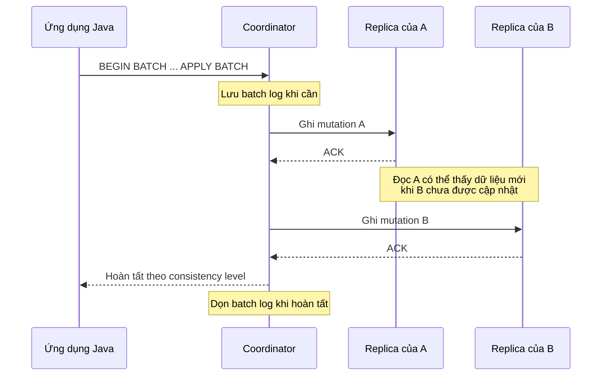

# Mục đích BATCH và phân biệt với giao dịch SQL thông thường

## 1. Bối cảnh: vì sao Cassandra có `BATCH`?

Apache Cassandra là cơ sở dữ liệu phân tán dạng **wide-column**. Dữ liệu được phân bổ giữa các nút theo **partition key** và được nhân bản theo cấu hình replication. Khi thiết kế bảng theo truy vấn, một thực thể nghiệp vụ có thể được ghi vào nhiều bảng hoặc nhiều phân vùng để đáp ứng các cách đọc khác nhau.

Trong CQL, `BATCH` gom một tập câu lệnh **ghi** (`INSERT`, `UPDATE`, `DELETE`) vào một thao tác logic. Nó hữu ích khi các thay đổi có quan hệ với nhau cần được gửi và theo dõi cùng nhau, đặc biệt khi phải cập nhật các bản sao dữ liệu phục vụ nhiều truy vấn.

Tuy nhiên, **`BATCH` trong Cassandra không tương đương transaction ACID tổng quát của cơ sở dữ liệu SQL**. Nó không cung cấp cơ chế đọc một ảnh chụp nhất quán của nhiều phân vùng, không hỗ trợ `ROLLBACK` kiểu SQL và không biến nhiều lần ghi phân tán thành một thao tác tức thời được cô lập hoàn toàn.

Sau bài này, bạn cần phân biệt được ba câu hỏi:

1. Các câu lệnh trong batch có được **áp dụng cuối cùng** hay không (atomicity)?
2. Người đọc đồng thời có thể **thấy trạng thái trung gian** hay không (isolation)?
3. Gom câu lệnh bằng batch có làm việc ghi **nhanh hơn** hay không (performance)?

Ba câu hỏi này có câu trả lời khác nhau và phải được xét cùng **phạm vi phân vùng**.

## 2. Cú pháp CQL và trường hợp phù hợp

```sql
BEGIN BATCH
    INSERT INTO ...;
    UPDATE ...;
    DELETE FROM ...;
APPLY BATCH;
```

`BEGIN BATCH` mặc định là **logged batch**. Có hai biến thể cần biết: `BEGIN UNLOGGED BATCH` (bỏ batch log) và `BEGIN COUNTER BATCH` (dành riêng cho cập nhật counter). Batch dành cho các câu lệnh sửa dữ liệu; không dùng để gom `SELECT` thành một giao dịch đọc.

### Ví dụ A — ghi nhiều hàng trong cùng một partition

Giả sử ứng dụng Java lưu các dòng hàng của một đơn đặt hàng và thường truy vấn tất cả mặt hàng theo `order_id`:

```sql
CREATE TABLE order_items_by_order (
    order_id uuid,
    item_id uuid,
    sku text,
    quantity int,
    PRIMARY KEY ((order_id), item_id)
);

BEGIN BATCH
    INSERT INTO order_items_by_order (order_id, item_id, sku, quantity)
    VALUES (
        11111111-1111-1111-1111-111111111111,
        aaaaaaaa-aaaa-aaaa-aaaa-aaaaaaaaaaaa,
        'BOOK-01', 2
    );
    INSERT INTO order_items_by_order (order_id, item_id, sku, quantity)
    VALUES (
        11111111-1111-1111-1111-111111111111,
        bbbbbbbb-bbbb-bbbb-bbbb-bbbbbbbbbbbb,
        'PEN-02', 5
    );
APPLY BATCH;
```

Cả hai hàng có cùng `order_id` nên thuộc **cùng một partition** trong cùng bảng. Đây là trường hợp batch thường hợp lý: các thay đổi có liên quan, chia sẻ partition key và Cassandra có thể xử lý chúng theo đường đi tối ưu cho một phân vùng. Các thay đổi trong cùng partition có bảo đảm cô lập mạnh hơn so với batch trải trên nhiều partition: người đọc không bị phơi bày một tập thay đổi từng phần *trong phạm vi một partition*.

> **Lưu ý:** Không phải cứ có nhiều `INSERT` thì cần `BATCH`. Nếu các lệnh không có quan hệ nghiệp vụ, có thể thực hiện ghi độc lập. Mục đích chính là bảo đảm tính đúng đắn trong phạm vi phù hợp, không phải tối ưu hóa số câu SQL/CQL bằng cách ghép thật nhiều lệnh.

### Ví dụ B — cập nhật hai bảng phục vụ hai truy vấn

Giả sử hệ thống đọc đơn hàng theo ID, đồng thời liệt kê đơn hàng theo khách hàng. Theo nguyên tắc **thiết kế bảng theo truy vấn**, ứng dụng có hai bảng:

```sql
CREATE TABLE orders_by_id (
    order_id uuid PRIMARY KEY,
    customer_id uuid,
    status text
);

CREATE TABLE orders_by_customer (
    customer_id uuid,
    order_id uuid,
    status text,
    PRIMARY KEY ((customer_id), order_id)
);

BEGIN BATCH
    INSERT INTO orders_by_id (order_id, customer_id, status)
    VALUES (
        22222222-2222-2222-2222-222222222222,
        33333333-3333-3333-3333-333333333333,
        'CREATED'
    );
    INSERT INTO orders_by_customer (customer_id, order_id, status)
    VALUES (
        33333333-3333-3333-3333-333333333333,
        22222222-2222-2222-2222-222222222222,
        'CREATED'
    );
APPLY BATCH;
```

Đây là **batch trên nhiều partition** vì dữ liệu nằm ở hai bảng với khóa phân vùng khác nhau. Logged batch giúp Cassandra lưu thông tin phục hồi để các mutation trong batch có thể được áp dụng đầy đủ sau sự cố. Nhưng trong lúc thực thi, một truy vấn có thể thấy bản ghi ở `orders_by_id` trước khi bản ghi tương ứng xuất hiện ở `orders_by_customer`.

Ứng dụng phải chấp nhận khả năng **hiển thị tạm thời không đồng thời** giữa hai kiểu truy vấn và cân nhắc điều này khi thiết kế API, cơ chế đọc, retry và kiểm tra tính đầy đủ dữ liệu.

## 3. Logged batch, unlogged batch và counter batch

| Loại batch | Cú pháp bắt đầu | Cơ chế và mục đích | Điểm cần tránh hiểu nhầm |
|---|---|---|---|
| **Logged** (mặc định) | `BEGIN BATCH` | Dùng **batch log** cho các mutation trải nhiều partition để hỗ trợ hoàn tất các ghi sau lỗi điều phối. Phù hợp khi nhiều bản biểu diễn dữ liệu cần được cập nhật cùng một thao tác logic. | Bảo đảm hoàn tất về sau không đồng nghĩa tất cả các phân vùng được nhìn thấy cùng thời điểm. |
| **Unlogged** | `BEGIN UNLOGGED BATCH` | Không dùng batch log; giảm chi phí ghi log khi không cần bảo đảm khôi phục cấp batch. Thường chỉ cân nhắc cho các mutation đã cùng partition hoặc khi ứng dụng chủ động chấp nhận kết quả một phần. | Trên nhiều partition, một số ghi có thể thành công và số khác thất bại mà không có batch log hỗ trợ hoàn tất. |
| **Counter** | `BEGIN COUNTER BATCH` | Gom các phép cộng/trừ trên các cột kiểu `counter`; không trộn với cập nhật cột thông thường. | Counter có hành vi ghi và retry riêng: lặp lại phép cộng có thể làm tăng số đếm nhiều lần. |

**Batch log không phải commit log, không phải bản sao dữ liệu và không thay thế replication/repair.** Về nguyên lý, coordinator của logged batch ghi thông tin batch để phục hồi, chuyển các mutation đến những replica thích hợp, rồi dọn bản ghi batch khi hoàn thành. Nếu coordinator lỗi giữa chừng, thông tin còn được lưu giúp cơ chế phát lại tiếp tục các mutation chưa hoàn tất.

Một logged batch có thể đạt **atomicity theo nghĩa eventual**: khi cụm hoạt động trở lại và thông tin phục hồi còn khả dụng, các mutation đã được chấp nhận vào batch sẽ được hoàn tất. Trong khoảng thời gian chuyển tiếp, trạng thái đọc có thể chưa đồng bộ giữa các partition. Đây không phải một transaction có rollback về trạng thái cũ khi gặp lỗi.

### Ví dụ `UNLOGGED BATCH`

```sql
BEGIN UNLOGGED BATCH
    UPDATE order_items_by_order
    SET quantity = 3
    WHERE order_id = 11111111-1111-1111-1111-111111111111
      AND item_id = aaaaaaaa-aaaa-aaaa-aaaa-aaaaaaaaaaaa;

    UPDATE order_items_by_order
    SET quantity = 6
    WHERE order_id = 11111111-1111-1111-1111-111111111111
      AND item_id = bbbbbbbb-bbbb-bbbb-bbbb-bbbbbbbbbbbb;
APPLY BATCH;
```

Hai cập nhật vẫn nằm trong một partition. Nếu chuyển sang nhiều `order_id` khác nhau, hãy đánh giá lại yêu cầu hoàn tất khi lỗi; đừng chọn `UNLOGGED` chỉ vì thấy nó có vẻ nhanh hơn.

## 4. So sánh với transaction SQL

Trong hệ quản trị quan hệ như PostgreSQL, một transaction có thể thay đổi nhiều hàng và bảng dưới cơ chế **ACID**. Mức cô lập cụ thể phụ thuộc hệ quản trị và isolation level, nhưng transaction có ranh giới `COMMIT`/`ROLLBACK` rõ ràng. Cassandra ưu tiên kiến trúc phân tán, tính sẵn sàng và khả năng mở rộng; `BATCH` cung cấp một tập bảo đảm hẹp hơn.

| Tiêu chí | Transaction SQL thông thường | Cassandra `BATCH` |
|---|---|---|
| Mục tiêu | Nhóm thao tác trong một đơn vị giao dịch ACID. | Nhóm các mutation có liên quan, đặc biệt để ghi nhất quán về sau vào nhiều biểu diễn dữ liệu. |
| Atomicity | `COMMIT` tất cả thay đổi hoặc `ROLLBACK` thay đổi của transaction khi thất bại. | Logged batch hỗ trợ các mutation được áp dụng đầy đủ **cuối cùng**; không rollback như SQL. Unlogged multi-partition không có bảo đảm phục hồi cấp batch. |
| Isolation | Hệ quản trị bảo đảm theo isolation level được chọn (ví dụ Read Committed, Repeatable Read, Serializable). | Không có isolation xuyên nhiều partition; các truy vấn đồng thời có thể thấy kết quả từng phần. |
| Đọc và ghi cùng transaction | Có thể đọc, kiểm tra điều kiện và ghi trong cùng transaction. | `BATCH` chỉ gom mutation; không tạo snapshot đọc nhiều partition để quyết định ghi. |
| Điều khiển giao dịch | `BEGIN`, `COMMIT`, `ROLLBACK`, tùy hệ có savepoint. | `BEGIN BATCH` ... `APPLY BATCH`; không có `ROLLBACK` hay savepoint tương đương. |
| Hiệu năng | Tối ưu theo bộ máy giao dịch của RDBMS, index và khóa. | Cross-partition batch phát sinh thêm điều phối và batch log; không mặc định nhanh hơn ghi riêng. |

### Tình huống chuyển tiền minh họa khác biệt

Trong cơ sở dữ liệu quan hệ, giao dịch có thể thực hiện:

```sql
BEGIN;

UPDATE accounts SET balance = balance - 500 WHERE account_id = 1;
UPDATE accounts SET balance = balance + 500 WHERE account_id = 2;

COMMIT;
-- Khi transaction chưa commit hoặc gặp lỗi, DB xử lý theo cơ chế giao dịch,
-- gồm khả năng rollback và quy tắc cô lập của mức isolation đang dùng.
```

**Không chuyển nguyên mẫu này thành hai lệnh `UPDATE` trong Cassandra `BATCH` để xây dựng nghiệp vụ chuyển tiền.** Hai số dư có thể nằm trên hai partition. Logged batch không mang lại kiểm tra số dư, cô lập giao dịch nhiều tài khoản hay rollback tương ứng. Nghiệp vụ bất biến nghiêm ngặt như “không tạo hoặc mất tiền” cần một thiết kế phù hợp hơn, chẳng hạn một hệ thống giao dịch chuyên dụng hoặc mô hình ledger với cơ chế điều phối và kiểm soát tính đúng đắn riêng.

## 5. Failure, consistency level và khả năng đọc trạng thái trung gian

Xét logged batch cập nhật `orders_by_id` (partition A) và `orders_by_customer` (partition B):



Sơ đồ minh họa **thứ tự quan sát có thể xảy ra**, không khẳng định mọi mutation luôn được gửi tuần tự. Cassandra có thể gửi song song đến các replica và vị trí lỗi có thể thay đổi.

Nếu ứng dụng nhận `WriteTimeout`, `WriteFailure` hoặc mất kết nối:

- **Không kết luận batch chắc chắn chưa được ghi.** Yêu cầu có thể đã tới coordinator, một phần hoặc toàn bộ mutation có thể đã được áp dụng.
- Với **logged batch**, cơ chế batch log có thể tiếp tục hoàn tất các mutation sau sự cố. Trong lúc đó, truy vấn ở hai partition vẫn có thể trả về trạng thái khác nhau.
- Với **unlogged multi-partition batch**, ứng dụng phải chuẩn bị tình huống chỉ một phần mutation được ghi thành công.
- Quyết định **retry** cần xét tính idempotent: cùng một `INSERT`/`UPDATE` đặt giá trị cố định thường dễ retry an toàn hơn các phép thay đổi có hiệu ứng tích lũy, đặc biệt là counter.

Mức nhất quán như `ONE`, `LOCAL_QUORUM` hoặc `QUORUM` quyết định số replica cần đáp ứng điều kiện của thao tác đọc/ghi theo cấu hình, nhưng **không tạo ra snapshot hay giao dịch xuyên partition**. Ngay cả khi sử dụng quorum cho cả đọc và ghi, ứng dụng vẫn không nên kỳ vọng mọi partition trong batch xuất hiện đồng thời đối với mọi người đọc.

## 6. Vì sao batch lớn trên nhiều partition thường làm hệ thống chậm hơn?

Trong Cassandra, mỗi partition key xác định cách định tuyến dữ liệu. Khi batch chứa hàng chục hoặc hàng nghìn partition khác nhau, coordinator phải điều phối nhiều tuyến ghi và có thể phải quản lý batch log cùng khối lượng mutation lớn. Điều này tạo áp lực lên mạng, bộ nhớ, hàng đợi và các replica; một batch quá lớn còn làm tăng nguy cơ timeout và cảnh báo kích thước batch.

Hãy phân biệt hai cách gửi 100 lệnh:

- **100 lệnh ghi liên quan đến một partition:** batch nhỏ có thể hợp lý nếu ứng dụng cần thay đổi cùng một nhóm dữ liệu nhất quán ở cấp partition.
- **100 lệnh ghi độc lập tới 100 partition:** một batch lớn thường **không phải** tối ưu hóa hiệu năng. Ứng dụng Java thường nên sử dụng prepared statement và các lệnh ghi bất đồng bộ có **giới hạn concurrency**, theo dõi lỗi của từng lệnh và chọn consistency level phù hợp.

Batch không thay đổi thiết kế partition key, không gom các partition thành một partition mới và không thay thế việc chọn replication factor, compaction hay repair hợp lý. Nếu phải ghi nhiều bảng để phục vụ truy vấn, hãy cân nhắc giới hạn số bản sao dữ liệu và phạm vi consistency mà nghiệp vụ thực sự cần.

## 7. Quy tắc chọn nhanh cho ứng dụng Java

| Nhu cầu | Hướng xử lý khuyến nghị |
|---|---|
| Thay đổi vài hàng **trong cùng partition** và chúng có quan hệ nghiệp vụ. | Batch nhỏ; thiết kế partition key để toàn bộ hàng liên quan nằm cùng partition khi hợp lý. |
| Cập nhật các bảng phục vụ nhiều truy vấn và mutation rơi vào **nhiều partition**. | Chỉ dùng logged batch khi cần bảo đảm hoàn tất về sau; chấp nhận rằng người đọc có thể thấy trạng thái trung gian. |
| Nạp hoặc ghi hàng loạt nhiều partition **độc lập**. | Prepared statements + async/bounded concurrency, chia nhỏ công việc và quản lý retry. |
| Cần transaction **read-check-write** có điều kiện trên một partition. | Tìm hiểu **lightweight transaction (LWT)** với `IF` và các giới hạn của nó; không giả định `BATCH` thông thường có compare-and-set. |
| Cần giao dịch đa tài khoản/đa partition có invariant nghiêm ngặt. | Thiết kế giao dịch ở lớp phù hợp; không dựa riêng vào Cassandra batch. |
| Cập nhật cột `counter`. | Dùng `COUNTER BATCH` khi cần, không trộn với mutation thường; đặc biệt thận trọng với retry và khả năng đếm lặp. |

### Checklist trước khi viết `BEGIN BATCH`

1. Mọi mutation thuộc **cùng partition** hay trải trên nhiều partition/bảng?
2. Cần **atomicity về sau**, **isolation ngay lúc đọc**, hay chỉ cần gửi nhiều ghi cho tiện? Xác định đúng yêu cầu.
3. Nếu có lỗi/timeout, ứng dụng xử lý kết quả **không xác định** và retry như thế nào?
4. Kích thước batch có nhỏ, số partition có giới hạn và có quan sát độ trễ/cảnh báo batch không?
5. Nếu dùng counter hoặc các phép tăng giảm, retry có gây lặp hiệu ứng không?

## 8. Câu hỏi tự kiểm tra

**Câu 1.** Một logged batch ghi vào hai partition. Sau khi một partition đã có dữ liệu mới, truy vấn partition còn lại có thể vẫn thấy dữ liệu cũ không?

**Trả lời:** Có. Logged batch giúp hoàn tất các mutation sau lỗi nhưng không cung cấp isolation trên nhiều partition.

**Câu 2.** Gói 10.000 dòng ghi vào 10.000 partition bằng `BEGIN BATCH` có luôn nhanh hơn 10.000 lệnh ghi bất đồng bộ?

**Trả lời:** Không. Cross-partition batch lớn tạo thêm công việc điều phối và có thể tăng độ trễ, tải coordinator, rủi ro timeout.

**Câu 3.** Nếu ứng dụng không nhận được phản hồi khi `APPLY BATCH`, có được coi như toàn bộ thay đổi đã rollback không?

**Trả lời:** Không. Trạng thái thành công có thể chưa xác định; một phần hoặc toàn bộ mutation có thể đã được ghi, và logged batch có thể còn đang được phát lại.

**Câu 4.** `LOCAL_QUORUM` cho đọc và ghi có làm hai partition trong một batch xuất hiện đồng thời không?

**Trả lời:** Không. Consistency level kiểm soát phản hồi của replica đối với từng thao tác; nó không cung cấp giao dịch cô lập xuyên partition.

## 9. Ghi nhớ

`BATCH` là công cụ **nhóm mutation với bảo đảm phụ thuộc loại batch và phạm vi partition**. Batch nhỏ trong cùng partition phù hợp khi các hàng có liên quan; logged batch qua nhiều partition giúp hoàn tất ghi về sau nhưng có thể lộ trạng thái trung gian; unlogged batch qua nhiều partition không có cơ chế phục hồi tương đương. Không dùng Cassandra `BATCH` như giao dịch SQL có `COMMIT`/`ROLLBACK`, và không coi batch lớn là cách tăng tốc ghi dữ liệu phân tán.
