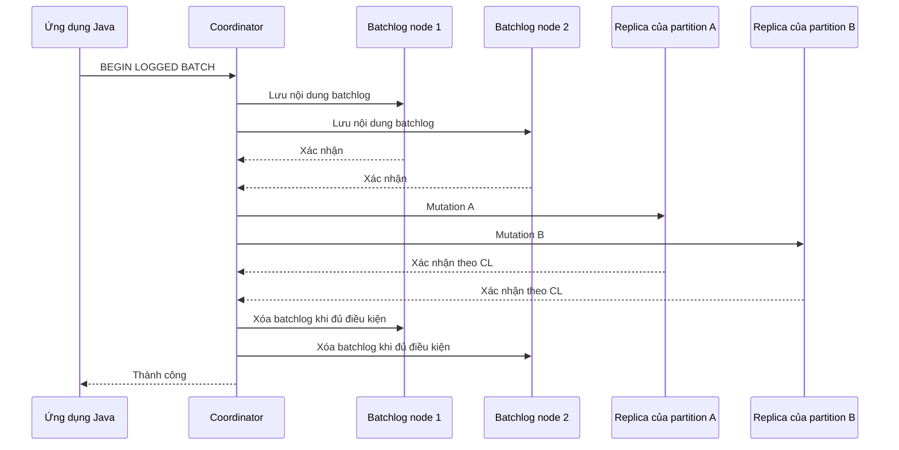
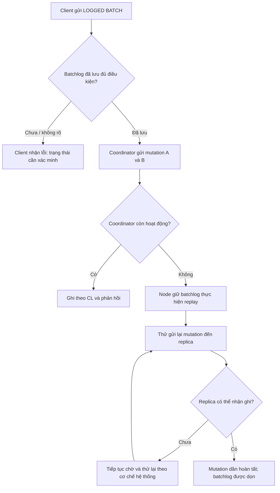

# LOGGED BATCH, batchlog và khả năng hoàn tất khi coordinator lỗi

## 1. Mục tiêu và bối cảnh

Trong Apache Cassandra, dữ liệu được phân phối đến nhiều node theo **partition key**. Một truy vấn ghi có thể tác động tới một partition hoặc nhiều partition; các partition này có thể có tập replica khác nhau. Vì vậy, việc gửi nhiều câu lệnh CQL trong một lần gọi không tự động tạo ra một giao dịch ACID như ở cơ sở dữ liệu quan hệ.

Bài này thuộc chủ đề **BATCH và counter** của module `DATABASE_ENGINE_WIDE_COLUMN_CASSANDRA`, trong đó trọng tâm là kiến trúc phân tán, thiết kế bảng theo truy vấn, replication, consistency level và xử lý lỗi từ ứng dụng Java. Sau khi học, bạn cần:

- Giải thích được `BEGIN LOGGED BATCH` bảo đảm điều gì khi ghi trên nhiều partition và điều gì **không** được bảo đảm.
- Mô tả vai trò của **batchlog**, coordinator, batchlog replicas và cơ chế **replay** khi coordinator ngừng hoạt động.
- Phân biệt lỗi lúc ghi batchlog với lỗi sau khi batchlog đã được ghi; hiểu vì sao timeout không đồng nghĩa thao tác chưa thực hiện.
- Chọn giữa `LOGGED`, `UNLOGGED`, `COUNTER` batch và các lệnh ghi độc lập dựa trên yêu cầu nhất quán của nghiệp vụ.
- Viết CQL, tích hợp Java driver, thiết kế retry an toàn và có kế hoạch quan sát sự cố.

## 2. `LOGGED BATCH` giải quyết vấn đề gì?

Giả sử một đơn hàng cần được ghi vào hai bảng phục vụ **hai truy vấn khác nhau**:

1. `orders_by_id` để lấy đơn hàng bằng `order_id`.
2. `orders_by_customer` để liệt kê đơn hàng theo `customer_id`.

Đây là mô hình *query-based denormalization* quen thuộc trong Cassandra: cùng một sự kiện nghiệp vụ được biểu diễn ở nhiều partition/bảng. Nếu ứng dụng gửi hai lệnh `INSERT` độc lập rồi mất kết nối sau lệnh thứ nhất, bảng thứ hai có thể chưa có dữ liệu. Trong trường hợp yêu cầu **các mutation đều phải được hoàn tất về sau**, một `LOGGED BATCH` nhỏ có thể phù hợp.

```sql
CREATE TABLE orders_by_id (
    order_id uuid PRIMARY KEY,
    customer_id uuid,
    placed_at timestamp,
    status text,
    total_cents bigint
);

CREATE TABLE orders_by_customer (
    customer_id uuid,
    placed_at timestamp,
    order_id uuid,
    status text,
    total_cents bigint,
    PRIMARY KEY ((customer_id), placed_at, order_id)
) WITH CLUSTERING ORDER BY (placed_at DESC, order_id ASC);

BEGIN LOGGED BATCH
    INSERT INTO orders_by_id
        (order_id, customer_id, placed_at, status, total_cents)
    VALUES
        (11111111-1111-4111-8111-111111111111,
         22222222-2222-4222-8222-222222222222,
         '2026-11-21T03:00:00Z', 'NEW', 150000);

    INSERT INTO orders_by_customer
        (customer_id, placed_at, order_id, status, total_cents)
    VALUES
        (22222222-2222-4222-8222-222222222222,
         '2026-11-21T03:00:00Z',
         11111111-1111-4111-8111-111111111111,
         'NEW', 150000);
APPLY BATCH;
```

`LOGGED` được ghi tường minh để thể hiện chủ đích; batch thông thường mặc định là logged. Hai lệnh ở ví dụ đi đến hai partition theo hai khóa phân vùng khác nhau. Chúng **không** trở thành một partition và cũng không được cô lập như một giao dịch SQL.

### Tính nguyên tử cần hiểu theo thời gian

Đối với batch ghi nhiều partition, tài liệu Cassandra dùng từ *atomicity* theo nghĩa: khi batchlog đã được lưu an toàn và hệ thống còn khả năng phục hồi, hệ thống có cơ chế để **cuối cùng thực hiện đủ các mutation của batch**, kể cả khi coordinator bị lỗi. Đây là bảo đảm **eventual completion** (*hoàn tất về sau*), không phải một thời điểm commit duy nhất mà mọi reader đều thấy toàn bộ thay đổi.

| Thuộc tính | `LOGGED BATCH` trên nhiều partition |
| --- | --- |
| Gom nhiều mutation vào một yêu cầu CQL | Có |
| Ghi bản ghi batchlog nhằm phục hồi thao tác dang dở | Có |
| Hỗ trợ hoàn tất các mutation sau lỗi coordinator | Có, với điều kiện batchlog đã được lưu bền vững và cluster có thể phục hồi |
| Mọi reader thấy tất cả thay đổi cùng một lúc | **Không** |
| Rollback tất cả mutation nếu một mutation lỗi | **Không** |
| Transaction có khóa, cô lập và ràng buộc liên partition như RDBMS | **Không** |
| Mặc nhiên nhanh hơn các câu lệnh ghi song song | **Không** |

Trong một khoảng thời gian ngắn, truy vấn bảng A có thể thấy bản ghi mới trong khi truy vấn bảng B chưa thấy. Đó là hành vi có thể xảy ra ngay cả khi `LOGGED BATCH` sau cùng sẽ hoàn tất. Nếu bài toán cần quyết định tài chính, chống chi tiêu vượt số dư, cấp phát tồn kho độc quyền hay điều kiện cập nhật đồng thời, không được coi `LOGGED BATCH` nhiều partition là giao dịch ACID.

## 3. Coordinator, batchlog và luồng ghi

**Coordinator** là node nhận yêu cầu từ client và điều phối các replica của từng partition. Với logged batch nhiều partition, Cassandra lưu nội dung batch vào **batchlog** được sao chép sang các node khác trước khi gửi các mutation đến đích. Sau khi xử lý thành công, các bản ghi batchlog được loại bỏ; nếu coordinator chết giữa chừng, những node giữ batchlog còn đủ thông tin để phát lại các mutation chưa chắc đã hoàn tất.



Sơ đồ chỉ minh họa **đường đi thành công**; số replica của mỗi partition và chi tiết xác nhận phụ thuộc replication factor (RF), consistency level (CL), topology và phiên bản Cassandra. Thông thường, batchlog được lưu trên hai node được chọn trong cluster để không phụ thuộc duy nhất vào bộ nhớ hay ổ đĩa coordinator. Không nên hiểu rằng batchlog nằm trên mọi replica chứa dữ liệu nghiệp vụ.

Các bước cần nắm:

1. Client gửi một batch đến coordinator. Coordinator phân tích batch và xác định các mutation theo partition.
2. Coordinator yêu cầu ghi batchlog theo cơ chế dự phòng; **giai đoạn này phải đủ điều kiện thành công** trước khi tiếp tục đường ghi thông thường.
3. Coordinator phân phối mutation tới các replica của từng partition. Các replica trả lời theo yêu cầu CL của thao tác.
4. Khi đã có đủ bằng chứng xử lý (hoặc cơ chế lưu chuyển cần thiết, chẳng hạn hint), batchlog có thể được dọn đi.
5. Nếu quá trình gián đoạn sau khi batchlog đã được ghi, node giữ batchlog sẽ **replay** các mutation để chúng có cơ hội đến đích khi replica hoạt động trở lại.

Batchlog là **nhật ký phục hồi batch chưa hoàn tất**; nó không thay cho commit log của từng replica. Commit log bảo vệ các ghi đã được node nhận trên chính node đó; batchlog bảo vệ ý định thực hiện toàn bộ nhóm mutation khi bộ phận điều phối bị lỗi.

### Replay không đồng nghĩa thực thi đúng một lần

Batchlog replay có thể gửi lại một mutation mà replica đã nhận trước khi coordinator lỗi. Vì vậy, ứng dụng nên thiết kế thao tác ghi có thể lặp lại an toàn (*idempotent*). Với `INSERT`/`UPDATE` đặt giá trị xác định cho cùng khóa và quản lý timestamp phù hợp, việc phát lại thường giữ nguyên trạng thái logic. Những thao tác phụ thuộc vào số lần thực hiện như **counter increment** hoặc cập nhật collection kiểu thêm phần tử không an toàn để mặc định coi là idempotent.

Replay diễn ra bất đồng bộ; thời gian hoàn tất phụ thuộc thời điểm replay, trạng thái replica, tải cluster và cấu hình. Đây không phải cam kết hoàn tất tức thì hay cam kết sẽ thành công khi toàn bộ các node cần thiết không thể khôi phục.

## 4. Nếu coordinator bị lỗi ở những thời điểm khác nhau

Giả sử batch chứa mutation `A` và `B` ở hai partition. Quan sát từ client và trạng thái thực trong cluster phải được phân biệt.

| Thời điểm xảy ra lỗi | Điều có thể xảy ra | Kết luận đúng từ phía client |
| --- | --- | --- |
| **Trước khi batchlog được lưu đủ điều kiện** | Coordinator chưa đi vào giai đoạn ghi mutation thông thường; có thể chưa có batchlog bền vững, hoặc tình trạng xác nhận còn không rõ | Không có bảo đảm từ batchlog rằng `A` và `B` đều sẽ được thực hiện; kiểm tra/retry theo chính sách an toàn |
| **Sau khi batchlog bền vững, trước khi phát mutation** | `A`, `B` có thể chưa xuất hiện ngay; node giữ batchlog có thể replay | Request có thể timeout, nhưng ý định ghi đã được lưu để hoàn tất về sau |
| **Sau khi `A` đã tới replica, `B` chưa tới** | Reader có thể thấy `A` trước `B`; replay sẽ tìm cách gửi phần còn lại | Không suy ra rollback hay dữ liệu đồng thời xuất hiện |
| **Sau khi các mutation được chấp nhận, trước khi phản hồi đến client** | Dữ liệu thực tế đã được ghi; client vẫn nhận lỗi kết nối hoặc timeout | Timeout có thể là **kết quả không xác định**, không chứng minh thất bại |
| **Batchlog/replica cần thiết mất vĩnh viễn hoặc cluster không phục hồi** | Cơ chế replay có thể không thể đưa batch về trạng thái hoàn tất | Không hứa hẹn phục hồi vượt quá giả định độ bền và khả năng hoạt động của cluster |

Một diễn tiến điển hình khi coordinator chết sau khi lưu batchlog:



Điểm mấu chốt là **trạng thái của client không phải trạng thái dữ liệu**. Sau timeout, câu hỏi “batch có thành công không?” có thể chưa trả lời được bằng một giá trị boolean. Ứng dụng cần cơ chế kiểm tra trạng thái nghiệp vụ, retry an toàn và quan sát quá trình hội tụ dữ liệu.

## 5. Consistency level, replication factor và atomicity là ba khái niệm khác nhau

Ví dụ một datacenter có `RF = 3` và client ghi batch với `LOCAL_QUORUM`:

- **RF = 3**: mỗi partition được phân phối lên ba replica trong datacenter đó; partition A và B có thể có các tập replica khác nhau.
- **`LOCAL_QUORUM`**: từng đường ghi cần mức xác nhận phù hợp với đa số replica tại datacenter cục bộ. Nó chi phối thời điểm coordinator có thể trả lời thành công, **không tạo ra một transaction duy nhất** trên A và B.
- **Batchlog**: ghi lại các mutation của batch nhằm hỗ trợ hoàn tất về sau nếu điều phối gặp sự cố; đây là cơ chế khác với mức xác nhận đọc/ghi.

Đọc với `LOCAL_QUORUM` cũng không khiến hai partition đổi trạng thái đồng thời. Một reader có thể chạy truy vấn A và B ở các thời điểm khác nhau, trong khi replay vẫn diễn ra. Với thiết kế dữ liệu theo truy vấn, cần xem tính nhất quán khi đọc theo nhu cầu nghiệp vụ, không chỉ nhìn vào cú pháp `BEGIN LOGGED BATCH`.

Một batch CQL không cho phép `SELECT` xen giữa các lệnh ghi; các câu lệnh được gom vào batch là `INSERT`, `UPDATE`, `DELETE`. Thứ tự liệt kê không tạo ra chuỗi hành động tuần tự kiểu script: các lệnh ghi cùng timestamp có thể chịu quy tắc giải quyết xung đột của Cassandra. Nếu hai mutation ghi đè cùng ô dữ liệu, phải thiết kế timestamp và quan hệ ghi một cách tường minh.

## 6. So sánh `LOGGED`, `UNLOGGED` và `COUNTER` batch

| Loại | Batchlog | Trường hợp phù hợp | Rủi ro/chú ý |
| --- | --- | --- | --- |
| `BEGIN LOGGED BATCH` | Có với batch nhiều partition; batch một partition có thể được tối ưu thành unlogged | Một số ít mutation cần khả năng hoàn tất cùng nhau về sau, chẳng hạn cập nhật các bảng phi chuẩn hóa cho một thực thể | Thêm lượt ghi batchlog và tải coordinator; không có isolation liên partition |
| `BEGIN UNLOGGED BATCH` | Không | Nhóm mutation trong **một partition**, hoặc nơi ứng dụng chấp nhận partial success | Nếu ghi nhiều partition mà lỗi, chỉ một phần batch có thể được áp dụng |
| `BEGIN COUNTER BATCH` | Không dùng như logged batch thông thường | Nhóm cập nhật cột `counter` theo quy tắc CQL | Increment/decrement không idempotent; retry có thể đếm hai lần |
| Các ghi độc lập, bất đồng bộ | Không | Ghi nhiều partition độc lập, ưu tiên throughput và có thể xử lý thành công/thất bại riêng | Ứng dụng tự chịu trách nhiệm đồng bộ dữ liệu khi một lệnh lỗi |

**Đừng dùng batch để tăng tốc nạp hàng loạt** hàng nghìn partition. Việc gom nhiều lệnh vào một coordinator có thể làm tăng độ trễ, sử dụng bộ nhớ và gây cảnh báo batch lớn. Khi chỉ cập nhật cùng một partition, Cassandra có thể tối ưu `LOGGED BATCH` thành đường thực thi không cần batchlog phân tán; đây là lý do đầu tiên cần kiểm tra partition key trước khi cân nhắc batch.

Ví dụ về khác biệt kết quả khi một yêu cầu bị gián đoạn:

```sql
-- Cùng một partition (customer_id giống nhau):
BEGIN UNLOGGED BATCH
    INSERT INTO events_by_customer (customer_id, event_time, event_id, action)
    VALUES (22222222-2222-4222-8222-222222222222,
            '2026-11-21T03:10:00Z',
            33333333-3333-4333-8333-333333333333, 'CREATED');
    INSERT INTO events_by_customer (customer_id, event_time, event_id, action)
    VALUES (22222222-2222-4222-8222-222222222222,
            '2026-11-21T03:11:00Z',
            44444444-4444-4444-8444-444444444444, 'PAID');
APPLY BATCH;
```

Đoạn này giả định đã có bảng `events_by_customer` với partition key `customer_id`; mục đích là minh họa **cùng partition**, không phải xây dựng toàn bộ schema. Nếu thay các `customer_id` bằng hai giá trị khác nhau thì batch unlogged đã vượt qua ranh giới partition và không có batchlog bảo vệ việc hoàn tất nhóm ghi.

## 7. Xử lý timeout và retry trong Java

Tại driver, timeout có thể xuất hiện dù dữ liệu đã được ghi. Native protocol phân biệt các kiểu write timeout, trong đó:

- `BATCH_LOG`: timeout xảy ra **khi ghi batchlog**. Không nên tự suy diễn rằng yêu cầu chắc chắn không tạo ra tác động nào, vì client chưa biết đầy đủ trạng thái ở phía cluster.
- `BATCH`: timeout của **logged batch sau giai đoạn ghi batchlog**; batchlog đã được lưu thành công theo đường xử lý đó, nhưng yêu cầu chưa đạt điều kiện hoàn thành trước timeout.
- `UNLOGGED_BATCH`: timeout của batch không có batchlog; với nhiều partition, phải xét khả năng thực hiện một phần.

Ví dụ với Java Driver 4.x (các lời gọi API mang tính minh họa; `CqlSession` được cấu hình và tạo trước đó):

```java
import java.time.Instant;
import java.util.UUID;

import com.datastax.oss.driver.api.core.CqlSession;
import com.datastax.oss.driver.api.core.DefaultConsistencyLevel;
import com.datastax.oss.driver.api.core.cql.BatchStatement;
import com.datastax.oss.driver.api.core.cql.BoundStatement;
import com.datastax.oss.driver.api.core.cql.DefaultBatchType;
import com.datastax.oss.driver.api.core.cql.PreparedStatement;

public class OrderWriter {
    public static void writeOrder(
            CqlSession session, UUID orderId, UUID customerId,
            Instant placedAt, long totalCents) {

        PreparedStatement byId = session.prepare(
            "INSERT INTO orders_by_id " +
            "(order_id, customer_id, placed_at, status, total_cents) " +
            "VALUES (?, ?, ?, ?, ?)");
        PreparedStatement byCustomer = session.prepare(
            "INSERT INTO orders_by_customer " +
            "(customer_id, placed_at, order_id, status, total_cents) " +
            "VALUES (?, ?, ?, ?, ?)");

        BoundStatement a = byId.bind(
            orderId, customerId, placedAt, "NEW", totalCents);
        BoundStatement b = byCustomer.bind(
            customerId, placedAt, orderId, "NEW", totalCents);

        BatchStatement batch = BatchStatement.builder(DefaultBatchType.LOGGED)
            .addStatement(a)
            .addStatement(b)
            .setConsistencyLevel(DefaultConsistencyLevel.LOCAL_QUORUM)
            // Chỉ đặt true khi đã kiểm tra tính idempotent của thao tác.
            .setIdempotent(true)
            .build();

        session.execute(batch);
    }
}
```

Trong ví dụ, hai lệnh chỉ đặt cùng một tập giá trị cho các khóa đã được xác định, không tăng counter và không nối thêm phần tử vào list. Cần bảo đảm `orderId`, `placedAt` và giá trị nghiệp vụ được **giữ nguyên khi retry**. Với luồng có ghi cạnh tranh hoặc cần thứ tự cập nhật chặt chẽ, phải thiết kế timestamp/version và chính sách đối soát riêng; không thể chỉ thêm `.setIdempotent(true)` để biến một thao tác thành an toàn.

Quy trình xử lý thực tế khi `session.execute(batch)` ném timeout:

1. Ghi log có cấu trúc gồm `orderId`, loại lỗi, loại write timeout (`BATCH_LOG`, `BATCH`...), consistency level và thời điểm; không ghi thông tin nhạy cảm trong payload.
2. Không trả cho nghiệp vụ kết luận “đã rollback”. Đánh dấu trạng thái **chưa xác định** và tra cứu/đối soát bằng khóa ổn định.
3. Chỉ retry tự động khi thao tác đã được chứng minh idempotent và phù hợp với retry policy của driver. Driver thường xử lý `BATCH_LOG` khác `BATCH`; không nên viết vòng lặp retry vô hạn ở ứng dụng.
4. Nếu hệ thống cung cấp API tạo đơn hàng, dùng khóa chống trùng/yêu cầu có ID cố định để hai lần gọi không sinh hai thực thể nghiệp vụ khác nhau.
5. Khi cluster hồi phục, kiểm tra các read model đã hội tụ; việc đọc ngay sau timeout chưa phải bằng chứng cuối cùng rằng replay sẽ không diễn ra.

Các driver có chính sách retry mặc định phụ thuộc phiên bản và loại exception. Không nên đưa ra tuyên bố “mọi timeout của logged batch đều được tự động retry”: ranh giới an toàn nằm ở **loại lỗi, tính idempotent và cấu hình driver**.

## 8. Quan sát, khắc phục và tối ưu vận hành

Khi nghi ngờ batchlog replay chậm, cần quan sát cả luồng ghi và cluster, thay vì chỉ tăng timeout của ứng dụng:

| Tín hiệu cần xem | Ý nghĩa có thể có | Hướng kiểm tra |
| --- | --- | --- |
| `BATCH_LOG` write timeout tăng | Không lưu được batchlog kịp thời | Khả năng hoạt động các node lưu batchlog, mạng liên node, disk latency, mức tải |
| `BATCH` write timeout tăng | Batchlog đã qua giai đoạn ghi nhưng xử lý mutation chưa đạt CL đúng hạn | Replica chậm, hotspot partition, nghẽn mạng, độ lớn batch |
| Hai bảng tạm thời khác nhau | Một mutation được đọc thấy trước mutation còn lại hoặc đang replay | Xác minh partition, consistency level, trạng thái replica và tiến trình hồi phục |
| Cảnh báo batch lớn hoặc nhiều partition | Coordinator nhận quá nhiều việc | Giảm số mutation/partition trong batch, xem lại mô hình ghi |
| Replay kéo dài sau sự cố node | Hàng đợi phục hồi và khả năng nhận ghi của replica có vấn đề | Kiểm tra log, metrics batchlog, tình trạng disk/network và cân bằng tải |

Trong các bản Cassandra có hỗ trợ, có thể **quan sát** mức giới hạn tốc độ replay bằng:

```bash
nodetool getbatchlogreplaythrottle
```

Lệnh `nodetool setbatchlogreplaythrottle` có thể điều chỉnh giới hạn, nhưng đây là thay đổi vận hành phải dựa trên giám sát thực tế vì replay nhanh hơn có thể làm tăng tải mạng và replica. Tên metric, cấu hình và chu kỳ replay có thể thay đổi theo phiên bản; cần đối chiếu tài liệu của bản Cassandra đang triển khai trước khi thay đổi production.

Ngoài batchlog, hệ thống phân tán còn cần **repair** và quy trình xử lý node lỗi để đưa các replica về trạng thái đồng nhất về lâu dài. Batchlog không thay thế repair, không tự bảo đảm consistency mạnh cho reader và không giải quyết mọi lỗi dữ liệu do mô hình ứng dụng.

## 9. Thiết kế quyết định: khi nào nên dùng?

**Nên cân nhắc `LOGGED BATCH`** khi một sự kiện cần ghi vào một số lượng nhỏ các bảng/partition phi chuẩn hóa, ứng dụng chấp nhận việc hai góc nhìn chưa xuất hiện đồng thời và có yêu cầu để các mutation được tiếp tục hoàn tất nếu coordinator lỗi.

**Nên chọn hướng khác** nếu yêu cầu là throughput lớn cho những ghi không phụ thuộc nhau (ghi bất đồng bộ), cập nhật nhiều hàng trong cùng một partition (thiết kế cùng partition và batch phù hợp), hoặc giao dịch mang tính điều kiện/vượt nhiều partition cần tính cô lập mạnh (xem lại ranh giới dữ liệu, cơ chế điều phối nghiệp vụ hoặc tính năng transaction phù hợp với phiên bản Cassandra). Đặc biệt, counter phải được xử lý theo mô hình `COUNTER BATCH` và tính không idempotent của phép tăng/giảm.

Checklist trước khi đưa một logged batch vào ứng dụng:

- **Partition:** batch chạm bao nhiêu partition, thuộc những bảng nào và mỗi partition có replica nào?
- **Nhu cầu:** cần bảo đảm hoàn tất về sau hay cần toàn bộ dữ liệu xuất hiện đồng thời? Hai yêu cầu này khác nhau.
- **Kích thước:** batch có đủ nhỏ để tránh quá tải coordinator và batchlog không?
- **Retry:** khóa nghiệp vụ, giá trị ghi và timestamp có ổn định khi phát lại không? Có counter hay phép ghi không idempotent không?
- **Vận hành:** khi client timeout, có cách đối soát, cảnh báo và quan sát replay không?

## 10. Tình huống tự kiểm tra

**Tình huống A.** Một logged batch cập nhật hai partition. Batchlog đã lưu thành công, partition thứ nhất nhận ghi, coordinator tắt đột ngột. Khi mở lại ứng dụng, partition thứ hai chưa có dữ liệu. Có được kết luận Cassandra đã làm mất mutation thứ hai không?

**Trả lời:** Chưa. Reader có thể bắt gặp trạng thái chưa hội tụ; batchlog còn là nguồn để replay mutation thứ hai. Cần kiểm tra khả năng hồi phục của các node giữ batchlog và replica đích, sau đó đối soát dữ liệu theo khóa.

**Tình huống B.** Client nhận `WriteTimeout` loại `BATCH`. Có thể báo người dùng “đơn hàng chắc chắn không được tạo” không?

**Trả lời:** Không. Loại `BATCH` cho biết batchlog đã vượt qua giai đoạn ghi, nhưng client không có xác nhận hoàn tất theo CL trong thời hạn. Trạng thái cần được coi là chưa xác định; không xóa giả định và cũng không tạo đơn mới bằng ID khác một cách mù quáng.

**Tình huống C.** Muốn tăng tồn kho và trừ tồn kho ở hai sản phẩm sao cho không bao giờ xuất hiện số âm, có dùng logged batch hai partition là đủ không?

**Trả lời:** Không. Replay bảo vệ sự hoàn tất các mutation, không cung cấp điều kiện kiểm tra và cô lập giao dịch xuyên partition. Phải xây dựng cơ chế bảo toàn bất biến nghiệp vụ thích hợp.

**Tình huống D.** Một công việc nhập dữ liệu ghi hàng chục nghìn partition độc lập. Có nên gom thành một logged batch để tiết kiệm thời gian?

**Trả lời:** Không. Coordinator và batchlog sẽ trở thành điểm chịu tải; nên chia nhỏ và dùng các ghi bất đồng bộ với giới hạn mức đồng thời, retry và giám sát phù hợp.

## 11. Tài liệu tham khảo

- [Apache Cassandra — CQL Data Manipulation, BATCH](https://cassandra.apache.org/doc/4.1/cassandra/cql/dml.html): cú pháp, `LOGGED`, `UNLOGGED`, `COUNTER` và giới hạn isolation.
- [Apache Cassandra — Guarantees](https://cassandra.apache.org/doc/stable/cassandra/architecture/guarantees.html): bảo đảm của batch và sự khác biệt với transaction.
- [Apache Cassandra — Native Protocol](https://cassandra.apache.org/doc/latest/cassandra/reference/native-protocol.html): ý nghĩa các loại write timeout `BATCH` và `BATCH_LOG`.
- [Apache Cassandra — nodetool getbatchlogreplaythrottle](https://cassandra.apache.org/doc/latest/cassandra/managing/tools/nodetool/getbatchlogreplaythrottle.html): quan sát giới hạn replay.
- [Apache Cassandra Java Driver — Retry policies](https://apache.googlesource.com/cassandra-java-driver/+/HEAD/manual/core/retries/README.md): retry policy và tính idempotent của yêu cầu.

**Ghi nhớ:** `LOGGED BATCH` nhiều partition sử dụng batchlog để **có thể hoàn tất các mutation về sau khi coordinator lỗi**. Nó không cung cấp khả năng đọc thấy tất cả thay đổi đồng thời, không rollback như giao dịch SQL và không nên được dùng như một kỹ thuật tăng tốc ghi hàng loạt.
