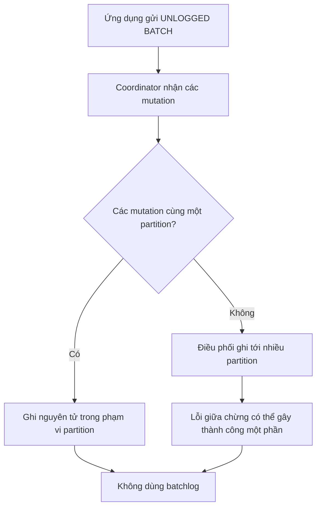

# UNLOGGED BATCH và phạm vi sử dụng phù hợp

Trong Apache Cassandra, `UNLOGGED BATCH` gom nhiều câu lệnh ghi CQL vào một yêu cầu gửi tới coordinator mà **không tạo batchlog** để khôi phục cả nhóm ghi khi xảy ra lỗi. Lựa chọn này đặc biệt hữu ích khi các thay đổi thuộc **cùng một partition**; nếu chúng nằm trên nhiều partition, cần chấp nhận khả năng chỉ một phần thao tác thành công. Hiểu đúng ranh giới này giúp thiết kế bảng theo truy vấn, bảo toàn kỳ vọng về dữ liệu và tránh dùng batch như một cách tăng tốc ghi hàng loạt.

## 1. Mục tiêu học tập và bối cảnh

Sau bài học, bạn có thể:

- Giải thích sự khác nhau giữa `UNLOGGED BATCH`, `LOGGED BATCH` và các lệnh ghi riêng lẻ.
- Xác định chính xác các câu lệnh có cùng partition key, kể cả khi bảng dùng khóa phân vùng tổng hợp.
- Chọn batch dựa trên yêu cầu về tính nguyên tử, khả năng chịu ghi thành công một phần và hiệu năng.
- Viết batch bằng CQL, gửi batch từ Java và xử lý tình huống timeout một cách an toàn.

Cassandra là cơ sở dữ liệu wide-column phân tán: **partition key** quyết định cách một partition được định tuyến tới các replica; các **clustering column** sắp xếp hàng bên trong partition. Mức nhất quán đọc/ghi (ví dụ `LOCAL_QUORUM`) quyết định số replica phải phản hồi, còn kiểu batch quyết định cách Cassandra nhóm và điều phối các mutation. Đây là hai khía cạnh khác nhau.

> **Quy tắc thiết kế:** Trước khi chọn `UNLOGGED BATCH`, hãy chỉ ra partition key của *từng* câu lệnh và yêu cầu nghiệp vụ khi xảy ra lỗi giữa chừng.

## 2. `UNLOGGED BATCH` thực sự làm gì?

Một batch CQL có dạng:

```sql
BEGIN UNLOGGED BATCH
    INSERT INTO ...;
    UPDATE ...;
APPLY BATCH;
```

Ứng dụng gửi một yêu cầu chứa nhiều mutation. Coordinator nhận batch, phân phối mutation tới các replica chịu trách nhiệm và chờ phản hồi theo consistency level của yêu cầu. Với `UNLOGGED BATCH`, coordinator **không ghi batchlog** để có thể phát lại toàn bộ batch khi một phần mutation chưa được áp dụng. Điều đó có hai hệ quả:

1. **Cùng một partition:** Cassandra có bảo đảm nguyên tử cho các mutation trong partition đó, kể cả với unlogged batch. Đây là trường hợp sử dụng tự nhiên nhất.
2. **Nhiều partition:** Không có bảo đảm nguyên tử *trên toàn bộ tập partition*. Nếu lỗi xảy ra trong lúc thực thi, một số partition có thể đã nhận ghi và một số khác chưa.

Không nên hiểu “một request” là “một transaction ACID giống cơ sở dữ liệu quan hệ”. Batch không cung cấp cơ chế rollback tổng quát hoặc snapshot isolation giữa nhiều partition. Đồng thời, câu lệnh trong batch không phải một chuỗi lệnh nghiệp vụ có thứ tự đảm bảo; không dùng thứ tự xuất hiện để mô phỏng logic “đọc rồi ghi” hay “ghi A xong mới ghi B”.



## 3. Nhận diện phạm vi của partition

Giả sử ứng dụng lưu sự kiện theo tài khoản và ngày. Một truy vấn chính là “lấy lịch sử sự kiện của tài khoản X trong ngày Y, mới nhất trước”. Ta thiết kế bảng:

```sql
CREATE TABLE account_events_by_day (
    account_id uuid,
    event_day date,
    event_time timestamp,
    event_id uuid,
    event_type text,
    payload text,
    PRIMARY KEY ((account_id, event_day), event_time, event_id)
) WITH CLUSTERING ORDER BY (event_time DESC, event_id ASC);
```

Trong bảng này, partition key là **`(account_id, event_day)`**, không phải chỉ `account_id`. Hai hàng có cùng tài khoản nhưng khác ngày thuộc **hai partition khác nhau**. Ngược lại, khác `event_time` hoặc `event_id` chỉ là khác clustering key, vẫn có thể thuộc cùng partition.

Ví dụ phù hợp với `UNLOGGED BATCH`:

```sql
BEGIN UNLOGGED BATCH
    INSERT INTO account_events_by_day
        (account_id, event_day, event_time, event_id, event_type, payload)
    VALUES
        (11111111-1111-4111-8111-111111111111, '2026-11-21',
         '2026-11-21T08:00:00Z', 22222222-2222-4222-8222-222222222222,
         'LOGIN', '{"device":"mobile"}');

    INSERT INTO account_events_by_day
        (account_id, event_day, event_time, event_id, event_type, payload)
    VALUES
        (11111111-1111-4111-8111-111111111111, '2026-11-21',
         '2026-11-21T08:02:00Z', 33333333-3333-4333-8333-333333333333,
         'VIEW_ITEM', '{"item":"A-42"}');
APPLY BATCH;
```

Hai mutation dùng cùng `account_id` và `event_day`, nên thuộc một partition trong cùng bảng. Cần phân biệt điều này với việc ghi vào **hai bảng khác nhau**: ngay cả khi giá trị khóa giống nhau, mỗi bảng có không gian partition riêng. Không được coi batch liên bảng là batch chỉ chạm một partition.

Việc gom nhiều hàng vào một partition vẫn phải tuân thủ giới hạn thiết kế: partition quá lớn làm tăng chi phí đọc, compaction và repair. Nếu lưu sự kiện thời gian dài, chọn bucket ngày/giờ theo lưu lượng thực tế thay vì kéo dài một partition vô hạn.

## 4. Trường hợp dễ sai: batch qua nhiều partition

Ví dụ dưới đây ghi cho hai ngày khác nhau:

```sql
BEGIN UNLOGGED BATCH
    INSERT INTO account_events_by_day
        (account_id, event_day, event_time, event_id, event_type, payload)
    VALUES
        (11111111-1111-4111-8111-111111111111, '2026-11-21',
         '2026-11-21T23:59:00Z', 44444444-4444-4444-8444-444444444444,
         'CHECKOUT', '{}');

    INSERT INTO account_events_by_day
        (account_id, event_day, event_time, event_id, event_type, payload)
    VALUES
        (11111111-1111-4111-8111-111111111111, '2026-11-22',
         '2026-11-22T00:01:00Z', 55555555-5555-4555-8555-555555555555,
         'PAYMENT', '{}');
APPLY BATCH;
```

Đây là **batch nhiều partition** dù hai hàng cùng `account_id`. Nếu coordinator hoặc mạng gặp sự cố, ứng dụng có thể nhận timeout trong khi hàng ngày 21 đã được ghi và hàng ngày 22 chưa được ghi. Timeout cũng có thể xảy ra sau khi cả hai đã được ghi: **không thể suy ra trạng thái dữ liệu chỉ từ việc nhận exception**.

Khi hai mutation độc lập, gửi các lệnh riêng lẻ (có kiểm soát số request đồng thời) thường đơn giản hơn và tránh thêm chi phí điều phối batch. Khi nghiệp vụ thực sự cần bảo đảm cuối cùng rằng **tất cả** mutation trên nhiều partition được áp dụng, hãy cân nhắc `LOGGED BATCH`, hoặc một mô hình nghiệp vụ có idempotency, bù trừ và đối soát rõ ràng. `LOGGED BATCH` cũng không mang lại transaction isolation hay cập nhật tức thời trên mọi replica.

## 5. Chọn đúng công cụ cho từng yêu cầu

| Tình huống | Phương án nên cân nhắc | Giải thích |
| --- | --- | --- |
| Ghi nhiều hàng/cột trong **cùng partition**, cần nguyên tử trong partition | `UNLOGGED BATCH` | Không cần batchlog; bảo đảm nguyên tử trong phạm vi partition. |
| Một mutation đơn giản | `INSERT`/`UPDATE` riêng lẻ | Batch không tạo thêm lợi ích rõ rệt. |
| Nhiều partition độc lập, ghi thành công một phần vẫn chấp nhận được | Các ghi bất đồng bộ, giới hạn concurrency | Dễ theo dõi/retry từng ghi; batch nhiều partition thường không tối ưu throughput. |
| Nhiều partition phải được áp dụng đủ về **tính nguyên tử cuối cùng**, chấp nhận chi phí batchlog | `LOGGED BATCH` | Batchlog giúp phát lại các mutation còn thiếu; không có rollback/đọc snapshot liên partition. |
| Tăng/giảm counter | `UPDATE` counter hoặc `COUNTER BATCH` | Counter dùng quy tắc riêng; không trộn counter với mutation thông thường. |
| Điều kiện “chỉ ghi nếu chưa tồn tại” hoặc so sánh phiên bản | Conditional statement/LWT theo phạm vi hỗ trợ | Batch thường không thay thế được kiểm tra điều kiện và đồng thuận. |
| Import hàng triệu bản ghi | Pipeline ghi có giới hạn lưu lượng | Không đóng gói toàn bộ dữ liệu trong batch khổng lồ. |

Phân biệt hai khái niệm thường bị lẫn:

- **Atomicity:** Một nhóm mutation có được áp dụng đầy đủ như yêu cầu hay không. Với `UNLOGGED BATCH` nhiều partition, không có bảo đảm này trên cả nhóm.
- **Consistency level:** Bao nhiêu replica phải xác nhận một lần ghi/đọc. Ví dụ `LOCAL_QUORUM` không biến `UNLOGGED BATCH` nhiều partition thành transaction nguyên tử. Replication factor và chiến lược replication quy định vị trí các replica; chúng không tạo ra batchlog còn thiếu.

## 6. Hiệu năng: batch không phải công cụ bulk insert

Ngộ nhận phổ biến là gửi 1.000 câu lệnh trong một batch luôn nhanh hơn gửi nhiều yêu cầu. Trên Cassandra, batch nhiều partition có thể khiến **một coordinator** phải tiếp nhận và chuyển tiếp nhiều mutation đến nhiều replica, tăng tải bộ nhớ, thời gian xử lý và rủi ro timeout. Việc giảm số lần ứng dụng gọi mạng không đồng nghĩa tăng throughput của cluster.

Nguyên tắc vận hành:

1. **Thiết kế bảng theo truy vấn** trước, xác định partition key rồi mới xem có nên batch.
2. **Giữ batch nhỏ, có giới hạn**, với số mutation và tổng kích thước phù hợp tải thực tế. Không biến một batch thành danh sách sự kiện không giới hạn.
3. Ưu tiên batch **cùng partition và cùng bảng** nếu mục tiêu là nguyên tử trong partition.
4. Với dữ liệu trải nhiều partition, đo tải bằng các lệnh bất đồng bộ có backpressure và concurrency giới hạn; chỉ dùng batch khi có lý do nghiệp vụ cụ thể.
5. Quan sát cảnh báo của Cassandra liên quan tới batch lớn hoặc unlogged batch chạm nhiều partition. Các ngưỡng cảnh báo/từ chối phụ thuộc cấu hình và phiên bản; kiểm tra cấu hình của cluster thay vì mặc định một con số cho mọi môi trường.

Batch không thay thế việc chọn partition key có phân phối đều. Một partition nóng có thể gây nghẽn dù chỉ dùng unlogged batch rất nhỏ. Theo dõi latency, timeout, hot partition, kích thước partition và áp lực compaction/repair để phát hiện nguyên nhân thực tế.

## 7. Gửi `UNLOGGED BATCH` từ Java

Ví dụ dưới dùng Java Driver 4.x của DataStax/Apache Cassandra. `CqlSession` đã được khởi tạo theo cấu hình cluster; mỗi lần gọi sử dụng `PreparedStatement` và `BoundStatement` để truyền giá trị đúng kiểu thay vì ghép chuỗi CQL.

```java
import java.time.Instant;
import java.time.LocalDate;
import java.util.UUID;

import com.datastax.oss.driver.api.core.CqlSession;
import com.datastax.oss.driver.api.core.DefaultConsistencyLevel;
import com.datastax.oss.driver.api.core.cql.BatchStatement;
import com.datastax.oss.driver.api.core.cql.BoundStatement;
import com.datastax.oss.driver.api.core.cql.DefaultBatchType;
import com.datastax.oss.driver.api.core.cql.PreparedStatement;

public class EventWriter {
    private final CqlSession session;
    private final PreparedStatement insertEvent;

    public EventWriter(CqlSession session) {
        this.session = session;
        this.insertEvent = session.prepare(
            "INSERT INTO account_events_by_day " +
            "(account_id, event_day, event_time, event_id, event_type, payload) " +
            "VALUES (?, ?, ?, ?, ?, ?)"
        );
    }

    public void writeSameDayEvents(UUID accountId, LocalDate day,
                                   UUID firstEventId, UUID secondEventId) {
        BoundStatement first = insertEvent.bind(
            accountId, day, Instant.parse("2026-11-21T08:00:00Z"),
            firstEventId, "LOGIN", "{}"
        );
        BoundStatement second = insertEvent.bind(
            accountId, day, Instant.parse("2026-11-21T08:02:00Z"),
            secondEventId, "VIEW_ITEM", "{}"
        );

        BatchStatement batch = BatchStatement.builder(DefaultBatchType.UNLOGGED)
            .addStatement(first)
            .addStatement(second)
            .build()
            .setConsistencyLevel(DefaultConsistencyLevel.LOCAL_QUORUM);

        session.execute(batch);
    }
}
```

Trong ứng dụng thật, hai thời điểm sự kiện phải đến từ dữ liệu đầu vào thay vì hardcode như ví dụ. `day` cũng phải được suy ra nhất quán từ thời gian sự kiện và timezone/bucket đã chọn; truyền nhầm ngày sẽ tách một batch dự kiến cùng partition thành nhiều partition. `LOCAL_QUORUM` chỉ thích hợp khi replication strategy, datacenter và mục tiêu nhất quán của hệ thống tương ứng; đây không phải cài đặt bắt buộc của `UNLOGGED BATCH`.

Nếu có nhiều batch, sử dụng API bất đồng bộ của driver với giới hạn in-flight requests và đo latency. Không tăng tốc bằng cách gom các partition tùy ý vào một batch lớn.

## 8. Timeout, retry và tính idempotent

Với hệ thống phân tán, không được diễn giải `WriteTimeoutException` hoặc mất kết nối là “chưa có mutation nào được áp dụng”. Các replica có thể đã nhận ghi nhưng phản hồi chưa đến được coordinator hoặc client.

Một quy trình xử lý hợp lý là:

1. **Phân loại phạm vi batch**: cùng partition hay nhiều partition; xác định cụ thể mutation nào có thể đã tồn tại.
2. **Dùng khóa chính ổn định cho sự kiện**: `event_id` được tạo trước khi gửi và giữ nguyên giữa các lần retry. Tạo UUID mới mỗi lần retry có thể sinh hàng trùng về mặt nghiệp vụ.
3. **Thiết kế mutation có thể lặp lại**: ghi cùng giá trị vào cùng khóa chính nhìn chung an toàn hơn so với phép tăng counter hay thao tác phụ thuộc trạng thái trước đó. Nếu cần thứ tự thắng/thua theo timestamp, quản lý write timestamp nhất quán để retry không vô tình thay đổi phiên bản được chọn theo cơ chế last-write-wins.
4. **Kiểm tra/đối soát khi cần**: với batch nhiều partition, xác định bản ghi thiếu và ghi bù theo idempotency key; không giả định `UNLOGGED BATCH` sẽ tự khôi phục toàn nhóm.
5. **Đặt timeout và retry policy có kiểm soát**: backoff, giới hạn số lần retry và chỉ retry an toàn theo ngữ nghĩa dữ liệu. Không retry vô hạn khi cluster đang quá tải.

Với counter, thao tác cộng/trừ **không idempotent** theo cách tương tự một `INSERT` có khóa xác định. Retry mù có thể đếm hai lần. Nếu nghiệp vụ yêu cầu chính xác từng lần tăng, cần thiết kế riêng cơ chế chống lặp/đối soát thay vì dựa vào `UNLOGGED BATCH`.

## 9. Các lỗi thiết kế thường gặp

| Sai lầm | Hệ quả | Hướng khắc phục |
| --- | --- | --- |
| Nghĩ cùng `account_id` nghĩa là cùng partition | Bỏ sót thành phần `event_day` trong partition key | Kiểm tra *toàn bộ* partition key của từng statement. |
| Gom ghi của hai bảng vì chúng có cùng khóa logic | Thực tế chạm partition ở hai bảng | Chỉ coi là một partition khi thực sự ở cùng bảng và cùng khóa phân vùng. |
| Dùng unlogged batch để cập nhật hai bảng denormalized “cùng thành công hoặc cùng thất bại” | Có thể lệch dữ liệu nếu lỗi giữa chừng | Cân nhắc logged batch cho yêu cầu atomicity cuối cùng, kèm đối soát khi cần. |
| Dùng `LOCAL_QUORUM` rồi mặc định batch nhiều partition nguyên tử | Hiểu sai vai trò của consistency level | Tách lập luận về replica acknowledgements và batch atomicity. |
| Đóng gói hàng nghìn partition để giảm round trip | Coordinator quá tải, batch quá lớn, latency tăng | Ghi bất đồng bộ có giới hạn song song. |
| Tự động retry bằng event ID mới hoặc retry counter | Trùng dữ liệu/đếm thừa | Dùng idempotency key và chính sách retry theo từng loại mutation. |

## 10. Bài tập áp dụng

Cho bảng `account_events_by_day` ở mục 3. Xác định trường hợp nào phù hợp với `UNLOGGED BATCH` và giải thích phạm vi nguyên tử:

1. Thêm ba sự kiện khác nhau cho cùng `account_id`, cùng `event_day`.
2. Thêm hai sự kiện cho cùng tài khoản vào hai ngày khác nhau.
3. Thêm một sự kiện vào `account_events_by_day` và cập nhật bảng `account_summary_by_id`.
4. Import 100.000 sự kiện của nhiều tài khoản bằng một batch.

**Gợi ý lời giải:** (1) cùng partition, phù hợp khi cần nhóm ghi và nguyên tử trong partition; (2) hai partition, không nguyên tử trên cả hai nếu dùng unlogged; (3) hai bảng tức hai phạm vi partition, cân nhắc yêu cầu nhất quán dữ liệu denormalized; (4) tránh batch khổng lồ, chia dữ liệu và ghi bất đồng bộ có giới hạn, quan sát tải cluster.

**Câu hỏi tự kiểm tra:** Vì sao timeout của `UNLOGGED BATCH` nhiều partition không đủ để kết luận dữ liệu chưa được ghi? Nếu muốn retry, điều kiện nào ở primary key và mutation giúp tránh tạo dữ liệu trùng hoặc sai trạng thái?

## 11. Ghi nhớ khi thiết kế hệ thống

`UNLOGGED BATCH` là lựa chọn thực dụng để gom mutation **trong cùng một partition** khi cần nguyên tử trong phạm vi đó. Với **nhiều partition**, nó chỉ là cách gửi nhiều mutation qua một yêu cầu, không có batchlog bảo đảm cả nhóm được hoàn tất khi gặp lỗi. Hãy bắt đầu bằng truy vấn cần hỗ trợ và partition key, xác định yêu cầu về atomicity, sau đó mới quyết định dùng unlogged batch, logged batch hay các ghi độc lập. Đo hiệu năng bằng tải thật và thiết kế retry/idempotency ngay từ đầu.
