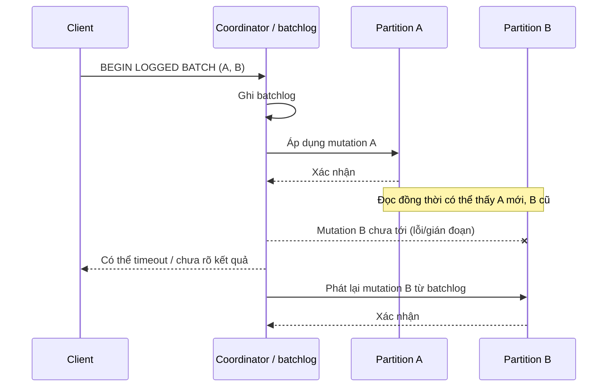

# Phạm vi nguyên tử và cô lập trong cùng phân vùng và qua nhiều phân vùng

## 1. Vì sao phải phân biệt phạm vi phân vùng?

Apache Cassandra là cơ sở dữ liệu **wide-column phân tán**: mỗi hàng thuộc một **partition** được xác định bởi *partition key* của bảng. Partition quyết định cách Cassandra phân phối và nhóm dữ liệu trên các replica; bảng nên được thiết kế dựa trên truy vấn và partition key, thay vì giả định mọi ghi trong một nghiệp vụ có thể tham gia một giao dịch SQL.

Trong chương **BATCH và counter**, hai khái niệm cần tách riêng là:

- **Tính nguyên tử (atomicity):** một đơn vị cập nhật được áp dụng đầy đủ, không để lộ một phần cập nhật của chính đơn vị đó. Với `BATCH` trải nhiều partition, `LOGGED BATCH` hỗ trợ bảo đảm các mutation *cuối cùng* được chuyển tới các partition sau lỗi, nhưng không tạo ra một thời điểm commit chung cho toàn bộ partition.
- **Tính cô lập (isolation):** thao tác đọc hoặc ghi đồng thời không quan sát trạng thái trung gian của một nhóm mutation trong **cùng partition**. Cassandra không cung cấp cô lập giao dịch xuyên nhiều partition tương tự giao dịch quan hệ.

> Điểm mấu chốt: **cùng partition** nghĩa là cùng *bảng* và cùng giá trị **toàn bộ partition key**. Hai bảng có cột `customer_id` bằng nhau vẫn là hai partition khác nhau; hai hàng có cùng cột clustering nhưng partition key khác nhau cũng thuộc partition khác nhau.

Ví dụ một bảng:

```sql
CREATE TABLE orders_by_customer (
    customer_id uuid,
    order_id uuid,
    status text,
    total decimal,
    PRIMARY KEY ((customer_id), order_id)
);
```

Trong bảng này, `customer_id` là partition key, còn `order_id` là clustering column. Mọi đơn hàng của cùng `customer_id` thuộc một partition logic của bảng `orders_by_customer`; đơn hàng của khách khác thuộc partition khác.

## 2. Ma trận bảo đảm cần nhớ

| Kiểu ghi | Nguyên tử/cô lập trong một partition | Bảo đảm qua nhiều partition | Cách hiểu thực tế |
|---|---|---|---|
| Một mutation vào một partition | Có, ở phạm vi mutation/partition liên quan | Không liên quan | Một lệnh ghi không biến các bảng/partition khác thành một giao dịch. |
| `UNLOGGED BATCH` chỉ ghi **một partition** | Các mutation cùng partition được áp dụng nguyên tử và cô lập ở phạm vi partition | Không liên quan | Thường phù hợp khi cần nhóm nhiều thay đổi cùng partition, không cần chi phí batchlog. |
| `LOGGED BATCH` chỉ ghi **một partition** | Vẫn có bảo đảm theo partition | Không mang lại giao dịch xuyên partition | Batchlog không làm tăng phạm vi cô lập; Cassandra có thể tối ưu bỏ batchlog cho batch một partition. |
| `LOGGED BATCH` ghi **nhiều partition** | Mỗi partition có tính nguyên tử/cô lập trong phạm vi chính nó | Batchlog hỗ trợ **hoàn tất cuối cùng** mọi mutation sau một số dạng lỗi, **không** có cô lập hay commit tức thời toàn cục | Một truy vấn có thể thấy partition A đã cập nhật, trong khi B chưa cập nhật. |
| `UNLOGGED BATCH` ghi **nhiều partition** | Từng partition vẫn giữ bảo đảm cục bộ | **Không** có bảo đảm phục hồi toàn bộ batch bằng batchlog | Một số partition có thể ghi thành công, số khác thất bại. |
| `BATCH` có điều kiện `IF` (LWT) cùng partition | Điều kiện và cập nhật dùng cơ chế Paxos/LWT ở phạm vi partition | Không mở rộng LWT thành giao dịch có điều kiện xuyên partition | Dùng khi cần kiểm tra điều kiện trước khi cập nhật dữ liệu cùng partition. |

**Không nên đánh đồng** “logged” với “isolated”, hoặc “atomic” với “all-or-nothing tại cùng một khoảnh khắc trên mọi partition”. Đây là hai lớp bảo đảm khác nhau.

## 3. Ghi nhiều hàng trong cùng partition

Giả sử cần tạo hai đơn hàng cho **cùng một khách hàng**:

```sql
BEGIN UNLOGGED BATCH
    INSERT INTO orders_by_customer (customer_id, order_id, status, total)
    VALUES (
        11111111-1111-1111-1111-111111111111,
        aaaaaaaa-aaaa-aaaa-aaaa-aaaaaaaaaaaa,
        'CREATED', 120.00
    );

    INSERT INTO orders_by_customer (customer_id, order_id, status, total)
    VALUES (
        11111111-1111-1111-1111-111111111111,
        bbbbbbbb-bbbb-bbbb-bbbb-bbbbbbbbbbbb,
        'CREATED', 80.00
    );
APPLY BATCH;
```

Hai mutation đều thuộc partition `customer_id = 11111111-1111-1111-1111-111111111111` trong **cùng bảng**. Cassandra nhóm chúng thành một cập nhật ở cấp partition; một thao tác đọc partition không nhìn thấy trạng thái đã áp dụng một nửa hai mutation của batch. Các mutation này không được coi là một chuỗi lệnh có thứ tự giống chương trình: **đừng dựa vào thứ tự câu lệnh trong batch để xử lý xung đột cập nhật cùng một ô**.

Một truy vấn kiểm tra:

```sql
SELECT order_id, status, total
FROM orders_by_customer
WHERE customer_id = 11111111-1111-1111-1111-111111111111;
```

Trong phạm vi một partition, `UNLOGGED BATCH` đủ để thể hiện nhóm ghi. Thêm `LOGGED` không tạo thêm “giao dịch mạnh hơn” cho cùng partition và có thể gây chi phí không cần thiết. Không cần dùng batch chỉ để gộp lệnh vì nghĩ rằng Cassandra sẽ gửi đi nhanh hơn; tối ưu thông lượng còn phụ thuộc partition, kích thước batch và cách driver lập lịch ghi.

### Điều gì không được suy ra?

Một batch chỉ chứa mutation; không thể xen `SELECT` để “đọc rồi ghi” như transaction SQL. Nếu việc cập nhật cần thỏa điều kiện từ giá trị hiện tại, cân nhắc **lightweight transaction (LWT)** với `IF`, và xem xét đồng bộ các luồng ghi khác cùng partition.

## 4. `LOGGED BATCH` trải nhiều partition: nguyên tử cuối cùng, không cô lập toàn cục

Ví dụ hai khách hàng khác nhau, nghĩa là **hai partition**:

```sql
BEGIN LOGGED BATCH
    INSERT INTO orders_by_customer (customer_id, order_id, status, total)
    VALUES (
        11111111-1111-1111-1111-111111111111,
        cccccccc-cccc-cccc-cccc-cccccccccccc,
        'CREATED', 50.00
    );

    INSERT INTO orders_by_customer (customer_id, order_id, status, total)
    VALUES (
        22222222-2222-2222-2222-222222222222,
        dddddddd-dddd-dddd-dddd-dddddddddddd,
        'CREATED', 75.00
    );
APPLY BATCH;
```

Với batch này, coordinator ghi thông tin vào **batchlog** nhằm có thể phát lại mutation chưa hoàn tất nếu coordinator hoặc đường truyền gặp sự cố ở giai đoạn đã ghi log. Khi hệ thống đủ khả năng phục hồi và các replica có thể nhận ghi, cơ chế đó hướng đến việc **mọi mutation của logged batch cuối cùng đều được áp dụng**. Nó **không** cung cấp rollback nghiệp vụ tức thì như cơ sở dữ liệu quan hệ.

Hãy xem một trình tự có thể xảy ra:



Trong khoảng giữa hai lần áp dụng, một ứng dụng đọc A rồi B có thể thấy dữ liệu **không đồng bộ về mặt thời điểm**. Vì vậy:

- `LOGGED BATCH` **không** biến nhiều partition thành một transaction có **snapshot isolation** hay commit cùng lúc.
- `LOGGED BATCH` **không** cho phép giả định “nếu client nhận timeout thì toàn batch đã bị hủy”. Timeout có thể có nghĩa một phần đã được áp dụng, hoặc batchlog vẫn sẽ phát lại; ứng dụng phải coi kết quả là **chưa xác định**.
- Nếu batch chưa được ghi nhận vào cơ chế bảo đảm bền vững trước khi lỗi xảy ra, không thể giả định batchlog sẽ cứu mọi mutation. Bảo đảm phục hồi cần được hiểu cùng với thời điểm lỗi và khả năng sẵn sàng của cluster.
- `UNLOGGED BATCH` trải nhiều partition không có bảo đảm hoàn tất bằng batchlog; việc từng partition thành công hay thất bại có thể khác nhau.

**Tình huống nghiệp vụ:** ghi `account_balance` cho tài khoản A và B trong hai partition không đủ để triển khai chuyển tiền chính xác chỉ bằng `LOGGED BATCH`. Khi đọc giữa chừng, hệ thống có thể thấy A đã trừ nhưng B chưa cộng. Việc chuyển tiền cần một mô hình riêng cho bất biến nghiệp vụ, ví dụ sổ cái sự kiện bất biến với idempotency key và cơ chế đối soát/hoàn tất, hoặc một hệ quản trị có transaction phù hợp với yêu cầu.

## 5. Vai trò của consistency level và LWT

**Consistency level (CL)** như `ONE`, `QUORUM`, `LOCAL_QUORUM` quyết định mức xác nhận replica cho từng thao tác đọc/ghi. Chọn `QUORUM` không biến logged batch qua nhiều partition thành giao dịch có commit toàn cục; nó chỉ đặt tiêu chí xác nhận giữa các replica theo cấu hình replication và CL.

**Lightweight transaction (LWT)** xử lý nhu cầu *compare-and-set* bằng điều kiện `IF`. Với một **conditional batch**, các mutation phải cùng partition; không thể đặt hai partition khác nhau vào một conditional batch rồi đòi Cassandra khóa/kiểm tra chúng như một transaction phân tán chung.

Ví dụ với hai đơn hàng **đã tồn tại trong cùng partition**:

```sql
BEGIN BATCH
    UPDATE orders_by_customer
    SET status = 'PAID'
    WHERE customer_id = 11111111-1111-1111-1111-111111111111
      AND order_id = aaaaaaaa-aaaa-aaaa-aaaa-aaaaaaaaaaaa
    IF status = 'CREATED';

    UPDATE orders_by_customer
    SET status = 'PAID'
    WHERE customer_id = 11111111-1111-1111-1111-111111111111
      AND order_id = bbbbbbbb-bbbb-bbbb-bbbb-bbbbbbbbbbbb;
APPLY BATCH;
```

Nếu điều kiện `IF` không thỏa, conditional batch không áp dụng nhóm cập nhật. CQL trả kết quả `[applied]` để ứng dụng kiểm tra. LWT có chi phí điều phối cao hơn ghi thường; khi cấu hình consistency cho LWT, cần hiểu cả mức ghi/đọc thông thường và mức **serial** (`SERIAL`/`LOCAL_SERIAL`). Bản thân LWT chỉ bảo vệ quy tắc điều kiện trong phạm vi partition liên quan, đặc biệt khi các tác nhân khác cũng tuân theo cách cập nhật tương thích.

Không thể lấy tính nguyên tử trong một partition rồi suy ra tính nhất quán giữa hai bảng, hai partition hay hai keyspace có cùng tên khóa nghiệp vụ.

## 6. Counter batch không mở rộng giao dịch

Counter là kiểu dữ liệu dành cho phép cộng/trừ. Cassandra dùng cú pháp `COUNTER BATCH` riêng:

```sql
CREATE TABLE page_views_by_day (
    page_id uuid,
    day date,
    views counter,
    PRIMARY KEY ((page_id), day)
);

BEGIN COUNTER BATCH
    UPDATE page_views_by_day
    SET views = views + 1
    WHERE page_id = 11111111-1111-1111-1111-111111111111
      AND day = '2026-11-21';
APPLY BATCH;
```

Không trộn thao tác counter với ghi dữ liệu thường trong cùng batch; counter cũng không hỗ trợ điều kiện LWT như cập nhật giá trị thường. **Counter increment không idempotent**: nếu ứng dụng timeout rồi gửi lại `+ 1`, giá trị có thể tăng thêm lần nữa. `COUNTER BATCH` không phải công cụ bảo đảm “đúng một lần” cho sự kiện hoặc transaction xuyên partition.

Khi số đếm phải chính xác theo từng sự kiện, hãy cân nhắc lưu sự kiện có mã duy nhất và tính/tổng hợp lại theo thiết kế ứng dụng, cùng cơ chế chống ghi lặp phù hợp. Counter hợp hơn với các bộ đếm có thể chấp nhận đặc điểm retry và đồng bộ phân tán của nó.

## 7. Cách chọn phương án trong thực tế

| Nhu cầu | Phương án thường phù hợp | Lý do |
|---|---|---|
| Đổi nhiều hàng trong một partition của cùng bảng | `UNLOGGED BATCH` gọn, có chủ đích | Giữ nguyên tử/cô lập trong partition, không phải trả chi phí batchlog cho nhiều partition. |
| Cần áp dụng cuối cùng các mutation của một nhóm nhỏ qua nhiều partition | `LOGGED BATCH` sau khi chấp nhận không có cô lập xuyên partition | Batchlog hỗ trợ hoàn tất khi có lỗi; phải chuẩn bị cho đọc trạng thái trung gian. |
| Ghi số lượng lớn các partition độc lập để tăng thông lượng | Prepared statement và ghi bất đồng bộ có kiểm soát | Batch nhiều partition thường tạo thêm chi phí ở coordinator và batchlog. |
| Chỉ ghi khi trạng thái hiện tại hợp lệ trong một partition | Conditional update/batch với `IF` (LWT) | Có kiểm tra điều kiện và đồng thuận trong phạm vi partition. |
| Giữ bất biến mạnh giữa nhiều partition, như chuyển tiền | Thiết kế nghiệp vụ riêng hoặc transactional datastore | CQL batch không cung cấp serializable transaction xuyên partition. |
| Cộng bộ đếm | `UPDATE ... SET c = c + n`, `COUNTER BATCH` khi thích hợp | Phải xử lý rõ rủi ro retry không idempotent. |

Khi xử lý lỗi từ **Java driver**, nên phân biệt rõ thao tác có thể retry an toàn hay không. Ghi lặp cùng giá trị vào cùng khóa thường dễ thiết kế idempotent hơn cộng counter; các lần retry còn phải xét timestamp, TTL, điều kiện `IF` và tác dụng nghiệp vụ. Không tự động retry mọi batch chỉ vì driver báo timeout.

Ngoài ra, batch lớn hoặc trải nhiều partition dễ gây tải cho coordinator và cảnh báo kích thước batch; hạn chế số lượng mutation trong mỗi batch và giám sát độ trễ, lỗi timeout, cảnh báo batch size ở cluster.

## 8. Tự kiểm tra hiểu biết

1. Hai bảng `orders_by_customer` và `order_status_by_customer` đều có `customer_id = X`. Một `BATCH` cập nhật cả hai có phải batch một partition không? **Không**: partition thuộc phạm vi từng bảng.
2. Ghi `LOGGED BATCH` qua partition A và B; ngay sau đó một reader thấy A mới, B cũ. Cassandra có vi phạm bảo đảm của logged batch không? **Không**: batchlog hướng đến hoàn tất mutation, không hứa cô lập đọc xuyên partition.
3. Client nhận timeout khi gửi logged batch. Có thể kết luận không có mutation nào được ghi không? **Không**: kết quả chưa xác định; một phần có thể đã ghi và phần còn lại có thể được phát lại.
4. Dùng `LOCAL_QUORUM` có tạo transaction cho hai partition không? **Không**: CL quy định mức xác nhận replica, không tạo isolation toàn cục.
5. Có thể dùng `IF` để kiểm tra điều kiện trên partition A và đồng thời ghi partition B trong một conditional batch không? **Không**: conditional batch bị giới hạn trong cùng partition.
6. Retry một lệnh `views = views + 1` sau timeout có chắc chỉ tăng một lần không? **Không**: counter update không idempotent.

**Ghi nhớ:** ranh giới mạnh nhất để suy luận nguyên tử/cô lập trong Cassandra là **partition**. `LOGGED BATCH` thêm cơ chế khôi phục và hoàn tất ghi qua nhiều partition, **không** thêm isolation đa partition. Hãy thiết kế partition key theo truy vấn, nêu rõ bất biến cần duy trì, và chọn `BATCH`, LWT hoặc cơ chế nghiệp vụ tương ứng với đúng phạm vi bảo đảm.
